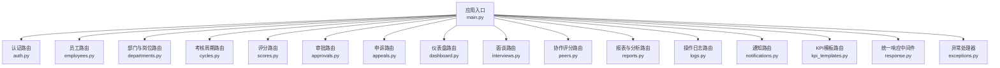
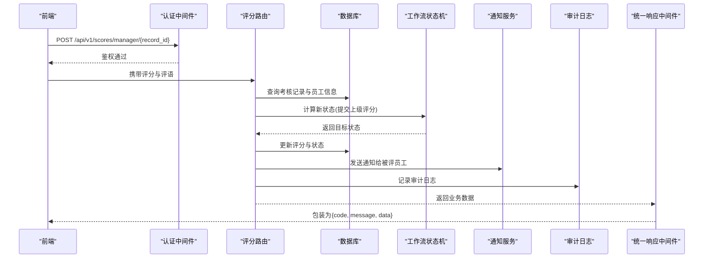
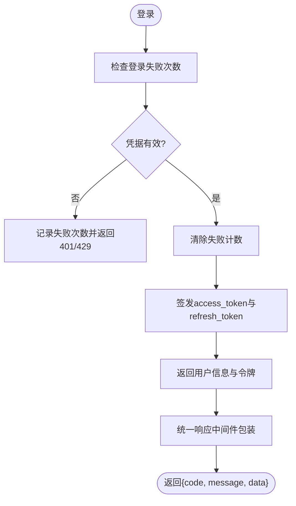
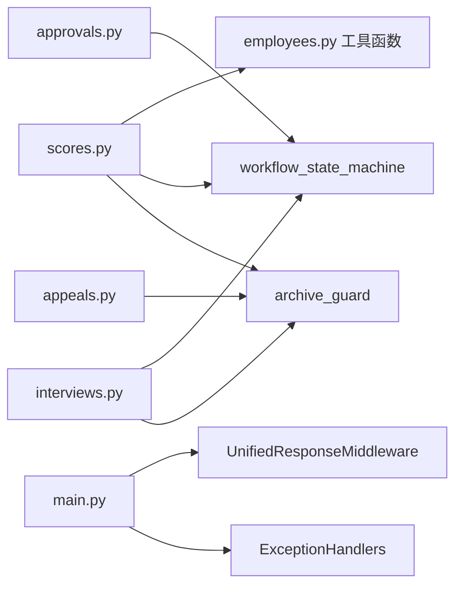

# API参考文档

<cite>
**本文引用的文件**   
- [backend/app/main.py](file://backend/app/main.py)
- [backend/app/core/response.py](file://backend/app/core/response.py)
- [backend/app/core/exceptions.py](file://backend/app/core/exceptions.py)
- [backend/app/routers/auth.py](file://backend/app/routers/auth.py)
- [backend/app/routers/employees.py](file://backend/app/routers/employees.py)
- [backend/app/routers/departments.py](file://backend/app/routers/departments.py)
- [backend/app/routers/cycles.py](file://backend/app/routers/cycles.py)
- [backend/app/routers/scores.py](file://backend/app/routers/scores.py)
- [backend/app/routers/approvals.py](file://backend/app/routers/approvals.py)
- [backend/app/routers/appeals.py](file://backend/app/routers/appeals.py)
- [backend/app/routers/dashboard.py](file://backend/app/routers/dashboard.py)
- [backend/app/routers/interviews.py](file://backend/app/routers/interviews.py)
- [backend/app/routers/peers.py](file://backend/app/routers/peers.py)
- [backend/app/routers/reports.py](file://backend/app/routers/reports.py)
- [backend/app/routers/logs.py](file://backend/app/routers/logs.py)
- [backend/app/routers/notifications.py](file://backend/app/routers/notifications.py)
- [backend/app/routers/kpi_templates.py](file://backend/app/routers/kpi_templates.py)
</cite>

## 更新摘要
**变更内容**   
- 更新了所有API接口的基础路径，从旧版本迁移到统一的/api/v1前缀
- 引入了统一的成功响应格式 {code, message, data}
- 实现了新的错误响应处理机制，保持HTTP状态码与业务错误码分离
- 添加了向后兼容的路由挂载，支持无前缀访问用于测试兼容性

## 目录
1. [引言](#引言)
2. [项目结构](#项目结构)
3. [核心组件](#核心组件)
4. [架构总览](#架构总览)
5. [详细接口规范](#详细接口规范)
6. [依赖关系分析](#依赖关系分析)
7. [性能与容量](#性能与容量)
8. [故障排查指南](#故障排查指南)
9. [结论](#结论)
10. [附录](#附录)

## 引言
本API参考文档面向绩效考核评分系统的后端RESTful接口，覆盖认证授权、员工管理、部门与岗位管理、考核周期、评分管理、审批管理、申诉管理、数据分析、绩效面谈、协作评分、KPI模板、操作日志与通知等模块。文档提供HTTP方法、URL路径、请求参数、响应格式、错误码定义、安全特性（认证、鉴权、速率限制）、版本策略与兼容性说明，并给出测试与调试建议。

**重要更新**：系统已全面迁移至/api/v1路由前缀，采用统一的成功响应格式{code, message, data}，并实现了标准化的错误响应处理机制。

## 项目结构
系统基于FastAPI构建，统一在/api/v1前缀下暴露接口，同时保留无前缀路由以兼容历史测试。各功能按路由模块拆分，核心入口负责中间件、异常处理、数据库初始化与默认数据种子。

**图表来源**
- [backend/app/main.py:9-99](file://backend/app/main.py#L9-L99)
- [backend/app/core/response.py:127-205](file://backend/app/core/response.py#L127-L205)
- [backend/app/core/exceptions.py:84-107](file://backend/app/core/exceptions.py#L84-L107)

**章节来源**
- [backend/app/main.py:9-99](file://backend/app/main.py#L9-L99)

## 核心组件
- **应用与路由注册**：统一前缀/api/v1，同时挂载无前缀路由用于向后兼容。
- **统一响应中间件**：自动包装成功响应为{code, message, data}格式，保持错误响应原样。
- **标准化异常处理**：业务异常与系统异常统一处理，返回标准JSON格式。
- **认证与安全**：Bearer Token鉴权，登录失败次数限制，密码复杂度校验，角色权限控制。
- **数据模型与ORM**：通过SQLAlchemy访问数据库，包含用户、员工、部门、岗位、考核周期、考核记录、评分明细、审批记录、申诉记录、面谈记录、协作评分任务、KPI模板等。
- **工作流状态机**：评分、审批、面谈等流程通过状态机驱动状态转换。
- **审计与通知**：关键操作记录审计日志，流程节点触发通知。

**章节来源**
- [backend/app/main.py:9-99](file://backend/app/main.py#L9-L99)
- [backend/app/core/response.py:127-205](file://backend/app/core/response.py#L127-L205)
- [backend/app/core/exceptions.py:1-107](file://backend/app/core/exceptions.py#L1-L107)
- [backend/app/routers/auth.py:1-179](file://backend/app/routers/auth.py#L1-L179)

## 架构总览
下图展示典型"提交上级评分"的调用链：前端调用评分路由，路由进行权限与状态校验，更新评分并触发状态机流转，随后发送通知并记录审计日志。

**图表来源**
- [backend/app/routers/scores.py:434-554](file://backend/app/routers/scores.py#L434-L554)
- [backend/app/core/response.py:127-205](file://backend/app/core/response.py#L127-L205)

## 详细接口规范

### 通用约定
- **基础路径**
  - 标准路径：/api/v1
  - 兼容路径：无前缀（仅用于历史兼容）
- **认证方式**
  - 使用HTTP Bearer Token，Authorization头携带access_token。
- **权限要求**
  - 多数写操作需要admin或hr；部分读操作允许manager、executive、employee、peer等角色。
- **分页与排序**
  - 列表接口普遍支持page、size、keyword、department_id等过滤参数。
- **时间字段**
  - ISO字符串格式，如created_at、updated_at、due_date等。
- **成功响应格式**
  - 统一结构：`{"code": 0, "message": "操作成功", "data": {...}}`
  - 分页数据：`{"code": 0, "message": "查询成功", "data": {"list": [...], "total": 100, "page": 1, "page_size": 10}}`
- **错误响应格式**
  - HTTP状态码+JSON体，例如`{"code": 4000, "message": "参数校验失败", "data": null}`
  - 业务异常：`{"code": 业务码, "message": "业务描述", "data": 附加数据}`
  - 系统异常：`{"code": 5000, "message": "服务器内部错误", "data": null}`

**章节来源**
- [backend/app/main.py:9-99](file://backend/app/main.py#L9-L99)
- [backend/app/core/response.py:58-92](file://backend/app/core/response.py#L58-L92)
- [backend/app/core/exceptions.py:6-30](file://backend/app/core/exceptions.py#L6-L30)

### 认证与授权
- **登录**
  - 方法：POST
  - 路径：/api/v1/auth/login
  - 请求体：用户名、密码
  - 响应：access_token、refresh_token、token_type、user信息
  - 错误：401用户名或密码错误；429密码错误次数过多
- **刷新Token**
  - 方法：POST
  - 路径：/api/v1/auth/refresh
  - 请求体：refresh_token
  - 响应：新的access_token
- **当前用户信息**
  - 方法：GET
  - 路径：/api/v1/auth/me
  - 响应：用户基本信息
- **修改密码**
  - 方法：PUT/POST
  - 路径：/api/v1/auth/password 或 /api/v1/auth/change-password
  - 请求体：旧密码、新密码（长度≥8，非纯数字/字母）
  - 响应：成功消息
- **退出登录**
  - 方法：POST
  - 路径：/api/v1/auth/logout
  - 响应：成功消息

**图表来源**
- [backend/app/routers/auth.py:35-93](file://backend/app/routers/auth.py#L35-L93)
- [backend/app/core/response.py:127-205](file://backend/app/core/response.py#L127-L205)

**章节来源**
- [backend/app/routers/auth.py:1-179](file://backend/app/routers/auth.py#L1-L179)

### 员工管理
- **下载导入模板**
  - GET /api/v1/employees/template?type=empty|sample
  - 权限：admin/hr/executive
  - 响应：Excel二进制流
- **导入员工**
  - POST /api/v1/employees/import
  - 权限：admin/hr
  - 请求：multipart/form-data上传Excel
  - 响应：{success, failed, errors}
- **导入预览**
  - POST /api/v1/employees/import-preview
  - 权限：admin/hr/executive
  - 响应：{total, rows, errors}
- **导入状态**
  - GET /api/v1/employees/import/status
  - 权限：admin/hr/executive
  - 响应：{status, progress}
- **员工列表**
  - GET /api/v1/employees?page=&size=&keyword=&department_id=&sort=&order=
  - 权限：已认证用户
  - 数据隔离：employee仅自身；manager本部门及子部门与下属
  - 响应：{total, page, size, items[]}
- **候选协作人**
  - GET /api/v1/employees/candidates?exclude_id=&keyword=
  - 权限：admin/hr/manager
  - 响应：候选员工列表
- **获取员工详情**
  - GET /api/v1/employees/{employee_id}
  - 权限：根据角色校验
  - 响应：员工详细信息
- **获取直属下属**
  - GET /api/v1/employees/{employee_id}/subordinates
  - 权限：manager/admin/hr
  - 响应：下属列表
- **创建员工**
  - POST /api/v1/employees
  - 权限：admin/hr
  - 请求：工号、姓名、部门、岗位、上级工号/ID、是否部门负责人、状态等
  - 响应：新建员工对象
- **更新员工**
  - PUT /api/v1/employees/{employee_id}
  - 权限：admin/hr
  - 请求：可更新字段
  - 响应：更新后员工对象
- **删除员工**
  - DELETE /api/v1/employees/{employee_id}
  - 权限：admin/hr
  - 约束：存在考核历史不可删除
  - 响应：204 No Content

**章节来源**
- [backend/app/routers/employees.py:35-663](file://backend/app/routers/employees.py#L35-L663)

### 部门与岗位管理
- **部门列表**
  - GET /api/v1/departments?tree=true|false
  - 权限：已认证用户
  - 响应：扁平或树形部门列表
- **创建部门**
  - POST /api/v1/departments
  - 权限：admin/hr
  - 响应：部门对象
- **更新部门**
  - PUT /api/v1/departments/{dept_id}
  - 权限：admin/hr
  - 响应：部门对象
- **删除部门**
  - DELETE /api/v1/departments/{dept_id}
  - 权限：admin/hr
  - 约束：无子部门、无员工、无岗位
  - 响应：204 No Content
- **岗位列表**
  - GET /api/v1/positions?department_id=
  - 权限：已认证用户
  - 响应：岗位列表
- **创建岗位**
  - POST /api/v1/positions
  - 权限：admin/hr
  - 响应：岗位对象
- **更新岗位**
  - PUT /api/v1/positions/{pos_id}
  - 权限：admin/hr
  - 响应：岗位对象
- **删除岗位**
  - DELETE /api/v1/positions/{pos_id}
  - 权限：admin/hr
  - 约束：无员工引用
  - 响应：204 No Content

**章节来源**
- [backend/app/routers/departments.py:1-212](file://backend/app/routers/departments.py#L1-L212)

### 考核周期
- **周期列表**
  - GET /api/v1/assessment-cycles?status=&type=&start_date=&end_date=&page=&size=
  - 权限：已认证用户
  - 响应：周期列表或分页对象
- **周期详情**
  - GET /api/v1/assessment-cycles/{cycle_id}
  - 权限：已认证用户
  - 响应：周期详情与参与部门列表
- **创建周期**
  - POST /api/v1/assessment-cycles
  - 权限：admin/hr
  - 请求：名称、类型、起止日期、自评/上级/协作截止时间、权重、等级规则等
  - 响应：新建周期对象
- **更新周期**
  - PUT /api/v1/assessment-cycles/{cycle_id}
  - 权限：admin/hr
  - 约束：未开始才可修改
  - 响应：更新后周期对象
- **删除周期**
  - DELETE /api/v1/assessment-cycles/{cycle_id}
  - 权限：admin/hr
  - 约束：未开始且无考核数据
  - 响应：204 No Content
- **启动周期**
  - POST /api/v1/assessment-cycles/launch 或 /api/v1/assessment-cycles/{cycle_id}/start
  - 权限：admin/hr
  - 请求：employee_ids
  - 行为：创建CycleEmployee与AssessmentRecord，设置初始状态，发送通知
  - 响应：{created_records, status}
- **添加员工到周期**
  - POST /api/v1/assessment-cycles/add-employees
  - 权限：admin/hr
  - 响应：周期内员工状态列表
- **从周期移除员工**
  - DELETE /api/v1/assessment-cycles/{cycle_id}/employees/{employee_id}
  - 权限：admin/hr
  - 响应：204 No Content
- **周期参与人员列表**
  - GET /api/v1/assessment-cycles/{cycle_id}/employees
  - 权限：admin/hr
  - 响应：参与人员列表
- **周期进度**
  - GET /api/v1/assessment-cycles/{cycle_id}/progress
  - 权限：已认证用户
  - 响应：阶段状态、完成率、未完成名单等
- **取消周期**
  - POST /api/v1/assessment-cycles/{cycle_id}/cancel
  - 权限：admin/hr
  - 响应：成功消息
- **归档周期**
  - POST /api/v1/assessment-cycles/{cycle_id}/archive
  - 权限：admin/hr
  - 行为：标记周期与记录为归档并锁定，异步生成PDF档案
  - 响应：成功消息
- **解冻周期**
  - POST /api/v1/assessment-cycles/{cycle_id}/unarchive
  - 权限：admin
  - 响应：成功消息
- **导出周期汇总Excel**
  - GET /api/v1/assessment-cycles/{cycle_id}/export-excel?department_id=
  - 权限：admin/hr/executive
  - 响应：Excel二进制流
- **发布周期结果**
  - POST /api/v1/assessment-cycles/{cycle_id}/publish
  - 权限：admin/hr
  - 约束：所有记录完成审批且面谈已完成
  - 响应：成功消息
- **测试辅助：推进到审批/面谈**
  - POST /api/v1/assessment-cycles/{cycle_id}/advance-to-approval
  - POST /api/v1/assessment-cycles/{cycle_id}/advance-to-interview
  - 权限：admin/hr

**章节来源**
- [backend/app/routers/cycles.py:49-1028](file://backend/app/routers/cycles.py#L49-L1028)

### 评分管理
- **评分汇总**
  - GET /api/v1/scores/summary/{cycle_id}?department_id=
  - 权限：admin/hr/manager
  - 响应：周期内评分汇总列表
- **计算总分**
  - POST /api/v1/scores/calculate/{cycle_id}
  - 权限：admin/hr
  - 行为：校验权重与完整性，计算加权分数与等级，执行强制分布，状态机推进
  - 响应：{calculated, abnormal_count, pending_distribution_review_count, pending_approval_count, status}
- **待评列表（上级评）**
  - GET /api/v1/scores/to-review?status=&department_id=&keyword=
  - 权限：manager/admin/hr
  - 响应：待评记录列表
- **上级评分列表（别名）**
  - GET /api/v1/scores/manager/score-list
  - 权限：manager/admin/hr
  - 响应：同to-review
- **提交上级评分**
  - POST /api/v1/scores/manager/{record_id}
  - 权限：manager/admin/hr
  - 请求：performance/ability/attitude、可选kpi_scores、comment（≥20字）
  - 行为：校验分数范围与评语长度，保存KPI评分，状态机推进，可能创建协作评分任务，发送通知
  - 响应：{record_id, manager_scores, comment, alerts, status}
- **提交协作评分**
  - POST /api/v1/scores/peer/{record_id}
  - 权限：peer
  - 请求：ability
  - 行为：校验分数，更新协作评分，同步PeerReviewTask
  - 响应：{record_id, peer_scores, status}
- **我的考核**
  - GET /api/v1/scores/my-assessment
  - 权限：employee/manager
  - 响应：个人考核记录列表（含KPI明细、申诉信息等）
- **提交自评**
  - POST /api/v1/scores/self/{record_id}
  - 权限：employee
  - 请求：performance/ability/attitude、可选kpi_scores
  - 行为：校验分数范围，保存自评分，状态机推进
  - 响应：{record_id, self_scores, status}
- **上级评分草稿**
  - GET /api/v1/scores/manager-draft/{record_id}
  - POST /api/v1/scores/manager-draft/{record_id}
  - 权限：manager/admin/hr
  - 行为：读取/保存草稿
- **统一评分草稿**
  - GET /api/v1/scores/records/{record_id}/draft
  - POST /api/v1/scores/records/{record_id}/draft
  - DELETE /api/v1/scores/records/{record_id}/draft
  - 权限：employee/manager/peer（按角色校验）
  - 行为：统一读写删除草稿
- **考核记录详情**
  - GET /api/v1/scores/records/{record_id}/detail
  - 权限：按角色校验
  - 响应：完整记录详情（含KPI明细、申诉、面谈）
- **自评数据加载**
  - GET /api/v1/scores/self/{record_id}
  - 权限：employee
  - 响应：KPI快照、已有自评分、草稿、周期信息
- **协作评分任务**
  - GET /api/v1/scores/peer/review-list
  - POST /api/v1/scores/peer/review-tasks/{task_id}/submit
  - 权限：peer
  - 行为：列出任务并提交能力评分，完成后推进状态
- **确认强制分布调整**
  - POST /api/v1/scores/cycles/{cycle_id}/confirm-distribution
  - 权限：admin/hr
  - 行为：将pending_distribution_review推进至pending_approval

**章节来源**
- [backend/app/routers/scores.py:96-1415](file://backend/app/routers/scores.py#L96-L1415)

### 审批管理
- **获取审批链配置**
  - GET /api/v1/approvals/chain-config
  - 权限：admin/hr/executive
  - 响应：{chain}
- **更新审批链配置**
  - PUT /api/v1/approvals/chain-config
  - 权限：admin
  - 请求：chain数组（角色名）
  - 响应：{chain}
- **待审批列表**
  - GET /api/v1/approvals/pending?department_id=&is_abnormal=&is_force_adjusted=&step=
  - 权限：manager/hr/admin
  - 行为：按审批链角色与用户身份计算可审批范围，避免全表扫描
  - 响应：待审批记录列表
- **强制分布特批申请列表**
  - GET /api/v1/approvals/distribution-overrides?cycle_id=
  - 权限：admin/hr/executive
  - 响应：特批申请列表
- **审批详情**
  - GET /api/v1/approvals/{record_id}
  - 权限：manager/hr/admin
  - 响应：评分、历史、审批链、协作评语等
- **通过审批**
  - POST /api/v1/approvals/{record_id}/approve
  - 权限：manager/hr/admin
  - 请求：comment（≥10字符）
  - 行为：记录审批步骤，状态机推进
  - 响应：{message, record_id, status}
- **驳回审批**
  - POST /api/v1/approvals/{record_id}/reject
  - 权限：manager/hr/admin
  - 请求：reason（≥10字符）
  - 行为：记录驳回，状态机保持pending_approval
  - 响应：{message, record_id}
- **打回重评**
  - POST /api/v1/approvals/{record_id}/rollback
  - 权限：manager/hr/admin
  - 请求：reason（≥10字符）
  - 行为：清除经理相关评分数据，回到上级评分阶段
  - 响应：{message, record_id}
- **审批历史**
  - GET /api/v1/approvals/history?record_id=
  - 权限：manager/hr/admin
  - 响应：审批历史列表
- **申请强制分布特批**
  - POST /api/v1/approvals/{record_id}/distribution-override
  - 权限：manager/hr/admin
  - 请求：reason
  - 响应：{message, record_id}
- **审批通过强制分布特批**
  - POST /api/v1/approvals/distribution-overrides/{record_id}/approve
  - 权限：admin/hr
  - 行为：批准特批申请

**章节来源**
- [backend/app/routers/approvals.py:1-849](file://backend/app/routers/approvals.py#L1-L849)

### 申诉管理
- **申诉列表**
  - GET /api/v1/appeals?status=
  - 权限：admin/hr/executive
  - 响应：申诉列表
- **我的申诉**
  - GET /api/v1/appeals/my-appeals
  - 权限：employee
  - 响应：个人申诉历史
- **待处理申诉**
  - GET /api/v1/appeals/pending
  - 权限：admin/hr/executive
  - 响应：待处理申诉列表
- **申诉详情**
  - GET /api/v1/appeals/{appeal_id}
  - 权限：已认证用户
  - 响应：申诉详情与关联考核记录
- **发起申诉**
  - POST /api/v1/appeals
  - 权限：已认证用户
  - 请求：record_id、reason、detail（≥20字，≤1000字）
  - 行为：仅published状态可申诉，更新考核记录状态为appealed，通知HR
  - 响应：{id, record_id, status, created_at}
- **复核申诉**
  - POST /api/v1/appeals/{appeal_id}/review
  - 权限：admin/hr
  - 请求：action(approve/reject)、review_result、可选new_total_score/new_grade
  - 行为：终审一次，通过后恢复published并可调整分数/等级
  - 响应：{id, status, review_result, resolved_at}
- **申诉解决**
  - POST /api/v1/appeals/{appeal_id}/resolve
  - 权限：admin/hr
  - 请求：resolution(maintain/adjust)、可选new_grade、comment
  - 行为：维持原结果或调整等级，恢复published
  - 响应：{id, status, resolution, new_grade, resolved_at}

**章节来源**
- [backend/app/routers/appeals.py:1-381](file://backend/app/routers/appeals.py#L1-L381)

### 数据分析与仪表盘
- **仪表盘统计**
  - GET /api/v1/dashboard
  - 权限：已认证用户
  - 响应：stats、recent_cycles、pending_tasks
- **高管仪表盘**
  - GET /api/v1/dashboard/executive
  - 权限：executive
  - 响应：覆盖率、平均分、等级分布、部门对比、季度趋势、强制调整人员
- **周期统计**
  - GET /api/v1/dashboard/cycles
  - 权限：admin/hr/executive
  - 响应：周期总数与按状态分组
- **审批统计**
  - GET /api/v1/dashboard/approvals
  - 权限：admin/hr/manager
  - 响应：待审批数量
- **评分统计**
  - GET /api/v1/dashboard/scores
  - 权限：admin/hr/manager
  - 响应：总数、已完成、进行中
- **负责人仪表盘**
  - GET /api/v1/dashboard/manager
  - 权限：manager/admin/hr
  - 响应：待评、待审批、待面谈、下属数
- **协作人仪表盘**
  - GET /api/v1/dashboard/peer
  - 权限：peer
  - 响应：待评、已完成、总数
- **员工仪表盘**
  - GET /api/v1/dashboard/employee
  - 权限：employee
  - 响应：当前周期、自评状态、记录数、待自评、申诉数

**章节来源**
- [backend/app/routers/dashboard.py:1-402](file://backend/app/routers/dashboard.py#L1-L402)

### 绩效面谈
- **待面谈列表**
  - GET /api/v1/interviews/pending
  - 权限：manager/hr/admin
  - 响应：待面谈记录列表
- **创建面谈记录**
  - POST /api/v1/interviews/{record_id}
  - 权限：manager/hr/admin
  - 请求：interview_time、location、content、improvement_plan（C/D等级必填）
  - 响应：面谈记录对象
- **获取面谈详情**
  - GET /api/v1/interviews/{record_id}
  - 权限：manager/hr/admin/employee/executive
  - 响应：面谈详情
- **更新面谈记录**
  - PUT /api/v1/interviews/{record_id}
  - 权限：manager/hr/admin
  - 请求：可更新字段
  - 响应：更新后面谈记录
- **员工面谈历史**
  - GET /api/v1/interviews/employee/{employee_id}
  - 权限：manager/hr/admin/employee/executive
  - 响应：面谈历史列表
- **经理面谈列表**
  - GET /api/v1/interviews/manager/interview-list?keyword=
  - 权限：manager/hr/admin
  - 响应：{pending[], completed[]}
- **提交面谈（考核记录路由）**
  - POST /api/v1/assessment-records/{id}/interview
  - 权限：manager/hr/admin
  - 请求：interview_time、location、content（≥50字）、improvement_plan（C/D等级≥30字）
  - 行为：写入interview_record JSON，状态机推进，发送通知
  - 响应：更新后的考核记录详情

**章节来源**
- [backend/app/routers/interviews.py:1-463](file://backend/app/routers/interviews.py#L1-L463)

### 协作评分
- **我的协作评分**
  - GET /api/v1/peer-reviewers/my-reviews
  - 权限：peer
  - 响应：协作评分任务列表
- **分配协作评分人**
  - POST /api/v1/peer-reviewers
  - 权限：admin/hr
  - 请求：cycle_id、employee_id、peer_id
  - 行为：创建PeerReviewer与PeerReviewTask
  - 响应：协作关系对象
- **移除协作评分人**
  - DELETE /api/v1/peer-reviewers/{relation_id}
  - 权限：admin/hr
  - 响应：{deleted: true}
- **周期协作评分关系列表**
  - GET /api/v1/peer-reviewers/cycle/{cycle_id}
  - 权限：admin/hr/executive
  - 响应：协作关系列表

**章节来源**
- [backend/app/routers/peers.py:1-194](file://backend/app/routers/peers.py#L1-L194)

### KPI模板
- **模板列表**
  - GET /api/v1/kpi-templates
  - 权限：已认证用户
  - 响应：模板列表
- **模板详情**
  - GET /api/v1/kpi-templates/{template_id}
  - 权限：已认证用户
  - 响应：模板详情
- **单条创建**
  - POST /api/v1/kpi-templates/single
  - 权限：admin
  - 响应：新建模板
- **单条更新**
  - PUT /api/v1/kpi-templates/single/{template_id}
  - 权限：admin
  - 响应：更新后模板
- **批量创建**
  - POST /api/v1/kpi-templates
  - 权限：admin
  - 响应：批量创建结果
- **批量更新**
  - PUT /api/v1/kpi-templates/{template_id}
  - 权限：admin
  - 行为：停用该岗位现有模板并创建新模板
  - 响应：更新结果
- **复制模板**
  - POST /api/v1/kpi-templates/{template_id}/copy
  - 权限：admin
  - 响应：副本模板
- **删除模板**
  - DELETE /api/v1/kpi-templates/{template_id}
  - 权限：admin
  - 约束：未被ScoreDetail引用
  - 响应：204 No Content
- **KPI调整申请**
  - POST /api/v1/kpi-templates/{record_id}/adjust
  - 权限：manager/admin
  - 请求：kpi_id、new_target、reason
  - 响应：{id, status, message}
- **待审批KPI调整**
  - GET /api/v1/kpi-templates/kpi-adjustments/pending
  - 权限：admin/hr/executive/manager
  - 响应：待审批调整列表
- **审批KPI调整**
  - POST /api/v1/kpi-templates/kpi-adjustments/{adj_id}/approve
  - 权限：admin/hr/manager
  - 响应：{status, message}
- **驳回KPI调整**
  - POST /api/v1/kpi-templates/kpi-adjustments/{adj_id}/reject
  - 权限：admin/hr/manager
  - 响应：{status, message}

**章节来源**
- [backend/app/routers/kpi_templates.py:1-366](file://backend/app/routers/kpi_templates.py#L1-L366)

### 报表与分析
- **周期分布统计**
  - GET /api/v1/reports/cycle/{cycle_id}/distribution
  - 权限：admin/hr/manager
  - 响应：整体与部门维度分布、平均分
- **导出周期结果Excel**
  - GET /api/v1/reports/cycle/{cycle_id}/export
  - 权限：admin/hr/executive
  - 响应：Excel二进制流
- **强制分布调整明细**
  - GET /api/v1/reports/cycle/{cycle_id}/distribution-adjustments
  - 权限：admin/hr/executive
  - 响应：调整明细列表
- **员工历史趋势**
  - GET /api/v1/reports/employee/{employee_id}/trend?limit=
  - 权限：按角色校验（employee仅本人）
  - 响应：历史考核记录列表
- **导出绩效档案PDF**
  - GET /api/v1/reports/record/{record_id}/pdf
  - 权限：admin/hr/executive/employee（仅本人）
  - 响应：PDF二进制流

**章节来源**
- [backend/app/routers/reports.py:1-307](file://backend/app/routers/reports.py#L1-L307)

### 操作日志
- **日志列表**
  - GET /api/v1/logs?page=&size=&action=&target_type=&start_date=&end_date=
  - 权限：admin/hr
  - 响应：{total, items[]}
- **操作类型枚举**
  - GET /api/v1/logs/actions
  - 权限：admin/hr
  - 响应：动作类型列表

**章节来源**
- [backend/app/routers/logs.py:1-83](file://backend/app/routers/logs.py#L1-L83)

### 通知消息
- **获取通知列表**
  - GET /api/v1/notifications?unread_only=
  - 权限：已认证用户
  - 响应：通知列表
- **标记已读**
  - POST /api/v1/notifications/{notification_id}/read
  - 权限：已认证用户
  - 响应：通知对象

**章节来源**
- [backend/app/routers/notifications.py:1-36](file://backend/app/routers/notifications.py#L1-L36)

## 依赖关系分析
- **路由耦合**
  - scores.py依赖employees.py中的组织关系工具函数（_is_in_subordinate_chain、get_all_dept_ids）。
  - approvals.py、scores.py、interviews.py均依赖工作流状态机与归档守卫。
  - appeals.py、scores.py、interviews.py依赖归档守卫以确保归档后不可编辑。
- **外部依赖**
  - openpyxl用于Excel导出与导入。
  - PDF生成工具用于档案导出与归档。
  - SQLAlchemy ORM用于数据库访问。

**图表来源**
- [backend/app/routers/scores.py:1-20](file://backend/app/routers/scores.py#L1-L20)
- [backend/app/routers/approvals.py:1-18](file://backend/app/routers/approvals.py#L1-L18)
- [backend/app/routers/interviews.py:1-20](file://backend/app/routers/interviews.py#L1-L20)
- [backend/app/routers/appeals.py:1-12](file://backend/app/routers/appeals.py#L1-L12)
- [backend/app/main.py:23-31](file://backend/app/main.py#L23-L31)

**章节来源**
- [backend/app/routers/scores.py:1-20](file://backend/app/routers/scores.py#L1-L20)
- [backend/app/routers/approvals.py:1-18](file://backend/app/routers/approvals.py#L1-L18)
- [backend/app/routers/interviews.py:1-20](file://backend/app/routers/interviews.py#L1-L20)
- [backend/app/routers/appeals.py:1-12](file://backend/app/routers/appeals.py#L1-L12)

## 性能与容量
- **登录失败限频**
  - 同一用户名连续失败5次将被锁定30分钟，返回429。
- **列表分页**
  - 员工、日志、周期等列表接口支持page/size，建议合理设置size上限。
- **查询优化**
  - 审批待办列表通过子查询与条件组合避免全表扫描。
- **批量操作**
  - 周期发布、归档、计算总分等批量更新需关注事务与并发。
- **文件导出**
  - Excel/PDF导出为大对象传输，建议在网关层限制大小与超时。
- **统一响应包装**
  - 成功响应自动包装为{code, message, data}格式，不影响二进制文件传输。

**章节来源**
- [backend/app/routers/auth.py:35-47](file://backend/app/routers/auth.py#L35-L47)
- [backend/app/routers/approvals.py:153-254](file://backend/app/routers/approvals.py#L153-L254)
- [backend/app/routers/cycles.py:928-999](file://backend/app/routers/cycles.py#L928-L999)
- [backend/app/core/response.py:127-205](file://backend/app/core/response.py#L127-L205)

## 故障排查指南
- **401 未认证**
  - 检查Authorization头是否正确携带Bearer Token。
- **403 无权限**
  - 检查用户角色与数据隔离逻辑（employee/manager/peer）。
- **404 资源不存在**
  - 检查ID是否存在，或是否已被删除/归档。
- **409 冲突**
  - 重复工号、重复协作关系、重复审批操作等。
- **422 参数校验失败**
  - 检查必填字段、长度限制、数值范围、日期格式等。
- **429 请求过多**
  - 登录失败次数超限，等待30分钟后重试。
- **500 内部错误**
  - 检查openpyxl/PDF生成依赖是否安装，数据库连接是否正常。
- **响应格式问题**
  - 确认客户端是否正确解析{code, message, data}格式。
  - 检查健康检查接口是否返回原始格式而非包装格式。

**章节来源**
- [backend/app/main.py:34-49](file://backend/app/main.py#L34-L49)
- [backend/app/routers/auth.py:35-47](file://backend/app/routers/auth.py#L35-L47)
- [backend/app/routers/employees.py:480-663](file://backend/app/routers/employees.py#L480-L663)
- [backend/app/routers/approvals.py:451-616](file://backend/app/routers/approvals.py#L451-L616)
- [backend/app/core/response.py:38-45](file://backend/app/core/response.py#L38-L45)

## 结论
本API参考文档系统化梳理了绩效考核评分系统的全部REST接口，涵盖认证、组织、周期、评分、审批、申诉、面谈、协作、报表、日志与通知等模块。通过统一的认证与鉴权机制、严格的数据隔离与工作流状态机，系统保障了业务流程的正确性与安全性。**最新更新**包括全面的/api/v1路由前缀迁移、统一的成功响应格式{code, message, data}以及标准化的错误响应处理机制。建议在生产环境启用网关级限流、审计与监控，并结合测试用例持续验证接口稳定性与兼容性。

## 附录
- **API版本管理与兼容性**
  - 主版本路径：/api/v1
  - 兼容路径：无前缀（仅用于测试兼容），不建议在新客户端中使用。
- **统一响应格式**
  - 成功响应：`{"code": 0, "message": "操作成功", "data": {...}}`
  - 分页响应：`{"code": 0, "message": "查询成功", "data": {"list": [...], "total": 100, "page": 1, "page_size": 10}}`
  - 错误响应：`{"code": 业务码, "message": "错误描述", "data": 附加数据}`
- **错误码分类**
  - 业务异常：1000-1999（通用业务错误）
  - 认证异常：2000-2999（认证/授权错误）
  - 资源异常：3000-3999（资源不存在等）
  - 参数异常：4000-4999（参数校验错误）
  - 系统异常：5000-5999（服务器内部错误）
- **安全特性**
  - 认证：Bearer Token
  - 鉴权：基于角色的访问控制（admin/hr/manager/employee/peer/executive）
  - 速率限制：登录失败次数限制（5次/30分钟）
  - 数据隔离：按角色与组织关系限制数据可见性
- **测试与调试**
  - 使用Swagger/OpenAPI文档进行接口探索（由FastAPI自动生成）。
  - 使用Postman或curl进行手动测试，注意携带Authorization头。
  - 利用测试辅助接口（如advance-to-approval/advance-to-interview）快速推进流程。
  - 查看操作日志接口定位问题与审计变更。
  - 注意健康检查接口返回原始格式，不参与统一响应包装。