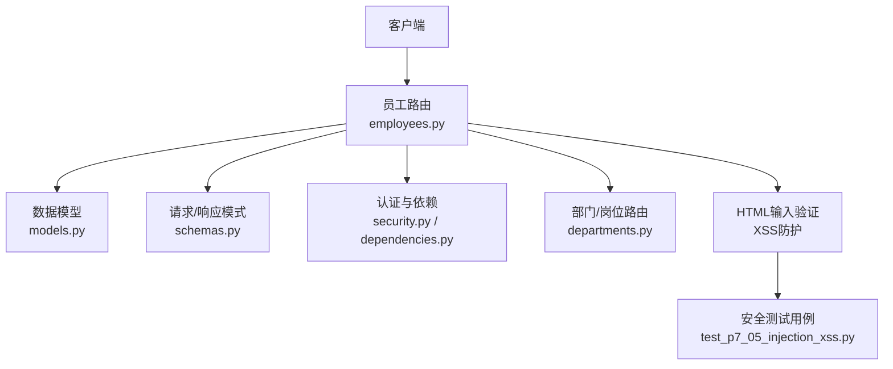
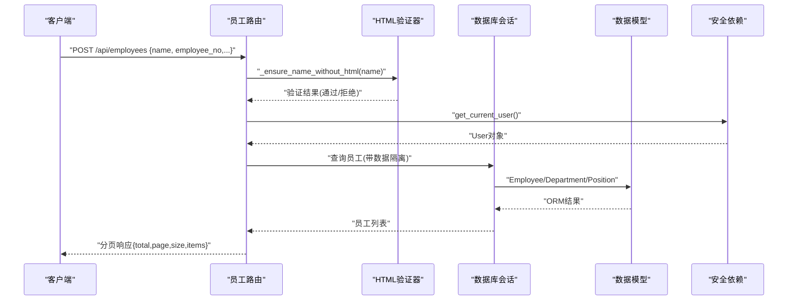
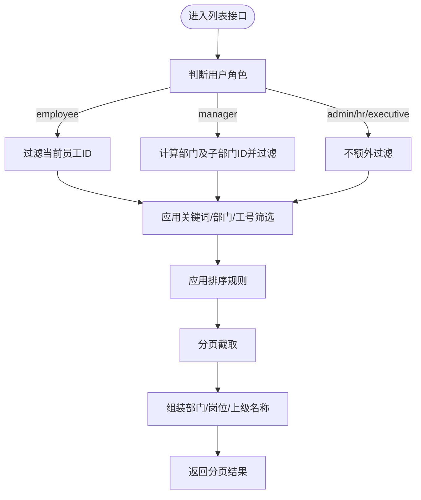
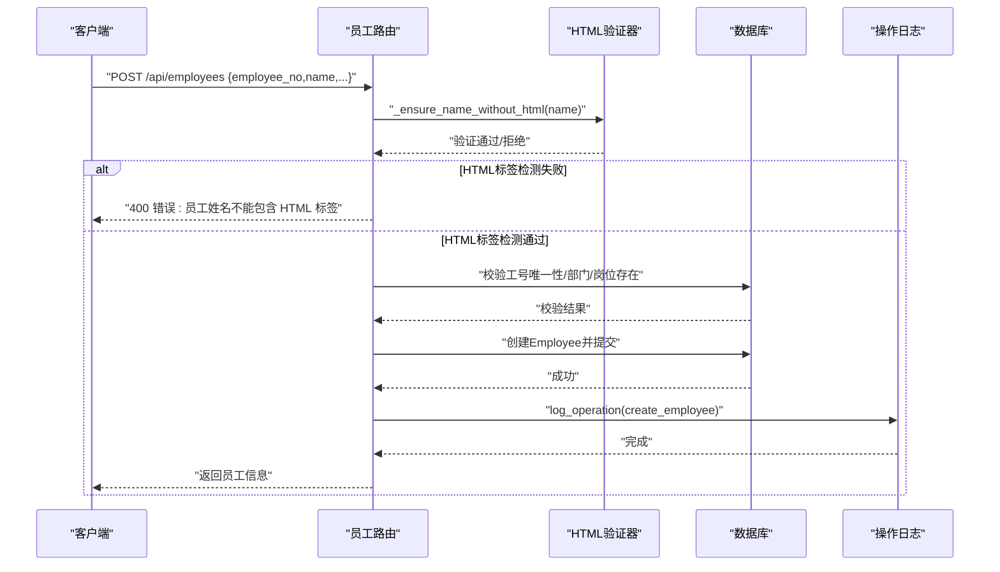
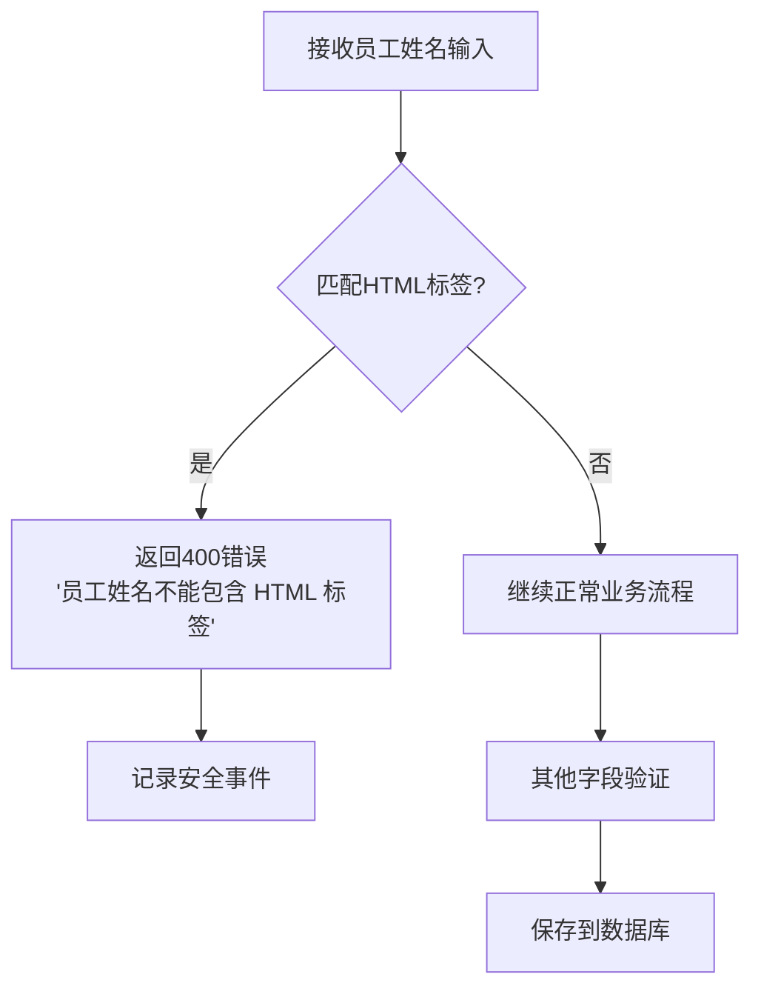
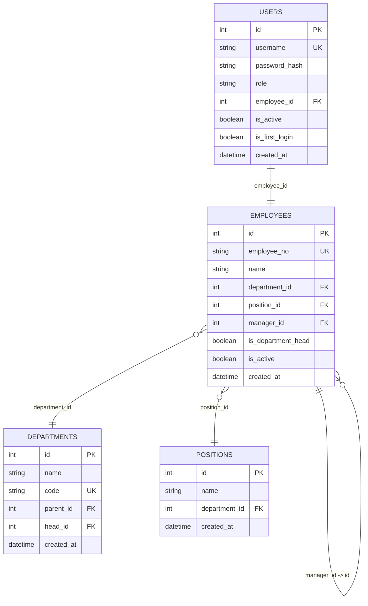
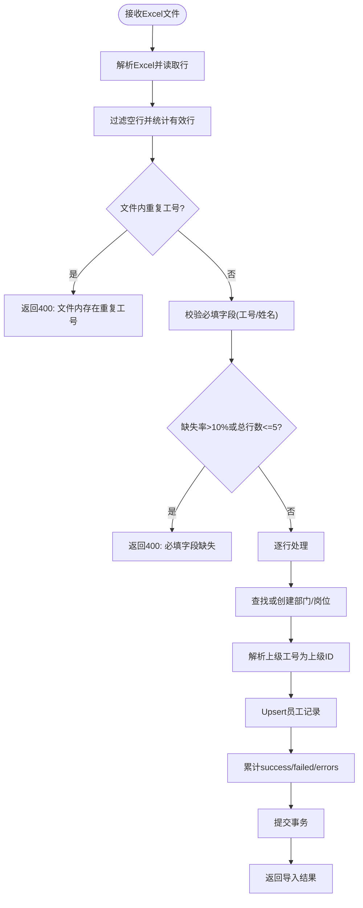
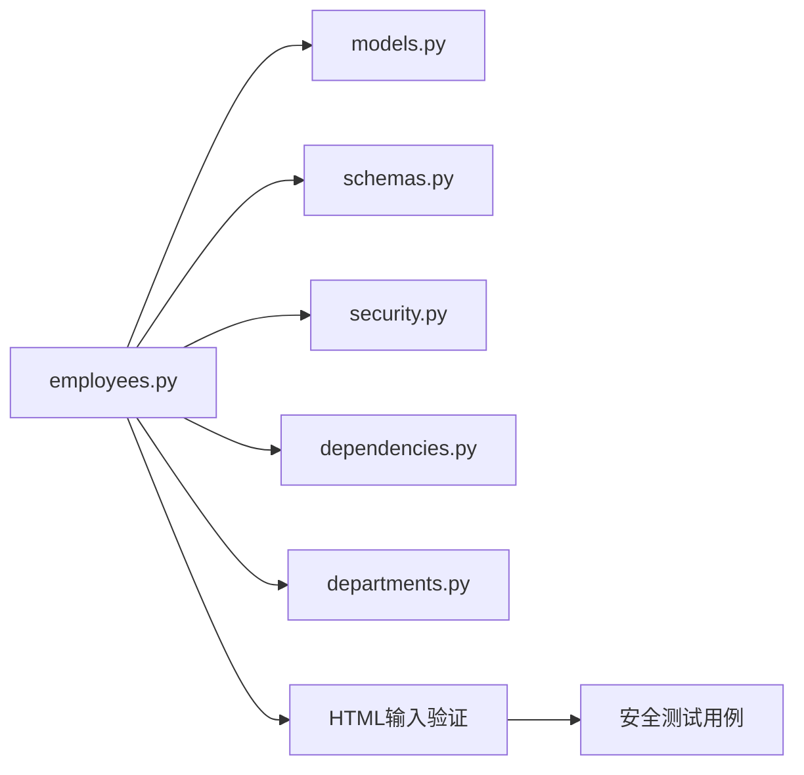

# 员工管理API

<cite>
**本文引用的文件**   
- [backend/app/routers/employees.py](file://backend/app/routers/employees.py)
- [backend/app/models.py](file://backend/app/models.py)
- [backend/app/schemas.py](file://backend/app/schemas.py)
- [backend/app/core/security.py](file://backend/app/core/security.py)
- [backend/app/core/dependencies.py](file://backend/app/core/dependencies.py)
- [backend/app/routers/departments.py](file://backend/app/routers/departments.py)
- [backend/tests/test_p7_05_injection_xss.py](file://backend/tests/test_p7_05_injection_xss.py)
</cite>

## 更新摘要
**变更内容**   
- 新增HTML输入验证功能，防止XSS攻击
- 在创建和更新员工时自动验证并拒绝包含HTML标签的名称
- 添加安全测试用例验证HTML过滤机制
- 增强数据安全性，防止恶意脚本注入

## 目录
1. [简介](#简介)
2. [项目结构](#项目结构)
3. [核心组件](#核心组件)
4. [架构总览](#架构总览)
5. [详细接口规范](#详细接口规范)
6. [数据安全与输入验证](#数据安全与输入验证)
7. [数据模型与字段定义](#数据模型与字段定义)
8. [权限控制与数据隔离](#权限控制与数据隔离)
9. [批量导入导出](#批量导入导出)
10. [依赖关系分析](#依赖关系分析)
11. [性能与事务](#性能与事务)
12. [故障排查](#故障排查)
13. [结论](#结论)

## 简介
本文件面向"员工管理"相关后端 API，覆盖员工的增删改查、批量导入、预览、模板下载、组织架构关联（部门、岗位、上级）、分页查询、条件筛选、权限控制与数据隔离等能力。**最新更新**：系统新增了HTML输入验证功能，在创建和更新员工时会自动验证并拒绝包含HTML标签的名称，有效防止XSS攻击。文档同时给出数据模型、校验规则、错误处理与事务机制说明，帮助前后端开发者快速对接并保证系统安全与一致性。

## 项目结构
员工管理功能主要位于后端 FastAPI 路由模块中，并与模型层、模式层、认证授权依赖以及部门/岗位路由协同工作：
- 路由层：`backend/app/routers/employees.py`
- 数据模型：`backend/app/models.py`
- 请求/响应模式：`backend/app/schemas.py`
- 认证与角色依赖：`backend/app/core/security.py`、`backend/app/core/dependencies.py`
- 部门/岗位路由：`backend/app/routers/departments.py`
- 安全测试：`backend/tests/test_p7_05_injection_xss.py`

**图表来源**
- [backend/app/routers/employees.py:1-32](file://backend/app/routers/employees.py#L1-L32)
- [backend/app/models.py:8-48](file://backend/app/models.py#L8-L48)
- [backend/app/schemas.py:74-117](file://backend/app/schemas.py#L74-L117)
- [backend/app/core/security.py:82-138](file://backend/app/core/security.py#L82-L138)
- [backend/app/core/dependencies.py:27-50](file://backend/app/core/dependencies.py#L27-L50)
- [backend/app/routers/departments.py:1-17](file://backend/app/routers/departments.py#L1-L17)
- [backend/tests/test_p7_05_injection_xss.py:225-244](file://backend/tests/test_p7_05_injection_xss.py#L225-L244)

**章节来源**
- [backend/app/routers/employees.py:1-32](file://backend/app/routers/employees.py#L1-L32)
- [backend/app/models.py:8-48](file://backend/app/models.py#L8-L48)
- [backend/app/schemas.py:74-117](file://backend/app/schemas.py#L74-L117)
- [backend/app/core/security.py:82-138](file://backend/app/core/security.py#L82-L138)
- [backend/app/core/dependencies.py:27-50](file://backend/app/core/dependencies.py#L27-L50)
- [backend/app/routers/departments.py:1-17](file://backend/app/routers/departments.py#L1-L17)
- [backend/tests/test_p7_05_injection_xss.py:225-244](file://backend/tests/test_p7_05_injection_xss.py#L225-L244)

## 核心组件
- 员工路由：提供员工列表、详情、新增、更新、删除、下属查询、协作候选人查询、Excel 模板下载、导入、导入预览、导入状态等接口。
- **HTML输入验证**：新增的HTML标签检测功能，防止XSS攻击。
- 数据模型：定义部门、岗位、员工、用户、考核记录等实体及关系。
- 模式定义：定义员工创建、更新、输出结构，以及通用响应结构。
- 安全与依赖：JWT 认证、当前用户解析、基于角色的访问控制。
- 部门/岗位路由：提供部门树、部门 CRUD、岗位 CRUD，支撑员工组织归属。

**章节来源**
- [backend/app/routers/employees.py:32-679](file://backend/app/routers/employees.py#L32-L679)
- [backend/app/models.py:8-48](file://backend/app/models.py#L8-L48)
- [backend/app/schemas.py:74-117](file://backend/app/schemas.py#L74-L117)
- [backend/app/core/security.py:82-138](file://backend/app/core/security.py#L82-L138)
- [backend/app/core/dependencies.py:27-50](file://backend/app/core/dependencies.py#L27-L50)
- [backend/app/routers/departments.py:20-212](file://backend/app/routers/departments.py#L20-L212)

## 架构总览
员工管理 API 的请求流程如下：
- 客户端通过 HTTP 调用员工路由接口。
- 路由层使用依赖注入获取数据库会话和当前用户。
- **新增HTML输入验证**：对员工姓名进行HTML标签检测，防止XSS攻击。
- 根据角色进行权限校验和数据隔离过滤。
- 调用 ORM 操作数据模型，必要时关联部门、岗位、上级员工信息。
- 返回标准化响应或流式文件（如 Excel）。

**图表来源**
- [backend/app/routers/employees.py:32-39](file://backend/app/routers/employees.py#L32-L39)
- [backend/app/routers/employees.py:496](file://backend/app/routers/employees.py#L496)
- [backend/app/routers/employees.py:578](file://backend/app/routers/employees.py#L578)
- [backend/app/routers/employees.py:233-312](file://backend/app/routers/employees.py#L233-L312)
- [backend/app/core/security.py:82-138](file://backend/app/core/security.py#L82-L138)
- [backend/app/models.py:31-48](file://backend/app/models.py#L31-L48)

## 详细接口规范

### 通用约定
- 认证方式：Bearer Token（JWT），由 `get_current_user` 解析。
- 角色控制：通过 `require_role("admin","hr",...)` 限制接口访问角色。
- 统一响应：业务层直接返回字典或 Pydantic 模型；通用包装可使用 `StandardResponse`。
- 错误码：遵循 FastAPI/HTTP 标准，如 400、401、403、404、409、422、500。
- **安全验证**：所有员工姓名输入都会经过HTML标签检测，防止XSS攻击。

**章节来源**
- [backend/app/core/security.py:82-138](file://backend/app/core/security.py#L82-L138)
- [backend/app/core/dependencies.py:27-50](file://backend/app/core/dependencies.py#L27-L50)
- [backend/app/schemas.py:7-11](file://backend/app/schemas.py#L7-L11)

### 员工列表查询
- 路径：`GET /api/employees`
- 参数：
  - page: 页码，默认 1，最小 1
  - size: 每页数量，默认 20，范围 1-1000
  - keyword: 关键词，支持姓名或工号模糊匹配
  - department_id: 按部门筛选
  - employee_no: 精确工号查询（命中时直接返回该员工集合）
  - sort: 排序字段，支持 created_at、name
  - order: 排序方向 asc/desc
- 权限：所有已登录用户可访问，但受数据隔离限制。
- 返回：分页对象 `{total, page, size, items}`，items 包含员工基本信息及部门、岗位、上级名称。
- 数据隔离：
  - employee：仅查看自己
  - manager：可查看本部门及子部门员工及其下属
  - admin/hr/executive：全量可见
- 排序默认按 created_at 降序。

**图表来源**
- [backend/app/routers/employees.py:233-312](file://backend/app/routers/employees.py#L233-L312)
- [backend/app/routers/employees.py:437-450](file://backend/app/routers/employees.py#L437-L450)

**章节来源**
- [backend/app/routers/employees.py:233-312](file://backend/app/routers/employees.py#L233-L312)
- [backend/app/routers/employees.py:437-450](file://backend/app/routers/employees.py#L437-L450)

### 获取单个员工
- 路径：`GET /api/employees/{employee_id}`
- 权限：
  - peer：禁止访问
  - employee：只能查看自己
  - manager：需满足部门/上下级关系判定
  - admin/hr/executive：允许访问
- 返回：员工详细信息，包括部门、岗位、上级名称。
- 数据隔离实现：
  - 若为 manager，则检查目标员工是否在当前用户的部门范围内或其下属链中。

**章节来源**
- [backend/app/routers/employees.py:357-401](file://backend/app/routers/employees.py#L357-L401)
- [backend/app/routers/employees.py:453-466](file://backend/app/routers/employees.py#L453-L466)

### 获取下属列表
- 路径：`GET /api/employees/{employee_id}/subordinates`
- 权限：manager/admin/hr
- 返回：指定员工的直属下属列表（在职）。
- 用途：用于构建汇报关系、选择协作人等场景。

**章节来源**
- [backend/app/routers/employees.py:404-434](file://backend/app/routers/employees.py#L404-L434)

### 协作候选人查询
- 路径：`GET /api/employees/candidates`
- 参数：
  - exclude_id: 排除被评分人自身
  - keyword: 模糊搜索姓名/工号
- 权限：admin/hr/manager
- 行为：优先返回其他部门员工，排除非在职员工。

**章节来源**
- [backend/app/routers/employees.py:315-354](file://backend/app/routers/employees.py#L315-L354)

### 新增员工
- 路径：`POST /api/employees`
- 权限：admin/hr
- 请求体：使用 `EmployeeCreate` 模式，必填字段包括工号和姓名，可选字段包括部门、岗位、上级、部门负责人标记、状态。
- **新增HTML验证**：
  - 自动检测姓名中的HTML标签
  - 如果检测到HTML标签，返回400错误："员工姓名不能包含 HTML 标签"
  - 使用正则表达式 `<[^>]*>` 匹配所有HTML标签
- 校验：
  - 工号唯一性
  - 部门/岗位外键存在性
  - 上级可通过 `manager_employee_no` 解析为 `manager_id`
- 返回：新建员工信息，含部门、岗位、上级名称。
- 审计：记录操作日志。

**图表来源**
- [backend/app/routers/employees.py:32-39](file://backend/app/routers/employees.py#L32-L39)
- [backend/app/routers/employees.py:496](file://backend/app/routers/employees.py#L496)
- [backend/app/routers/employees.py:480-551](file://backend/app/routers/employees.py#L480-L551)
- [backend/app/schemas.py:74-83](file://backend/app/schemas.py#L74-L83)

**章节来源**
- [backend/app/routers/employees.py:480-551](file://backend/app/routers/employees.py#L480-L551)
- [backend/app/schemas.py:74-83](file://backend/app/schemas.py#L74-L83)

### 更新员工
- 路径：`PUT /api/employees/{employee_id}`
- 权限：admin/hr
- 请求体：使用 `EmployeeUpdate` 模式，支持部分字段更新。
- **新增HTML验证**：
  - 同样对更新的姓名进行HTML标签检测
  - 防止通过更新接口绕过安全检查
- 校验：
  - 工号唯一性（排除自身）
  - 部门外键存在性
  - 上级可通过 `manager_employee_no` 解析
- 返回：更新后的员工信息。
- 审计：记录操作日志。

**章节来源**
- [backend/app/routers/employees.py:554-629](file://backend/app/routers/employees.py#L554-L629)
- [backend/app/schemas.py:84-93](file://backend/app/schemas.py#L84-L93)

### 删除员工
- 路径：`DELETE /api/employees/{employee_id}`
- 权限：admin/hr
- 约束：若该员工已有考核历史数据，则不允许删除。
- 返回：204 无内容。
- 审计：记录操作日志。

**章节来源**
- [backend/app/routers/employees.py:632-662](file://backend/app/routers/employees.py#L632-L662)

## 数据安全与输入验证

### HTML输入验证机制
**新增功能**：系统实现了全面的HTML输入验证，专门针对员工姓名字段进行XSS攻击防护。

#### 验证实现
- **正则表达式模式**：`<[^>]*>` 用于匹配所有HTML标签
- **验证函数**：`_ensure_name_without_html()` 在创建和更新员工时调用
- **错误处理**：检测到HTML标签时返回400状态码和明确的错误消息

#### 安全防护策略
- **输入拦截**：在数据入库前进行严格验证
- **拒绝策略**：发现HTML标签直接拒绝请求，不进行任何处理
- **统一错误消息**：返回"员工姓名不能包含 HTML 标签"的错误提示

**图表来源**
- [backend/app/routers/employees.py:29-39](file://backend/app/routers/employees.py#L29-L39)
- [backend/app/routers/employees.py:496](file://backend/app/routers/employees.py#L496)
- [backend/app/routers/employees.py:578](file://backend/app/routers/employees.py#L578)

#### 测试覆盖
系统包含完整的安全测试用例，验证以下场景：
- XSS脚本注入防护
- 各种HTML标签检测
- SQL注入防护
- 边界情况处理

**章节来源**
- [backend/app/routers/employees.py:29-39](file://backend/app/routers/employees.py#L29-L39)
- [backend/tests/test_p7_05_injection_xss.py:225-244](file://backend/tests/test_p7_05_injection_xss.py#L225-L244)

### 其他安全措施
- **SQL注入防护**：使用参数化查询，避免SQL注入攻击
- **权限控制**：严格的基于角色的访问控制
- **数据隔离**：不同角色只能访问授权范围内的数据
- **审计日志**：记录所有关键操作

**章节来源**
- [backend/app/routers/employees.py:233-312](file://backend/app/routers/employees.py#L233-L312)
- [backend/app/core/security.py:82-138](file://backend/app/core/security.py#L82-L138)

## 数据模型与字段定义

### 员工模型
- 表名：employees
- 关键字段：
  - id：主键
  - employee_no：工号，唯一且必填
  - name：姓名，必填，**新增HTML验证**
  - department_id：部门外键
  - position_id：岗位外键
  - manager_id：上级员工外键（自引用）
  - is_department_head：是否部门负责人
  - is_active：是否在职
  - created_at：创建时间
- 关系：
  - 部门：department
  - 岗位：position
  - 上级：manager
  - 下属：subordinates
  - 用户：user（一对一）

**图表来源**
- [backend/app/models.py:8-48](file://backend/app/models.py#L8-L48)
- [backend/app/models.py:49-60](file://backend/app/models.py#L49-L60)

**章节来源**
- [backend/app/models.py:8-48](file://backend/app/models.py#L8-L48)
- [backend/app/models.py:49-60](file://backend/app/models.py#L49-L60)

### 员工请求/响应模式
- EmployeeCreate：
  - 必填：employee_no、name
  - 可选：department_id、position_id、manager_id、manager_employee_no、is_department_head、is_active
- EmployeeUpdate：
  - 可选：同上（支持部分更新）
- EmployeeOut：
  - 包含基础字段及部门、岗位、上级名称等展示字段
- EmployeeListResponse：
  - total、page、size、items（EmployeeOut 列表）

**章节来源**
- [backend/app/schemas.py:74-117](file://backend/app/schemas.py#L74-L117)

## 权限控制与数据隔离

### 认证与角色
- JWT Bearer Token：通过 `get_current_user` 解析并验证。
- 角色依赖：`require_role("admin","hr",...)` 限制接口访问角色。
- 未认证或无效 Token：返回 401。
- 角色不符：返回 403。

**章节来源**
- [backend/app/core/security.py:82-138](file://backend/app/core/security.py#L82-L138)
- [backend/app/core/dependencies.py:27-50](file://backend/app/core/dependencies.py#L27-L50)

### 数据隔离策略
- employee：仅能查看自己的员工信息。
- manager：可查看本部门及子部门的员工，以及其下属。
- admin/hr/executive：全量可见。
- peer：在获取单个员工时被明确拒绝。

实现要点：
- 列表接口根据角色动态添加过滤条件。
- 详情接口对 manager 进行部门范围与下属链判定。
- 辅助函数：
  - get_all_dept_ids：递归收集部门及子部门 ID
  - _is_in_subordinate_chain：判断目标是否为某人的直接或间接下属

**章节来源**
- [backend/app/routers/employees.py:233-312](file://backend/app/routers/employees.py#L233-L312)
- [backend/app/routers/employees.py:357-401](file://backend/app/routers/employees.py#L357-L401)
- [backend/app/routers/employees.py:437-466](file://backend/app/routers/employees.py#L437-L466)

## 批量导入导出

### 模板下载
- 路径：`GET /api/employees/template?type=empty|sample`
- 权限：admin/hr/executive
- 行为：生成 Excel 模板，headers 包括工号、姓名、部门、岗位、直属上级工号、是否部门负责人、入职日期、状态。
- 依赖：openpyxl（未安装时返回 500）。

**章节来源**
- [backend/app/routers/employees.py:41-71](file://backend/app/routers/employees.py#L41-L71)

### 导入预览
- 路径：`POST /api/employees/import-preview`
- 权限：admin/hr/executive
- 行为：解析 Excel，统计有效行数，返回预览结果（当前实现返回空 rows 与 errors，total 为有效行数）。
- 依赖：openpyxl。

**章节来源**
- [backend/app/routers/employees.py:208-231](file://backend/app/routers/employees.py#L208-L231)

### 导入状态
- 路径：`GET /api/employees/import/status`
- 权限：admin/hr/executive
- 行为：返回就绪状态与进度（当前固定返回 ready 与 100%）。

**章节来源**
- [backend/app/routers/employees.py:234-236](file://backend/app/routers/employees.py#L234-L236)

### 批量导入
- 路径：`POST /api/employees/import`
- 权限：admin/hr
- 行为：
  - 解析 Excel，过滤空行
  - 文件内重复工号检测
  - 必填字段缺失率阈值控制（>10% 或总行数≤5 时直接报错）
  - 逐行处理：
    - 自动创建或查找部门
    - 自动创建或查找岗位（同部门下）
    - 通过上级工号解析上级员工 ID
    - Upsert：工号存在则更新，否则新增
  - 汇总 success/failed/errors
  - 提交事务
- 错误处理：
  - 无法解析 Excel：400
  - 文件为空：400
  - 文件内重复工号：400
  - 必填字段缺失：400
  - openpyxl 未安装：500

**图表来源**
- [backend/app/routers/employees.py:74-205](file://backend/app/routers/employees.py#L74-L205)

**章节来源**
- [backend/app/routers/employees.py:74-205](file://backend/app/routers/employees.py#L74-L205)

### 数据导出
- 当前员工路由未提供统一的"导出员工列表"接口。
- 前端测试中存在报表导出页面，但具体导出逻辑不在员工路由中体现。
- 如需扩展，可在员工路由增加导出接口，复用现有筛选与数据隔离逻辑，并以流式方式返回 Excel/PDF。

[本节为概念性说明，不涉及具体代码文件]

## 依赖关系分析

**图表来源**
- [backend/app/routers/employees.py:1-32](file://backend/app/routers/employees.py#L1-L32)
- [backend/app/models.py:8-48](file://backend/app/models.py#L8-L48)
- [backend/app/schemas.py:74-117](file://backend/app/schemas.py#L74-L117)
- [backend/app/core/security.py:82-138](file://backend/app/core/security.py#L82-L138)
- [backend/app/core/dependencies.py:27-50](file://backend/app/core/dependencies.py#L27-L50)
- [backend/app/routers/departments.py:1-17](file://backend/app/routers/departments.py#L1-L17)
- [backend/tests/test_p7_05_injection_xss.py:225-244](file://backend/tests/test_p7_05_injection_xss.py#L225-L244)

**章节来源**
- [backend/app/routers/employees.py:1-32](file://backend/app/routers/employees.py#L1-L32)
- [backend/app/models.py:8-48](file://backend/app/models.py#L8-L48)
- [backend/app/schemas.py:74-117](file://backend/app/schemas.py#L74-L117)
- [backend/app/core/security.py:82-138](file://backend/app/core/security.py#L82-L138)
- [backend/app/core/dependencies.py:27-50](file://backend/app/core/dependencies.py#L27-L50)
- [backend/app/routers/departments.py:1-17](file://backend/app/routers/departments.py#L1-L17)
- [backend/tests/test_p7_05_injection_xss.py:225-244](file://backend/tests/test_p7_05_injection_xss.py#L225-L244)

## 性能与事务
- 列表查询：
  - 默认按 created_at 降序，支持按 name 或 created_at 排序。
  - 支持分页 offset/limit，避免一次性加载大量数据。
  - 数据隔离通过 SQL 条件过滤，减少不必要的数据传输。
- 导入：
  - 先预检必填字段缺失率，避免无效数据入库。
  - 文件内重复工号提前拦截。
  - 部门/岗位按需创建或查找，减少冗余写入。
  - 最终统一提交事务，确保导入原子性。
- **HTML验证性能**：
  - 正则表达式匹配开销极小，对性能影响可忽略不计。
  - 验证在数据入库前进行，避免无效数据浪费数据库资源。
- 建议优化：
  - 对 employees.employee_no、employees.department_id、employees.position_id、employees.manager_id 建立索引以提升查询效率。
  - 对 departments.parent_id 建立索引以加速部门树遍历。
  - 大文件导入可考虑分批提交或使用异步任务队列，避免长事务阻塞。

[本节为通用性能建议，不直接分析具体代码文件]

## 故障排查
- 401 未认证：
  - 检查 Authorization Header 是否携带有效的 Bearer Token。
  - 确认 Token 未过期且用户未被禁用。
- 403 权限不足：
  - 检查当前用户角色是否在接口允许的 roles 列表中。
  - 检查数据隔离逻辑是否阻止访问（如 peer 访问详情、employee 访问他人详情）。
- 404 资源不存在：
  - 检查员工 ID 是否存在且在职。
- 409 冲突：
  - 新增/更新时工号重复。
  - 删除员工时存在考核历史数据。
- 422 不可处理：
  - 部门/岗位外键不存在。
- **400 HTML验证错误**：
  - 员工姓名包含HTML标签，如 ``
  - 解决方案：移除所有HTML标签，只保留纯文本姓名
- 500 内部错误：
  - openpyxl 未安装导致模板下载/导入失败。

**章节来源**
- [backend/app/core/security.py:82-138](file://backend/app/core/security.py#L82-L138)
- [backend/app/routers/employees.py:480-551](file://backend/app/routers/employees.py#L480-L551)
- [backend/app/routers/employees.py:554-629](file://backend/app/routers/employees.py#L554-L629)
- [backend/app/routers/employees.py:632-662](file://backend/app/routers/employees.py#L632-L662)
- [backend/app/routers/employees.py:41-71](file://backend/app/routers/employees.py#L41-L71)
- [backend/app/routers/employees.py:32-39](file://backend/app/routers/employees.py#L32-L39)

## 结论
员工管理 API 提供了完整的 CRUD、批量导入、预览与模板下载能力，并通过角色依赖与数据隔离保障不同角色的访问边界。**最新版本**增加了全面的HTML输入验证机制，有效防止XSS攻击，提升了系统的安全性。部门与岗位的关联通过外键与路由协同实现，支持灵活的组织架构管理。建议在后续版本中补充统一的员工导出接口，并对关键查询字段建立索引以提升性能。对于大规模导入，可引入异步任务与分批提交机制，增强系统的稳定性与可扩展性。

**安全改进总结**：
- 实现了全面的HTML输入验证，防止XSS攻击
- 添加了完整的安全测试用例覆盖
- 保持了向后兼容性，不影响现有功能
- 提供了清晰的错误提示信息，便于前端处理