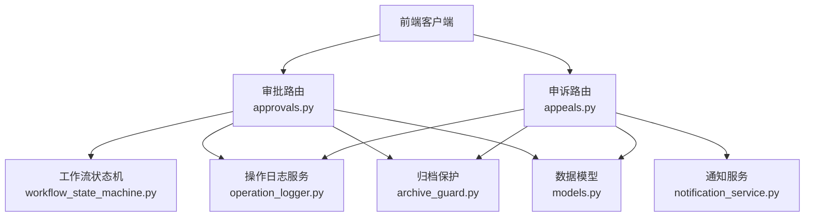
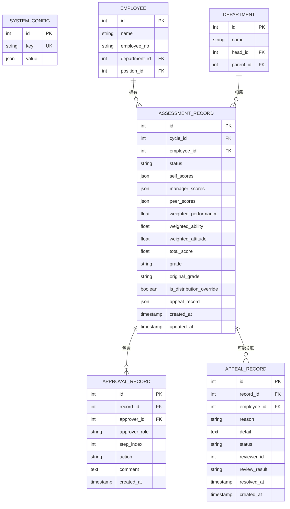
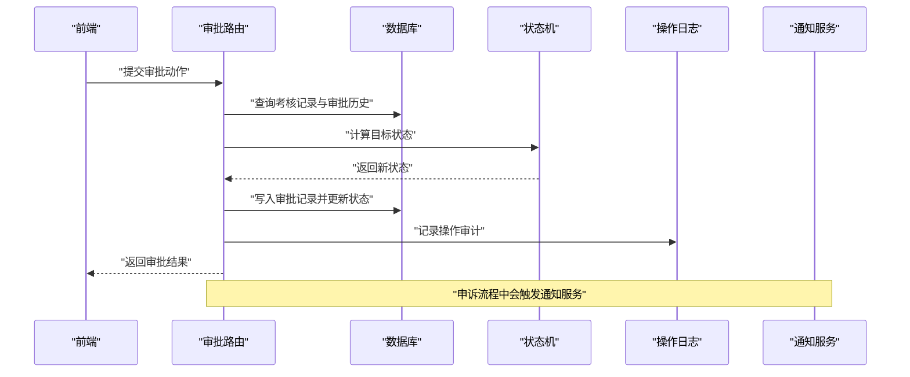
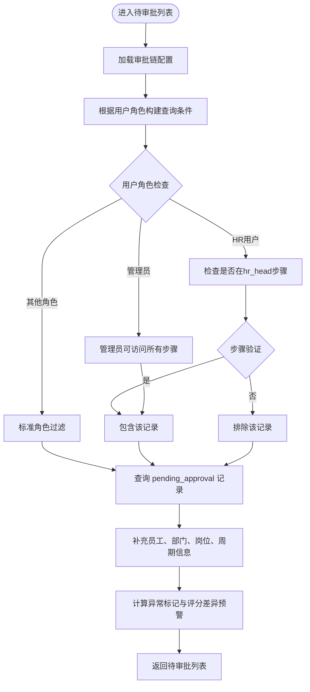
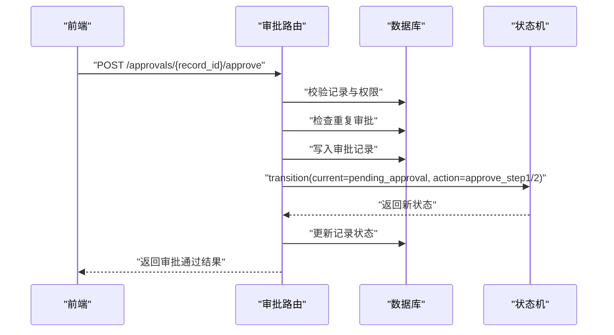
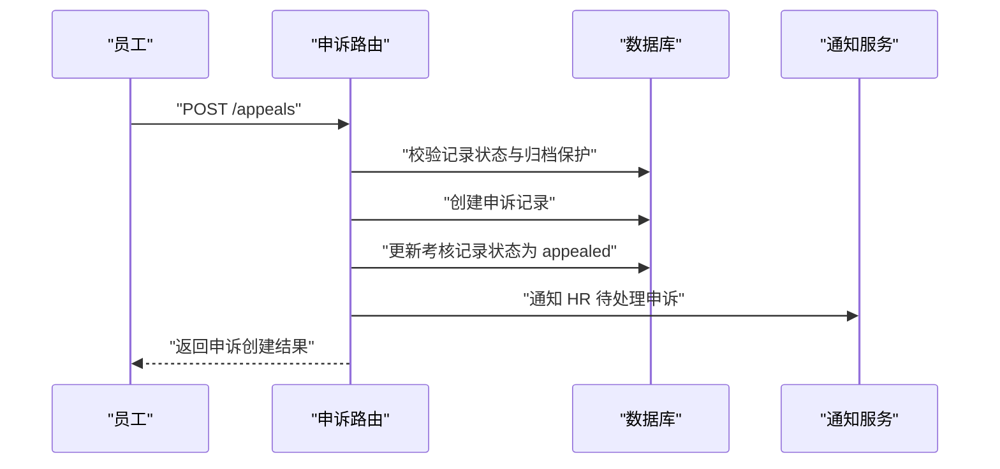
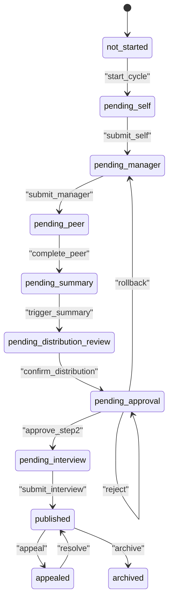
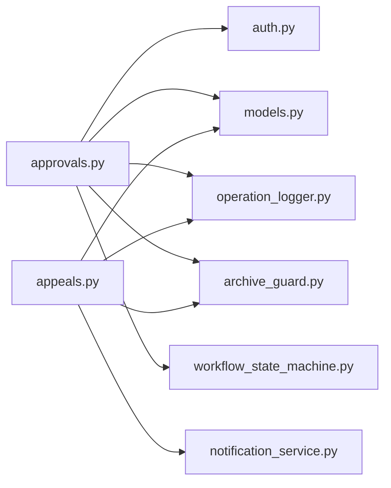

# 审批工作流API

<cite>
**本文引用的文件**   
- [backend/app/routers/approvals.py](file://backend/app/routers/approvals.py)
- [backend/app/routers/appeals.py](file://backend/app/routers/appeals.py)
- [backend/app/utils/workflow_state_machine.py](file://backend/app/utils/workflow_state_machine.py)
- [backend/app/models.py](file://backend/app/models.py)
- [backend/app/routers/archive_guard.py](file://backend/app/routers/archive_guard.py)
- [backend/app/services/operation_logger.py](file://backend/app/services/operation_logger.py)
- [backend/app/services/notification_service.py](file://backend/app/services/notification_service.py)
- [backend/app/core/exceptions.py](file://backend/app/core/exceptions.py)
- [backend/tests/test_approvals.py](file://backend/tests/test_approvals.py)
- [backend/tests/test_p5_06_approvals_list.py](file://backend/tests/test_p5_06_approvals_list.py)
- [backend/tests/test_p5_07_approvals_detail.py](file://backend/tests/test_p5_07_approvals_detail.py)
- [backend/tests/test_p6_05_appeals.py](file://backend/tests/test_p6_05_appeals.py)
- [backend/tests/test_p6_06_appeal_resolve.py](file://backend/tests/test_p6_06_appeal_resolve.py)
- [backend/tests/test_p6_09_appeal_review_final.py](file://backend/tests/test_p6_09_appeal_review_final.py)
- [backend/tests/test_p21_dashboard_role_scoped_stats.py](file://backend/tests/test_p21_dashboard_role_scoped_stats.py)
- [backend/tests/test_p23_pending_approvals_no_full_table_scan.py](file://backend/tests/test_p23_pending_approvals_no_full_table_scan.py)
- [backend/tests/test_approval_chain.py](file://backend/tests/test_approval_chain.py)
- [backend/tests/test_p5_17_approval.py](file://backend/tests/test_p5_17_approval.py)
- [frontend/src/api/approvals.js](file://frontend/src/api/approvals.js)
- [frontend/src/api/appeals.js](file://frontend/src/api/appeals.js)
- [frontend/src/views/appeal/AppealList.vue](file://frontend/src/views/appeal/AppealList.vue)
- [frontend/src/views/appeal/AppealDetail.vue](file://frontend/src/views/appeal/AppealDetail.vue)
- [frontend/src/views/appeal/AppealView.vue](file://frontend/src/views/appeal/AppealView.vue)
- [frontend/src/views/approval-workbench/ApprovalWorkbench.vue](file://frontend/src/views/approval-workbench/ApprovalWorkbench.vue)
- [frontend/src/views/approval-workbench/ApprovalDetail.vue](file://frontend/src/views/approval-workbench/ApprovalDetail.vue)
</cite>

## 更新摘要
**已进行的变更**   
- 更新了待审批列表与权限控制部分，详细说明HR人员的步骤特定可见性机制
- 新增了HR角色权限控制的详细逻辑说明
- 添加了防止"越级审批"的约束条件说明
- 更新了相关测试用例的引用和说明

## 目录
1. [文档目标与适用范围](#文档目标与适用范围)
2. [项目结构与模块定位](#项目结构与模块定位)
3. [核心概念与数据模型](#核心概念与数据模型)
4. [系统架构总览](#系统架构总览)
5. [审批链配置接口](#审批链配置接口)
6. [待审批列表与权限控制](#待审批列表与权限控制)
7. [审批详情与历史追溯](#审批详情与历史追溯)
8. [审批动作接口：通过、驳回、打回重评](#审批动作接口通过驳回打回重评)
9. [强制分布特批流程](#强制分布特批流程)
10. [申诉处理完整流程](#申诉处理完整流程)
11. [状态机与流转规则](#状态机与流转规则)
12. [高级特性说明](#高级特性说明)
13. [统计分析与绩效评估接口现状](#统计分析与绩效评估接口现状)
14. [依赖关系分析](#依赖关系分析)
15. [性能与可观测性](#性能与可观测性)
16. [故障排查指南](#故障排查指南)
17. [前端集成要点](#前端集成要点)
18. [结论与扩展建议](#结论与扩展建议)

## 文档目标与适用范围
本文面向绩效考核系统中的"审批工作流"和"申诉处理"能力，重点说明以下方面：
- 多级审批流程的配置、执行、监控接口规范。
- 审批节点流转规则、审批权限控制、审批意见记录。
- **新增** HR人员步骤特定可见性机制，防止越级审批。
- 申诉从提交到最终裁决的完整管理流程。
- 审批历史追溯与审批链路可视化支撑点。
- 当前实现中已具备或尚未实现的超时处理、自动升级、并行审批等高级特性。
- 审批数据统计与绩效评估接口的现状与扩展方向。

本说明以后端路由、状态机、测试用例和前端 API 调用为依据，避免臆造未实现的接口行为。

## 项目结构与模块定位
审批工作流相关代码主要分布在以下位置：
- 审批路由：`backend/app/routers/approvals.py`
- 申诉路由：`backend/app/routers/appeals.py`
- 状态机工具：`backend/app/utils/workflow_state_machine.py`
- 数据模型：`backend/app/models.py`
- 归档保护：`backend/app/routers/archive_guard.py`
- 操作日志服务：`backend/app/services/operation_logger.py`
- 通知服务：`backend/app/services/notification_service.py`
- 业务异常定义：`backend/app/core/exceptions.py`
- 前端审批工作台与申诉页面：`frontend/src/views/approval-workbench/*`、`frontend/src/views/appeal/*`
- 前端 API 封装：`frontend/src/api/approvals.js`、`frontend/src/api/appeals.js`



**图表来源**
- [backend/app/routers/approvals.py:1-18](file://backend/app/routers/approvals.py#L1-L18)
- [backend/app/routers/appeals.py:1-14](file://backend/app/routers/appeals.py#L1-L14)
- [backend/app/utils/workflow_state_machine.py:10-20](file://backend/app/utils/workflow_state_machine.py#L10-L20)
- [backend/app/routers/archive_guard.py:6-28](file://backend/app/routers/archive_guard.py#L6-L28)

**章节来源**
- [backend/app/routers/approvals.py:1-18](file://backend/app/routers/approvals.py#L1-L18)
- [backend/app/routers/appeals.py:1-14](file://backend/app/routers/appeals.py#L1-L14)
- [backend/app/utils/workflow_state_machine.py:10-20](file://backend/app/utils/workflow_state_machine.py#L10-L20)

## 核心概念与数据模型
审批工作流围绕以下核心实体展开：
- 考核记录：承载员工自评、上级评分、协作评分、加权分数、总分、等级、状态等信息。
- 审批记录：记录每次审批操作的审批人、角色、步骤序号、动作、意见和时间。
- 申诉记录：记录员工对已发布结果的申诉原因、详情、处理状态、复核结果和处理时间。
- 系统配置：存储审批链配置，如默认顺序为直属上级、部门负责人、HR负责人等。
- 归档保护：防止已归档周期中的记录被修改。



**图表来源**
- [backend/app/models.py](file://backend/app/models.py)
- [backend/app/routers/approvals.py:10-13](file://backend/app/routers/approvals.py#L10-L13)
- [backend/app/routers/appeals.py:7-8](file://backend/app/routers/appeals.py#L7-L8)

**章节来源**
- [backend/app/models.py](file://backend/app/models.py)
- [backend/app/routers/approvals.py:10-13](file://backend/app/routers/approvals.py#L10-L13)
- [backend/app/routers/appeals.py:7-8](file://backend/app/routers/appeals.py#L7-L8)

## 系统架构总览
审批工作流由"路由层 + 状态机 + 数据模型 + 日志与通知"组成：
- 路由层负责接收请求、参数校验、权限检查、业务编排。
- 状态机负责定义合法状态与动作转换，保证流程一致性。
- 数据模型持久化考核记录、审批记录、申诉记录。
- 日志与通知用于审计追踪和用户提醒。



**图表来源**
- [backend/app/routers/approvals.py:451-534](file://backend/app/routers/approvals.py#L451-L534)
- [backend/app/utils/workflow_state_machine.py:106-186](file://backend/app/utils/workflow_state_machine.py#L106-L186)
- [backend/app/services/operation_logger.py](file://backend/app/services/operation_logger.py)
- [backend/app/services/notification_service.py](file://backend/app/services/notification_service.py)

**章节来源**
- [backend/app/routers/approvals.py:451-534](file://backend/app/routers/approvals.py#L451-L534)
- [backend/app/utils/workflow_state_machine.py:106-186](file://backend/app/utils/workflow_state_machine.py#L106-L186)

## 审批链配置接口
### 获取审批链配置
- 方法：GET
- 路径：`/api/v1/approvals/chain-config`
- 权限：admin、hr、executive
- 功能：返回当前系统配置的审批链角色序列。
- 默认链：当系统未配置时，使用默认链 `["direct_manager", "dept_head", "hr_head"]`。

**章节来源**
- [backend/app/routers/approvals.py:102-108](file://backend/app/routers/approvals.py#L102-L108)
- [backend/app/routers/approvals.py:19-29](file://backend/app/routers/approvals.py#L19-L29)

### 更新审批链配置
- 方法：PUT
- 路径：`/api/v1/approvals/chain-config`
- 权限：admin
- 输入：`chain` 必须为列表，元素需为有效角色（`direct_manager`、`dept_head`、`hr_head`、`admin`）。
- 输出：返回更新的链配置。
- 副作用：写入系统配置表，并记录操作日志。

**章节来源**
- [backend/app/routers/approvals.py:111-150](file://backend/app/routers/approvals.py#L111-L150)

## 待审批列表与权限控制
### 获取待审批列表
- 方法：GET
- 路径：`/api/v1/approvals/pending`
- 权限：manager、hr、admin
- 过滤参数：
  - `department_id`：按部门筛选。
  - `is_abnormal`：是否强制分布异常标记。
  - `is_force_adjusted`：是否强制调整（原始等级与当前等级不一致）。
  - `step`：按审批步骤过滤（1 表示第一步，2 表示第二步）。
- **更新** 权限逻辑：
  - 根据用户身份与审批链角色动态构建查询条件。
  - 直属经理只能看到自己下属的记录。
  - 部门负责人能看到本部门记录。
  - **HR人员步骤特定可见性**：HR用户只能在轮到其特定步骤（hr_head）时看到待审批记录，防止"越级审批"或提前看到仍在早期审批阶段的记录。
  - 管理员可代任何步骤处理所有待审批记录。
- 性能优化：
  - 使用子查询计算每条记录已通过的最大步骤序号，避免全表扫描。
  - 预计算下属 ID 与部门 ID，减少重复查询。

**更新** HR权限控制逻辑详解：
```python
elif role in ("hr_head", "hr") and user.role in ("hr", "admin"):
    if user.role == "admin":
        # 管理员可代任何步骤处理
        conditions.append(AssessmentRecord.status == "pending_approval")
    else:
        # HR 只在轮到 hr_head 步骤时可见，避免提前看到前序步骤的记录
        conditions.append(
            and_(
                AssessmentRecord.status == "pending_approval",
                func.coalesce(step_counts.c.max_step, 0) == step_idx,
            )
        )
```

**关键约束**：
- HR用户只能在其特定步骤（hr_head）激活时看到记录
- 如果记录仍处于早期审批阶段（如direct_manager或dept_head），HR无法看到
- 这防止了"step-skipping"或过早可见性，确保审批流程的顺序性



**图表来源**
- [backend/app/routers/approvals.py:190-230](file://backend/app/routers/approvals.py#L190-L230)

**章节来源**
- [backend/app/routers/approvals.py:153-311](file://backend/app/routers/approvals.py#L153-L311)
- [backend/tests/test_p5_06_approvals_list.py:254-291](file://backend/tests/test_p5_06_approvals_list.py#L254-L291)
- [backend/tests/test_p23_pending_approvals_no_full_table_scan.py:214-281](file://backend/tests/test_p23_pending_approvals_no_full_table_scan.py#L214-L281)
- [backend/tests/test_approval_chain.py:152-174](file://backend/tests/test_approval_chain.py#L152-L174)

## 审批详情与历史追溯
### 获取审批详情
- 方法：GET
- 路径：`/api/v1/approvals/{record_id}`
- 权限：manager、hr、admin
- 返回内容：
  - 员工、部门、岗位、周期信息。
  - 自评分、上级评分、协作评分及协作评语。
  - 加权维度分、总分、等级、原始等级、强制分布标记。
  - 历史评分（最近三个周期）。
  - 审批历史（按步骤升序）。
  - 评分差异预警标志。
- 访问控制：
  - admin/hr 可直接查看。
  - 直属经理可查看下属记录。
  - 当前审批链下一步角色可访问。
  - 部门负责人可访问本部门记录。

**章节来源**
- [backend/app/routers/approvals.py:346-448](file://backend/app/routers/approvals.py#L346-L448)

### 获取审批历史
- 方法：GET
- 路径：`/api/v1/approvals/history`
- 权限：manager、hr、admin
- 可选参数：`record_id`（按记录筛选）
- 返回：审批记录列表，按创建时间倒序。

**章节来源**
- [backend/app/routers/approvals.py:719-745](file://backend/app/routers/approvals.py#L719-L745)
- [backend/tests/test_approvals.py:750-760](file://backend/tests/test_approvals.py#L750-L760)

## 审批动作接口：通过、驳回、打回重评
### 通过审批
- 方法：POST
- 路径：`/api/v1/approvals/{record_id}/approve`
- 权限：manager、hr、admin
- 输入：可选 `comment`（至少 10 个字符）。
- 行为：
  - 校验记录存在且状态为 `pending_approval`。
  - 校验当前用户是否为该步骤的合法审批角色。
  - 防重复审批：同一审批人在同一步骤不能重复通过。
  - 写入审批记录，并通过状态机决定下一步状态。
  - 若为最后一步，则状态转为 `pending_interview`；否则仍为 `pending_approval`。
  - 记录操作日志。



**图表来源**
- [backend/app/routers/approvals.py:451-534](file://backend/app/routers/approvals.py#L451-L534)
- [backend/app/utils/workflow_state_machine.py:62-67](file://backend/app/utils/workflow_state_machine.py#L62-L67)

**章节来源**
- [backend/app/routers/approvals.py:451-534](file://backend/app/routers/approvals.py#L451-L534)

### 驳回审批
- 方法：POST
- 路径：`/api/v1/approvals/{record_id}/reject`
- 权限：manager、hr、admin
- 输入：必填 `reason`（至少 10 个字符）。
- 行为：
  - 校验记录存在且状态为 `pending_approval`。
  - 校验当前用户是否为该步骤的合法审批角色。
  - 防重复驳回：同一审批人不能重复驳回。
  - 写入审批记录，状态保持 `pending_approval`，供上一环节修改。
  - 记录操作日志。

**章节来源**
- [backend/app/routers/approvals.py:537-616](file://backend/app/routers/approvals.py#L537-L616)
- [backend/tests/test_approvals.py:762-769](file://backend/tests/test_approvals.py#L762-L769)

### 打回重评
- 方法：POST
- 路径：`/api/v1/approvals/{record_id}/rollback`
- 权限：manager、hr、admin
- 输入：必填 `reason`（至少 10 个字符）。
- 行为：
  - 校验记录存在且状态为 `pending_approval`。
  - 校验当前用户是否为该步骤的合法审批角色。
  - 防重复打回：同一审批人不能重复打回。
  - 写入审批记录，清除上级评分相关字段，状态转为 `pending_manager`。
  - 记录操作日志。

**章节来源**
- [backend/app/routers/approvals.py:619-716](file://backend/app/routers/approvals.py#L619-L716)

## 强制分布特批流程
### 申请强制分布特批
- 方法：POST
- 路径：`/api/v1/approvals/{record_id}/distribution-override`
- 权限：manager、hr、admin
- 输入：必填 `reason`。
- 行为：
  - 校验记录存在且未被归档。
  - 校验当前用户为该员工的直属经理。
  - 仅当记录存在原始等级且与当前等级不同才可申请。
  - 写入特批原因，并记录操作日志。

**章节来源**
- [backend/app/routers/approvals.py:748-784](file://backend/app/routers/approvals.py#L748-L784)

### 获取强制分布特批申请列表
- 方法：GET
- 路径：`/api/v1/approvals/distribution-overrides`
- 权限：admin、hr、executive
- 可选参数：`cycle_id`
- 返回：特批申请记录，包含员工信息、原始等级、调整后等级、原因。

**章节来源**
- [backend/app/routers/approvals.py:314-343](file://backend/app/routers/approvals.py#L314-L343)

### 通过特批申请
- 方法：POST
- 路径：`/api/v1/approvals/distribution-overrides/{record_id}/approve`
- 权限：admin、hr
- 行为：
  - 校验记录存在且未被归档。
  - 校验记录存在特批原因。
  - 将等级恢复为原始等级，并标记为强制分布特批通过。
  - 记录操作日志。

**章节来源**
- [backend/app/routers/approvals.py:787-818](file://backend/app/routers/approvals.py#L787-L818)

### 驳回特批申请
- 方法：POST
- 路径：`/api/v1/approvals/distribution-overrides/{record_id}/reject`
- 权限：admin、hr
- 行为：
  - 校验记录存在且未被归档。
  - 校验记录存在特批原因。
  - 清空特批原因。
  - 记录操作日志。

**章节来源**
- [backend/app/routers/approvals.py:821-849](file://backend/app/routers/approvals.py#L821-L849)

## 申诉处理完整流程
### 发起申诉
- 方法：POST
- 路径：`/api/v1/appeals`
- 权限：登录用户（employee）
- 输入：`record_id`、`reason`、`detail`
- 行为：
  - 校验记录存在且未被归档。
  - 仅允许对 `published` 状态的记录发起申诉。
  - 校验理由长度与详细说明长度。
  - 创建申诉记录，状态设为 `pending`。
  - 更新考核记录的 `appeal_record` JSON 字段，并将状态改为 `appealed`。
  - 通知 HR 待处理申诉。
  - 记录操作日志。



**图表来源**
- [backend/app/routers/appeals.py:113-191](file://backend/app/routers/appeals.py#L113-L191)

**章节来源**
- [backend/app/routers/appeals.py:113-191](file://backend/tests/test_p6_05_appeals.py)

### 我的申诉历史
- 方法：GET
- 路径：`/api/v1/appeals/my-appeals`
- 权限：employee
- 返回：当前用户的申诉记录列表。

**章节来源**
- [backend/app/routers/appeals.py:47-71](file://backend/app/routers/appeals.py#L47-L71)

### 申诉列表与详情
- 方法：GET
- 路径：`/api/v1/appeals`
- 权限：admin、hr、executive
- 可选参数：`status`
- 返回：申诉记录列表，包含员工信息、审核人、复核结果、处理时间等。

- 方法：GET
- 路径：`/api/v1/appeals/{appeal_id}`
- 权限：登录用户
- 返回：申诉详情，包含关联考核记录摘要。

**章节来源**
- [backend/app/routers/appeals.py:16-45](file://backend/app/routers/appeals.py#L16-L45)
- [backend/app/routers/appeals.py:78-111](file://backend/app/routers/appeals.py#L78-L111)

### 申诉复核（终审）
- 方法：POST
- 路径：`/api/v1/appeals/{appeal_id}/review`
- 权限：admin、hr
- 输入：`action`（approve/reject）、`review_result`、可选 `total_score`、`grade`
- 行为：
  - 校验申诉记录存在且未被归档。
  - 仅允许对 `pending` 状态的申诉进行终审。
  - 若通过且传入新分数/等级，则更新考核记录对应字段。
  - 若原状态为 `appealed`，终审后将考核记录状态回写为 `published`。
  - 通知申诉人复核结果。
  - 记录操作日志。

**章节来源**
- [backend/app/routers/appeals.py:193-293](file://backend/app/routers/appeals.py#L193-L293)
- [backend/tests/test_p6_09_appeal_review_final.py]

### 申诉处理（维持或调整）
- 方法：POST
- 路径：`/api/v1/appeals/{appeal_id}/resolve`
- 权限：admin、hr
- 输入：`resolution`（maintain/adjust）、可选 `new_grade`、`comment`
- 行为：
  - 校验申诉记录存在且未被归档。
  - 校验关联考核记录处于 `appealed` 状态。
  - 若选择调整，则必填 `new_grade`。
  - 更新申诉记录状态为 `resolved`，并记录复核结果。
  - 将考核记录状态回写为 `published`；若调整则更新等级。
  - 通知申诉人处理结果。
  - 记录操作日志。

**章节来源**
- [backend/app/routers/appeals.py:296-380](file://backend/app/routers/appeals.py#L296-L380)
- [backend/tests/test_p6_06_appeal_resolve.py]

## 状态机与流转规则
状态机定义了从考核创建到归档的完整状态流转，包括申诉分支：
- 正常链路：`not_started → pending_self → pending_manager → pending_peer → pending_summary → pending_distribution_review → pending_approval → pending_interview → published → archived`
- 申诉分支：`published ↔ appealed`

关键转换：
- `pending_approval`：
  - `approve_step1`：第一步通过后仍为 `pending_approval`。
  - `approve_step2`：第二步通过后进入 `pending_interview`。
  - `reject`：驳回后保持 `pending_approval`。
  - `rollback`：打回重评后回到 `pending_manager`。
- `published`：
  - `appeal`：进入 `appealed`。
  - `archive`：归档。
- `appealed`：
  - `resolve`：申诉处理后回到 `published`。



**图表来源**
- [backend/app/utils/workflow_state_machine.py:22-78](file://backend/app/utils/workflow_state_machine.py#L22-L78)

**章节来源**
- [backend/app/utils/workflow_state_machine.py:22-78](file://backend/app/utils/workflow_state_machine.py#L22-L78)

## 高级特性说明
### 超时处理
当前代码库中未发现针对审批节点的显式超时处理逻辑。状态机与路由未提供基于时间的自动升级或超时转交机制。如需实现，可在状态机中注册基于时间的校验函数，或在后台任务中扫描超时的 `pending_approval` 记录并触发升级动作。

### 自动升级
当前实现未提供自动升级逻辑。可通过扩展状态机注册器，在特定条件下（如多次驳回、长时间未处理）自动提升审批层级或切换审批角色。

### 并行审批
当前审批链为串行结构，由 `_get_next_approver_role` 与 `_can_approve_as_role` 决定下一步角色，不存在并行审批实现。若需要并行审批，需改造审批链数据结构与步骤判定逻辑，支持多角色同时审批与聚合决策。

### 并发安全
- 重复审批防护：通过检查同一审批人在同一步骤的动作记录，防止重复通过、驳回、打回。
- 归档保护：所有写操作前调用归档保护，防止对已归档周期的记录进行修改。
- **新增** HR步骤特定可见性：通过步骤索引验证确保HR只能在其特定步骤访问记录，防止并发条件下的越级访问。

**章节来源**
- [backend/app/routers/approvals.py:477-492](file://backend/app/routers/approvals.py#L477-L492)
- [backend/app/routers/approvals.py:562-576](file://backend/app/routers/approvals.py#L562-L576)
- [backend/app/routers/approvals.py:644-658](file://backend/app/routers/approvals.py#L644-L658)
- [backend/app/routers/archive_guard.py:6-28](file://backend/app/routers/archive_guard.py#L6-L28)

## 统计分析与绩效评估接口现状
当前仓库中并未暴露专门的"审批统计分析"或"绩效评估指标"REST 接口。但可从现有数据源推导统计口径：
- 待审批数量：基于 `AssessmentRecord.status == "pending_approval"` 计数。
- 申诉数量：基于 `AppealRecord.status` 分类计数。
- 审批通过率：基于 `ApprovalRecord.action == "approved"` 与总审批次数比例。
- 平均审批时长：基于 `ApprovalRecord.created_at` 差值计算。
- 部门/角色维度统计：结合 `Department.head_id`、`User.role`、`Employee.subordinates` 聚合。

仪表盘测试用例显示，dashboard 统计中包含 `pending_approvals` 与 `pending_appeals`，可作为扩展统计接口的参考口径。

**章节来源**
- [backend/tests/test_p21_dashboard_role_scoped_stats.py:423-441](file://backend/tests/test_p21_dashboard_role_scoped_stats.py#L423-L441)

## 依赖关系分析
审批路由依赖：
- 数据库会话：`app.database.get_db`
- 认证与权限：`app.auth.get_current_user`、`require_role`
- 模型：`AssessmentRecord`、`Employee`、`Department`、`Position`、`User`、`ApprovalRecord`、`AssessmentCycle`、`SystemConfig`、`PeerReviewTask`
- 操作日志：`app.services.operation_logger.log_operation`
- 归档保护：`app.routers.archive_guard.check_record_not_archived`
- 状态机：`app.utils.workflow_state_machine.WorkflowStateMachine`

申诉路由依赖：
- 模型：`AppealRecord`、`AssessmentRecord`、`Employee`、`User`
- 归档保护：同上
- 通知服务：`app.services.notification_service.create_notification`
- 操作日志：同上



**图表来源**
- [backend/app/routers/approvals.py:1-18](file://backend/app/routers/approvals.py#L1-L18)
- [backend/app/routers/appeals.py:1-14](file://backend/app/routers/appeals.py#L1-L14)

**章节来源**
- [backend/app/routers/approvals.py:1-18](file://backend/app/routers/approvals.py#L1-L18)
- [backend/app/routers/appeals.py:1-14](file://backend/app/routers/appeals.py#L1-L14)

## 性能与可观测性
### 性能优化
- 待审批列表查询避免全表扫描，使用子查询与预计算关系数据。
- **新增** HR步骤特定可见性通过步骤索引比较实现高效过滤，避免不必要的数据库查询。
- 审批详情返回历史评分与审批历史，注意分页与限制条数以避免大对象响应。
- 申诉列表与详情返回关联实体信息，建议在大数据量场景下按需加载。

### 可观测性
- 所有关键操作均记录操作日志，便于审计与回溯。
- 申诉流程中向 HR 与申诉人发送通知，便于跟踪处理进度。
- 状态机转换过程中记录状态变更日志，便于问题定位。
- **新增** HR访问控制日志，便于监控潜在的越级访问尝试。

**章节来源**
- [backend/app/routers/approvals.py:169-222](file://backend/app/routers/approvals.py#L169-L222)
- [backend/app/routers/approvals.py:524-532](file://backend/app/routers/approvals.py#L524-L532)
- [backend/app/routers/appeals.py:166-175](file://backend/app/routers/appeals.py#L166-L175)
- [backend/app/routers/appeals.py:260-269](file://backend/app/routers/appeals.py#L260-L269)

## 故障排查指南
常见问题与排查要点：
- 审批失败提示"无权审批此记录"：
  - 检查当前用户是否为该步骤的合法审批角色。
  - 确认记录状态为 `pending_approval`。
  - 确认未被归档。
  - **新增** 对于HR用户，确认记录是否已推进到hr_head步骤。
- 重复审批冲突：
  - 检查是否存在同一审批人在同一步骤的重复动作记录。
- HR无法看到待审批记录：
  - 确认记录是否已完成前序审批步骤（direct_manager和dept_head）。
  - 检查审批链配置是否正确。
  - 验证步骤索引计算是否正确。
- 申诉无法发起：
  - 确认考核记录状态为 `published`。
  - 确认记录未被归档。
  - 校验理由与详细说明长度。
- 申诉终审失败：
  - 确认申诉状态为 `pending`。
  - 确认传入的 `action` 与 `review_result` 合法。
- 特批申请无效：
  - 确认记录存在特批原因。
  - 确认原始等级与当前等级不同。

**章节来源**
- [backend/app/routers/approvals.py:468-474](file://backend/app/routers/approvals.py#L468-L474)
- [backend/app/routers/approvals.py:484-492](file://backend/app/routers/approvals.py#L484-L492)
- [backend/app/routers/appeals.py:126-143](file://backend/app/routers/appeals.py#L126-L143)
- [backend/app/routers/appeals.py:216-221](file://backend/app/routers/appeals.py#L216-L221)
- [backend/app/routers/approvals.py:769-770](file://backend/app/routers/approvals.py#L769-L770)

## 前端集成要点
### 审批工作台
- 前端视图：`frontend/src/views/approval-workbench/ApprovalWorkbench.vue`、`ApprovalDetail.vue`
- 前端 API：`frontend/src/api/approvals.js`
- 典型交互：
  - 获取待审批列表。
  - 查看审批详情。
  - 执行通过、驳回、打回重评。
  - 查看审批历史。
  - **新增** HR用户界面应显示步骤指示器，明确当前记录所处的审批阶段。

**章节来源**
- [frontend/src/views/approval-workbench/ApprovalWorkbench.vue](file://frontend/src/views/approval-workbench/ApprovalWorkbench.vue)
- [frontend/src/views/approval-workbench/ApprovalDetail.vue](file://frontend/src/views/approval-workbench/ApprovalDetail.vue)
- [frontend/src/api/approvals.js](file://frontend/src/api/approvals.js)

### 申诉页面
- 前端视图：`frontend/src/views/appeal/AppealList.vue`、`AppealDetail.vue`、`AppealView.vue`
- 前端 API：`frontend/src/api/appeals.js`
- 典型交互：
  - 发起申诉。
  - 查看我的申诉历史。
  - 查看申诉列表与详情。
  - 执行申诉复核与处理。

**章节来源**
- [frontend/src/views/appeal/AppealList.vue](file://frontend/src/views/appeal/AppealList.vue)
- [frontend/src/views/appeal/AppealDetail.vue](file://frontend/src/views/appeal/AppealDetail.vue)
- [frontend/src/views/appeal/AppealView.vue](file://frontend/src/views/appeal/AppealView.vue)
- [frontend/src/api/appeals.js](file://frontend/src/api/appeals.js)

## 结论与扩展建议
当前审批工作流实现了：
- 可配置的审批链。
- 多级审批的执行与权限控制。
- **新增** HR人员步骤特定可见性机制，防止越级审批。
- 审批详情、历史追溯与操作审计。
- 强制分布特批流程。
- 申诉从提交到终审的完整闭环。
- 基于状态机的流程一致性保障。

尚未实现或需扩展的能力：
- 审批超时自动升级与并行审批。
- 专门的审批统计与绩效评估 REST 接口。
- 更细粒度的审批链路可视化数据接口（如步骤级耗时、角色通过率）。
- **新增** HR访问控制审计日志的详细分析接口。

建议后续扩展：
- 在状态机中注册基于时间的校验函数，实现超时与自动升级。
- 扩展审批链数据结构，支持并行审批与条件分支。
- 新增统计接口，聚合审批通过率、平均时长、部门/角色维度指标。
- 提供审批链路可视化数据接口，便于前端绘制流程图与热力图。
- **新增** HR访问模式分析接口，帮助识别潜在的审批流程瓶颈。