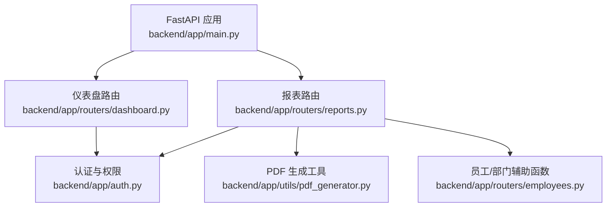
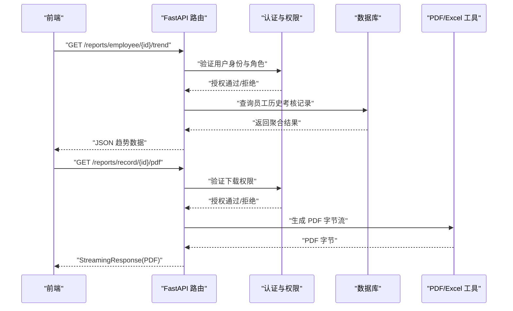
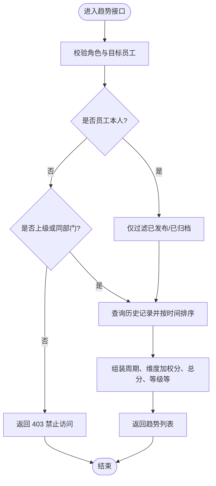
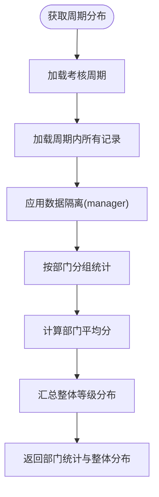
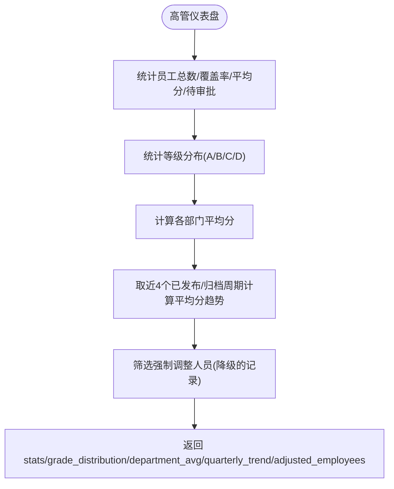
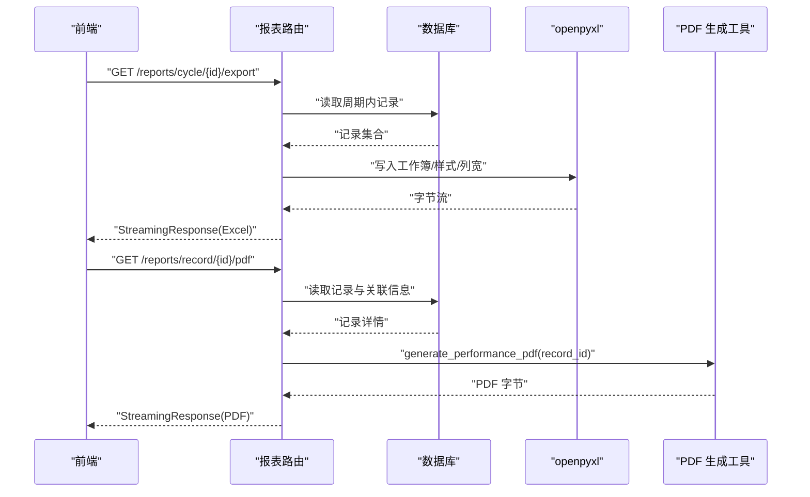
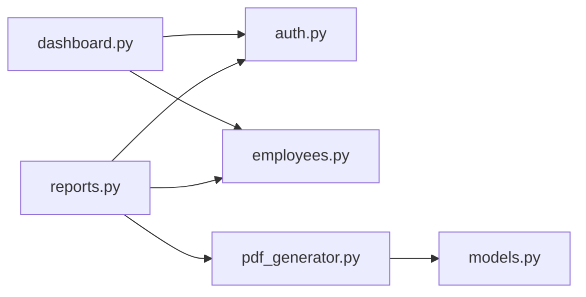
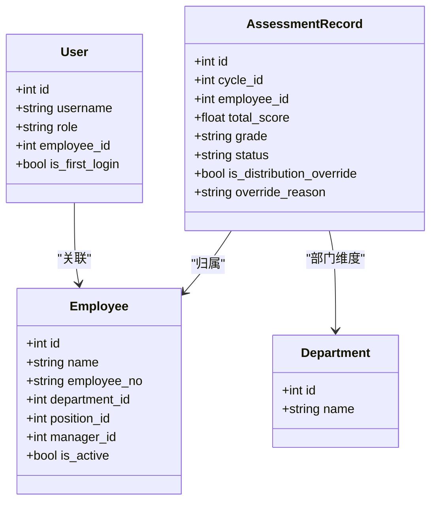

# 数据分析API

<cite>
**本文引用的文件**   
- [backend/app/main.py](file://backend/app/main.py)
- [backend/app/routers/dashboard.py](file://backend/app/routers/dashboard.py)
- [backend/app/routers/reports.py](file://backend/app/routers/reports.py)
- [backend/app/utils/pdf_generator.py](file://backend/app/utils/pdf_generator.py)
- [backend/app/auth.py](file://backend/app/auth.py)
- [backend/app/routers/employees.py](file://backend/app/routers/employees.py)
- [docs/TECH_绩效考核评分系统_v1.0.md](file://docs/TECH_绩效考核评分系统_v1.0.md)
- [docs/PRD_绩效考核评分系统_v1.0.md](file://docs/PRD_绩效考核评分系统_v1.0.md)
</cite>

## 目录
1. [引言](#引言)
2. [项目结构](#项目结构)
3. [核心组件](#核心组件)
4. [架构总览](#架构总览)
5. [详细组件分析](#详细组件分析)
6. [依赖关系分析](#依赖关系分析)
7. [性能与大数据优化](#性能与大数据优化)
8. [权限与数据隔离](#权限与数据隔离)
9. [故障排查指南](#故障排查指南)
10. [结论](#结论)

## 引言
本文件面向“数据分析API”，聚焦以下能力：
- 个人绩效查看与趋势分析
- 部门统计分析
- 高管仪表盘
- 报表生成与导出（PDF、Excel）
- 实时数据更新机制
- 数据权限控制与角色差异
- 大数据量下的查询与展示优化策略

该文档以代码实现为依据，结合产品需求与技术设计说明，给出可操作的接口规范、计算逻辑、流程图和排障建议。

## 项目结构
后端采用 FastAPI 模块化路由组织方式，数据分析相关能力主要分布在以下模块：
- 路由层：dashboard.py、reports.py
- 工具层：pdf_generator.py
- 认证与权限：auth.py
- 主应用入口：main.py
- 员工与部门辅助：routers/employees.py
- 产品与技术文档：docs/PRD_*.md、docs/TECH_*.md

**图表来源** 
- [backend/app/main.py:49-71](file://backend/app/main.py#L49-L71)
- [backend/app/routers/dashboard.py:1-12](file://backend/app/routers/dashboard.py#L1-L12)
- [backend/app/routers/reports.py:1-14](file://backend/app/routers/reports.py#L1-L14)
- [backend/app/utils/pdf_generator.py:1-10](file://backend/app/utils/pdf_generator.py#L1-L10)
- [backend/app/auth.py:116-130](file://backend/app/auth.py#L116-L130)
- [backend/app/routers/employees.py:1-50](file://backend/app/routers/employees.py#L1-L50)

**章节来源**
- [backend/app/main.py:49-71](file://backend/app/main.py#L49-L71)

## 核心组件
- 仪表盘聚合接口
  - GET /api/v1/dashboard：按角色返回统计卡片、近期周期等
  - GET /api/v1/dashboard/executive：高管专属聚合数据
  - GET /api/v1/dashboard/{manager|peer|employee}：角色化子仪表盘
- 报表与分析接口
  - GET /api/v1/reports/cycle/{cycle_id}/distribution：等级分布与部门统计
  - GET /api/v1/reports/cycle/{cycle_id}/export：导出 Excel
  - GET /api/v1/reports/cycle/{cycle_id}/distribution-adjustments：强制调整明细
  - GET /api/v1/reports/employee/{employee_id}/trend：个人历史趋势
  - GET /api/v1/reports/record/{record_id}/pdf：导出 PDF 档案

这些接口共同构成“个人绩效查看、部门统计分析、高管仪表盘、报表导出”的数据分析能力闭环。

**章节来源**
- [backend/app/routers/dashboard.py:15-136](file://backend/app/routers/dashboard.py#L15-L136)
- [backend/app/routers/dashboard.py:139-241](file://backend/app/routers/dashboard.py#L139-L241)
- [backend/app/routers/reports.py:17-82](file://backend/app/routers/reports.py#L17-L82)
- [backend/app/routers/reports.py:85-172](file://backend/app/routers/reports.py#L85-L172)
- [backend/app/routers/reports.py:175-211](file://backend/app/routers/reports.py#L175-L211)
- [backend/app/routers/reports.py:214-277](file://backend/app/routers/reports.py#L214-L277)
- [backend/app/routers/reports.py:280-306](file://backend/app/routers/reports.py#L280-L306)

## 架构总览
数据分析API的整体调用链路如下：
- 前端发起请求至 FastAPI 路由
- 路由进行鉴权与参数校验
- 服务层通过 SQLAlchemy 聚合数据库指标
- 工具层生成 PDF/Excel 并流式返回
- 统一异常处理与审计日志贯穿全程

**图表来源**
- [backend/app/routers/reports.py:214-277](file://backend/app/routers/reports.py#L214-L277)
- [backend/app/routers/reports.py:280-306](file://backend/app/routers/reports.py#L280-L306)
- [backend/app/utils/pdf_generator.py:12-100](file://backend/app/utils/pdf_generator.py#L12-L100)
- [backend/app/auth.py:116-130](file://backend/app/auth.py#L116-L130)

## 详细组件分析

### 个人绩效查看与趋势分析
- 接口：GET /api/v1/reports/employee/{employee_id}/trend
- 功能要点
  - 支持限制返回最近 N 个周期（默认 8，最大 20）
  - 对每个周期返回维度加权分、总分、等级、状态、评语等
  - 员工仅能查看本人已发布或已归档的历史记录
  - 上级可查看下属及本部门范围的趋势
  - 管理员、HR、高管可查看所有人员趋势
- 权限与数据隔离
  - peer 角色禁止访问
  - employee 只能查本人且仅 published/archived
  - manager 需满足直属下级或同部门范围
  - admin/hr/executive 全量可见

**图表来源**
- [backend/app/routers/reports.py:214-277](file://backend/app/routers/reports.py#L214-L277)

**章节来源**
- [backend/app/routers/reports.py:214-277](file://backend/app/routers/reports.py#L214-L277)

### 部门统计分析
- 接口：GET /api/v1/reports/cycle/{cycle_id}/distribution
- 功能要点
  - 按部门聚合：人数、等级计数、平均分
  - 提供公司整体等级分布
  - manager 受数据隔离约束：仅可见下属及本部门
  - admin/hr/manager 可访问
- 计算逻辑
  - 遍历周期内所有记录，按部门分组累计
  - 计算部门平均分（基于 total_score）
  - 汇总整体等级分布

**图表来源**
- [backend/app/routers/reports.py:17-82](file://backend/app/routers/reports.py#L17-L82)

**章节来源**
- [backend/app/routers/reports.py:17-82](file://backend/app/routers/reports.py#L17-L82)

### 高管仪表盘
- 接口：GET /api/v1/dashboard/executive
- 功能要点
  - 基础统计：在职员工总数、覆盖率、公司平均总分、待审批数
  - 绩效分布饼图：A/B/C/D 等级占比（基于已发布/归档记录）
  - 部门平均分对比柱状图：各部门平均总分
  - 近 4 季度趋势：按周期 end_date 倒序取最近 4 个已发布/归档周期，计算公司平均分
  - 强制调整人员列表：is_distribution_override 为真且已发布/归档的记录
- 权限：仅 executive 可访问

**图表来源**
- [backend/app/routers/dashboard.py:139-241](file://backend/app/routers/dashboard.py#L139-L241)

**章节来源**
- [backend/app/routers/dashboard.py:139-241](file://backend/app/routers/dashboard.py#L139-L241)

### 报表生成与导出流程
- Excel 导出
  - 接口：GET /api/v1/reports/cycle/{cycle_id}/export
  - 内容：工号、姓名、部门、总分、等级、原始等级、业绩/能力/态度加权分、状态、是否特批
  - 格式：application/vnd.openxmlformats-officedocument.spreadsheetml.sheet
  - 权限：admin/hr/executive
- PDF 档案
  - 接口：GET /api/v1/reports/record/{record_id}/pdf
  - 内容：基本信息、得分表、上级评语、页脚声明
  - 权限：admin/hr/executive/employee（员工仅限本人）
  - 实现：reportlab 生成 PDF 字节流，StreamingResponse 返回

**图表来源**
- [backend/app/routers/reports.py:85-172](file://backend/app/routers/reports.py#L85-L172)
- [backend/app/routers/reports.py:280-306](file://backend/app/routers/reports.py#L280-L306)
- [backend/app/utils/pdf_generator.py:12-100](file://backend/app/utils/pdf_generator.py#L12-L100)

**章节来源**
- [backend/app/routers/reports.py:85-172](file://backend/app/routers/reports.py#L85-L172)
- [backend/app/routers/reports.py:280-306](file://backend/app/routers/reports.py#L280-L306)
- [backend/app/utils/pdf_generator.py:12-100](file://backend/app/utils/pdf_generator.py#L12-L100)

### 实时数据更新机制
- 仪表盘与报表均为“读时聚合”模式：每次请求从数据库实时计算统计值
- 前端可通过轮询或 WebSocket 刷新仪表板数据（当前后端未内置推送，可在前端侧实现）
- 关键指标如覆盖率、平均分、等级分布均基于最新数据库状态

**章节来源**
- [backend/app/routers/dashboard.py:139-241](file://backend/app/routers/dashboard.py#L139-L241)
- [backend/app/routers/reports.py:17-82](file://backend/app/routers/reports.py#L17-L82)

## 依赖关系分析
- 路由依赖
  - dashboard.py 依赖 auth.get_current_user、auth.require_role、employees.get_all_dept_ids
  - reports.py 依赖 auth.get_current_user、auth.require_role、employees._is_in_subordinate_chain、employees.get_all_dept_ids
  - pdf_generator.py 依赖 models（AssessmentRecord、Employee、Department、Position、AssessmentCycle）
- 外部库
  - openpyxl：用于 Excel 生成
  - reportlab：用于 PDF 生成
  - fastapi.responses.StreamingResponse：用于大文件流式返回

**图表来源**
- [backend/app/routers/dashboard.py:1-12](file://backend/app/routers/dashboard.py#L1-L12)
- [backend/app/routers/reports.py:1-14](file://backend/app/routers/reports.py#L1-L14)
- [backend/app/utils/pdf_generator.py:1-10](file://backend/app/utils/pdf_generator.py#L1-L10)
- [backend/app/auth.py:116-130](file://backend/app/auth.py#L116-L130)
- [backend/app/routers/employees.py:1-50](file://backend/app/routers/employees.py#L1-L50)

**章节来源**
- [backend/app/routers/dashboard.py:1-12](file://backend/app/routers/dashboard.py#L1-L12)
- [backend/app/routers/reports.py:1-14](file://backend/app/routers/reports.py#L1-L14)
- [backend/app/utils/pdf_generator.py:1-10](file://backend/app/utils/pdf_generator.py#L1-L10)

## 性能与大数据优化
- 查询优化
  - 使用 SQL 聚合函数（如 avg、count）减少内存计算
  - 限制返回数量（如趋势 limit=8~20，高管趋势取最近 4 个周期）
  - 针对高频字段建立索引（如 cycle_id、employee_id、status、total_score、grade）
- 导出优化
  - 使用 StreamingResponse 避免一次性加载大文件到内存
  - Excel 生成时按需设置列宽与样式，避免过度渲染
- 缓存建议
  - 对高管仪表盘中的静态指标（如员工总数、部门列表）可引入短期缓存
  - 对趋势类数据可按周期粒度缓存，缩短重复查询耗时
- 分页与增量
  - 趋势接口已支持 limit；未来可扩展 offset/page 分页
  - 对大型报表可考虑异步任务+通知下载

[本节为通用性能建议，不直接分析具体文件]

## 权限与数据隔离
- 角色与访问范围
  - admin：全量数据访问，配置与治理
  - hr：全量数据访问，流程与规则管理
  - executive：全量只读数据，不可操作
  - manager：下属与本部门数据可见，含趋势与分布
  - employee：仅本人数据，且仅 published/archived
  - peer：受限协作评分，趋势接口明确禁止访问
- 实现要点
  - require_role 装饰器在路由层进行角色白名单校验
  - employees.get_all_dept_ids 与 _is_in_subordinate_chain 用于部门链与上下级链判断
  - 员工趋势接口中显式过滤 published/archived

**图表来源**
- [backend/app/models.py:1-200](file://backend/app/models.py#L1-L200)

**章节来源**
- [backend/app/auth.py:116-130](file://backend/app/auth.py#L116-L130)
- [backend/app/routers/reports.py:214-277](file://backend/app/routers/reports.py#L214-L277)
- [backend/app/routers/reports.py:17-82](file://backend/app/routers/reports.py#L17-L82)

## 故障排查指南
- 403 禁止访问
  - 常见原因：peer 角色访问趋势接口；employee 访问他人趋势；manager 越权访问非下属/非本部门
  - 定位方法：检查 require_role 与员工/部门隔离逻辑
- 404 资源不存在
  - 常见原因：周期 ID 或记录 ID 无效
  - 定位方法：确认传入的 cycle_id/record_id 是否存在
- 500 PDF 生成失败
  - 常见原因：记录缺失或 PDF 生成工具异常
  - 定位方法：检查 generate_performance_pdf 返回值与数据库记录完整性
- 数据不一致
  - 现象：仪表板与报表数据不一致
  - 可能原因：并发写入导致读时聚合差异；前端缓存未刷新
  - 解决：确保前端及时刷新；必要时引入一致性校验或短缓存失效策略

**章节来源**
- [backend/app/routers/reports.py:214-277](file://backend/app/routers/reports.py#L214-L277)
- [backend/app/routers/reports.py:280-306](file://backend/app/routers/reports.py#L280-L306)
- [backend/app/utils/pdf_generator.py:12-100](file://backend/app/utils/pdf_generator.py#L12-L100)

## 结论
本数据分析API围绕“个人绩效查看、部门统计分析、高管仪表盘、报表导出”构建完整的数据视图与导出能力。通过严格的角色权限与数据隔离，确保不同角色看到的数据范围与粒度符合业务要求。接口采用读时聚合与流式导出，兼顾准确性与可扩展性。建议在后续迭代中引入缓存、分页与异步导出，进一步提升大数据场景下的性能与用户体验。

[本节为总结性内容，不直接分析具体文件]