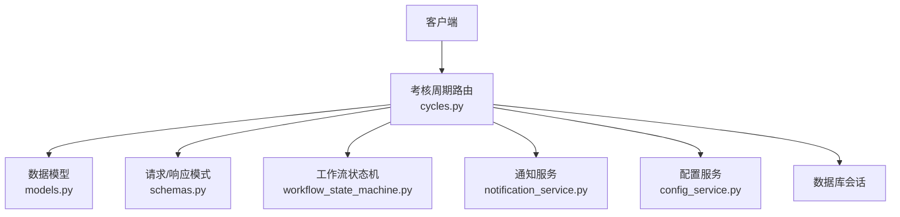
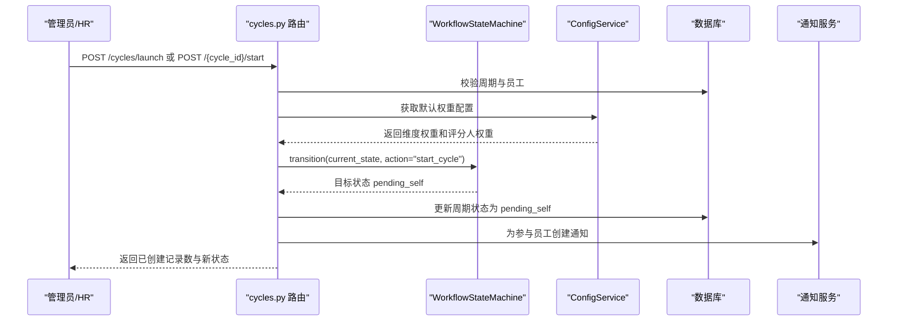
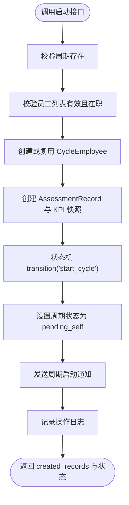
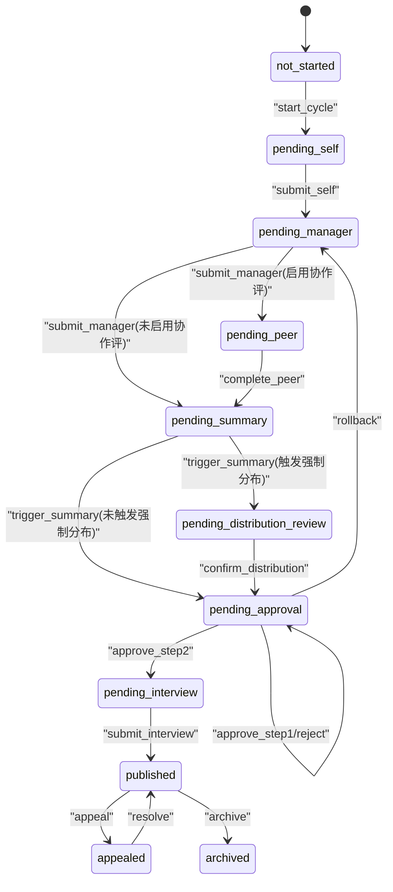
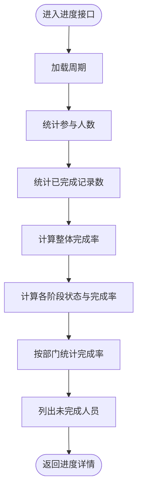
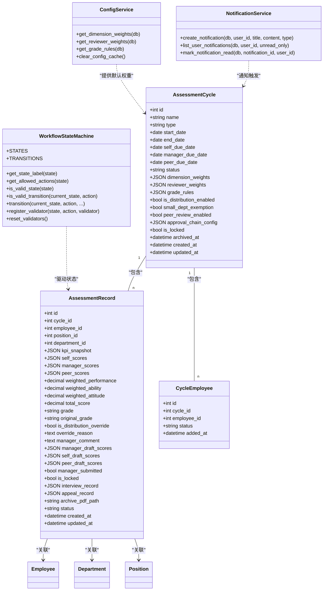

# 考核周期API

<cite>
**本文引用的文件**   
- [backend/app/routers/cycles.py](file://backend/app/routers/cycles.py)
- [backend/app/models.py](file://backend/app/models.py)
- [backend/app/schemas.py](file://backend/app/schemas.py)
- [backend/app/utils/workflow_state_machine.py](file://backend/app/utils/workflow_state_machine.py)
- [backend/app/services/notification_service.py](file://backend/app/services/notification_service.py)
- [backend/app/services/config_service.py](file://backend/app/services/config_service.py)
- [backend/tests/test_cycle_default_weights.py](file://backend/tests/test_cycle_default_weights.py)
- [docs/TECH_绩效考核评分系统_v1.0.md](file://docs/TECH_绩效考核评分系统_v1.0.md)
</cite>

## 更新摘要
**变更内容**   
- POST /cycles接口的weights字段变为可选参数，当未提供时后端自动从config_service获取默认值
- 新增了详细的权重默认值说明，包括维度权重和评分人权重的全局配置机制
- 更新了创建周期的参数说明，明确weights字段的可选性和默认值处理逻辑

## 目录
1. [引言](#引言)
2. [项目结构](#项目结构)
3. [核心组件](#核心组件)
4. [架构总览](#架构总览)
5. [详细组件分析](#详细组件分析)
6. [依赖关系分析](#依赖关系分析)
7. [性能与扩展性](#性能与扩展性)
8. [故障排查指南](#故障排查指南)
9. [结论](#结论)
10. [附录：接口清单与参数说明](#附录接口清单与参数说明)

## 引言
本文件面向"考核周期"相关 API，覆盖创建、启动、暂停（取消）、结束（发布、归档、解冻）等生命周期管理接口；详细说明状态机驱动的流程控制、阶段业务规则与约束条件；包含参与者管理、进度监控、自动提醒等功能接口；提供考核周期配置的详细参数说明（评分权重、时间设置、参与范围等）；明确状态转换规则与限制，确保业务流程正确；并给出周期数据的统计分析与报表生成接口。

## 项目结构
围绕考核周期的后端实现主要位于以下模块：
- 路由层：`backend/app/routers/cycles.py`
- 数据模型：`backend/app/models.py`
- 请求/响应模式：`backend/app/schemas.py`
- 状态机工具：`backend/app/utils/workflow_state_machine.py`
- 通知服务：`backend/app/services/notification_service.py`
- 配置服务：`backend/app/services/config_service.py`
- 技术文档参考：`docs/TEECH_绩效考核评分系统_v1.0.md`



**图表来源**
- [backend/app/routers/cycles.py:1-33](file://backend/app/routers/cycles.py#L1-L33)
- [backend/app/models.py:62-83](file://backend/app/models.py#L62-L83)
- [backend/app/schemas.py:208-323](file://backend/app/schemas.py#L208-L323)
- [backend/app/utils/workflow_state_machine.py:10-78](file://backend/app/utils/workflow_state_machine.py#L10-L78)
- [backend/app/services/notification_service.py:5-17](file://backend/app/services/notification_service.py#L5-L17)
- [backend/app/services/config_service.py:1-100](file://backend/app/services/config_service.py#L1-L100)

**章节来源**
- [backend/app/routers/cycles.py:1-33](file://backend/app/routers/cycles.py#L1-L33)
- [backend/app/models.py:62-83](file://backend/app/models.py#L62-L83)
- [backend/app/schemas.py:208-323](file://backend/app/schemas.py#L208-L323)

## 核心组件
- 考核周期实体：`AssessmentCycle`，包含名称、类型、起止时间、各阶段截止时间、状态、维度权重、评分人权重、等级规则、强制分布开关、小部门豁免、协作评开关、审批链配置、锁定标志、归档时间等。
- 考核记录实体：`AssessmentRecord`，关联周期与员工，保存 KPI 快照、各维度加权分、总分、等级、原始等级、是否强制调整、面谈与申诉信息、归档 PDF 路径、状态等。
- 周期-员工关系：`CycleEmployee`，表示某员工被纳入某考核周期及其加入状态。
- 状态机：`WorkflowStateMachine`，定义完整状态集合与转换规则，支持条件转换、额外校验注册、操作日志记录。
- 通知服务：`NotificationService`，用于在关键节点创建站内通知。
- 配置服务：`ConfigService`，提供全局配置默认值，包括维度权重、评分人权重、等级规则等。

**章节来源**
- [backend/app/models.py:62-129](file://backend/app/models.py#L62-L129)
- [backend/app/models.py:167-174](file://backend/app/models.py#L167-L174)
- [backend/app/utils/workflow_state_machine.py:10-78](file://backend/app/utils/workflow_state_machine.py#L10-L78)
- [backend/app/services/notification_service.py:5-17](file://backend/app/services/notification_service.py#L5-L17)
- [backend/app/services/config_service.py:41-100](file://backend/app/services/config_service.py#L41-L100)

## 架构总览
考核周期的生命周期由路由层协调，结合状态机进行强约束的状态流转，并在关键节点触发通知与审计日志。



**图表来源**
- [backend/app/routers/cycles.py:307-382](file://backend/app/routers/cycles.py#L307-L382)
- [backend/app/routers/cycles.py:385-465](file://backend/app/routers/cycles.py#L385-L465)
- [backend/app/utils/workflow_state_machine.py:39-42](file://backend/app/utils/workflow_state_machine.py#L39-L42)
- [backend/app/services/notification_service.py:5-17](file://backend/app/services/notification_service.py#L5-L17)
- [backend/app/services/config_service.py:55-81](file://backend/app/services/config_service.py#L55-L81)

## 详细组件分析

### 生命周期管理接口

#### 1) 创建考核周期
- 接口：`POST /cycles`
- 权限：admin/hr
- 功能要点：
  - 规范化等级规则，兼容简单值与区间对象。
  - 校验名称唯一性。
  - 默认状态为 `not_started`。
  - **新增**：当未提供weights参数时，自动从config_service获取默认权重配置。
  - 写入维度权重、评分人权重、等级规则、小部门豁免、协作评开关等配置。
- 输入参数（来自 `AssessmentCycleCreate`）：
  - name、type、start_date、end_date
  - self_due_date、manager_due_date、peer_due_date
  - **weights（可选）**：维度权重，总和必须为 100。如未提供则使用全局默认值。
  - grade_rules（等级规则，支持简单值或区间对象）
  - small_dept_exemption、peer_review_enabled、department_ids（可选）
- 输出字段：id、name、type、起止时间、各阶段截止时间、status、weights、grade_rules、peer_review_enabled、created_at。

**更新** weights字段现在为可选参数，当未提供时后端会自动调用config_service.get_dimension_weights()和config_service.get_reviewer_weights()来获取默认权重配置。

**章节来源**
- [backend/app/routers/cycles.py:160-227](file://backend/app/routers/cycles.py#L160-L227)
- [backend/app/schemas.py:215-228](file://backend/app/schemas.py#L215-L228)
- [backend/app/services/config_service.py:55-81](file://backend/app/services/config_service.py#L55-L81)

#### 2) 查询与筛选周期列表
- 接口：`GET /cycles`
- 能力：按 status、type、start_date、end_date 筛选，分页返回。
- 返回项包含周期基本信息、权重、等级规则、开关标志及创建时间。

**章节来源**
- [backend/app/routers/cycles.py:50-115](file://backend/app/routers/cycles.py#L50-L115)

#### 3) 获取周期详情
- 接口：`GET /cycles/{cycle_id}`
- 能力：返回周期详情，并附带参与员工的部门列表。

**章节来源**
- [backend/app/routers/cycles.py:118-157](file://backend/app/routers/cycles.py#L118-L157)

#### 4) 修改周期配置
- 接口：`PUT /cycles/{cycle_id}`
- 权限：admin/hr
- 约束：仅当周期状态为 `not_started` 时可修改。
- 可更新字段：name、type、日期、weights、grade_rules、small_dept_exemption、peer_review_enabled。

**章节来源**
- [backend/app/routers/cycles.py:230-284](file://backend/app/routers/cycles.py#L230-L284)

#### 5) 删除周期
- 接口：`DELETE /cycles/{cycle_id}`
- 权限：admin/hr
- 约束：仅 `not_started` 且无考核记录的周期可删除。

**章节来源**
- [backend/app/routers/cycles.py:287-309](file://backend/app/routers/cycles.py#L287-L309)

#### 6) 启动考核周期（两种风格）
- 接口A：`POST /cycles/launch`
- 接口B：`POST /{cycle_id}/start`
- 权限：admin/hr
- 共同流程：
  - 校验周期存在。
  - 校验至少选择一名员工。
  - 校验员工存在且在职。
  - 为每个员工创建或复用 `CycleEmployee` 与 `AssessmentRecord`，并生成 KPI 快照。
  - 使用状态机执行 `start_cycle`，将周期状态转为 `pending_self`。
  - 向参与员工发送通知。
  - 记录操作日志。
- 区别：
  - `/launch` 直接设置状态为 `pending_self`。
  - `/{cycle_id}/start` 通过状态机计算目标状态，增强一致性。



**图表来源**
- [backend/app/routers/cycles.py:312-387](file://backend/app/routers/cycles.py#L312-L387)
- [backend/app/routers/cycles.py:390-470](file://backend/app/routers/cycles.py#L390-L470)
- [backend/app/utils/workflow_state_machine.py:39-42](file://backend/app/utils/workflow_state_machine.py#L39-L42)

**章节来源**
- [backend/app/routers/cycles.py:312-470](file://backend/app/routers/cycles.py#L312-L470)
- [backend/app/utils/workflow_state_machine.py:39-42](file://backend/app/utils/workflow_state_machine.py#L39-L42)

#### 7) 暂停（取消）考核周期
- 接口：`POST /{cycle_id}/cancel`
- 权限：admin/hr
- 行为：将周期状态置为 `cancelled`，并将该周期下所有考核记录状态置为 `cancelled`。

**章节来源**
- [backend/app/routers/cycles.py:717-741](file://backend/app/routers/cycles.py#L717-L741)

#### 8) 发布考核结果
- 接口：`POST /{cycle_id}/publish`
- 权限：admin/hr
- 前置校验：
  - 周期下所有记录必须到达 `pending_interview` 或已发布/归档。
  - 处于 `pending_interview` 的记录必须有面谈记录。
- 行为：批量将 `pending_interview` 记录改为 `published`，并更新周期状态为 `published`。

**章节来源**
- [backend/app/routers/cycles.py:928-999](file://backend/app/routers/cycles.py#L928-L999)

#### 9) 归档与解冻
- 归档接口：`POST /{cycle_id}/archive`
  - 权限：admin/hr
  - 约束：仅 `published` 的周期可归档。
  - 行为：周期状态改为 `archived`，设置 `is_locked=True`，归档时间写入；同时锁定该周期下所有记录；异步生成每条记录的归档 PDF。
- 解冻接口：`POST /{cycle_id}/unarchive`
  - 权限：admin
  - 约束：仅 `archived` 的周期可解冻。
  - 行为：周期状态恢复为 `published`，解锁周期与记录。

**章节来源**
- [backend/app/routers/cycles.py:744-831](file://backend/app/routers/cycles.py#L744-L831)

#### 10) 测试辅助推进状态
- 接口：`POST /{cycle_id}/advance-to-approval`
- 接口：`POST /{cycle_id}/advance-to-interview`
- 用途：E2E 测试中将周期下所有记录推进到指定状态。

**章节来源**
- [backend/app/routers/cycles.py:1002-1027](file://backend/app/routers/cycles.py#L1002-L1027)

### 状态机驱动的流程控制

#### 状态集合与中文描述
- not_started：未开始
- pending_self：待自评
- pending_manager：待上级评分
- pending_peer：待协作评分
- pending_summary：待汇总
- pending_distribution_review：待强制分布审核
- pending_approval：待审批
- pending_interview：待面谈
- published：已发布
- appealed：申诉中
- archived：已归档

#### 核心转换规则
- not_started → start_cycle → pending_self
- pending_self → submit_self → pending_manager
- pending_manager → submit_manager → pending_peer（若启用协作评）或 pending_summary
- pending_peer → complete_peer → pending_summary
- pending_summary → trigger_summary → pending_distribution_review（若触发强制分布）或 pending_approval
- pending_distribution_review → confirm_distribution → pending_approval
- pending_approval → approve_step1/step2/reject/rollback（多步审批与回滚）
- pending_interview → submit_interview → published
- published → appeal → appealed；published → archive → archived
- appealed → resolve → published



**图表来源**
- [backend/app/utils/workflow_state_machine.py:22-78](file://backend/app/utils/workflow_state_machine.py#L22-L78)

**章节来源**
- [backend/app/utils/workflow_state_machine.py:10-78](file://backend/app/utils/workflow_state_machine.py#L10-L78)

### 参与者管理与进度监控

#### 参与者管理
- 添加参与者：`POST /cycles/add-employees`
  - 校验周期存在。
  - 对每个员工创建或复用 `CycleEmployee`，如不存在则创建 `AssessmentRecord`。
- 移除参与者：`DELETE /{cycle_id}/employees/{employee_id}`
- 查看参与者列表：`GET /{cycle_id}/employees`
  - 返回员工编号、姓名、部门、岗位、状态、加入时间等。

**章节来源**
- [backend/app/routers/cycles.py:473-515](file://backend/app/routers/cycles.py#L473-L515)
- [backend/app/routers/cycles.py:518-532](file://backend/app/routers/cycles.py#L518-L532)
- [backend/app/routers/cycles.py:535-571](file://backend/app/routers/cycles.py#L535-L571)

#### 进度监控
- 接口：`GET /{cycle_id}/progress`
- 返回内容：
  - 周期状态、阶段状态（自评、上级评、协作评、汇总、审批）、整体完成率、参与人数、已完成人数、更新时间。
  - 自评、上级评、协作评完成率。
  - 各部门完成率。
  - 未完成人员名单（当前阶段未完成）。



**图表来源**
- [backend/app/routers/cycles.py:574-714](file://backend/app/routers/cycles.py#L574-L714)

**章节来源**
- [backend/app/routers/cycles.py:574-714](file://backend/app/routers/cycles.py#L574-L714)

### 自动提醒与通知
- 在周期启动时，为参与员工创建通知，提示尽快完成自评。
- 通知服务提供创建、查询、标记已读等方法。

**章节来源**
- [backend/app/routers/cycles.py:365-375](file://backend/app/routers/cycles.py#L365-L375)
- [backend/app/routers/cycles.py:448-458](file://backend/app/routers/cycles.py#L448-L458)
- [backend/app/services/notification_service.py:5-17](file://backend/app/services/notification_service.py#L5-L17)

### 考核周期配置参数说明

#### 维度权重与评分人权重
- **维度权重（`weights`）**：业绩、能力、态度的权重之和必须为 100。**新增**：此字段现在是可选的，当未提供时自动从config_service获取默认值。
- **评分人权重（`reviewer_weights`）**：每个维度下自评、上级、协作的权重之和必须为 100。

**更新** 维度权重现在支持两种处理方式：
1. 显式提供：客户端在请求中传入weights字段，总和必须为100
2. 使用默认值：不传weights字段时，系统自动从config_service获取全局默认配置

#### 权重默认值机制
系统通过config_service提供全局权重默认值：

- **维度权重默认值**：
  ```json
  {
    "performance": 60,
    "ability": 20, 
    "attitude": 20
  }
  ```

- **评分人权重默认值**：
  ```json
  {
    "performance": {"self": 30, "manager": 70, "peer": 0},
    "ability": {"self": 20, "manager": 60, "peer": 20},
    "attitude": {"self": 10, "manager": 50, "peer": 40}
  }
  ```

这些默认值存储在SystemConfig表中，支持动态配置和管理。

#### 等级规则（`grade_rules`）
- 支持简单值（如 A=90）或区间对象（如 A={min:90,max:100,ratio_limit:0.2}）。
- 区间需满足：
  - min < max
  - 最低等级 min=0，最高等级 max=100
  - 区间不重叠且连续（允许极小间隙）
  - ratio_limit 合计不超过 100%

#### 时间设置
- start_date ≤ end_date
- 各阶段截止时间递增：self_due_date < manager_due_date < peer_due_date
- 所有时间不得早于今天

#### 参与范围与开关
- department_ids：可选，但为空数组会被拒绝。
- small_dept_exemption：小部门豁免开关。
- peer_review_enabled：协作评开关，影响状态机从上级评到协作评或汇总的分支。

**章节来源**
- [backend/app/schemas.py:215-228](file://backend/app/schemas.py#L215-L228)
- [backend/app/schemas.py:405-458](file://backend/app/schemas.py#L405-L458)
- [backend/app/models.py:62-83](file://backend/app/models.py#L62-L83)
- [backend/app/services/config_service.py:55-81](file://backend/app/services/config_service.py#L55-L81)

### 统计分析、报表与导出

#### 周期进度统计
- 接口：`GET /{cycle_id}/progress`
- 提供阶段状态、完成率、部门完成率、未完成人员明细。

#### Excel 导出
- 接口：`GET /{cycle_id}/export-excel`
- 权限：admin/hr/executive
- 能力：导出周期汇总报表，支持按部门筛选。
- 字段：工号、姓名、部门、总分、等级、原始等级、业绩分、能力分、态度分、强制调整标记、状态。

#### 其他报表接口（技术文档）
- 等级分布、强制调整人员清单、历史趋势、PDF 档案等接口见技术文档。

**章节来源**
- [backend/app/routers/cycles.py:574-714](file://backend/app/routers/cycles.py#L574-L714)
- [backend/app/routers/cycles.py:834-925](file://backend/app/routers/cycles.py#L834-L925)
- [docs/TECH_绩效考核评分系统_v1.0.md:1033-1040](file://docs/TECH_绩效考核评分系统_v1.0.md#L1033-L1040)

## 依赖关系分析



**图表来源**
- [backend/app/models.py:62-129](file://backend/app/models.py#L62-L129)
- [backend/app/models.py:167-174](file://backend/app/models.py#L167-L174)
- [backend/app/utils/workflow_state_machine.py:10-78](file://backend/app/utils/workflow_state_machine.py#L10-L78)
- [backend/app/services/notification_service.py:5-17](file://backend/app/services/notification_service.py#L5-L17)
- [backend/app/services/config_service.py:41-100](file://backend/app/services/config_service.py#L41-L100)

**章节来源**
- [backend/app/models.py:62-129](file://backend/app/models.py#L62-L129)
- [backend/app/models.py:167-174](file://backend/app/models.py#L167-L174)
- [backend/app/utils/workflow_state_machine.py:10-78](file://backend/app/utils/workflow_state_machine.py#L10-L78)
- [backend/app/services/notification_service.py:5-17](file://backend/app/services/notification_service.py#L5-L17)
- [backend/app/services/config_service.py:41-100](file://backend/app/services/config_service.py#L41-L100)

## 性能与扩展性
- 批量操作：启动周期时为多个员工创建记录与快照，建议关注批量插入的性能与事务边界。
- 异步任务：归档时异步生成 PDF，避免阻塞主流程。
- 统计查询：进度统计涉及多次聚合与关联查询，建议在高频访问场景考虑缓存或预聚合。
- 配置缓存：config_service使用内存缓存提高配置读取性能。
- 可扩展点：
  - 通过状态机注册额外校验函数，扩展业务约束。
  - 扩展通知渠道（邮件、短信、IM）。
  - 扩展报表导出格式（CSV、PDF）。
  - 通过config_service扩展更多全局配置项。

## 故障排查指南
- 周期不可修改：仅在 `not_started` 状态下可修改；否则返回错误。
- 周期不可删除：仅在 `not_started` 且无考核记录时可删除。
- 启动失败：检查员工是否存在且在职；检查至少选择一名员工。
- 发布失败：检查是否有未完成审批或未完成面谈的记录。
- 归档失败：仅 `published` 状态可归档；归档后周期与记录将被锁定。
- 解冻失败：仅 `archived` 状态可解冻；解冻后周期与记录解锁。
- **权重配置问题**：如果weights字段未提供，确认config_service中的默认配置是否正确设置。

**章节来源**
- [backend/app/routers/cycles.py:230-284](file://backend/app/routers/cycles.py#L230-L284)
- [backend/app/routers/cycles.py:287-309](file://backend/app/routers/cycles.py#L287-L309)
- [backend/app/routers/cycles.py:312-470](file://backend/app/routers/cycles.py#L312-L470)
- [backend/app/routers/cycles.py:928-999](file://backend/app/routers/cycles.py#L928-L999)
- [backend/app/routers/cycles.py:744-831](file://backend/app/routers/cycles.py#L744-L831)

## 结论
本 API 体系以状态机为核心，严格约束考核周期的生命周期流转，并提供完善的参与者管理、进度监控、通知提醒与报表导出能力。通过清晰的配置参数与校验规则，确保业务流程的正确性与可追溯性。**新增的权重默认值机制**使得系统在未显式提供权重配置时能够自动使用全局默认配置，提高了系统的易用性和灵活性。建议在大规模使用中关注批量操作性能与统计查询优化，并通过状态机扩展点持续完善业务约束。

## 附录：接口清单与参数说明

### 生命周期接口
- `POST /cycles`：创建考核周期
- `GET /cycles`：查询周期列表（支持筛选与分页）
- `GET /cycles/{cycle_id}`：查询周期详情
- `PUT /cycles/{cycle_id}`：修改周期配置
- `DELETE /cycles/{cycle_id}`：删除周期
- `POST /cycles/launch`：启动周期（非 RESTful）
- `POST /{cycle_id}/start`：启动周期（RESTful）
- `POST /{cycle_id}/cancel`：取消周期
- `POST /{cycle_id}/publish`：发布周期结果
- `POST /{cycle_id}/archive`：归档周期
- `POST /{cycle_id}/unarchive`：解冻周期
- `POST /{cycle_id}/advance-to-approval`：测试辅助推进至审批
- `POST /{cycle_id}/advance-to-interview`：测试辅助推进至面谈

### 参与者管理接口
- `POST /cycles/add-employees`：添加参与者
- `DELETE /{cycle_id}/employees/{employee_id}`：移除参与者
- `GET /{cycle_id}/employees`：查询参与者列表

### 进度与统计接口
- `GET /{cycle_id}/progress`：周期进度监控
- `GET /{cycle_id}/export-excel`：导出周期汇总 Excel

### 关键参数说明
- **维度权重（`weights`）**：**更新** 现在为可选参数。总和必须为 100。如未提供则使用config_service的全局默认值（performance: 60%, ability: 20%, attitude: 20%）。
- 评分人权重（`reviewer_weights`）：每个维度下自评、上级、协作权重之和必须为 100。
- 等级规则（`grade_rules`）：区间需满足连续性、不重叠、全覆盖与比例上限约束。
- 时间设置：起止时间与阶段截止时间需满足递增与未来时间约束。
- 参与范围：`department_ids` 可为空数组但会被拒绝；`small_dept_exemption`、`peer_review_enabled` 控制业务开关。

**章节来源**
- [backend/app/routers/cycles.py:50-115](file://backend/app/routers/cycles.py#L50-L115)
- [backend/app/routers/cycles.py:118-157](file://backend/app/routers/cycles.py#L118-L157)
- [backend/app/routers/cycles.py:160-227](file://backend/app/routers/cycles.py#L160-L227)
- [backend/app/routers/cycles.py:230-309](file://backend/app/routers/cycles.py#L230-L309)
- [backend/app/routers/cycles.py:312-470](file://backend/app/routers/cycles.py#L312-L470)
- [backend/app/routers/cycles.py:473-571](file://backend/app/routers/cycles.py#L473-L571)
- [backend/app/routers/cycles.py:574-714](file://backend/app/routers/cycles.py#L574-L714)
- [backend/app/routers/cycles.py:717-831](file://backend/app/routers/cycles.py#L717-L831)
- [backend/app/routers/cycles.py:834-925](file://backend/app/routers/cycles.py#L834-L925)
- [backend/app/routers/cycles.py:928-1027](file://backend/app/routers/cycles.py#L928-L1027)
- [backend/app/schemas.py:215-323](file://backend/app/schemas.py#L215-L323)
- [backend/app/schemas.py:405-458](file://backend/app/schemas.py#L405-L458)
- [backend/app/services/config_service.py:55-81](file://backend/app/services/config_service.py#L55-L81)
- [backend/tests/test_cycle_default_weights.py:1-39](file://backend/tests/test_cycle_default_weights.py#L1-L39)