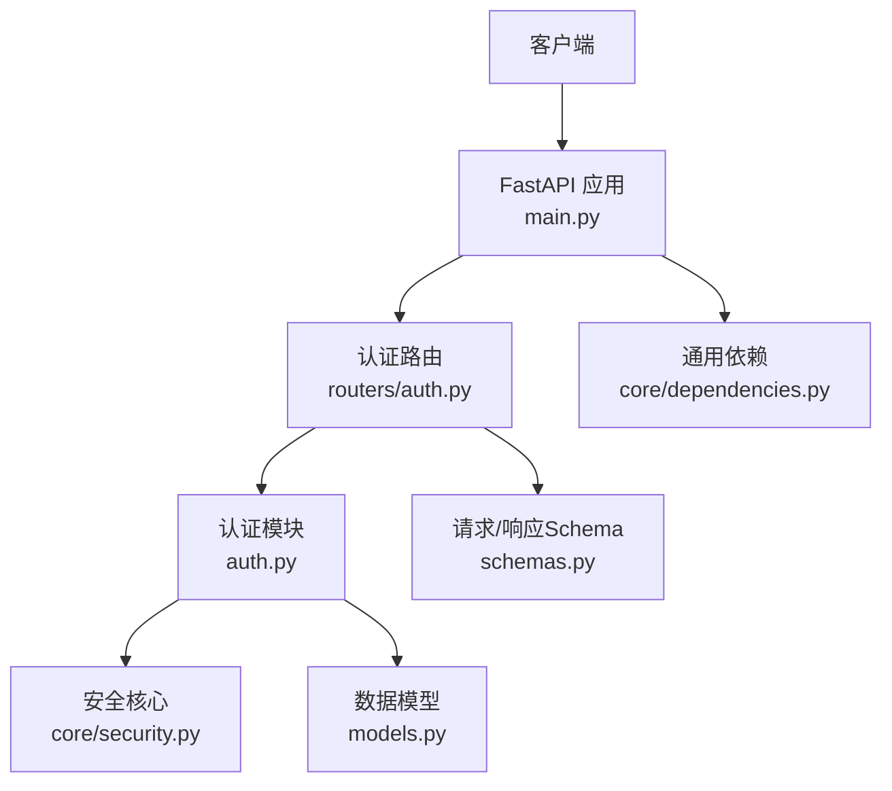
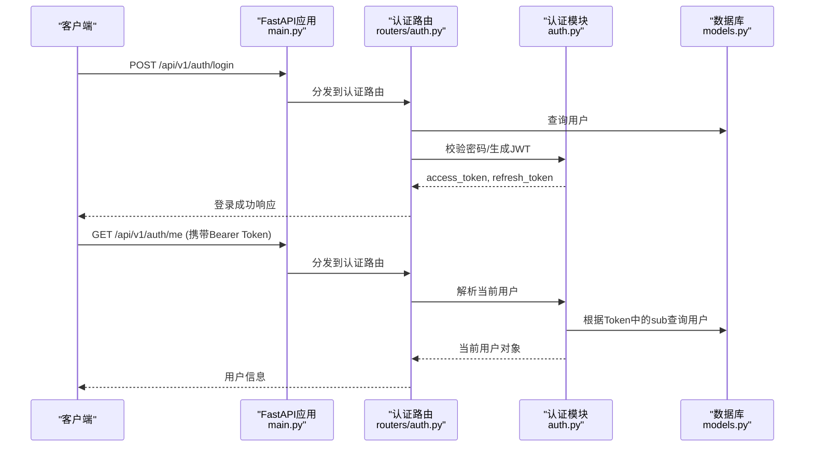
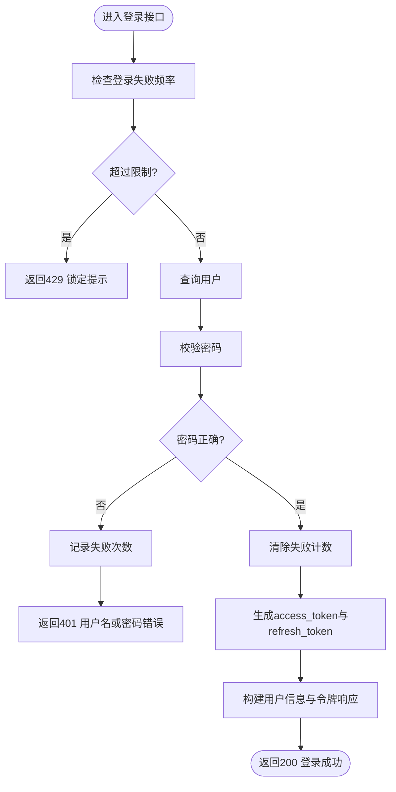
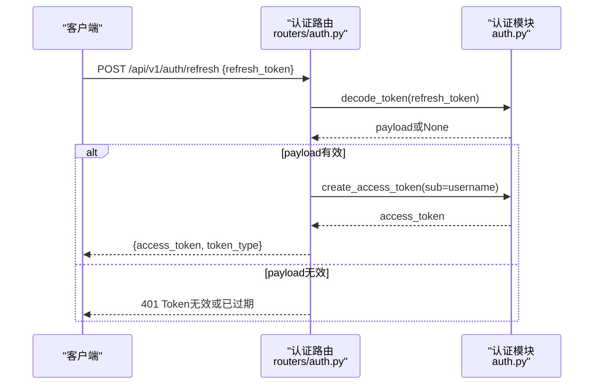
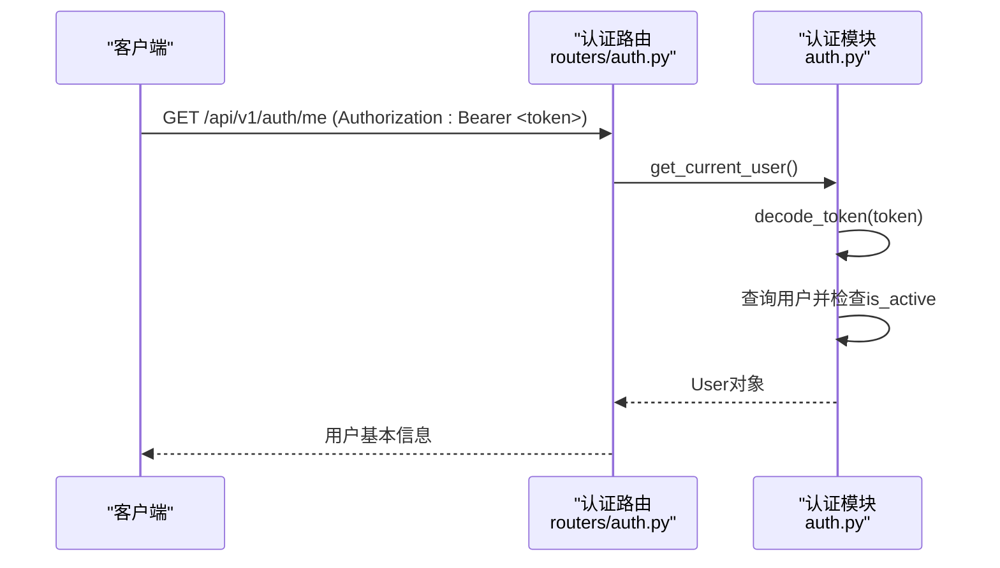
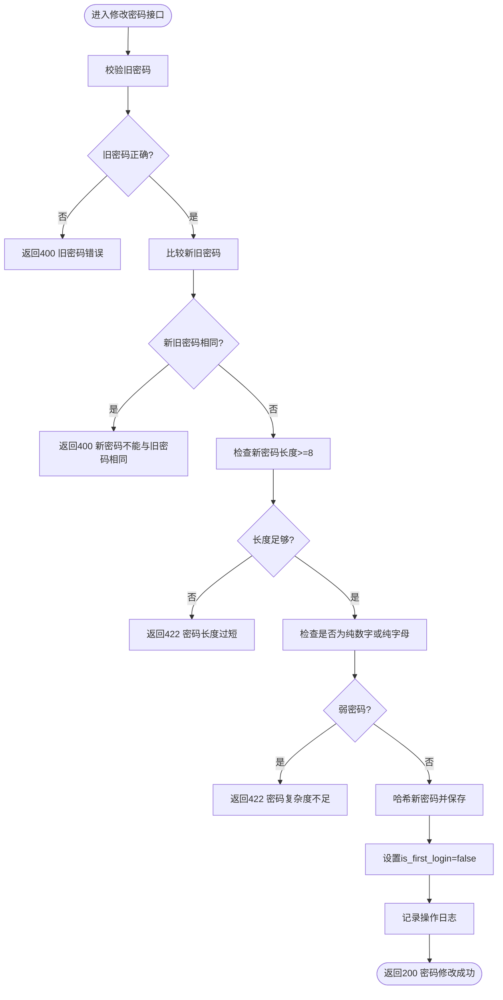
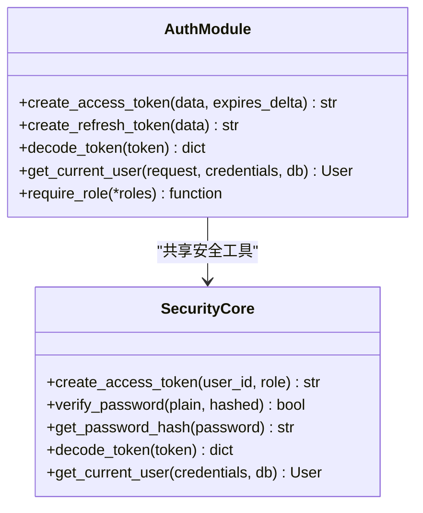
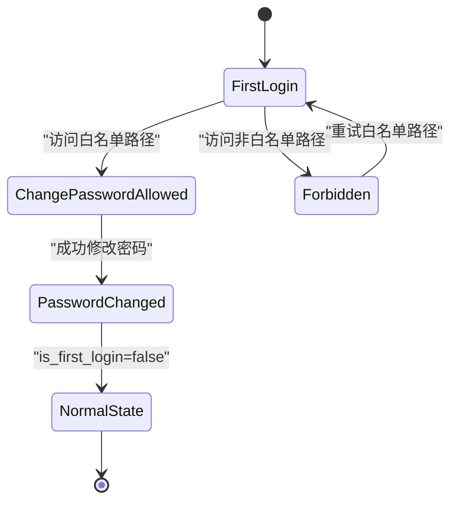
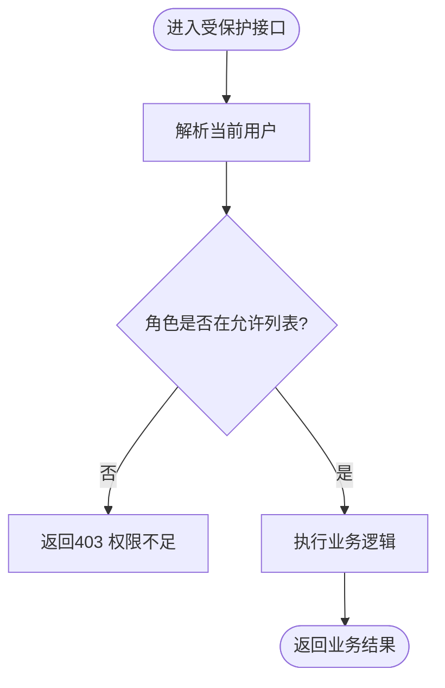

# 认证授权API

<cite>
**本文引用的文件**   
- [backend/app/routers/auth.py](file://backend/app/routers/auth.py)
- [backend/app/auth.py](file://backend/app/auth.py)
- [backend/app/core/security.py](file://backend/app/core/security.py)
- [backend/app/core/dependencies.py](file://backend/app/core/dependencies.py)
- [backend/app/models.py](file://backend/app/models.py)
- [backend/app/schemas.py](file://backend/app/schemas.py)
- [backend/app/main.py](file://backend/app/main.py)
- [backend/tests/test_auth.py](file://backend/tests/test_auth.py)
</cite>

## 目录
1. [简介](#简介)
2. [项目结构](#项目结构)
3. [核心组件](#核心组件)
4. [架构总览](#架构总览)
5. [详细接口规范](#详细接口规范)
6. [依赖与权限控制](#依赖与权限控制)
7. [性能与安全特性](#性能与安全特性)
8. [故障排查指南](#故障排查指南)
9. [结论](#结论)

## 简介
本文件为绩效考核评分系统的认证授权API文档，覆盖以下能力：
- 用户登录、登出
- 密码修改（含复杂度校验）
- 令牌刷新
- JWT令牌的获取、验证与刷新机制
- RBAC角色权限控制
- 首次登录强制改密
- 登录失败锁定机制
- 完整的请求/响应示例与错误场景说明

## 项目结构
认证相关代码主要分布在以下模块：
- 路由层：`backend/app/routers/auth.py`
- 认证逻辑与RBAC：`backend/app/auth.py`
- 通用安全工具与依赖：`backend/app/core/security.py`、`backend/app/core/dependencies.py`
- 数据模型：`backend/app/models.py`
- 请求/响应Schema：`backend/app/schemas.py`
- 应用入口与路由挂载：`backend/app/main.py`
- 认证测试用例：`backend/tests/test_auth.py`

**图表来源**
- [backend/app/main.py:49-71](file://backend/app/main.py#L49-L71)
- [backend/app/routers/auth.py:1-28](file://backend/app/routers/auth.py#L1-L28)
- [backend/app/auth.py:1-27](file://backend/app/auth.py#L1-L27)
- [backend/app/core/security.py:1-17](file://backend/app/core/security.py#L1-L17)
- [backend/app/models.py:49-60](file://backend/app/models.py#L49-L60)
- [backend/app/schemas.py:12-29](file://backend/app/schemas.py#L12-L29)

**章节来源**
- [backend/app/main.py:49-71](file://backend/app/main.py#L49-L71)
- [backend/app/routers/auth.py:1-28](file://backend/app/routers/auth.py#L1-L28)
- [backend/app/auth.py:1-27](file://backend/app/auth.py#L1-L27)
- [backend/app/core/security.py:1-17](file://backend/app/core/security.py#L1-L17)
- [backend/app/models.py:49-60](file://backend/app/models.py#L49-L60)
- [backend/app/schemas.py:12-29](file://backend/app/schemas.py#L12-L29)

## 核心组件
- 认证路由：提供登录、刷新、个人信息、修改密码、登出等接口。
- 认证模块：实现JWT创建/解码、密码哈希/校验、当前用户解析、首次登录白名单、RBAC角色检查。
- 安全核心：提供通用的JWT工具、密码工具、以及基于HTTP Bearer的当前用户解析。
- 通用依赖：提供“未认证返回403”的依赖和按角色的依赖封装。
- 数据模型：User表包含用户名、密码哈希、角色、是否激活、是否首次登录等字段。
- Schema：定义登录请求、登录响应、修改密码请求、刷新令牌请求等数据结构。

**章节来源**
- [backend/app/routers/auth.py:63-178](file://backend/app/routers/auth.py#L63-L178)
- [backend/app/auth.py:19-129](file://backend/app/auth.py#L19-L129)
- [backend/app/core/security.py:20-138](file://backend/app/core/security.py#L20-L138)
- [backend/app/core/dependencies.py:10-50](file://backend/app/core/dependencies.py#L10-L50)
- [backend/app/models.py:49-60](file://backend/app/models.py#L49-L60)
- [backend/app/schemas.py:12-29](file://backend/app/schemas.py#L12-L29)

## 架构总览
认证流程整体如下：
- 客户端通过HTTP调用认证接口。
- FastAPI路由将请求交由认证处理函数。
- 认证处理函数使用数据库查询用户、校验密码、生成JWT。
- 受保护接口通过依赖注入解析当前用户并执行RBAC检查。
- 首次登录用户仅能访问白名单接口，否则返回禁止访问。

**图表来源**
- [backend/app/main.py:49-71](file://backend/app/main.py#L49-L71)
- [backend/app/routers/auth.py:63-122](file://backend/app/routers/auth.py#L63-L122)
- [backend/app/auth.py:46-113](file://backend/app/auth.py#L46-L113)
- [backend/app/models.py:49-60](file://backend/app/models.py#L49-L60)

## 详细接口规范

### 登录
- 方法：POST
- URL：/api/v1/auth/login
- 请求体：
  - username：字符串，必填
  - password：字符串，必填
  - remember_me：布尔值，可选，默认false
- 成功响应：
  - access_token：字符串，JWT访问令牌
  - refresh_token：字符串，JWT刷新令牌
  - token_type：固定为bearer
  - user：对象，包含id、username、role、name、employee_id、is_first_login
- 错误场景：
  - 用户名或密码错误：401
  - 参数缺失或格式错误：422
  - 登录失败次数过多：429（同一用户名连续失败达到阈值后触发）

**图表来源**
- [backend/app/routers/auth.py:35-93](file://backend/app/routers/auth.py#L35-L93)

**章节来源**
- [backend/app/routers/auth.py:63-93](file://backend/app/routers/auth.py#L63-L93)
- [backend/app/schemas.py:13-23](file://backend/app/schemas.py#L13-L23)
- [backend/tests/test_auth.py:5-62](file://backend/tests/test_auth.py#L5-L62)

### 刷新令牌
- 方法：POST
- URL：/api/v1/auth/refresh
- 请求体：
  - refresh_token：字符串，必填
- 成功响应：
  - access_token：字符串，新的JWT访问令牌
  - token_type：固定为bearer
- 错误场景：
  - refresh_token无效或过期：401
  - 参数缺失或格式错误：422

**图表来源**
- [backend/app/routers/auth.py:96-111](file://backend/app/routers/auth.py#L96-L111)
- [backend/app/auth.py:60-65](file://backend/app/auth.py#L60-L65)

**章节来源**
- [backend/app/routers/auth.py:96-111](file://backend/app/routers/auth.py#L96-L111)
- [backend/app/schemas.py:28-29](file://backend/app/schemas.py#L28-L29)
- [backend/tests/test_auth.py:64-85](file://backend/tests/test_auth.py#L64-L85)

### 获取当前用户信息
- 方法：GET
- URL：/api/v1/auth/me
- 鉴权：需要有效的Bearer Token
- 成功响应：
  - id：整数
  - username：字符串
  - name：字符串
  - role：字符串
  - employee_id：整数
- 错误场景：
  - 未提供认证凭据：401
  - Token无效或已过期：401
  - 用户不存在或被禁用：401

**图表来源**
- [backend/app/routers/auth.py:114-122](file://backend/app/routers/auth.py#L114-L122)
- [backend/app/auth.py:68-113](file://backend/app/auth.py#L68-L113)

**章节来源**
- [backend/app/routers/auth.py:114-122](file://backend/app/routers/auth.py#L114-L122)
- [backend/tests/test_auth.py:87-107](file://backend/tests/test_auth.py#L87-L107)

### 修改密码
- 方法：PUT 或 POST
- URL：/api/v1/auth/password 或 /api/v1/auth/change-password
- 鉴权：需要有效的Bearer Token
- 请求体：
  - old_password：字符串，必填
  - new_password：字符串，必填
- 成功响应：
  - code：整数，通常为0
  - message：字符串，如“密码修改成功”
- 错误场景：
  - 旧密码错误：400
  - 新密码与旧密码相同：400
  - 新密码长度不足：422
  - 新密码复杂度不足（纯数字或纯字母）：422
  - 未提供认证凭据：401

**图表来源**
- [backend/app/routers/auth.py:125-173](file://backend/app/routers/auth.py#L125-L173)

**章节来源**
- [backend/app/routers/auth.py:125-173](file://backend/app/routers/auth.py#L125-L173)
- [backend/app/schemas.py:24-27](file://backend/app/schemas.py#L24-L27)
- [backend/tests/test_auth.py:109-156](file://backend/tests/test_auth.py#L109-L156)

### 登出
- 方法：POST
- URL：/api/v1/auth/logout
- 鉴权：需要有效的Bearer Token
- 成功响应：
  - code：整数，通常为0
  - message：字符串，如“退出成功”
- 错误场景：
  - 未提供认证凭据：401

**章节来源**
- [backend/app/routers/auth.py:176-178](file://backend/app/routers/auth.py#L176-L178)
- [backend/tests/test_auth.py:158-169](file://backend/tests/test_auth.py#L158-L169)

## 依赖与权限控制

### JWT令牌机制
- Access Token：
  - 由认证模块在登录成功后生成，包含用户标识与过期时间。
  - 用于访问受保护资源。
- Refresh Token：
  - 由认证模块在登录成功后生成，有效期更长。
  - 用于换取新的Access Token。
- 解码与验证：
  - 使用统一的安全模块解码JWT，若无效则返回未认证错误。

**图表来源**
- [backend/app/auth.py:46-129](file://backend/app/auth.py#L46-L129)
- [backend/app/core/security.py:20-138](file://backend/app/core/security.py#L20-L138)

**章节来源**
- [backend/app/auth.py:46-129](file://backend/app/auth.py#L46-L129)
- [backend/app/core/security.py:20-138](file://backend/app/core/security.py#L20-L138)

### 首次登录强制改密
- 白名单路径：
  - /auth/login
  - /auth/refresh
  - /auth/me
  - /auth/password
  - /auth/change-password
  - /auth/logout
- 行为：
  - 当用户is_first_login为true时，仅允许访问上述白名单路径。
  - 其他受保护接口将返回403禁止访问。

**图表来源**
- [backend/app/auth.py:19-35](file://backend/app/auth.py#L19-L35)
- [backend/app/auth.py:107-113](file://backend/app/auth.py#L107-L113)

**章节来源**
- [backend/app/auth.py:19-35](file://backend/app/auth.py#L19-L35)
- [backend/app/auth.py:107-113](file://backend/app/auth.py#L107-L113)

### RBAC权限控制
- 角色检查依赖：
  - require_role(*roles)：要求当前用户的角色在允许列表中。
  - 若角色不匹配，返回403禁止访问。
- 使用方式：
  - 在路由中通过Depends(require_role("admin", "hr"))等方式声明所需角色。

**图表来源**
- [backend/app/auth.py:116-129](file://backend/app/auth.py#L116-L129)
- [backend/app/core/dependencies.py:27-50](file://backend/app/core/dependencies.py#L27-L50)

**章节来源**
- [backend/app/auth.py:116-129](file://backend/app/auth.py#L116-L129)
- [backend/app/core/dependencies.py:27-50](file://backend/app/core/dependencies.py#L27-L50)

## 性能与安全特性

### 登录失败锁定机制
- 实现方式：
  - 使用内存字典记录每个用户名的失败尝试次数与最近尝试时间。
  - 连续失败达到阈值后，返回429并提示锁定时间。
- 特点：
  - 简单快速，适合单机部署。
  - 跨进程/多实例时需考虑分布式锁或外部存储。

**章节来源**
- [backend/app/routers/auth.py:31-61](file://backend/app/routers/auth.py#L31-L61)
- [backend/tests/test_auth.py:34-42](file://backend/tests/test_auth.py#L34-L42)

### 密码复杂度验证
- 规则：
  - 最小长度不少于8位。
  - 不允许纯数字或纯字母。
- 目的：
  - 防止弱口令，提升账户安全性。

**章节来源**
- [backend/app/routers/auth.py:141-151](file://backend/app/routers/auth.py#L141-L151)
- [backend/tests/test_auth.py:134-144](file://backend/tests/test_auth.py#L134-L144)

### 令牌有效期
- Access Token：
  - 默认较短有效期，减少泄露风险。
- Refresh Token：
  - 较长有效期，便于无感续期。

**章节来源**
- [backend/app/auth.py:12-15](file://backend/app/auth.py#L12-L15)
- [backend/app/core/security.py:13-16](file://backend/app/core/security.py#L13-L16)

## 故障排查指南
- 401未认证：
  - 检查Authorization头是否正确携带Bearer Token。
  - 确认Token未过期且有效。
- 403禁止访问：
  - 检查用户是否处于首次登录状态且访问了非白名单路径。
  - 检查用户角色是否具备访问该接口的权限。
- 422参数错误：
  - 检查请求体字段是否符合Schema定义。
  - 检查密码复杂度是否符合规则。
- 429频率限制：
  - 等待锁定时间结束后再尝试登录。

**章节来源**
- [backend/app/routers/auth.py:63-178](file://backend/app/routers/auth.py#L63-L178)
- [backend/app/auth.py:68-129](file://backend/app/auth.py#L68-L129)
- [backend/tests/test_auth.py:5-169](file://backend/tests/test_auth.py#L5-L169)

## 结论
本认证授权API通过JWT实现无状态认证，结合RBAC进行细粒度权限控制，并提供首次登录强制改密与登录失败锁定等安全机制。接口设计清晰，错误处理完善，适用于企业级绩效考核系统的安全需求。建议在生产环境中替换默认密钥、扩展分布式锁与审计能力，以进一步提升安全性与可观测性。