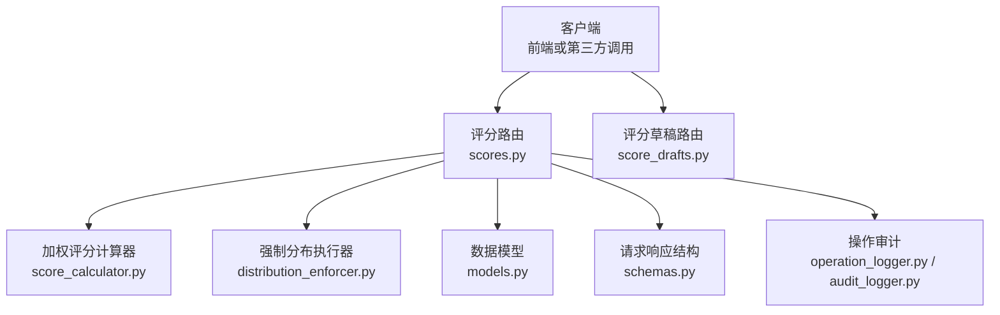
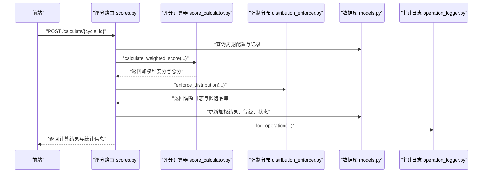
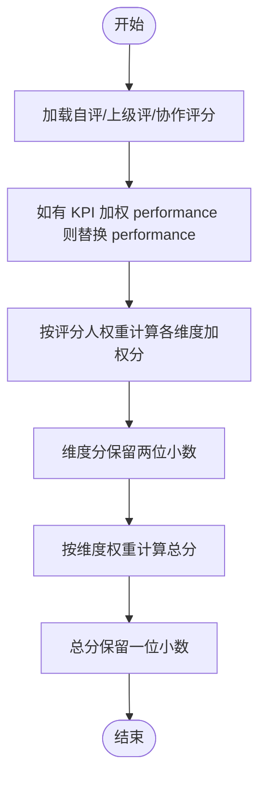
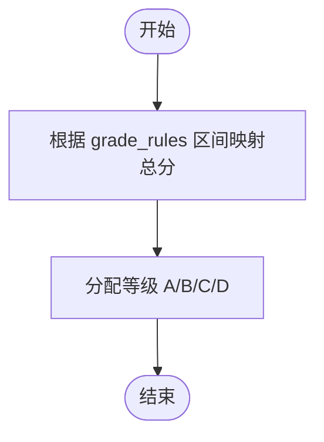
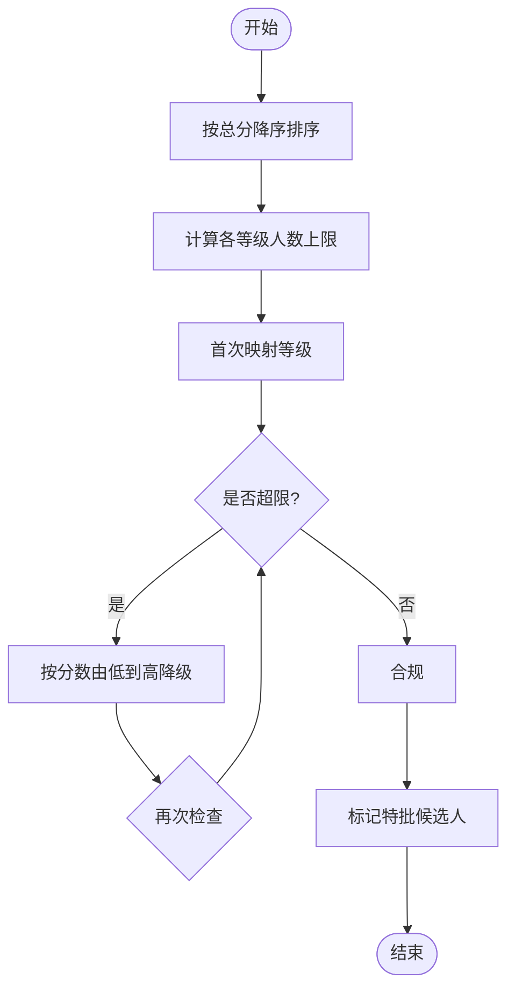
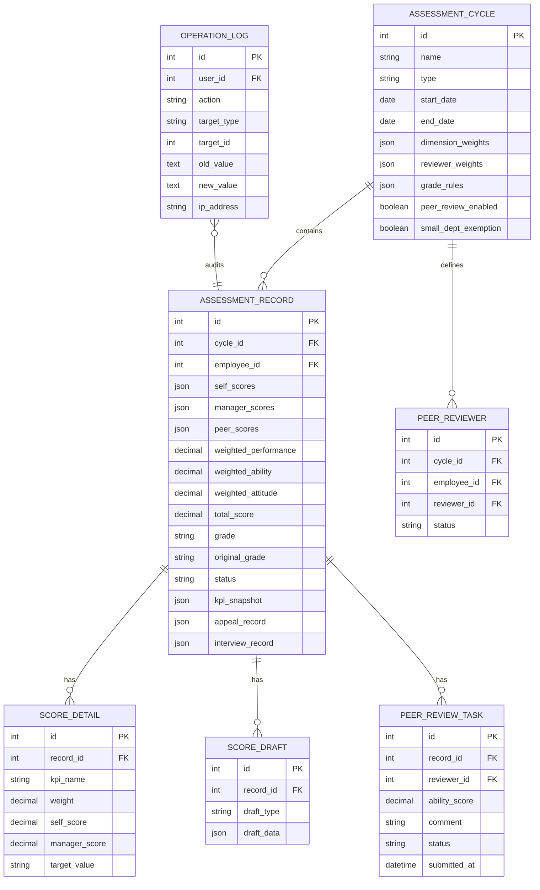
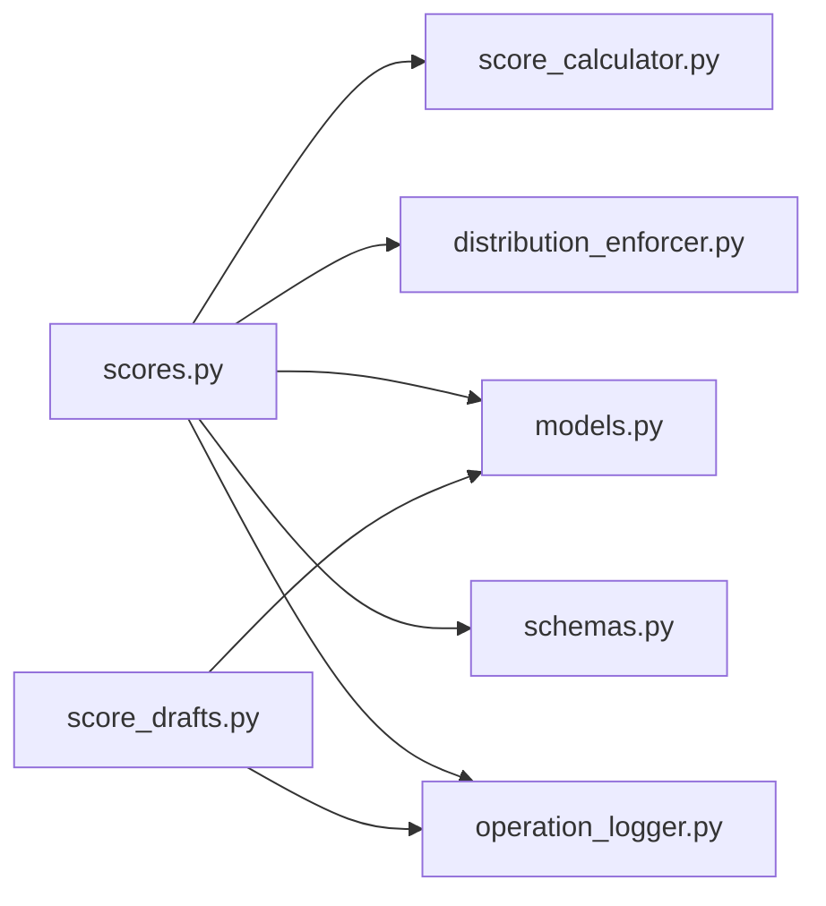

# 评分管理API

<cite>
**本文引用的文件**   
- [scores.py](file://backend/app/routers/scores.py)
- [score_drafts.py](file://backend/app/routers/score_drafts.py)
- [score_calculator.py](file://backend/app/services/score_calculator.py)
- [distribution_enforcer.py](file://backend/app/services/distribution_enforcer.py)
- [models.py](file://backend/app/models.py)
- [schemas.py](file://backend/app/schemas.py)
- [audit_logger.py](file://backend/app/utils/audit_logger.py)
- [operation_logger.py](file://backend/app/services/operation_logger.py)
</cite>

## 目录
1. [简介](#简介)
2. [项目结构与定位](#项目结构与定位)
3. [核心能力总览](#核心能力总览)
4. [架构概览](#架构概览)
5. [详细接口说明](#详细接口说明)
6. [业务规则与算法](#业务规则与算法)
7. [数据模型与版本追溯](#数据模型与版本追溯)
8. [依赖关系分析](#依赖关系分析)
9. [性能与扩展建议](#性能与扩展建议)
10. [故障排查指南](#故障排查指南)
11. [结论](#结论)

## 简介
本文件面向“绩效考核评分系统”的评分管理 API，覆盖自评、上级评分、协作评分等多维度评分的提交、查看、计算、草稿、强制分布、异常检测、汇总统计等能力。文档同时说明评分模板、动态维度权重配置、结果汇总、等级判定、历史审计等关键机制，帮助后端开发者、前端集成方和测试人员快速理解并正确使用这些接口。

## 项目结构与定位
评分相关能力主要位于后端 FastAPI 路由层与服务层：
- 路由层：`backend/app/routers/scores.py`、`backend/app/routers/score_drafts.py`
- 服务层：`backend/app/services/score_calculator.py`、`backend/app/services/distribution_enforcer.py`
- 数据模型：`backend/app/models.py`
- 请求响应结构：`backend/app/schemas.py`
- 审计日志：`backend/app/utils/audit_logger.py`、`backend/app/services/operation_logger.py`

**图表来源**
- [scores.py:1-20](file://backend/app/routers/scores.py#L1-L20)
- [score_drafts.py:1-10](file://backend/app/routers/score_drafts.py#L1-L10)
- [score_calculator.py:1-15](file://backend/app/services/score_calculator.py#L1-L15)
- [distribution_enforcer.py:1-15](file://backend/app/services/distribution_enforcer.py#L1-L15)
- [models.py:99-131](file://backend/app/models.py#L99-L131)
- [schemas.py:208-315](file://backend/app/schemas.py#L208-L315)
- [operation_logger.py:1-40](file://backend/app/services/operation_logger.py#L1-L40)
- [audit_logger.py:1-54](file://backend/app/utils/audit_logger.py#L1-L54)

**章节来源**
- [scores.py:1-20](file://backend/app/routers/scores.py#L1-L20)
- [score_drafts.py:1-10](file://backend/app/routers/score_drafts.py#L1-L10)
- [models.py:99-131](file://backend/app/models.py#L99-L131)
- [schemas.py:208-315](file://backend/app/schemas.py#L208-L315)

## 核心能力总览
- 多维度评分提交与查看
  - 自评：提交绩效、能力、态度三维分数，支持 KPI 明细评分；加载自评数据（KPI 快照、已有自评分、草稿、周期配置）。
  - 上级评分：提交三维分数与评语，支持 KPI 明细评分；校验与自评分差异；状态机推进到协作评分或汇总阶段。
  - 协作评分：仅评“工作能力”维度；支持任务列表与任务提交；多协作人时取平均分。
- 评分计算与汇总
  - 按维度权重与评分人权重计算加权得分；支持 KPI 加权 performance 替代原始维度分。
  - 等级映射：根据周期配置的等级区间判定等级。
  - 强制分布：按部门独立核算，超限自动降级，标记特批候选人。
  - 异常检测：总分低于 60 或高于 98 视为异常。
- 草稿机制
  - 统一草稿接口：支持 employee/manager/peer 角色分别读写对应字段；保存、读取、删除草稿；记录审计日志。
  - 专用草稿表：ScoreDraft 表按 record_id + draft_type 唯一约束，保留最新草稿。
- 模板与动态权重
  - 考核周期维度权重与评分人权重可配置；KPI 模板指标权重总和必须为 100%。
- 版本管理与审计
  - AssessmentRecord 存储各维度评分、加权结果、等级、状态、KPI 快照、申诉、面谈等信息。
  - OperationLog 记录操作审计，支持中间件自动捕获请求/响应体。

**章节来源**
- [scores.py:96-331](file://backend/app/routers/scores.py#L96-L331)
- [scores.py:348-554](file://backend/app/routers/scores.py#L348-L554)
- [scores.py:557-626](file://backend/app/routers/scores.py#L557-L626)
- [scores.py:629-796](file://backend/app/routers/scores.py#L629-L796)
- [scores.py:807-1014](file://backend/app/routers/scores.py#L807-L1014)
- [score_drafts.py:13-83](file://backend/app/routers/score_drafts.py#L13-L83)
- [score_calculator.py:4-84](file://backend/app/services/score_calculator.py#L4-L84)
- [distribution_enforcer.py:30-128](file://backend/app/services/distribution_enforcer.py#L30-L128)
- [models.py:62-83](file://backend/app/models.py#L62-L83)
- [models.py:133-143](file://backend/app/models.py#L133-L143)
- [schemas.py:118-187](file://backend/app/schemas.py#L118-L187)
- [schemas.py:474-511](file://backend/app/schemas.py#L474-L511)

## 架构概览
评分流程从路由层进入，经过权限校验、数据校验、业务逻辑处理，最终写入数据库并触发状态机与通知。

**图表来源**
- [scores.py:165-331](file://backend/app/routers/scores.py#L165-L331)
- [score_calculator.py:4-84](file://backend/app/services/score_calculator.py#L4-L84)
- [distribution_enforcer.py:30-128](file://backend/app/services/distribution_enforcer.py#L30-L128)
- [models.py:99-131](file://backend/app/models.py#L99-L131)
- [operation_logger.py:7-40](file://backend/app/services/operation_logger.py#L7-L40)

## 详细接口说明

### 自评相关接口
- 获取我的考核记录列表
  - 路径：`GET /api/scores/my-assessment`
  - 功能：返回当前员工的考核记录，包含自评、上级评、协作评、加权结果、等级、KPI 明细、申诉与面谈信息等。
  - 权限：employee、manager。
  - 输出字段包括：record_id、cycle_id、self_scores、manager_scores、peer_scores、weighted_performance/ability/attitude、total_score、grade、status、kpi_details、appeal、interview 等。
- 加载自评数据
  - 路径：`GET /api/scores/self/{record_id}`
  - 功能：加载 KPI 快照、已有自评分、草稿、周期维度权重与评分人权重。
  - 权限：employee。
- 提交自评
  - 路径：`POST /api/scores/self/{record_id}`
  - 功能：提交绩效、能力、态度三维分数，可选 KPI 明细评分；校验分数范围；使用状态机推进状态。
  - 权限：employee。
  - 输入结构：SelfScoreSubmit（performance、ability、attitude、kpi_scores）。

**章节来源**
- [scores.py:636-737](file://backend/app/routers/scores.py#L636-L737)
- [scores.py:1130-1196](file://backend/app/routers/scores.py#L1130-L1196)
- [scores.py:740-796](file://backend/app/routers/scores.py#L740-L796)
- [schemas.py:629-634](file://backend/app/schemas.py#L629-L634)

### 上级评分相关接口
- 待评列表
  - 路径：`GET /api/scores/to-review` 或 `GET /api/scores/manager/score-list`
  - 功能：返回当前经理的待评下属列表，支持状态、部门、关键词筛选。
  - 权限：manager、admin、hr。
- 提交上级评分
  - 路径：`POST /api/scores/manager/{record_id}`
  - 功能：提交绩效、能力、态度三维分数与评语；可选 KPI 明细评分；校验与自评分差异超过阈值告警；状态机推进；必要时创建协作评分任务；发送通知给被评员工；记录审计日志。
  - 权限：manager、admin、hr。
  - 输入结构：ManagerScoreSubmit（performance、ability、attitude、kpi_scores、comment）。

**章节来源**
- [scores.py:348-431](file://backend/app/routers/scores.py#L348-L431)
- [scores.py:434-554](file://backend/app/routers/scores.py#L434-L554)
- [schemas.py:340-346](file://backend/app/schemas.py#L340-L346)

### 协作评分相关接口
- 协作待评列表
  - 路径：`GET /api/scores/peer/review-list`
  - 功能：基于 PeerReviewTask 返回当前协作人的待评任务列表。
  - 权限：peer。
- 协作评分提交
  - 路径：`POST /api/scores/peer/review-tasks/{task_id}/submit`
  - 功能：提交能力分数与评语；校验评语长度；更新任务状态；若所有协作任务完成则推进状态；通知 HR；记录审计日志。
  - 权限：peer。
  - 输入结构：PeerReviewTaskSubmit（ability、comment）。
- 旧版协作评分提交
  - 路径：`POST /api/scores/peer/{record_id}`
  - 功能：直接对 AssessmentRecord 的 peer_scores 写入能力分数；同步更新 PeerReviewTask；记录审计日志。
  - 权限：peer。
  - 输入结构：PeerScoreSubmit（ability）。

**章节来源**
- [scores.py:1202-1248](file://backend/app/routers/scores.py#L1202-L1248)
- [scores.py:1256-1355](file://backend/app/routers/scores.py#L1256-L1355)
- [scores.py:557-626](file://backend/app/routers/scores.py#L557-L626)
- [schemas.py:557-559](file://backend/app/schemas.py#L557-L559)
- [schemas.py:1251-1253](file://backend/app/schemas.py#L1251-L1253)

### 评分计算与汇总接口
- 计算评分
  - 路径：`POST /api/scores/calculate/{cycle_id}`
  - 功能：校验维度权重与评分人权重；检查自评、上级评、协作评是否完成；计算加权维度分与总分；映射等级；按部门执行强制分布；状态机推进；统计异常数量；返回计算结果与待审数量。
  - 权限：admin、hr。
- 确认强制分布
  - 路径：`POST /api/scores/cycles/{cycle_id}/confirm-distribution`
  - 功能：将 pending_distribution_review 状态的记录推进到 pending_approval；记录审计日志。
  - 权限：admin、hr。

**章节来源**
- [scores.py:165-331](file://backend/app/routers/scores.py#L165-L331)
- [scores.py:1358-1414](file://backend/app/routers/scores.py#L1358-L1414)

### 评分草稿接口
- 统一草稿读取
  - 路径：`GET /api/scores/records/{record_id}/draft`
  - 功能：根据角色判断可访问的草稿类型与字段；返回草稿数据与是否存在草稿。
  - 权限：get_current_user。
- 统一草稿保存
  - 路径：`POST /api/scores/records/{record_id}/draft`
  - 功能：根据角色写入对应草稿字段；记录审计日志。
  - 权限：get_current_user。
- 统一草稿删除
  - 路径：`DELETE /api/scores/records/{record_id}/draft`
  - 功能：清空对应草稿字段；记录审计日志。
  - 权限：get_current_user。
- 专用草稿表接口
  - 路径：`POST /api/score-drafts`、`GET /api/score-drafts/{record_id}`
  - 功能：按 record_id + draft_type 唯一约束保存与读取最新草稿；记录审计日志。
  - 权限：get_current_user。

**章节来源**
- [scores.py:807-1014](file://backend/app/routers/scores.py#L807-L1014)
- [score_drafts.py:13-83](file://backend/app/routers/score_drafts.py#L13-L83)
- [schemas.py:525-541](file://backend/app/schemas.py#L525-L541)

### 考核记录详情接口
- 获取详情
  - 路径：`GET /api/scores/records/{record_id}/detail`
  - 功能：返回考核记录完整信息，包括维度评分、加权结果、等级、KPI 明细、申诉、面谈等；权限控制严格；员工只能查看已发布/已归档结果。
  - 权限：get_current_user（employee/manager/admin/hr/executive）。

**章节来源**
- [scores.py:1017-1127](file://backend/app/routers/scores.py#L1017-L1127)

## 业务规则与算法

### 评分权重计算
- 维度得分 = Σ(评分人维度分 × 评分人维度权重)
- 总分 = Σ(维度得分 × 维度权重)
- 中间结果保留两位小数，最终总分保留一位小数。
- 支持 KPI 加权 performance 替代原始 performance 维度分。

**图表来源**
- [score_calculator.py:4-84](file://backend/app/services/score_calculator.py#L4-L84)

**章节来源**
- [score_calculator.py:4-84](file://backend/app/services/score_calculator.py#L4-L84)

### 等级判定算法
- 根据周期配置的 grade_rules 区间映射总分到等级 A/B/C/D。
- 默认规则示例：A[90,100]、B[80,89.9]、C[60,79.9]、D[0,59.9]。
- 强制分布后可能调整等级，original_grade 保留初始等级。

**图表来源**
- [distribution_enforcer.py:20-27](file://backend/app/services/distribution_enforcer.py#L20-L27)
- [models.py:62-83](file://backend/app/models.py#L62-L83)

**章节来源**
- [distribution_enforcer.py:20-27](file://backend/app/services/distribution_enforcer.py#L20-L27)
- [models.py:62-83](file://backend/app/models.py#L62-L83)

### 强制分布算法
- 按部门独立核算。
- 小部门豁免：当部门人数 ≤ 5 且启用豁免时，采用固定上限策略。
- 超限降级：从 A→B→C 依次处理，按分数由低到高降级。
- 特批候选人：被从 A 强制降级且总分 ≥ 90 的记录标记为 override_candidates。

**图表来源**
- [distribution_enforcer.py:30-128](file://backend/app/services/distribution_enforcer.py#L30-L128)

**章节来源**
- [distribution_enforcer.py:30-128](file://backend/app/services/distribution_enforcer.py#L30-L128)

### 异常检测
- 在计算完成后统计异常数量：总分 < 60 或 > 98。
- 用于提醒 HR 关注极端分数。

**章节来源**
- [scores.py:319-323](file://backend/app/routers/scores.py#L319-L323)

### 模板与动态权重
- 考核周期维度权重与评分人权重可配置，需在计算前校验总和为 100% 或 1.0。
- KPI 模板指标权重总和必须等于 100%，名称唯一。
- 评分表自动生成：启动考核时为每个被考核员工生成 KPI 快照，冻结模板内容。

**章节来源**
- [scores.py:177-198](file://backend/app/routers/scores.py#L177-L198)
- [schemas.py:118-187](file://backend/app/schemas.py#L118-L187)
- [schemas.py:474-511](file://backend/app/schemas.py#L474-L511)

## 数据模型与版本追溯

### 核心数据模型
- AssessmentCycle：考核周期，包含维度权重、评分人权重、等级规则、协作评分开关、小部门豁免等。
- AssessmentRecord：考核记录，包含自评、上级评、协作评、加权维度分、总分、等级、状态、KPI 快照、申诉、面谈、档案 PDF 路径等。
- ScoreDetail：KPI 评分明细，含权重、目标值、自评/上级评分。
- ScoreDraft：评分草稿表，按 record_id + draft_type 唯一约束。
- PeerReviewer、PeerReviewTask：协作评分关系与任务。
- OperationLog：操作审计日志。

> 本图为局部关系片段，完整实体关系与约束以 [ER图设计.md](../系统架构/数据库架构设计/ER图设计.md) 为唯一权威来源。

**图表来源**
- [models.py:62-83](file://backend/app/models.py#L62-L83)
- [models.py:99-131](file://backend/app/models.py#L99-L131)
- [models.py:133-143](file://backend/app/models.py#L133-L143)
- [models.py:176-184](file://backend/app/models.py#L176-L184)
- [models.py:230-241](file://backend/app/models.py#L230-L241)
- [models.py:255-265](file://backend/app/models.py#L255-L265)
- [models.py:186-196](file://backend/app/models.py#L186-L196)

### 版本管理与变更审计
- AssessmentRecord 字段存储各阶段评分与结果，便于历史追溯。
- OperationLog 记录每次操作的旧值与新值，支持中间件自动捕获请求/响应体。
- 草稿表 ScoreDraft 提供按类型隔离的草稿版本，结合 AssessmentRecord 的草稿字段实现双重保障。

**章节来源**
- [models.py:99-131](file://backend/app/models.py#L99-L131)
- [models.py:186-196](file://backend/app/models.py#L186-L196)
- [models.py:230-241](file://backend/app/models.py#L230-L241)
- [audit_logger.py:15-54](file://backend/app/utils/audit_logger.py#L15-L54)
- [operation_logger.py:7-40](file://backend/app/services/operation_logger.py#L7-L40)

## 依赖关系分析
- 路由层依赖服务层进行复杂计算与规则执行。
- 数据模型贯穿所有接口，确保一致性。
- 审计日志贯穿评分提交、草稿操作、强制分布确认等关键动作。

**图表来源**
- [scores.py:1-20](file://backend/app/routers/scores.py#L1-L20)
- [score_drafts.py:1-10](file://backend/app/routers/score_drafts.py#L1-L10)
- [score_calculator.py:1-15](file://backend/app/services/score_calculator.py#L1-L15)
- [distribution_enforcer.py:1-15](file://backend/app/services/distribution_enforcer.py#L1-L15)
- [models.py:99-131](file://backend/app/models.py#L99-L131)
- [schemas.py:208-315](file://backend/app/schemas.py#L208-L315)
- [operation_logger.py:1-40](file://backend/app/services/operation_logger.py#L1-L40)

**章节来源**
- [scores.py:1-20](file://backend/app/routers/scores.py#L1-L20)
- [score_drafts.py:1-10](file://backend/app/routers/score_drafts.py#L1-L10)

## 性能与扩展建议
- 批量计算优化：在 calculate_scores 中可对未完成评分提前短路，减少无效计算。
- 强制分布缓存：对小部门豁免场景可缓存 caps 计算结果。
- 索引优化：对 AssessmentRecord.cycle_id、employee_id、status 建立索引以提升查询性能。
- 异步通知：HR 通知可改为异步任务队列，避免阻塞主流程。
- 可视化与统计：可扩展 dashboard 接口，聚合部门维度分布、异常率、趋势分析等。

[本节为通用建议，不直接分析具体文件]

## 故障排查指南
- 维度权重之和不为 100% 或 1.0：检查周期配置的 dimension_weights 与 reviewer_weights。
- 协作评分未完成：检查 PeerReviewTask 状态是否为 completed。
- 上级评分与自评分差异过大：检查 ManagerScoreSubmit 的维度分与 SelfScoreSubmit 的维度分。
- 强制分布未生效：检查 grade_rules 的 ratio_limit 与小部门豁免配置。
- 草稿无法读取：检查 ScoreDraft 的 draft_type 与 AssessmentRecord 的草稿字段是否一致。
- 审计日志缺失：检查 OperationLog 写入与中间件是否正确启用。

**章节来源**
- [scores.py:177-198](file://backend/app/routers/scores.py#L177-L198)
- [scores.py:210-226](file://backend/app/routers/scores.py#L210-L226)
- [scores.py:479-486](file://backend/app/routers/scores.py#L479-L486)
- [distribution_enforcer.py:58-70](file://backend/app/services/distribution_enforcer.py#L58-L70)
- [score_drafts.py:28-47](file://backend/app/routers/score_drafts.py#L28-L47)
- [audit_logger.py:104-188](file://backend/app/utils/audit_logger.py#L104-L188)

## 结论
本评分管理 API 提供了完整的自评、上级评、协作评流程，支持动态维度权重与评分人权重配置、KPI 模板与快照、加权评分与等级判定、强制分布与异常检测、草稿机制与审计追溯。通过清晰的路由分层、服务化计算与严格的权限控制，系统具备良好的可维护性与扩展性。后续可在可视化统计、异步通知、索引优化等方面进一步增强用户体验与系统性能。