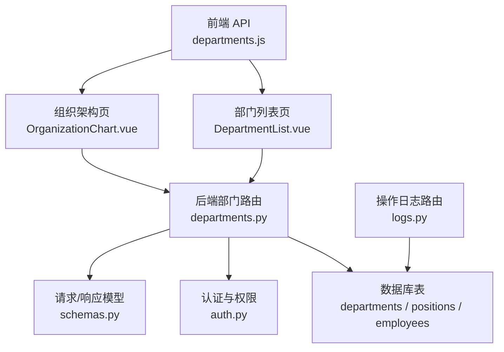
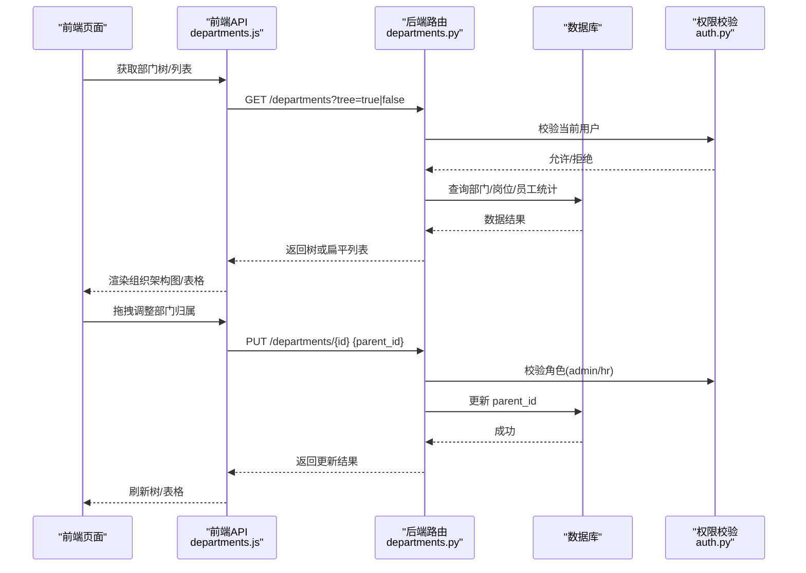
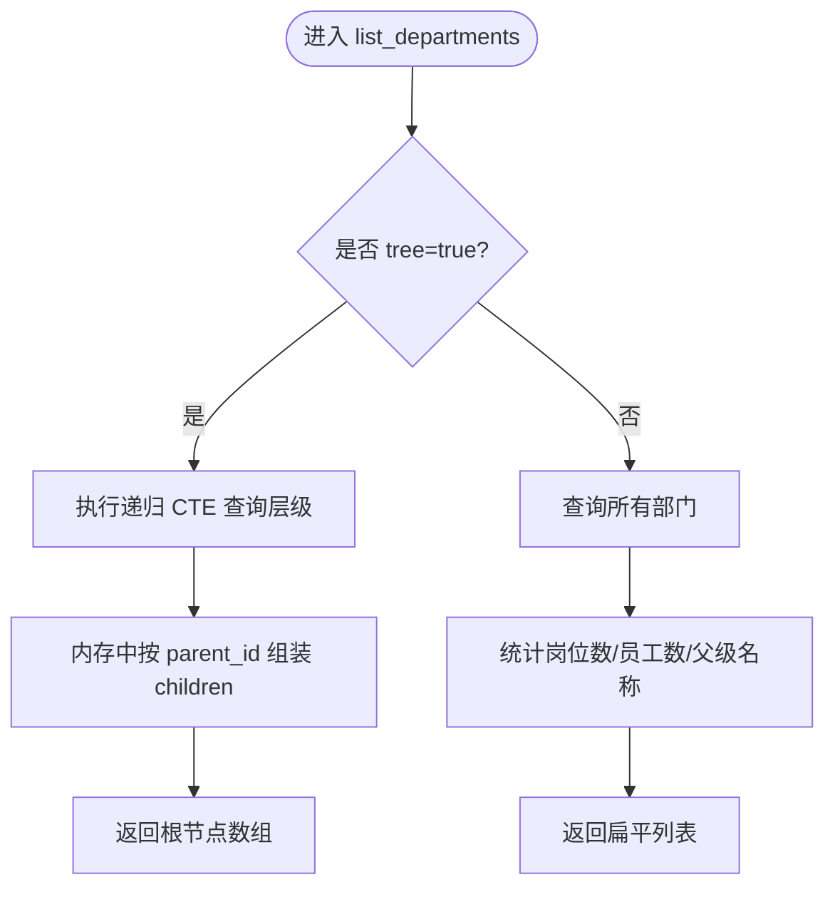
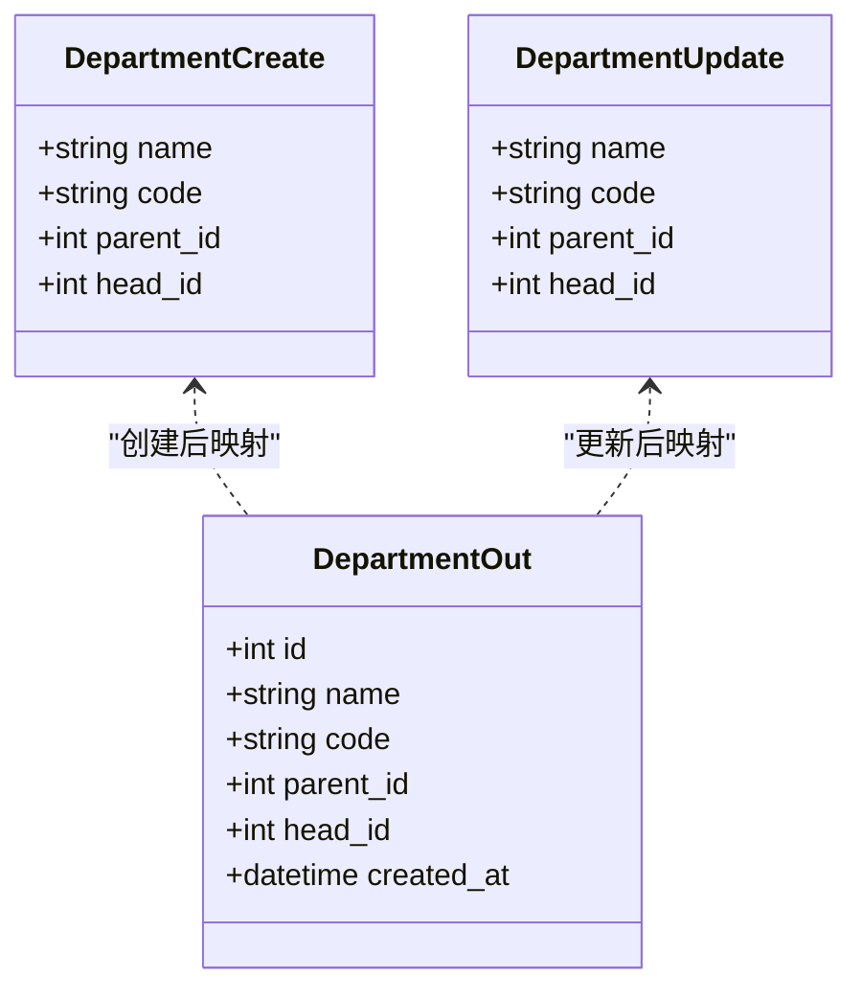
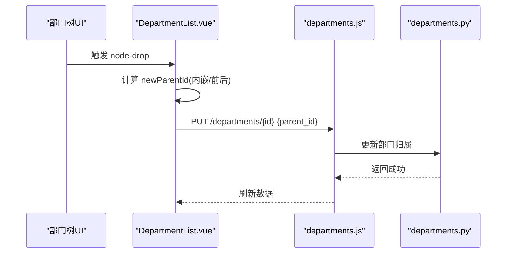
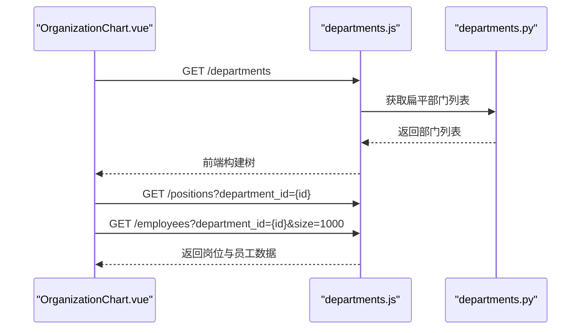
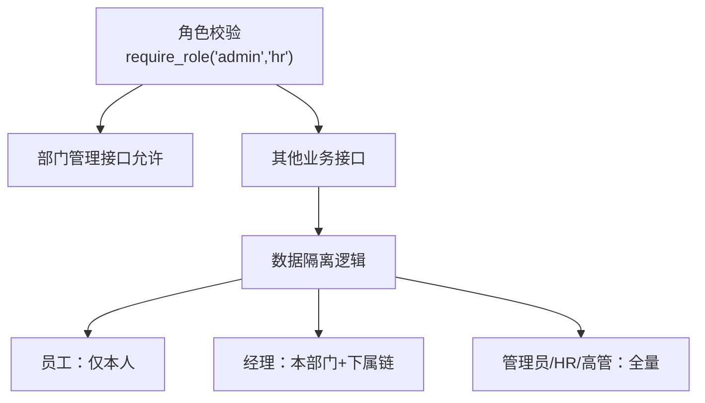
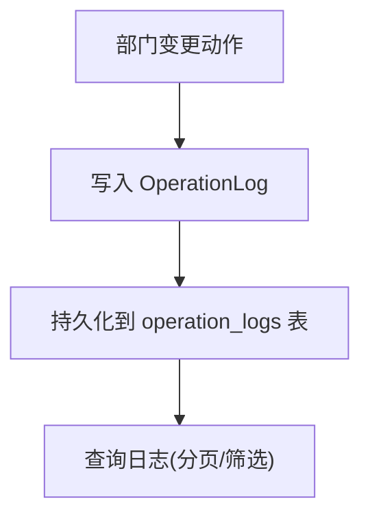
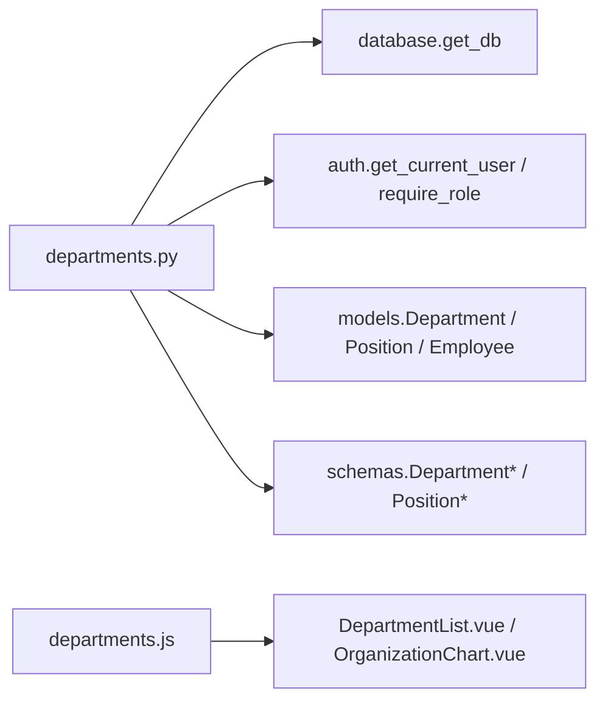

# 部门管理API

<cite>
**本文引用的文件 **
- [departments.py](file://backend/app/routers/departments.py)
- [models.py](file://backend/app/models.py)
- [schemas.py](file://backend/app/schemas.py)
- [auth.py](file://backend/app/auth.py)
- [logs.py](file://backend/app/routers/logs.py)
- [employees.py](file://backend/app/routers/employees.py)
- [interviews.py](file://backend/app/routers/interviews.py)
- [departments.js](file://frontend/src/api/departments.js)
- [DepartmentList.vue](file://frontend/src/views/departments/DepartmentList.vue)
- [OrganizationChart.vue](file://frontend/src/views/departments/OrganizationChart.vue)
</cite>

## 目录
1. [简介](#简介)
2. [项目结构](#项目结构)
3. [核心组件](#核心组件)
4. [架构总览](#架构总览)
5. [详细组件分析](#详细组件分析)
6. [依赖关系分析](#依赖关系分析)
7. [性能与扩展建议](#性能与扩展建议)
8. [故障排查指南](#故障排查指南)
9. [结论](#结论)

## 简介
本文件面向“部门管理”相关接口，覆盖以下能力：
- 部门的层级结构与树形结构查询、构建与展示
- 部门的增删改查（CRUD）
- 父子关系维护与拖拽调整归属
- 部门编码规则与唯一性校验
- 组织架构图数据接口，支持前端渲染企业组织结构
- 权限控制与数据隔离策略（基于角色与部门范围）
- 变更历史与审计日志能力（通过操作日志模块）

该文档同时给出后端路由、数据模型、请求响应模型以及前端调用方式的说明，并辅以流程图和时序图帮助理解。

## 项目结构
与部门管理相关的代码主要分布在以下位置：
- 后端路由：`backend/app/routers/departments.py`
- 数据模型：`backend/app/models.py`
- 请求/响应模型：`backend/app/schemas.py`
- 认证与权限：`backend/app/auth.py`
- 操作日志：`backend/app/routers/logs.py`
- 员工与面试等涉及数据隔离的路由：`backend/app/routers/employees.py`、`backend/app/routers/interviews.py`
- 前端 API 封装：`frontend/src/api/departments.js`
- 前端页面：`frontend/src/views/departments/DepartmentList.vue`、`frontend/src/views/departments/OrganizationChart.vue`

**图表来源**
- [departments.py:20-148](file://backend/app/routers/departments.py#L20-L148)
- [models.py:8-28](file://backend/app/models.py#L8-L28)
- [schemas.py:31-71](file://backend/app/schemas.py#L31-L71)
- [auth.py:68-117](file://backend/app/auth.py#L68-L117)
- [logs.py:14-83](file://backend/app/routers/logs.py#L14-L83)
- [departments.js:1-34](file://frontend/src/api/departments.js#L1-L34)
- [DepartmentList.vue:174-470](file://frontend/src/views/departments/DepartmentList.vue#L174-L470)
- [OrganizationChart.vue:60-123](file://frontend/src/views/departments/OrganizationChart.vue#L60-L123)

**章节来源**
- [departments.py:1-212](file://backend/app/routers/departments.py#L1-L212)
- [models.py:8-28](file://backend/app/models.py#L8-L28)
- [schemas.py:31-71](file://backend/app/schemas.py#L31-L71)
- [auth.py:68-117](file://backend/app/auth.py#L68-L117)
- [logs.py:14-83](file://backend/app/routers/logs.py#L14-L83)
- [departments.js:1-34](file://frontend/src/api/departments.js#L1-L34)
- [DepartmentList.vue:174-470](file://frontend/src/views/departments/DepartmentList.vue#L174-L470)
- [OrganizationChart.vue:60-123](file://frontend/src/views/departments/OrganizationChart.vue#L60-L123)

## 核心组件
- 部门路由层：提供部门与岗位的 CRUD 接口，支持树形结构查询与扁平列表查询。
- 数据模型层：定义部门、岗位、员工等实体及关联关系。
- 模式层：定义部门创建、更新、输出等 Pydantic 模型。
- 认证与权限：基于角色的访问控制，限制部门管理接口的可访问角色。
- 前端 API 层：封装部门与岗位相关 HTTP 调用。
- 前端视图层：部门列表、组织架构树、拖拽调整归属、岗位管理等交互。

**章节来源**
- [departments.py:20-212](file://backend/app/routers/departments.py#L20-L212)
- [models.py:8-28](file://backend/app/models.py#L8-L28)
- [schemas.py:31-71](file://backend/app/schemas.py#L31-L71)
- [auth.py:68-117](file://backend/app/auth.py#L68-L117)
- [departments.js:1-34](file://frontend/src/api/departments.js#L1-L34)
- [DepartmentList.vue:174-470](file://frontend/src/views/departments/DepartmentList.vue#L174-L470)
- [OrganizationChart.vue:60-123](file://frontend/src/views/departments/OrganizationChart.vue#L60-L123)

## 架构总览
部门管理 API 的整体流程如下：
- 前端通过 `departments.js` 调用后端 `/departments` 与 `/positions` 接口。
- 后端路由在 `departments.py` 中处理请求，使用 SQLAlchemy 操作数据库。
- 树形结构通过递归 CTE 或内存组装实现；扁平列表返回包含父级名称、统计字段。
- 权限校验通过 `auth.py` 的 `require_role` 装饰器限制为 admin/hr。
- 删除前进行子部门、员工、岗位存在性检查，保证数据一致性。
- 前端 `DepartmentList.vue` 支持拖拽调整部门归属，调用更新接口修改 `parent_id`。
- 前端 `OrganizationChart.vue` 读取部门树并展示详情、岗位与员工列表。

**图表来源**
- [departments.py:20-148](file://backend/app/routers/departments.py#L20-L148)
- [auth.py:68-117](file://backend/app/auth.py#L68-L117)
- [departments.js:1-34](file://frontend/src/api/departments.js#L1-L34)
- [DepartmentList.vue:377-412](file://frontend/src/views/departments/DepartmentList.vue#L377-L412)

## 详细组件分析

### 部门树形结构查询与构建
- 当 `tree=true` 时，后端使用递归 CTE 查询所有部门及其层级，并在内存中组装成树形结构，返回根节点数组。
- 当 `tree=false` 时，返回扁平列表，包含父级名称、岗位数、员工数等统计信息，便于前端自行构建树。

**图表来源**
- [departments.py:20-84](file://backend/app/routers/departments.py#L20-L84)

**章节来源**
- [departments.py:20-84](file://backend/app/routers/departments.py#L20-L84)

### 部门增删改查接口规范
- 创建部门
  - 方法：POST `/departments`
  - 权限：admin/hr
  - 校验：编码唯一、名称唯一
  - 输入模型：`DepartmentCreate`
  - 输出模型：`DepartmentOut`
- 更新部门
  - 方法：PUT `/departments/{dept_id}`
  - 权限：admin/hr
  - 校验：部门存在
  - 输入模型：`DepartmentUpdate`
  - 输出模型：`DepartmentOut`
- 删除部门
  - 方法：DELETE `/departments/{dept_id}`
  - 权限：admin/hr
  - 前置校验：无子部门、无员工、无岗位
  - 状态码：204 成功；404 不存在；400 存在子部门/员工/岗位
- 查询部门
  - 方法：GET `/departments`
  - 参数：`tree`（布尔）
  - 返回：树形结构或扁平列表

**图表来源**
- [schemas.py:31-53](file://backend/app/schemas.py#L31-L53)
- [departments.py:87-148](file://backend/app/routers/departments.py#L87-L148)

**章节来源**
- [departments.py:87-148](file://backend/app/routers/departments.py#L87-L148)
- [schemas.py:31-53](file://backend/app/schemas.py#L31-L53)

### 父子关系维护与移动
- 前端支持拖拽部门到目标节点内部或前后位置，计算新的 `parent_id`。
- 调用更新接口修改部门归属，成功后刷新树与表格。
- 不允许将节点拖入自身或其子节点，避免循环引用。

**图表来源**
- [DepartmentList.vue:377-412](file://frontend/src/views/departments/DepartmentList.vue#L377-L412)
- [departments.py:108-122](file://backend/app/routers/departments.py#L108-L122)

**章节来源**
- [DepartmentList.vue:377-412](file://frontend/src/views/departments/DepartmentList.vue#L377-L412)
- [departments.py:108-122](file://backend/app/routers/departments.py#L108-L122)

### 组织架构图数据接口
- 前端 `OrganizationChart.vue` 调用 `listDepartments()` 获取扁平列表，并在前端构建部门树。
- 点击节点后并行加载该部门的岗位与员工列表，用于右侧详情展示。
- 该页面主要用于查看组织结构和部门详情，不包含编辑功能。

**图表来源**
- [OrganizationChart.vue:83-118](file://frontend/src/views/departments/OrganizationChart.vue#L83-L118)
- [departments.js:1-34](file://frontend/src/api/departments.js#L1-L34)
- [departments.py:154-163](file://backend/app/routers/departments.py#L154-L163)

**章节来源**
- [OrganizationChart.vue:83-118](file://frontend/src/views/departments/OrganizationChart.vue#L83-L118)
- [departments.py:154-163](file://backend/app/routers/departments.py#L154-L163)

### 部门编码规则与唯一性
- 编码字段 `code` 在数据库中定义为唯一索引。
- 创建部门时若传入编码，后端会检查是否存在相同编码，存在则返回冲突错误。
- 名称字段 `name` 也做唯一性校验，防止重复部门名。

**章节来源**
- [models.py:8-18](file://backend/app/models.py#L8-L18)
- [departments.py:87-105](file://backend/app/routers/departments.py#L87-L105)

### 权限继承机制与数据隔离策略
- 部门管理接口通过 `require_role("admin", "hr")` 限制访问角色。
- 其他业务接口（如员工、面试）采用基于角色的数据隔离：
  - 普通员工只能访问自己的数据。
  - 经理可访问其部门范围、下属链中的数据。
  - 管理员、HR、高管可访问全部数据。
- 部门本身不直接实现“权限继承”，但通过员工所属部门与上级关系，结合角色判断实现数据可见性。

**图表来源**
- [departments.py:87-148](file://backend/app/routers/departments.py#L87-L148)
- [employees.py:367-385](file://backend/app/routers/employees.py#L367-L385)
- [interviews.py:156-174](file://backend/app/routers/interviews.py#L156-L174)

**章节来源**
- [departments.py:87-148](file://backend/app/routers/departments.py#L87-L148)
- [employees.py:367-385](file://backend/app/routers/employees.py#L367-L385)
- [interviews.py:156-174](file://backend/app/routers/interviews.py#L156-L174)

### 部门变更的历史记录与审计日志
- 系统提供操作日志模块，记录用户操作类型、目标类型、目标ID、旧值/新值、IP 与时间戳。
- 日志查询支持分页、按操作类型/目标类型/时间范围筛选。
- 部门管理的增删改操作可通过统一日志记录机制进行审计（需在业务层写入日志）。

**图表来源**
- [logs.py:14-83](file://backend/app/routers/logs.py#L14-L83)
- [models.py:186-196](file://backend/app/models.py#L186-L196)

**章节来源**
- [logs.py:14-83](file://backend/app/routers/logs.py#L14-L83)
- [models.py:186-196](file://backend/app/models.py#L186-L196)

## 依赖关系分析
- 路由层依赖：
  - 数据库会话：`get_db`
  - 认证依赖：`get_current_user`、`require_role`
  - 模型：`Department`、`Position`、`Employee`
  - 模式：`DepartmentCreate`、`DepartmentUpdate`、`DepartmentOut`、`PositionCreate`、`PositionUpdate`、`PositionOut`
- 前端依赖：
  - `departments.js` 封装 HTTP 请求
  - `DepartmentList.vue` 与 `OrganizationChart.vue` 消费 API

**图表来源**
- [departments.py:1-16](file://backend/app/routers/departments.py#L1-L16)
- [auth.py:68-117](file://backend/app/auth.py#L68-L117)
- [models.py:8-28](file://backend/app/models.py#L8-L28)
- [schemas.py:31-71](file://backend/app/schemas.py#L31-L71)
- [departments.js:1-34](file://frontend/src/api/departments.js#L1-L34)

**章节来源**
- [departments.py:1-16](file://backend/app/routers/departments.py#L1-L16)
- [auth.py:68-117](file://backend/app/auth.py#L68-L117)
- [models.py:8-28](file://backend/app/models.py#L8-L28)
- [schemas.py:31-71](file://backend/app/schemas.py#L31-L71)
- [departments.js:1-34](file://frontend/src/api/departments.js#L1-L34)

## 性能与扩展建议
- 树形查询优化：
  - 当前树形查询使用递归 CTE，适合中等规模组织；超大规模时可考虑缓存或预聚合。
  - 扁平列表查询对每个部门额外计数岗位与员工，建议在大数据量场景下引入缓存或异步统计任务。
- 前端树构建：
  - 扁平列表在前端构建树，注意大数据量时的性能；可使用虚拟滚动或分页加载。
- 扩展方向：
  - 增加部门排序字段或排序规则，便于稳定展示。
  - 增加部门状态字段（启用/停用），配合前端标签显示。
  - 完善岗位字段（如 level）在后端模型中的定义与校验。
  - 在部门变更时统一写入操作日志，增强审计能力。

[本节为通用建议，不直接分析具体文件]

## 故障排查指南
- 创建部门失败：
  - 检查编码或名称是否已存在，后端会返回冲突错误。
- 删除部门失败：
  - 检查是否存在子部门、员工或岗位，后端会返回相应提示。
- 拖拽调整失败：
  - 检查是否尝试将节点拖入自身或其子节点，前端已阻止此类操作。
- 权限不足：
  - 确认当前用户角色是否为 admin 或 hr，否则无法访问部门管理接口。
- 组织架构图数据为空：
  - 检查后端是否返回扁平列表，前端是否正确构建树；确认岗位与员工接口是否正常返回。

**章节来源**
- [departments.py:87-148](file://backend/app/routers/departments.py#L87-L148)
- [DepartmentList.vue:351-412](file://frontend/src/views/departments/DepartmentList.vue#L351-L412)
- [OrganizationChart.vue:83-118](file://frontend/src/views/departments/OrganizationChart.vue#L83-L118)

## 结论
部门管理 API 提供了完整的部门与岗位管理能力，支持树形结构查询、扁平列表查询、拖拽调整归属、权限控制与数据隔离，并通过操作日志模块支持审计追踪。前端页面实现了组织架构图与部门列表的可视化交互，满足企业组织结构的展示与管理需求。后续可在性能优化、字段扩展与审计日志集成方面持续改进。