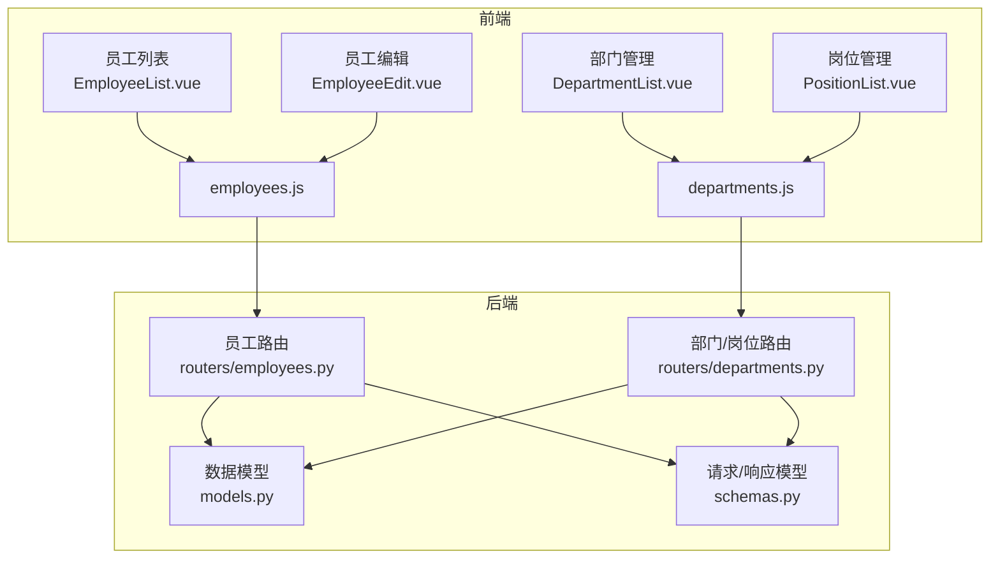
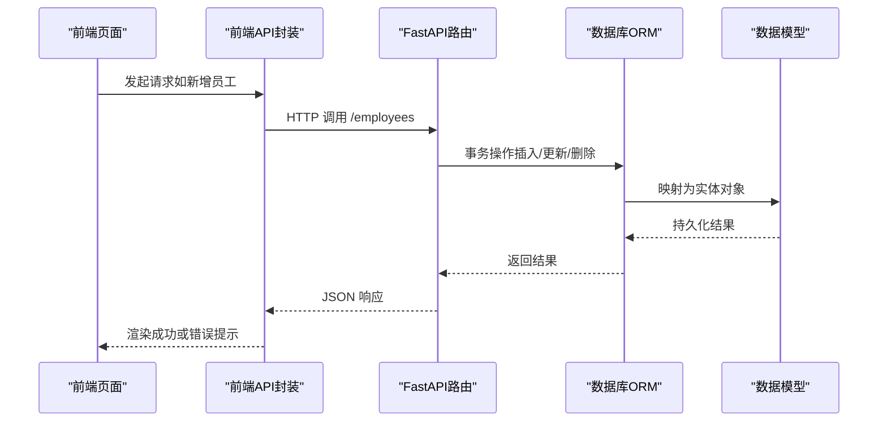
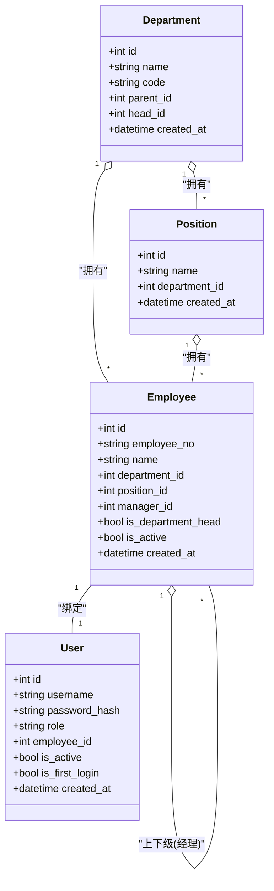
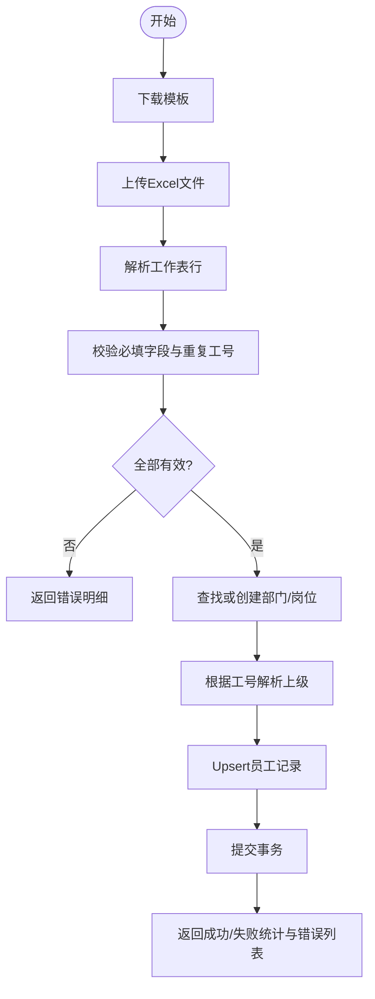
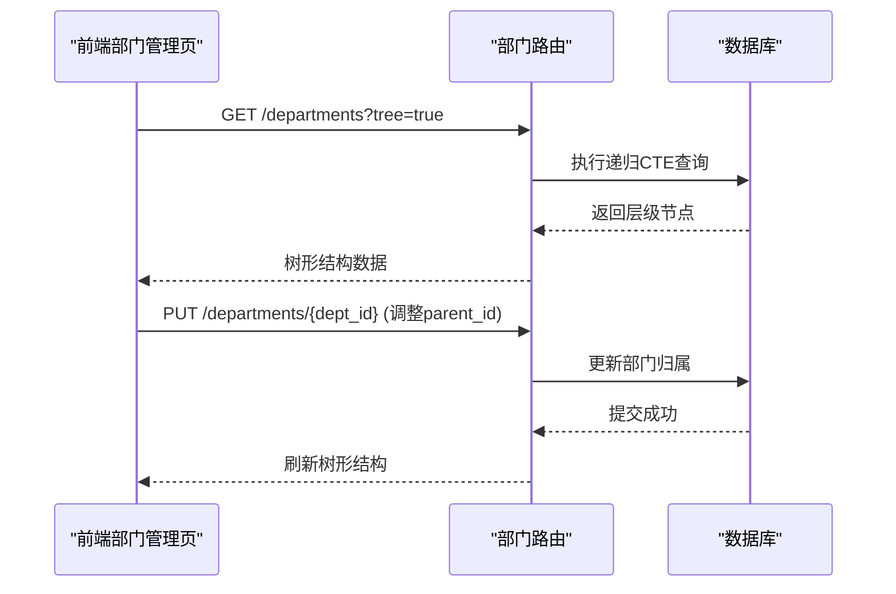
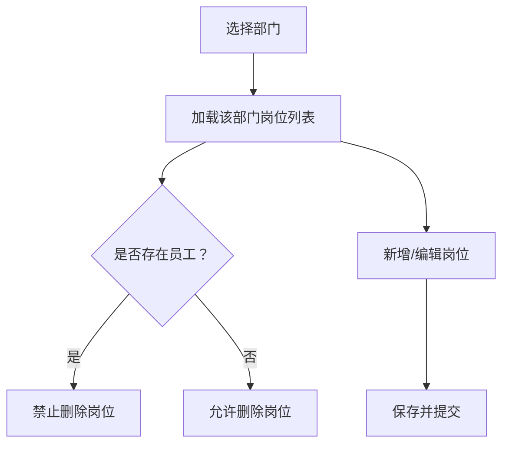
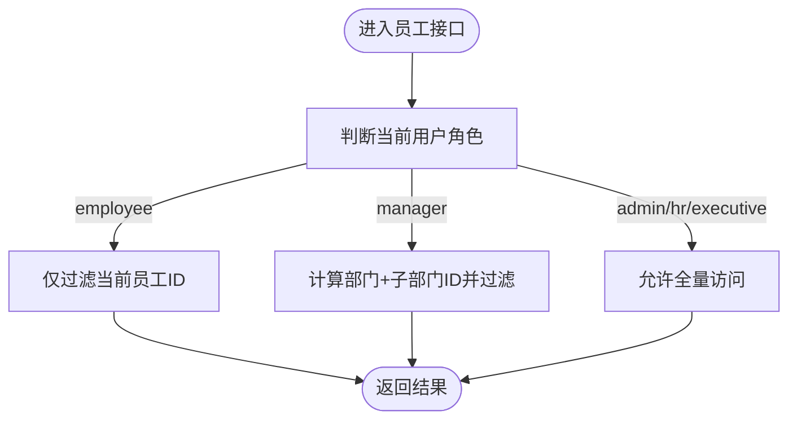
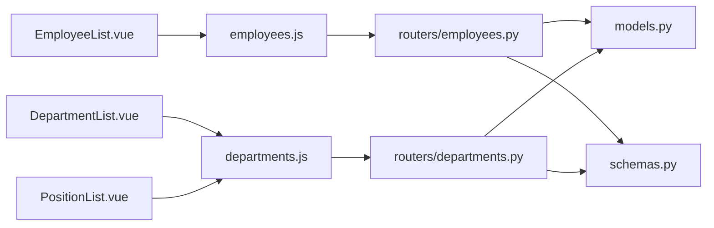

# 员工与组织管理

<cite>
**本文引用的文件**   
- [models.py](file://backend/app/models.py)
- [schemas.py](file://backend/app/schemas.py)
- [employees.py](file://backend/app/routers/employees.py)
- [departments.py](file://backend/app/routers/departments.py)
- [EmployeeList.vue](file://frontend/src/views/employees/EmployeeList.vue)
- [EmployeeEdit.vue](file://frontend/src/views/employees/EmployeeEdit.vue)
- [DepartmentList.vue](file://frontend/src/views/departments/DepartmentList.vue)
- [PositionList.vue](file://frontend/src/views/positions/PositionList.vue)
- [employees.js](file://frontend/src/api/employees.js)
- [departments.js](file://frontend/src/api/departments.js)
</cite>

## 目录
1. [简介](#简介)
2. [项目结构](#项目结构)
3. [核心组件](#核心组件)
4. [架构总览](#架构总览)
5. [详细组件分析](#详细组件分析)
6. [依赖关系分析](#依赖关系分析)
7. [性能考虑](#性能考虑)
8. [故障排查指南](#故障排查指南)
9. [结论](#结论)
10. [附录：API 接口文档](#附录api-接口文档)

## 简介
本模块聚焦“员工与组织管理”，覆盖组织架构数据模型、部门树形结构、岗位体系、员工信息结构与 CRUD 流程，以及 Excel 批量导入导出能力。后端基于 FastAPI + SQLAlchemy ORM，前端使用 Vue 3 + Element Plus。权限控制通过角色（admin、hr、manager、employee 等）实现数据隔离与访问控制。

## 项目结构
围绕员工与组织管理的代码主要分布在以下位置：
- 后端数据模型与请求校验：`backend/app/models.py`、`backend/app/schemas.py`
- 后端路由与业务逻辑：`backend/app/routers/employees.py`、`backend/app/routers/departments.py`
- 前端 API 封装：`frontend/src/api/employees.js`、`frontend/src/api/departments.js`
- 前端页面组件：`frontend/src/views/employees/EmployeeList.vue`、`frontend/src/views/employees/EmployeeEdit.vue`、`frontend/src/views/departments/DepartmentList.vue`、`frontend/src/views/positions/PositionList.vue`

**图表来源**
- [EmployeeList.vue:1-342](file://frontend/src/views/employees/EmployeeList.vue#L1-L342)
- [EmployeeEdit.vue:1-154](file://frontend/src/views/employees/EmployeeEdit.vue#L1-L154)
- [DepartmentList.vue:1-507](file://frontend/src/views/departments/DepartmentList.vue#L1-L507)
- [PositionList.vue:1-203](file://frontend/src/views/positions/PositionList.vue#L1-L203)
- [employees.js:1-30](file://frontend/src/api/employees.js#L1-L30)
- [departments.js:1-34](file://frontend/src/api/departments.js#L1-L34)
- [employees.py:1-663](file://backend/app/routers/employees.py#L1-L663)
- [departments.py:1-212](file://backend/app/routers/departments.py#L1-L212)
- [models.py:1-266](file://backend/app/models.py#L1-L266)
- [schemas.py:1-541](file://backend/app/schemas.py#L1-L541)

**章节来源**
- [EmployeeList.vue:1-342](file://frontend/src/views/employees/EmployeeList.vue#L1-L342)
- [DepartmentList.vue:1-507](file://frontend/src/views/departments/DepartmentList.vue#L1-L507)
- [employees.py:1-663](file://backend/app/routers/employees.py#L1-L663)
- [departments.py:1-212](file://backend/app/routers/departments.py#L1-L212)
- [models.py:1-266](file://backend/app/models.py#L1-L266)
- [schemas.py:1-541](file://backend/app/schemas.py#L1-L541)

## 核心组件
- 数据模型层
  - 部门 Department：支持 parent_id 自关联形成层级结构，head_id 指向部门负责人。
  - 岗位 Position：归属部门，可关联 KPI 模板与员工。
  - 员工 Employee：包含工号、姓名、所属部门、岗位、直属上级 manager_id、是否部门负责人、在职状态等。
  - 用户 User：与员工一对一绑定，承载登录认证与角色。
- 请求校验层
  - 部门/岗位/员工的创建、更新、输出 DTO，统一字段约束与默认值。
- 路由与服务层
  - 员工路由提供分页查询、详情、下属、增删改、Excel 导入/模板下载。
  - 部门路由提供树形/扁平列表、增删改；岗位路由提供按部门过滤的增删改查。
- 前端组件层
  - 员工列表页：搜索、分页、新增/编辑弹窗、导入弹窗、模板下载。
  - 部门管理页：组织架构图（拖拽调整归属）、树形表格、负责人选择、岗位管理弹窗。
  - 岗位管理页：按部门筛选、人数统计、增删改。

**章节来源**
- [models.py:8-60](file://backend/app/models.py#L8-L60)
- [schemas.py:32-117](file://backend/app/schemas.py#L32-L117)
- [employees.py:35-230](file://backend/app/routers/employees.py#L35-L230)
- [departments.py:20-212](file://backend/app/routers/departments.py#L20-L212)
- [EmployeeList.vue:1-342](file://frontend/src/views/employees/EmployeeList.vue#L1-L342)
- [DepartmentList.vue:1-507](file://frontend/src/views/departments/DepartmentList.vue#L1-L507)
- [PositionList.vue:1-203](file://frontend/src/views/positions/PositionList.vue#L1-L203)

## 架构总览
下图展示从前端到后端的调用链路与数据流转：

**图表来源**
- [employees.py:480-551](file://backend/app/routers/employees.py#L480-L551)
- [departments.py:87-122](file://backend/app/routers/departments.py#L87-L122)
- [models.py:8-60](file://backend/app/models.py#L8-L60)

## 详细组件分析

### 数据模型设计
- 部门 Department
  - 字段：id、name、code、parent_id、head_id、created_at
  - 关系：一对多 employees、positions；自关联 parent_id 表示层级
- 岗位 Position
  - 字段：id、name、department_id、created_at
  - 关系：属于 department；关联 employees、kpi_templates
- 员工 Employee
  - 字段：id、employee_no、name、department_id、position_id、manager_id、is_department_head、is_active、created_at
  - 关系：属于 department、position；manager_id 自关联形成汇报树；一对一 user
- 用户 User
  - 字段：id、username、password_hash、role、employee_id、is_active、is_first_login、created_at
  - 关系：一对一 employee

**图表来源**
- [models.py:8-60](file://backend/app/models.py#L8-L60)

**章节来源**
- [models.py:8-60](file://backend/app/models.py#L8-L60)

### 员工 CRUD 与批量导入
- 创建员工
  - 校验工号唯一性、部门/岗位存在性、上级解析（支持通过工号解析）
  - 记录审计日志
- 更新员工
  - 支持部分字段更新、工号唯一性校验、上级解析
- 删除员工
  - 若存在考核历史则禁止删除
- 查询员工
  - 分页、关键词、部门过滤、排序
  - 数据隔离：employee 仅查看自己；manager 可查看本部门及子部门与下属
- 批量导入
  - 模板下载：支持空模板与示例模板
  - 导入流程：解析 Excel → 去重校验 → 必填字段校验 → 部门/岗位自动创建 → 上级解析 → Upsert 员工
  - 预览与状态接口：用于前端进度与结果展示

**图表来源**
- [employees.py:35-65](file://backend/app/routers/employees.py#L35-L65)
- [employees.py:68-199](file://backend/app/routers/employees.py#L68-L199)

**章节来源**
- [employees.py:480-663](file://backend/app/routers/employees.py#L480-L663)
- [employees.py:35-230](file://backend/app/routers/employees.py#L35-L230)

### 部门管理与树形结构
- 部门列表
  - tree=true：使用递归 CTE 获取层级并组装 children
  - tree=false：返回扁平列表，附带父部门名称、岗位数、在职员工数
- 部门增删改
  - 创建：校验编码/名称唯一性
  - 更新：支持修改 parent_id、head_id 等
  - 删除：若存在子部门、员工或岗位则禁止删除
- 前端组织架构图
  - 使用 el-tree 展示部门树，支持拖拽调整归属（内部/前后），触发更新接口
  - 负责人选择器排除自身及其子部门，避免循环引用

**图表来源**
- [departments.py:20-84](file://backend/app/routers/departments.py#L20-L84)
- [departments.py:87-148](file://backend/app/routers/departments.py#L87-L148)
- [DepartmentList.vue:377-412](file://frontend/src/views/departments/DepartmentList.vue#L377-L412)

**章节来源**
- [departments.py:20-148](file://backend/app/routers/departments.py#L20-L148)
- [DepartmentList.vue:1-507](file://frontend/src/views/departments/DepartmentList.vue#L1-L507)

### 岗位管理功能
- 岗位定义
  - 字段：id、name、department_id、created_at
  - 支持按部门过滤查询
- 岗位与部门关联
  - 前端在部门管理弹窗中维护岗位列表，支持新增/编辑/删除
- 岗位权限配置
  - 当前岗位模型未直接存储权限字段；权限由用户角色与审批链配置决定（见其他模块）
- 删除保护
  - 若岗位下存在员工则禁止删除

**图表来源**
- [departments.py:154-212](file://backend/app/routers/departments.py#L154-L212)
- [PositionList.vue:102-130](file://frontend/src/views/positions/PositionList.vue#L102-L130)

**章节来源**
- [departments.py:154-212](file://backend/app/routers/departments.py#L154-L212)
- [PositionList.vue:1-203](file://frontend/src/views/positions/PositionList.vue#L1-L203)

### 权限与数据隔离机制
- 角色与数据可见性
  - employee：仅能查看自己的信息
  - manager：可查看本部门及子部门的员工，以及其直接/间接下属
  - admin/hr/executive：全量访问
- 实现方式
  - 列表查询与详情接口中根据当前用户角色动态构建查询条件
  - 辅助函数 get_all_dept_ids 递归收集部门及子部门 ID
  - _is_in_subordinate_chain 判断目标是否为某经理的下属链

**图表来源**
- [employees.py:233-312](file://backend/app/routers/employees.py#L233-L312)
- [employees.py:357-401](file://backend/app/routers/employees.py#L357-L401)
- [employees.py:437-466](file://backend/app/routers/employees.py#L437-L466)

**章节来源**
- [employees.py:233-466](file://backend/app/routers/employees.py#L233-L466)

### 前端组件使用示例
- 员工列表页
  - 搜索：关键词（姓名/工号）、部门下拉
  - 分页：page、size
  - 工具栏：新增、下载模板、导入
  - 表格列：工号、姓名、部门、岗位、直属上级、部门负责人、状态、操作
  - 新增/编辑弹窗：表单校验（工号、姓名、部门、岗位必填），上级工号可选
  - 导入弹窗：选择 .xlsx 文件，调用导入接口，显示成功/失败统计
- 部门管理页
  - 组织架构图：el-tree 展示，支持拖拽调整归属
  - 树形表格：展示层级、上级部门、负责人、员工数、岗位数
  - 部门弹窗：编码、名称、上级部门树选择、负责人选择
  - 岗位管理弹窗：在当前部门内新增/编辑/删除岗位
- 岗位管理页
  - 按部门筛选，展示岗位名称、所属部门、职级、人数
  - 新增/编辑/删除岗位

**章节来源**
- [EmployeeList.vue:1-342](file://frontend/src/views/employees/EmployeeList.vue#L1-L342)
- [DepartmentList.vue:1-507](file://frontend/src/views/departments/DepartmentList.vue#L1-L507)
- [PositionList.vue:1-203](file://frontend/src/views/positions/PositionList.vue#L1-L203)

## 依赖关系分析
- 前端依赖
  - 员工相关页面依赖 employees.js API 封装
  - 部门/岗位相关页面依赖 departments.js API 封装
- 后端依赖
  - 路由依赖 models.py 中的实体与 relationships
  - 路由依赖 schemas.py 中的 Pydantic 校验模型
- 外部依赖
  - openpyxl：用于 Excel 模板生成与导入解析

**图表来源**
- [EmployeeList.vue:116-122](file://frontend/src/views/employees/EmployeeList.vue#L116-L122)
- [DepartmentList.vue:174-188](file://frontend/src/views/departments/DepartmentList.vue#L174-L188)
- [PositionList.vue:62-67](file://frontend/src/views/positions/PositionList.vue#L62-L67)
- [employees.js:1-30](file://frontend/src/api/employees.js#L1-L30)
- [departments.js:1-34](file://frontend/src/api/departments.js#L1-L34)
- [employees.py:14-24](file://backend/app/routers/employees.py#L14-L24)
- [departments.py:5-15](file://backend/app/routers/departments.py#L5-L15)

**章节来源**
- [employees.py:1-31](file://backend/app/routers/employees.py#L1-L31)
- [departments.py:1-17](file://backend/app/routers/departments.py#L1-L17)
- [models.py:1-60](file://backend/app/models.py#L1-L60)
- [schemas.py:1-117](file://backend/app/schemas.py#L1-L117)

## 性能考虑
- 部门树查询
  - 使用递归 CTE 一次性获取层级，减少多次往返
- 员工列表分页
  - 默认 size=20，最大 1000；建议合理设置 page/size 避免大结果集
- 导入批量处理
  - 先进行文件内重复与必填校验，再逐行 Upsert；对大量数据建议分批提交或使用异步任务
- 数据隔离查询
  - manager 角色需递归计算子部门 ID，建议在高频场景缓存部门树或子部门集合

[本节为通用指导，不直接分析具体文件]

## 故障排查指南
- 导入失败
  - 检查 openpyxl 是否安装；确认 Excel 格式正确且非空
  - 检查必填字段（工号、姓名）是否缺失；文件内是否存在重复工号
  - 查看返回的错误明细，定位具体行号与原因
- 删除失败
  - 部门：存在子部门、员工或岗位时不可删除
  - 岗位：存在员工时不可删除
  - 员工：存在考核历史时不可删除
- 权限拒绝
  - 检查当前用户角色是否符合接口要求（如 admin/hr/manager）
  - 确认数据隔离规则（employee 仅看自己，manager 仅看本部门及下属）

**章节来源**
- [employees.py:68-199](file://backend/app/routers/employees.py#L68-L199)
- [departments.py:125-148](file://backend/app/routers/departments.py#L125-L148)
- [employees.py:632-663](file://backend/app/routers/employees.py#L632-L663)

## 结论
员工与组织管理模块以清晰的三层架构（前端页面、API 封装、后端路由与模型）实现了部门树、岗位体系与员工信息的完整生命周期管理。通过角色驱动的数据隔离与严格的校验规则，保障了数据的准确性与安全性。Excel 导入导出提供了高效的批量处理能力，配合前端交互提升了用户体验。后续可在权限继承与岗位权限配置方面进一步扩展，以满足更复杂的组织治理需求。

[本节为总结性内容，不直接分析具体文件]

## 附录：API 接口文档

### 员工接口
- 下载模板
  - 方法：GET
  - 路径：/employees/template?type={empty|sample}
  - 说明：返回 Excel 模板（空模板或示例模板）
- 导入员工
  - 方法：POST
  - 路径：/employees/import
  - 说明：上传 .xlsx 文件，返回成功/失败统计与错误列表
- 预览导入
  - 方法：POST
  - 路径：/employees/import-preview
  - 说明：预览文件行数与错误（当前返回 total 与空 rows/errors）
- 导入状态
  - 方法：GET
  - 路径：/employees/import/status
  - 说明：返回导入状态与进度（当前固定 ready/100）
- 列表查询
  - 方法：GET
  - 路径：/employees?page=&size=&keyword=&department_id=&sort=&order=
  - 说明：分页、关键词、部门过滤、排序；返回 items 与 total
- 候选协作人
  - 方法：GET
  - 路径：/employees/candidates?exclude_id=&keyword=
  - 说明：返回可协作的员工列表（排除被评分人、优先其他部门）
- 详情
  - 方法：GET
  - 路径：/employees/{employee_id}
  - 说明：返回员工详细信息（含部门/岗位/上级名称）
- 下属列表
  - 方法：GET
  - 路径：/employees/{employee_id}/subordinates
  - 说明：返回某员工的直属下属列表
- 新增员工
  - 方法：POST
  - 路径：/employees
  - 说明：创建员工，返回新记录
- 更新员工
  - 方法：PUT
  - 路径：/employees/{employee_id}
  - 说明：部分字段更新
- 删除员工
  - 方法：DELETE
  - 路径：/employees/{employee_id}
  - 说明：无考核历史方可删除

**章节来源**
- [employees.py:35-230](file://backend/app/routers/employees.py#L35-L230)
- [employees.py:233-663](file://backend/app/routers/employees.py#L233-L663)

### 部门与岗位接口
- 部门列表
  - 方法：GET
  - 路径：/departments?tree={true|false}
  - 说明：tree=true 返回树形结构；tree=false 返回扁平列表（含父部门名、岗位数、员工数）
- 新增部门
  - 方法：POST
  - 路径：/departments
  - 说明：创建部门，校验编码/名称唯一性
- 更新部门
  - 方法：PUT
  - 路径：/departments/{dept_id}
  - 说明：更新部门信息（包括 parent_id、head_id）
- 删除部门
  - 方法：DELETE
  - 路径：/departments/{dept_id}
  - 说明：无子部门、员工、岗位方可删除
- 岗位列表
  - 方法：GET
  - 路径：/positions?department_id=
  - 说明：按部门过滤岗位
- 新增岗位
  - 方法：POST
  - 路径：/positions
  - 说明：创建岗位
- 更新岗位
  - 方法：PUT
  - 路径：/positions/{pos_id}
  - 说明：更新岗位信息
- 删除岗位
  - 方法：DELETE
  - 路径：/positions/{pos_id}
  - 说明：无员工方可删除

**章节来源**
- [departments.py:20-212](file://backend/app/routers/departments.py#L20-L212)