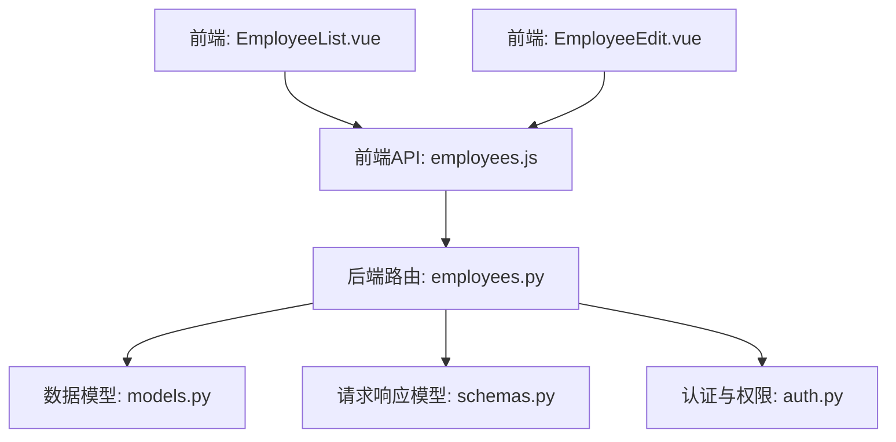
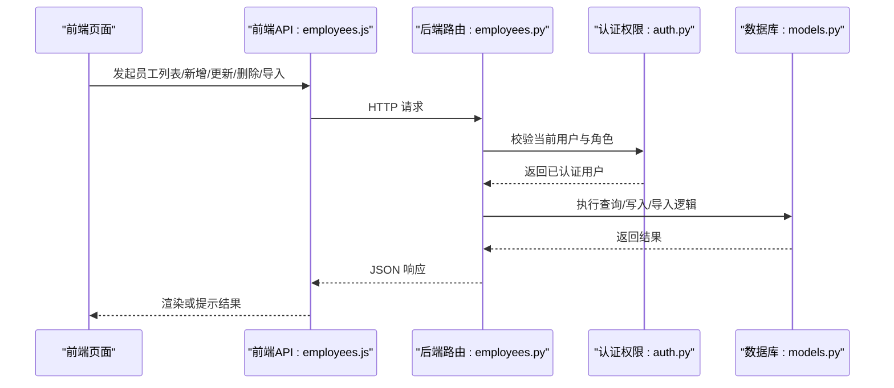
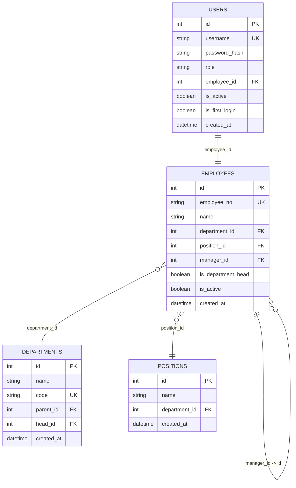
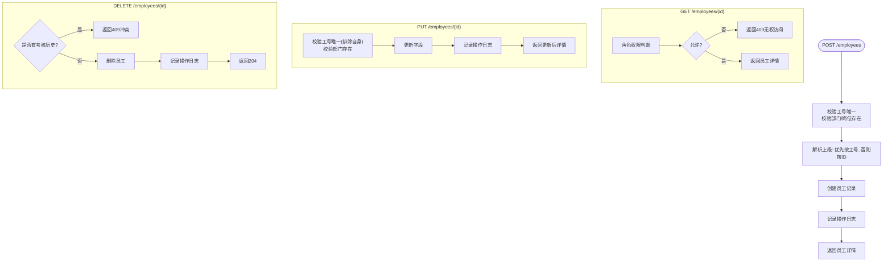
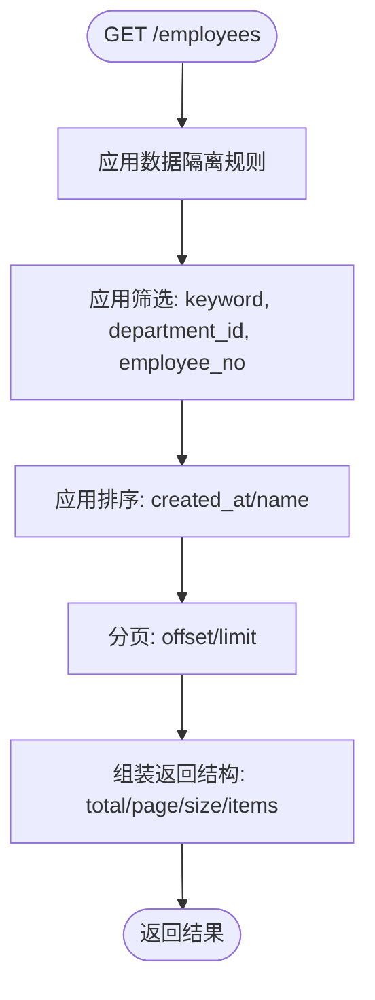
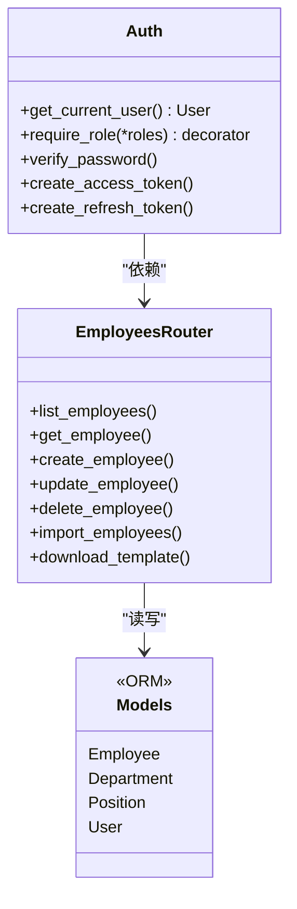
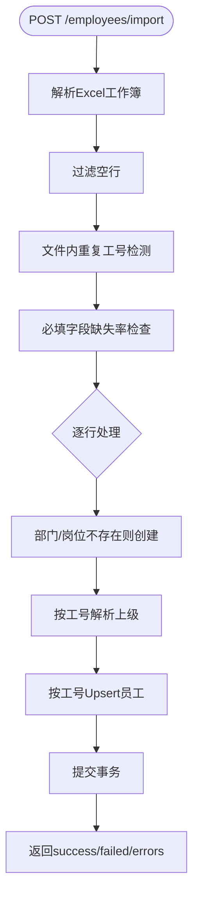
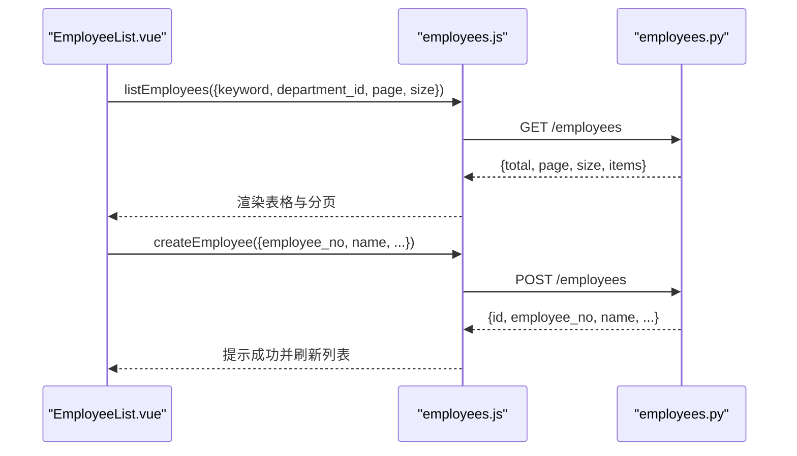
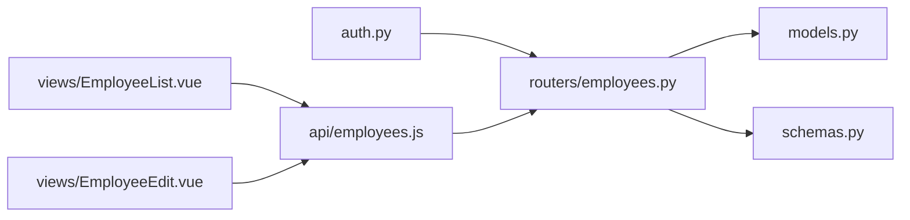

# 员工管理核心功能

<cite>
**本文引用的文件**   
- [models.py](file://backend/app/models.py)
- [schemas.py](file://backend/app/schemas.py)
- [employees.py](file://backend/app/routers/employees.py)
- [auth.py](file://backend/app/auth.py)
- [employees.js](file://frontend/src/api/employees.js)
- [EmployeeList.vue](file://frontend/src/views/employees/EmployeeList.vue)
- [EmployeeEdit.vue](file://frontend/src/views/employees/EmployeeEdit.vue)
</cite>

## 目录
1. [引言](#引言)
2. [项目结构](#项目结构)
3. [核心组件](#核心组件)
4. [架构总览](#架构总览)
5. [详细组件分析](#详细组件分析)
6. [依赖关系分析](#依赖关系分析)
7. [性能与扩展性](#性能与扩展性)
8. [故障排查指南](#故障排查指南)
9. [结论](#结论)

## 引言
本文件聚焦“员工管理”核心能力，围绕员工数据的创建、查询、更新、删除（CRUD）、数据模型设计、列表高级查询、权限隔离策略、导入导出机制以及前端组件使用进行系统化说明。目标是帮助后端开发者、前端开发者与产品测试人员快速理解并正确使用该模块。

## 项目结构
员工管理相关代码主要分布在以下位置：
- 后端数据模型与接口定义：`backend/app/models.py`、`backend/app/schemas.py`
- 后端路由与业务逻辑：`backend/app/routers/employees.py`
- 认证与权限控制：`backend/app/auth.py`
- 前端 API 封装：`frontend/src/api/employees.js`
- 前端页面与交互：`frontend/src/views/employees/EmployeeList.vue`、`frontend/src/views/employees/EmployeeEdit.vue`

**图表来源**
- [EmployeeList.vue:1-342](file://frontend/src/views/employees/EmployeeList.vue#L1-L342)
- [EmployeeEdit.vue:1-154](file://frontend/src/views/employees/EmployeeEdit.vue#L1-L154)
- [employees.js:1-30](file://frontend/src/api/employees.js#L1-L30)
- [employees.py:1-663](file://backend/app/routers/employees.py#L1-L663)
- [models.py:31-48](file://backend/app/models.py#L31-L48)
- [schemas.py:73-117](file://backend/app/schemas.py#L73-L117)
- [auth.py:68-129](file://backend/app/auth.py#L68-L129)

**章节来源**
- [models.py:31-48](file://backend/app/models.py#L31-L48)
- [schemas.py:73-117](file://backend/app/schemas.py#L73-L117)
- [employees.py:1-663](file://backend/app/routers/employees.py#L1-L663)
- [auth.py:68-129](file://backend/app/auth.py#L68-L129)
- [employees.js:1-30](file://frontend/src/api/employees.js#L1-L30)
- [EmployeeList.vue:1-342](file://frontend/src/views/employees/EmployeeList.vue#L1-L342)
- [EmployeeEdit.vue:1-154](file://frontend/src/views/employees/EmployeeEdit.vue#L1-L154)

## 核心组件
- 数据模型层
  - 员工表 `Employee`：包含工号、姓名、部门、岗位、直属上级、是否部门负责人、在职状态等字段。
  - 部门表 `Department`、岗位表 `Position`：支撑员工所属组织信息。
  - 用户表 `User`：承载登录账号、角色、关联员工等信息。
- 接口契约层
  - 员工创建/更新/输出 DTO：`EmployeeCreate`、`EmployeeUpdate`、`EmployeeOut`、`EmployeeListResponse`。
- 路由与服务层
  - 员工 CRUD 接口、列表分页查询、导入模板下载、Excel 批量导入、候选协作人查询、下属列表查询。
- 认证与权限层
  - JWT 鉴权、角色校验、首次登录强制改密、基于角色的访问控制。
- 前端展示层
  - 员工列表页：搜索、筛选、分页、新增/编辑弹窗、导入导出。
  - 员工编辑页：表单校验、联动加载岗位、保存调用后端接口。

**章节来源**
- [models.py:8-60](file://backend/app/models.py#L8-L60)
- [schemas.py:73-117](file://backend/app/schemas.py#L73-L117)
- [employees.py:35-230](file://backend/app/routers/employees.py#L35-L230)
- [auth.py:68-129](file://backend/app/auth.py#L68-L129)
- [EmployeeList.vue:1-342](file://frontend/src/views/employees/EmployeeList.vue#L1-L342)
- [EmployeeEdit.vue:1-154](file://frontend/src/views/employees/EmployeeEdit.vue#L1-L154)

## 架构总览
员工管理的整体流程如下：
- 前端通过 `employees.js` 调用后端 `/employees` 系列接口。
- 后端路由在 `employees.py` 中实现具体业务逻辑，包括权限校验、数据隔离、Excel 导入处理等。
- 数据持久化通过 SQLAlchemy ORM 操作 `models.py` 中的实体。
- 认证与权限由 `auth.py` 提供统一鉴权与角色检查。

**图表来源**
- [employees.js:1-30](file://frontend/src/api/employees.js#L1-L30)
- [employees.py:1-663](file://backend/app/routers/employees.py#L1-L663)
- [auth.py:68-129](file://backend/app/auth.py#L68-L129)
- [models.py:31-60](file://backend/app/models.py#L31-L60)

## 详细组件分析

### 员工数据模型设计
- 关键字段与约束
  - 工号 `employee_no`：唯一且必填，用于跨系统标识。
  - 姓名 `name`：必填，长度限制。
  - 部门 `department_id`：外键指向部门表，可为空。
  - 岗位 `position_id`：外键指向岗位表，可为空。
  - 直属上级 `manager_id`：自引用外键，支持层级汇报关系。
  - 是否部门负责人 `is_department_head`：布尔标记。
  - 在职状态 `is_active`：默认在职，用于软删除与过滤。
- 关系映射
  - 员工与部门：一对多（一个部门多名员工）。
  - 员工与岗位：一对多（一个岗位多名员工）。
  - 员工与上级：自引用一对多（一名员工有多个下属）。
  - 员工与用户：一对一（员工绑定登录账号）。

> 本图为局部关系片段，完整实体关系与约束以 [ER图设计.md](../系统架构/数据库架构设计/ER图设计.md) 为唯一权威来源。

**图表来源**
- [models.py:8-60](file://backend/app/models.py#L8-L60)

**章节来源**
- [models.py:31-60](file://backend/app/models.py#L31-L60)

### 员工 CRUD 接口实现
- 创建员工
  - 输入：`EmployeeCreate`，包含工号、姓名、部门、岗位、上级工号或ID、是否部门负责人、在职状态。
  - 校验：工号唯一、部门/岗位存在性、上级解析。
  - 输出：`EmployeeOut` 字段集合。
  - 审计：记录操作日志。
- 查询单个员工
  - 权限：peer 禁止；employee 仅本人；manager 需满足部门或上下级链；admin/hr/executive 全量。
  - 输出：同 `EmployeeOut`。
- 更新员工
  - 输入：`EmployeeUpdate`，可选字段更新。
  - 校验：工号唯一（排除自身）、部门存在、上级解析。
  - 输出：同 `EmployeeOut`。
  - 审计：记录操作日志。
- 删除员工
  - 前置校验：若存在考核历史则不可删除。
  - 成功返回 204。
  - 审计：记录操作日志。

**图表来源**
- [employees.py:480-551](file://backend/app/routers/employees.py#L480-L551)
- [employees.py:357-401](file://backend/app/routers/employees.py#L357-L401)
- [employees.py:554-629](file://backend/app/routers/employees.py#L554-L629)
- [employees.py:632-662](file://backend/app/routers/employees.py#L632-L662)

**章节来源**
- [employees.py:480-551](file://backend/app/routers/employees.py#L480-L551)
- [employees.py:357-401](file://backend/app/routers/employees.py#L357-L401)
- [employees.py:554-629](file://backend/app/routers/employees.py#L554-L629)
- [employees.py:632-662](file://backend/app/routers/employees.py#L632-L662)

### 员工列表查询与高级特性
- 基础能力
  - 分页：`page`、`size`。
  - 搜索：关键词匹配姓名或工号。
  - 筛选：按部门 ID 筛选。
  - 排序：支持按 `created_at`、`name` 升/降序。
- 数据隔离
  - employee：仅查看本人。
  - manager：可查看本部门及子部门员工，以及其直接/间接下属。
  - admin/hr/executive：全量可见。
- 特殊查询
  - 按工号精确查询：当传入 `employee_no` 时直接返回匹配结果。
  - 候选协作人：排除被评分人、非在职员工，优先其他部门。
  - 下属列表：获取某员工的直属下属。

**图表来源**
- [employees.py:233-312](file://backend/app/routers/employees.py#L233-L312)
- [employees.py:315-354](file://backend/app/routers/employees.py#L315-L354)
- [employees.py:404-434](file://backend/app/routers/employees.py#L404-L434)

**章节来源**
- [employees.py:233-312](file://backend/app/routers/employees.py#L233-L312)
- [employees.py:315-354](file://backend/app/routers/employees.py#L315-L354)
- [employees.py:404-434](file://backend/app/routers/employees.py#L404-L434)

### 权限控制机制
- 认证流程
  - Bearer Token 校验，解析 JWT，查找用户，检查账户激活状态。
  - 首次登录未改密：除白名单接口外，拒绝访问。
- 角色校验
  - `require_role` 装饰器：限定特定角色可访问接口。
- 数据隔离
  - 列表与详情接口根据角色动态过滤数据范围。
  - 部门树递归收集子部门 ID，结合上下级链判断访问权限。

**图表来源**
- [auth.py:68-129](file://backend/app/auth.py#L68-L129)
- [employees.py:1-663](file://backend/app/routers/employees.py#L1-L663)
- [models.py:31-60](file://backend/app/models.py#L31-L60)

**章节来源**
- [auth.py:68-129](file://backend/app/auth.py#L68-L129)
- [employees.py:233-401](file://backend/app/routers/employees.py#L233-L401)

### 员工导入导出机制
- Excel 模板下载
  - 接口：`GET /employees/template?type=empty|sample`
  - 模板列：工号、姓名、部门、岗位、直属上级工号、是否部门负责人、入职日期、状态。
  - 示例行：当 `type=sample` 时返回样例数据。
- Excel 批量导入
  - 接口：`POST /employees/import`
  - 权限：admin、hr。
  - 处理逻辑：
    - 解析工作簿与工作表，跳过空行。
    - 文件内重复工号检测。
    - 必填字段缺失率阈值控制（>10% 或行数≤5 直接失败）。
    - 逐行校验：工号、姓名必填；部门/岗位不存在则自动创建；上级按工号解析。
    - Upsert：按工号判断是否存在，存在则更新，不存在则新建。
    - 提交事务，返回成功/失败计数与错误明细。
- 导入预览与状态
  - 预览接口：`POST /employees/import-preview`，返回总行数与空错误列表。
  - 状态接口：`GET /employees/import/status`，返回就绪状态与进度。

**图表来源**
- [employees.py:35-65](file://backend/app/routers/employees.py#L35-L65)
- [employees.py:68-199](file://backend/app/routers/employees.py#L68-L199)
- [employees.py:202-230](file://backend/app/routers/employees.py#L202-L230)

**章节来源**
- [employees.py:35-65](file://backend/app/routers/employees.py#L35-L65)
- [employees.py:68-199](file://backend/app/routers/employees.py#L68-L199)
- [employees.py:202-230](file://backend/app/routers/employees.py#L202-L230)

### 前端组件使用示例与 API 调用方法
- 列表页 `EmployeeList.vue`
  - 功能：搜索（姓名/工号）、部门筛选、分页、新增/编辑弹窗、导入导出。
  - 关键 API：
    - `listEmployees(params)`：获取分页列表。
    - `createEmployee(data)`：新增员工。
    - `updateEmployee(id, data)`：更新员工。
    - `deleteEmployee(id)`：删除员工。
    - `importEmployees(file)`：上传 Excel 导入。
    - `downloadTemplate(type)`：下载模板。
- 编辑页 `EmployeeEdit.vue`
  - 功能：表单校验、部门联动岗位、保存调用后端接口。
  - 关键 API：同上。

**图表来源**
- [EmployeeList.vue:116-324](file://frontend/src/views/employees/EmployeeList.vue#L116-L324)
- [employees.js:1-30](file://frontend/src/api/employees.js#L1-L30)
- [employees.py:233-312](file://backend/app/routers/employees.py#L233-L312)
- [employees.py:480-551](file://backend/app/routers/employees.py#L480-L551)

**章节来源**
- [EmployeeList.vue:1-342](file://frontend/src/views/employees/EmployeeList.vue#L1-L342)
- [EmployeeEdit.vue:1-154](file://frontend/src/views/employees/EmployeeEdit.vue#L1-L154)
- [employees.js:1-30](file://frontend/src/api/employees.js#L1-L30)

## 依赖关系分析
- 模块耦合
  - 路由层依赖认证模块进行鉴权与角色校验。
  - 路由层依赖数据模型进行 ORM 操作。
  - 前端 API 封装与后端路由一一对应。
- 外部依赖
  - Excel 处理依赖 `openpyxl`，未安装时返回明确错误。
- 潜在循环依赖
  - 当前路由与模型之间无循环导入；认证模块独立。

**图表来源**
- [auth.py:68-129](file://backend/app/auth.py#L68-L129)
- [employees.py:1-663](file://backend/app/routers/employees.py#L1-L663)
- [models.py:31-60](file://backend/app/models.py#L31-L60)
- [schemas.py:73-117](file://backend/app/schemas.py#L73-L117)
- [employees.js:1-30](file://frontend/src/api/employees.js#L1-L30)
- [EmployeeList.vue:1-342](file://frontend/src/views/employees/EmployeeList.vue#L1-L342)
- [EmployeeEdit.vue:1-154](file://frontend/src/views/employees/EmployeeEdit.vue#L1-L154)

**章节来源**
- [employees.py:1-663](file://backend/app/routers/employees.py#L1-L663)
- [auth.py:68-129](file://backend/app/auth.py#L68-L129)
- [models.py:31-60](file://backend/app/models.py#L31-L60)
- [schemas.py:73-117](file://backend/app/schemas.py#L73-L117)
- [employees.js:1-30](file://frontend/src/api/employees.js#L1-L30)
- [EmployeeList.vue:1-342](file://frontend/src/views/employees/EmployeeList.vue#L1-L342)
- [EmployeeEdit.vue:1-154](file://frontend/src/views/employees/EmployeeEdit.vue#L1-L154)

## 性能与扩展性
- 列表查询优化
  - 建议在常用筛选字段（如 `department_id`、`employee_no`）建立索引。
  - 大数据量下避免 N+1 查询，可使用 `joinedload` 预加载部门、岗位、上级信息。
- 导入性能
  - 大批量导入建议分批提交事务，降低锁竞争。
  - 对部门/岗位名称到 ID 的映射可缓存以减少重复查询。
- 权限计算
  - 部门树递归与上下级链判断在高并发场景可能成为瓶颈，可考虑物化路径或闭包表优化。

[本节为通用指导，不直接分析具体文件]

## 故障排查指南
- 常见错误与定位
  - 401 未认证：检查 Token 是否有效、用户是否禁用、是否首次登录未改密。
  - 403 权限不足：检查角色是否满足接口要求，或数据隔离是否阻止访问。
  - 404 资源不存在：确认员工 ID 是否存在且在职。
  - 409 冲突：工号重复或删除时存在考核历史。
  - 422 参数不可处理：部门/岗位不存在或必填字段缺失。
  - 400 无法解析 Excel：文件格式错误或为空。
- 调试建议
  - 查看后端日志与操作日志，确认变更轨迹。
  - 使用导入预览接口验证 Excel 结构与数据质量。
  - 在前端控制台捕获网络响应，核对请求参数与返回结构。

**章节来源**
- [auth.py:68-129](file://backend/app/auth.py#L68-L129)
- [employees.py:357-401](file://backend/app/routers/employees.py#L357-L401)
- [employees.py:480-551](file://backend/app/routers/employees.py#L480-L551)
- [employees.py:554-629](file://backend/app/routers/employees.py#L554-L629)
- [employees.py:632-662](file://backend/app/routers/employees.py#L632-L662)
- [employees.py:68-199](file://backend/app/routers/employees.py#L68-L199)

## 结论
员工管理模块在后端通过清晰的模型与 DTO 定义、严格的权限与数据隔离策略、完善的导入导出机制，提供了稳定可靠的 CRUD 能力；前端以列表与编辑页为核心，配合统一的 API 封装，实现了完整的用户体验。建议在后续迭代中持续优化查询性能与导入吞吐，并完善错误提示与审计追踪，以提升系统的可用性与可维护性。