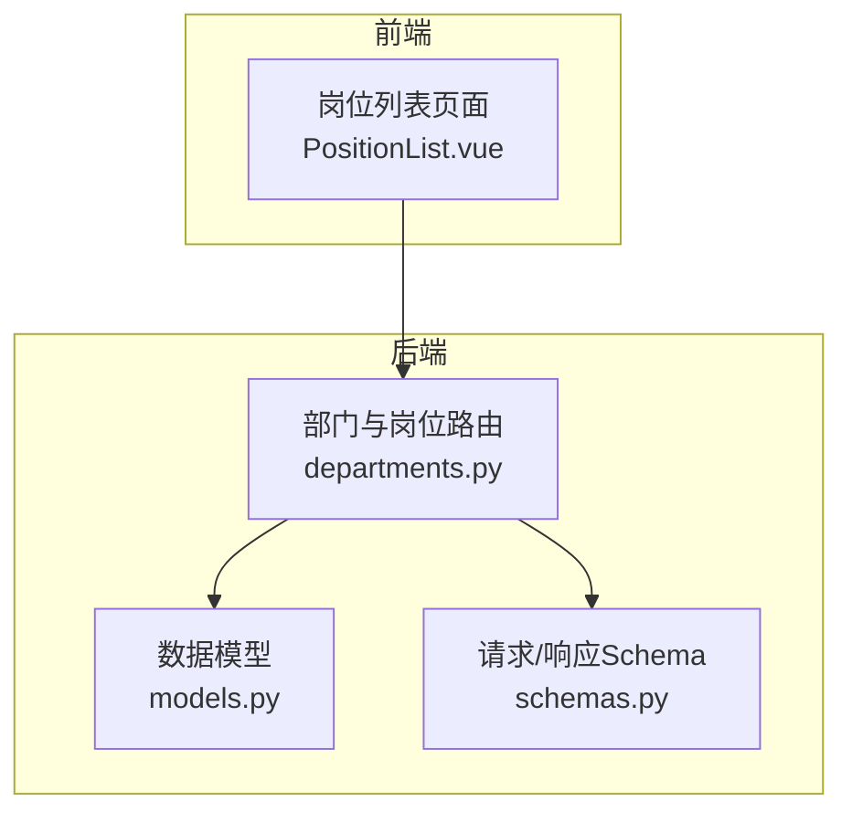
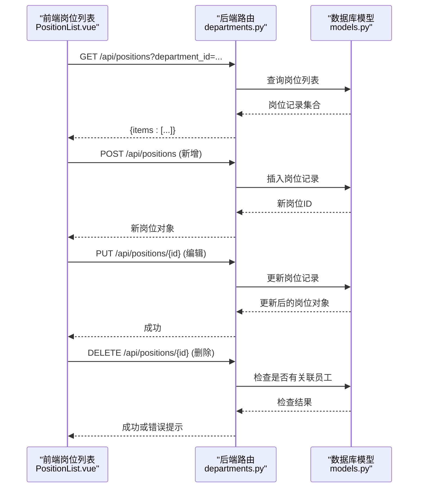
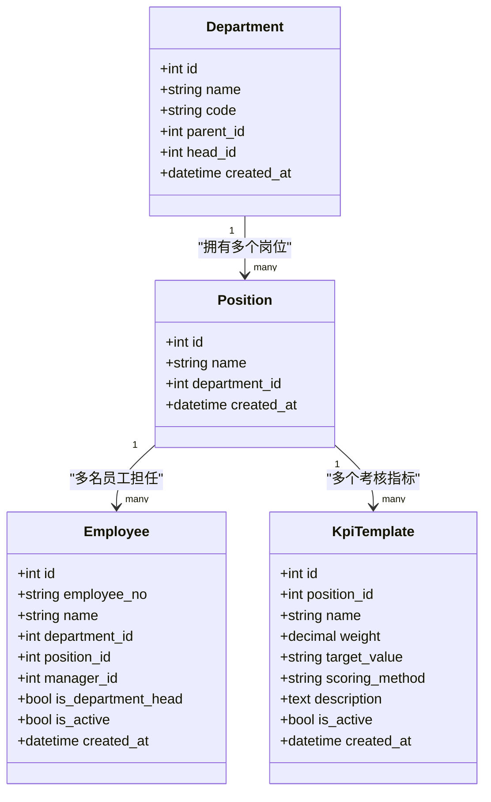
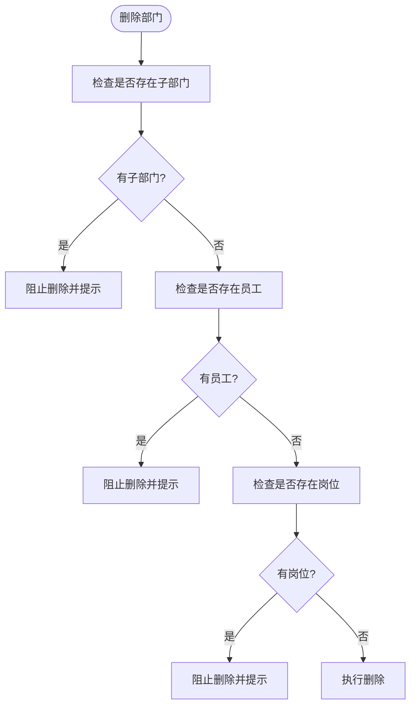
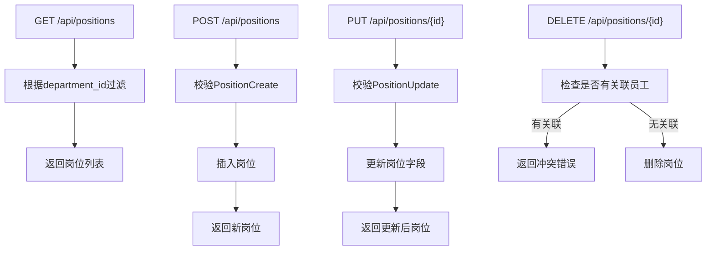
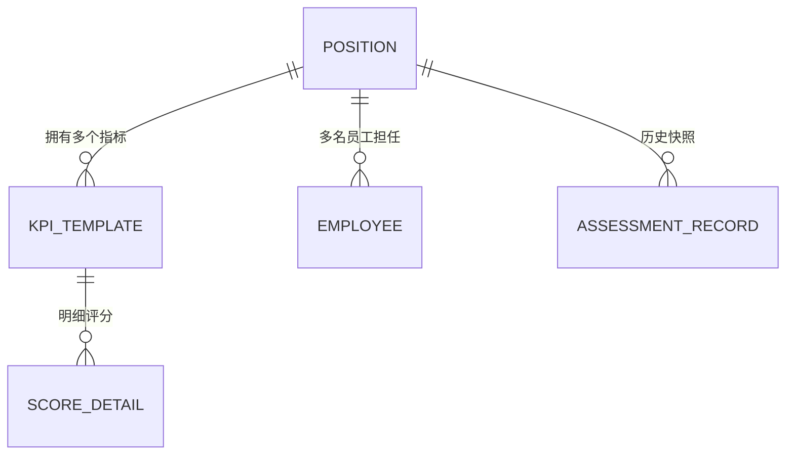
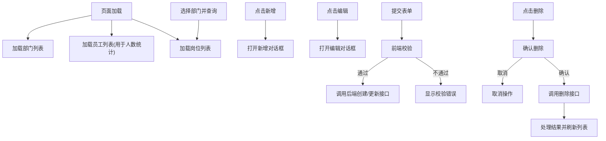
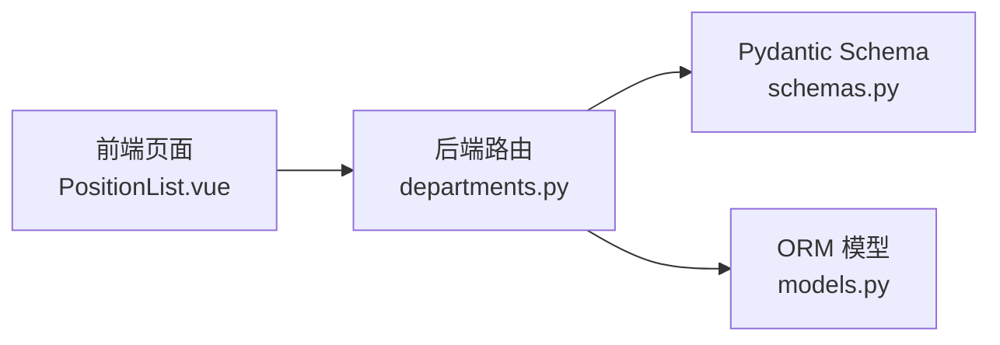

# 岗位管理

<cite>
**本文引用的文件**   
- [backend/app/models.py](file://backend/app/models.py)
- [backend/app/schemas.py](file://backend/app/schemas.py)
- [backend/app/routers/departments.py](file://backend/app/routers/departments.py)
- [frontend/src/views/positions/PositionList.vue](file://frontend/src/views/positions/PositionList.vue)
</cite>

## 目录
1. [引言](#引言)
2. [项目结构](#项目结构)
3. [核心组件](#核心组件)
4. [架构总览](#架构总览)
5. [详细组件分析](#详细组件分析)
6. [依赖关系分析](#依赖关系分析)
7. [性能考虑](#性能考虑)
8. [故障排查指南](#故障排查指南)
9. [结论](#结论)

## 引言
本文件面向“岗位管理”功能，系统性说明岗位数据模型、岗位与部门的关系、岗位的 CRUD 接口实现、岗位在绩效考核中的作用、前端岗位列表管理界面能力，以及相关的业务规则与验证逻辑。文档既适合后端开发者理解接口与模型设计，也适合产品与测试人员把握业务流程与边界条件。

## 项目结构
岗位管理涉及后端的数据模型、API 路由与校验 Schema，以及前端的岗位列表页面：
- 后端数据模型定义在 models.py，包含 Department、Position、Employee、KpiTemplate 等实体。
- 后端 API 路由集中在 routers/departments.py，其中同时提供部门与岗位的 REST 接口。
- 请求/响应数据结构定义在 schemas.py，包含 PositionCreate、PositionUpdate、PositionOut 等 Pydantic 模型。
- 前端岗位列表页面位于 frontend/src/views/positions/PositionList.vue，负责岗位查询、新增、编辑、删除及人数统计展示。

**图表来源**
- [frontend/src/views/positions/PositionList.vue:1-203](file://frontend/src/views/positions/PositionList.vue#L1-L203)
- [backend/app/routers/departments.py:1-212](file://backend/app/routers/departments.py#L1-L212)
- [backend/app/models.py:8-30](file://backend/app/models.py#L8-L30)
- [backend/app/schemas.py:55-71](file://backend/app/schemas.py#L55-L71)

**章节来源**
- [backend/app/models.py:8-30](file://backend/app/models.py#L8-L30)
- [backend/app/schemas.py:55-71](file://backend/app/schemas.py#L55-L71)
- [backend/app/routers/departments.py:151-211](file://backend/app/routers/departments.py#L151-L211)
- [frontend/src/views/positions/PositionList.vue:1-203](file://frontend/src/views/positions/PositionList.vue#L1-L203)

## 核心组件
- 岗位数据模型（Position）：包含岗位名称、所属部门、创建时间等字段，并通过外键关联到部门表。
- 部门数据模型（Department）：支持树形结构，并维护与岗位、员工的双向关系。
- 员工数据模型（Employee）：通过 position_id 与岗位建立多对一关系，体现“一个岗位可有多名员工”。
- KPI 模板（KpiTemplate）：通过 position_id 与岗位关联，承载该岗位下的考核指标与权重。
- 岗位 API 路由：提供岗位列表、创建、更新、删除接口，并在删除时进行业务约束检查。
- 岗位前端页面：提供按部门筛选、岗位信息展示、新增/编辑弹窗、删除确认、人数统计等功能。

**章节来源**
- [backend/app/models.py:8-30](file://backend/app/models.py#L8-L30)
- [backend/app/models.py:31-48](file://backend/app/models.py#L31-L48)
- [backend/app/models.py:85-98](file://backend/app/models.py#L85-L98)
- [backend/app/routers/departments.py:151-211](file://backend/app/routers/departments.py#L151-L211)
- [frontend/src/views/positions/PositionList.vue:1-203](file://frontend/src/views/positions/PositionList.vue#L1-L203)

## 架构总览
岗位管理的整体调用链如下：
- 前端岗位列表页面发起 HTTP 请求，调用后端部门与岗位相关路由。
- 后端路由接收请求，使用 SQLAlchemy ORM 操作数据库模型。
- 返回给前端的岗位数据包含基础字段；前端再结合已加载的部门与员工数据，补充部门名称与人数统计。

**图表来源**
- [frontend/src/views/positions/PositionList.vue:102-189](file://frontend/src/views/positions/PositionList.vue#L102-L189)
- [backend/app/routers/departments.py:154-211](file://backend/app/routers/departments.py#L154-L211)
- [backend/app/models.py:20-29](file://backend/app/models.py#L20-L29)

## 详细组件分析

### 岗位数据模型设计
- 岗位主键 id：自增整数，作为唯一标识。
- 岗位名称 name：必填字符串，用于岗位展示与管理。
- 所属部门 department_id：可选外键，指向 departments.id，表示岗位归属部门。
- 创建时间 created_at：默认当前时间，用于审计与排序。
- 关系映射：
  - 与部门 Department：一对多（一个部门下可有多个岗位）。
  - 与员工 Employee：一对多（一个岗位可被多名员工担任）。
  - 与 KPI 模板 KpiTemplate：一对多（一个岗位可配置多个考核指标项）。

**图表来源**
- [backend/app/models.py:8-30](file://backend/app/models.py#L8-L30)
- [backend/app/models.py:31-48](file://backend/app/models.py#L31-L48)
- [backend/app/models.py:85-98](file://backend/app/models.py#L85-L98)

**章节来源**
- [backend/app/models.py:20-29](file://backend/app/models.py#L20-L29)

### 岗位与部门的关联关系
- 业务规则：
  - 岗位必须属于某个部门（department_id 为外键），体现组织归属。
  - 部门下可存在多个岗位，便于按部门维度进行岗位管理与统计。
- 数据约束：
  - 删除部门时需检查是否存在子部门、员工、岗位，若存在则禁止删除，保证数据一致性。
- 查询增强：
  - 部门列表接口会统计每个部门的岗位数量与在职员工数量，辅助管理决策。

**图表来源**
- [backend/app/routers/departments.py:125-148](file://backend/app/routers/departments.py#L125-L148)

**章节来源**
- [backend/app/routers/departments.py:65-84](file://backend/app/routers/departments.py#L65-L84)
- [backend/app/routers/departments.py:125-148](file://backend/app/routers/departments.py#L125-L148)

### 岗位的 CRUD 操作实现
- 列表查询 list_positions：
  - 支持按 department_id 过滤。
  - 返回 items 数组，包含岗位基础字段。
- 创建 create_position：
  - 使用 PositionCreate Schema 校验输入。
  - 直接写入数据库并返回新岗位对象。
- 更新 update_position：
  - 使用 PositionUpdate Schema 校验输入。
  - 仅更新传入字段，返回更新后的岗位对象。
- 删除 delete_position：
  - 先检查是否存在与该岗位关联的员工，若存在则拒绝删除并返回冲突错误。
  - 否则执行删除。

**图表来源**
- [backend/app/routers/departments.py:154-211](file://backend/app/routers/departments.py#L154-L211)
- [backend/app/schemas.py:55-71](file://backend/app/schemas.py#L55-L71)

**章节来源**
- [backend/app/routers/departments.py:154-211](file://backend/app/routers/departments.py#L154-L211)
- [backend/app/schemas.py:55-71](file://backend/app/schemas.py#L55-L71)

### 岗位在绩效考核中的作用
- 岗位与 KPI 模板：
  - KpiTemplate.position_id 外键关联岗位，表示该模板适用于某岗位。
  - KpiTemplate.weight 表示该指标在岗位考核中的权重，所有指标权重总和需等于 100%。
  - KpiTemplate.scoring_method 表示评分方式（如百分比），target_value 为目标值，description 为描述。
- 岗位与评估记录：
  - AssessmentRecord.position_id 与 department_id 用于快照化岗位与部门信息，便于历史追溯。
  - ScoreDetail.kpi_template_id 与 kpi_name、weight 用于明细评分计算。
- 岗位与评分权重：
  - 岗位层面的 KPI 模板权重直接影响最终总分与等级分布。
  - 系统还可通过 AssessmentCycle.dimension_weights 与 reviewer_weights 控制维度与评分人权重。

> 本图为局部关系片段，完整实体关系与约束以 [ER图设计.md](../系统架构/数据库架构设计/ER图设计.md) 为唯一权威来源。

**图表来源**
- [backend/app/models.py:85-98](file://backend/app/models.py#L85-L98)
- [backend/app/models.py:99-143](file://backend/app/models.py#L99-L143)
- [backend/app/schemas.py:118-207](file://backend/app/schemas.py#L118-L207)

**章节来源**
- [backend/app/models.py:85-98](file://backend/app/models.py#L85-L98)
- [backend/app/models.py:99-143](file://backend/app/models.py#L99-L143)
- [backend/app/schemas.py:118-207](file://backend/app/schemas.py#L118-L207)

### 岗位列表管理界面功能
- 部门筛选：
  - 页面顶部提供“所属部门”下拉框，支持清空选择以查看全部岗位。
- 岗位信息展示：
  - 表格列包括岗位名称、所属部门、职级、人数。
  - 人数由前端汇总员工数据得到，部门名称由部门列表填充。
- 状态管理：
  - 页面维护 loading、positions、departments、allEmployees 等状态。
  - 表单校验确保岗位名称与所属部门必填。
- 操作能力：
  - 新增岗位：弹出对话框填写岗位名称、所属部门、职级。
  - 编辑岗位：回填现有岗位信息，支持修改。
  - 删除岗位：二次确认后调用删除接口，若岗位下有员工则显示错误提示。

**图表来源**
- [frontend/src/views/positions/PositionList.vue:1-203](file://frontend/src/views/positions/PositionList.vue#L1-L203)

**章节来源**
- [frontend/src/views/positions/PositionList.vue:1-203](file://frontend/src/views/positions/PositionList.vue#L1-L203)

### 岗位数据的业务规则与验证逻辑
- 前端校验：
  - 岗位名称必填。
  - 所属部门必填。
  - 新增/编辑成功后刷新岗位列表。
- 后端校验：
  - PositionCreate/PositionUpdate 使用 Pydantic 模型进行字段类型与必填校验。
  - 删除岗位时检查是否存在关联员工，若存在则返回冲突错误。
  - 删除部门时检查是否存在子部门、员工、岗位，若存在则阻止删除。
- 数据一致性：
  - 岗位与部门、员工、KPI 模板之间通过外键保持引用完整性。
  - 前端通过本地聚合计算人数与部门名称，提升用户体验。

**章节来源**
- [backend/app/schemas.py:55-71](file://backend/app/schemas.py#L55-L71)
- [backend/app/routers/departments.py:196-211](file://backend/app/routers/departments.py#L196-L211)
- [backend/app/routers/departments.py:125-148](file://backend/app/routers/departments.py#L125-L148)
- [frontend/src/views/positions/PositionList.vue:79-82](file://frontend/src/views/positions/PositionList.vue#L79-L82)

## 依赖关系分析
- 模块耦合：
  - 路由层依赖模型层与 Schema 层，职责清晰。
  - 前端页面依赖后端路由提供的接口，同时依赖部门与员工接口完成数据增强。
- 外部依赖：
  - FastAPI 提供路由与依赖注入。
  - SQLAlchemy ORM 提供数据库访问与关系映射。
  - Element Plus 提供 UI 组件。

**图表来源**
- [frontend/src/views/positions/PositionList.vue:62-68](file://frontend/src/views/positions/PositionList.vue#L62-L68)
- [backend/app/routers/departments.py:1-15](file://backend/app/routers/departments.py#L1-L15)
- [backend/app/models.py:1-6](file://backend/app/models.py#L1-L6)
- [backend/app/schemas.py:1-4](file://backend/app/schemas.py#L1-L4)

**章节来源**
- [backend/app/routers/departments.py:1-15](file://backend/app/routers/departments.py#L1-L15)
- [backend/app/models.py:1-6](file://backend/app/models.py#L1-L6)
- [backend/app/schemas.py:1-4](file://backend/app/schemas.py#L1-L4)
- [frontend/src/views/positions/PositionList.vue:62-68](file://frontend/src/views/positions/PositionList.vue#L62-L68)

## 性能考虑
- 列表查询优化：
  - 当前岗位列表接口未分页，数据量较大时建议增加分页参数与限制返回字段。
  - 部门列表接口中统计岗位数与员工数采用多次查询，可考虑合并查询或使用窗口函数优化。
- 前端数据聚合：
  - 人数统计在前端遍历员工列表计算，建议在后端提供岗位维度的员工计数以减少前端开销。
- 缓存策略：
  - 部门与岗位数据变化频率较低，可在后端引入缓存（如 Redis）以提升读取性能。

[本节为通用性能建议，不直接分析具体代码文件]

## 故障排查指南
- 删除岗位失败：
  - 现象：删除岗位时报错提示“岗位下存在员工，不可删除”。
  - 原因：该岗位仍有员工关联。
  - 处理：先将员工调岗或删除员工后再删除岗位。
- 删除部门失败：
  - 现象：删除部门时报错提示“部门下存在子部门/员工/岗位，不可删除”。
  - 原因：存在下级组织或关联数据。
  - 处理：先清理子部门、员工、岗位后再删除部门。
- 前端表单校验失败：
  - 现象：新增/编辑岗位时提示“请输入岗位名称/请选择所属部门”。
  - 原因：必填字段为空。
  - 处理：完善表单字段后重试。

**章节来源**
- [backend/app/routers/departments.py:196-211](file://backend/app/routers/departments.py#L196-L211)
- [backend/app/routers/departments.py:125-148](file://backend/app/routers/departments.py#L125-L148)
- [frontend/src/views/positions/PositionList.vue:174-189](file://frontend/src/views/positions/PositionList.vue#L174-L189)

## 结论
岗位管理功能以清晰的模型设计与接口实现为基础，支撑了岗位与部门、员工、KPI 模板之间的关联关系。前端岗位列表提供了便捷的查询、新增、编辑、删除与人数统计能力，满足日常组织与绩效管理需求。后续可在分页、统计聚合与缓存方面进一步优化，以提升大规模数据场景下的性能与体验。