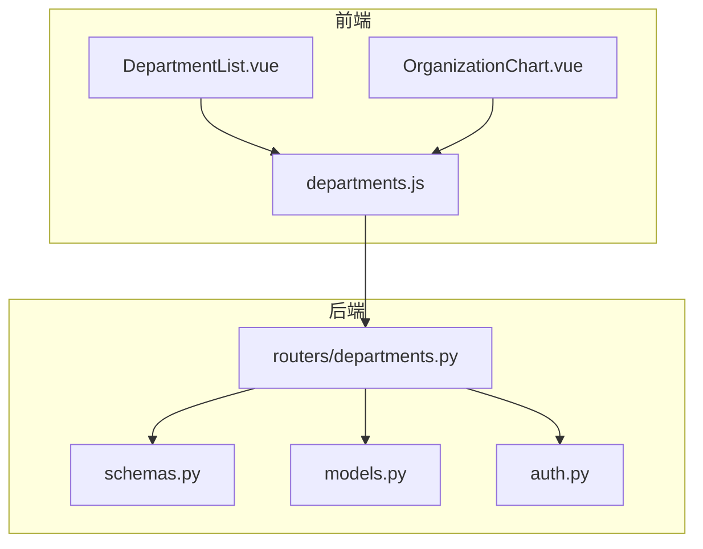
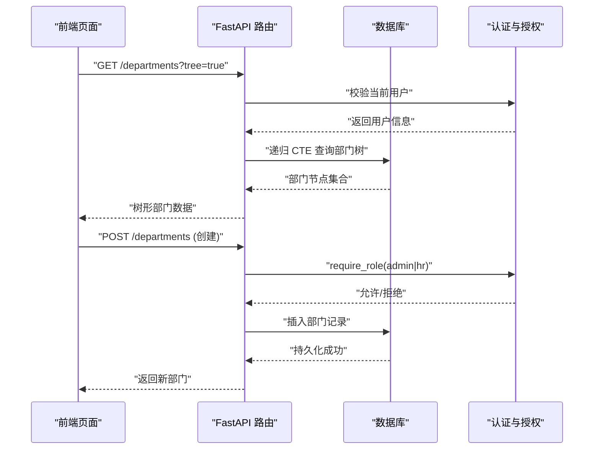
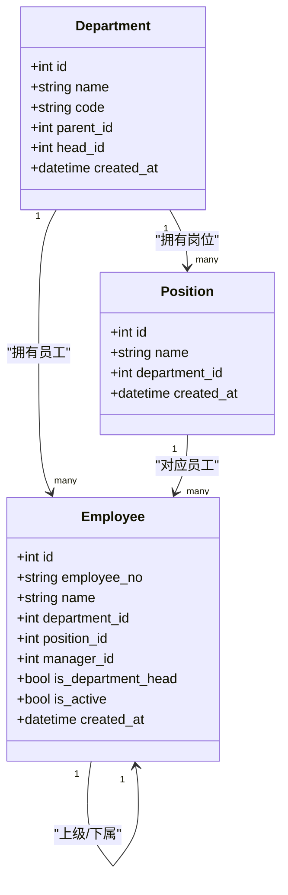
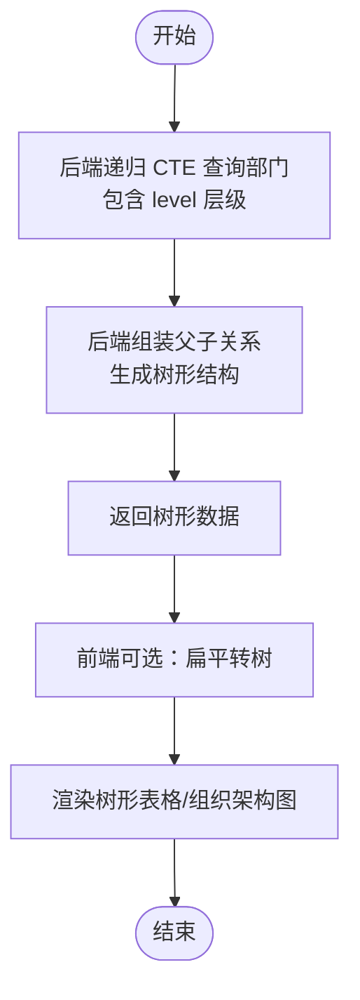
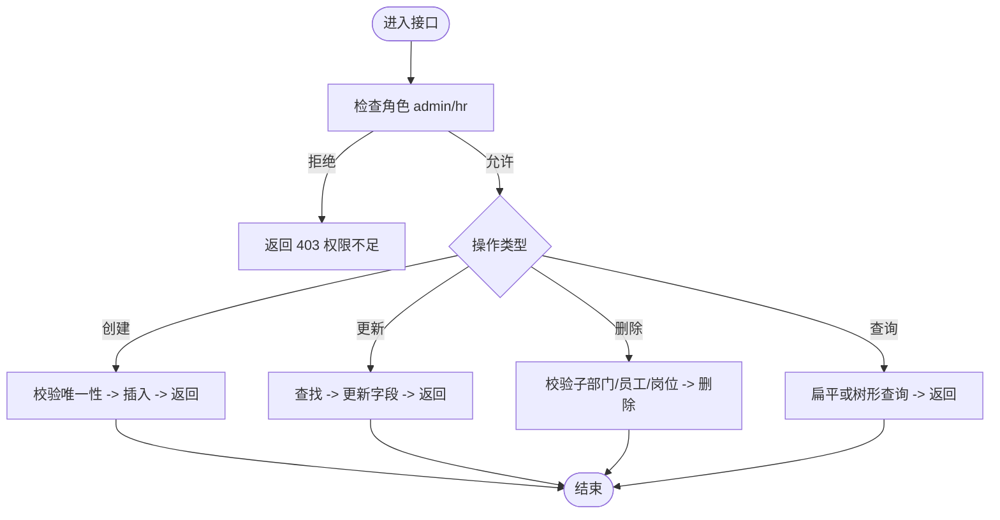
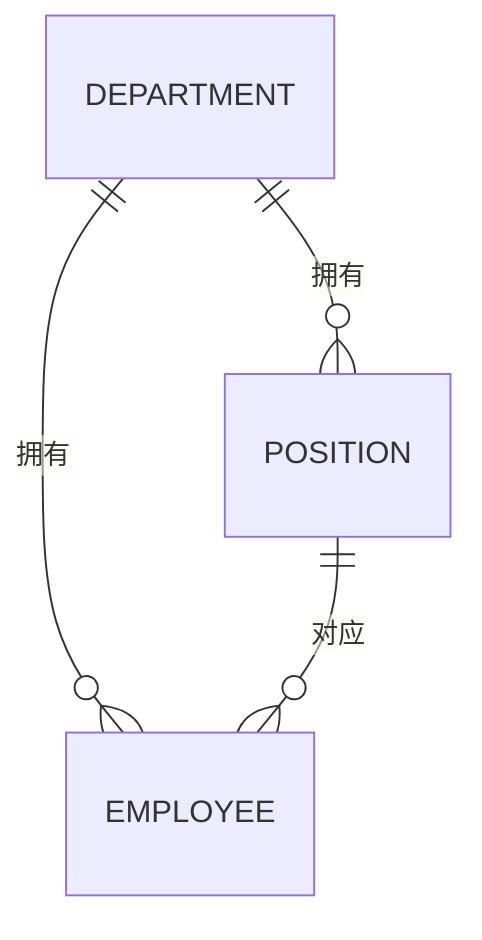
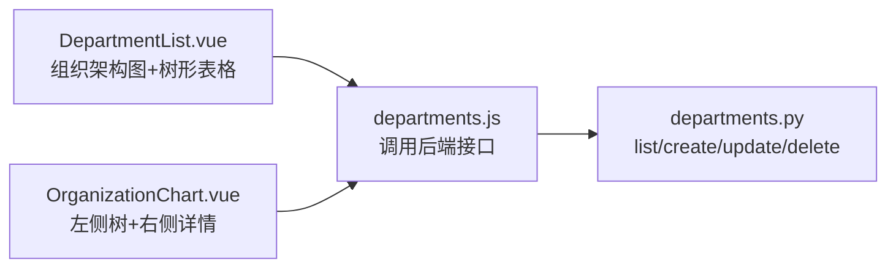
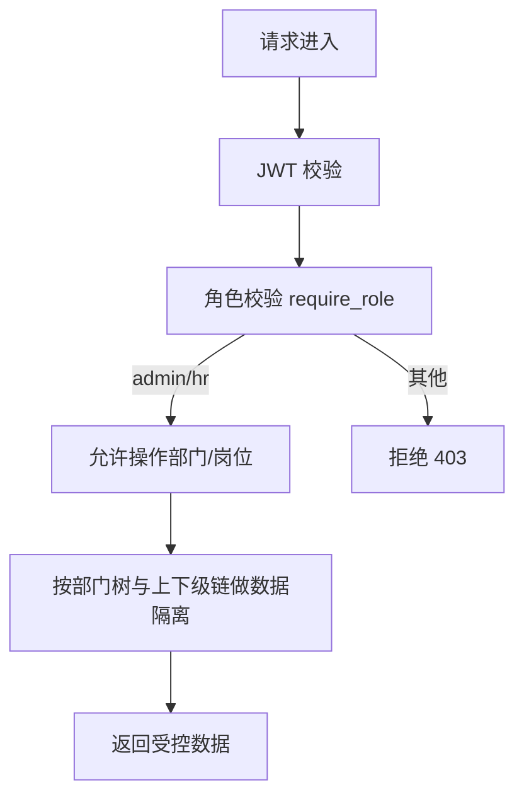
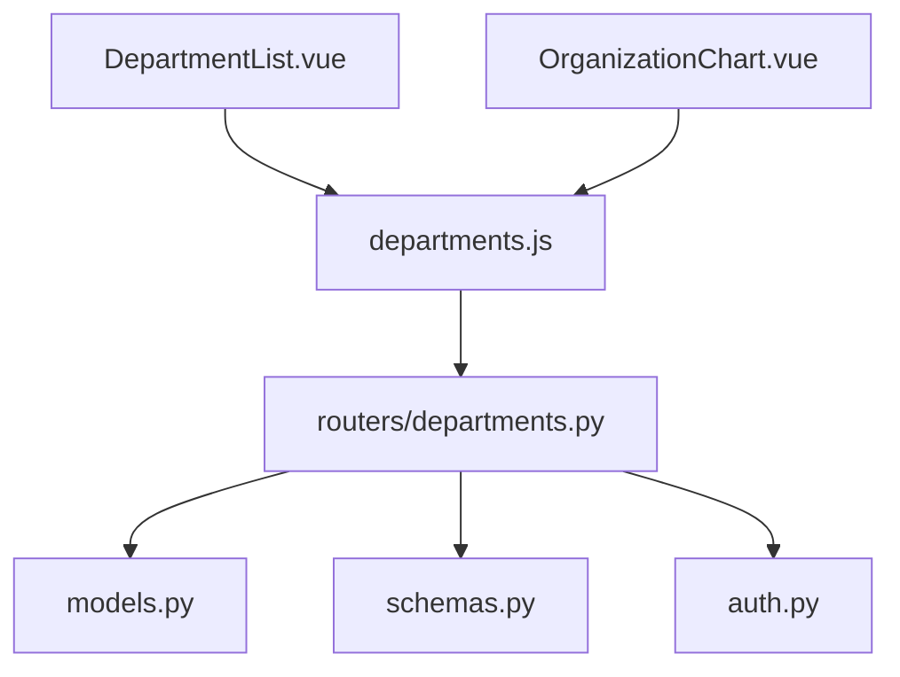

# 部门管理

<cite>
**本文引用的文件**   
- [models.py](file://backend/app/models.py)
- [departments.py](file://backend/app/routers/departments.py)
- [schemas.py](file://backend/app/schemas.py)
- [auth.py](file://backend/app/auth.py)
- [DepartmentList.vue](file://frontend/src/views/departments/DepartmentList.vue)
- [OrganizationChart.vue](file://frontend/src/views/departments/OrganizationChart.vue)
- [departments.js](file://frontend/src/api/departments.js)
- [employees.py](file://backend/app/routers/employees.py)
- [TECH_绩效考核评分系统_v1.0.md](file://docs/TECH_绩效考核评分系统_v1.0.md)
</cite>

## 目录
1. [简介](#简介)
2. [项目结构](#项目结构)
3. [核心组件](#核心组件)
4. [架构总览](#架构总览)
5. [详细组件分析](#详细组件分析)
6. [依赖关系分析](#依赖关系分析)
7. [性能与可扩展性](#性能与可扩展性)
8. [故障排查指南](#故障排查指南)
9. [结论](#结论)

## 简介
本文件面向“部门管理”功能，系统性说明部门数据模型、树形结构实现、CRUD 接口、与员工和岗位的关联、组织架构图展示能力，以及权限控制与数据隔离机制。文档兼顾后端实现与前端交互，帮助读者从业务到代码全面理解该模块。

## 项目结构
部门管理涉及后端模型、路由、请求校验、认证鉴权，以及前端的部门列表、组织架构视图与 API 调用封装：
- 后端
  - 数据模型：部门、岗位、员工等实体定义
  - 路由层：部门与岗位的增删改查、树形查询
  - 校验层：Pydantic 模型约束
  - 认证层：JWT 鉴权与角色校验
- 前端
  - 页面：部门列表（含拖拽调整归属）、组织架构详情
  - API：部门与岗位相关接口封装

**图表来源**
- [DepartmentList.vue:174-470](file://frontend/src/views/departments/DepartmentList.vue#L174-L470)
- [OrganizationChart.vue:60-123](file://frontend/src/views/departments/OrganizationChart.vue#L60-L123)
- [departments.js:1-34](file://frontend/src/api/departments.js#L1-L34)
- [departments.py:1-212](file://backend/app/routers/departments.py#L1-L212)
- [schemas.py:31-71](file://backend/app/schemas.py#L31-L71)
- [models.py:8-48](file://backend/app/models.py#L8-L48)
- [auth.py:68-129](file://backend/app/auth.py#L68-L129)

**章节来源**
- [DepartmentList.vue:1-507](file://frontend/src/views/departments/DepartmentList.vue#L1-L507)
- [OrganizationChart.vue:1-129](file://frontend/src/views/departments/OrganizationChart.vue#L1-L129)
- [departments.js:1-34](file://frontend/src/api/departments.js#L1-L34)
- [departments.py:1-212](file://backend/app/routers/departments.py#L1-L212)
- [schemas.py:31-71](file://backend/app/schemas.py#L31-L71)
- [models.py:8-48](file://backend/app/models.py#L8-L48)
- [auth.py:68-129](file://backend/app/auth.py#L68-L129)

## 核心组件
- 数据模型
  - 部门：支持层级（parent_id）、编码（code）、名称（name）、负责人（head_id）
  - 岗位：归属部门（department_id），与部门和员工多对一
  - 员工：归属部门（department_id）、岗位（position_id）、上级（manager_id）、是否部门负责人（is_department_head）
- 路由与接口
  - 部门列表：支持扁平与树形两种返回
  - 部门 CRUD：创建、更新、删除（含子部门/员工/岗位存在性校验）
  - 岗位 CRUD：按部门筛选、增删改
- 前端交互
  - 部门列表：树形表格 + 简单组织架构图 + 拖拽调整部门归属
  - 组织架构：左侧树导航，右侧展示部门详情、岗位列表、员工列表
- 权限与安全
  - 基于 JWT 的登录态校验
  - 基于角色的访问控制（admin/hr 可操作部门/岗位）

**章节来源**
- [models.py:8-48](file://backend/app/models.py#L8-L48)
- [departments.py:20-212](file://backend/app/routers/departments.py#L20-L212)
- [DepartmentList.vue:1-507](file://frontend/src/views/departments/DepartmentList.vue#L1-L507)
- [OrganizationChart.vue:1-129](file://frontend/src/views/departments/OrganizationChart.vue#L1-L129)
- [auth.py:68-129](file://backend/app/auth.py#L68-L129)

## 架构总览
部门管理的端到端流程如下：
- 前端发起部门或岗位相关请求
- FastAPI 路由进行参数校验、角色校验
- 通过 SQLAlchemy ORM 访问数据库
- 返回结构化数据给前端渲染

**图表来源**
- [departments.py:20-105](file://backend/app/routers/departments.py#L20-L105)
- [auth.py:68-129](file://backend/app/auth.py#L68-L129)

## 详细组件分析

### 数据模型设计
- 部门 Department
  - id：主键
  - name：部门名称
  - code：部门编码（唯一）
  - parent_id：父部门 ID（自引用外键）
  - head_id：部门负责人（指向员工表）
  - created_at：创建时间
  - 关系：一对多员工、一对多岗位
- 岗位 Position
  - id：主键
  - name：岗位名称
  - department_id：所属部门
  - created_at：创建时间
  - 关系：一对多员工、一对多 KPI 模板
- 员工 Employee
  - id：主键
  - employee_no：工号（唯一）
  - name：姓名
  - department_id：所属部门
  - position_id：岗位
  - manager_id：直属上级（自引用）
  - is_department_head：是否部门负责人
  - is_active：是否启用
  - 关系：所属部门、岗位、上级、下属、用户账号

**图表来源**
- [models.py:8-48](file://backend/app/models.py#L8-L48)

**章节来源**
- [models.py:8-48](file://backend/app/models.py#L8-L48)

### 部门树形结构与路径计算
- 后端树形查询
  - 使用递归 CTE 查询所有部门及其层级 level
  - 将结果组装为父子嵌套结构，便于前端直接渲染树
- 前端树构建
  - 若后端返回扁平列表，前端通过 buildTree 递归构建树
  - 在编辑时排除自身及子节点作为上级，避免形成环
- 层级展示
  - 树形表格根据 level 字段设置缩进
  - 组织架构图左侧树点击后加载部门详情、岗位与员工

**图表来源**
- [departments.py:20-84](file://backend/app/routers/departments.py#L20-L84)
- [DepartmentList.vue:294-304](file://frontend/src/views/departments/DepartmentList.vue#L294-L304)

**章节来源**
- [departments.py:20-84](file://backend/app/routers/departments.py#L20-L84)
- [DepartmentList.vue:294-304](file://frontend/src/views/departments/DepartmentList.vue#L294-L304)

### 部门的 CRUD 操作
- 创建部门
  - 校验：编码与名称唯一性
  - 权限：仅 admin/hr
  - 返回：新部门对象
- 更新部门
  - 权限：仅 admin/hr
  - 支持部分字段更新
- 删除部门
  - 权限：仅 admin/hr
  - 前置校验：无子部门、无员工、无岗位
- 查询部门
  - 扁平列表：附带上级部门名、岗位数、员工数
  - 树形列表：带层级 level 与 children

**图表来源**
- [departments.py:87-148](file://backend/app/routers/departments.py#L87-L148)
- [auth.py:116-129](file://backend/app/auth.py#L116-L129)

**章节来源**
- [departments.py:87-148](file://backend/app/routers/departments.py#L87-L148)
- [auth.py:116-129](file://backend/app/auth.py#L116-L129)

### 部门与员工、岗位的关联
- 部门与员工
  - 一个部门可有多个员工
  - 员工归属部门（department_id）
  - 部门负责人（head_id）指向员工
  - 员工统计：后端在扁平列表接口中统计 active 员工数量
- 部门与岗位
  - 一个部门可有多个岗位
  - 岗位归属部门（department_id）
  - 岗位统计：后端在扁平列表接口中统计岗位数量
- 前端展示
  - 部门列表显示员工数、岗位数
  - 组织架构页点击部门后并行加载岗位与员工列表

> 本图为局部关系片段，完整实体关系与约束以 [ER图设计.md](../系统架构/数据库架构设计/ER图设计.md) 为唯一权威来源。

**图表来源**
- [models.py:8-48](file://backend/app/models.py#L8-L48)

**章节来源**
- [departments.py:65-84](file://backend/app/routers/departments.py#L65-L84)
- [DepartmentList.vue:69-83](file://frontend/src/views/departments/DepartmentList.vue#L69-L83)
- [OrganizationChart.vue:103-117](file://frontend/src/views/departments/OrganizationChart.vue#L103-L117)

### 组织架构图展示
- 部门列表页
  - 顶部提供简化版组织架构图（可拖拽调整部门归属）
  - 下方树形表格展示部门层级、上级部门、负责人、人数、岗位数
  - 支持新增/编辑/删除部门与管理岗位
- 独立组织架构图页
  - 左侧树导航，右侧展示部门详情、岗位列表、员工列表
  - 点击节点后并行加载岗位与员工数据

**图表来源**
- [DepartmentList.vue:1-172](file://frontend/src/views/departments/DepartmentList.vue#L1-L172)
- [OrganizationChart.vue:1-57](file://frontend/src/views/departments/OrganizationChart.vue#L1-L57)
- [departments.js:1-34](file://frontend/src/api/departments.js#L1-L34)
- [departments.py:20-212](file://backend/app/routers/departments.py#L20-L212)

**章节来源**
- [DepartmentList.vue:1-172](file://frontend/src/views/departments/DepartmentList.vue#L1-L172)
- [OrganizationChart.vue:1-57](file://frontend/src/views/departments/OrganizationChart.vue#L1-L57)

### 权限控制与数据隔离
- 认证与授权
  - 基于 JWT 的用户认证
  - require_role 装饰器限制 admin/hr 可操作部门与岗位
- 数据隔离
  - 文档明确部门数据隔离规则：部门负责人可查看本部门及子部门的所有记录
  - 员工与考核相关接口通过 get_all_dept_ids 与上下级链判断实现隔离

**图表来源**
- [auth.py:68-129](file://backend/app/auth.py#L68-L129)
- [TECH_绩效考核评分系统_v1.0.md:2231-2243](file://docs/TECH_绩效考核评分系统_v1.0.md#L2231-L2243)
- [employees.py:247-285](file://backend/app/routers/employees.py#L247-L285)

**章节来源**
- [auth.py:68-129](file://backend/app/auth.py#L68-L129)
- [TECH_绩效考核评分系统_v1.0.md:2231-2243](file://docs/TECH_绩效考核评分系统_v1.0.md#L2231-L2243)
- [employees.py:247-285](file://backend/app/routers/employees.py#L247-L285)

## 依赖关系分析
- 前端依赖
  - DepartmentList.vue 依赖 departments.js 提供的接口
  - OrganizationChart.vue 依赖 departments.js 与 employees.js
- 后端依赖
  - routers/departments.py 依赖 models.py、schemas.py、auth.py
  - 认证依赖 auth.py 中的 get_current_user 与 require_role

**图表来源**
- [DepartmentList.vue:174-470](file://frontend/src/views/departments/DepartmentList.vue#L174-L470)
- [OrganizationChart.vue:60-123](file://frontend/src/views/departments/OrganizationChart.vue#L60-L123)
- [departments.js:1-34](file://frontend/src/api/departments.js#L1-L34)
- [departments.py:1-212](file://backend/app/routers/departments.py#L1-L212)
- [models.py:8-48](file://backend/app/models.py#L8-L48)
- [schemas.py:31-71](file://backend/app/schemas.py#L31-L71)
- [auth.py:68-129](file://backend/app/auth.py#L68-L129)

**章节来源**
- [departments.py:1-212](file://backend/app/routers/departments.py#L1-L212)
- [models.py:8-48](file://backend/app/models.py#L8-L48)
- [schemas.py:31-71](file://backend/app/schemas.py#L31-L71)
- [auth.py:68-129](file://backend/app/auth.py#L68-L129)

## 性能与可扩展性
- 查询优化
  - 树形查询使用递归 CTE，减少多次往返
  - 扁平列表一次性统计岗位与员工数量，避免 N+1 问题
- 前端优化
  - 并行加载部门与员工数据，缩短首屏时间
  - 树形结构在前端缓存，减少重复构建
- 可扩展建议
  - 增加分页与过滤条件（如按编码、名称模糊搜索）
  - 引入部门路径字段（path）以加速祖先/后代查询
  - 对大规模组织树采用懒加载与虚拟滚动

[本节为通用指导，不直接分析具体文件]

## 故障排查指南
- 常见错误
  - 409 冲突：部门编码或名称已存在
  - 404 未找到：部门或岗位不存在
  - 400 非法请求：删除部门但存在子部门/员工/岗位
  - 403 权限不足：非 admin/hr 尝试修改部门/岗位
- 定位步骤
  - 检查前端表单校验与提交载荷
  - 查看后端日志与 HTTP 状态码
  - 确认当前用户角色与 token 有效性
  - 验证部门是否存在子部门、员工或岗位

**章节来源**
- [departments.py:87-148](file://backend/app/routers/departments.py#L87-L148)
- [auth.py:68-129](file://backend/app/auth.py#L68-L129)

## 结论
部门管理模块以清晰的模型设计与严格的权限控制为基础，提供了完整的树形结构展示与 CRUD 能力，并与员工、岗位紧密关联。通过递归 CTE 与前端树构建相结合，实现了高效的层级展示；通过角色校验与数据隔离策略，保障了数据安全。建议在后续迭代中增强分页、搜索与路径字段，以提升大规模组织场景下的性能与可用性。