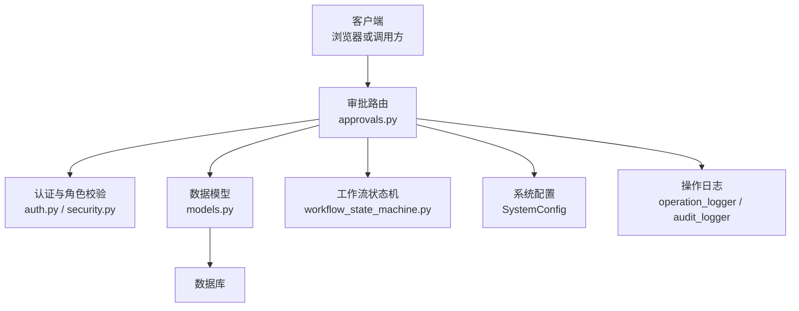
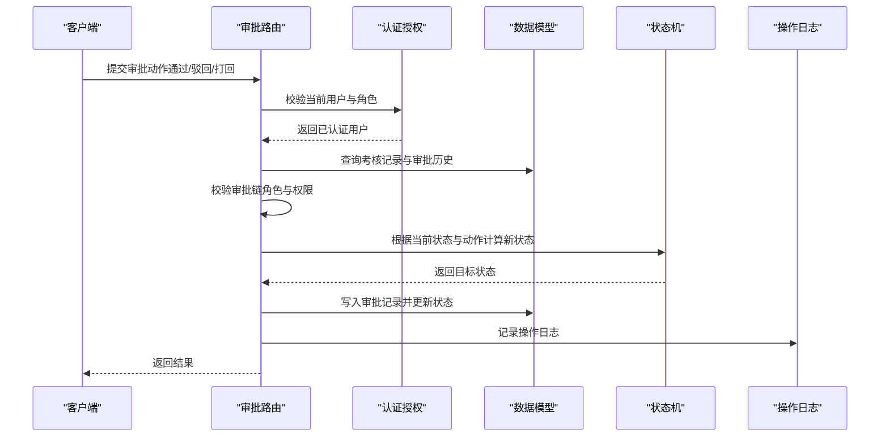
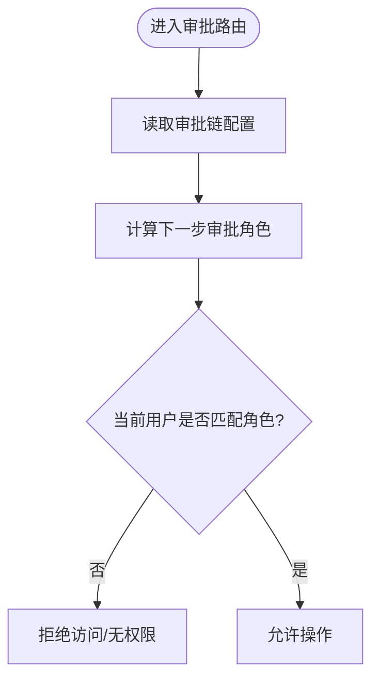
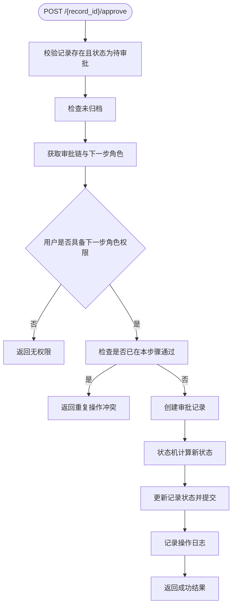
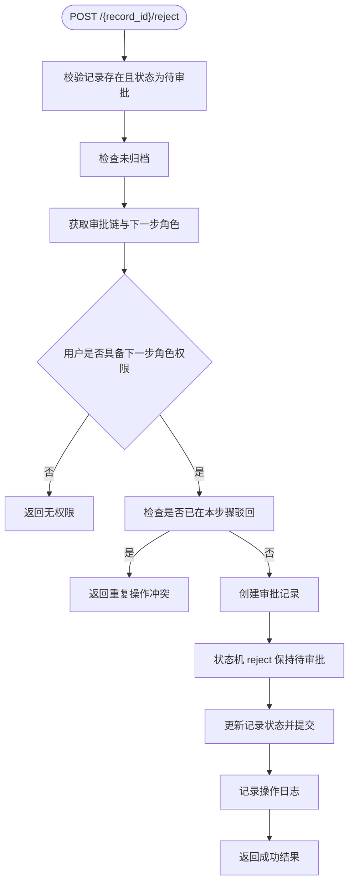
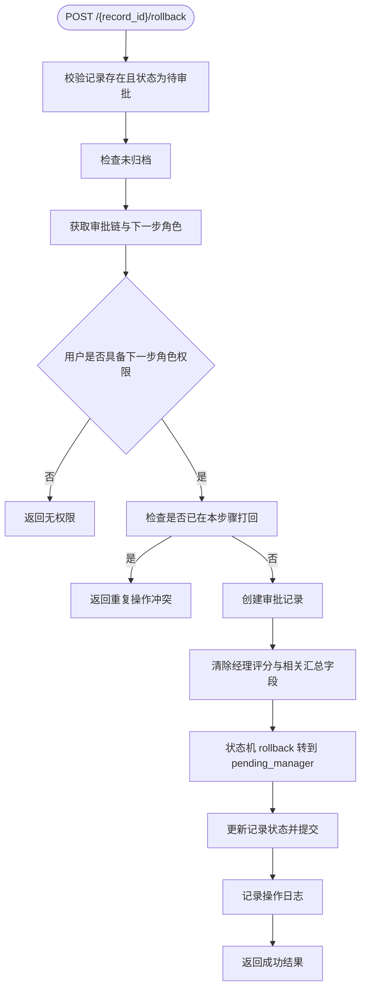
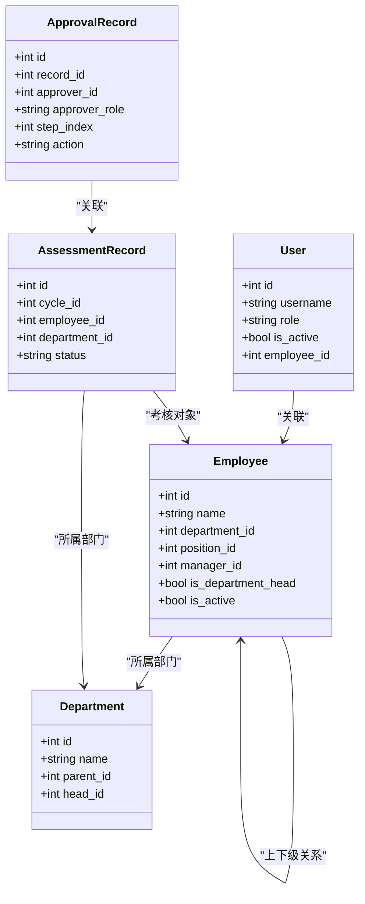
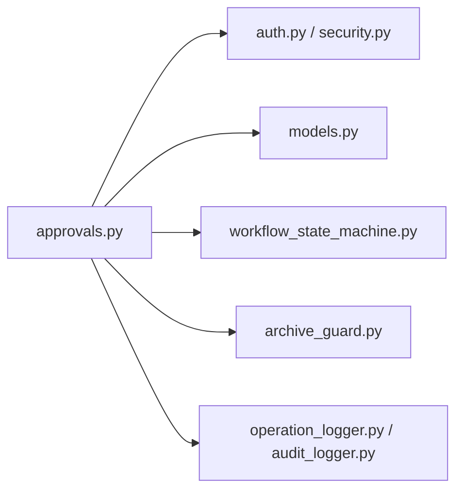

# 审批决策逻辑

<cite>
**本文引用的文件**   
- [backend/app/routers/approvals.py](file://backend/app/routers/approvals.py)
- [backend/app/models.py](file://backend/app/models.py)
- [backend/app/auth.py](file://backend/app/auth.py)
- [backend/app/core/security.py](file://backend/app/core/security.py)
- [backend/app/utils/workflow_state_machine.py](file://backend/app/utils/workflow_state_machine.py)
- [backend/app/core/exceptions.py](file://backend/app/core/exceptions.py)
- [backend/tests/test_approvals.py](file://backend/tests/test_approvals.py)
</cite>

## 目录
1. [引言](#引言)
2. [项目结构与审批相关范围](#项目结构与审批相关范围)
3. [核心组件与职责](#核心组件与职责)
4. [架构总览](#架构总览)
5. [详细组件分析](#详细组件分析)
6. [依赖关系分析](#依赖关系分析)
7. [性能与一致性设计](#性能与一致性设计)
8. [API 接口规范](#api-接口规范)
9. [业务规则配置](#业务规则配置)
10. [异常处理方案](#异常处理方案)
11. [故障排查指南](#故障排查指南)
12. [结论](#结论)

## 引言
本文聚焦绩效考核系统中的“审批决策逻辑”，围绕三种审批动作展开：通过、驳回、打回。文档从系统架构、权限验证、状态机流转、原子性与重复操作防护、数据一致性、API 规范、配置项和异常处理等维度，给出可落地的技术说明，帮助开发者、测试人员和运维人员理解并维护审批链路。

## 项目结构与审批相关范围
审批功能主要位于后端 FastAPI 路由层，结合模型、认证授权、工作流状态机和系统配置实现。前端提供审批工作台界面，但本文重点在后端实现。

**图表来源**  
- [backend/app/routers/approvals.py:1-18](file://backend/app/routers/approvals.py#L1-L18)
- [backend/app/auth.py:116-129](file://backend/app/auth.py#L116-L129)
- [backend/app/core/security.py:82-138](file://backend/app/core/security.py#L82-L138)
- [backend/app/models.py:99-165](file://backend/app/models.py#L99-L165)
- [backend/app/utils/workflow_state_machine.py:10-78](file://backend/app/utils/workflow_state_machine.py#L10-L78)

**章节来源**  
- [backend/app/routers/approvals.py:1-18](file://backend/app/routers/approvals.py#L1-L18)
- [backend/app/models.py:99-165](file://backend/app/models.py#L99-L165)

## 核心组件与职责
- 审批路由模块：定义待审批列表、详情、通过、驳回、打回、历史查询、强制分布特批等接口；实现审批链解析、权限判断、重复操作防护、状态更新与审计日志记录。
- 数据模型：考核记录、员工、部门、职位、用户、审批记录、系统配置等实体，支撑审批流程的数据持久化。
- 认证与授权：JWT 鉴权、角色校验、首次登录限制、白名单访问控制。
- 工作流状态机：集中管理状态与动作映射，确保状态转换合法并可扩展。
- 异常体系：统一业务异常结构，便于全局处理器返回标准错误响应。

**章节来源**  
- [backend/app/routers/approvals.py:19-97](file://backend/app/routers/approvals.py#L19-L97)
- [backend/app/models.py:8-165](file://backend/app/models.py#L8-L165)
- [backend/app/auth.py:19-129](file://backend/app/auth.py#L19-L129)
- [backend/app/core/security.py:20-138](file://backend/app/core/security.py#L20-L138)
- [backend/app/utils/workflow_state_machine.py:10-78](file://backend/app/utils/workflow_state_machine.py#L10-L78)
- [backend/app/core/exceptions.py:6-107](file://backend/app/core/exceptions.py#L6-L107)

## 架构总览
审批决策的整体流程如下：

**图表来源**  
- [backend/app/routers/approvals.py:451-534](file://backend/app/routers/approvals.py#L451-L534)
- [backend/app/routers/approvals.py:537-616](file://backend/app/routers/approvals.py#L537-L616)
- [backend/app/routers/approvals.py:619-716](file://backend/app/routers/approvals.py#L619-L716)
- [backend/app/utils/workflow_state_machine.py:106-186](file://backend/app/utils/workflow_state_machine.py#L106-L186)

## 详细组件分析

### 审批链与权限验证
- 审批链默认顺序为直接上级、部门负责人、HR负责人，支持通过系统配置动态调整。
- 下一步审批角色由已有“已通过”的审批步骤决定；若已完成所有步骤则不允许继续审批。
- 权限判断依据：
  - 直接上级：当前用户是否为该员工的直接上级。
  - 部门负责人：当前用户是否是该员工所在部门的负责人，或部门头部的上级链中匹配。
  - HR/管理员：用户角色为 hr 或 admin。
- 访问详情权限：除管理员与HR外，仅允许直接上级、当前审批链中的下一步角色、以及部门头部及其上级链中的部门负责人查看。

**图表来源**  
- [backend/app/routers/approvals.py:22-64](file://backend/app/routers/approvals.py#L22-L64)
- [backend/app/routers/approvals.py:67-97](file://backend/app/routers/approvals.py#L67-L97)

**章节来源**  
- [backend/app/routers/approvals.py:22-64](file://backend/app/routers/approvals.py#L22-L64)
- [backend/app/routers/approvals.py:67-97](file://backend/app/routers/approvals.py#L67-L97)

### 通过（approve）业务规则
- 前置条件：
  - 考核记录存在且状态为“待审批”。
  - 未归档。
  - 存在下一步审批角色。
  - 当前用户具备对应角色权限。
  - 同一用户在当前步骤未重复通过。
- 处理逻辑：
  - 创建审批记录，记录审批人、角色、步骤索引、动作“approved”及评论。
  - 使用状态机根据步骤数量选择“approve_step1”或“approve_step2”，得到新状态。
  - 更新考核记录状态并提交事务。
  - 记录操作日志，包含旧状态与新状态、步骤变化。

**图表来源**  
- [backend/app/routers/approvals.py:451-534](file://backend/app/routers/approvals.py#L451-L534)
- [backend/app/utils/workflow_state_machine.py:62-67](file://backend/app/utils/workflow_state_machine.py#L62-L67)

**章节来源**  
- [backend/app/routers/approvals.py:451-534](file://backend/app/routers/approvals.py#L451-L534)
- [backend/app/utils/workflow_state_machine.py:62-67](file://backend/app/utils/workflow_state_machine.py#L62-L67)

### 驳回（reject）业务规则
- 前置条件：
  - 考核记录存在且状态为“待审批”。
  - 未归档。
  - 存在下一步审批角色。
  - 当前用户具备对应角色权限。
  - 同一用户未重复驳回。
- 处理逻辑：
  - 创建审批记录，动作“rejected”，附带理由。
  - 状态机将“pending_approval”经“reject”动作保持“pending_approval”，表示退回修改。
  - 更新记录状态并提交事务。
  - 记录操作日志，包含原因。

**图表来源**  
- [backend/app/routers/approvals.py:537-616](file://backend/app/routers/approvals.py#L537-L616)
- [backend/app/utils/workflow_state_machine.py:62-67](file://backend/app/utils/workflow_state_machine.py#L62-L67)

**章节来源**  
- [backend/app/routers/approvals.py:537-616](file://backend/app/routers/approvals.py#L537-L616)
- [backend/app/utils/workflow_state_machine.py:62-67](file://backend/app/utils/workflow_state_machine.py#L62-L67)

### 打回（rollback）业务规则
- 前置条件：
  - 考核记录存在且状态为“待审批”。
  - 未归档。
  - 存在下一步审批角色。
  - 当前用户具备对应角色权限。
  - 同一用户未重复打回。
- 处理逻辑：
  - 创建审批记录，动作“rollback”，附带理由。
  - 清除经理评分及相关加权分数、总分、等级、原始等级、经理评语等字段，保留自评与协作评分。
  - 状态机将“pending_approval”经“rollback”动作转为“pending_manager”，回到上级评分阶段。
  - 更新记录状态并提交事务。
  - 记录操作日志，包含被清除的评分快照与新状态。

**图表来源**  
- [backend/app/routers/approvals.py:619-716](file://backend/app/routers/approvals.py#L619-L716)
- [backend/app/utils/workflow_state_machine.py:62-67](file://backend/app/utils/workflow_state_machine.py#L62-L67)

**章节来源**  
- [backend/app/routers/approvals.py:619-716](file://backend/app/routers/approvals.py#L619-L716)
- [backend/app/utils/workflow_state_machine.py:62-67](file://backend/app/utils/workflow_state_machine.py#L62-L67)

### 权限验证机制
- 角色权限检查：
  - 路由层使用 require_role 装饰器限定 manager/hr/admin 等角色。
  - 具体审批角色判断在 _can_approve_as_role 中实现，区分 direct_manager、dept_head、hr_head/hr、admin。
- 部门层级关系验证：
  - 部门负责人判定基于部门 head_id 与当前用户 employee_id 匹配。
  - 访问详情时支持向上遍历部门 parent_id 链，确认上级部门负责人权限。
- 直接上级关系确认：
  - 直接上级判定基于 Employee.subordinates 关系，判断目标员工是否在下属列表中。

**图表来源**  
- [backend/app/models.py:8-60](file://backend/app/models.py#L8-L60)
- [backend/app/models.py:99-165](file://backend/app/models.py#L99-L165)

**章节来源**  
- [backend/app/auth.py:116-129](file://backend/app/auth.py#L116-L129)
- [backend/app/routers/approvals.py:45-64](file://backend/app/routers/approvals.py#L45-L64)
- [backend/app/routers/approvals.py:67-97](file://backend/app/routers/approvals.py#L67-L97)
- [backend/app/models.py:8-60](file://backend/app/models.py#L8-L60)
- [backend/app/models.py:99-165](file://backend/app/models.py#L99-L165)

### 原子性保证、重复操作防护与数据一致性
- 原子性：
  - 每个审批动作在同一个数据库会话中写入审批记录并更新考核记录状态，最后统一提交事务，保证操作的原子性。
- 重复操作防护：
  - 通过：检查同一用户在当前步骤是否存在“approved”记录，避免重复通过。
  - 驳回：检查同一用户是否存在“rejected”记录，避免重复驳回。
  - 打回：检查同一用户是否存在“rollback”记录，避免重复打回。
- 数据一致性：
  - 打回时清除经理评分与汇总字段，确保重新评分后数据一致。
  - 状态变更通过状态机统一管理，避免非法状态跳转。
  - 所有关键操作均记录审计日志，便于追溯。

**章节来源**  
- [backend/app/routers/approvals.py:484-492](file://backend/app/routers/approvals.py#L484-L492)
- [backend/app/routers/approvals.py:569-576](file://backend/app/routers/approvals.py#L569-L576)
- [backend/app/routers/approvals.py:651-658](file://backend/app/routers/approvals.py#L651-L658)
- [backend/app/routers/approvals.py:674-702](file://backend/app/routers/approvals.py#L674-L702)
- [backend/app/utils/workflow_state_machine.py:106-186](file://backend/app/utils/workflow_state_machine.py#L106-L186)

## 依赖关系分析
- 路由层依赖：
  - 认证依赖 get_current_user 与 require_role。
  - 数据依赖 models 中的 AssessmentRecord、Employee、Department、Position、User、ApprovalRecord、AssessmentCycle、SystemConfig、PeerReviewTask。
  - 工具依赖 workflow_state_machine 的状态机。
  - 审计日志依赖 operation_logger 与 audit_logger。
- 外部集成点：
  - 归档保护 check_record_not_archived 防止对已归档记录进行审批操作。

**图表来源**  
- [backend/app/routers/approvals.py:8-17](file://backend/app/routers/approvals.py#L8-L17)
- [backend/app/auth.py:116-129](file://backend/app/auth.py#L116-L129)
- [backend/app/core/security.py:82-138](file://backend/app/core/security.py#L82-L138)
- [backend/app/models.py:99-165](file://backend/app/models.py#L99-L165)
- [backend/app/utils/workflow_state_machine.py:10-78](file://backend/app/utils/workflow_state_machine.py#L10-L78)

**章节来源**  
- [backend/app/routers/approvals.py:8-17](file://backend/app/routers/approvals.py#L8-L17)
- [backend/app/auth.py:116-129](file://backend/app/auth.py#L116-L129)
- [backend/app/core/security.py:82-138](file://backend/app/core/security.py#L82-L138)
- [backend/app/models.py:99-165](file://backend/app/models.py#L99-L165)
- [backend/app/utils/workflow_state_machine.py:10-78](file://backend/app/utils/workflow_state_machine.py#L10-L78)

## 性能与一致性设计
- 待审批列表查询优化：
  - 使用子查询聚合每条记录的已通过最大 step_index，避免全表扫描。
  - 预计算用户的下属 ID 与部门 ID，构建 OR 条件组合，减少无效数据加载。
  - 支持按部门、异常标记、强制调整标记、步骤过滤，提升查询效率。
- 状态机集中管理：
  - 所有状态转换集中在状态机中定义，降低分支复杂度，提高可维护性。
- 审计日志异步容错：
  - 状态机内部日志写入失败不阻断主流程，保证核心业务可用性。

**章节来源**  
- [backend/app/routers/approvals.py:174-254](file://backend/app/routers/approvals.py#L174-L254)
- [backend/app/utils/workflow_state_machine.py:169-184](file://backend/app/utils/workflow_state_machine.py#L169-L184)

## API 接口规范
以下列出审批相关的核心接口与其行为说明。请求体参数以路由定义为准，部分接口使用 Body(embed=True)。

- 获取审批链配置
  - GET /approvals/chain-config
  - 权限：admin/hr/executive
  - 返回：当前审批链角色序列

- 更新审批链配置
  - PUT /approvals/chain-config
  - 权限：admin
  - 请求体：chain 列表，元素为 direct_manager/dept_head/hr_head/admin
  - 返回：更新后的 chain

- 获取待审批列表
  - GET /approvals/pending
  - 权限：manager/hr/admin
  - 查询参数：department_id、is_abnormal、is_force_adjusted、step
  - 返回：待审批记录集合，含员工信息、评分、下一步角色、步骤索引等

- 获取强制分布特批申请列表
  - GET /approvals/distribution-overrides
  - 权限：admin/hr/executive
  - 查询参数：cycle_id
  - 返回：特批申请集合

- 获取审批详情
  - GET /approvals/{record_id}
  - 权限：manager/hr/admin
  - 返回：考核记录详情、评分、协作评价、历史、审批历史

- 通过审批
  - POST /approvals/{record_id}/approve
  - 权限：manager/hr/admin
  - 请求体：comment（可选，至少10字符）
  - 返回：message、record_id、status

- 驳回审批
  - POST /approvals/{record_id}/reject
  - 权限：manager/hr/admin
  - 请求体：reason（必填，至少10字符）
  - 返回：message、record_id

- 打回重评
  - POST /approvals/{record_id}/rollback
  - 权限：manager/hr/admin
  - 请求体：reason（必填，至少10字符）
  - 返回：message、record_id

- 获取审批历史
  - GET /approvals/history
  - 权限：manager/hr/admin
  - 查询参数：record_id（可选）
  - 返回：审批记录集合，按时间倒序

- 申请强制分布特批
  - POST /approvals/{record_id}/distribution-override
  - 权限：manager/hr/admin
  - 请求体：reason
  - 返回：message、record_id

- 通过强制分布特批
  - POST /approvals/distribution-overrides/{record_id}/approve
  - 权限：admin/hr
  - 返回：message、record_id、grade

- 驳回强制分布特批
  - POST /approvals/distribution-overrides/{record_id}/reject
  - 权限：admin/hr
  - 返回：message、record_id

**章节来源**  
- [backend/app/routers/approvals.py:102-150](file://backend/app/routers/approvals.py#L102-L150)
- [backend/app/routers/approvals.py:153-311](file://backend/app/routers/approvals.py#L153-L311)
- [backend/app/routers/approvals.py:314-343](file://backend/app/routers/approvals.py#L314-L343)
- [backend/app/routers/approvals.py:346-448](file://backend/app/routers/approvals.py#L346-L448)
- [backend/app/routers/approvals.py:451-534](file://backend/app/routers/approvals.py#L451-L534)
- [backend/app/routers/approvals.py:537-616](file://backend/app/routers/approvals.py#L537-L616)
- [backend/app/routers/approvals.py:619-716](file://backend/app/routers/approvals.py#L619-L716)
- [backend/app/routers/approvals.py:719-745](file://backend/app/routers/approvals.py#L719-L745)
- [backend/app/routers/approvals.py:748-784](file://backend/app/routers/approvals.py#L748-L784)
- [backend/app/routers/approvals.py:787-818](file://backend/app/routers/approvals.py#L787-L818)
- [backend/app/routers/approvals.py:821-849](file://backend/app/routers/approvals.py#L821-L849)

## 业务规则配置
- 审批链配置 key：approval_chain
- 默认值：["direct_manager", "dept_head", "hr_head"]
- 有效角色集合：direct_manager、dept_head、hr_head、admin
- 配置更新需管理员权限，并记录操作日志。

**章节来源**  
- [backend/app/routers/approvals.py:19-29](file://backend/app/routers/approvals.py#L19-L29)
- [backend/app/routers/approvals.py:111-150](file://backend/app/routers/approvals.py#L111-L150)

## 异常处理方案
- 业务异常 BizError：
  - 统一结构 {code, message, data}，支持自定义 HTTP 状态码。
  - 子类包括 AuthError、NotFoundError、ValidationError。
- 全局异常处理器：
  - 注册 BizError 处理器，返回标准 JSON。
  - 捕获通用 Exception，返回服务器内部错误。
- 状态机异常：
  - 未知状态或非法动作抛出 BizError，携带当前状态、动作与允许动作列表。

**章节来源**  
- [backend/app/core/exceptions.py:6-107](file://backend/app/core/exceptions.py#L6-L107)
- [backend/app/utils/workflow_state_machine.py:136-155](file://backend/app/utils/workflow_state_machine.py#L136-L155)

## 故障排查指南
- 常见问题定位：
  - 无权限：检查 require_role 与 _can_approve_as_role 的角色匹配逻辑。
  - 重复操作：检查 ApprovalRecord 中是否存在相同 approver_id 与 step_index 的动作记录。
  - 状态非法：检查 WorkflowStateMachine.TRANSITIONS 中是否允许当前动作。
  - 归档保护：检查 check_record_not_archived 是否阻止了已归档记录的审批。
- 调试建议：
  - 查看 OperationLog 与 ApprovalRecord 的历史记录，确认操作轨迹。
  - 检查 SystemConfig.approval_chain 配置是否正确。
  - 使用单元测试覆盖边界场景，如空下属、空部门、多步审批链。

**章节来源**  
- [backend/app/routers/approvals.py:451-716](file://backend/app/routers/approvals.py#L451-L716)
- [backend/app/routers/approvals.py:102-150](file://backend/app/routers/approvals.py#L102-L150)
- [backend/app/utils/workflow_state_machine.py:106-186](file://backend/app/utils/workflow_state_machine.py#L106-L186)
- [backend/tests/test_approvals.py:225-236](file://backend/tests/test_approvals.py#L225-L236)
- [backend/tests/test_approvals.py:750-789](file://backend/tests/test_approvals.py#L750-L789)

## 结论
本系统的审批决策逻辑通过路由层、模型层、认证授权、状态机与系统配置的协同，实现了灵活的审批链、严格的权限验证、可靠的原子性与重复操作防护，以及清晰的数据一致性保障。API 接口规范明确，业务规则可配置，异常处理统一，便于扩展与维护。建议在后续迭代中持续完善状态机校验、增强并发控制与优化查询性能，同时加强端到端测试覆盖。