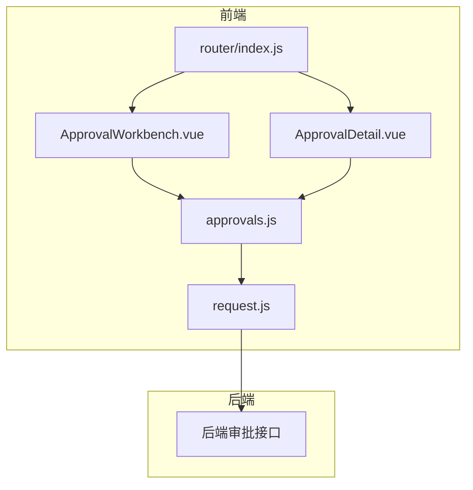
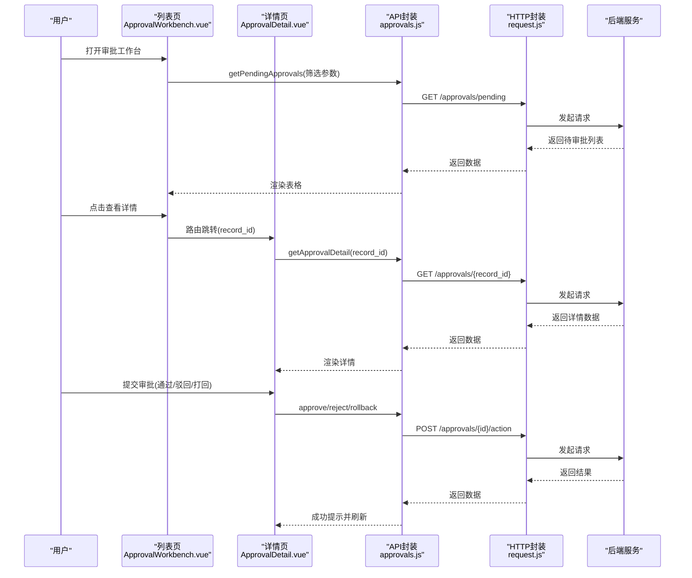
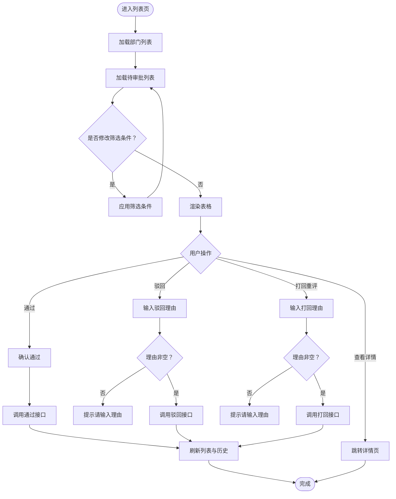
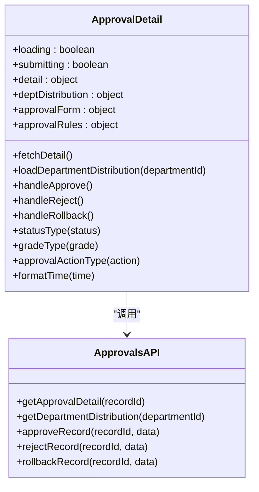
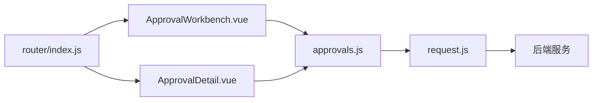

# 审批工作台前端

<cite>
**本文引用的文件**   
- [ApprovalWorkbench.vue](file://frontend/src/views/approval-workbench/ApprovalWorkbench.vue)
- [ApprovalDetail.vue](file://frontend/src/views/approval-workbench/ApprovalDetail.vue)
- [approvals.js](file://frontend/src/api/approvals.js)
- [request.js](file://frontend/src/api/request.js)
- [index.js](file://frontend/src/router/index.js)
- [DEV_TODO_LIST.md](file://docs/DEV_TODO_LIST.md)
- [TECH_绩效考核评分系统_v1.0.md](file://docs/TECH_绩效考核评分系统_v1.0.md)
</cite>

## 目录
1. [简介](#简介)
2. [项目结构](#项目结构)
3. [核心组件](#核心组件)
4. [架构总览](#架构总览)
5. [详细组件分析](#详细组件分析)
6. [依赖关系分析](#依赖关系分析)
7. [性能与体验优化](#性能与体验优化)
8. [故障排查指南](#故障排查指南)
9. [集成与扩展建议](#集成与扩展建议)
10. [结论](#结论)

## 简介
本文件面向“审批工作台”前端，聚焦以下目标：
- 待办事项列表页：审批任务展示、筛选过滤、批量操作（当前为行级操作）、异常标记与强制调整高亮。
- 审批详情查看界面：评分信息对比、加权结果、异常提示、协作评分明细、历史绩效、审批历史、操作按钮控制。
- 前后端交互流程：数据获取、状态同步、用户反馈、错误处理。
- 组件复用策略、样式定制选项、响应式适配。
- 集成指南与扩展开发建议。

该功能由两个主要页面组成：
- 审批工作台列表页：负责筛选、展示、基础操作与跳转详情。
- 审批详情页：负责完整评分对比、部门等级分布、审批操作与历史查看。

## 项目结构
审批工作台相关的前端代码位于 `frontend/src` 下，关键路径如下：
- 视图层：`views/approval-workbench/ApprovalWorkbench.vue`、`views/approval-workbench/ApprovalDetail.vue`
- API 封装：`api/approvals.js`
- HTTP 请求封装：`api/request.js`
- 路由配置：`router/index.js`

图表来源
- [ApprovalWorkbench.vue:1-329](file://frontend/src/views/approval-workbench/ApprovalWorkbench.vue#L1-L329)
- [ApprovalDetail.vue:1-443](file://frontend/src/views/approval-workbench/ApprovalDetail.vue#L1-L443)
- [approvals.js:1-30](file://frontend/src/api/approvals.js#L1-L30)
- [request.js:1-89](file://frontend/src/api/request.js#L1-L89)
- [index.js:1-85](file://frontend/src/router/index.js#L1-L85)

章节来源
- [ApprovalWorkbench.vue:1-329](file://frontend/src/views/approval-workbench/ApprovalWorkbench.vue#L1-L329)
- [ApprovalDetail.vue:1-443](file://frontend/src/views/approval-workbench/ApprovalDetail.vue#L1-L443)
- [approvals.js:1-30](file://frontend/src/api/approvals.js#L1-L30)
- [request.js:1-89](file://frontend/src/api/request.js#L1-L89)
- [index.js:1-85](file://frontend/src/router/index.js#L1-L85)

## 核心组件
- 审批工作台列表页（ApprovalWorkbench.vue）
  - 提供部门筛选、异常分数筛选、强制调整筛选、Step 步骤筛选。
  - 表格展示员工姓名、工号、部门、考核周期、总分、等级、提交时间、Step 标签、异常标记。
  - 支持通过、驳回、打回重评、查看详情等操作。
  - 底部展示全局审批历史时间线。
- 审批详情页（ApprovalDetail.vue）
  - 左侧：员工基本信息、评分维度对比（自评/上级/协作）、加权计算结果、异常提示区、协作评分明细、历史绩效。
  - 右侧：审批历史、审批操作表单（意见必填且不少于10字）。
  - 底部：部门当前等级分布卡片，含超限警告。

章节来源
- [ApprovalWorkbench.vue:1-329](file://frontend/src/views/approval-workbench/ApprovalWorkbench.vue#L1-L329)
- [ApprovalDetail.vue:1-443](file://frontend/src/views/approval-workbench/ApprovalDetail.vue#L1-L443)

## 架构总览
审批工作台前端的整体交互流程如下：
- 用户在列表页进行筛选并触发查询，调用 `getPendingApprovals` 获取待审批列表。
- 点击“查看详情”跳转到详情页，调用 `getApprovalDetail` 获取详情数据，同时可选加载部门等级分布。
- 在详情页执行通过/驳回/打回重评，分别调用对应接口，成功后刷新详情或返回列表。
- 所有 HTTP 请求统一经过 `request.js` 的拦截器，自动注入 Token、打印日志、统一错误处理。

图表来源
- [ApprovalWorkbench.vue:166-255](file://frontend/src/views/approval-workbench/ApprovalWorkbench.vue#L166-L255)
- [ApprovalDetail.vue:277-373](file://frontend/src/views/approval-workbench/ApprovalDetail.vue#L277-L373)
- [approvals.js:3-29](file://frontend/src/api/approvals.js#L3-L29)
- [request.js:14-86](file://frontend/src/api/request.js#L14-L86)

## 详细组件分析

### 审批工作台列表页（ApprovalWorkbench.vue）
- 筛选逻辑
  - 部门：下拉选择，调用 `listDepartments` 获取部门列表。
  - 仅显示异常分数：将 `score_diff_alert` 作为筛选条件。
  - 仅显示强制调整：将 `is_abnormal` 作为筛选条件。
  - Step 步骤：step1（直接上级）、step2（部门负责人），根据角色默认值不同。
- 列表展示
  - 表格字段包含员工信息、考核周期、总分、等级、提交时间、Step 标签、异常标记。
  - 强制调整行使用特殊样式高亮。
- 操作行为
  - 通过：二次确认后调用 `approveRecord`，成功后刷新列表和历史。
  - 驳回：弹出对话框输入理由，校验非空后调用 `rejectRecord`。
  - 打回重评：弹出对话框输入理由，校验非空后调用 `rollbackRecord`。
  - 查看详情：携带 `record_id` 跳转至详情页。
- 审批历史
  - 页面底部展示全局审批历史时间线，便于快速了解近期审批动态。

图表来源
- [ApprovalWorkbench.vue:157-321](file://frontend/src/views/approval-workbench/ApprovalWorkbench.vue#L157-L321)

章节来源
- [ApprovalWorkbench.vue:1-329](file://frontend/src/views/approval-workbench/ApprovalWorkbench.vue#L1-L329)

### 审批详情页（ApprovalDetail.vue）
- 数据加载
  - 根据路由参数 `record_id` 调用 `getApprovalDetail` 获取详情。
  - 若存在部门ID，则调用 `getDepartmentDistribution` 获取部门等级分布。
- 评分对比
  - 维度包括业绩、能力、态度；展示自评、上级、协作评分及差异。
  - 差异大于阈值时高亮显示，并在异常提示区给出关注提醒。
- 加权结果
  - 展示各维度加权得分、总分、等级，并根据分数区间设置文本颜色。
- 异常提示
  - 强制分布调整、异常分数、自评与上级评分差异较大等提示。
- 协作评分明细
  - 以表格形式展示评价人、评分、评语。
- 历史绩效
  - 近3周期的历史绩效时间线，展示总分与等级。
- 审批历史
  - 右侧时间线展示审批动作、步骤、评论与时间。
- 审批操作
  - 表单校验：审批意见必填且不少于10字。
  - 三个操作按钮：通过、驳回、打回重评，均带确认弹窗与提交中状态。
  - 成功后清空意见并刷新详情。

图表来源
- [ApprovalDetail.vue:203-413](file://frontend/src/views/approval-workbench/ApprovalDetail.vue#L203-L413)
- [approvals.js:1-30](file://frontend/src/api/approvals.js#L1-L30)

章节来源
- [ApprovalDetail.vue:1-443](file://frontend/src/views/approval-workbench/ApprovalDetail.vue#L1-L443)

## 依赖关系分析
- 组件依赖
  - 列表页依赖：`@/api/approvals`、`@/api/departments`、`@/stores/auth`、Element Plus UI 组件。
  - 详情页依赖：`@/api/approvals`、Element Plus UI 组件与图标。
- API 依赖
  - 列表页：`getPendingApprovals`、`getApprovalHistory`。
  - 详情页：`getApprovalDetail`、`getDepartmentDistribution`、`approveRecord`、`rejectRecord`、`rollbackRecord`。
- HTTP 封装
  - 统一 baseURL、超时、Token 注入、请求/响应日志、错误提示与登录过期处理。
- 路由权限
  - 审批工作台与详情页对 manager/hr/admin 开放，路由守卫校验角色。

图表来源
- [ApprovalWorkbench.vue:112-118](file://frontend/src/views/approval-workbench/ApprovalWorkbench.vue#L112-L118)
- [ApprovalDetail.vue:203-206](file://frontend/src/views/approval-workbench/ApprovalDetail.vue#L203-L206)
- [approvals.js:1-30](file://frontend/src/api/approvals.js#L1-L30)
- [request.js:1-89](file://frontend/src/api/request.js#L1-L89)
- [index.js:40-41](file://frontend/src/router/index.js#L40-L41)

章节来源
- [index.js:1-85](file://frontend/src/router/index.js#L1-L85)
- [request.js:1-89](file://frontend/src/api/request.js#L1-L89)
- [approvals.js:1-30](file://frontend/src/api/approvals.js#L1-L30)

## 性能与体验优化
- 列表加载
  - 使用 v-loading 提升感知性能；失败时静默降级不影响主流程。
  - 部门列表加载失败不阻断主功能，避免阻塞渲染。
- 筛选与过滤
  - 前端 computed 过滤减少不必要的网络请求；建议在大数据量场景考虑服务端分页与筛选。
- 交互反馈
  - 统一使用 ElMessage 与 ElMessageBox 提供成功、警告、错误提示与确认框。
- 样式定制
  - 强制调整行背景色通过 scoped 样式覆盖 Element Plus 的行类名实现。
  - 评分差异高亮通过自定义 CSS 类实现，便于主题化。
- 响应式适配
  - 使用 Element Plus 栅格布局（el-row/el-col）实现左右分栏；移动端可考虑折叠侧边审批操作区。

[本节为通用指导，不直接分析具体文件]

## 故障排查指南
- 列表加载失败
  - 检查 `/approvals/pending` 接口是否正常返回；查看 request.js 控制台日志。
  - 确认 Token 是否正确注入；如 401 会跳转登录。
- 详情加载失败
  - 检查 `/approvals/{record_id}` 接口；确认 record_id 有效。
  - 部门分布接口可能不存在，组件已做静默失败处理。
- 审批操作失败
  - 校验审批意见长度与内容；确认当前用户具备相应审批权限。
  - 查看后端返回的错误消息，request.js 会统一提示。
- 路由权限问题
  - 确认当前用户角色是否在允许列表中；否则会被重定向到 403。

章节来源
- [request.js:47-86](file://frontend/src/api/request.js#L47-L86)
- [index.js:61-75](file://frontend/src/router/index.js#L61-L75)

## 集成与扩展建议
- 集成指南
  - 确保后端提供以下接口：
    - GET `/approvals/pending`：我的待审批列表，支持部门、异常分数、强制调整、Step 筛选。
    - GET `/approvals/{record_id}`：审批详情，包含评分、加权结果、异常提示、历史绩效。
    - POST `/approvals/{record_id}/approve`：通过。
    - POST `/approvals/{record_id}/reject`：驳回。
    - POST `/approvals/{record_id}/rollback`：打回重评。
    - GET `/approvals/history?record_id=...`：审批历史。
    - GET `/approvals/department-distribution?department_id=...`：部门等级分布（可选）。
  - 前端环境变量：
    - VITE_API_BASE_URL：后端 API 基础路径，默认 `/api/v1`。
- 扩展开发建议
  - 批量操作：可在列表页增加多选与批量通过/驳回，注意后端需支持批量接口与幂等性。
  - 分页与排序：当数据量大时，建议在后端实现分页与排序，前端传递 page/page_size/sort_by。
  - 审批链配置：可引入审批链配置接口，动态渲染 Step 标签与操作按钮。
  - 审计日志：结合后端审计日志接口，在详情页展示更丰富的操作轨迹。
  - 主题与样式：将高亮样式与颜色映射抽离为变量，便于多主题切换。

章节来源
- [TECH_绩效考核评分系统_v1.0.md:1024-1105](file://docs/TECH_绩效考核评分系统_v1.0.md#L1024-L1105)
- [DEV_TODO_LIST.md:1408-1432](file://docs/DEV_TODO_LIST.md#L1408-L1432)

## 结论
审批工作台前端通过清晰的列表与详情双页设计，实现了从筛选、展示到审批操作的完整闭环。列表页注重高效筛选与快速定位，详情页强调评分对比、异常提示与审批操作的可控性。借助统一的 HTTP 封装与路由权限控制，系统在用户体验与安全方面具备良好的基础。未来可在批量操作、分页排序、审批链配置等方面进一步扩展，以提升大规模场景下的可用性与可维护性。