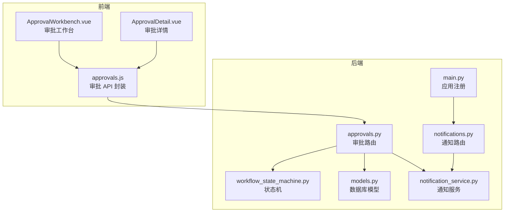
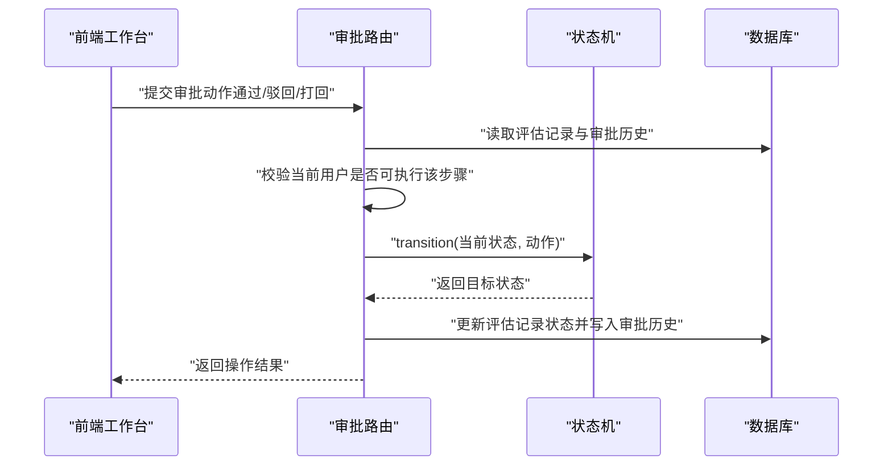
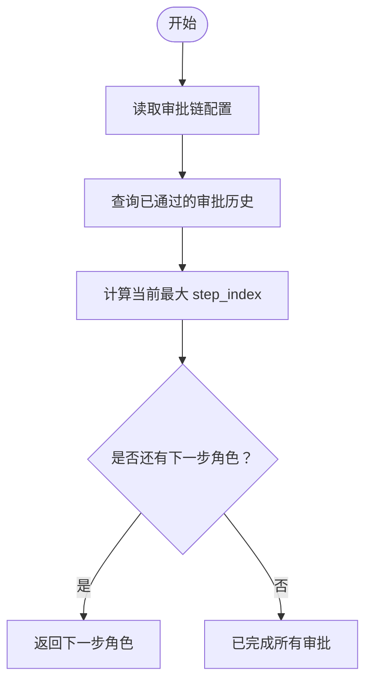
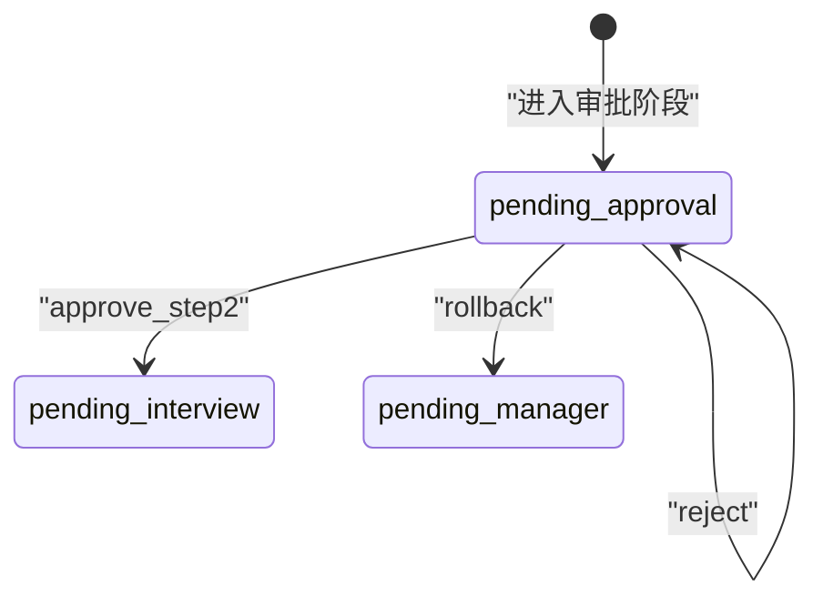
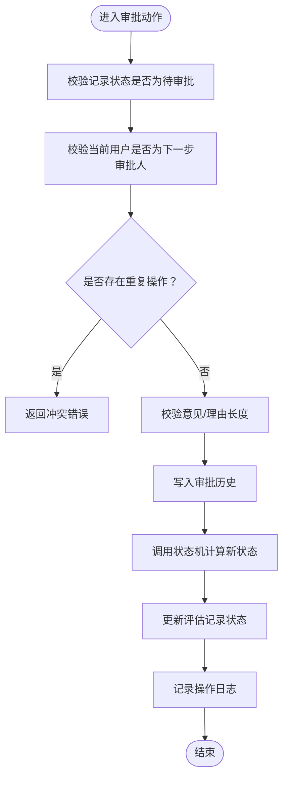
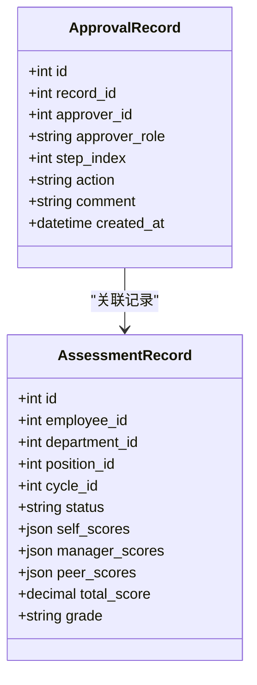
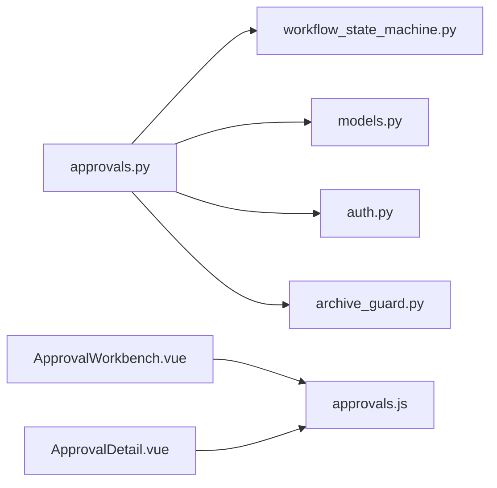
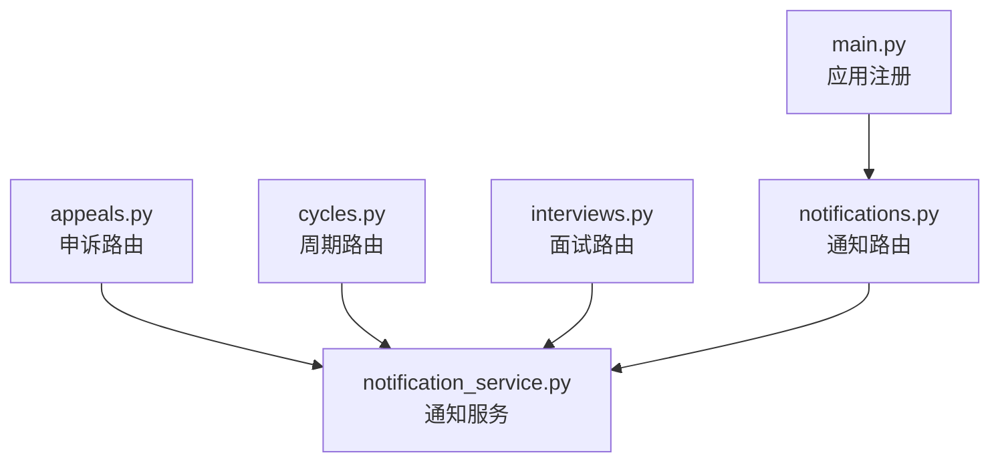
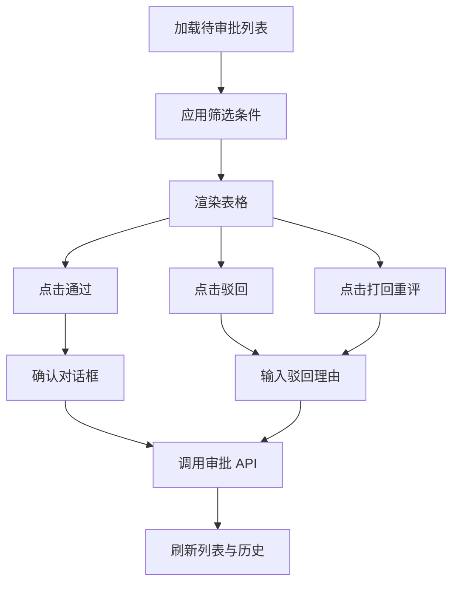

# 审批工作流

<cite>
**本文引用的文件**   
- [backend/app/routers/approvals.py](file://backend/app/routers/approvals.py)
- [backend/app/utils/workflow_state_machine.py](file://backend/app/utils/workflow_state_machine.py)
- [frontend/src/views/approval-workbench/ApprovalWorkbench.vue](file://frontend/src/views/approval-workbench/ApprovalWorkbench.vue)
- [frontend/src/views/approval-workbench/ApprovalDetail.vue](file://frontend/src/views/approval-workbench/ApprovalDetail.vue)
- [frontend/src/api/approvals.js](file://frontend/src/api/approvals.js)
- [backend/app/services/notification_service.py](file://backend/app/services/notification_service.py)
- [backend/app/models.py](file://backend/app/models.py)
- [backend/app/main.py](file://backend/app/main.py)
- [backend/app/routers/notifications.py](file://backend/app/routers/notifications.py)
- [backend/tests/test_p5_09_approval_state_machine.py](file://backend/tests/test_p5_09_approval_state_machine.py)
- [backend/tests/test_p5_17_approval.py](file://backend/tests/test_p5_17_approval.py)
- [backend/tests/test_approval_chain.py](file://backend/tests/test_approval_chain.py)
- [backend/tests/test_approvals.py](file://backend/tests/test_approvals.py)
</cite>

## 目录
1. [引言](#引言)
2. [项目结构定位](#项目结构定位)
3. [核心组件总览](#核心组件总览)
4. [架构总览](#架构总览)
5. [详细组件分析](#详细组件分析)
6. [依赖关系分析](#依赖关系分析)
7. [性能与并发特性](#性能与并发特性)
8. [通知服务集成说明](#通知服务集成说明)
9. [前端审批工作台实现](#前端审批工作台实现)
10. [API 接口文档](#api-接口文档)
11. [故障排查指南](#故障排查指南)
12. [结论](#结论)

## 引言
本章节面向“审批工作流模块”，围绕绩效考核系统中的多级审批流程展开，重点说明以下方面：
- 多级审批链配置、顺序控制、角色判定与权限校验。
- 审批状态管理机制：状态定义、转换规则、历史记录追踪。
- 审批决策逻辑：通过、驳回、打回重评的业务规则与数据影响。
- 通知服务集成现状：系统内消息模型与现有触发点。
- 前端审批工作台：待办列表、详情查看、操作交互。
- API 接口与工作流配置示例。

该模块当前以“串行多级审批”为核心能力，默认支持至少两步审批；并行审批、条件分支等高级特性在代码中未直接实现，但可通过扩展状态机与路由逻辑演进。

## 项目结构定位
审批工作流在后端由 FastAPI 路由提供，核心逻辑集中在审批路由与通用状态机工具中；在前端由 Vue 页面和 API 封装组成。

**图表来源**
- [backend/app/routers/approvals.py:1-18](file://backend/app/routers/approvals.py#L1-L18)
- [backend/app/utils/workflow_state_machine.py:10-78](file://backend/app/utils/workflow_state_machine.py#L10-L78)
- [backend/app/models.py:245-260](file://backend/app/models.py#L245-L260)
- [backend/app/services/notification_service.py:5-31](file://backend/app/services/notification_service.py#L5-L31)
- [backend/app/routers/notifications.py:15-32](file://backend/app/routers/notifications.py#L15-L32)
- [backend/app/main.py:68-92](file://backend/app/main.py#L68-L92)
- [frontend/src/views/approval-workbench/ApprovalWorkbench.vue:1-110](file://frontend/src/views/approval-workbench/ApprovalWorkbench.vue#L1-L110)
- [frontend/src/views/approval-workbench/ApprovalDetail.vue:1-200](file://frontend/src/views/approval-workbench/ApprovalDetail.vue#L1-L200)
- [frontend/src/api/approvals.js:1-30](file://frontend/src/api/approvals.js#L1-L30)

**章节来源**
- [backend/app/routers/approvals.py:1-18](file://backend/app/routers/approvals.py#L1-L18)
- [backend/app/utils/workflow_state_machine.py:10-78](file://backend/app/utils/workflow_state_machine.py#L10-L78)
- [frontend/src/views/approval-workbench/ApprovalWorkbench.vue:1-110](file://frontend/src/views/approval-workbench/ApprovalWorkbench.vue#L1-L110)
- [frontend/src/views/approval-workbench/ApprovalDetail.vue:1-200](file://frontend/src/views/approval-workbench/ApprovalDetail.vue#L1-L200)
- [frontend/src/api/approvals.js:1-30](file://frontend/src/api/approvals.js#L1-L30)

## 核心组件总览
- 审批路由层：负责审批链配置、待办查询、审批详情、审批动作（通过/驳回/打回）、强制分布特批申请与审批。
- 状态机层：统一维护考核全生命周期状态及转换规则，审批阶段通过 approve_step1、approve_step2、reject、rollback 等动作驱动流转。
- 前端工作台：展示待审批记录、筛选维度、审批历史，并提供通过/驳回/打回操作入口。
- 通知服务：提供系统内通知创建、查询、已读标记能力；当前审批路由未直接调用通知服务，但系统具备通知基础设施。

**章节来源**
- [backend/app/routers/approvals.py:102-150](file://backend/app/routers/approvals.py#L102-L150)
- [backend/app/routers/approvals.py:153-311](file://backend/app/routers/approvals.py#L153-L311)
- [backend/app/routers/approvals.py:451-716](file://backend/app/routers/approvals.py#L451-L716)
- [backend/app/utils/workflow_state_machine.py:10-78](file://backend/app/utils/workflow_state_machine.py#L10-L78)
- [backend/app/services/notification_service.py:5-31](file://backend/app/services/notification_service.py#L5-L31)
- [frontend/src/views/approval-workbench/ApprovalWorkbench.vue:112-321](file://frontend/src/views/approval-workbench/ApprovalWorkbench.vue#L112-L321)
- [frontend/src/views/approval-workbench/ApprovalDetail.vue:203-413](file://frontend/src/views/approval-workbench/ApprovalDetail.vue#L203-L413)

## 架构总览
审批工作流采用“路由 + 状态机 + 数据模型”的分层设计：
- 路由层接收前端请求，进行参数校验、权限校验、业务前置检查。
- 状态机层根据当前状态与动作计算目标状态，并可选记录审计日志。
- 数据层持久化审批记录、评估记录、系统配置、通知消息等。

**图表来源**
- [backend/app/routers/approvals.py:451-534](file://backend/app/routers/approvals.py#L451-L534)
- [backend/app/utils/workflow_state_machine.py:106-186](file://backend/app/utils/workflow_state_machine.py#L106-L186)

## 详细组件分析

### 审批链配置与顺序控制
- 默认审批链为“直属上级 → 部门负责人 → HR负责人”，可从系统配置中读取或更新。
- 获取下一个审批角色的逻辑基于“已通过审批的最大 step_index”，从而确定下一步角色。
- 角色判定包含直属下级判断、部门头判断、HR/管理员角色判断。

**图表来源**
- [backend/app/routers/approvals.py:22-42](file://backend/app/routers/approvals.py#L22-L42)

**章节来源**
- [backend/app/routers/approvals.py:19-29](file://backend/app/routers/approvals.py#L19-L29)
- [backend/app/routers/approvals.py:32-42](file://backend/app/routers/approvals.py#L32-L42)
- [backend/app/routers/approvals.py:45-64](file://backend/app/routers/approvals.py#L45-L64)
- [backend/app/routers/approvals.py:102-150](file://backend/app/routers/approvals.py#L102-L150)

### 审批状态管理与转换规则
状态机定义了从“未开始”到“归档”的完整状态序列，审批阶段的关键状态为“待审批”。在“待审批”状态下允许的动作包括：
- approve_step1：第一步审批通过，仍停留在“待审批”，进入第二步。
- approve_step2：第二步审批通过，进入“待面谈”。
- reject：驳回，保持“待审批”，用于退回修改。
- rollback：打回重评，回到“待上级评分”。

**图表来源**
- [backend/app/utils/workflow_state_machine.py:39-78](file://backend/app/utils/workflow_state_machine.py#L39-L78)

**章节来源**
- [backend/app/utils/workflow_state_machine.py:10-78](file://backend/app/utils/workflow_state_machine.py#L10-L78)
- [backend/app/utils/workflow_state_machine.py:106-186](file://backend/app/utils/workflow_state_machine.py#L106-L186)
- [backend/tests/test_p5_09_approval_state_machine.py](file://backend/tests/test_p5_09_approval_state_machine.py)

### 审批决策逻辑与数据处理
- 通过：校验当前步骤、重复审批拦截、评论长度校验，写入审批历史，调用状态机推进状态，记录操作日志。
- 驳回：校验当前步骤、重复驳回拦截、理由长度校验，写入审批历史，状态保持“待审批”，记录操作日志。
- 打回重评：校验当前步骤、重复打回拦截、理由长度校验，清空上级相关评分与加权结果，状态回到“待上级评分”，记录操作日志。

**图表来源**
- [backend/app/routers/approvals.py:451-534](file://backend/app/routers/approvals.py#L451-L534)
- [backend/app/routers/approvals.py:537-616](file://backend/app/routers/approvals.py#L537-L616)
- [backend/app/routers/approvals.py:619-716](file://backend/app/routers/approvals.py#L619-L716)

**章节来源**
- [backend/app/routers/approvals.py:451-716](file://backend/app/routers/approvals.py#L451-L716)

### 审批历史与访问控制
- 审批历史按 step_index 升序展示，包含审批人姓名、动作、意见、时间。
- 访问审批详情的权限包括管理员、HR、员工直属上级、当前步骤审批人、部门头及其上级部门头。

**图表来源**
- [backend/app/models.py:245-260](file://backend/app/models.py#L245-L260)
- [backend/app/routers/approvals.py:398-411](file://backend/app/routers/approvals.py#L398-L411)

**章节来源**
- [backend/app/routers/approvals.py:346-448](file://backend/app/routers/approvals.py#L346-L448)
- [backend/app/routers/approvals.py:719-745](file://backend/app/routers/approvals.py#L719-L745)

### 强制分布特批流程
- 经理可申请强制分布特批，填写原因。
- HR/管理员可审批通过或驳回特批申请。
- 通过后恢复原始等级并标记为强制调整。

**章节来源**
- [backend/app/routers/approvals.py:748-849](file://backend/app/routers/approvals.py#L748-L849)

## 依赖关系分析
- 审批路由依赖：
  - 数据库会话与模型（评估记录、员工、部门、岗位、周期、系统配置、协作评审任务）。
  - 认证与权限（当前用户、角色校验）。
  - 状态机工具（状态转换）。
  - 归档保护（防止对已归档记录操作）。
- 前端依赖：
  - 审批 API 封装。
  - 部门列表 API。
  - 认证状态存储。

**图表来源**
- [backend/app/routers/approvals.py:1-18](file://backend/app/routers/approvals.py#L1-L18)
- [frontend/src/views/approval-workbench/ApprovalWorkbench.vue:112-118](file://frontend/src/views/approval-workbench/ApprovalWorkbench.vue#L112-L118)
- [frontend/src/views/approval-workbench/ApprovalDetail.vue:203-206](file://frontend/src/views/approval-workbench/ApprovalDetail.vue#L203-L206)
- [frontend/src/api/approvals.js:1-30](file://frontend/src/api/approvals.js#L1-L30)

**章节来源**
- [backend/app/routers/approvals.py:1-18](file://backend/app/routers/approvals.py#L1-L18)
- [frontend/src/api/approvals.js:1-30](file://frontend/src/api/approvals.js#L1-L30)

## 性能与并发特性
- 待审批列表查询避免全表扫描：先根据用户身份与审批链角色计算可审批范围，再使用 SQL IN 条件过滤。
- 并发重复审批防护：同一记录在同一审批步骤中，若已被审批则拒绝重复操作。
- 当前无审批超时自动推进机制；长期积压需人工催办或通过仪表盘监控。

**章节来源**
- [backend/app/routers/approvals.py:169-222](file://backend/app/routers/approvals.py#L169-L222)
- [backend/app/routers/approvals.py:484-492](file://backend/app/routers/approvals.py#L484-L492)
- [backend/app/routers/approvals.py:569-576](file://backend/app/routers/approvals.py#L569-L576)
- [backend/app/routers/approvals.py:651-658](file://backend/app/routers/approvals.py#L651-L658)

## 通知服务集成说明
当前通知服务提供了系统内通知的创建、查询、已读标记能力，并在申诉、周期启动、面试等环节有调用点。审批路由本身未直接调用通知服务，但系统具备通知基础设施，可在未来扩展审批任务通知、审批结果通知、超时提醒等场景。

**图表来源**
- [backend/app/services/notification_service.py:5-31](file://backend/app/services/notification_service.py#L5-L31)
- [backend/app/routers/notifications.py:15-32](file://backend/app/routers/notifications.py#L15-L32)
- [backend/app/main.py:68-92](file://backend/app/main.py#L68-L92)

**章节来源**
- [backend/app/services/notification_service.py:5-31](file://backend/app/services/notification_service.py#L5-L31)
- [backend/app/routers/notifications.py:15-32](file://backend/app/routers/notifications.py#L15-L32)
- [backend/app/main.py:68-92](file://backend/app/main.py#L68-L92)

## 前端审批工作台实现
- 待办事项列表：支持按部门、异常分数、强制调整、审批步骤筛选；显示员工信息、周期、总分、等级、提交时间、Step 标签、异常标记。
- 审批详情：展示员工基本信息、评分对比、加权结果、异常提示、协作评分明细、历史绩效、审批历史、部门等级分布。
- 批量审批操作：当前工作台提供单条记录的通过/驳回/打回操作；批量操作可扩展为多选后统一调用后端批量接口。

**图表来源**
- [frontend/src/views/approval-workbench/ApprovalWorkbench.vue:112-321](file://frontend/src/views/approval-workbench/ApprovalWorkbench.vue#L112-L321)
- [frontend/src/views/approval-workbench/ApprovalDetail.vue:203-413](file://frontend/src/views/approval-workbench/ApprovalDetail.vue#L203-L413)
- [frontend/src/api/approvals.js:1-30](file://frontend/src/api/approvals.js#L1-L30)

**章节来源**
- [frontend/src/views/approval-workbench/ApprovalWorkbench.vue:1-329](file://frontend/src/views/approval-workbench/ApprovalWorkbench.vue#L1-L329)
- [frontend/src/views/approval-workbench/ApprovalDetail.vue:1-443](file://frontend/src/views/approval-workbench/ApprovalDetail.vue#L1-L443)
- [frontend/src/api/approvals.js:1-30](file://frontend/src/api/approvals.js#L1-L30)

## API 接口文档

### 审批链配置
- 获取审批链配置
  - 方法：GET
  - 路径：/approvals/chain-config
  - 权限：admin/hr/executive
  - 响应：{ chain: string[] }

- 更新审批链配置
  - 方法：PUT
  - 路径：/approvals/chain-config
  - 权限：admin
  - 请求体：{ chain: string[] }
  - 校验：chain 必须为列表，元素必须在合法角色集合内
  - 响应：{ chain: string[] }

**章节来源**
- [backend/app/routers/approvals.py:102-150](file://backend/app/routers/approvals.py#L102-L150)

### 待审批列表
- 获取当前用户的待审批列表
  - 方法：GET
  - 路径：/approvals/pending
  - 权限：manager/hr/admin
  - 查询参数：
    - department_id: 可选
    - is_abnormal: 可选
    - is_force_adjusted: 可选
    - step: 可选，取值 1 或 2
  - 响应：数组，包含 record_id、employee_name、department_name、cycle_name、total_score、grade、is_abnormal、score_diff_alert、step_index、next_approver_role 等字段

**章节来源**
- [backend/app/routers/approvals.py:153-311](file://backend/app/routers/approvals.py#L153-L311)

### 审批详情
- 获取审批详情
  - 方法：GET
  - 路径：/approvals/{record_id}
  - 权限：manager/hr/admin
  - 响应：包含员工信息、评分详情、加权结果、历史绩效、审批历史、异常标记等

**章节来源**
- [backend/app/routers/approvals.py:346-448](file://backend/app/routers/approvals.py#L346-L448)

### 审批动作
- 通过审批
  - 方法：POST
  - 路径：/approvals/{record_id}/approve
  - 权限：manager/hr/admin
  - 请求体：{ comment?: string }
  - 行为：校验当前步骤、重复审批、评论长度；写入审批历史；状态机推进；记录操作日志

- 驳回审批
  - 方法：POST
  - 路径：/approvals/{record_id}/reject
  - 权限：manager/hr/admin
  - 请求体：{ reason: string }
  - 行为：校验当前步骤、重复驳回、理由长度；写入审批历史；状态保持“待审批”；记录操作日志

- 打回重评
  - 方法：POST
  - 路径：/approvals/{record_id}/rollback
  - 权限：manager/hr/admin
  - 请求体：{ reason: string }
  - 行为：校验当前步骤、重复打回、理由长度；清空上级相关评分与加权结果；状态回到“待上级评分”；记录操作日志

**章节来源**
- [backend/app/routers/approvals.py:451-716](file://backend/app/routers/approvals.py#L451-L716)

### 审批历史
- 获取审批历史
  - 方法：GET
  - 路径：/approvals/history
  - 权限：manager/hr/admin
  - 查询参数：record_id（可选）
  - 响应：数组，包含 approver_name、action、comment、step_index、created_at 等

**章节来源**
- [backend/app/routers/approvals.py:719-745](file://backend/app/routers/approvals.py#L719-L745)

### 强制分布特批
- 申请强制分布特批
  - 方法：POST
  - 路径：/approvals/{record_id}/distribution-override
  - 权限：manager/hr/admin
  - 请求体：{ reason: string }
  - 行为：校验下属关系与是否被强制调整；记录 override_reason

- 审批通过强制分布特批
  - 方法：POST
  - 路径：/approvals/distribution-overrides/{record_id}/approve
  - 权限：admin/hr
  - 行为：恢复原始等级并标记为强制调整

- 驳回强制分布特批
  - 方法：POST
  - 路径：/approvals/distribution-overrides/{record_id}/reject
  - 权限：admin/hr
  - 行为：清除 override_reason

**章节来源**
- [backend/app/routers/approvals.py:748-849](file://backend/app/routers/approvals.py#L748-L849)

## 故障排查指南
- 重复审批冲突：同一记录在同一审批步骤中再次操作会返回冲突错误。建议刷新列表后重试。
- 无权审批：当前用户不是下一步审批人或角色不匹配时返回禁止访问错误。请确认用户角色与审批链配置。
- 状态不允许：记录状态非“待审批”时无法执行审批动作。请先确认记录所处阶段。
- 评论/理由长度不足：通过需要至少 10 个字符的意见；驳回与打回需要至少 10 个字符的理由。
- 审批历史为空：若尚未产生审批记录，历史列表为空属正常现象。

**章节来源**
- [backend/app/routers/approvals.py:465-474](file://backend/app/routers/approvals.py#L465-L474)
- [backend/app/routers/approvals.py:494-496](file://backend/app/routers/approvals.py#L494-L496)
- [backend/app/routers/approvals.py:578-580](file://backend/app/routers/approvals.py#L578-L580)
- [backend/app/routers/approvals.py:660-662](file://backend/app/routers/approvals.py#L660-L662)

## 结论
审批工作流模块在当前版本实现了可靠的串行多级审批能力，涵盖审批链配置、顺序控制、角色判定、状态机驱动的状态转换、审批历史追踪以及强制分布特批流程。前端工作台提供了完整的待办管理、详情查看与操作交互。通知服务基础设施完备，但审批路由尚未直接集成通知发送；后续可按需扩展审批任务通知、审批结果通知与超时提醒。对于并行审批与条件分支等高级特性，建议在状态机与路由层增加相应扩展点，并结合前端工作流可视化配置进行增强。