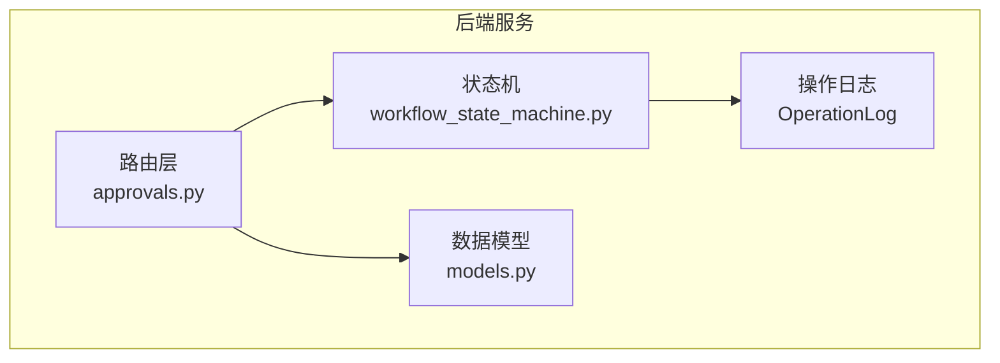
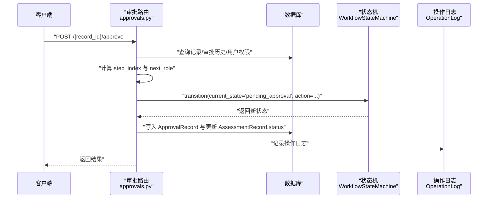
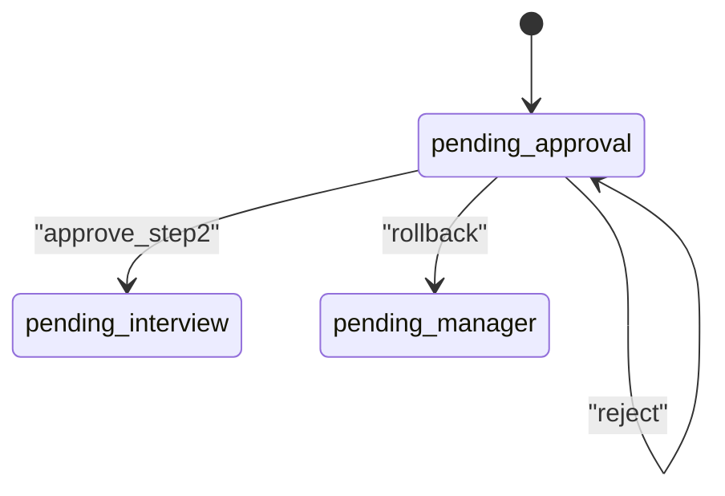
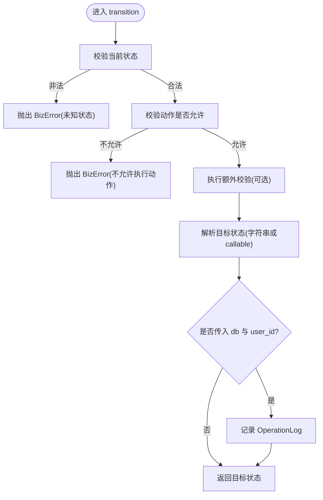
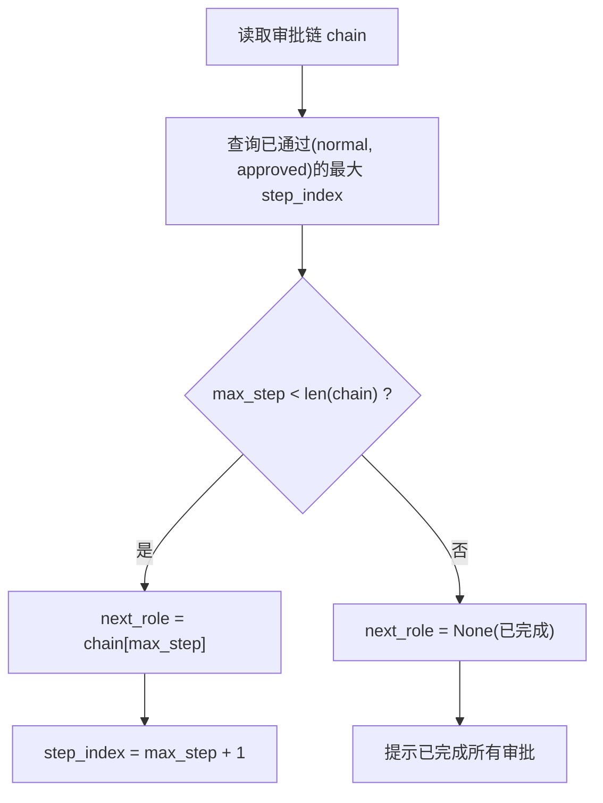
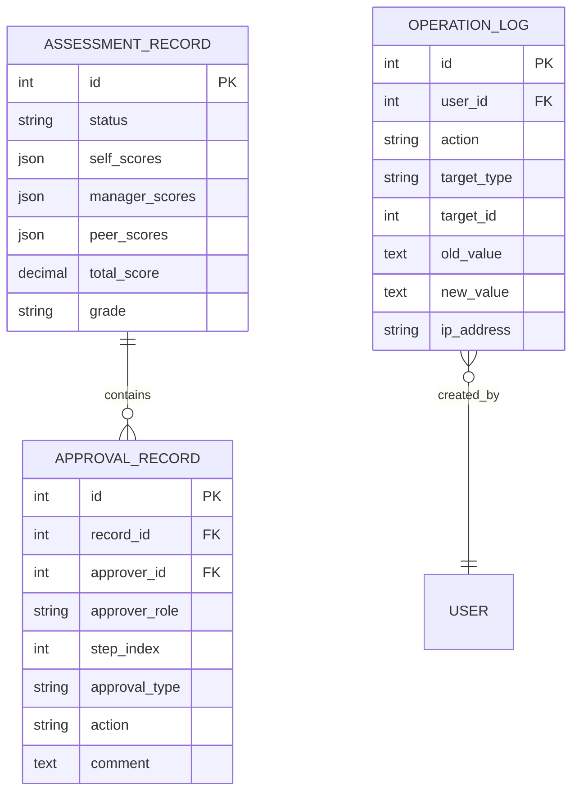
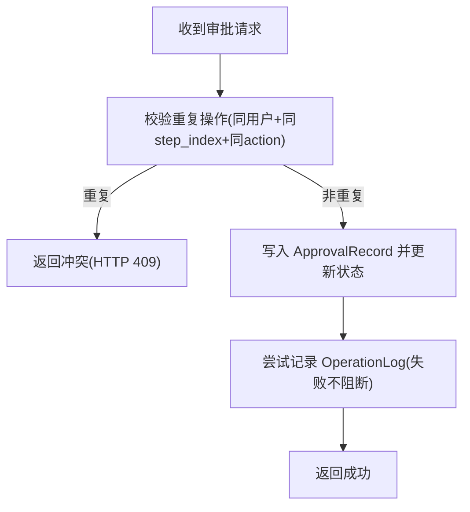
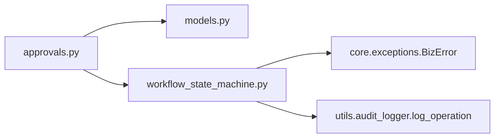
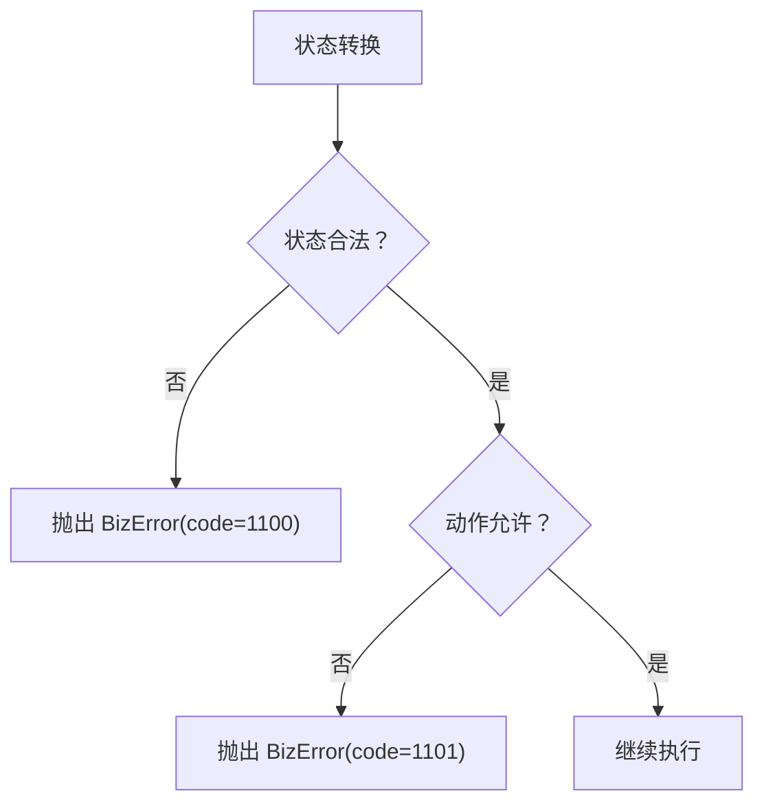

# 审批状态管理

<cite>
**本文引用的文件**   
- [workflow_state_machine.py](file://backend/app/utils/workflow_state_machine.py)
- [approvals.py](file://backend/app/routers/approvals.py)
- [models.py](file://backend/app/models.py)
- [test_p5_09_approval_state_machine.py](file://backend/tests/test_p5_09_approval_state_machine.py)
- [test_p5_15_state_machine_complete.py](file://backend/tests/test_p5_15_state_machine_complete.py)
</cite>

## 目录
1. [引言](#引言)
2. [项目结构](#项目结构)
3. [核心组件](#核心组件)
4. [架构总览](#架构总览)
5. [详细组件分析](#详细组件分析)
6. [依赖关系分析](#依赖关系分析)
7. [性能与并发特性](#性能与并发特性)
8. [API 调用示例](#api-调用示例)
9. [错误处理机制](#错误处理机制)
10. [调试与排错指南](#调试与排错指南)
11. [结论](#结论)

## 引言
本文件聚焦“绩效考核评分系统”中的审批状态管理，围绕以下目标展开：
- 明确审批工作流的状态机设计，包括状态定义、转换规则与触发条件。
- 解释审批步骤管理机制：step_index 计算、当前审批人确定、下一步审批人预测。
- 说明状态持久化策略、状态历史追踪、并发访问控制等关键技术实现。
- 提供状态转换的 API 调用示例、错误处理机制和调试方法。

该文档既适合后端开发者理解实现细节，也适合产品与测试人员把握业务语义与边界条件。

## 项目结构
与审批状态管理直接相关的代码主要分布在以下位置：
- 状态机核心逻辑：`backend/app/utils/workflow_state_machine.py`
- 审批路由与业务编排：`backend/app/routers/approvals.py`
- 数据模型定义（含审批记录）：`backend/app/models.py`
- 单元测试覆盖状态机与审批流程：`backend/tests/test_p5_09_approval_state_machine.py`、`backend/tests/test_p5_15_state_machine_complete.py`

**图表来源**
- [approvals.py:1-18](file://backend/app/routers/approvals.py#L1-L18)
- [workflow_state_machine.py:1-20](file://backend/app/utils/workflow_state_machine.py#L1-L20)
- [models.py:186-196](file://backend/app/models.py#L186-L196)

**章节来源**
- [approvals.py:1-18](file://backend/app/routers/approvals.py#L1-L18)
- [workflow_state_machine.py:1-20](file://backend/app/utils/workflow_state_machine.py#L1-L20)
- [models.py:155-165](file://backend/app/models.py#L155-L165)

## 核心组件
- 状态机类 WorkflowStateMachine：集中维护状态常量、转换规则、校验扩展点与统一转换入口。
- 审批路由 Approvals：负责权限校验、审批链解析、step_index 计算、持久化写入与状态机调用。
- 数据模型 ApprovalRecord/AssessmentRecord：分别承载审批历史与考核记录主状态。
- 操作日志 OperationLog：记录状态变更轨迹，便于审计与回溯。

**章节来源**
- [workflow_state_machine.py:10-78](file://backend/app/utils/workflow_state_machine.py#L10-L78)
- [approvals.py:153-311](file://backend/app/routers/approvals.py#L153-L311)
- [models.py:99-129](file://backend/app/models.py#L99-L129)
- [models.py:155-165](file://backend/app/models.py#L155-L165)
- [models.py:186-196](file://backend/app/models.py#L186-L196)

## 架构总览
审批状态管理的整体交互如下：
- 前端或外部系统调用审批相关 API。
- 路由层进行鉴权、参数校验、权限判断与重复操作保护。
- 路由层根据审批链与已通过的审批记录计算 step_index 与下一步角色。
- 路由层调用状态机执行状态转换，并持久化 ApprovalRecord 与 AssessmentRecord.status。
- 状态机在传入数据库会话时自动记录 OperationLog。

**图表来源**
- [approvals.py:451-534](file://backend/app/routers/approvals.py#L451-L534)
- [workflow_state_machine.py:105-186](file://backend/app/utils/workflow_state_machine.py#L105-L186)
- [models.py:155-165](file://backend/app/models.py#L155-L165)
- [models.py:186-196](file://backend/app/models.py#L186-L196)

## 详细组件分析

### 状态机设计与状态定义
- 状态集合包含：未开始、待自评、待上级评分、待协作评分、待汇总、待强制分布审核、待审批、待面谈、已发布、申诉中、已归档。
- 审批阶段的核心状态为 pending_approval，其允许的动作包括：
  - approve_step1：第一步审批通过，仍停留在 pending_approval。
  - approve_step2：第二步审批通过，进入 pending_interview。
  - reject：驳回，保持在 pending_approval。
  - rollback：打回重评，回到 pending_manager。

**图表来源**
- [workflow_state_machine.py:22-35](file://backend/app/utils/workflow_state_machine.py#L22-L35)
- [workflow_state_machine.py:39-78](file://backend/app/utils/workflow_state_machine.py#L39-L78)

**章节来源**
- [workflow_state_machine.py:22-78](file://backend/app/utils/workflow_state_machine.py#L22-L78)
- [test_p5_09_approval_state_machine.py:9-39](file://backend/tests/test_p5_09_approval_state_machine.py#L9-L39)

### 状态转换规则与触发条件
- 转换规则由 TRANSITIONS 字典定义，支持字符串目标状态或可调用函数（用于条件分支）。
- 对于 pending_approval：
  - approve_step1 → pending_approval
  - approve_step2 → pending_interview
  - reject → pending_approval
  - rollback → pending_manager
- 转换入口 transition() 会依次执行：
  1) 校验当前状态是否合法；
  2) 校验动作是否允许；
  3) 执行额外注册的业务校验（可选）；
  4) 解析目标状态（支持 callable）；
  5) 若传入 db 与 user_id，则记录操作日志；
  6) 返回目标状态。

**图表来源**
- [workflow_state_machine.py:105-186](file://backend/app/utils/workflow_state_machine.py#L105-L186)

**章节来源**
- [workflow_state_machine.py:98-186](file://backend/app/utils/workflow_state_machine.py#L98-L186)
- [test_p5_09_approval_state_machine.py:41-59](file://backend/tests/test_p5_09_approval_state_machine.py#L41-L59)

### 审批步骤管理机制
- 审批链配置：
  - 默认链：direct_manager → dept_head → hr_head。
  - 可通过系统配置 SystemConfig(key="approval_chain") 动态调整。
- 下一步审批人角色：
  - _get_next_approver_role 基于 ApprovalRecord 中已通过(normal, approved)的最大 step_index 决定下一个角色。
- step_index 计算：
  - 列表接口 get_pending_approvals 中，对每条记录查询已通过的最大 step_index，然后 step_index = max + 1。
  - 审批动作 approve/reject/rollback 中，current_step = 最大 step_index，新记录的 step_index = current_step + 1。
- 当前审批人判定：
  - _can_approve_as_role 根据角色类型与员工上下级、部门主管、HR/Admin 身份进行权限校验。

**图表来源**
- [approvals.py:22-42](file://backend/app/routers/approvals.py#L22-L42)
- [approvals.py:174-181](file://backend/app/routers/approvals.py#L174-L181)
- [approvals.py:281-287](file://backend/app/routers/approvals.py#L281-L287)
- [approvals.py:476-489](file://backend/app/routers/approvals.py#L476-L489)

**章节来源**
- [approvals.py:19-42](file://backend/app/routers/approvals.py#L19-L42)
- [approvals.py:153-311](file://backend/app/routers/approvals.py#L153-L311)
- [approvals.py:451-534](file://backend/app/routers/approvals.py#L451-L534)

### 状态持久化策略
- AssessmentRecord.status：保存当前主状态（如 pending_approval、pending_interview 等）。
- ApprovalRecord：记录每次审批行为，关键字段包括 approver_id、approver_role、step_index、approval_type、action、comment。
- OperationLog：记录状态变更前后值、操作人、IP 等，便于审计。

> 本图为局部关系片段，完整实体关系与约束以 [ER图设计.md](../系统架构/数据库架构设计/ER图设计.md) 为唯一权威来源。

**图表来源**
- [models.py:99-129](file://backend/app/models.py#L99-L129)
- [models.py:155-165](file://backend/app/models.py#L155-L165)
- [models.py:186-196](file://backend/app/models.py#L186-L196)

**章节来源**
- [models.py:99-129](file://backend/app/models.py#L99-L129)
- [models.py:155-165](file://backend/app/models.py#L155-L165)
- [models.py:186-196](file://backend/app/models.py#L186-L196)

### 并发访问控制
- 路由层在审批动作中进行重复操作检查：
  - approve：同一用户在相同 step_index 且 action=approved 的记录存在时，返回冲突。
  - reject：同一用户已 rejected 的记录存在时，返回冲突。
  - rollback：同一用户已 rollback 的记录存在时，返回冲突。
- 状态机在日志写入失败时不阻断主流程，保证状态转换的鲁棒性。

**图表来源**
- [approvals.py:484-492](file://backend/app/routers/approvals.py#L484-L492)
- [approvals.py:569-576](file://backend/app/routers/approvals.py#L569-L576)
- [approvals.py:651-658](file://backend/app/routers/approvals.py#L651-L658)
- [workflow_state_machine.py:169-184](file://backend/app/utils/workflow_state_machine.py#L169-L184)

**章节来源**
- [approvals.py:451-534](file://backend/app/routers/approvals.py#L451-L534)
- [approvals.py:537-616](file://backend/app/routers/approvals.py#L537-L616)
- [approvals.py:619-716](file://backend/app/routers/approvals.py#L619-L716)
- [workflow_state_machine.py:169-184](file://backend/app/utils/workflow_state_machine.py#L169-L184)

## 依赖关系分析
- 路由层依赖：
  - 数据模型：AssessmentRecord、ApprovalRecord、Employee、Department、Position、SystemConfig、PeerReviewTask。
  - 工具模块：WorkflowStateMachine、audit_logger.log_operation。
  - 安全与依赖注入：FastAPI 的 Depends、require_role、get_db。
- 状态机依赖：
  - 业务异常：BizError。
  - 审计日志：log_operation。
  - 数据库会话：Session（可选，用于写日志）。

**图表来源**
- [approvals.py:1-18](file://backend/app/routers/approvals.py#L1-L18)
- [workflow_state_machine.py:1-8](file://backend/app/utils/workflow_state_machine.py#L1-L8)

**章节来源**
- [approvals.py:1-18](file://backend/app/routers/approvals.py#L1-L18)
- [workflow_state_machine.py:1-8](file://backend/app/utils/workflow_state_machine.py#L1-L8)

## 性能与并发特性
- 避免全表扫描：
  - 获取待审批列表时，先根据用户身份与审批链角色构建 OR 条件，再使用 SQL IN 过滤，避免一次性加载所有 pending_approval 记录。
  - 使用子查询聚合 ApprovalRecord.max(step_index)，按 step 筛选。
- 预计算关系数据：
  - 提前计算 subordinate_ids 与 dept_ids，减少循环内查询。
- 并发保护：
  - 路由层针对重复操作进行冲突检测，防止幂等性问题。
  - 状态机日志写入失败不阻断主流程，提高吞吐与稳定性。

**章节来源**
- [approvals.py:169-222](file://backend/app/routers/approvals.py#L169-L222)
- [approvals.py:281-287](file://backend/app/routers/approvals.py#L281-L287)
- [workflow_state_machine.py:169-184](file://backend/app/utils/workflow_state_machine.py#L169-L184)

## API 调用示例
以下为审批状态转换的典型 API 调用路径与行为说明（以 FastAPI 风格描述）：

- 获取待审批列表
  - GET /approvals/pending
  - 功能：返回当前用户的待审批记录，支持按部门、异常标记、强制调整、step 过滤。
  - 关键输出字段：step_index、next_approver_role、status、score_diff_alert 等。

- 获取审批详情
  - GET /approvals/{record_id}
  - 功能：返回记录详情、评分、历史、审批历史、分数差异告警等。

- 通过审批
  - POST /approvals/{record_id}/approve
  - 输入：comment（可选，长度至少 10 字符）
  - 行为：校验权限与重复操作，写入 ApprovalRecord，调用状态机 determine 新状态，更新 AssessmentRecord.status。

- 驳回审批
  - POST /approvals/{record_id}/reject
  - 输入：reason（必填，长度至少 10 字符）
  - 行为：校验权限与重复操作，写入 ApprovalRecord(action=rejected)，状态机保持 pending_approval。

- 打回重评
  - POST /approvals/{record_id}/rollback
  - 输入：reason（必填，长度至少 10 字符）
  - 行为：清除经理相关评分数据，写入 ApprovalRecord(action=rollback)，状态机转至 pending_manager。

- 获取审批历史
  - GET /approvals/history?record_id={id}
  - 功能：返回指定记录或全局的审批历史，包含 approver_name、step_index、action、comment、created_at。

**章节来源**
- [approvals.py:153-311](file://backend/app/routers/approvals.py#L153-L311)
- [approvals.py:346-448](file://backend/app/routers/approvals.py#L346-L448)
- [approvals.py:451-534](file://backend/app/routers/approvals.py#L451-L534)
- [approvals.py:537-616](file://backend/app/routers/approvals.py#L537-L616)
- [approvals.py:619-716](file://backend/app/routers/approvals.py#L619-L716)
- [approvals.py:719-745](file://backend/app/routers/approvals.py#L719-L745)

## 错误处理机制
- 业务异常 BizError：
  - 未知状态：code=1100，message 包含“未知状态”。
  - 不允许执行动作：code=1101，message 包含“不允许执行动作”，并附带 allowed_actions。
- HTTP 异常：
  - 404：记录不存在。
  - 403：无权审批或查看。
  - 409：重复操作（已审批/已驳回/已打回）。
  - 422：参数校验失败（如 comment/reason 长度不足、状态不允许审批）。

**图表来源**
- [workflow_state_machine.py:136-155](file://backend/app/utils/workflow_state_machine.py#L136-L155)

**章节来源**
- [workflow_state_machine.py:136-155](file://backend/app/utils/workflow_state_machine.py#L136-L155)
- [approvals.py:459-474](file://backend/app/routers/approvals.py#L459-L474)
- [approvals.py:545-560](file://backend/app/routers/approvals.py#L545-L560)
- [approvals.py:627-642](file://backend/app/routers/approvals.py#L627-L642)

## 调试与排错指南
- 验证状态转换是否正确：
  - 使用单元测试用例验证 approve_step1、approve_step2、reject、rollback 的行为是否符合预期。
  - 参考测试文件：test_p5_09_approval_state_machine.py。
- 验证完整状态机流转：
  - 参考测试文件：test_p5_15_state_machine_complete.py，覆盖从 pending_approval 到 published/appealed 等场景。
- 排查审批链与 step_index：
  - 检查 SystemConfig(approval_chain) 配置是否正确。
  - 检查 ApprovalRecord 中已通过(normal, approved)的最大 step_index 是否与预期一致。
- 审计与回溯：
  - 查看 OperationLog，确认状态变更的前后值、操作人、IP 等信息。
  - 关注日志写入失败不影响主流程的设计，必要时单独排查日志子系统。

**章节来源**
- [test_p5_09_approval_state_machine.py:1-137](file://backend/tests/test_p5_09_approval_state_machine.py#L1-L137)
- [test_p5_15_state_machine_complete.py:93-123](file://backend/tests/test_p5_15_state_machine_complete.py#L93-L123)
- [approvals.py:102-150](file://backend/app/routers/approvals.py#L102-L150)
- [models.py:186-196](file://backend/app/models.py#L186-L196)

## 结论
本系统的审批状态管理以 WorkflowStateMachine 为核心，结合路由层的权限与步骤计算，实现了稳定、可扩展且可审计的审批流程。通过明确的狀態定义、转换规则与触发条件，配合 step_index 与审批链机制，系统能够准确定位当前与下一步审批人，并在并发环境下提供幂等保护。持久化策略涵盖 AssessmentRecord.status、ApprovalRecord 与 OperationLog，确保状态可追溯、可审计。API 设计清晰，错误处理完善，便于开发与测试快速定位问题。