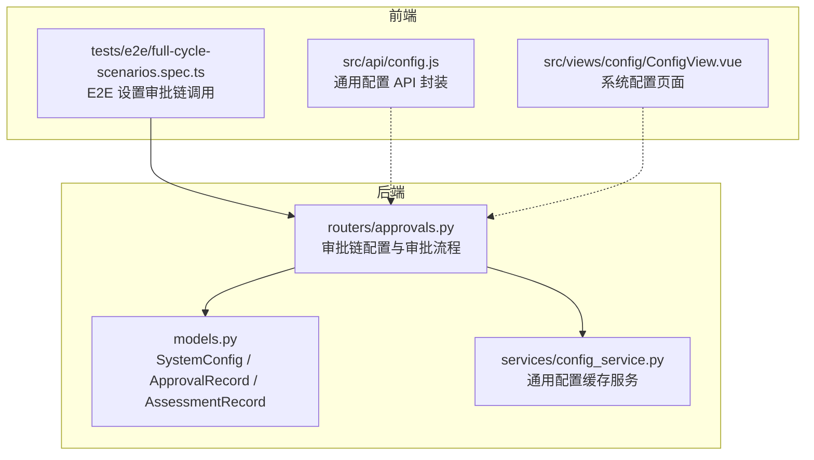
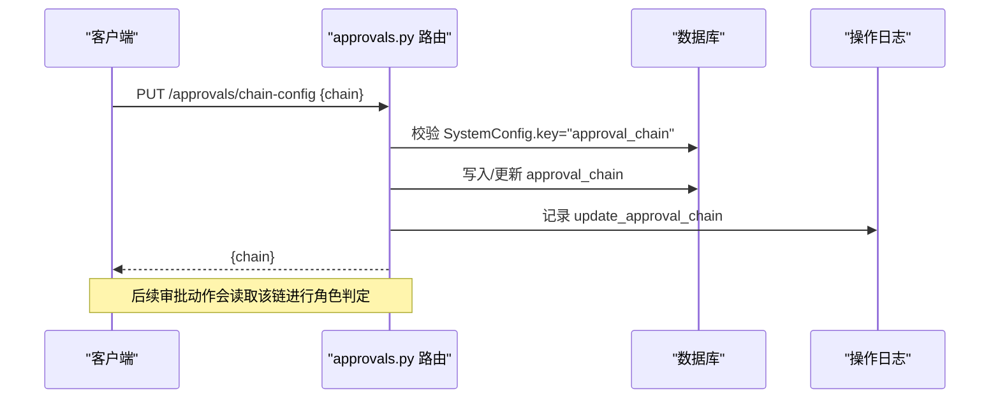
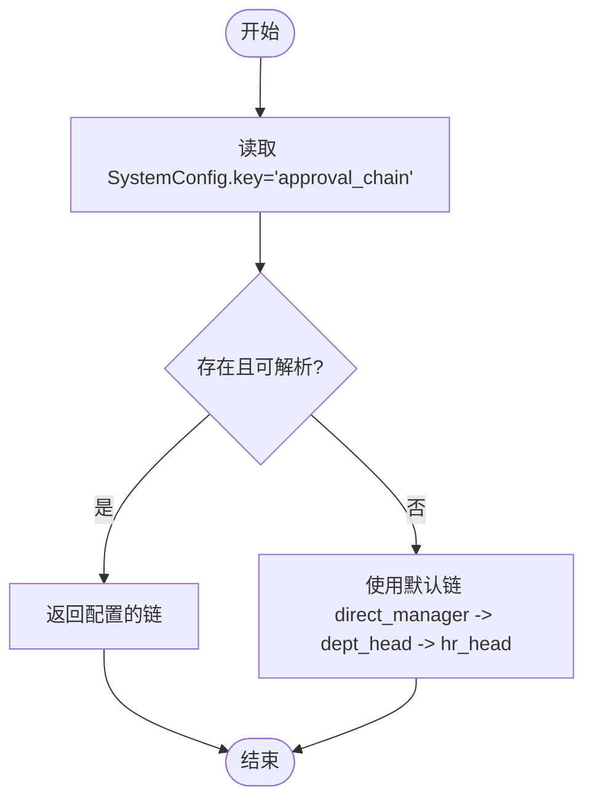
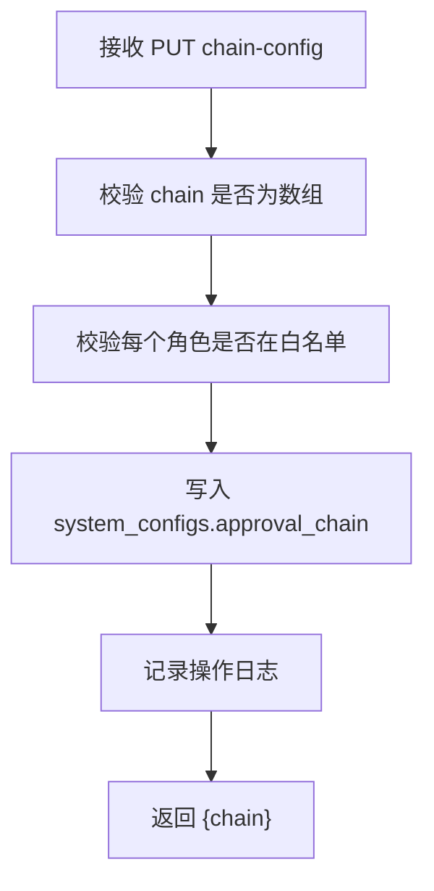
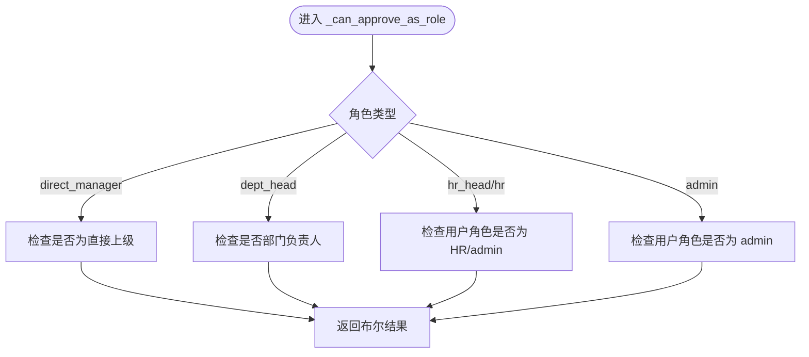
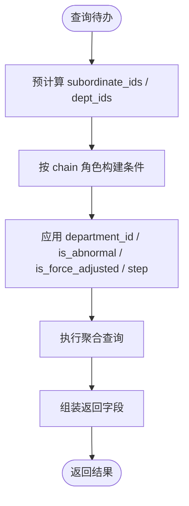
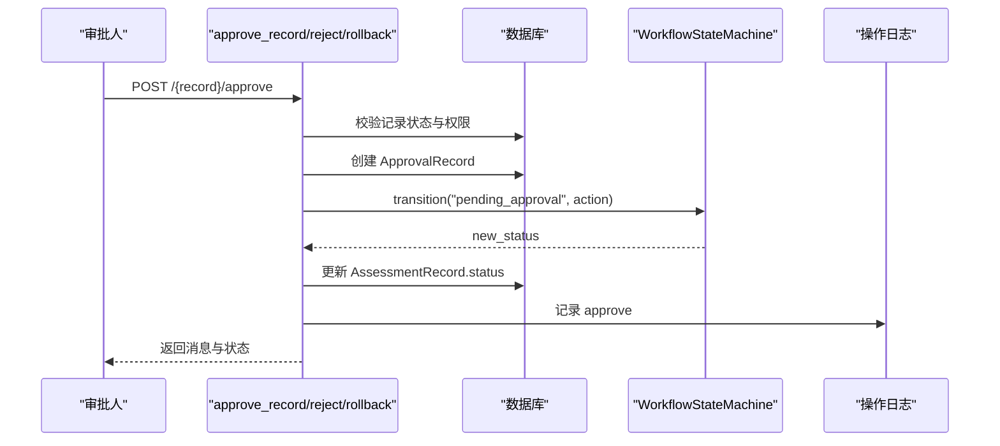
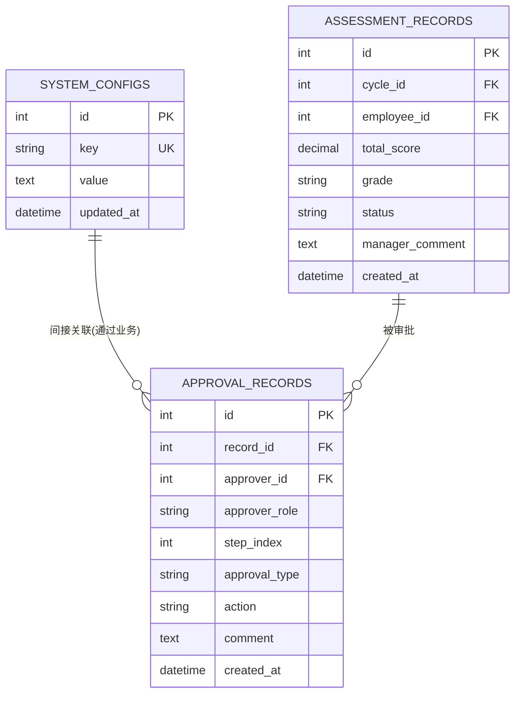
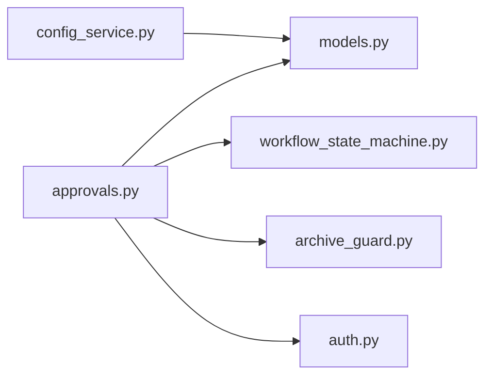

# 审批链配置管理

<cite>
**本文引用的文件**   
- [backend/app/routers/approvals.py](file://backend/app/routers/approvals.py)
- [backend/app/models.py](file://backend/app/models.py)
- [backend/app/services/config_service.py](file://backend/app/services/config_service.py)
- [backend/app/schemas.py](file://backend/app/schemas.py)
- [frontend/src/api/config.js](file://frontend/src/api/config.js)
- [frontend/src/views/config/ConfigView.vue](file://frontend/src/views/config/ConfigView.vue)
- [frontend/tests/e2e/full-cycle-scenarios.spec.ts](file://frontend/tests/e2e/full-cycle-scenarios.spec.ts)
</cite>

## 目录
1. [简介](#简介)
2. [项目结构定位](#项目结构定位)
3. [核心组件](#核心组件)
4. [架构总览](#架构总览)
5. [详细组件分析](#详细组件分析)
6. [依赖关系分析](#依赖关系分析)
7. [性能与扩展性](#性能与扩展性)
8. [故障排查指南](#故障排查指南)
9. [结论](#结论)
10. [附录：API 接口文档、配置示例与最佳实践](#附录api-接口文档配置示例与最佳实践)

## 简介
本文件围绕“审批链配置管理”展开，重点说明以下内容：
- 多级审批链的配置机制与默认值。
- 动态更新审批链的 API 接口、权限控制与数据校验规则。
- 审批链在待办查询、审批动作中的执行逻辑。
- 存储结构与数据格式（系统配置表）。
- 如何新增审批角色、调整审批顺序、设计条件分支等高级能力。
- 前端界面现状与使用建议。

## 项目结构定位
审批链配置相关代码主要位于后端路由模块与模型层，同时在前端测试脚本中体现调用方式；当前前端配置页面尚未暴露审批链配置入口。

**图表来源**
- [backend/app/routers/approvals.py:19-150](file://backend/app/routers/approvals.py#L19-L150)
- [backend/app/models.py:155-166](file://backend/app/models.py#L155-L166)
- [backend/app/models.py:222-228](file://backend/app/models.py#L222-L228)
- [backend/app/services/config_service.py:1-39](file://backend/app/services/config_service.py#L1-L39)
- [frontend/src/api/config.js:1-42](file://frontend/src/api/config.js#L1-L42)
- [frontend/src/views/config/ConfigView.vue:1-434](file://frontend/src/views/config/ConfigView.vue#L1-L434)
- [frontend/tests/e2e/full-cycle-scenarios.spec.ts:248-265](file://frontend/tests/e2e/full-cycle-scenarios.spec.ts#L248-L265)

**章节来源**
- [backend/app/routers/approvals.py:19-150](file://backend/app/routers/approvals.py#L19-L150)
- [backend/app/models.py:155-166](file://backend/app/models.py#L155-L166)
- [backend/app/models.py:222-228](file://backend/app/models.py#L222-L228)
- [backend/app/services/config_service.py:1-39](file://backend/app/services/config_service.py#L1-L39)
- [frontend/src/api/config.js:1-42](file://frontend/src/api/config.js#L1-L42)
- [frontend/src/views/config/ConfigView.vue:1-434](file://frontend/src/views/config/ConfigView.vue#L1-L434)
- [frontend/tests/e2e/full-cycle-scenarios.spec.ts:248-265](file://frontend/tests/e2e/full-cycle-scenarios.spec.ts#L248-L265)

## 核心组件
- 审批链读取与默认值：从系统配置表读取 `approval_chain`，未配置时回退到默认链。
- 审批链更新接口：仅管理员可更新，校验角色白名单并持久化。
- 审批执行逻辑：根据已通过的审批步骤计算下一步角色，并进行权限校验。
- 待办查询优化：按用户身份和审批链角色构建 SQL 条件，避免全表扫描。
- 状态机集成：通过工作流状态机决定审批后的新状态。
- 审计日志：所有关键操作记录操作日志。

**章节来源**
- [backend/app/routers/approvals.py:19-150](file://backend/app/routers/approvals.py#L19-L150)
- [backend/app/routers/approvals.py:153-311](file://backend/app/routers/approvals.py#L153-L311)
- [backend/app/routers/approvals.py:451-534](file://backend/app/routers/approvals.py#L451-L534)
- [backend/app/routers/approvals.py:537-616](file://backend/app/routers/approvals.py#L537-L616)
- [backend/app/routers/approvals.py:619-716](file://backend/app/routers/approvals.py#L619-L716)

## 架构总览
审批链配置管理涉及以下交互：
- 前端或外部客户端调用 `/api/v1/approvals/chain-config` 获取或更新审批链。
- 后端路由校验请求参数、权限，写入 `system_configs` 表。
- 审批流程在执行时读取当前审批链，结合 `approval_records` 确定下一步角色。
- 待办列表接口根据当前用户身份与审批链生成高效查询。

**图表来源**
- [backend/app/routers/approvals.py:111-150](file://backend/app/routers/approvals.py#L111-L150)
- [backend/app/models.py:222-228](file://backend/app/models.py#L222-L228)

**章节来源**
- [backend/app/routers/approvals.py:111-150](file://backend/app/routers/approvals.py#L111-L150)
- [backend/app/models.py:222-228](file://backend/app/models.py#L222-L228)

## 详细组件分析

### 默认审批链定义与读取
- 默认链为三级：直接上级、部门负责人、HR 负责人。
- 读取优先级：系统配置表 `approval_chain` > 默认链。
- 解析失败时回退默认链，保证系统可用性。

**图表来源**
- [backend/app/routers/approvals.py:19-29](file://backend/app/routers/approvals.py#L19-L29)

**章节来源**
- [backend/app/routers/approvals.py:19-29](file://backend/app/routers/approvals.py#L19-L29)

### 动态配置更新接口
- 接口路径：`PUT /api/v1/approvals/chain-config`
- 权限要求：管理员。
- 入参：`chain` 必须为数组，元素必须是允许的角色集合。
- 校验规则：
  - 非数组或空数组拒绝。
  - 角色必须在白名单内：`direct_manager`、`dept_head`、`hr_head`、`admin`。
- 存储：写入 `system_configs` 表，key 为 `approval_chain`，value 为 JSON 字符串。
- 审计：记录操作日志，包含变更前后值。

**图表来源**
- [backend/app/routers/approvals.py:111-150](file://backend/app/routers/approvals.py#L111-L150)
- [backend/app/models.py:222-228](file://backend/app/models.py#L222-L228)

**章节来源**
- [backend/app/routers/approvals.py:111-150](file://backend/app/routers/approvals.py#L111-L150)
- [backend/app/models.py:222-228](file://backend/app/models.py#L222-L228)

### 角色权限验证逻辑
- 直接上级：当前用户是该员工的直接上级。
- 部门负责人：当前用户是该员工所在部门的负责人。
- HR 负责人：当前用户角色为 HR 或管理员。
- 管理员：当前用户角色为管理员。
- 访问详情权限：HR、管理员、直接上级、当前链下一步角色、部门负责人均可查看。

**图表来源**
- [backend/app/routers/approvals.py:45-64](file://backend/app/routers/approvals.py#L45-L64)

**章节来源**
- [backend/app/routers/approvals.py:45-64](file://backend/app/routers/approvals.py#L45-L64)

### 待办审批查询优化
- 预计算用户的下属 ID 与部门 ID。
- 根据审批链角色构建 OR 条件，结合已通过的 step_index 过滤。
- 支持按部门、异常标记、强制调整标记、指定步骤筛选。
- 避免一次性加载所有 pending 记录，提升性能。

**图表来源**
- [backend/app/routers/approvals.py:153-311](file://backend/app/routers/approvals.py#L153-L311)

**章节来源**
- [backend/app/routers/approvals.py:153-311](file://backend/app/routers/approvals.py#L153-L311)

### 审批动作与工作流状态机
- 通过审批：
  - 校验当前状态、角色权限、重复审批。
  - 创建审批记录，调用状态机决定新状态。
  - 记录操作日志。
- 驳回审批：
  - 校验理由长度，创建驳回记录，状态机保持待审批。
- 打回重评：
  - 清理经理评分相关数据，状态机回到上级评分阶段。

**图表来源**
- [backend/app/routers/approvals.py:451-534](file://backend/app/routers/approvals.py#L451-L534)

**章节来源**
- [backend/app/routers/approvals.py:451-534](file://backend/app/routers/approvals.py#L451-L534)

### 存储结构与数据格式
- 系统配置表 `system_configs`：
  - key：`approval_chain`
  - value：JSON 字符串，例如 `["direct_manager","dept_head","hr_head"]`
- 审批记录表 `approval_records`：
  - record_id：关联考核记录
  - approver_id：审批人
  - approver_role：审批角色
  - step_index：步骤序号
  - action：approved/rejected/rollback
  - comment：审批意见
- 考核记录表 `assessment_records`：
  - status：如 pending_approval
  - total_score/grade：总分与等级
  - manager_comment：经理评语

**图表来源**
- [backend/app/models.py:155-166](file://backend/app/models.py#L155-L166)
- [backend/app/models.py:222-228](file://backend/app/models.py#L222-L228)

**章节来源**
- [backend/app/models.py:155-166](file://backend/app/models.py#L155-L166)
- [backend/app/models.py:222-228](file://backend/app/models.py#L222-L228)

### 前端界面实现与使用指南
- 当前前端配置页面 `ConfigView.vue` 提供等级规则、维度权重、评价人权重、小部门豁免、协作评分开关等配置项，但未包含审批链配置 UI。
- 前端 API 封装 `config.js` 也未暴露审批链配置方法。
- E2E 测试脚本通过直接调用后端接口设置审批链，用于端到端流程验证。

建议：
- 在前端配置页增加“审批链配置”标签页，提供可视化编辑与保存按钮。
- 复用现有配置页面的表单模式与校验提示风格。
- 调用后端 `PUT /api/v1/approvals/chain-config` 接口完成更新。

**章节来源**
- [frontend/src/views/config/ConfigView.vue:1-434](file://frontend/src/views/config/ConfigView.vue#L1-L434)
- [frontend/src/api/config.js:1-42](file://frontend/src/api/config.js#L1-L42)
- [frontend/tests/e2e/full-cycle-scenarios.spec.ts:248-265](file://frontend/tests/e2e/full-cycle-scenarios.spec.ts#L248-L265)

## 依赖关系分析
- 路由层依赖：
  - 模型层：`AssessmentRecord`、`Employee`、`Department`、`Position`、`User`、`ApprovalRecord`、`AssessmentCycle`、`SystemConfig`、`PeerReviewTask`。
  - 工具层：`WorkflowStateMachine`、`check_record_not_archived`。
  - 认证依赖：`get_current_user`、`require_role`。
- 配置服务层：
  - 提供通用配置缓存与默认值，但审批链读取逻辑目前直接在路由层实现。

**图表来源**
- [backend/app/routers/approvals.py:1-18](file://backend/app/routers/approvals.py#L1-L18)
- [backend/app/models.py:155-166](file://backend/app/models.py#L155-L166)
- [backend/app/models.py:222-228](file://backend/app/models.py#L222-L228)
- [backend/app/services/config_service.py:1-39](file://backend/app/services/config_service.py#L1-L39)

**章节来源**
- [backend/app/routers/approvals.py:1-18](file://backend/app/routers/approvals.py#L1-L18)
- [backend/app/models.py:155-166](file://backend/app/models.py#L155-L166)
- [backend/app/models.py:222-228](file://backend/app/models.py#L222-L228)
- [backend/app/services/config_service.py:1-39](file://backend/app/services/config_service.py#L1-L39)

## 性能与扩展性
- 性能优化：
  - 待办查询使用子查询与 IN 条件，避免全表扫描。
  - 预计算用户关系数据，减少重复查询。
- 扩展性建议：
  - 将审批链读取逻辑抽象到配置服务层，统一缓存策略。
  - 引入更灵活的审批链表达式（条件分支、并行审批）以支持复杂场景。
  - 对审批链配置变更增加版本管理与生效范围（全局/周期级）。

[本节为通用指导，不直接分析具体文件]

## 故障排查指南
常见问题与处理建议：
- 无法更新审批链：
  - 检查请求体是否为数组，角色是否在白名单内。
  - 确认当前用户具备管理员权限。
- 审批无下一步角色：
  - 检查是否已完成所有审批步骤。
  - 核对 `approval_records` 中已通过步骤是否正确记录。
- 无权审批：
  - 确认当前用户是否满足对应角色的权限条件。
  - 检查员工上下级关系与部门负责人设置。
- 待办列表为空：
  - 检查筛选条件（部门、异常标记、步骤）是否过严。
  - 确认审批链配置与用户角色匹配。

**章节来源**
- [backend/app/routers/approvals.py:111-150](file://backend/app/routers/approvals.py#L111-L150)
- [backend/app/routers/approvals.py:451-534](file://backend/app/routers/approvals.py#L451-L534)
- [backend/app/routers/approvals.py:153-311](file://backend/app/routers/approvals.py#L153-L311)

## 结论
审批链配置管理在当前系统中实现了基础的多级审批能力，包括默认链定义、动态更新接口、角色权限校验与待办查询优化。建议在后续迭代中增强前端配置界面、扩展审批链表达式与版本管理能力，以提升系统的灵活性与可维护性。

[本节为总结性内容，不直接分析具体文件]

## 附录：API 接口文档、配置示例与最佳实践

### 接口定义
- 获取审批链配置
  - 方法：GET
  - 路径：`/api/v1/approvals/chain-config`
  - 权限：admin、hr、executive
  - 响应：`{ chain: [...] }`
- 更新审批链配置
  - 方法：PUT
  - 路径：`/api/v1/approvals/chain-config`
  - 权限：admin
  - 请求体：`{ chain: ["direct_manager", "dept_head", "hr_head"] }`
  - 校验：chain 必须为数组，元素必须在白名单内
  - 响应：`{ chain: [...] }`

**章节来源**
- [backend/app/routers/approvals.py:102-150](file://backend/app/routers/approvals.py#L102-L150)

### 配置示例
- 默认链：`["direct_manager", "dept_head", "hr_head"]`
- 单级链（仅直接上级）：`["direct_manager"]`
- 管理员兜底链：`["direct_manager", "dept_head", "hr_head", "admin"]`

**章节来源**
- [backend/app/routers/approvals.py:19-29](file://backend/app/routers/approvals.py#L19-L29)
- [backend/app/routers/approvals.py:111-150](file://backend/app/routers/approvals.py#L111-L150)
- [frontend/tests/e2e/full-cycle-scenarios.spec.ts:248-265](file://frontend/tests/e2e/full-cycle-scenarios.spec.ts#L248-L265)

### 最佳实践
- 明确审批链角色语义：
  - direct_manager：直接上级
  - dept_head：部门负责人
  - hr_head：HR 负责人
  - admin：管理员兜底
- 谨慎添加新角色：
  - 先在 `_can_approve_as_role` 中实现权限判断逻辑。
  - 在更新接口的白名单中加入新角色。
- 合理设置审批顺序：
  - 先业务线（直接上级），再部门线（部门负责人），最后治理线（HR/管理员）。
- 条件分支建议：
  - 基于部门规模、分数差异、异常标记等条件选择不同审批链。
  - 可在路由层扩展条件判断逻辑，或在配置服务层引入表达式引擎。
- 前端配置界面：
  - 提供可视化编辑与实时校验。
  - 保存后提示“仅影响新考核周期”，避免历史数据混乱。

[本节为通用指导，不直接分析具体文件]