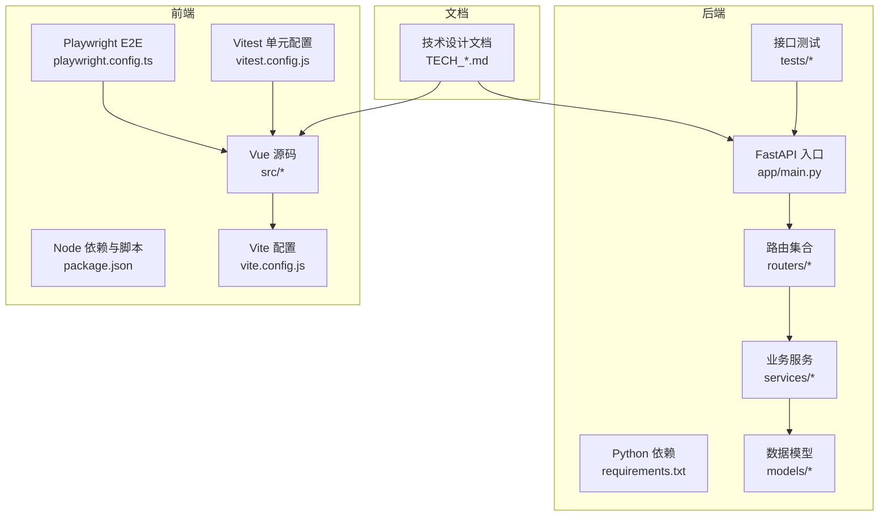
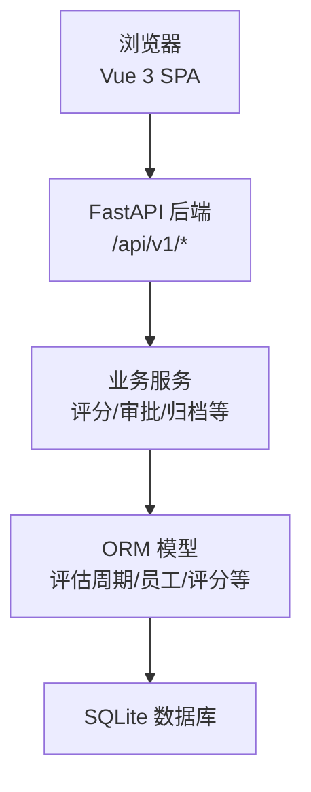
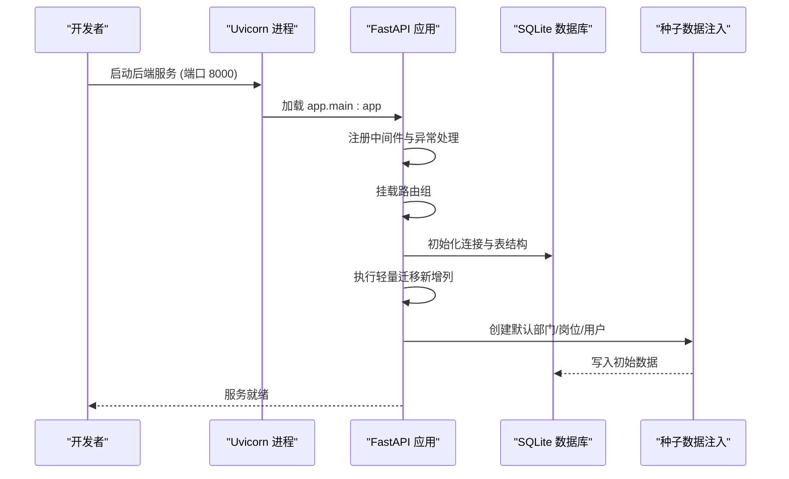
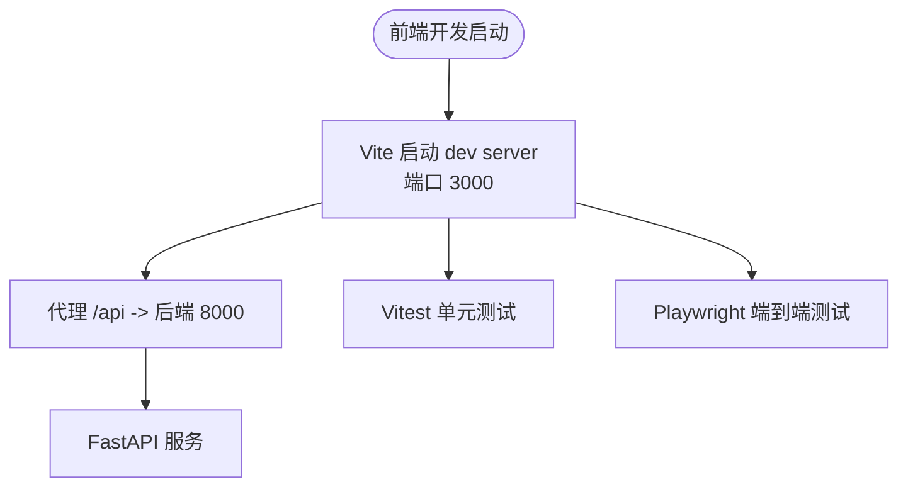
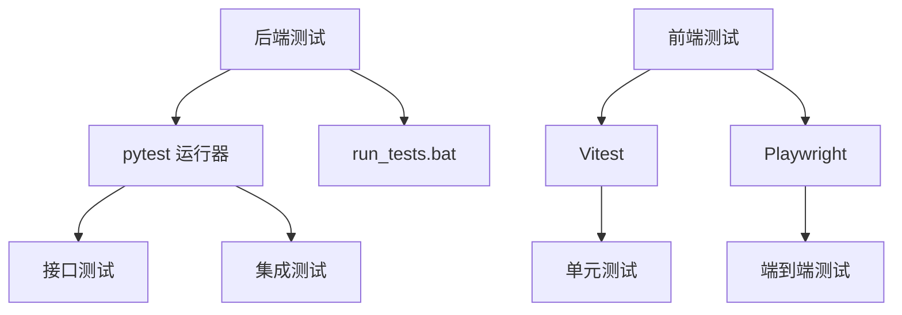
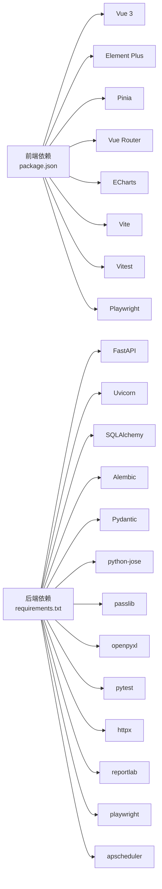

# 开发指南

<cite>
**本文引用的文件**   
- [backend/requirements.txt](file://backend/requirements.txt)
- [frontend/package.json](file://frontend/package.json)
- [backend/app/main.py](file://backend/app/main.py)
- [frontend/vite.config.js](file://frontend/vite.config.js)
- [frontend/playwright.config.ts](file://frontend/playwright.config.ts)
- [frontend/vitest.config.js](file://frontend/vitest.config.js)
- [docs/TECH_绩效考核评分系统_v1.0.md](file://docs/TECH_绩效考核评分系统_v1.0.md)
- [backend/run_tests.bat](file://backend/run_tests.bat)
- [backend/tests/README.md](file://backend/tests/README.md)
- [scripts/restart.bat](file://scripts/restart.bat)
- [restart-services.bat](file://restart-services.bat)
</cite>

## 更新摘要
**所做更改**   
- 更新了后端端口配置从8000到8000的所有相关说明
- 修正了前端代理配置中的后端端口指向
- 更新了启动脚本和部署说明中的端口信息
- 保持了文档的整体结构和一致性

## 目录
1. [引言](#引言)
2. [项目结构](#项目结构)
3. [核心组件](#核心组件)
4. [架构总览](#架构总览)
5. [详细组件分析](#详细组件分析)
6. [依赖关系分析](#依赖关系分析)
7. [性能考虑](#性能考虑)
8. [故障排查指南](#故障排查指南)
9. [结论](#结论)
10. [附录](#附录)

## 引言
本指南面向后端与前端开发者，目标是帮助你在本地快速搭建可运行的开发环境，统一代码规范与协作流程，并掌握新功能从需求到上线的完整路径。本项目采用前后端分离架构：后端基于 FastAPI + SQLAlchemy + SQLite，前端基于 Vue 3 + Vite + Element Plus + Pinia，测试覆盖单元测试、接口测试与端到端测试。

## 项目结构
仓库采用"后端 + 前端 + 文档 + 脚本"的分层组织方式：
- backend：FastAPI 应用、路由、模型、服务、工具、测试等
- frontend：Vue 3 SPA、Vite 构建、E2E 与单元测试配置
- docs：产品与技术设计文档
- scripts：数据库初始化、备份、迁移辅助脚本
- tests：跨模块验收用例与脚本

图表来源
- [backend/app/main.py:1-71](file://backend/app/main.py#L1-L71)
- [frontend/vite.config.js:1-22](file://frontend/vite.config.js#L1-L22)
- [frontend/playwright.config.ts:1-66](file://frontend/playwright.config.ts#L1-L66)
- [frontend/vitest.config.js:1-24](file://frontend/vitest.config.js#L1-L24)

章节来源
- [backend/app/main.py:1-71](file://backend/app/main.py#L1-L71)
- [frontend/vite.config.js:1-22](file://frontend/vite.config.js#L1-L22)
- [frontend/playwright.config.ts:1-66](file://frontend/playwright.config.ts#L1-L66)
- [frontend/vitest.config.js:1-24](file://frontend/vitest.config.js#L1-L24)

## 核心组件
- 后端入口与中间件：FastAPI 应用注册 CORS、审计日志、异常处理器，挂载 /api/v1 与兼容路由，启动时初始化数据库、执行轻量迁移并注入默认管理员与测试用户。
- 前端开发服务器：Vite 提供热更新，代理 /api 到后端 8000 端口，便于本地联调。
- 测试体系：后端 pytest + httpx；前端 Vitest 单元测试 + Playwright 端到端测试。

**更新** 后端端口已从8000更改为8000，所有相关配置已同步更新。

章节来源
- [backend/app/main.py:1-71](file://backend/app/main.py#L1-L71)
- [frontend/vite.config.js:12-21](file://frontend/vite.config.js#L12-L21)
- [backend/requirements.txt:1-15](file://backend/requirements.txt#L1-L15)
- [frontend/package.json:6-15](file://frontend/package.json#L6-L15)

## 架构总览
系统采用经典前后端分离 B/S 架构：浏览器中的 Vue 3 SPA 通过 REST API 与 FastAPI 后端通信，后端使用 SQLAlchemy ORM 访问 SQLite 数据库。后端内部按 Router → Service → Repository 分层，Router 仅做参数校验与权限守卫，Service 编排业务逻辑（状态机、加权计算、强制分布），Repository 负责数据访问。

图表来源
- [docs/TECH_绩效考核评分系统_v1.0.md:41-79](file://docs/TECH_绩效考核评分系统_v1.0.md#L41-L79)
- [docs/TECH_绩效考核评分系统_v1.0.md:125-152](file://docs/TECH_绩效考核评分系统_v1.0.md#L125-L152)

## 详细组件分析

### 后端入口与启动流程
FastAPI 应用在启动阶段完成以下关键步骤：
- 注册全局中间件（CORS、审计日志）
- 注册异常处理器（HTTP 异常、请求校验异常）
- 挂载 /api/v1 路由组与兼容路由
- 启动事件初始化数据库、执行轻量迁移、注入默认管理员与测试账号

图表来源
- [backend/app/main.py:1-71](file://backend/app/main.py#L1-L71)
- [backend/app/main.py:97-129](file://backend/app/main.py#L97-L129)
- [backend/app/main.py:126-278](file://backend/app/main.py#L126-L278)

章节来源
- [backend/app/main.py:1-71](file://backend/app/main.py#L1-L71)
- [backend/app/main.py:97-129](file://backend/app/main.py#L97-L129)
- [backend/app/main.py:126-278](file://backend/app/main.py#L126-L278)

### 前端开发与代理配置
- 开发服务器：Vite 在 127.0.0.1:3000 启动，自动代理 /api 到后端 8000 端口，避免跨域问题。
- 别名：@ 指向 src 目录，简化导入路径。
- 测试：Vitest 使用 jsdom 环境，支持覆盖率统计；Playwright 用于端到端测试，默认 Chromium。

**更新** 前端代理配置已更新为指向后端 8000 端口。

图表来源
- [frontend/vite.config.js:1-22](file://frontend/vite.config.js#L1-L22)
- [frontend/vitest.config.js:1-24](file://frontend/vitest.config.js#L1-L24)
- [frontend/playwright.config.ts:1-66](file://frontend/playwright.config.ts#L1-L66)

章节来源
- [frontend/vite.config.js:1-22](file://frontend/vite.config.js#L1-L22)
- [frontend/vitest.config.js:1-24](file://frontend/vitest.config.js#L1-L24)
- [frontend/playwright.config.ts:1-66](file://frontend/playwright.config.ts#L1-L66)

### 测试体系与运行方式
- 后端测试：pytest + httpx，支持单测与集成测试；提供批处理脚本 run_tests.bat 快速运行。
- 前端测试：
  - 单元测试：npm run test / test:unit / test:watch / test:coverage
  - 端到端测试：npm run test:e2e / test:e2e:ui，Playwright 自动启动前端 dev server

图表来源
- [backend/run_tests.bat:1-20](file://backend/run_tests.bat#L1-L20)
- [backend/tests/README.md:90-105](file://backend/tests/README.md#L90-L105)
- [frontend/package.json:6-15](file://frontend/package.json#L6-L15)
- [frontend/playwright.config.ts:59-66](file://frontend/playwright.config.ts#L59-L66)

章节来源
- [backend/run_tests.bat:1-20](file://backend/run_tests.bat#L1-L20)
- [backend/tests/README.md:90-105](file://backend/tests/README.md#L90-L105)
- [frontend/package.json:6-15](file://frontend/package.json#L6-L15)
- [frontend/playwright.config.ts:59-66](file://frontend/playwright.config.ts#L59-L66)

## 依赖关系分析
- 后端依赖：FastAPI、Uvicorn、SQLAlchemy、Alembic、Pydantic、JWT、密码哈希、Excel 读写、测试框架、异步任务调度等。
- 前端依赖：Vue 3、Element Plus、Pinia、Vue Router、ECharts、Axios、Vite、Vitest、Playwright 等。

图表来源
- [frontend/package.json:17-39](file://frontend/package.json#L17-L39)
- [backend/requirements.txt:1-15](file://backend/requirements.txt#L1-L15)

章节来源
- [frontend/package.json:17-39](file://frontend/package.json#L17-L39)
- [backend/requirements.txt:1-15](file://backend/requirements.txt#L1-L15)

## 性能考虑
- 数据库查询优化
  - 优先使用 ORM 聚合查询与分页，避免全表扫描。
  - 对高频查询字段建立索引（如部门、岗位、状态）。
  - 将复杂计算下沉至 Service 层，避免在 Router 中直接操作数据库。
- 前端性能优化
  - 合理使用 ECharts 大数据集渲染策略（按需加载、增量更新）。
  - 列表页使用虚拟滚动或分页，减少 DOM 节点数量。
  - 静态资源走 CDN 或开启缓存策略。
- 缓存策略
  - 对只读配置与字典数据使用内存缓存（如 LRU）。
  - 对热点报表结果进行短期缓存，结合版本号失效。
  - 前端对不频繁变化的配置进行本地缓存，减少重复请求。

[本节为通用指导，不直接分析具体文件]

## 故障排查指南
- 后端启动失败
  - 检查 Python 虚拟环境与依赖安装是否成功。
  - 确认 SQLite 数据库文件路径与权限。
  - 查看启动日志中是否有迁移或种子数据注入错误。
  - **更新** 确认后端服务是否在 8000 端口正常启动。
- 前端无法调用后端接口
  - 确认 Vite 代理配置是否正确转发到后端 8000 端口。
  - 检查后端 CORS 是否允许前端域名与方法头。
- 测试失败
  - 后端：使用 pytest 详细输出定位断言失败点。
  - 前端：使用 Vitest 覆盖率报告定位未覆盖分支；使用 Playwright UI 模式录制失败视频与截图。

章节来源
- [backend/app/main.py:15-28](file://backend/app/main.py#L15-L28)
- [frontend/vite.config.js:12-21](file://frontend/vite.config.js#L12-L21)
- [backend/run_tests.bat:1-20](file://backend/run_tests.bat#L1-L20)
- [frontend/playwright.config.ts:29-49](file://frontend/playwright.config.ts#L29-L49)

## 结论
本指南梳理了项目的开发环境搭建、核心组件职责、架构总览与依赖关系，并提供了测试运行方式与常见问题的排查思路。建议团队在遵循本文档的基础上，进一步完善代码规范、Git 工作流与发布流程，确保协作高效、质量可控。

[本节为总结性内容，不直接分析具体文件]

## 附录

### 开发环境搭建步骤
- 后端环境
  - 创建并激活 Python 虚拟环境。
  - 安装后端依赖：pip install -r backend/requirements.txt。
  - 启动后端服务：uvicorn app.main:app --host 0.0.0.0 --port 8000。
- 前端环境
  - 安装 Node.js 与 npm。
  - 安装前端依赖：cd frontend && npm install。
  - 启动前端开发服务器：npm run dev（默认 127.0.0.1:3000）。
- 联调说明
  - 前端已配置代理 /api -> 后端 8000，无需额外跨域设置。
  - 首次启动会自动初始化数据库与默认管理员/测试用户。

**更新** 后端端口已统一更改为 8000，所有启动命令和配置均已同步更新。

章节来源
- [docs/TECH_绩效考核评分系统_v1.0.md:2953-2973](file://docs/TECH_绩效考核评分系统_v1.0.md#L2953-L2973)
- [backend/app/main.py:126-278](file://backend/app/main.py#L126-L278)
- [frontend/vite.config.js:12-21](file://frontend/vite.config.js#L12-L21)

### IDE 与代码格式化建议
- Python（后端）
  - 推荐 VS Code + Pylance + Black + isort + Flake8/Ruff。
  - 配置保存时自动格式化与排序导入。
- Vue.js（前端）
  - 推荐 VS Code + Volar + ESLint + Prettier。
  - 配置保存时自动格式化与修复规则。
- 统一规则
  - 提交前运行格式化与 lint 检查，失败则阻止提交。

[本节为通用指导，不直接分析具体文件]

### 调试配置
- 后端调试
  - 使用 VS Code 的 Python 调试配置，断点设置在路由或服务方法。
  - 配合 pytest 调试单个测试用例。
- 前端调试
  - 使用浏览器开发者工具调试 Vue 组件与网络请求。
  - Playwright UI 模式录制失败场景，便于复现与定位。

章节来源
- [frontend/playwright.config.ts:32-49](file://frontend/playwright.config.ts#L32-L49)
- [backend/run_tests.bat:1-20](file://backend/run_tests.bat#L1-L20)

### Git 工作流程（团队协作规范）
- 分支管理
  - main：稳定分支，仅合并已通过评审的代码。
  - develop：开发分支，日常功能开发在此分支进行。
  - feature/*：功能分支，从 develop 拉出，完成后合并回 develop。
  - hotfix/*：紧急修复分支，从 main 拉出，完成后合并回 main 与 develop。
- 提交规范
  - 提交信息格式：type(scope): description，例如 feat(auth): 增加登录接口。
  - 类型包括：feat、fix、docs、style、refactor、test、chore。
- 代码审查
  - 所有变更需通过 Pull Request 审查，至少一名 reviewer 批准后方可合并。
  - 审查重点：功能正确性、代码风格、测试覆盖、性能与安全。

[本节为通用指导，不直接分析具体文件]

### 新功能开发完整流程
- 需求分析
  - 明确业务目标、用户角色、输入输出、边界条件。
- 设计文档
  - 编写技术方案（接口定义、数据模型、流程图、时序图）。
  - 评审通过后进入开发阶段。
- 代码实现
  - 后端：Router 参数校验与权限守卫，Service 编排业务逻辑，Repository 数据访问。
  - 前端：页面组件、状态管理、API 封装、表单校验。
- 测试验证
  - 后端：单元测试与接口测试，覆盖正常与异常路径。
  - 前端：单元测试与端到端测试，覆盖关键交互流程。
- 上线发布
  - 合并到 main 分支，部署到生产环境。
  - 监控日志与指标，必要时回滚。

[本节为通用指导，不直接分析具体文件]

### 常见开发问题与解决方案
- 端口冲突
  - **更新** 后端 8000 被占用：修改 uvicorn 启动端口或释放占用进程。
  - 前端 3000 被占用：修改 vite.config.js 中的 server.port。
- 跨域问题
  - 确认后端 CORS 中间件已启用，允许前端域名与方法头。
- 数据库迁移失败
  - 检查 SQLite 文件权限与路径，确认迁移脚本无语法错误。
- 测试用例不稳定
  - 使用 Playwright 录制失败视频与截图，定位竞态条件或异步问题。

章节来源
- [frontend/vite.config.js:12-21](file://frontend/vite.config.js#L12-L21)
- [backend/app/main.py:15-28](file://backend/app/main.py#L15-L28)
- [frontend/playwright.config.ts:32-49](file://frontend/playwright.config.ts#L32-L49)

### 服务启动脚本
项目提供了多个启动脚本以简化开发流程：

- **scripts/restart.bat**：重启后端服务，自动检测并终止占用 8000 端口的进程
- **restart-services.bat**：同时启动后端（8000端口）和前端（3000端口）服务
- **backend/restart.bat**：后端专用重启脚本，包含健康检查机制

**更新** 所有启动脚本已更新为使用 8000 端口作为后端服务端口。

章节来源
- [scripts/restart.bat:1-58](file://scripts/restart.bat#L1-L58)
- [restart-services.bat:1-58](file://restart-services.bat#L1-L58)
- [backend/restart.bat:1-57](file://backend/restart.bat#L1-L57)