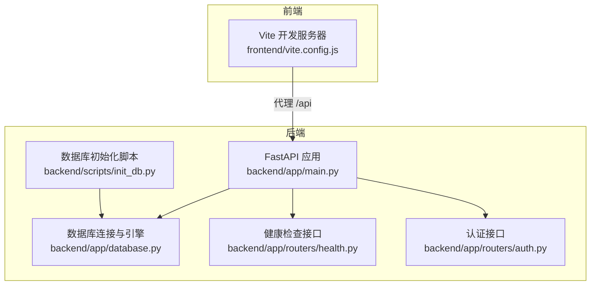
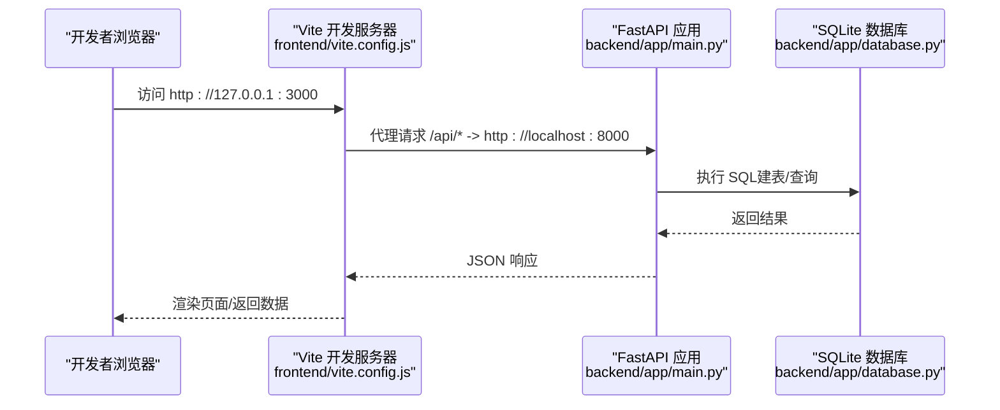
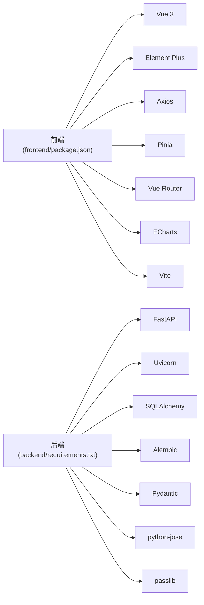

# 快速开始

<cite>
**本文引用的文件**   
- [backend/requirements.txt](file://backend/requirements.txt)
- [frontend/package.json](file://frontend/package.json)
- [backend/app/main.py](file://backend/app/main.py)
- [backend/app/database.py](file://backend/app/database.py)
- [backend/scripts/init_db.py](file://backend/scripts/init_db.py)
- [backend/app/routers/health.py](file://backend/app/routers/health.py)
- [backend/app/routers/auth.py](file://backend/app/routers/auth.py)
- [frontend/vite.config.js](file://frontend/vite.config.js)
- [restart-services.bat](file://restart-services.bat)
- [scripts/restart.bat](file://scripts/restart.bat)
</cite>

## 更新摘要
**变更内容**   
- 后端服务端口从8000标准化为8000
- 更新了所有相关的启动脚本和配置文件
- 修正了前端代理配置以指向新的端口
- 更新了API调用示例中的端口号

## 目录
1. [简介](#简介)
2. [项目结构](#项目结构)
3. [核心组件](#核心组件)
4. [架构总览](#架构总览)
5. [详细组件分析](#详细组件分析)
6. [依赖关系分析](#依赖关系分析)
7. [性能注意事项](#性能注意事项)
8. [故障排除指南](#故障排除指南)
9. [结论](#结论)
10. [附录：第一个 API 调用示例](#附录第一个-api-调用示例)

## 简介
本指南面向首次接触"绩效考核评分系统"的开发者，目标是帮助你在本地快速搭建前后端开发环境，完成数据库初始化、后端服务启动与前端开发服务器运行，并通过一个最小可用的 API 调用验证环境配置是否正确。

- 后端采用 FastAPI + SQLAlchemy（SQLite），提供 RESTful API。
- 前端采用 Vue 3 + Vite，内置代理转发到后端。
- 默认使用 SQLite 文件型数据库，无需额外安装数据库服务。
- **重要更新**：后端服务端口已标准化为8000，替代之前的8000端口。

## 项目结构
本项目为前后端分离结构：
- backend：FastAPI 后端服务、数据模型、路由、脚本等。
- frontend：Vue 3 + Vite 前端应用、测试与 E2E 用例。
- data/db：默认存放 SQLite 数据库文件。
- scripts：包含数据库初始化脚本等工具。

**图表来源**
- [backend/app/main.py:1-71](file://backend/app/main.py#L1-L71)
- [backend/app/database.py:1-31](file://backend/app/database.py#L1-L31)
- [backend/app/routers/health.py:1-26](file://backend/app/routers/health.py#L1-L26)
- [backend/app/routers/auth.py:1-179](file://backend/app/routers/auth.py#L1-L179)
- [backend/scripts/init_db.py:1-262](file://backend/scripts/init_db.py#L1-L262)
- [frontend/vite.config.js:1-27](file://frontend/vite.config.js#L1-L27)

**章节来源**
- [backend/app/main.py:1-71](file://backend/app/main.py#L1-L71)
- [frontend/vite.config.js:1-27](file://frontend/vite.config.js#L1-L27)

## 核心组件
- 后端入口与路由挂载：FastAPI 应用创建、CORS、审计中间件、异常处理、统一 API 前缀与兼容路由挂载。
- 数据库连接：SQLAlchemy Engine、SessionLocal、init_db 建表、get_db 依赖注入。
- 健康检查：返回数据库状态、版本号。
- 认证模块：登录、刷新令牌、获取当前用户、修改密码、登出，含失败次数限制。
- 数据库初始化脚本：清空并重建表结构，插入演示部门、岗位、员工、用户账号及汇报关系。

**章节来源**
- [backend/app/main.py:1-278](file://backend/app/main.py#L1-L278)
- [backend/app/database.py:1-31](file://backend/app/database.py#L1-L31)
- [backend/app/routers/health.py:1-26](file://backend/app/routers/health.py#L1-L26)
- [backend/app/routers/auth.py:1-179](file://backend/app/routers/auth.py#L1-L179)
- [backend/scripts/init_db.py:1-262](file://backend/scripts/init_db.py#L1-L262)

## 架构总览
下图展示本地开发时前后端交互与关键依赖：

**图表来源**
- [frontend/vite.config.js:12-21](file://frontend/vite.config.js#L12-L21)
- [backend/app/main.py:1-71](file://backend/app/main.py#L1-L71)
- [backend/app/database.py:13-18](file://backend/app/database.py#L13-L18)

## 详细组件分析

### 后端服务启动流程
1. 准备 Python 环境与依赖
   - 建议使用 Python 3.10+（与 FastAPI/SQLAlchemy 生态兼容性良好）。
   - 进入 backend 目录，安装依赖：
     - `pip install -r requirements.txt`
2. 初始化数据库
   - 方式一：通过脚本初始化（推荐用于全新环境）
     - `python scripts/init_db.py`
     - 该脚本会创建 data/db/performance_evaluation.db，并插入演示数据。
   - 方式二：由后端启动自动建表
     - 后端启动时会调用 init_db() 进行建表；同时还会执行轻量迁移与种子数据填充。
3. 启动后端服务
   - **重要更新**：后端服务现已标准化使用端口8000
   - 使用 uvicorn 启动：
     - `uvicorn app.main:app --host 0.0.0.0 --port 8000 --reload`
   - 或使用提供的启动脚本：
     - Windows: `restart-services.bat` 或 `scripts/restart.bat`
     - 这些脚本会自动清理端口占用并启动服务
   - 启动后会自动：
     - 注册 CORS、审计日志中间件与全局异常处理器。
     - 挂载 /api/v1 与兼容路由。
     - 初始化数据库表与增量字段。
     - 若不存在，则创建默认管理员与演示角色用户。

**章节来源**
- [backend/requirements.txt:1-15](file://backend/requirements.txt#L1-L15)
- [backend/scripts/init_db.py:25-54](file://backend/scripts/init_db.py#L25-L54)
- [backend/app/database.py:29-31](file://backend/app/database.py#L29-L31)
- [backend/app/main.py:15-28](file://backend/app/main.py#L15-L28)
- [backend/app/main.py:49-94](file://backend/app/main.py#L49-L94)
- [backend/app/main.py:97-129](file://backend/app/main.py#L97-L129)
- [backend/app/main.py:126-278](file://backend/app/main.py#L126-L278)
- [restart-services.bat:6](file://restart-services.bat#L6)
- [scripts/restart.bat:5](file://scripts/restart.bat#L5)

### 前端开发环境搭建
1. 准备 Node.js 环境
   - 建议使用 Node.js 18+（与 Vite 5.x 生态兼容良好）。
2. 安装依赖
   - 进入 frontend 目录，执行：
     - `npm install`
3. 启动开发服务器
   - `npm run dev`
   - 默认监听 http://127.0.0.1:3000，并将 /api 请求代理至 http://localhost:8000。

**章节来源**
- [frontend/package.json:6-16](file://frontend/package.json#L6-L16)
- [frontend/package.json:17-40](file://frontend/package.json#L17-L40)
- [frontend/vite.config.js:12-21](file://frontend/vite.config.js#L12-L21)

### 环境变量与数据库配置
- 数据库路径
  - 运行时默认将 SQLite 文件放在项目根目录的 data/db/performance_evaluation.db。
  - 初始化脚本同样使用该路径。
- 环境变量
  - 当前实现未强制要求设置 DATABASE_URL 或 ALEMBIC_DB_URL 等环境变量；如未来切换 MySQL/PostgreSQL，可在 database.py 中读取环境变量以覆盖默认 SQLite 连接串。
- 端口与代理
  - **重要更新**：后端默认监听8000端口（已从8000标准化）。
  - 前端 Vite 开发服务器默认 3000，并代理 /api 到后端。

**章节来源**
- [backend/app/database.py:7-11](file://backend/app/database.py#L7-L11)
- [backend/scripts/init_db.py:15-17](file://backend/scripts/init_db.py#L15-L17)
- [frontend/vite.config.js:12-21](file://frontend/vite.config.js#L12-L21)

## 依赖关系分析
- 后端依赖
  - FastAPI、Uvicorn、SQLAlchemy、Alembic、Pydantic、JWT、Passlib、Openpyxl、ReportLab、APScheduler 等。
- 前端依赖
  - Vue 3、Element Plus、Axios、Pinia、Vue Router、ECharts、Vite、Vitest、Playwright 等。

**图表来源**
- [frontend/package.json:17-40](file://frontend/package.json#L17-L40)
- [backend/requirements.txt:1-15](file://backend/requirements.txt#L1-L15)

**章节来源**
- [frontend/package.json:17-40](file://frontend/package.json#L17-L40)
- [backend/requirements.txt:1-15](file://backend/requirements.txt#L1-L15)

## 性能注意事项
- SQLite 并发写入瓶颈：在多人同时提交评分时可能出现锁等待。MVP 场景并发可控；如需更高并发，可预留切换到 MySQL/PostgreSQL 的能力（仅需修改数据库连接串）。
- 鉴权与限流：登录失败次数限制基于内存存储，重启服务后会清零。生产环境建议替换为持久化存储。

[本节为通用指导，不直接分析具体文件]

## 故障排除指南
- 无法访问 http://127.0.0.1:3000
  - 确认已执行 npm install 与 npm run dev。
  - 检查 vite.config.js 中的 server.port 是否为 3000。
- 前端能打开但接口报跨域或 404
  - **重要更新**：确认后端已在8000端口运行（而非8000）。
  - 检查 vite.config.js 中 proxy.target 是否指向 http://localhost:8000。
- 登录后提示用户名或密码错误
  - 确认已通过 scripts/init_db.py 初始化演示数据，或使用后端启动时的种子逻辑创建了默认用户。
  - 注意登录失败次数限制：连续失败多次会被临时锁定。
- 数据库相关报错
  - 确认 data/db 目录存在且可写。
  - 若需要重置数据，重新运行 scripts/init_db.py。
- 健康检查失败
  - 调用健康检查接口查看数据库状态与版本信息，定位问题。
- 端口冲突问题
  - 如果使用启动脚本遇到端口占用，可使用 `restart-services.bat` 或 `scripts/restart.bat` 自动清理端口。
  - 确保没有其他进程占用8000端口。

**章节来源**
- [frontend/vite.config.js:12-21](file://frontend/vite.config.js#L12-L21)
- [backend/app/routers/auth.py:31-55](file://backend/app/routers/auth.py#L31-L55)
- [backend/app/routers/health.py:10-25](file://backend/app/routers/health.py#L10-L25)
- [backend/scripts/init_db.py:35-54](file://backend/scripts/init_db.py#L35-L54)
- [restart-services.bat:6](file://restart-services.bat#L6)
- [scripts/restart.bat:5](file://scripts/restart.bat#L5)

## 结论
按照本指南完成环境准备、依赖安装、数据库初始化与前后端服务启动后，即可在本地完整体验绩效考核评分系统的核心流程。建议先通过健康检查与登录接口验证环境正确性，再逐步探索其他业务模块。

**重要提醒**：请确保使用新的标准端口8000，而非旧的8000端口。

[本节为总结性内容，不直接分析具体文件]

## 附录：第一个 API 调用示例
以下示例帮助你快速验证后端是否正常运行。请根据实际部署情况调整 URL。

**重要更新**：所有API端点现已使用8000端口。

- 健康检查
  - 方法：GET
  - URL：http://localhost:8000/api/v1/health
  - 预期：返回包含数据库状态与版本号的 JSON。

- 登录
  - 方法：POST
  - URL：http://localhost:8000/api/v1/auth/login
  - 请求体示例（JSON）：
    - username: "admin"
    - password: "admin123"
  - 预期：返回 access_token、refresh_token、token_type 与用户基本信息。

- 获取当前用户
  - 方法：GET
  - URL：http://localhost:8000/api/v1/auth/me
  - 请求头：Authorization: Bearer <access_token>
  - 预期：返回当前用户信息。

- 前端代理说明
  - 在前端开发模式下，可直接访问 http://127.0.0.1:3000，Vite 会将 /api 请求代理到 http://localhost:8000。

**章节来源**
- [backend/app/routers/health.py:10-25](file://backend/app/routers/health.py#L10-L25)
- [backend/app/routers/auth.py:63-93](file://backend/app/routers/auth.py#L63-L93)
- [backend/app/routers/auth.py:114-122](file://backend/app/routers/auth.py#L114-L122)
- [frontend/vite.config.js:12-21](file://frontend/vite.config.js#L12-L21)
- [restart-services.bat:6](file://restart-services.bat#L6)
- [scripts/restart.bat:5](file://scripts/restart.bat#L5)