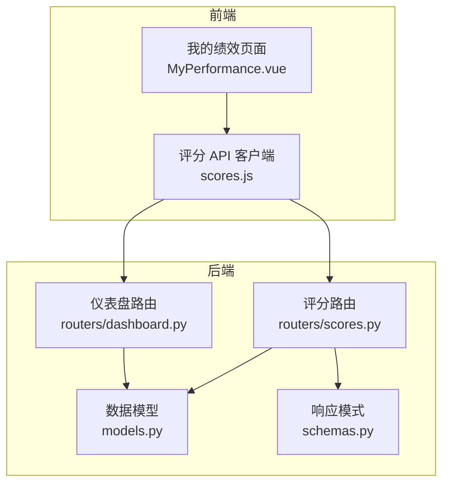
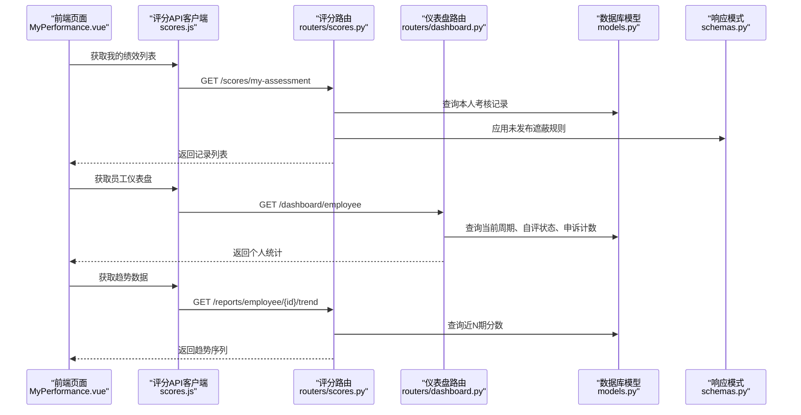
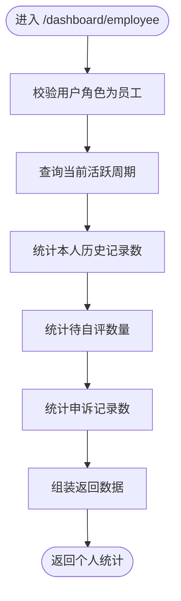
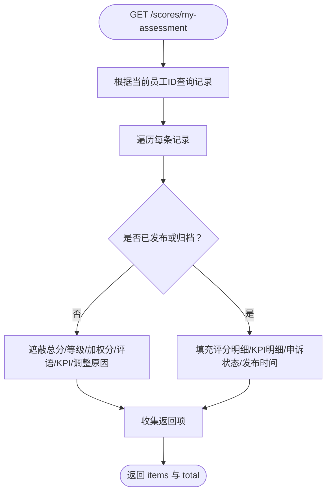
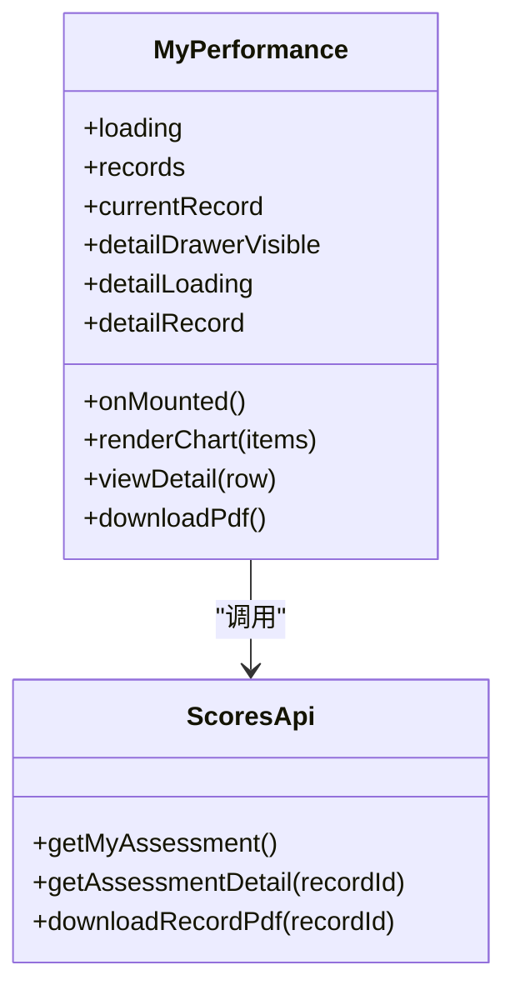
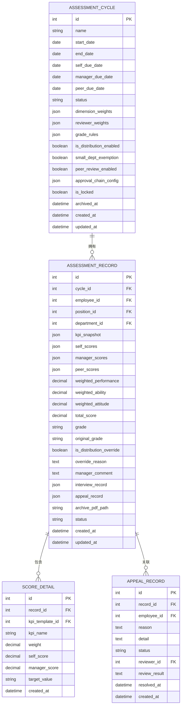
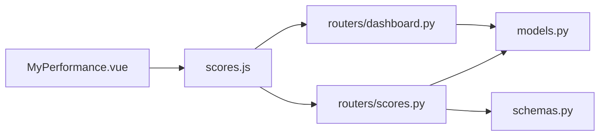

# 个人绩效查看

<cite>
**本文引用的文件**   
- [backend/app/routers/dashboard.py](file://backend/app/routers/dashboard.py)
- [backend/app/routers/scores.py](file://backend/app/routers/scores.py)
- [backend/app/models.py](file://backend/app/models.py)
- [backend/app/schemas.py](file://backend/app/schemas.py)
- [frontend/src/views/my-performance/MyPerformance.vue](file://frontend/src/views/my-performance/MyPerformance.vue)
- [frontend/src/api/scores.js](file://frontend/src/api/scores.js)
- [docs/PRD_绩效考核评分系统_v1.0.md](file://docs/PRD_绩效考核评分系统_v1.0.md)
- [docs/TECH_绩效考核评分系统_v1.0.md](file://docs/TECH_绩效考核评分系统_v1.0.md)
</cite>

## 目录
1. [引言](#引言)
2. [项目结构](#项目结构)
3. [核心组件](#核心组件)
4. [架构总览](#架构总览)
5. [详细组件分析](#详细组件分析)
6. [依赖关系分析](#依赖关系分析)
7. [性能考虑](#性能考虑)
8. [故障排查指南](#故障排查指南)
9. [结论](#结论)
10. [附录：API 使用示例](#附录api-使用示例)

## 引言
本章节面向“个人绩效查看”功能，说明员工如何查看自己的绩效考核结果，包括当前考核周期状态、历史评分记录、绩效等级变化趋势等数据展示；解释个人仪表盘的数据聚合逻辑（自评状态跟踪、待办任务提醒、申诉记录统计）；说明个人绩效数据的权限控制机制；提供个人绩效相关 API 的使用示例；并给出前端组件的实现细节与用户体验设计要点。

## 项目结构
围绕“个人绩效查看”，后端主要涉及以下模块：
- 仪表盘聚合接口：按角色返回统计数据与近期周期信息，其中包含普通员工的个人维度统计。
- 我的绩效列表接口：返回当前员工的考核记录，并对未发布数据进行敏感字段遮蔽。
- 模型与模式定义：描述考核周期、考核记录、申诉记录、KPI 明细等数据结构及输出约束。
- 前端页面：展示当前状态、历史趋势图、历史记录列表与详情抽屉，并提供 PDF 下载入口。

**图表来源**
- [frontend/src/views/my-performance/MyPerformance.vue:1-220](file://frontend/src/views/my-performance/MyPerformance.vue#L1-L220)
- [frontend/src/api/scores.js:60-76](file://frontend/src/api/scores.js#L60-L76)
- [backend/app/routers/scores.py:636-737](file://backend/app/routers/scores.py#L636-L737)
- [backend/app/routers/dashboard.py:351-401](file://backend/app/routers/dashboard.py#L351-L401)
- [backend/app/models.py:62-130](file://backend/app/models.py#L62-L130)
- [backend/app/schemas.py:364-385](file://backend/app/schemas.py#L364-L385)

**章节来源**
- [backend/app/routers/dashboard.py:15-136](file://backend/app/routers/dashboard.py#L15-L136)
- [backend/app/routers/scores.py:636-737](file://backend/app/routers/scores.py#L636-L737)
- [backend/app/models.py:62-130](file://backend/app/models.py#L62-L130)
- [backend/app/schemas.py:364-385](file://backend/app/schemas.py#L364-L385)
- [frontend/src/views/my-performance/MyPerformance.vue:1-220](file://frontend/src/views/my-performance/MyPerformance.vue#L1-L220)
- [frontend/src/api/scores.js:60-76](file://frontend/src/api/scores.js#L60-L76)

## 核心组件
- 员工个人仪表盘聚合接口：返回当前进行中的考核周期、自评状态、历史总数、待自评数量与申诉计数。
- 我的绩效列表接口：返回本人所有考核记录，并按是否已发布对总分、等级、维度加权分等进行遮蔽。
- 个人绩效前端页面：展示当前状态卡片、强制分布调整提示、历史趋势折线图、历史记录表格与详情抽屉。
- 数据模型与模式：定义考核周期、考核记录、申诉记录、KPI 明细等实体，以及未发布结果的字段遮蔽规则。

**章节来源**
- [backend/app/routers/dashboard.py:351-401](file://backend/app/routers/dashboard.py#L351-L401)
- [backend/app/routers/scores.py:636-737](file://backend/app/routers/scores.py#L636-L737)
- [frontend/src/views/my-performance/MyPerformance.vue:1-220](file://frontend/src/views/my-performance/MyPerformance.vue#L1-L220)
- [backend/app/models.py:62-130](file://backend/app/models.py#L62-L130)
- [backend/app/schemas.py:364-385](file://backend/app/schemas.py#L364-L385)

## 架构总览
下图展示了从前端到后端的调用链路，以及关键数据在模型与模式层的流转。

**图表来源**
- [frontend/src/views/my-performance/MyPerformance.vue:261-289](file://frontend/src/views/my-performance/MyPerformance.vue#L261-L289)
- [frontend/src/api/scores.js:60-76](file://frontend/src/api/scores.js#L60-L76)
- [backend/app/routers/scores.py:636-737](file://backend/app/routers/scores.py#L636-L737)
- [backend/app/routers/dashboard.py:351-401](file://backend/app/routers/dashboard.py#L351-L401)
- [backend/app/models.py:62-130](file://backend/app/models.py#L62-L130)
- [backend/app/schemas.py:364-385](file://backend/app/schemas.py#L364-L385)

## 详细组件分析

### 员工个人仪表盘聚合接口
该接口为普通员工提供个人维度的聚合数据，包括：
- 当前进行中的考核周期与状态
- 自评状态（如 pending_self）
- 历史考核记录总数
- 待自评数量
- 申诉记录数量

**图表来源**
- [backend/app/routers/dashboard.py:351-401](file://backend/app/routers/dashboard.py#L351-L401)

**章节来源**
- [backend/app/routers/dashboard.py:351-401](file://backend/app/routers/dashboard.py#L351-L401)

### 我的绩效列表接口
该接口返回当前员工的考核记录列表，并按是否已发布进行敏感字段遮蔽：
- 若记录未发布（非 published/archived），则不返回总分、等级、维度加权分、上级评语、KPI 明细、强制调整原因等信息。
- 若记录已发布或归档，则返回完整评分明细、KPI 明细、申诉状态等。

**图表来源**
- [backend/app/routers/scores.py:636-737](file://backend/app/routers/scores.py#L636-L737)
- [backend/app/schemas.py:364-385](file://backend/app/schemas.py#L364-L385)

**章节来源**
- [backend/app/routers/scores.py:636-737](file://backend/app/routers/scores.py#L636-L737)
- [backend/app/schemas.py:364-385](file://backend/app/schemas.py#L364-L385)

### 前端“我的绩效”页面
该页面负责：
- 加载我的绩效列表与当前记录
- 渲染当前考核状态卡片（含进度条与步骤指示）
- 渲染历史趋势折线图（支持近 4 期/近 8 期切换）
- 渲染历史记录表格（仅已发布/归档可查看详情）
- 打开详情抽屉展示三维评分对比、KPI 明细、上级评语、申诉记录、面谈记录
- 触发 PDF 档案下载

**图表来源**
- [frontend/src/views/my-performance/MyPerformance.vue:202-443](file://frontend/src/views/my-performance/MyPerformance.vue#L202-L443)
- [frontend/src/api/scores.js:60-76](file://frontend/src/api/scores.js#L60-L76)

**章节来源**
- [frontend/src/views/my-performance/MyPerformance.vue:1-220](file://frontend/src/views/my-performance/MyPerformance.vue#L1-L220)
- [frontend/src/views/my-performance/MyPerformance.vue:261-443](file://frontend/src/views/my-performance/MyPerformance.vue#L261-L443)
- [frontend/src/api/scores.js:60-76](file://frontend/src/api/scores.js#L60-L76)

### 数据模型与模式
- 考核周期：包含起止时间、截止时间、权重配置、等级规则、协作评开关、审批链配置、锁定与归档时间等。
- 考核记录：包含各维度评分、加权分、总分、等级、强制调整标记与原因、上级评语、面试与申诉记录、PDF 路径、状态与时间戳。
- 申诉记录：包含申诉原因、详情、处理状态、复核结果、处理人与时间。
- KPI 明细：指标名称、权重、目标值、自评与上级评分。
- 响应模式：对未发布的考核记录自动遮蔽总分与等级。

**图表来源**
- [backend/app/models.py:62-130](file://backend/app/models.py#L62-L130)
- [backend/app/models.py:133-143](file://backend/app/models.py#L133-L143)
- [backend/app/models.py:198-209](file://backend/app/models.py#L198-L209)
- [backend/app/schemas.py:364-385](file://backend/app/schemas.py#L364-L385)

**章节来源**
- [backend/app/models.py:62-130](file://backend/app/models.py#L62-L130)
- [backend/app/models.py:133-143](file://backend/app/models.py#L133-L143)
- [backend/app/models.py:198-209](file://backend/app/models.py#L198-L209)
- [backend/app/schemas.py:364-385](file://backend/app/schemas.py#L364-L385)

## 依赖关系分析
- 前端“我的绩效”页面依赖评分 API 客户端，用于获取我的绩效列表、详情与 PDF 下载。
- 评分路由依赖数据库模型（考核周期、考核记录、申诉记录、KPI 明细等）。
- 仪表盘路由依赖数据库模型（考核周期、员工、申诉记录等）。
- 响应模式层对未发布记录的总分与等级进行遮蔽，确保前端不会误显敏感数据。

**图表来源**
- [frontend/src/views/my-performance/MyPerformance.vue:202-443](file://frontend/src/views/my-performance/MyPerformance.vue#L202-L443)
- [frontend/src/api/scores.js:60-76](file://frontend/src/api/scores.js#L60-L76)
- [backend/app/routers/scores.py:636-737](file://backend/app/routers/scores.py#L636-L737)
- [backend/app/routers/dashboard.py:351-401](file://backend/app/routers/dashboard.py#L351-L401)
- [backend/app/models.py:62-130](file://backend/app/models.py#L62-L130)
- [backend/app/schemas.py:364-385](file://backend/app/schemas.py#L364-L385)

**章节来源**
- [frontend/src/views/my-performance/MyPerformance.vue:202-443](file://frontend/src/views/my-performance/MyPerformance.vue#L202-L443)
- [frontend/src/api/scores.js:60-76](file://frontend/src/api/scores.js#L60-L76)
- [backend/app/routers/scores.py:636-737](file://backend/app/routers/scores.py#L636-L737)
- [backend/app/routers/dashboard.py:351-401](file://backend/app/routers/dashboard.py#L351-L401)
- [backend/app/models.py:62-130](file://backend/app/models.py#L62-L130)
- [backend/app/schemas.py:364-385](file://backend/app/schemas.py#L364-L385)

## 性能考虑
- 列表与趋势数据分页与限制：前端趋势图支持近 4 期/近 8 期切换，避免一次性拉取过多历史数据。
- 未发布数据遮蔽在后端完成，减少前端计算开销与敏感数据传输。
- 详情抽屉按需加载，仅在点击时请求详情，降低首屏压力。
- PDF 下载采用 Blob 流式下载，避免内存峰值过大。

[本节为通用性能建议，不直接分析具体文件]

## 故障排查指南
- 无法加载我的绩效列表：检查登录态与权限，确认接口返回是否为空数组或错误码。
- 历史趋势图无数据：确认趋势接口参数是否正确，检查后端是否返回有效序列。
- 详情抽屉为空：确认所选记录是否已发布或归档，未发布记录可能不包含详情所需字段。
- PDF 下载失败：检查网络与后端生成服务，确认返回的 Blob 类型正确。

**章节来源**
- [frontend/src/views/my-performance/MyPerformance.vue:261-443](file://frontend/src/views/my-performance/MyPerformance.vue#L261-L443)

## 结论
“个人绩效查看”通过前后端协同，实现了员工对个人考核状态的可视化、历史评分与趋势的分析、以及申诉与面谈信息的透明化。后端通过严格的权限控制与数据遮蔽策略，确保员工只能访问自己的敏感信息；前端以清晰的交互与图表呈现，提升用户体验。整体架构清晰、职责明确，便于扩展与维护。

[本节为总结性内容，不直接分析具体文件]

## 附录：API 使用示例
以下为个人绩效相关接口的调用示例（基于现有实现与文档约定）：

- 获取我的绩效列表
  - 方法：GET
  - 路径：/scores/my-assessment
  - 说明：返回当前员工的考核记录列表，未发布记录将遮蔽总分、等级等敏感字段。
  - 参考：[backend/app/routers/scores.py:636-737](file://backend/app/routers/scores.py#L636-L737)

- 获取考核记录详情
  - 方法：GET
  - 路径：/scores/records/{record_id}/detail
  - 说明：返回指定记录的详细信息，包括三维评分对比、KPI 明细、上级评语、申诉与面谈记录等。
  - 参考：[frontend/src/api/scores.js:64-66](file://frontend/src/api/scores.js#L64-L66)

- 下载个人绩效 PDF 档案
  - 方法：GET
  - 路径：/reports/record/{record_id}/pdf
  - 说明：返回 PDF 二进制流，前端以 Blob 形式下载。
  - 参考：[frontend/src/api/scores.js:68-72](file://frontend/src/api/scores.js#L68-L72)

- 获取员工个人仪表盘统计
  - 方法：GET
  - 路径：/dashboard/employee
  - 说明：返回当前周期、自评状态、历史总数、待自评数量与申诉计数。
  - 参考：[backend/app/routers/dashboard.py:351-401](file://backend/app/routers/dashboard.py#L351-L401)

- 获取员工历史趋势
  - 方法：GET
  - 路径：/reports/employee/{employee_id}/trend
  - 说明：返回近 N 期的总分与各维度加权分序列，用于趋势图展示。
  - 参考：[docs/TECH_绩效考核评分系统_v1.0.md:1033-1041](file://docs/TECH_绩效考核评分系统_v1.0.md#L1033-L1041)

**章节来源**
- [backend/app/routers/scores.py:636-737](file://backend/app/routers/scores.py#L636-L737)
- [frontend/src/api/scores.js:64-72](file://frontend/src/api/scores.js#L64-L72)
- [backend/app/routers/dashboard.py:351-401](file://backend/app/routers/dashboard.py#L351-L401)
- [docs/TECH_绩效考核评分系统_v1.0.md:1033-1041](file://docs/TECH_绩效考核评分系统_v1.0.md#L1033-L1041)