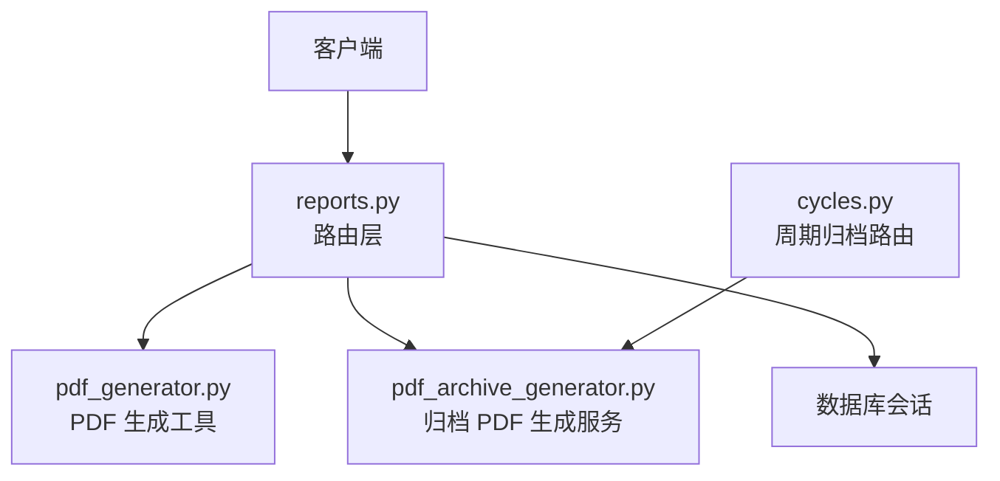
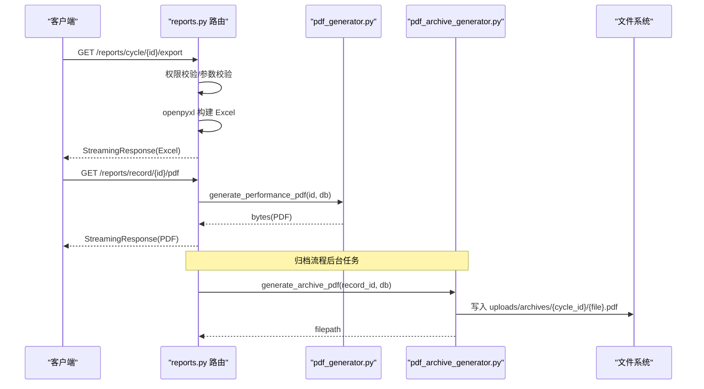
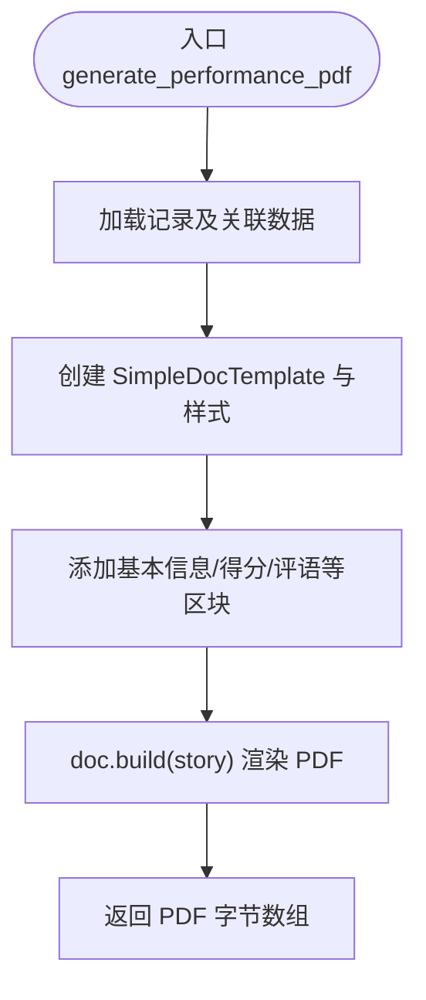
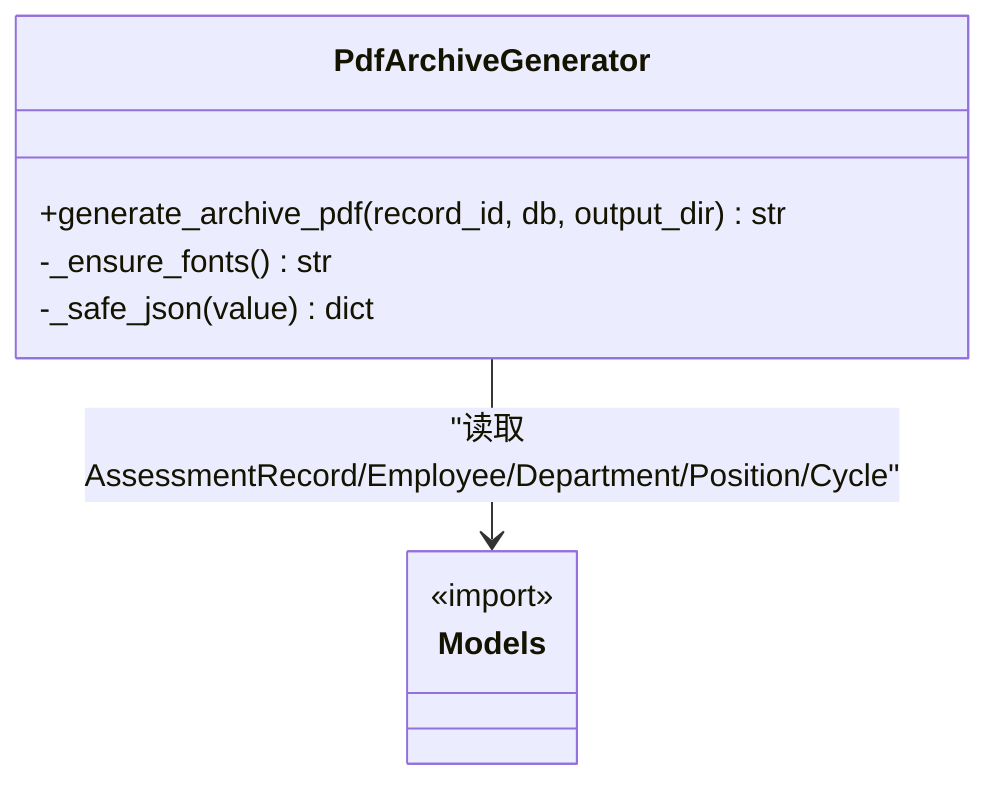
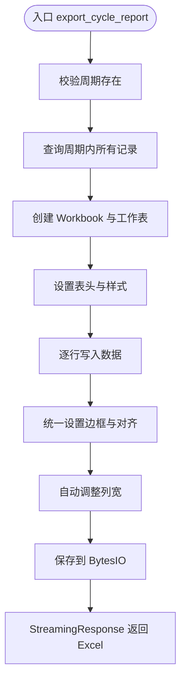
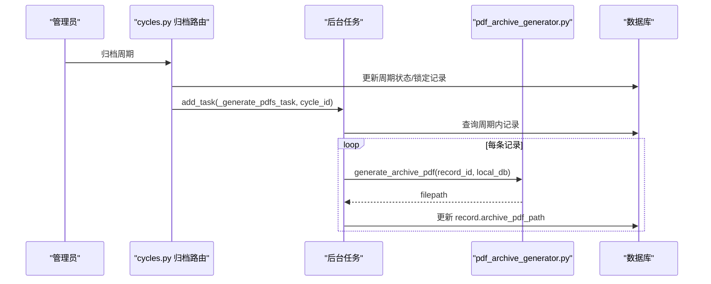
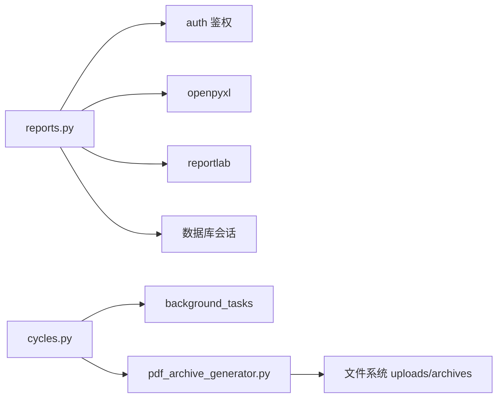

# 报表导出

<cite>
**本文引用的文件**   
- [backend/app/routers/reports.py](file://backend/app/routers/reports.py)
- [backend/app/utils/pdf_generator.py](file://backend/app/utils/pdf_generator.py)
- [backend/app/services/pdf_archive_generator.py](file://backend/app/services/pdf_archive_generator.py)
- [backend/app/routers/cycles.py](file://backend/app/routers/cycles.py)
- [backend/tests/test_excel_export.py](file://backend/tests/test_excel_export.py)
- [docs/TECH_绩效考核评分系统_v1.0.md](file://docs/TECH_绩效考核评分系统_v1.0.md)
</cite>

## 目录
1. [引言](#引言)
2. [项目结构](#项目结构)
3. [核心组件](#核心组件)
4. [架构总览](#架构总览)
5. [详细组件分析](#详细组件分析)
6. [依赖关系分析](#依赖关系分析)
7. [性能与优化](#性能与优化)
8. [故障排查指南](#故障排查指南)
9. [结论](#结论)
10. [附录：接口规范](#附录接口规范)

## 引言
本文件聚焦“报表导出”能力，覆盖以下目标：
- PDF 档案生成服务的技术实现：模板引擎使用、数据填充逻辑、格式化处理、文件存储管理。
- Excel 数据导出方案：数据格式化、批量处理、性能优化。
- 自定义报表模板设计模式：模板语法、变量替换、条件渲染等扩展机制（概念性说明）。
- 报表导出 API 接口文档：PDF 生成、Excel 导出、模板管理等接口规范与示例。
- 性能优化策略：异步处理、缓存机制、批量导出最佳实践。
- 报表文件版本管理与归档策略。

## 项目结构
围绕报表导出的后端代码主要分布在以下位置：
- 路由层：提供 HTTP 接口，负责权限校验、参数校验、调用服务或工具方法。
- 工具与服务层：封装 PDF 生成、Excel 导出、归档流程等具体实现。
- 测试用例：验证导出功能的行为与边界。

**图表来源**
- [backend/app/routers/reports.py:1-307](file://backend/app/routers/reports.py#L1-L307)
- [backend/app/utils/pdf_generator.py:1-101](file://backend/app/utils/pdf_generator.py#L1-L101)
- [backend/app/services/pdf_archive_generator.py:1-302](file://backend/app/services/pdf_archive_generator.py#L1-L302)
- [backend/app/routers/cycles.py:753-793](file://backend/app/routers/cycles.py#L753-L793)

**章节来源**
- [backend/app/routers/reports.py:1-307](file://backend/app/routers/reports.py#L1-L307)
- [backend/app/utils/pdf_generator.py:1-101](file://backend/app/utils/pdf_generator.py#L1-L101)
- [backend/app/services/pdf_archive_generator.py:1-302](file://backend/app/services/pdf_archive_generator.py#L1-L302)
- [backend/app/routers/cycles.py:753-793](file://backend/app/routers/cycles.py#L753-L793)

## 核心组件
- 报表路由模块 reports.py
  - 提供等级分布查询、强制调整清单、员工趋势、Excel 导出、PDF 档案导出等接口。
  - 使用 openpyxl 构建 Excel 工作簿并流式返回；使用 reportlab 通过工具函数生成 PDF 字节流并流式返回。
- PDF 生成工具 pdf_generator.py
  - 基于 reportlab 的 SimpleDocTemplate 构建页面，包含基本信息、考核得分、上级评语等区块。
  - 返回 PDF 字节数组供路由直接流式响应。
- 归档 PDF 生成服务 pdf_archive_generator.py
  - 面向归档场景，输出完整绩效档案 PDF，支持中文字体注册、多页表格、封面、页脚声明等。
  - 将生成的 PDF 写入文件系统（uploads/archives/{cycle_id}），返回文件路径。
- 周期归档路由 cycles.py
  - 在周期归档时触发异步任务，为每条记录生成归档 PDF，并回写 archive_pdf_path。

**章节来源**
- [backend/app/routers/reports.py:17-307](file://backend/app/routers/reports.py#L17-L307)
- [backend/app/utils/pdf_generator.py:12-101](file://backend/app/utils/pdf_generator.py#L12-L101)
- [backend/app/services/pdf_archive_generator.py:18-302](file://backend/app/services/pdf_archive_generator.py#L18-L302)
- [backend/app/routers/cycles.py:753-793](file://backend/app/routers/cycles.py#L753-L793)

## 架构总览
报表导出整体流程如下：
- 客户端发起请求至 /reports 路由。
- 路由进行权限校验与参数校验。
- 根据类型选择 Excel 导出或 PDF 生成：
  - Excel：openpyxl 构建工作簿，设置表头样式、边框、列宽，写入内存缓冲区后以 StreamingResponse 返回。
  - PDF：调用 pdf_generator.generate_performance_pdf 生成字节流，再以 StreamingResponse 返回。
- 归档流程：周期归档时，后台任务遍历记录并调用归档 PDF 生成服务，持久化到 uploads/archives。

**图表来源**
- [backend/app/routers/reports.py:85-172](file://backend/app/routers/reports.py#L85-L172)
- [backend/app/routers/reports.py:280-307](file://backend/app/routers/reports.py#L280-L307)
- [backend/app/utils/pdf_generator.py:12-101](file://backend/app/utils/pdf_generator.py#L12-L101)
- [backend/app/services/pdf_archive_generator.py:50-302](file://backend/app/services/pdf_archive_generator.py#L50-L302)
- [backend/app/routers/cycles.py:765-783](file://backend/app/routers/cycles.py#L765-L783)

## 详细组件分析

### PDF 档案生成服务（pdf_generator.py）
- 职责
  - 根据 AssessmentRecord 及其关联 Employee、Department、Position、AssessmentCycle 数据，构建 PDF 内容。
  - 使用 reportlab 的 SimpleDocTemplate 创建文档，定义标题、段落、表格样式。
  - 返回 PDF 字节数组，供路由直接流式下载。
- 关键实现要点
  - 页面尺寸与边距：A4，四边 2cm。
  - 样式：标题、二级标题、正文样式，表格网格与背景色。
  - 内容区块：基本信息、考核得分、上级评语、页脚声明。
- 复杂度与性能
  - 单次生成时间取决于数据量与表格数量；当前实现为同步生成，适合单条记录导出。
  - 建议对高频访问的记录进行结果缓存（如 Redis），避免重复计算。

**图表来源**
- [backend/app/utils/pdf_generator.py:12-101](file://backend/app/utils/pdf_generator.py#L12-L101)

**章节来源**
- [backend/app/utils/pdf_generator.py:12-101](file://backend/app/utils/pdf_generator.py#L12-L101)

### PDF 归档生成服务（pdf_archive_generator.py）
- 职责
  - 生成完整的绩效考核档案 PDF，包含封面、基本信息、评分详情、加权结果、强制调整记录、面谈记录、申诉记录、上级评语、页脚声明。
  - 自动注册中文字体，确保中文显示正常。
  - 将 PDF 写入文件系统，路径规则：uploads/archives/{cycle_id}/{employee_no}_archive.pdf。
- 关键实现要点
  - 字体注册：尝试多种字体路径，失败则回退 Helvetica。
  - JSON 字段安全解析：self_scores、manager_scores、peer_scores、interview_record、appeal_record 等字段可能为字符串或 dict，统一安全解析。
  - 表格样式：网格线、背景色、对齐方式、字体大小与名称。
  - 分页：PageBreak 用于封面与正文分隔。
- 错误处理
  - 若记录不存在，返回空字符串。
  - 文件系统写入异常需由上层捕获并记录日志。

**图表来源**
- [backend/app/services/pdf_archive_generator.py:18-302](file://backend/app/services/pdf_archive_generator.py#L18-L302)

**章节来源**
- [backend/app/services/pdf_archive_generator.py:18-302](file://backend/app/services/pdf_archive_generator.py#L18-L302)

### Excel 数据导出（reports.py）
- 职责
  - 按考核周期导出全员考核结果 Excel，包含工号、姓名、部门、总分、等级、原始等级、三维度加权分、状态、是否特批等字段。
  - 设置表头样式（颜色、字体、对齐）、单元格边框、自动列宽。
  - 使用 BytesIO 缓冲并在内存中保存 Workbook，随后以 StreamingResponse 返回。
- 关键实现要点
  - 使用 openpyxl.Workbook 创建工作簿与工作表。
  - 表头行应用 Font、PatternFill、Alignment、Border。
  - 遍历记录并逐行写入数据，最后统一设置边框与对齐。
  - 文件名含周期名称，Content-Disposition 使用 UTF-8 编码。
- 性能考量
  - 当前实现将所有记录加载到内存再一次性写入，适用于中小规模数据。
  - 对于大规模数据（如 5000 人），建议使用流式写入（openpyxl 的 write_only 模式）以降低内存峰值。

**图表来源**
- [backend/app/routers/reports.py:85-172](file://backend/app/routers/reports.py#L85-L172)

**章节来源**
- [backend/app/routers/reports.py:85-172](file://backend/app/routers/reports.py#L85-L172)

### 周期归档与异步 PDF 生成（cycles.py）
- 职责
  - 当周期状态变为 archived 时，锁定该周期下所有评估记录。
  - 触发后台任务，为每条记录生成归档 PDF，并将路径回写到记录的 archive_pdf_path。
- 关键实现要点
  - 使用 FastAPI background_tasks.add_task 执行异步任务。
  - 在任务内部创建独立数据库会话，避免主事务阻塞。
  - 单条记录 PDF 生成失败不影响其他记录。

**图表来源**
- [backend/app/routers/cycles.py:753-793](file://backend/app/routers/cycles.py#L753-L793)
- [backend/app/services/pdf_archive_generator.py:50-302](file://backend/app/services/pdf_archive_generator.py#L50-L302)

**章节来源**
- [backend/app/routers/cycles.py:753-793](file://backend/app/routers/cycles.py#L753-L793)

### 自定义报表模板设计模式（概念性说明）
- 模板语法
  - 当前 PDF 生成采用程序化构建（reportlab），未引入外部模板引擎。
  - 可抽象出“模板描述对象”，包含区块定义、样式、占位符映射，便于后续扩展。
- 变量替换
  - 将业务数据映射为键值对，在构建表格与段落时注入对应字段。
- 条件渲染
  - 根据字段是否存在或特定值决定渲染哪些区块（例如面谈记录、申诉记录为空时显示“暂无”）。
- 扩展机制
  - 将样式与布局抽离为配置项，支持不同业务线的模板风格。
  - 引入模板版本控制，保证历史报告一致性。

[本节为概念性说明，不直接分析具体文件]

## 依赖关系分析
- 路由层依赖
  - reports.py 依赖 auth 鉴权、数据库会话、openpyxl、reportlab。
  - cycles.py 依赖 background_tasks、pdf_generator、pdf_archive_generator。
- 工具与服务层依赖
  - pdf_generator.py 依赖 reportlab 与 ORM 模型。
  - pdf_archive_generator.py 依赖 reportlab、ORM 模型、文件系统。
- 外部集成点
  - 文件系统：uploads/archives 目录用于归档 PDF。
  - 数据库：读取 AssessmentRecord、Employee、Department、Position、AssessmentCycle 等实体。

**图表来源**
- [backend/app/routers/reports.py:1-307](file://backend/app/routers/reports.py#L1-L307)
- [backend/app/routers/cycles.py:753-793](file://backend/app/routers/cycles.py#L753-L793)
- [backend/app/services/pdf_archive_generator.py:1-302](file://backend/app/services/pdf_archive_generator.py#L1-L302)

**章节来源**
- [backend/app/routers/reports.py:1-307](file://backend/app/routers/reports.py#L1-L307)
- [backend/app/routers/cycles.py:753-793](file://backend/app/routers/cycles.py#L753-L793)
- [backend/app/services/pdf_archive_generator.py:1-302](file://backend/app/services/pdf_archive_generator.py#L1-L302)

## 性能与优化
- Excel 导出优化
  - 流式导出：当前已使用 StreamingResponse，减少响应体驻留内存。
  - 大数据量优化：建议启用 openpyxl 的 write_only 模式，逐行写入，降低内存峰值。
  - 列宽计算优化：避免全表扫描多次，可在写入过程中维护最大长度。
- PDF 生成优化
  - 缓存热点记录：对频繁导出的记录，缓存 PDF 字节或文件路径，缩短响应时间。
  - 异步生成：归档流程已使用后台任务，避免阻塞主线程。
  - 字体注册优化：字体注册仅一次，避免重复 IO。
- 批量导出最佳实践
  - 分批查询：使用分页或游标查询，避免一次性加载全部记录。
  - 并发控制：限制后台任务并发数，防止资源争用。
  - 监控与告警：对导出耗时、内存占用、文件大小进行监控与阈值告警。

[本节为通用指导，不直接分析具体文件]

## 故障排查指南
- PDF 生成失败
  - 检查记录是否存在；若不存在，工具函数返回空字节。
  - 检查字体注册是否成功；若失败，回退 Helvetica，可能导致中文显示异常。
  - 检查文件系统权限与磁盘空间，确保归档路径可写。
- Excel 导出异常
  - 检查 Content-Type 是否正确；应为 application/vnd.openxmlformats-officedocument.spreadsheetml.sheet。
  - 检查文件名编码；应使用 UTF-8 编码以避免乱码。
  - 大数据量导致内存溢出：考虑启用 write_only 模式与流式写入。
- 归档流程问题
  - 后台任务未执行：检查 background_tasks 配置与进程模型。
  - 单条记录失败影响整体：确认任务中对异常进行捕获与忽略。
  - 路径回写失败：检查数据库会话提交与关闭逻辑。

**章节来源**
- [backend/app/utils/pdf_generator.py:12-101](file://backend/app/utils/pdf_generator.py#L12-L101)
- [backend/app/services/pdf_archive_generator.py:18-302](file://backend/app/services/pdf_archive_generator.py#L18-L302)
- [backend/app/routers/reports.py:85-172](file://backend/app/routers/reports.py#L85-L172)
- [backend/app/routers/cycles.py:765-783](file://backend/app/routers/cycles.py#L765-L783)

## 结论
- 报表导出功能已具备基础能力：Excel 导出与 PDF 档案生成。
- PDF 生成分为两种路径：即时生成（工具函数）与归档生成（服务函数），分别满足在线下载与归档存储需求。
- 归档流程采用异步任务，提升用户体验与系统稳定性。
- 建议在大数据量场景下进一步优化 Excel 导出性能，并引入模板抽象与缓存机制以提升可扩展性与响应速度。

[本节为总结性内容，不直接分析具体文件]

## 附录：接口规范

### 报表分析接口
- 等级分布
  - 方法：GET
  - 路径：/reports/cycle/{cycle_id}/distribution
  - 权限：admin/hr/manager
  - 说明：返回周期内等级分布统计，含部门维度统计。
- 强制调整清单
  - 方法：GET
  - 路径：/reports/cycle/{cycle_id}/distribution-adjustments
  - 权限：admin/hr
  - 说明：返回强制调整人员清单。
- 历史趋势
  - 方法：GET
  - 路径：/reports/employee/{employee_id}/trend
  - 权限：本人/上级/hr
  - 说明：返回员工近 N 个周期的绩效趋势。

**章节来源**
- [docs/TECH_绩效考核评分系统_v1.0.md:1033-1041](file://docs/TECH_绩效考核评分系统_v1.0.md#L1033-L1041)

### Excel 导出接口
- 导出 Excel
  - 方法：GET
  - 路径：/reports/cycle/{cycle_id}/export
  - 权限：admin/hr/executive
  - 说明：导出周期内全员考核结果 Excel，包含工号、姓名、部门、总分、等级、原始等级、三维度加权分、状态、是否特批等字段。
  - 响应：application/vnd.openxmlformats-officedocument.spreadsheetml.sheet
  - 示例：前端调用 GET /api/v1/assessment-cycles/{id}/export-excel，期望 200 且 content-type 正确。

**章节来源**
- [backend/app/routers/reports.py:85-172](file://backend/app/routers/reports.py#L85-L172)
- [backend/tests/test_excel_export.py:103-183](file://backend/tests/test_excel_export.py#L103-L183)

### PDF 档案生成接口
- 生成 PDF 档案
  - 方法：GET
  - 路径：/reports/record/{record_id}/pdf
  - 权限：本人/上级/hr/admin/executive
  - 说明：根据记录生成 PDF 档案并流式返回。
  - 响应：application/pdf
  - 示例：前端调用 GET /reports/record/{id}/pdf，期望 200 且 content-type 为 application/pdf。

**章节来源**
- [backend/app/routers/reports.py:280-307](file://backend/app/routers/reports.py#L280-L307)
- [docs/TECH_绩效考核评分系统_v1.0.md:1033-1041](file://docs/TECH_绩效考核评分系统_v1.0.md#L1033-L1041)

### 模板管理接口（概念性）
- 模板列表
  - 方法：GET
  - 路径：/kpi-templates
  - 权限：admin
  - 说明：获取 KPI 模板列表。
- 新增模板
  - 方法：POST
  - 路径：/kpi-templates
  - 权限：admin
  - 说明：新增 KPI 模板，需校验权重和与唯一性。
- 修改模板
  - 方法：PUT
  - 路径：/kpi-templates/{id}
  - 权限：admin
  - 说明：修改模板，需处理关联约束。
- 删除模板
  - 方法：DELETE
  - 路径：/kpi-templates/{id}
  - 权限：admin
  - 说明：删除模板，需处理关联约束。

**章节来源**
- [docs/TECH_绩效考核评分系统_v1.0.md:1148-1155](file://docs/TECH_绩效考核评分系统_v1.0.md#L1148-L1155)