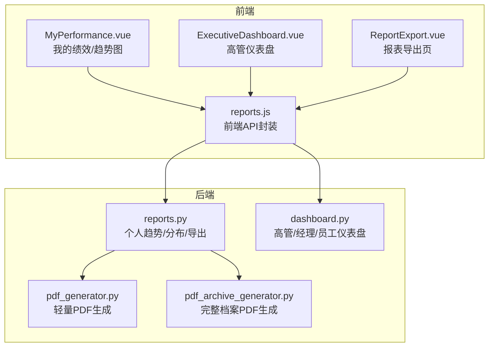
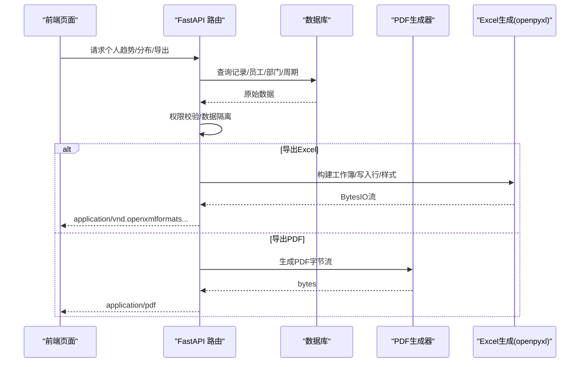
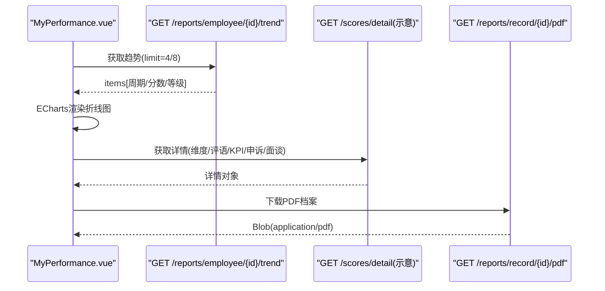
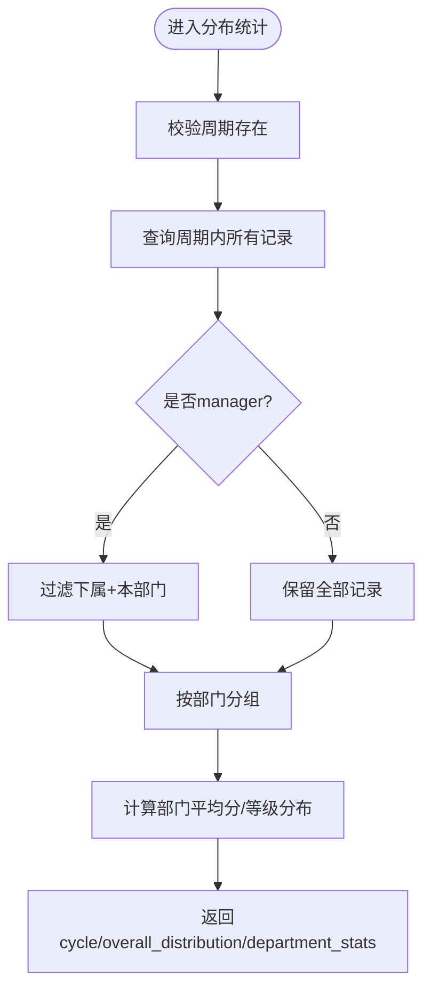
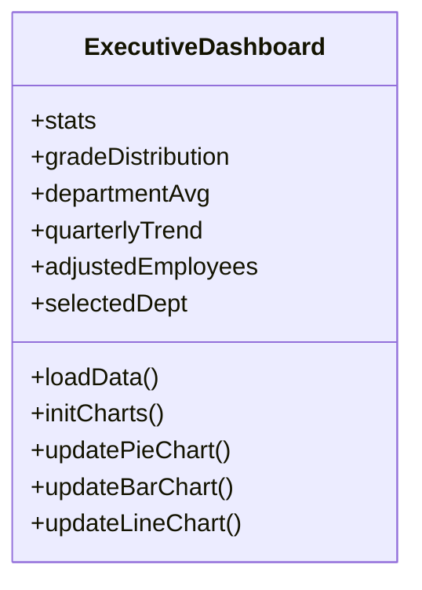
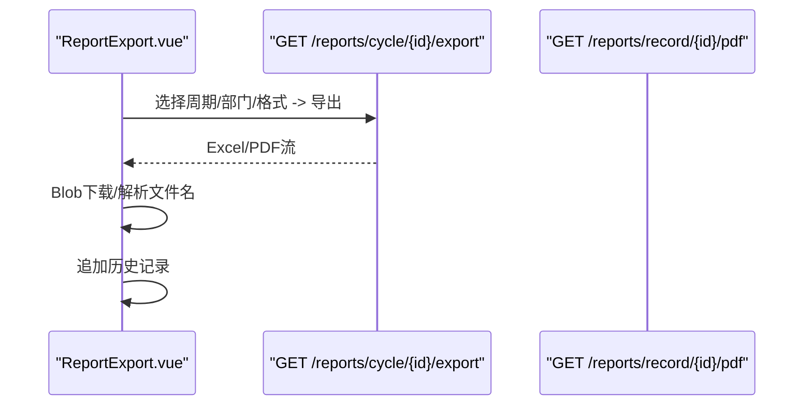
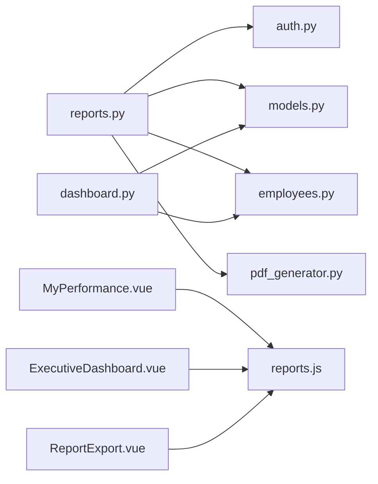

# 数据分析与报表

<cite>
**本文引用的文件**   
- [reports.py](file://backend/app/routers/reports.py)
- [dashboard.py](file://backend/app/routers/dashboard.py)
- [pdf_generator.py](file://backend/app/utils/pdf_generator.py)
- [pdf_archive_generator.py](file://backend/app/services/pdf_archive_generator.py)
- [MyPerformance.vue](file://frontend/src/views/my-performance/MyPerformance.vue)
- [ExecutiveDashboard.vue](file://frontend/src/views/dashboard/ExecutiveDashboard.vue)
- [ReportExport.vue](file://frontend/src/views/reports/ReportExport.vue)
- [reports.js](file://frontend/src/api/reports.js)
</cite>

## 目录
1. [引言](#引言)
2. [项目结构](#项目结构)
3. [核心组件](#核心组件)
4. [架构总览](#架构总览)
5. [详细组件分析](#详细组件分析)
6. [依赖关系分析](#依赖关系分析)
7. [性能与扩展建议](#性能与扩展建议)
8. [故障排查指南](#故障排查指南)
9. [结论](#结论)
10. [附录：接口与使用示例](#附录接口与使用示例)

## 引言
本模块聚焦“数据分析与报表”，覆盖以下能力：
- 个人绩效查看：评分详情、历史趋势、等级变化。
- 部门统计分析：平均分、等级分布、对比分析。
- 高管仪表盘：全局概览、关键指标监控、异常预警（强制调整）。
- 报表导出：PDF 档案生成、Excel 数据导出、前端交互与下载。
- 数据可视化：图表展示、交互式分析、数据钻取（部门筛选、周期切换等）。
- API 文档与使用示例：面向前后端联调与二次开发。

## 项目结构
后端以 FastAPI 路由组织数据聚合与导出能力，前端以 Vue 页面承载可视化与交互。

**图示来源**
- [reports.py:17-306](file://backend/app/routers/reports.py#L17-L306)
- [dashboard.py:15-402](file://backend/app/routers/dashboard.py#L15-L402)
- [pdf_generator.py:12-101](file://backend/app/utils/pdf_generator.py#L12-L101)
- [pdf_archive_generator.py:50-302](file://backend/app/services/pdf_archive_generator.py#L50-L302)
- [MyPerformance.vue:202-314](file://frontend/src/views/my-performance/MyPerformance.vue#L202-L314)
- [ExecutiveDashboard.vue:177-299](file://frontend/src/views/dashboard/ExecutiveDashboard.vue#L177-L299)
- [ReportExport.vue:132-216](file://frontend/src/views/reports/ReportExport.vue#L132-L216)
- [reports.js:4-42](file://frontend/src/api/reports.js#L4-L42)

**章节来源**
- [reports.py:17-306](file://backend/app/routers/reports.py#L17-L306)
- [dashboard.py:15-402](file://backend/app/routers/dashboard.py#L15-L402)
- [MyPerformance.vue:202-314](file://frontend/src/views/my-performance/MyPerformance.vue#L202-L314)
- [ExecutiveDashboard.vue:177-299](file://frontend/src/views/dashboard/ExecutiveDashboard.vue#L177-L299)
- [ReportExport.vue:132-216](file://frontend/src/views/reports/ReportExport.vue#L132-L216)
- [reports.js:4-42](file://frontend/src/api/reports.js#L4-L42)

## 核心组件
- 个人绩效查看
  - 后端提供员工历史趋势接口，支持权限隔离与已发布结果过滤。
  - 前端渲染 ECharts 折线图，支持近 4/8 期切换。
- 部门统计分析
  - 后端按部门统计平均分、等级分布，支持 manager 数据隔离。
- 高管仪表盘
  - 后端聚合全公司覆盖率、平均分、等级分布、部门对比、季度趋势、强制调整名单。
  - 前端用饼图、柱状图、折线图呈现，并支持部门筛选。
- 报表导出
  - Excel：基于 openpyxl 流式返回。
  - PDF：轻量版与完整档案版两种生成器。
  - 前端统一导出入口，支持进度条与历史记录。

**章节来源**
- [reports.py:214-277](file://backend/app/routers/reports.py#L214-L277)
- [reports.py:17-82](file://backend/app/routers/reports.py#L17-L82)
- [dashboard.py:139-241](file://backend/app/routers/dashboard.py#L139-L241)
- [pdf_generator.py:12-101](file://backend/app/utils/pdf_generator.py#L12-L101)
- [pdf_archive_generator.py:50-302](file://backend/app/services/pdf_archive_generator.py#L50-L302)
- [MyPerformance.vue:261-314](file://frontend/src/views/my-performance/MyPerformance.vue#L261-L314)
- [ExecutiveDashboard.vue:177-299](file://frontend/src/views/dashboard/ExecutiveDashboard.vue#L177-L299)
- [ReportExport.vue:132-216](file://frontend/src/views/reports/ReportExport.vue#L132-L216)

## 架构总览
系统采用前后端分离：前端通过 Axios/FastAPI Request 调用后端 REST 接口；后端在路由层完成权限校验、数据聚合与导出；PDF/Excel 由工具类或服务类生成并以流式响应返回。

**图示来源**
- [reports.py:85-172](file://backend/app/routers/reports.py#L85-L172)
- [reports.py:280-306](file://backend/app/routers/reports.py#L280-L306)
- [pdf_generator.py:12-101](file://backend/app/utils/pdf_generator.py#L12-L101)

## 详细组件分析

### 个人绩效查看
- 功能要点
  - 历史趋势：按员工维度拉取多周期总分与三维加权分，前端以折线图展示。
  - 权限控制：peer 禁止访问；employee 仅能看本人且仅 published/archived；manager 可看下属及本部门。
  - 详情抽屉：展示三维评分对比、KPI明细、上级评语、申诉与面谈记录，并提供 PDF 下载。
- 关键流程
  - 前端加载当前考核状态与历史列表，调用趋势接口绘制图表。
  - 点击详情后加载单条记录详情，支持下载 PDF 档案。

**图示来源**
- [MyPerformance.vue:261-314](file://frontend/src/views/my-performance/MyPerformance.vue#L261-L314)
- [MyPerformance.vue:391-428](file://frontend/src/views/my-performance/MyPerformance.vue#L391-L428)
- [reports.py:214-277](file://backend/app/routers/reports.py#L214-L277)
- [reports.py:280-306](file://backend/app/routers/reports.py#L280-L306)

**章节来源**
- [reports.py:214-277](file://backend/app/routers/reports.py#L214-L277)
- [reports.py:280-306](file://backend/app/routers/reports.py#L280-L306)
- [MyPerformance.vue:202-314](file://frontend/src/views/my-performance/MyPerformance.vue#L202-L314)
- [MyPerformance.vue:391-428](file://frontend/src/views/my-performance/MyPerformance.vue#L391-L428)

### 部门统计分析
- 功能要点
  - 按部门统计：人数、等级分布、平均分。
  - 数据隔离：manager 仅可见下属与本部门范围。
  - 整体分布：返回全量等级计数。
- 处理逻辑
  - 遍历记录，按 department_id 分组累计 grades 与 scores，计算 avg_score。
  - 对 manager 角色进行子部门链与部门树过滤。

**图示来源**
- [reports.py:17-82](file://backend/app/routers/reports.py#L17-L82)

**章节来源**
- [reports.py:17-82](file://backend/app/routers/reports.py#L17-L82)

### 高管仪表盘
- 功能要点
  - 统计卡片：员工总数、覆盖率、公司平均总分、待审批数。
  - 图表数据：等级分布饼图、部门平均分对比、近 4 季度趋势。
  - 异常预警：强制调整人员列表（含原因）。
- 前端交互
  - 部门筛选联动柱状图更新。
  - 三图初始化与数据监听自动刷新。

**图示来源**
- [ExecutiveDashboard.vue:177-299](file://frontend/src/views/dashboard/ExecutiveDashboard.vue#L177-L299)

**章节来源**
- [dashboard.py:139-241](file://backend/app/routers/dashboard.py#L139-L241)
- [ExecutiveDashboard.vue:177-299](file://frontend/src/views/dashboard/ExecutiveDashboard.vue#L177-L299)

### 报表导出
- Excel 导出
  - 后端使用 openpyxl 构建工作簿，设置表头、边框、对齐、列宽，流式返回二进制流。
  - 前端通过 axios 接收 blob 并触发下载，解析 Content-Disposition 文件名。
- PDF 导出
  - 轻量版：用于单个记录的快速归档。
  - 完整版：包含封面、基本信息、评分详情、加权结果、强制调整、面谈、申诉、评语等完整档案。
- 前端统一入口
  - 选择周期、部门、格式，显示进度条，成功后加入本地历史记录并可重新下载。

**图示来源**
- [reports.py:85-172](file://backend/app/routers/reports.py#L85-L172)
- [reports.py:280-306](file://backend/app/routers/reports.py#L280-L306)
- [ReportExport.vue:132-216](file://frontend/src/views/reports/ReportExport.vue#L132-L216)

**章节来源**
- [reports.py:85-172](file://backend/app/routers/reports.py#L85-L172)
- [reports.py:280-306](file://backend/app/routers/reports.py#L280-L306)
- [pdf_generator.py:12-101](file://backend/app/utils/pdf_generator.py#L12-L101)
- [pdf_archive_generator.py:50-302](file://backend/app/services/pdf_archive_generator.py#L50-L302)
- [ReportExport.vue:132-216](file://frontend/src/views/reports/ReportExport.vue#L132-L216)

## 依赖关系分析
- 路由依赖
  - reports.py 依赖 auth、models、employees（数据隔离）、pdf_generator/openpyxl。
  - dashboard.py 依赖 models、employees（部门树）。
- 前端依赖
  - MyPerformance.vue 依赖 echarts、reports.js、scores.js。
  - ExecutiveDashboard.vue 依赖 echarts、departments.js。
  - ReportExport.vue 依赖 reports.js、axios。

**图示来源**
- [reports.py:1-14](file://backend/app/routers/reports.py#L1-L14)
- [dashboard.py:1-12](file://backend/app/routers/dashboard.py#L1-L12)
- [reports.js:1-42](file://frontend/src/api/reports.js#L1-L42)

**章节来源**
- [reports.py:1-14](file://backend/app/routers/reports.py#L1-L14)
- [dashboard.py:1-12](file://backend/app/routers/dashboard.py#L1-L12)
- [reports.js:1-42](file://frontend/src/api/reports.js#L1-L42)

## 性能与扩展建议
- 大数据量优化
  - 趋势接口 limit 参数限制返回数量，避免大结果集。
  - 部门统计建议在数据库层聚合（GROUP BY），减少 Python 侧循环。
- 并发与缓存
  - 高管仪表盘高频读取，可对覆盖率、平均分、分布做短期缓存。
- 导出性能
  - Excel 流式写入，避免内存峰值；PDF 生成考虑异步任务队列。
- 可扩展性
  - 自定义报表模板：将 PDF/Excel 模板抽离为配置或模板引擎驱动。
  - 可视化增强：增加钻取（从公司到部门再到个人）与多维筛选。

[本节为通用建议，不直接分析具体文件]

## 故障排查指南
- 权限问题
  - peer 访问个人趋势将被拒绝；employee 只能查看本人且仅已发布/归档记录；manager 需满足下属或部门关系。
- 数据缺失
  - 若员工无记录或周期不存在，接口返回相应错误码与提示。
- PDF 生成失败
  - 检查中文字体注册路径与 reportlab 环境；确认记录存在且有必要字段。
- Excel 导出异常
  - 检查 openpyxl 版本与依赖；确保字段非空时类型转换正确。

**章节来源**
- [reports.py:214-277](file://backend/app/routers/reports.py#L214-L277)
- [reports.py:280-306](file://backend/app/routers/reports.py#L280-L306)
- [pdf_archive_generator.py:18-32](file://backend/app/services/pdf_archive_generator.py#L18-L32)

## 结论
本模块围绕“个人—部门—公司”三层视角，提供了从数据聚合、可视化到导出的完整闭环。后端以清晰的权限与数据隔离保障数据安全，前端以 ECharts 实现丰富的交互体验。后续可在模板化、缓存与异步导出方面进一步演进，提升可维护性与性能。

[本节为总结性内容，不直接分析具体文件]

## 附录：接口与使用示例

### 个人绩效趋势
- 接口
  - GET `/reports/employee/{employee_id}/trend?limit=8`
  - 说明：返回该员工的历史记录项，包含周期信息、各维度加权分、总分、等级、状态等。
- 前端调用
  - 使用 `getEmployeeTrend(employeeId, params)` 获取数据并渲染折线图。

**章节来源**
- [reports.py:214-277](file://backend/app/routers/reports.py#L214-L277)
- [reports.js:40-42](file://frontend/src/api/reports.js#L40-L42)
- [MyPerformance.vue:261-314](file://frontend/src/views/my-performance/MyPerformance.vue#L261-L314)

### 部门分布统计
- 接口
  - GET `/reports/cycle/{cycle_id}/distribution`
  - 说明：返回周期名称、总记录数、整体等级分布、各部门统计（人数、等级分布、平均分）。
- 权限
  - admin/hr/manager 可访问；manager 受数据隔离约束。

**章节来源**
- [reports.py:17-82](file://backend/app/routers/reports.py#L17-L82)

### 强制分布调整明细
- 接口
  - GET `/reports/cycle/{cycle_id}/distribution-adjustments`
  - 说明：返回被强制调整的人员明细（原始等级、调整后等级、原因等）。

**章节来源**
- [reports.py:175-211](file://backend/app/routers/reports.py#L175-L211)

### 周期报告导出（Excel）
- 接口
  - GET `/reports/cycle/{cycle_id}/export`
  - 说明：返回 Excel 二进制流，包含工号、姓名、部门、总分、等级、原始等级、三维加权分、状态、是否特批等列。
- 前端调用
  - 使用 `exportCycleReportExcel(cycleId, departmentIds)` 下载。

**章节来源**
- [reports.py:85-172](file://backend/app/routers/reports.py#L85-L172)
- [reports.js:12-24](file://frontend/src/api/reports.js#L12-L24)
- [ReportExport.vue:150-189](file://frontend/src/views/reports/ReportExport.vue#L150-L189)

### 个人档案导出（PDF）
- 接口
  - GET `/reports/record/{record_id}/pdf`
  - 说明：返回 PDF 二进制流，内容为轻量版绩效考核档案。
- 前端调用
  - 在“我的绩效”详情页点击下载按钮触发。

**章节来源**
- [reports.py:280-306](file://backend/app/routers/reports.py#L280-L306)
- [pdf_generator.py:12-101](file://backend/app/utils/pdf_generator.py#L12-L101)
- [MyPerformance.vue:411-428](file://frontend/src/views/my-performance/MyPerformance.vue#L411-L428)

### 高管仪表盘数据
- 接口
  - GET `/dashboard/executive`
  - 说明：返回 stats、grade_distribution、department_avg、quarterly_trend、adjusted_employees。
- 前端调用
  - 使用 request.get('/dashboard/executive') 获取数据并渲染图表。

**章节来源**
- [dashboard.py:139-241](file://backend/app/routers/dashboard.py#L139-L241)
- [ExecutiveDashboard.vue:177-299](file://frontend/src/views/dashboard/ExecutiveDashboard.vue#L177-L299)

### 报表导出页（前端）
- 功能
  - 选择周期、部门、格式（Excel/PDF），显示进度条，成功后加入本地历史记录并可重新下载。
- 关键逻辑
  - 根据 format 调用不同导出接口，Blob 下载并解析文件名。

**章节来源**
- [ReportExport.vue:132-216](file://frontend/src/views/reports/ReportExport.vue#L132-L216)
- [reports.js:4-38](file://frontend/src/api/reports.js#L4-L38)