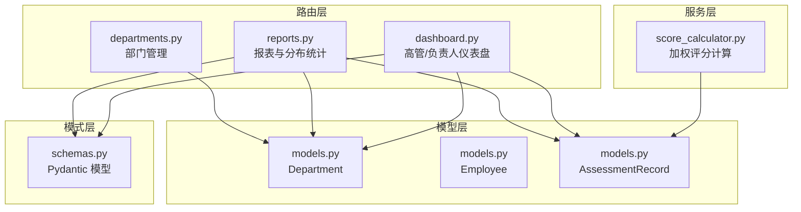
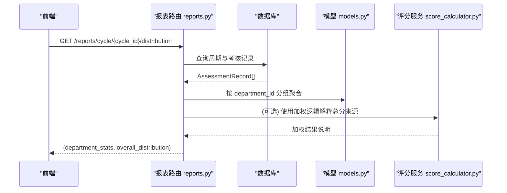
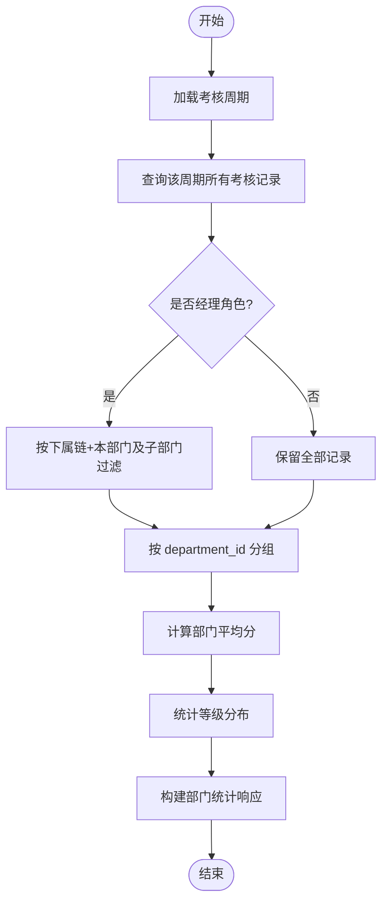
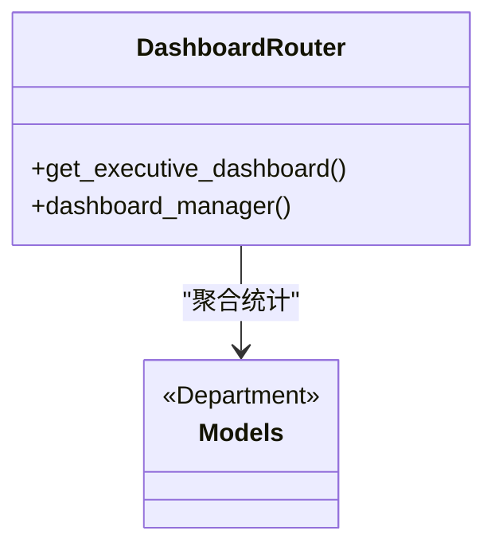
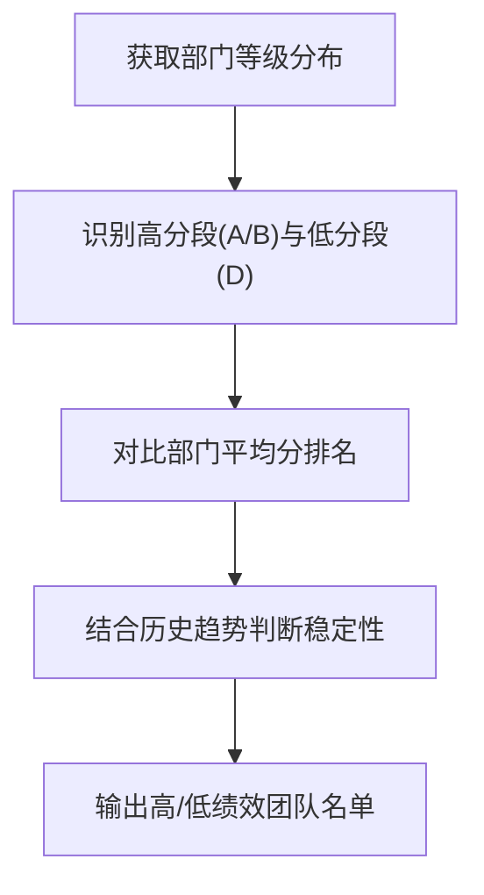
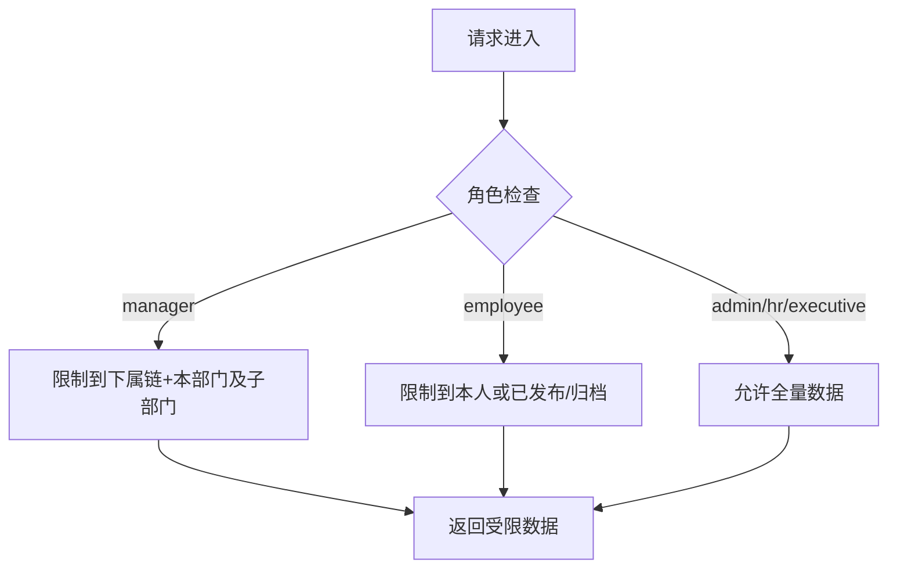
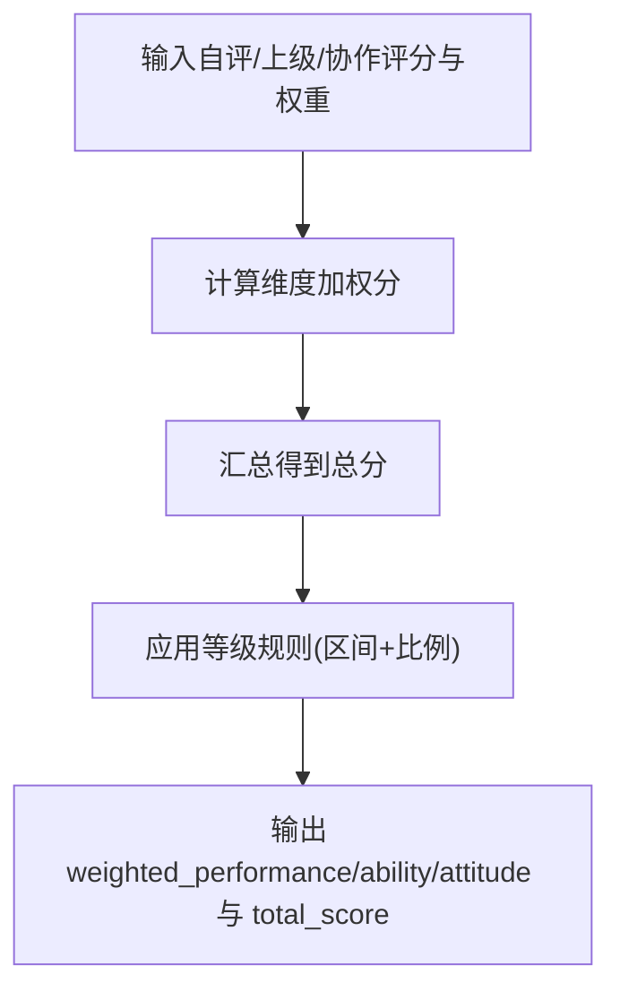
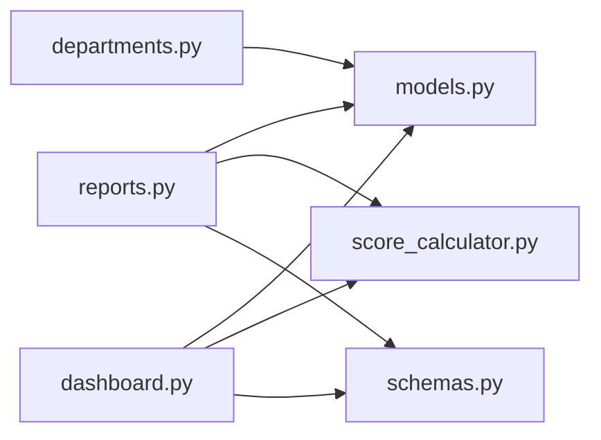

# 部门统计分析

<cite>
**本文引用的文件**   
- [backend/app/routers/departments.py](file://backend/app/routers/departments.py)
- [backend/app/routers/reports.py](file://backend/app/routers/reports.py)
- [backend/app/routers/dashboard.py](file://backend/app/routers/dashboard.py)
- [backend/app/models.py](file://backend/app/models.py)
- [backend/app/schemas.py](file://backend/app/schemas.py)
- [backend/app/services/score_calculator.py](file://backend/app/services/score_calculator.py)
</cite>

## 目录
1. [引言](#引言)
2. [项目结构](#项目结构)
3. [核心组件](#核心组件)
4. [架构总览](#架构总览)
5. [详细组件分析](#详细组件分析)
6. [依赖关系分析](#依赖关系分析)
7. [性能与扩展性](#性能与扩展性)
8. [故障排查指南](#故障排查指南)
9. [结论](#结论)
10. [附录：API 接口说明](#附录api-接口说明)

## 引言
本文件聚焦“部门统计分析”能力，覆盖以下目标：
- 部门平均分计算、等级分布统计、成员绩效对比分析。
- 部门数据聚合算法：整体表现、高/低绩效团队识别、部门间差异分析。
- 权限控制机制：不同角色管理者仅能查看其权限范围内的部门数据。
- 相关 API 接口文档：获取部门统计数据、部门对比分析、异常检测等。
- 数据可视化方案：柱状图、饼图、雷达图等展示建议。

## 项目结构
围绕部门统计分析，后端主要涉及以下模块：
- 路由层：部门管理、报表统计、仪表盘聚合。
- 模型层：部门、员工、考核记录等实体定义。
- 服务层：评分加权计算工具。
- 模式层：请求/响应数据结构校验。

图表来源
- [backend/app/routers/departments.py:1-212](file://backend/app/routers/departments.py#L1-L212)
- [backend/app/routers/reports.py:1-307](file://backend/app/routers/reports.py#L1-L307)
- [backend/app/routers/dashboard.py:1-402](file://backend/app/routers/dashboard.py#L1-L402)
- [backend/app/models.py:1-266](file://backend/app/models.py#L1-L266)
- [backend/app/schemas.py:1-541](file://backend/app/schemas.py#L1-L541)
- [backend/app/services/score_calculator.py:1-126](file://backend/app/services/score_calculator.py#L1-L126)

章节来源
- [backend/app/routers/departments.py:1-212](file://backend/app/routers/departments.py#L1-L212)
- [backend/app/routers/reports.py:1-307](file://backend/app/routers/reports.py#L1-L307)
- [backend/app/routers/dashboard.py:1-402](file://backend/app/routers/dashboard.py#L1-L402)
- [backend/app/models.py:1-266](file://backend/app/models.py#L1-L266)
- [backend/app/schemas.py:1-541](file://backend/app/schemas/schemas.py#L1-L541)
- [backend/app/services/score_calculator.py:1-126](file://backend/app/services/score_calculator.py#L1-L126)

## 核心组件
- 部门管理路由：提供部门树、部门列表、岗位管理等基础能力，为后续统计提供组织维度。
- 报表统计路由：按周期聚合部门维度的等级分布、平均分、总分明细等。
- 仪表盘路由：面向高管和部门负责人，提供公司级/部门级平均分、等级分布、趋势等聚合视图。
- 评分计算服务：实现维度加权与 KPI 加权 performance 得分，支撑总分与等级判定。
- 数据模型：部门、员工、考核记录等实体，承载统计所需字段。
- 模式定义：对请求/响应进行结构化校验，保障接口契约稳定。

章节来源
- [backend/app/routers/departments.py:20-84](file://backend/app/routers/departments.py#L20-L84)
- [backend/app/routers/reports.py:17-82](file://backend/app/routers/reports.py#L17-L82)
- [backend/app/routers/dashboard.py:139-241](file://backend/app/routers/dashboard.py#L139-L241)
- [backend/app/services/score_calculator.py:4-84](file://backend/app/services/score_calculator.py#L4-L84)
- [backend/app/models.py:8-18](file://backend/app/models.py#L8-L18)
- [backend/app/models.py:31-48](file://backend/app/models.py#L31-L48)
- [backend/app/models.py:99-130](file://backend/app/models.py#L99-L130)
- [backend/app/schemas.py:31-53](file://backend/app/schemas.py#L31-L53)
- [backend/app/schemas.py:364-385](file://backend/app/schemas.py#L364-L385)

## 架构总览
部门统计分析的整体流程如下：
- 前端调用报表或仪表盘接口。
- 路由层根据当前用户角色进行权限校验与数据隔离。
- 查询层基于模型聚合部门维度的分数与等级。
- 服务层可选地参与加权计算（如 KPI 加权 performance）。
- 返回结构化数据供前端可视化渲染。

图表来源
- [backend/app/routers/reports.py:17-82](file://backend/app/routers/reports.py#L17-L82)
- [backend/app/models.py:99-130](file://backend/app/models.py#L99-L130)
- [backend/app/services/score_calculator.py:4-84](file://backend/app/services/score_calculator.py#L4-L84)

## 详细组件分析

### 部门平均分与等级分布统计
- 部门平均分：对部门内已发布/归档记录的 total_score 求平均。
- 等级分布：统计每个部门的 A/B/C/D 人数占比。
- 部门对比：返回各部门的 avg_score 与 grades 分布，便于横向比较。

图表来源
- [backend/app/routers/reports.py:17-82](file://backend/app/routers/reports.py#L17-L82)

章节来源
- [backend/app/routers/reports.py:17-82](file://backend/app/routers/reports.py#L17-L82)

### 高管与部门负责人仪表盘中的部门对比
- 高管仪表盘：提供公司级平均分、等级分布、近季度趋势、部门平均分对比。
- 部门负责人仪表盘：提供待处理任务数、下属数量等，结合部门维度可进一步下钻。

图表来源
- [backend/app/routers/dashboard.py:139-241](file://backend/app/routers/dashboard.py#L139-L241)
- [backend/app/models.py:8-18](file://backend/app/models.py#L8-L18)
- [backend/app/models.py:31-48](file://backend/app/models.py#L31-L48)
- [backend/app/models.py:99-130](file://backend/app/models.py#L99-L130)

章节来源
- [backend/app/routers/dashboard.py:139-241](file://backend/app/routers/dashboard.py#L139-L241)
- [backend/app/routers/dashboard.py:279-317](file://backend/app/routers/dashboard.py#L279-L317)

### 成员绩效对比分析
- 通过部门维度的等级分布与平均分，识别高绩效与低绩效团队。
- 结合历史趋势（按周期）观察部门表现变化。
- 强制调整清单可用于分析异常分布与特批情况。

[此图为概念流程图，不直接映射具体代码文件]

### 权限控制机制
- 报表接口支持 admin/hr/manager 角色访问；manager 仅可查看下属链与本部门和子部门的数据。
- 仪表盘接口按角色返回不同范围的数据，确保数据隔离。
- 员工只能查看本人或已发布/归档的记录。

图表来源
- [backend/app/routers/reports.py:17-40](file://backend/app/routers/reports.py#L17-L40)
- [backend/app/routers/dashboard.py:15-136](file://backend/app/routers/dashboard.py#L15-L136)

章节来源
- [backend/app/routers/reports.py:17-40](file://backend/app/routers/reports.py#L17-L40)
- [backend/app/routers/dashboard.py:15-136](file://backend/app/routers/dashboard.py#L15-L136)

### 评分加权与等级规则
- 加权总分：按维度权重与评分人权重计算各维度加权分，再汇总得到总分。
- KPI 加权 performance：根据 KPI 明细的权重与评分计算加权 performance。
- 等级规则：A/B/C/D 区间与比例上限约束，用于强制分布调整。

图表来源
- [backend/app/services/score_calculator.py:4-84](file://backend/app/services/score_calculator.py#L4-L84)
- [backend/app/services/score_calculator.py:87-126](file://backend/app/services/score_calculator.py#L87-L126)
- [backend/app/schemas.py:406-458](file://backend/app/schemas.py#L406-L458)

章节来源
- [backend/app/services/score_calculator.py:4-84](file://backend/app/services/score_calculator.py#L4-L84)
- [backend/app/services/score_calculator.py:87-126](file://backend/app/services/score_calculator.py#L87-L126)
- [backend/app/schemas.py:406-458](file://backend/app/schemas.py#L406-L458)

## 依赖关系分析
- 路由层依赖模型层进行数据查询与聚合。
- 报表与仪表盘路由均依赖 Employee/Department/AssessmentRecord 等实体。
- 评分计算服务独立于路由，但为总分与等级判定提供算法支撑。
- Pydantic 模式用于统一请求/响应结构，降低前后端耦合。

图表来源
- [backend/app/routers/reports.py:1-307](file://backend/app/routers/reports.py#L1-L307)
- [backend/app/routers/dashboard.py:1-402](file://backend/app/routers/dashboard.py#L1-L402)
- [backend/app/routers/departments.py:1-212](file://backend/app/routers/departments.py#L1-L212)
- [backend/app/models.py:1-266](file://backend/app/models.py#L1-L266)
- [backend/app/services/score_calculator.py:1-126](file://backend/app/services/score_calculator.py#L1-L126)
- [backend/app/schemas.py:1-541](file://backend/app/schemas.py#L1-L541)

章节来源
- [backend/app/routers/reports.py:1-307](file://backend/app/routers/reports.py#L1-L307)
- [backend/app/routers/dashboard.py:1-402](file://backend/app/routers/dashboard.py#L1-L402)
- [backend/app/routers/departments.py:1-212](file://backend/app/routers/departments.py#L1-L212)
- [backend/app/models.py:1-266](file://backend/app/models.py#L1-L266)
- [backend/app/services/score_calculator.py:1-126](file://backend/app/services/score_calculator.py#L1-L126)
- [backend/app/schemas.py:1-541](file://backend/app/schemas.py#L1-L541)

## 性能与扩展性
- 聚合查询优化：尽量在数据库侧完成分组与聚合，减少内存中循环计算。
- 分页与限流：对大规模部门统计结果应支持分页与最大条目限制。
- 缓存策略：对高频访问的部门平均分与等级分布可引入缓存层（如 Redis）。
- 可扩展点：新增部门维度指标（如达标率、改进项计数）时，优先在 SQL 层聚合。

[本节为通用指导，不直接分析具体文件]

## 故障排查指南
- 部门平均分异常：检查是否存在未发布/归档记录被纳入统计；确认 total_score 是否为空。
- 等级分布不一致：核对等级规则配置与强制分布调整记录。
- 权限问题：确认当前用户角色与数据隔离逻辑是否符合预期。
- 导出失败：检查 Excel/PDF 生成依赖与路径权限。

章节来源
- [backend/app/routers/reports.py:85-172](file://backend/app/routers/reports.py#L85-L172)
- [backend/app/routers/reports.py:280-307](file://backend/app/routers/reports.py#L280-L307)

## 结论
部门统计分析以报表与仪表盘为核心，结合模型与评分服务，实现了部门平均分、等级分布、成员对比与权限隔离。通过合理的聚合算法与可视化方案，可为管理层提供清晰的部门绩效洞察与决策依据。

[本节为总结性内容，不直接分析具体文件]

## 附录：API 接口说明

### 获取部门等级分布与平均分
- 方法：GET
- 路径：/reports/cycle/{cycle_id}/distribution
- 权限：admin/hr/manager
- 功能：返回周期内的总体等级分布与各部门的等级分布、平均分、人数。
- 数据隔离：manager 仅可见下属链与本部门和子部门数据。

章节来源
- [backend/app/routers/reports.py:17-82](file://backend/app/routers/reports.py#L17-L82)

### 导出周期考核结果 Excel
- 方法：GET
- 路径：/reports/cycle/{cycle_id}/export
- 权限：admin/hr/executive
- 功能：导出包含工号、姓名、部门、总分、等级等字段的 Excel 文件。

章节来源
- [backend/app/routers/reports.py:85-172](file://backend/app/routers/reports.py#L85-L172)

### 获取强制分布调整清单
- 方法：GET
- 路径：/reports/cycle/{cycle_id}/distribution-adjustments
- 权限：admin/hr/executive
- 功能：返回原始等级与调整后等级不一致的人员清单，含原因与是否特批。

章节来源
- [backend/app/routers/reports.py:175-211](file://backend/app/routers/reports.py#L175-L211)

### 获取员工历史趋势
- 方法：GET
- 路径：/reports/employee/{employee_id}/trend
- 权限：本人/上级/hr/admin/executive
- 功能：返回该员工近 N 周期的自评、上级评、协作评、总分、等级等趋势数据。

章节来源
- [backend/app/routers/reports.py:214-277](file://backend/app/routers/reports.py#L214-L277)

### 导出个人档案 PDF
- 方法：GET
- 路径：/reports/record/{record_id}/pdf
- 权限：admin/hr/executive/本人
- 功能：生成并下载个人绩效档案 PDF。

章节来源
- [backend/app/routers/reports.py:280-307](file://backend/app/routers/reports.py#L280-L307)

### 高管仪表盘（含部门平均分对比）
- 方法：GET
- 路径：/dashboard/executive
- 权限：executive
- 功能：返回公司级统计、等级分布、部门平均分对比、近季度趋势、强制调整人员列表。

章节来源
- [backend/app/routers/dashboard.py:139-241](file://backend/app/routers/dashboard.py#L139-L241)

### 部门负责人仪表盘
- 方法：GET
- 路径：/dashboard/manager
- 权限：manager/admin/hr
- 功能：返回待审核、待审批、待面试数量与下属人数。

章节来源
- [backend/app/routers/dashboard.py:279-317](file://backend/app/routers/dashboard.py#L279-L317)

### 普通员工仪表盘
- 方法：GET
- 路径：/dashboard/employee
- 权限：employee
- 功能：返回当前周期、自评状态、历史记录数、待办自评数、申诉数。

章节来源
- [backend/app/routers/dashboard.py:351-401](file://backend/app/routers/dashboard.py#L351-L401)

### 协作人仪表盘
- 方法：GET
- 路径：/dashboard/peer
- 权限：peer
- 功能：返回待评审、已完成评审、总评审数。

章节来源
- [backend/app/routers/dashboard.py:320-348](file://backend/app/routers/dashboard.py#L320-L348)

### 部门与岗位管理接口
- 部门列表：GET /departments
- 新增部门：POST /departments（需 hr/admin）
- 修改部门：PUT /departments/{id}（需 hr/admin）
- 删除部门：DELETE /departments/{id}（需 hr/admin）
- 岗位列表：GET /positions
- 新增岗位：POST /positions（需 hr/admin）
- 修改岗位：PUT /positions/{id}（需 hr/admin）
- 删除岗位：DELETE /positions/{id}（需 hr/admin）

章节来源
- [backend/app/routers/departments.py:20-84](file://backend/app/routers/departments.py#L20-L84)
- [backend/app/routers/departments.py:87-148](file://backend/app/routers/departments.py#L87-L148)
- [backend/app/routers/departments.py:154-212](file://backend/app/routers/departments.py#L154-L212)

## 数据可视化实现方案

### 柱状图
- 适用场景：部门平均分对比、部门人数对比。
- 数据来源：/dashboard/executive 返回的 department_avg；/reports/cycle/{cycle_id}/distribution 返回的 department_stats。
- 建议：X 轴为部门名称，Y 轴为平均分或人数；支持排序与筛选。

### 饼图
- 适用场景：等级分布（A/B/C/D）、周期覆盖率。
- 数据来源：/dashboard/executive 返回的 grade_distribution；/reports/cycle/{cycle_id}/distribution 返回的 overall_distribution。
- 建议：显示百分比与绝对人数，支持点击下钻至部门维度。

### 雷达图
- 适用场景：部门维度能力画像（业绩/能力/态度加权分）。
- 数据来源：/reports/employee/{employee_id}/trend 返回的 weighted_performance/weighted_ability/weighted_attitude；可聚合至部门维度。
- 建议：多部门叠加对比，突出优势与短板维度。

### 折线图
- 适用场景：近季度趋势（公司或部门平均分）。
- 数据来源：/dashboard/executive 返回的 quarterly_trend；可按部门拆分。
- 建议：时间轴为周期结束日期，Y 轴为平均分，标注关键事件（如强制分布调整）。

[本节为可视化建议，不直接分析具体文件]