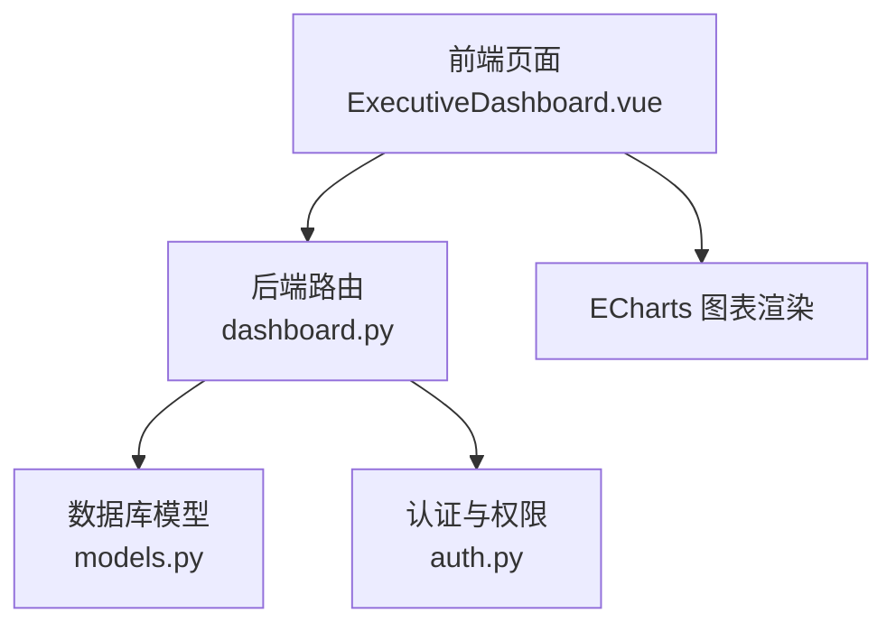
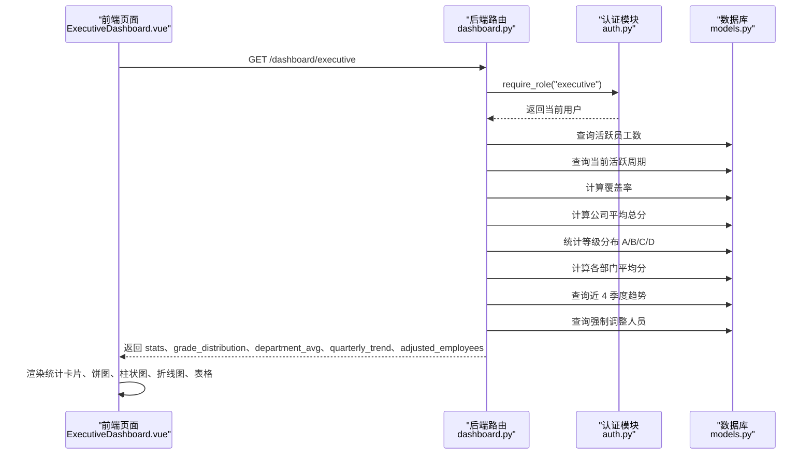
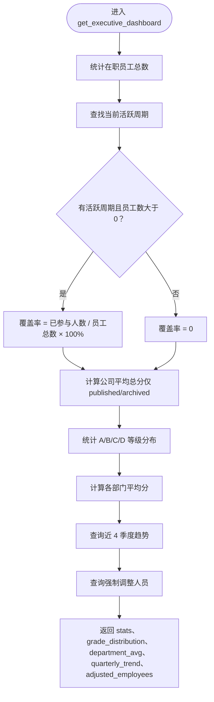
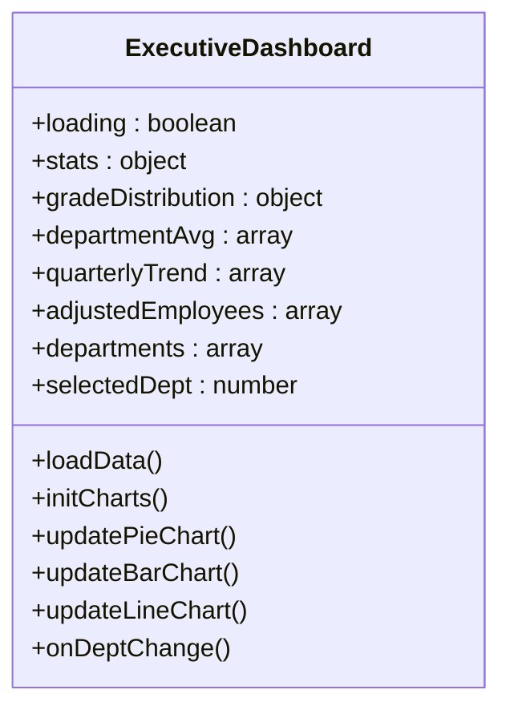
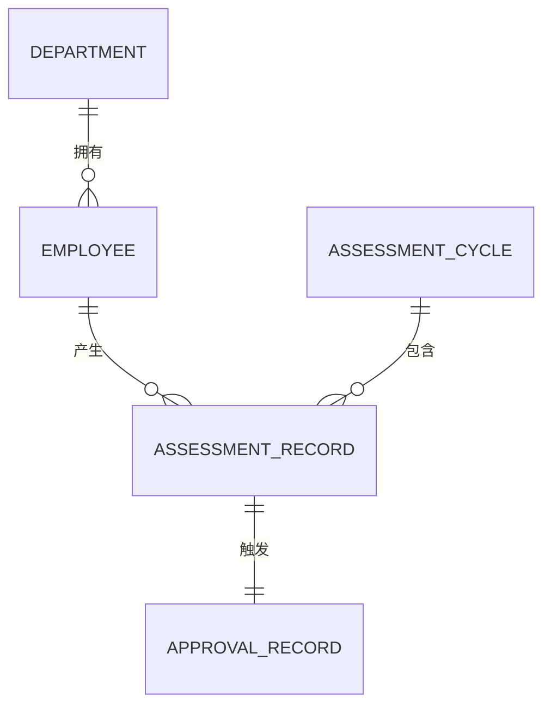
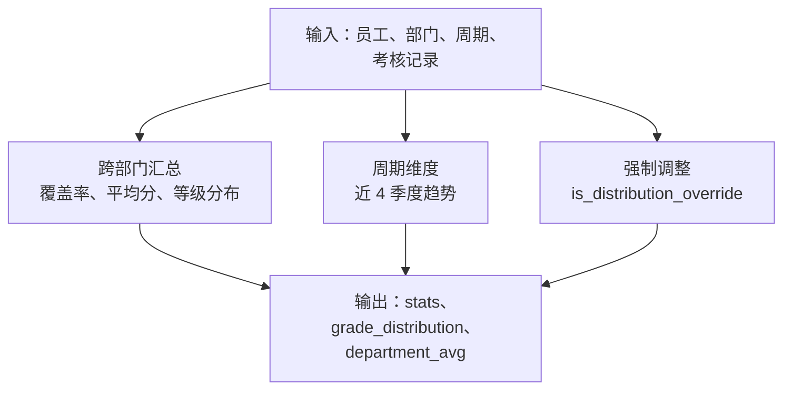
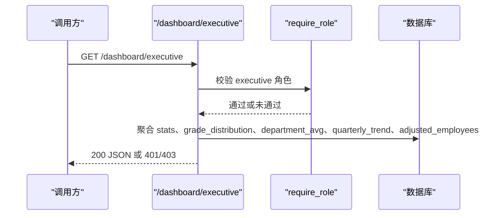
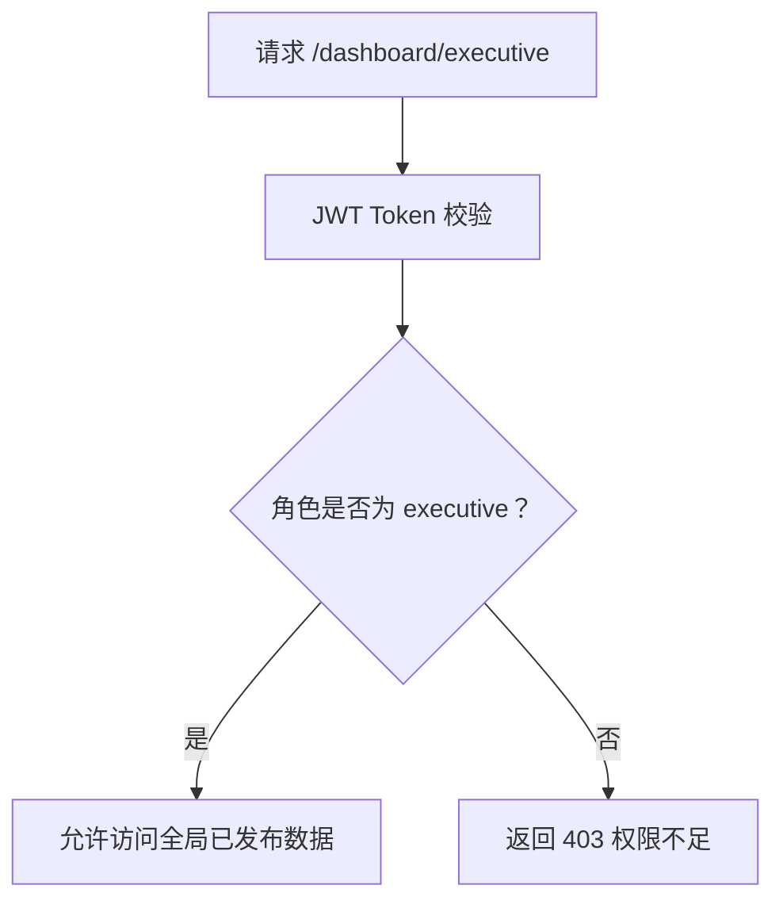

# 高管仪表盘

<cite>
**本文引用的文件**   
- [backend/app/routers/dashboard.py](file://backend/app/routers/dashboard.py)
- [frontend/src/views/dashboard/ExecutiveDashboard.vue](file://frontend/src/views/dashboard/ExecutiveDashboard.vue)
- [backend/app/models.py](file://backend/app/models.py)
- [backend/app/auth.py](file://backend/app/auth.py)
- [backend/tests/test_p6_08_executive_dashboard.py](file://backend/tests/test_p6_08_executive_dashboard.py)
- [docs/TECH_绩效考核评分系统_v1.0.md](file://docs/TECH_绩效考核评分系统_v1.0.md)
</cite>

## 目录
1. [简介](#简介)
2. [项目结构定位](#项目结构定位)
3. [核心能力概览](#核心能力概览)
4. [架构总览](#架构总览)
5. [详细组件分析](#详细组件分析)
6. [数据聚合策略](#数据聚合策略)
7. [决策支持与智能特性](#决策支持与智能特性)
8. [API 接口规范](#api-接口规范)
9. [数据安全与权限隔离](#数据安全与权限隔离)
10. [性能与扩展建议](#性能与扩展建议)
11. [故障排查指南](#故障排查指南)
12. [结论](#结论)

## 简介
高管仪表盘面向公司高层管理者，提供全局只读视角的绩效监控与分析能力。其核心目标是帮助高管快速掌握公司整体覆盖率、平均总分、绩效等级分布、部门对比、季度趋势以及强制调整人员等关键信息，从而支撑组织级绩效决策。

从实现上看，高管仪表盘由后端聚合接口和前端可视化页面组成：
- 后端通过 `/dashboard/executive` 返回高管视图所需的全局统计数据、等级分布、部门平均分、近 4 季度趋势及强制调整人员列表。
- 前端 `ExecutiveDashboard.vue` 负责展示统计卡片、ECharts 图表（饼图、柱状图、折线图）以及强制调整人员表格，并提供部门筛选交互。

该功能属于“全公司绩效考核全景视图”的高管视角部分，强调只读、全局、可观测，不包含评分、审批或配置操作入口。

**章节来源**
- [docs/TECH_绩效考核评分系统_v1.0.md:524-532](file://docs/TECH_绩效考核评分系统_v1.0.md#L524-L532)

## 项目结构定位
高管仪表盘在系统中的位置如下：
- 后端路由位于 `backend/app/routers/dashboard.py`，其中包含通用仪表盘接口和高管专属接口。
- 前端页面位于 `frontend/src/views/dashboard/ExecutiveDashboard.vue`，使用 Element Plus 和 ECharts 构建。
- 数据模型集中在 `backend/app/models.py`，包括员工、部门、考核周期、考核记录、审批记录等。
- 认证与权限控制集中在 `backend/app/auth.py`，通过 JWT 和角色校验保护接口。
- 行为验证由测试用例覆盖，尤其是 `backend/tests/test_p6_08_executive_dashboard.py`。

**图示来源**
- [frontend/src/views/dashboard/ExecutiveDashboard.vue:177-197](file://frontend/src/views/dashboard/ExecutiveDashboard.vue#L177-L197)
- [backend/app/routers/dashboard.py:139-241](file://backend/app/routers/dashboard.py#L139-L241)
- [backend/app/models.py:8-129](file://backend/app/models.py#L8-L129)
- [backend/app/auth.py:68-129](file://backend/app/auth.py#L68-L129)

**章节来源**
- [backend/app/routers/dashboard.py:1-12](file://backend/app/routers/dashboard.py#L1-L12)
- [frontend/src/views/dashboard/ExecutiveDashboard.vue:1-19](file://frontend/src/views/dashboard/ExecutiveDashboard.vue#L1-L19)
- [backend/app/models.py:1-129](file://backend/app/models.py#L1-L129)
- [backend/app/auth.py:1-129](file://backend/app/auth.py#L1-L129)

## 核心能力概览
高管仪表盘的核心指标与能力包括：
- 全局统计卡片：员工总数、考核覆盖率、公司平均总分、待审批数。
- 绩效等级分布：A/B/C/D 四等级的占比，用于观察整体绩效健康度。
- 部门平均分对比：按部门维度计算已发布或归档记录的总分平均值。
- 近 4 季度趋势：按考核周期结束时间倒序取最近 4 个已发布/归档周期，计算每个周期的平均总分。
- 强制调整人员追踪：列出因强制分布规则被调整的员工，展示原始等级、调整后等级及原因。

这些能力共同构成高管视角的全局绩效概览，既支持横向部门对比，也支持纵向历史趋势分析。

**章节来源**
- [backend/app/routers/dashboard.py:145-241](file://backend/app/routers/dashboard.py#L145-L241)
- [frontend/src/views/dashboard/ExecutiveDashboard.vue:20-133](file://frontend/src/views/dashboard/ExecutiveDashboard.vue#L20-L133)

## 架构总览
高管仪表盘的数据流遵循“前端请求 → 后端聚合 → 数据库查询 → 返回结构化数据 → 前端渲染”的链路。

**图示来源**
- [backend/app/routers/dashboard.py:139-241](file://backend/app/routers/dashboard.py#L139-L241)
- [backend/app/auth.py:116-129](file://backend/app/auth.py#L116-L129)
- [frontend/src/views/dashboard/ExecutiveDashboard.vue:177-197](file://frontend/src/views/dashboard/ExecutiveDashboard.vue#L177-L197)

## 详细组件分析

### 后端高管聚合接口
后端 `/dashboard/executive` 是高管仪表盘的核心数据源。它首先校验调用者是否为 `executive` 角色，然后执行以下聚合逻辑：
- 基础统计：在职员工总数、当前活跃周期、覆盖率、公司平均总分、待审批数。
- 等级分布：统计状态为已发布或归档且等级非空的记录，累计 A/B/C/D 数量。
- 部门平均分：遍历所有部门，获取部门下员工 ID，再计算这些员工在已发布或归档记录中的平均总分。
- 近 4 季度趋势：按周期结束时间倒序取最近 4 个已发布或归档周期，计算每个周期的平均总分。
- 强制调整人员：查询标记为强制分布调整的记录，最多返回 20 条，并关联员工姓名、工号、原等级、调整后等级及原因。

**图示来源**
- [backend/app/routers/dashboard.py:145-241](file://backend/app/routers/dashboard.py#L145-L241)

**章节来源**
- [backend/app/routers/dashboard.py:139-241](file://backend/app/routers/dashboard.py#L139-L241)

### 前端高管仪表盘页面
前端页面 `ExecutiveDashboard.vue` 负责：
- 加载数据：调用 `/dashboard/executive` 获取高管聚合数据，同时加载部门列表用于筛选。
- 渲染统计卡片：展示员工总数、覆盖率、公司平均总分、待审批数。
- 渲染图表：
  - 饼图：展示 A/B/C/D 等级分布。
  - 柱状图：展示部门平均分对比，支持按选中部门过滤。
  - 折线图：展示近 4 季度公司平均总分趋势。
- 展示强制调整人员表格：显示姓名、工号、原等级、调整后等级、调整原因。

**图示来源**
- [frontend/src/views/dashboard/ExecutiveDashboard.vue:145-197](file://frontend/src/views/dashboard/ExecutiveDashboard.vue#L145-L197)
- [frontend/src/views/dashboard/ExecutiveDashboard.vue:199-299](file://frontend/src/views/dashboard/ExecutiveDashboard.vue#L199-L299)

**章节来源**
- [frontend/src/views/dashboard/ExecutiveDashboard.vue:1-197](file://frontend/src/views/dashboard/ExecutiveDashboard.vue#L1-L197)
- [frontend/src/views/dashboard/ExecutiveDashboard.vue:199-299](file://frontend/src/views/dashboard/ExecutiveDashboard.vue#L199-L299)

### 数据模型与关系
高管仪表盘依赖以下核心模型：
- `Department`：部门信息，用于部门平均分对比。
- `Employee`：员工信息，用于统计在职员工数和覆盖率。
- `AssessmentCycle`：考核周期，用于确定当前活跃周期和近 4 季度趋势。
- `AssessmentRecord`：考核记录，用于覆盖率、平均总分、等级分布、部门平均分、趋势和强制调整人员。
- `ApprovalRecord`：审批记录，用于统计待审批数。

**图示来源**
- [backend/app/models.py:8-129](file://backend/app/models.py#L8-L129)

**章节来源**
- [backend/app/models.py:8-129](file://backend/app/models.py#L8-L129)

## 数据聚合策略
高管仪表盘的数据聚合策略围绕“跨部门汇总、周期维度、已发布数据优先”展开：

- 跨部门数据汇总：
  - 覆盖率基于当前活跃周期内已生成考核记录的数量与在职员工总数之比。
  - 公司平均总分对所有已发布或归档记录的总分求平均。
  - 部门平均分先收集部门下员工 ID，再对这些员工的已发布或归档记录求平均。
- 季度趋势分析：
  - 按周期结束时间倒序取最近 4 个已发布或归档周期。
  - 对每个周期内的考核记录求平均总分，形成时间序列。
- 强制调整人员追踪：
  - 基于 `is_distribution_override` 字段筛选被强制分布调整的记录。
  - 关联员工信息，展示原等级、调整后等级和调整原因。

**图示来源**
- [backend/app/routers/dashboard.py:145-241](file://backend/app/routers/dashboard.py#L145-L241)

**章节来源**
- [backend/app/routers/dashboard.py:145-241](file://backend/app/routers/dashboard.py#L145-L241)

## 决策支持与智能特性
高管仪表盘的决策支持特性体现在以下几个方面：

- 异常预警机制：
  - 当前实现中未内置自动阈值告警，但可通过前端视觉高亮（如待审批数卡片）提示管理层关注。
  - 未来可扩展为当覆盖率低于阈值、平均总分显著下降或 D 等级比例过高时触发预警。
- 关键指标阈值设置：
  - 当前后端未暴露阈值配置；可在前端或外部监控系统接入阈值判断。
- 趋势预测分析：
  - 当前仅提供近 4 季度历史趋势，未实现预测算法。
  - 可结合时间序列模型对未来季度平均总分进行预测，辅助资源分配与激励策略。

需要特别说明的是，当前实现以“只读、可观测”为主，不包含评分、审批、配置等写入操作，符合高管视角的定位。

**章节来源**
- [frontend/src/views/dashboard/ExecutiveDashboard.vue:61-73](file://frontend/src/views/dashboard/ExecutiveDashboard.vue#L61-L73)
- [docs/TECH_绩效考核评分系统_v1.0.md:524-532](file://docs/TECH_绩效考核评分系统_v1.0.md#L524-L532)

## API 接口规范

### 高管仪表盘聚合接口
- 接口路径：`GET /dashboard/executive`
- 认证要求：必须携带有效 Bearer Token，且用户角色为 `executive`。
- 成功响应结构：
  - `stats`：对象，包含：
    - `total_employees`：整数，在职员工总数。
    - `coverage_rate`：浮点数，考核覆盖率百分比。
    - `avg_total_score`：浮点数，公司平均总分。
    - `pending_approvals`：整数，待审批数。
  - `grade_distribution`：对象，键为 `A`、`B`、`C`、`D`，值为对应等级人数。
  - `department_avg`：数组，每项包含：
    - `id`：部门 ID。
    - `name`：部门名称。
    - `avg_score`：部门平均总分。
  - `quarterly_trend`：数组，每项包含：
    - `cycle_name`：周期名称。
    - `avg_score`：周期平均总分。
  - `adjusted_employees`：数组，每项包含：
    - `record_id`：考核记录 ID。
    - `employee_name`：员工姓名。
    - `employee_no`：员工工号。
    - `original_grade`：原始等级。
    - `adjusted_grade`：调整后等级。
    - `override_reason`：调整原因。
- 失败响应：
  - 非 `executive` 角色返回 403。
  - 未携带或无效 Token 返回 401。

**图示来源**
- [backend/app/routers/dashboard.py:139-241](file://backend/app/routers/dashboard.py#L139-L241)
- [backend/app/auth.py:116-129](file://backend/app/auth.py#L116-L129)

**章节来源**
- [backend/app/routers/dashboard.py:139-241](file://backend/app/routers/dashboard.py#L139-L241)
- [backend/tests/test_p6_08_executive_dashboard.py:60-83](file://backend/tests/test_p6_08_executive_dashboard.py#L60-L83)

## 数据安全与权限隔离
高管仪表盘的安全设计主要体现在认证与角色隔离上：

- 认证机制：
  - 使用 JWT Bearer Token 进行身份认证。
  - 首次登录未修改密码的用户会被限制访问受保护接口。
- 角色隔离：
  - `/dashboard/executive` 使用 `require_role("executive")` 严格限制只有高管角色可访问。
  - 其他角色（如 employee、manager、admin）访问该接口将返回 403。
- 数据可见性：
  - 高管可查看全公司已发布的绩效数据，不受部门隔离限制。
  - 高管不可查看未发布数据、评分草稿、审批详情等敏感信息。

**图示来源**
- [backend/app/auth.py:68-129](file://backend/app/auth.py#L68-L129)
- [backend/app/routers/dashboard.py:139-143](file://backend/app/routers/dashboard.py#L139-L143)

**章节来源**
- [backend/app/auth.py:68-129](file://backend/app/auth.py#L68-L129)
- [backend/app/routers/dashboard.py:139-143](file://backend/app/routers/dashboard.py#L139-L143)
- [backend/tests/test_p6_08_executive_dashboard.py:75-83](file://backend/tests/test_p6_08_executive_dashboard.py#L75-L83)

## 性能与扩展建议
当前实现的性能特征与建议如下：

- 性能特征：
  - 覆盖率计算依赖当前活跃周期，避免全量扫描。
  - 公司平均总分和等级分布基于已发布或归档记录，减少中间态数据干扰。
  - 部门平均分逐部门查询，若部门数量较多可能产生多次子查询。
  - 近 4 季度趋势限制周期数量为 4，降低历史数据压力。
  - 强制调整人员限制返回 20 条，避免大表全量返回。
- 优化建议：
  - 对 `AssessmentRecord.cycle_id`、`AssessmentRecord.status`、`AssessmentRecord.employee_id` 建立复合索引，提升聚合查询效率。
  - 对高频统计指标引入缓存层（如 Redis），定期刷新以降低数据库压力。
  - 将部门平均分计算改为一次性 JOIN 聚合，减少 N+1 查询问题。
  - 在前端增加分页或懒加载，避免一次性渲染过多图表数据。

[本节为通用性能指导，不直接分析具体代码文件]

## 故障排查指南
常见问题与排查思路：

- 401 未认证：
  - 检查是否携带有效 Bearer Token。
  - 检查 Token 是否过期或用户名不存在。
- 403 权限不足：
  - 检查当前用户角色是否为 `executive`。
  - 检查用户是否处于首次登录未改密状态。
- 数据为空或不准确：
  - 确认是否存在已发布或归档的考核记录。
  - 确认当前是否有活跃周期。
  - 确认员工是否在职且已关联部门。
- 图表不更新：
  - 检查前端是否正确监听数据变化并调用 `updatePieChart`、`updateBarChart`、`updateLineChart`。
  - 检查 ECharts 实例是否正确初始化。

**章节来源**
- [backend/app/auth.py:68-129](file://backend/app/auth.py#L68-L129)
- [backend/app/routers/dashboard.py:139-241](file://backend/app/routers/dashboard.py#L139-L241)
- [frontend/src/views/dashboard/ExecutiveDashboard.vue:199-299](file://frontend/src/views/dashboard/ExecutiveDashboard.vue#L199-L299)

## 结论
高管仪表盘以只读、全局、可观测为核心定位，通过后端聚合接口与前端可视化页面协同，为高层管理者提供公司整体覆盖率、平均总分、绩效等级分布、部门对比、季度趋势和强制调整人员等关键信息。其安全设计基于 JWT 与角色隔离，确保只有高管角色可访问全局已发布数据。当前实现已覆盖主要业务场景，并在测试中得到验证。未来可在异常预警、阈值配置、趋势预测和数据聚合性能方面进一步扩展，以提升决策支持的智能化水平。