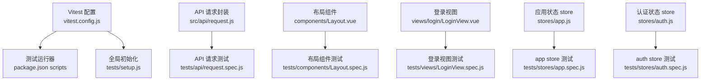
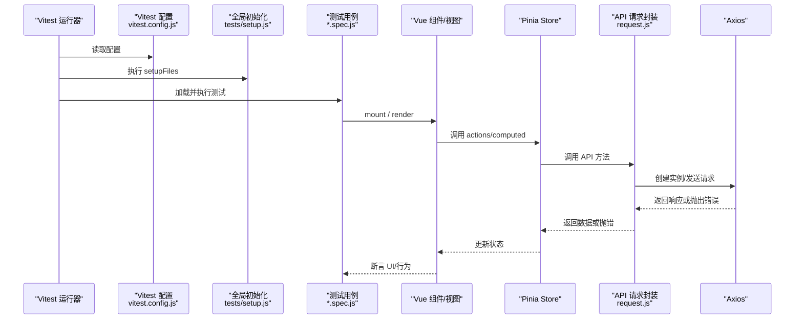
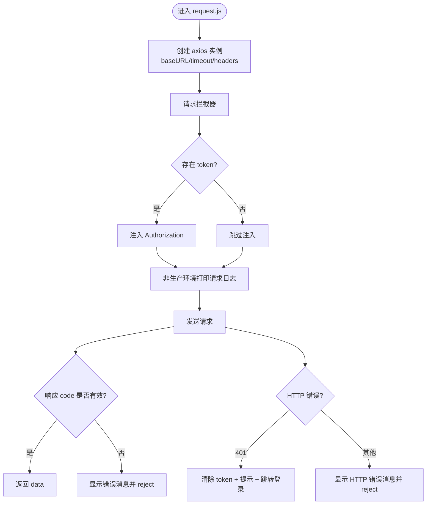
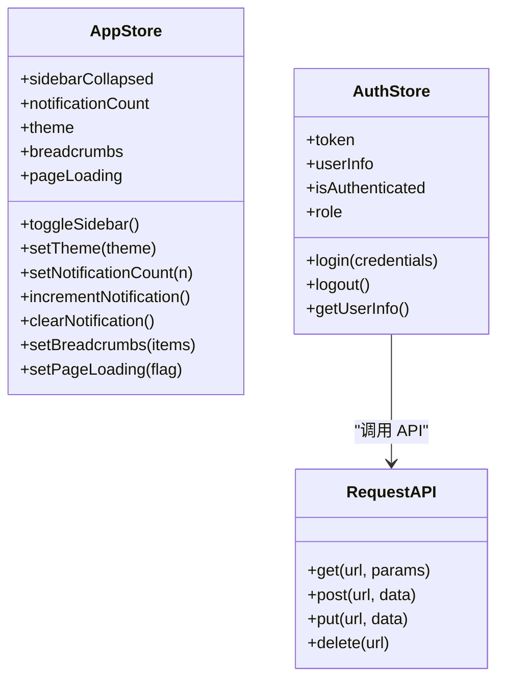
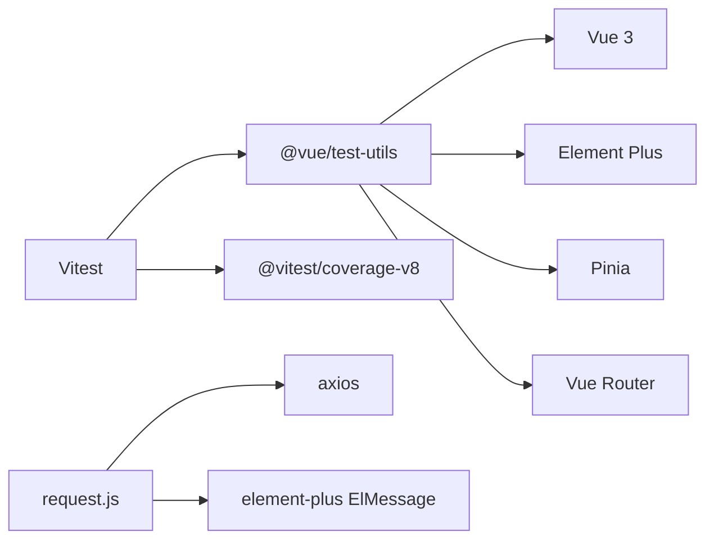

# 前端测试

<cite>
**本文引用的文件**   
- [frontend/vitest.config.js](file://frontend/vitest.config.js)
- [frontend/package.json](file://frontend/package.json)
- [frontend/tests/setup.js](file://frontend/tests/setup.js)
- [frontend/src/api/request.js](file://frontend/src/api/request.js)
- [frontend/tests/api/request.spec.js](file://frontend/tests/api/request.spec.js)
- [frontend/tests/components/Layout.spec.js](file://frontend/tests/components/Layout.spec.js)
- [frontend/tests/views/LoginView.spec.js](file://frontend/tests/views/LoginView.spec.js)
- [frontend/tests/stores/app.spec.js](file://frontend/tests/stores/app.spec.js)
- [frontend/tests/stores/auth.spec.js](file://frontend/tests/stores/auth.spec.js)
</cite>

## 目录
1. [简介](#简介)
2. [项目结构](#项目结构)
3. [核心组件](#核心组件)
4. [架构总览](#架构总览)
5. [详细组件分析](#详细组件分析)
6. [依赖关系分析](#依赖关系分析)
7. [性能与稳定性考虑](#性能与稳定性考虑)
8. [故障排查指南](#故障排查指南)
9. [结论](#结论)
10. [附录：命令与覆盖率配置](#附录命令与覆盖率配置)

## 简介
本文件面向前端测试，系统性说明基于 Vitest 的测试框架在该项目中的配置与实践。内容涵盖：
- 测试环境搭建、配置文件设置、测试运行器使用
- Vue 组件测试策略（渲染、事件模拟、属性验证、插槽）
- Pinia 状态管理测试（同步/异步 action、副作用处理）
- API 客户端测试（请求拦截、Mock、响应模拟）
- 测试工具函数规范与测试数据管理策略
- 测试覆盖率统计与持续集成建议

## 项目结构
前端测试相关代码集中在 frontend 目录下，关键位置如下：
- 测试配置：frontend/vitest.config.js
- 测试全局初始化：frontend/tests/setup.js
- 单元测试入口与脚本：frontend/package.json
- 示例测试：tests/api、tests/components、tests/views、tests/stores

图表来源
- [frontend/vitest.config.js:1-25](file://frontend/vitest.config.js#L1-L25)
- [frontend/package.json:6-15](file://frontend/package.json#L6-L15)
- [frontend/tests/setup.js:1-39](file://frontend/tests/setup.js#L1-L39)
- [frontend/src/api/request.js:1-89](file://frontend/src/api/request.js#L1-L89)
- [frontend/tests/api/request.spec.js:1-174](file://frontend/tests/api/request.spec.js#L1-L174)
- [frontend/tests/components/Layout.spec.js:1-73](file://frontend/tests/components/Layout.spec.js#L1-L73)
- [frontend/tests/views/LoginView.spec.js:1-183](file://frontend/tests/views/LoginView.spec.js#L1-L183)
- [frontend/tests/stores/app.spec.js:1-82](file://frontend/tests/stores/app.spec.js#L1-L82)
- [frontend/tests/stores/auth.spec.js:1-132](file://frontend/tests/stores/auth.spec.js#L1-L132)

章节来源
- [frontend/vitest.config.js:1-25](file://frontend/vitest.config.js#L1-L25)
- [frontend/package.json:6-15](file://frontend/package.json#L6-L15)

## 核心组件
本节聚焦测试基础设施与关键模块：
- Vitest 配置：定义测试环境、全局变量、setup 文件、覆盖率等
- 全局初始化：注册 Element Plus、polyfill、mock window API
- API 请求封装：axios 实例、请求/响应拦截器、错误处理
- 示例测试：组件、视图、store、API 层测试样例

章节来源
- [frontend/vitest.config.js:1-25](file://frontend/vitest.config.js#L1-L25)
- [frontend/tests/setup.js:1-39](file://frontend/tests/setup.js#L1-L39)
- [frontend/src/api/request.js:1-89](file://frontend/src/api/request.js#L1-L89)

## 架构总览
下图展示测试执行时各模块之间的交互关系：Vitest 加载配置与 setup，运行器执行测试用例；组件/视图通过 @vue/test-utils 挂载并触发行为；store 通过 Pinia 提供状态；API 层通过 axios 发起请求并在拦截器中处理鉴权与错误。

图表来源
- [frontend/vitest.config.js:1-25](file://frontend/vitest.config.js#L1-L25)
- [frontend/tests/setup.js:1-39](file://frontend/tests/setup.js#L1-L39)
- [frontend/src/api/request.js:1-89](file://frontend/src/api/request.js#L1-L89)

## 详细组件分析

### Vitest 测试框架配置与运行
- 测试环境：jsdom，用于模拟浏览器 DOM
- 全局变量：启用 globals，可直接使用 describe/it/expect 等
- 初始化文件：setupFiles 指向 tests/setup.js
- 排除路径：排除 e2e 与 node_modules
- 覆盖率：v8 provider，输出 text/json/html，包含 src/**/*.vue/js，排除 main.js、router、stores
- 别名：@ 指向 src

章节来源
- [frontend/vitest.config.js:1-25](file://frontend/vitest.config.js#L1-L25)

### 测试环境初始化（tests/setup.js）
- 为 jsdom 提供 ResizeObserver、IntersectionObserver polyfill
- Mock window.matchMedia、scrollTo
- 全局注册 Element Plus 插件，避免每个测试重复配置

章节来源
- [frontend/tests/setup.js:1-39](file://frontend/tests/setup.js#L1-L39)

### API 客户端测试方案（request.js）
- 目标：验证 axios 实例配置、请求拦截器注入 Authorization、非生产环境日志打印、响应成功/失败分支、401 自动跳转与清理 token
- 策略：
  - 使用 vi.mock 替换 axios 与 element-plus
  - 捕获 create 参数以校验 baseURL、timeout、headers
  - 直接调用拦截器回调，断言返回值与副作用（localStorage、ElMessage、window.location.href）
  - 使用 vi.useFakeTimers 控制 setTimeout 行为

图表来源
- [frontend/src/api/request.js:1-89](file://frontend/src/api/request.js#L1-L89)
- [frontend/tests/api/request.spec.js:1-174](file://frontend/tests/api/request.spec.js#L1-L174)

章节来源
- [frontend/src/api/request.js:1-89](file://frontend/src/api/request.js#L1-L89)
- [frontend/tests/api/request.spec.js:1-174](file://frontend/tests/api/request.spec.js#L1-L174)

### 组件测试实施策略（Layout.vue）
- 使用 @vue/test-utils 的 mount 挂载组件
- 子组件通过 vi.mock 替换为简单 stub，隔离外部依赖
- 注入 Pinia 与 Router，确保路由视图正常渲染
- 断言 DOM 结构与类名存在性，验证布局容器、侧边栏、头部、面包屑区域
- 使用 flushPromises 等待异步更新完成

章节来源
- [frontend/tests/components/Layout.spec.js:1-73](file://frontend/tests/components/Layout.spec.js#L1-L73)

### 视图测试实施策略（LoginView.vue）
- 模拟 Element Plus 图标与 auth store
- 构造最小化 router，断言登录后跳转
- 覆盖以下场景：
  - 表单渲染与输入
  - 点击登录按钮触发 store.login
  - 首次登录弹出修改密码弹窗
  - 密码强度校验失败保持弹窗打开
  - 修改密码成功后调用 logout 并清空表单
  - 回车键提交表单

章节来源
- [frontend/tests/views/LoginView.spec.js:1-183](file://frontend/tests/views/LoginView.spec.js#L1-L183)

### 状态管理测试（Pinia Store）
- app store：验证默认 state、toggleSidebar、setTheme、通知计数操作、面包屑设置、页面加载状态
- auth store：
  - 初始化：无 localStorage 时为空；有 localStorage 时恢复 token/userInfo
  - login：调用 API、更新状态、写入 localStorage
  - logout：清除状态与 localStorage
  - getUserInfo：根据 token 是否存在决定是否调用 API，失败时清理状态并抛错
  - computed：isAuthenticated、role 推导逻辑

图表来源
- [frontend/tests/stores/app.spec.js:1-82](file://frontend/tests/stores/app.spec.js#L1-L82)
- [frontend/tests/stores/auth.spec.js:1-132](file://frontend/tests/stores/auth.spec.js#L1-L132)

章节来源
- [frontend/tests/stores/app.spec.js:1-82](file://frontend/tests/stores/app.spec.js#L1-L82)
- [frontend/tests/stores/auth.spec.js:1-132](file://frontend/tests/stores/auth.spec.js#L1-L132)

### 组件测试最佳实践清单
- 渲染测试：断言根节点、关键类名、文本内容与插槽内容
- 事件模拟：使用 trigger('click'/'keyup.enter') 模拟用户交互
- 属性验证：通过 props 传入不同值，断言渲染差异
- 插槽测试：向插槽传入具名/匿名插槽内容，断言渲染结果
- 异步更新：使用 flushPromises 或 await nextTick 确保 DOM 更新完成
- 依赖隔离：对第三方库（Element Plus、ECharts）进行 mock 或 stub

[本节为通用实践总结，不直接分析具体文件]

### API 客户端测试最佳实践清单
- 拦截器测试：分别注入请求拦截器与响应拦截器的回调，断言 config 修改与返回值
- Mock 服务器：使用 vi.mock 替换 axios，避免真实网络请求
- 响应模拟：构造成功与失败两种响应，覆盖业务 code 判断与错误消息
- 副作用断言：检查 localStorage、ElMessage、window.location.href 等行为
- 定时器控制：使用 vi.useFakeTimers 与 runAllTimers 控制 setTimeout 行为

章节来源
- [frontend/tests/api/request.spec.js:1-174](file://frontend/tests/api/request.spec.js#L1-L174)

## 依赖关系分析
- 测试运行器依赖 Vitest 与 @vue/test-utils
- 组件测试依赖 Vue 3、Element Plus、Pinia、Vue Router
- API 层测试依赖 axios 与 element-plus 的消息提示
- 覆盖率统计依赖 @vitest/coverage-v8 与 v8 provider

图表来源
- [frontend/package.json:17-39](file://frontend/package.json#L17-L39)
- [frontend/vitest.config.js:12-17](file://frontend/vitest.config.js#L12-L17)
- [frontend/src/api/request.js:1-89](file://frontend/src/api/request.js#L1-L89)

章节来源
- [frontend/package.json:17-39](file://frontend/package.json#L17-L39)
- [frontend/vitest.config.js:12-17](file://frontend/vitest.config.js#L12-L17)

## 性能与稳定性考虑
- 使用 vi.mock 替代真实依赖，减少 IO 与网络开销
- 仅挂载必要组件，避免全量渲染大型页面
- 合理使用 flushPromises，避免不必要的等待
- 将耗时且稳定的测试放入独立套件，必要时并行执行
- 覆盖率统计时排除无关文件（如 main.js、router、stores），提升构建速度

[本节为通用指导，不直接分析具体文件]

## 故障排查指南
- jsdom 不支持某些浏览器 API：在 tests/setup.js 中补充 polyfill 或 mock（如 ResizeObserver、IntersectionObserver、matchMedia）
- Element Plus 组件未注册：在 setup.js 中全局注册 Element Plus
- 异步更新未生效：在断言前添加 flushPromises 或 await nextTick
- 定时器导致测试不稳定：使用 vi.useFakeTimers 与 vi.runAllTimers 控制时间
- 401 跳转未触发：确认已 mock window.location 并使用 fake timers 执行 setTimeout

章节来源
- [frontend/tests/setup.js:1-39](file://frontend/tests/setup.js#L1-L39)
- [frontend/tests/api/request.spec.js:52-64](file://frontend/tests/api/request.spec.js#L52-L64)

## 结论
本项目采用 Vitest 作为测试框架，结合 @vue/test-utils、Pinia、Vue Router 与 Element Plus，形成了从 API 层到组件层的完整测试体系。通过统一的 vitest.config.js 与 tests/setup.js，保证了测试环境的稳定与可复用。示例测试覆盖了常见场景，包括组件渲染、事件模拟、store 状态变更与 API 拦截器行为，具备良好的扩展性与维护性。

[本节为总结性内容，不直接分析具体文件]

## 附录：命令与覆盖率配置
- 运行测试：npm test 或 npm run test:unit
- 监听模式：npm run test:watch
- 生成覆盖率：npm run test:coverage
- E2E 测试：npm run test:e2e 或 npm run test:e2e:ui

章节来源
- [frontend/package.json:6-15](file://frontend/package.json#L6-L15)
- [frontend/vitest.config.js:12-17](file://frontend/vitest.config.js#L12-L17)