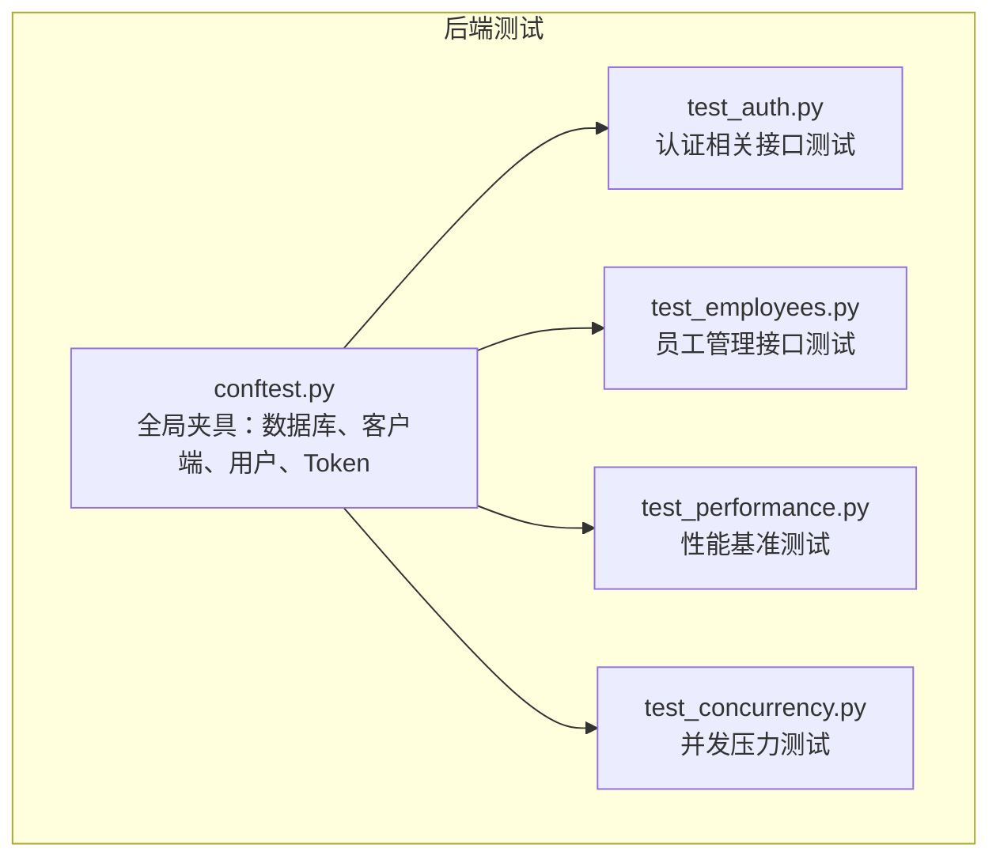
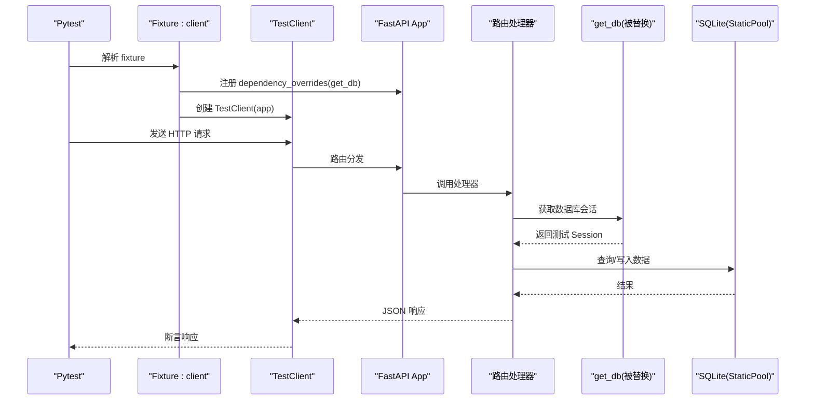
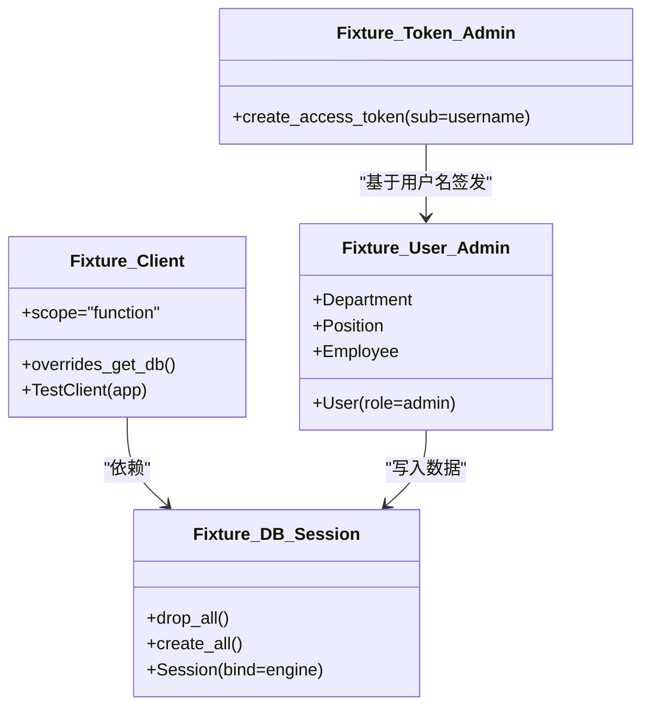
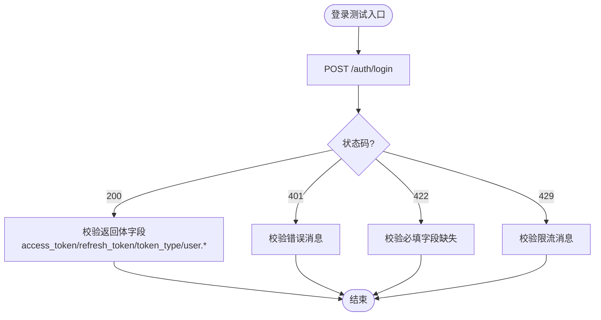
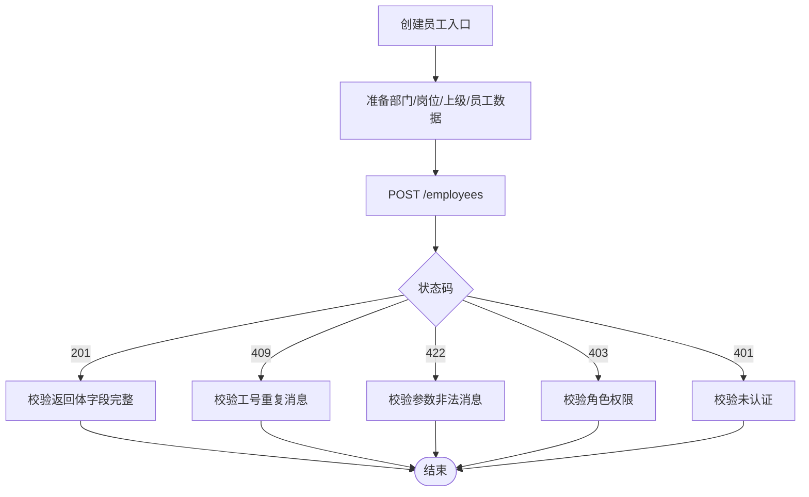
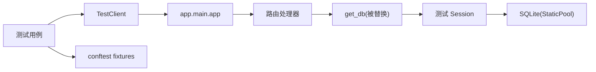
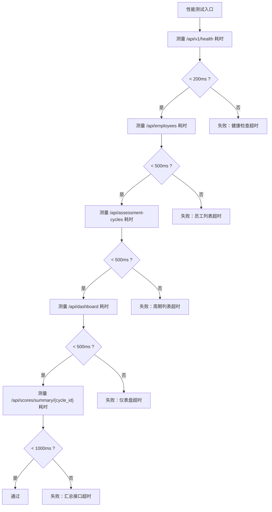
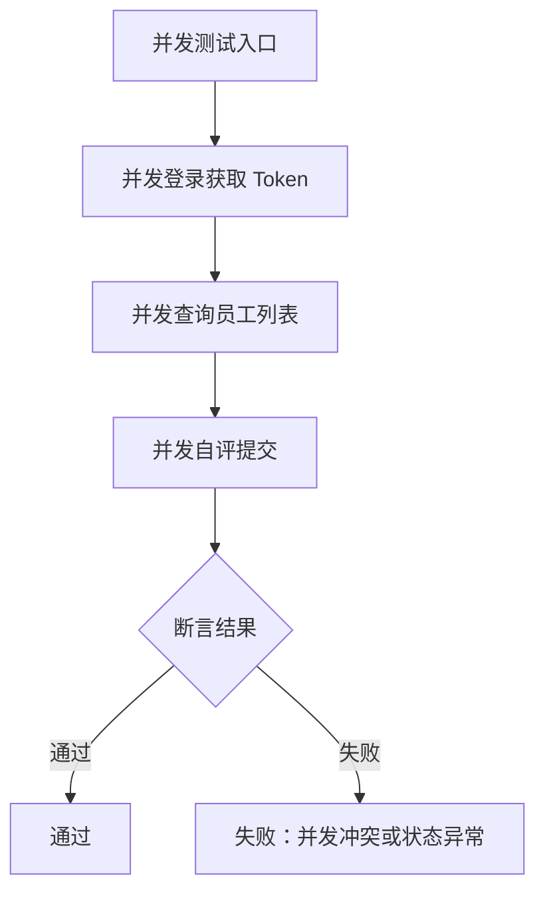

# 后端测试

<cite>
**本文引用的文件**   
- [backend/tests/README.md](file://backend/tests/README.md)
- [backend/tests/conftest.py](file://backend/tests/conftest.py)
- [backend/tests/test_auth.py](file://backend/tests/test_auth.py)
- [backend/tests/test_employees.py](file://backend/tests/test_employees.py)
- [backend/tests/test_performance.py](file://backend/tests/test_performance.py)
- [backend/tests/test_concurrency.py](file://backend/tests/test_concurrency.py)
</cite>

## 目录
1. [引言](#引言)
2. [项目结构](#项目结构)
3. [核心组件](#核心组件)
4. [架构总览](#架构总览)
5. [详细组件分析](#详细组件分析)
6. [依赖关系分析](#依赖关系分析)
7. [性能与并发测试指南](#性能与并发测试指南)
8. [测试覆盖率与报告](#测试覆盖率与报告)
9. [故障排查](#故障排查)
10. [结论](#结论)

## 引言
本文件面向后端测试工程师与维护者，系统化说明基于 Pytest + FastAPI TestClient 的后端测试体系。重点覆盖：
- 测试夹具 conftest.py 的配置与职责边界
- 测试数据准备策略（部门、岗位、员工、用户、角色、Token）
- Mock 与依赖注入的使用技巧
- 单元测试规范（函数、类方法、异步场景）
- 数据库测试方案（SQLite 内存/文件库、初始化与清理、事务回滚）
- API 接口测试（请求构造、响应验证、状态码与错误处理）
- 性能测试与并发测试实践
- 测试覆盖率统计与报告生成

## 项目结构
后端测试位于 backend/tests 目录，采用“按模块组织”的测试文件命名方式，每个路由模块对应一个或多个测试文件；全局夹具集中在 conftest.py。

图表来源
- [backend/tests/conftest.py:1-313](file://backend/tests/conftest.py#L1-L313)
- [backend/tests/test_auth.py:1-169](file://backend/tests/test_auth.py#L1-L169)
- [backend/tests/test_employees.py:1-571](file://backend/tests/test_employees.py#L1-L571)
- [backend/tests/test_performance.py:1-75](file://backend/tests/test_performance.py#L1-L75)
- [backend/tests/test_concurrency.py:1-78](file://backend/tests/test_concurrency.py#L1-L78)

章节来源
- [backend/tests/README.md:1-199](file://backend/tests/README.md#L1-L199)

## 核心组件
- 测试客户端与依赖注入
  - 使用 FastAPI 的 TestClient 发起 HTTP 请求，并通过 dependency_overrides 将业务依赖 get_db 替换为测试数据库会话。
- 数据库夹具
  - 使用 SQLite 文件数据库 + StaticPool，确保多连接共享同一内存/文件库；每个测试函数独立建表并创建会话。
- 用户与角色夹具
  - 预置 admin、hr、manager、employee、executive、peer 等角色用户及其关联 Employee，并提供对应的 Token 夹具。
- 断言规范
  - 禁止仅检查状态码或键存在；必须校验返回体字段值、分页结构、错误消息关键字、权限控制分支等。

章节来源
- [backend/tests/conftest.py:1-313](file://backend/tests/conftest.py#L1-L313)
- [backend/tests/README.md:32-75](file://backend/tests/README.md#L32-L75)

## 架构总览
下图展示测试执行时，Pytest、TestClient、应用依赖、数据库之间的交互关系。

图表来源
- [backend/tests/conftest.py:35-78](file://backend/tests/conftest.py#L35-L78)
- [backend/tests/test_auth.py:8-22](file://backend/tests/test_auth.py#L8-L22)
- [backend/tests/test_employees.py:10-42](file://backend/tests/test_employees.py#L10-L42)

## 详细组件分析

### 测试夹具与测试环境（conftest.py）
- 数据库引擎与会话
  - 使用临时文件路径构建 SQLite URL，配合 StaticPool 避免多线程/多连接问题。
  - 提供 db_session fixture，在每个测试函数作用域内 drop_all/create_all，保证隔离。
- 客户端与依赖注入
  - 提供 client fixture，覆盖 app.dependency_overrides[get_db]，使所有路由使用测试数据库。
  - 临时清空 on_startup 和 lifespan，避免重复初始化外部资源。
- 用户与 Token
  - 提供 admin_user/hr_user/manager_user/employee_user/executive_user/peer_user 等夹具，自动创建部门、岗位、员工、用户。
  - 提供 admin_token/hr_token/manager_token/employee_token/executive_token/peer_token/first_login_token 等夹具，直接生成访问令牌，避免登录限流干扰。

图表来源
- [backend/tests/conftest.py:23-43](file://backend/tests/conftest.py#L23-L43)
- [backend/tests/conftest.py:46-78](file://backend/tests/conftest.py#L46-L78)
- [backend/tests/conftest.py:81-102](file://backend/tests/conftest.py#L81-L102)
- [backend/tests/conftest.py:231-234](file://backend/tests/conftest.py#L231-L234)

章节来源
- [backend/tests/conftest.py:1-313](file://backend/tests/conftest.py#L1-L313)

### 认证接口测试（test_auth.py）
- 登录流程
  - 正常登录：校验 access_token、refresh_token、token_type、user.role、user.username、id、employee_id、is_first_login 等字段。
  - 异常路径：密码错误、用户不存在、限流触发、必填字段缺失、首次登录用户标记。
- 刷新令牌
  - 成功刷新、无效 token、缺少 token 等分支。
- 当前用户信息
  - 携带有效 Token 获取用户信息；无 Token 或 Token 无效返回 401。
- 修改密码
  - 旧密码错误、新旧密码相同、长度过短、复杂度不足、POST/PUT 两种接口路径、无认证保护。
- 退出登录
  - 成功退出、无认证保护。

图表来源
- [backend/tests/test_auth.py:8-22](file://backend/tests/test_auth.py#L8-L22)
- [backend/tests/test_auth.py:24-46](file://backend/tests/test_auth.py#L24-L46)

章节来源
- [backend/tests/test_auth.py:1-169](file://backend/tests/test_auth.py#L1-L169)

### 员工管理接口测试（test_employees.py）
- 列表查询
  - 正常路径：校验分页 total/page/size/items，以及 enriched 字段 department_name、position_name、manager_name、manager_employee_no、created_at 等。
  - 过滤与排序：keyword、department_id、employee_no、sort/order。
  - 未认证：返回 401。
- 详情查询
  - 成功返回 id、employee_no、name、department_id/name、position_id/name、is_active、created_at。
  - 不存在返回 404；未认证返回 401。
- 创建员工
  - 成功返回 201，校验返回体字段完整性。
  - 工号重复返回 409；部门/岗位不存在返回 422；缺少必填字段返回 422；非管理员角色返回 403；未认证返回 401。
- 更新员工
  - 成功返回 200，校验字段更新；工号重复返回 409；不存在返回 404；非管理员返回 403。
- 删除员工
  - 成功返回 204；存在考核历史数据返回 409；不存在返回 404；非管理员返回 403。
- 导入相关接口
  - import/import-preview/import/status 的状态码与权限校验。
- 下属查询
  - 正确返回下属列表；空下属返回空数组；不存在返回 404；权限不足返回 403；未认证返回 401。

图表来源
- [backend/tests/test_employees.py:181-275](file://backend/tests/test_employees.py#L181-L275)

章节来源
- [backend/tests/test_employees.py:1-571](file://backend/tests/test_employees.py#L1-L571)

### 单元测试编写规范
- 命名约定
  - 测试类名对应接口模块或一组端点；测试方法名遵循 test_<操作>_<场景>_<期望结果>。
- 断言要求
  - 必须具体到字段值；禁止仅检查 status_code 或 key in data；禁止宽松类型检查；禁止跳过失败用例。
- 反模式清单
  - 仅检查状态码、仅检查键存在、状态码或关系断言、宽松类型检查、缺少持久化检查。

章节来源
- [backend/tests/README.md:32-87](file://backend/tests/README.md#L32-L87)

### 数据库测试实现方案
- 存储介质
  - 使用 SQLite 文件数据库（通过 tempfile 生成），配合 StaticPool 支持多连接共享。
- 初始化与清理
  - 每个测试函数级 fixture 先 drop_all 再 create_all，确保表结构一致且数据隔离。
- 依赖注入
  - 通过 dependency_overrides 替换 get_db，使路由层使用测试会话。
- 事务回滚
  - 由于每个测试函数拥有独立 Session 并在结束后释放，结合 drop_all/create_all 达到强隔离效果；如需显式回滚，可在 fixture 中捕获异常后 session.rollback()。

章节来源
- [backend/tests/conftest.py:23-43](file://backend/tests/conftest.py#L23-L43)
- [backend/tests/conftest.py:46-78](file://backend/tests/conftest.py#L46-L78)

### API 接口测试方法
- 请求构造
  - 使用 TestClient.post/get/put/delete，设置 headers Authorization: Bearer <token>，json 载荷包含业务参数。
- 响应验证
  - 校验 status_code、JSON 结构、关键字段值、分页结构、错误消息关键字。
- 状态码检查
  - 200/201/204 表示成功；401 未认证；403 权限不足；404 资源不存在；409 冲突；422 参数校验失败；429 限流。
- 错误处理测试
  - 覆盖必填字段缺失、格式错误、业务规则违反、资源状态不可操作等分支，并断言错误消息关键字。

章节来源
- [backend/tests/test_auth.py:8-169](file://backend/tests/test_auth.py#L8-L169)
- [backend/tests/test_employees.py:10-571](file://backend/tests/test_employees.py#L10-L571)
- [backend/tests/README.md:32-75](file://backend/tests/README.md#L32-L75)

### Mock 对象与依赖注入技巧
- 依赖注入
  - 使用 app.dependency_overrides[get_db] 替换数据库依赖，确保所有路由使用测试数据库。
- 启动钩子隔离
  - 临时清空 app.router.on_startup 与 lifespan_context，避免重复初始化外部资源。
- 模块重载
  - 在 conftest 开头强制 reload app.* 模块，确保模型变更生效。

章节来源
- [backend/tests/conftest.py:13-19](file://backend/tests/conftest.py#L13-L19)
- [backend/tests/conftest.py:46-78](file://backend/tests/conftest.py#L46-L78)

### 异步测试与协程
- 当前测试以同步 TestClient 为主；若需测试异步依赖，可结合 pytest-asyncio 与 AsyncClient，或在 fixture 中使用 async def 并 await 异步依赖。
- 对于异步路由处理器，建议使用 AsyncClient 并声明测试函数为 async def，同时确保依赖注入返回异步上下文管理器。

[本节为通用指导，不直接分析具体文件]

## 依赖关系分析
测试模块对应用模块的依赖主要集中在：
- FastAPI TestClient 用于 HTTP 请求
- app.main.app 作为被测应用实例
- app.database.get_db 被替换为测试会话
- app.models 中的实体用于构造测试数据
- app.auth 中的工具函数用于生成 Token

图表来源
- [backend/tests/conftest.py:1-313](file://backend/tests/conftest.py#L1-L313)
- [backend/tests/test_auth.py:1-169](file://backend/tests/test_auth.py#L1-L169)
- [backend/tests/test_employees.py:1-571](file://backend/tests/test_employees.py#L1-L571)

章节来源
- [backend/tests/conftest.py:1-313](file://backend/tests/conftest.py#L1-L313)

## 性能与并发测试指南

### 性能测试
- 健康检查接口
  - 目标：响应时间小于 200ms。
- 员工列表接口
  - 目标：响应时间小于 500ms。
- 考核周期列表接口
  - 目标：响应时间小于 500ms。
- 仪表盘接口
  - 目标：响应时间小于 500ms。
- 评分汇总接口
  - 目标：响应时间小于 1000ms；若无可用周期则跳过该用例。

图表来源
- [backend/tests/test_performance.py:9-75](file://backend/tests/test_performance.py#L9-L75)

章节来源
- [backend/tests/test_performance.py:1-75](file://backend/tests/test_performance.py#L1-L75)

### 并发测试
- 并发登录
  - 多用户同时登录，断言均能获取到唯一 Token。
- 并发查询员工列表
  - 多用户同时查询，断言全部返回 200 且 items 不为空。
- 并发自评提交
  - 同一员工多次提交自评，至少一次成功，其余可能返回 409 或 400。
- 注意
  - 当前并发测试标记为 skip，需要生产数据库与正确的 API 路由才能运行。

图表来源
- [backend/tests/test_concurrency.py:16-78](file://backend/tests/test_concurrency.py#L16-L78)

章节来源
- [backend/tests/test_concurrency.py:1-78](file://backend/tests/test_concurrency.py#L1-L78)

## 测试覆盖率与报告
- 覆盖率统计
  - 使用 pytest-cov 插件，命令示例：python -m pytest tests/ --cov=app --cov-report=term-missing --cov-report=html
- 报告输出
  - 终端输出缺失行信息；HTML 报告便于可视化查看覆盖率。
- 持续集成建议
  - 在 CI 中固定 Python 版本与依赖，缓存依赖安装步骤，并行运行测试集，上传覆盖率报告。

[本节为通用指导，不直接分析具体文件]

## 故障排查
- 测试数据库连接问题
  - 确认 conftest.py 中 engine 与 StaticPool 配置；确保 check_same_thread=False。
- 依赖注入未生效
  - 检查 app.dependency_overrides[get_db] 是否被正确注册与恢复。
- 启动钩子重复初始化
  - 确认 on_startup 与 lifespan_context 已临时清空与恢复。
- 模块未重载
  - 确认 conftest 开头对 app.* 模块进行强制 reload。
- 权限与认证失败
  - 检查 Token 夹具是否正确生成；必要时使用 first_login_token 处理首次登录场景。
- 断言失败
  - 对照 README 中的严格断言规范，确保校验字段值与错误消息关键字。

章节来源
- [backend/tests/conftest.py:13-19](file://backend/tests/conftest.py#L13-L19)
- [backend/tests/conftest.py:46-78](file://backend/tests/conftest.py#L46-L78)
- [backend/tests/README.md:32-87](file://backend/tests/README.md#L32-L87)

## 结论
本测试体系以 Pytest 为核心，结合 FastAPI TestClient 与 SQLite 测试数据库，构建了覆盖认证、员工管理等关键接口的稳定测试基线。通过严格的断言规范、完善的夹具设计与依赖注入机制，确保了测试的可维护性与可扩展性。建议在后续开发中继续遵循“先写测试、再实现代码”的流程，并逐步补充异步测试、Mock 外部依赖与更全面的性能/并发测试用例。