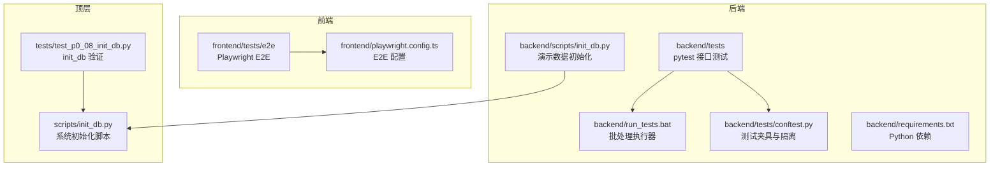
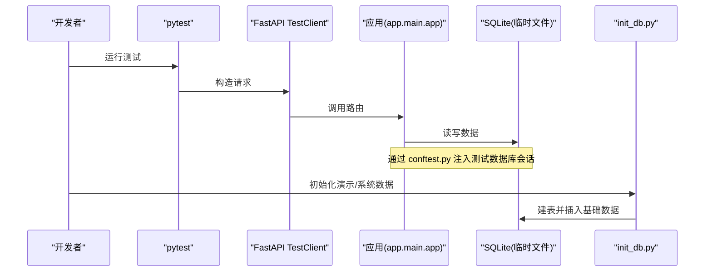
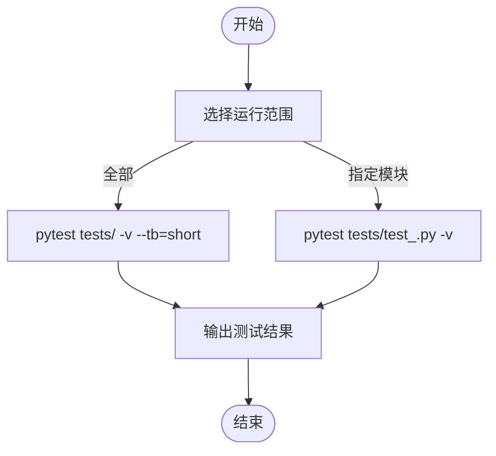
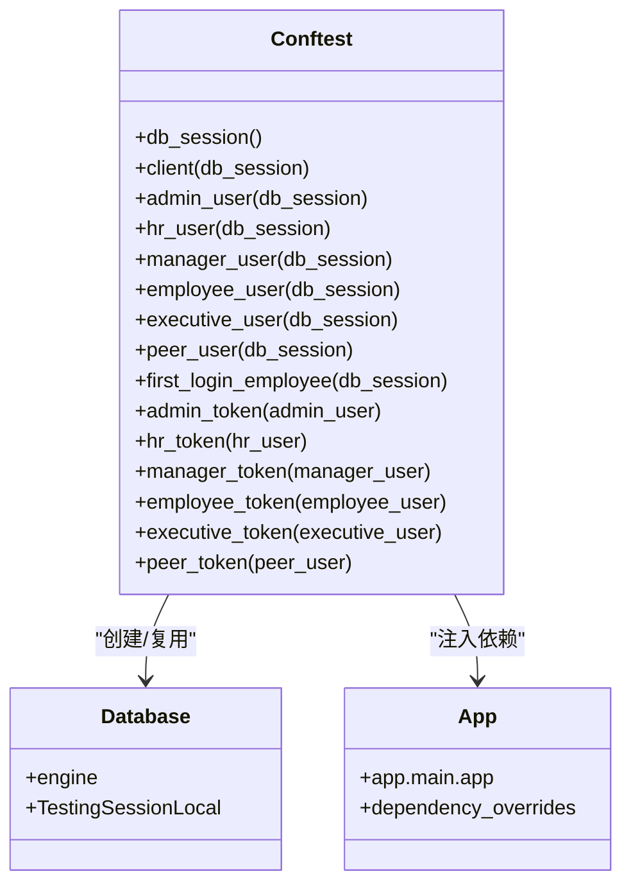
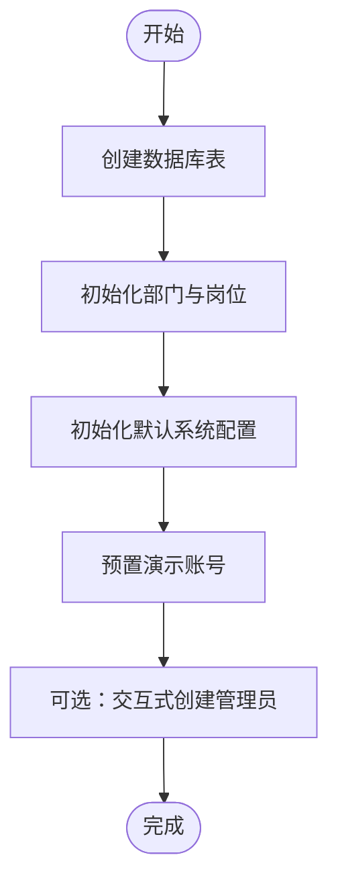
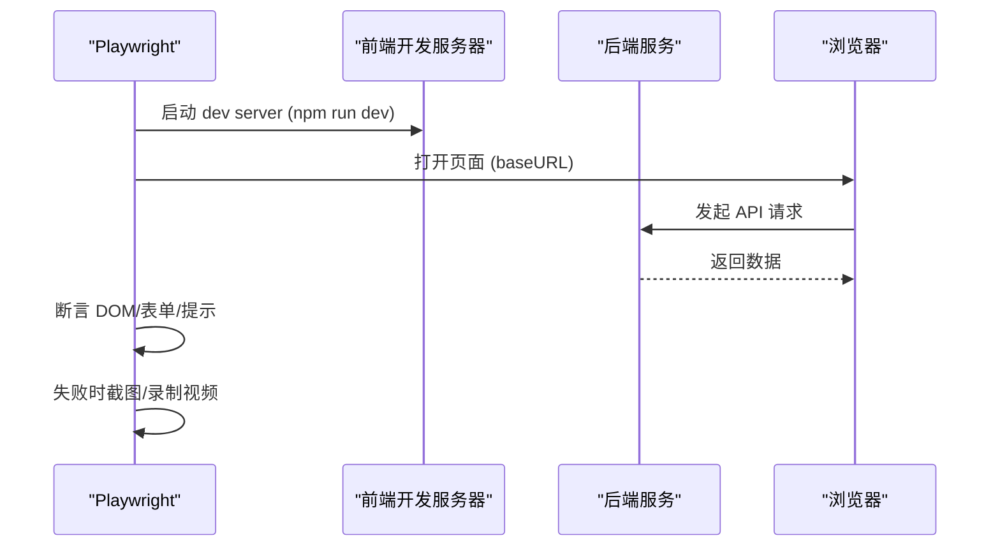
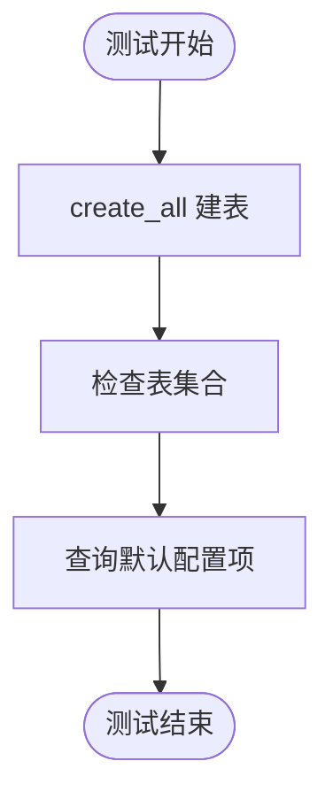
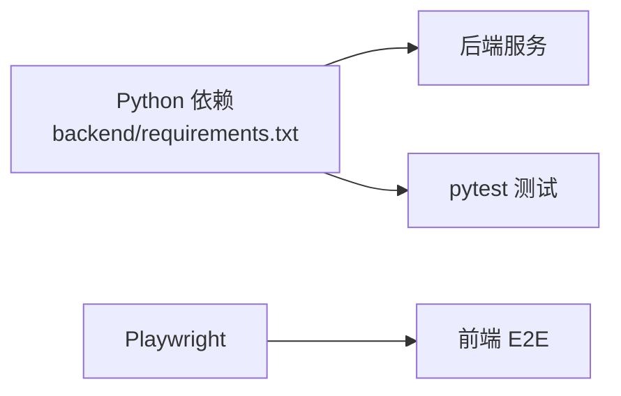

# 测试基础设施

<cite>
**本文引用的文件**   
- [backend/tests/README.md](file://backend/tests/README.md)
- [backend/run_tests.bat](file://backend/run_tests.bat)
- [backend/scripts/init_db.py](file://backend/scripts/init_db.py)
- [scripts/init_db.py](file://scripts/init_db.py)
- [backend/tests/conftest.py](file://backend/tests/conftest.py)
- [backend/requirements.txt](file://backend/requirements.txt)
- [frontend/playwright.config.ts](file://frontend/playwright.config.ts)
- [tests/test_p0_08_init_db.py](file://tests/test_p0_08_init_db.py)
- [backend/tests/test_init_db.py](file://backend/tests/test_init_db.py)
</cite>

## 目录
1. [简介](#简介)
2. [项目结构](#项目结构)
3. [核心组件](#核心组件)
4. [架构总览](#架构总览)
5. [详细组件分析](#详细组件分析)
6. [依赖关系分析](#依赖关系分析)
7. [性能与质量保障](#性能与质量保障)
8. [故障排查指南](#故障排查指南)
9. [结论](#结论)
10. [附录](#附录)

## 简介
本文件面向“绩效考核评分系统”的测试基础设施，覆盖后端接口测试、前端端到端测试、数据库初始化、测试数据管理、批量执行与报告、以及持续集成建议。目标是帮助开发者快速搭建稳定可重复的测试环境，编写高质量测试用例，并在 CI 中自动化运行。

## 项目结构
测试相关的关键位置如下：
- 后端接口测试：backend/tests（pytest + FastAPI TestClient）
- 后端测试脚本入口：backend/run_tests.bat
- 演示数据库初始化：backend/scripts/init_db.py 与 scripts/init_db.py
- 测试基础设施配置：backend/tests/conftest.py
- 前端 E2E 测试：frontend/tests/e2e（Playwright），配置文件 frontend/playwright.config.ts
- 顶层测试套件：tests（包含 init_db 验证等）

**图示来源**
- [backend/tests/README.md:1-199](file://backend/tests/README.md#L1-L199)
- [backend/run_tests.bat:1-20](file://backend/run_tests.bat#L1-L20)
- [backend/scripts/init_db.py:1-262](file://backend/scripts/init_db.py#L1-L262)
- [scripts/init_db.py:1-316](file://scripts/init_db.py#L1-L316)
- [backend/tests/conftest.py:1-313](file://backend/tests/conftest.py#L1-L313)
- [frontend/playwright.config.ts:1-66](file://frontend/playwright.config.ts#L1-L66)
- [tests/test_p0_08_init_db.py:40-137](file://tests/test_p0_08_init_db.py#L40-L137)

**章节来源**
- [backend/tests/README.md:1-199](file://backend/tests/README.md#L1-L199)
- [backend/run_tests.bat:1-20](file://backend/run_tests.bat#L1-L20)
- [backend/scripts/init_db.py:1-262](file://backend/scripts/init_db.py#L1-L262)
- [scripts/init_db.py:1-316](file://scripts/init_db.py#L1-L316)
- [backend/tests/conftest.py:1-313](file://backend/tests/conftest.py#L1-L313)
- [frontend/playwright.config.ts:1-66](file://frontend/playwright.config.ts#L1-L66)
- [tests/test_p0_08_init_db.py:40-137](file://tests/test_p0_08_init_db.py#L40-L137)

## 核心组件
- 后端接口测试框架：基于 pytest 与 FastAPI TestClient，严格断言状态码、响应结构与字段值。
- 测试夹具与隔离：conftest.py 提供 db_session、client、多角色用户与 Token 等 fixture，使用临时 SQLite 文件 + StaticPool 实现跨连接共享与函数级隔离。
- 演示数据初始化：backend/scripts/init_db.py 与 scripts/init_db.py 分别用于演示数据与系统初始化（部门、岗位、默认配置、预置账号）。
- 前端 E2E 测试：Playwright 配置在 frontend/playwright.config.ts，自动启动前端 dev server，支持失败截图与视频录制。
- 顶层 init_db 验证：tests/test_p0_08_init_db.py 校验数据库表结构与默认配置是否正确创建。

**章节来源**
- [backend/tests/README.md:32-75](file://backend/tests/README.md#L32-L75)
- [backend/tests/conftest.py:23-78](file://backend/tests/conftest.py#L23-L78)
- [backend/scripts/init_db.py:25-54](file://backend/scripts/init_db.py#L25-L54)
- [scripts/init_db.py:87-125](file://scripts/init_db.py#L87-L125)
- [frontend/playwright.config.ts:11-66](file://frontend/playwright.config.ts#L11-L66)
- [tests/test_p0_08_init_db.py:40-137](file://tests/test_p0_08_init_db.py#L40-L137)

## 架构总览
下图展示从测试执行到数据库与服务的交互流程。

**图示来源**
- [backend/tests/conftest.py:23-78](file://backend/tests/conftest.py#L23-L78)
- [backend/scripts/init_db.py:25-54](file://backend/scripts/init_db.py#L25-L54)
- [scripts/init_db.py:264-311](file://scripts/init_db.py#L264-L311)

## 详细组件分析

### 后端接口测试规范与执行
- 测试组织：按模块划分 test_auth.py、test_employees.py 等，对应后端路由。
- 断言规范：必须断言状态码、错误消息关键字、返回数据结构与字段值；禁止仅检查状态码或键存在。
- 运行方式：
  - 全部测试：python -m pytest tests/ -v --tb=short
  - 指定模块：python -m pytest tests/test_xxx.py -v
  - Windows 批处理：run_tests.bat 或 run_tests.bat <module_name>

**图示来源**
- [backend/tests/README.md:88-107](file://backend/tests/README.md#L88-L107)
- [backend/run_tests.bat:1-20](file://backend/run_tests.bat#L1-L20)

**章节来源**
- [backend/tests/README.md:32-75](file://backend/tests/README.md#L32-L75)
- [backend/tests/README.md:88-107](file://backend/tests/README.md#L88-L107)
- [backend/run_tests.bat:1-20](file://backend/run_tests.bat#L1-L20)

### 测试夹具与数据隔离（conftest.py）
- 数据库隔离：使用临时 SQLite 文件 + StaticPool，确保多连接共享同一库且每个测试函数独立隔离。
- 客户端注入：通过 app.dependency_overrides 将 get_db 替换为测试会话，避免影响真实数据库。
- 生命周期保护：临时移除 on_startup 与 lifespan，防止重复初始化文件数据库。
- 角色与令牌：提供 admin/hr/manager/employee/executive/peer 等用户与 token fixtures，便于权限场景测试。

**图示来源**
- [backend/tests/conftest.py:23-78](file://backend/tests/conftest.py#L23-L78)
- [backend/tests/conftest.py:81-313](file://backend/tests/conftest.py#L81-L313)

**章节来源**
- [backend/tests/conftest.py:23-78](file://backend/tests/conftest.py#L23-L78)
- [backend/tests/conftest.py:81-313](file://backend/tests/conftest.py#L81-L313)

### 演示数据与系统初始化
- backend/scripts/init_db.py：清空旧数据、重建表结构、创建部门/岗位/员工/用户，打印演示账号与汇报关系。
- scripts/init_db.py：更完整的系统初始化，包括部门与岗位、默认系统配置（等级规则、权重、豁免等）、预置 7 个演示账号，并提供交互式自定义管理员创建。

**图示来源**
- [backend/scripts/init_db.py:25-54](file://backend/scripts/init_db.py#L25-L54)
- [scripts/init_db.py:87-125](file://scripts/init_db.py#L87-L125)
- [scripts/init_db.py:128-205](file://scripts/init_db.py#L128-L205)
- [scripts/init_db.py:208-261](file://scripts/init_db.py#L208-L261)
- [scripts/init_db.py:264-311](file://scripts/init_db.py#L264-L311)

**章节来源**
- [backend/scripts/init_db.py:25-54](file://backend/scripts/init_db.py#L25-L54)
- [scripts/init_db.py:87-125](file://scripts/init_db.py#L87-L125)
- [scripts/init_db.py:128-205](file://scripts/init_db.py#L128-L205)
- [scripts/init_db.py:208-261](file://scripts/init_db.py#L208-L261)
- [scripts/init_db.py:264-311](file://scripts/init_db.py#L264-L311)

### 前端端到端测试（Playwright）
- 测试目录：frontend/tests/e2e
- 浏览器：Chromium（桌面版）
- 自动启动前端 dev server：npm run dev
- 失败诊断：自动截图与首次重试时录制视频
- 并行与重试：CI 限制 worker 数量并允许重试

**图示来源**
- [frontend/playwright.config.ts:11-66](file://frontend/playwright.config.ts#L11-L66)

**章节来源**
- [frontend/playwright.config.ts:11-66](file://frontend/playwright.config.ts#L11-L66)

### 初始化脚本验证（顶层测试）
- tests/test_p0_08_init_db.py：验证 Base.metadata.create_all 能创建全部表，并校验默认系统配置是否写入正确。

**图示来源**
- [tests/test_p0_08_init_db.py:40-137](file://tests/test_p0_08_init_db.py#L40-L137)

**章节来源**
- [tests/test_p0_08_init_db.py:40-137](file://tests/test_p0_08_init_db.py#L40-L137)

## 依赖关系分析
- Python 依赖：fastapi、uvicorn、sqlalchemy、alembic、pydantic、python-jose、passlib[bcrypt]、python-multipart、openpyxl、pytest、httpx、reportlab、playwright、apscheduler。
- 前端依赖：由 Playwright 与 Vite 生态组成（见 playwright.config.ts 与 vite.config.js）。

**图示来源**
- [backend/requirements.txt:1-15](file://backend/requirements.txt#L1-L15)
- [frontend/playwright.config.ts:1-66](file://frontend/playwright.config.ts#L1-L66)

**章节来源**
- [backend/requirements.txt:1-15](file://backend/requirements.txt#L1-L15)
- [frontend/playwright.config.ts:1-66](file://frontend/playwright.config.ts#L1-L66)

## 性能与质量保障
- 覆盖率统计：建议使用 pytest-cov 生成覆盖率报告（例如 coverage.xml 与 HTML），在 CI 中上传作为质量门禁。
- 性能基准测试：可在后端引入 pytest-benchmark 对关键计算逻辑进行基准回归；前端可使用 Playwright 的 performance 指标采集。
- 安全扫描：建议在 CI 中加入静态安全扫描（如 bandit、safety）与依赖漏洞检测（pip-audit），并对敏感信息（JWT_SECRET_KEY）进行环境变量管理。
- 报告归档：pytest 与 Playwright 均支持 HTML 报告，建议统一归档至构建产物目录。

[本节为通用指导，不直接分析具体文件]

## 故障排查指南
- 测试数据库未隔离：确认 conftest.py 已启用 StaticPool 与临时文件路径，并确保 app.database.engine 与 SessionLocal 被替换为测试版本。
- 初始化脚本失败：检查 backend/scripts/init_db.py 与 scripts/init_db.py 的数据库路径与权限；必要时先执行 scripts/init_db.py 以建立默认配置与演示账号。
- 前端 E2E 无法启动：确认 frontend/playwright.config.ts 中的 webServer 命令与 baseURL 正确，且后端服务可用。
- 报告缺失：检查 pytest 与 Playwright 的 reporter 配置，确保输出目录存在并可写。

**章节来源**
- [backend/tests/conftest.py:23-78](file://backend/tests/conftest.py#L23-L78)
- [backend/scripts/init_db.py:25-54](file://backend/scripts/init_db.py#L25-L54)
- [scripts/init_db.py:264-311](file://scripts/init_db.py#L264-L311)
- [frontend/playwright.config.ts:11-66](file://frontend/playwright.config.ts#L11-L66)

## 结论
本项目具备完善的测试基础设施：后端接口测试严格断言、前端 E2E 自动化、演示数据与系统初始化脚本完备、测试夹具提供强隔离与多角色支持。建议在 CI 中集成覆盖率、安全扫描与报告归档，形成闭环的质量保障体系。

## 附录

### 环境搭建与维护清单
- 安装 Python 依赖：cd backend && pip install -r requirements.txt
- 初始化演示数据：python backend/scripts/init_db.py 或 python scripts/init_db.py
- 运行后端测试：cd backend && python -m pytest tests/ -v --tb=short 或使用 run_tests.bat
- 运行前端 E2E：cd frontend && npx playwright test --project=chromium

**章节来源**
- [backend/requirements.txt:1-15](file://backend/requirements.txt#L1-L15)
- [backend/scripts/init_db.py:25-54](file://backend/scripts/init_db.py#L25-L54)
- [scripts/init_db.py:264-311](file://scripts/init_db.py#L264-L311)
- [backend/tests/README.md:88-107](file://backend/tests/README.md#L88-L107)
- [frontend/playwright.config.ts:11-66](file://frontend/playwright.config.ts#L11-L66)