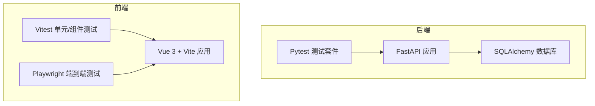
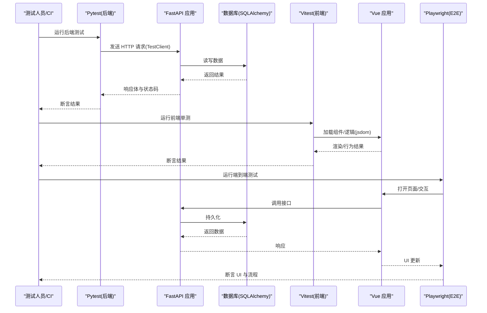
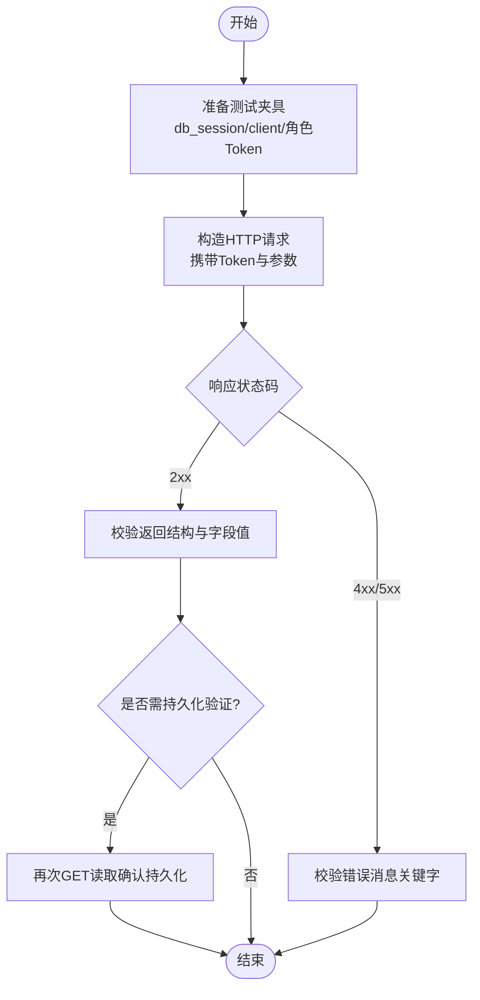
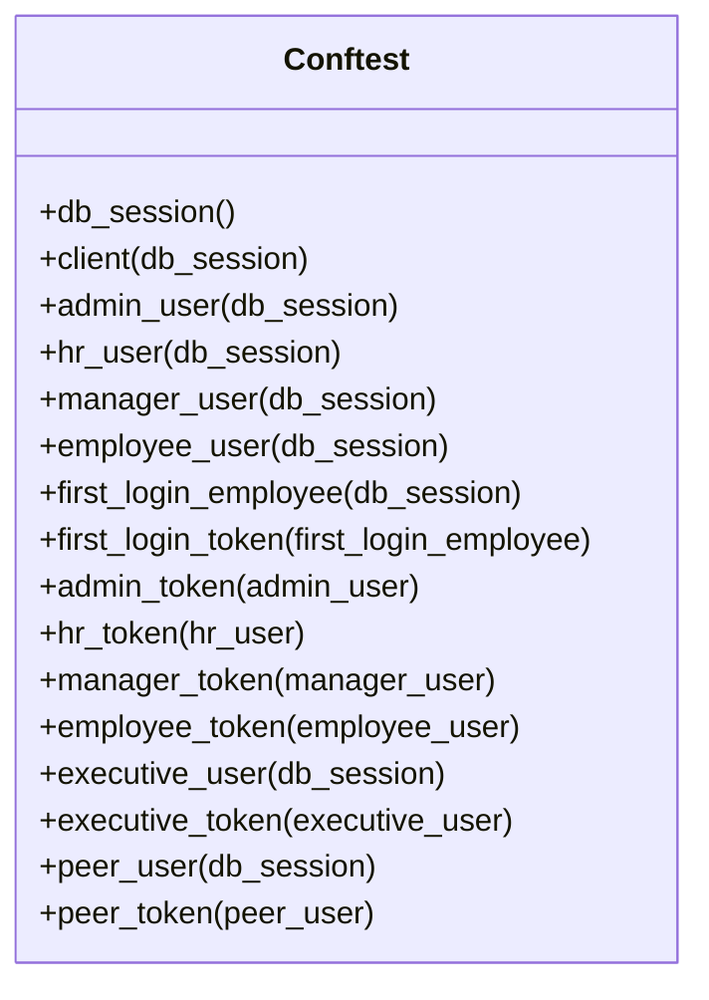
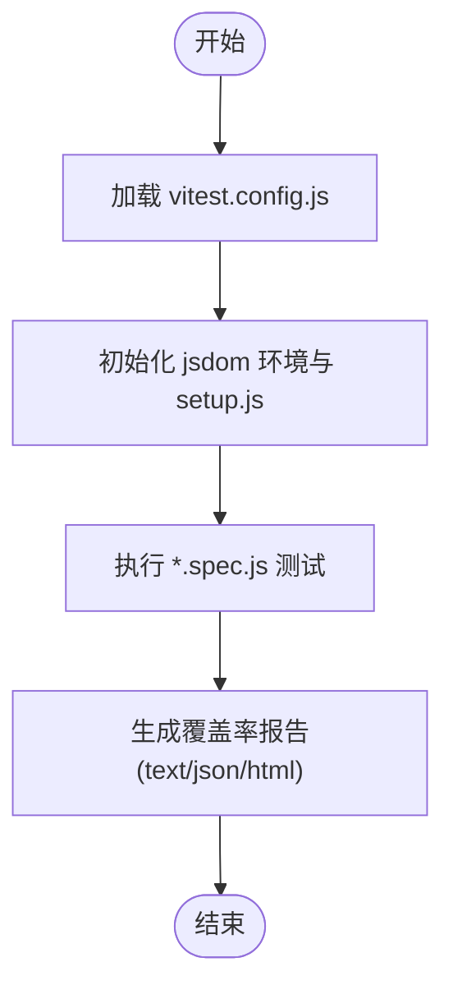
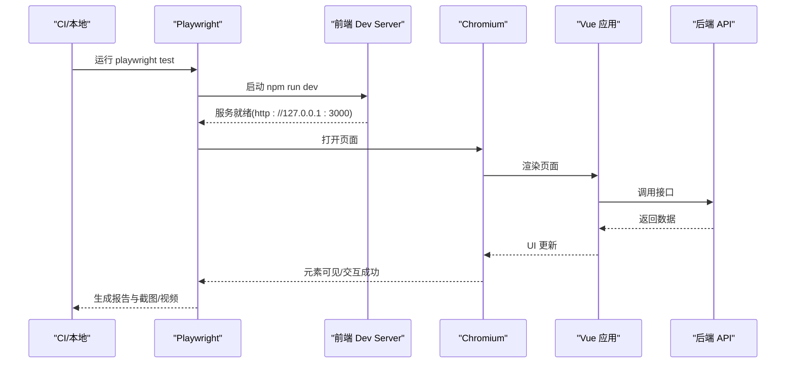
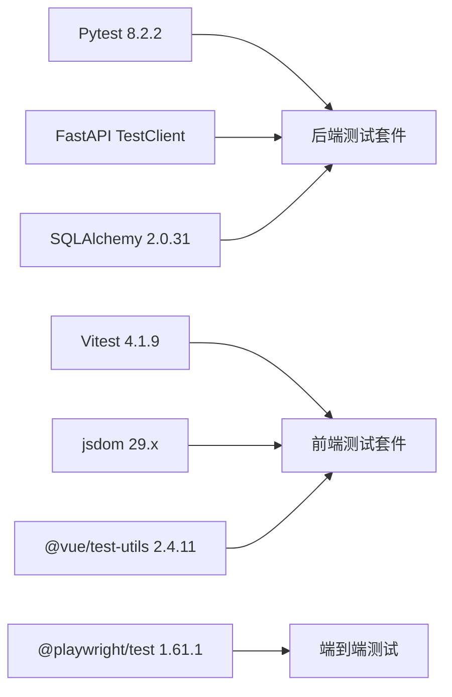

# 测试指南

<cite>
**本文引用的文件**   
- [backend/tests/README.md](file://backend/tests/README.md)
- [backend/tests/conftest.py](file://backend/tests/conftest.py)
- [backend/requirements.txt](file://backend/requirements.txt)
- [frontend/vitest.config.js](file://frontend/vitest.config.js)
- [frontend/playwright.config.ts](file://frontend/playwright.config.ts)
- [frontend/package.json](file://frontend/package.json)
- [frontend/tests/e2e/README.md](file://frontend/tests/e2e/README.md)
</cite>

## 目录
1. [引言](#引言)
2. [项目结构](#项目结构)
3. [核心组件](#核心组件)
4. [架构总览](#架构总览)
5. [详细组件分析](#详细组件分析)
6. [依赖关系分析](#依赖关系分析)
7. [性能与稳定性考虑](#性能与稳定性考虑)
8. [故障排查指南](#故障排查指南)
9. [结论](#结论)
10. [附录：命令与环境清单](#附录命令与环境清单)

## 引言
本测试指南面向绩效考核评分系统的后端、前端与端到端测试，目标是建立统一的测试策略、编写规范、数据准备方式、断言标准以及持续集成与报告输出方法。文档基于仓库中已有的测试基础设施与配置进行系统化梳理，帮助开发团队在新增功能或变更接口时，保持高质量、可回归的测试体系。

## 项目结构
本项目采用前后端分离架构，测试代码分别位于后端与前端的独立目录中：
- 后端测试：位于 `backend/tests`，使用 Pytest + FastAPI TestClient，覆盖认证、员工、部门、周期、KPI 模板、配置、仪表盘等模块。
- 前端测试：位于 `frontend/tests`，包含 Vitest 单元测试、组件测试、路由守卫测试、Store 测试，以及 Playwright 端到端测试。
- E2E 测试设计文档：位于 `frontend/tests/e2e/README.md`，按角色划分场景并给出选择器策略与运行命令。

**图示来源**
- [backend/tests/README.md:1-19](file://backend/tests/README.md#L1-L19)
- [frontend/vitest.config.js:1-25](file://frontend/vitest.config.js#L1-L25)
- [frontend/playwright.config.ts:1-67](file://frontend/playwright.config.ts#L1-L67)

**章节来源**
- [backend/tests/README.md:1-19](file://backend/tests/README.md#L1-L19)
- [frontend/tests/e2e/README.md:1-27](file://frontend/tests/e2e/README.md#L1-L27)

## 核心组件
本节聚焦测试体系的核心基础设施与关键配置：
- 后端测试夹具与数据库隔离：通过 `conftest.py` 提供内存 SQLite、TestClient 依赖注入、多角色用户与 Token 生成。
- 前端单元测试配置：通过 `vitest.config.js` 启用 jsdom 环境、全局 API、覆盖率统计与别名解析。
- 端到端测试配置：通过 `playwright.config.ts` 定义浏览器、并行策略、失败截图/视频、webServer 自动启动前端 Dev Server。
- 测试运行脚本：通过 `package.json` 暴露统一测试命令，便于本地与 CI 调用。

**章节来源**
- [backend/tests/conftest.py:1-313](file://backend/tests/conftest.py#L1-L313)
- [frontend/vitest.config.js:1-25](file://frontend/vitest.config.js#L1-L25)
- [frontend/playwright.config.ts:1-67](file://frontend/playwright.config.ts#L1-L67)
- [frontend/package.json:1-42](file://frontend/package.json#L1-L42)

## 架构总览
下图展示测试层与应用层的交互关系：后端通过 Pytest 直接调用 FastAPI 应用；前端通过 Vitest 对组件与逻辑进行单测；Playwright 驱动真实浏览器访问前端页面，并与后端服务协作完成业务流程验证。

**图示来源**
- [backend/tests/conftest.py:35-78](file://backend/tests/conftest.py#L35-L78)
- [frontend/vitest.config.js:5-18](file://frontend/vitest.config.js#L5-L18)
- [frontend/playwright.config.ts:11-65](file://frontend/playwright.config.ts#L11-L65)

## 详细组件分析

### 后端单元测试策略（Pytest）
后端测试以 Pytest 为核心，结合 FastAPI TestClient 对接口进行严格断言。测试规范强调：
- 正常路径必须验证返回结构与字段值，禁止仅检查状态码或键存在。
- 输入校验、认证授权、资源状态、分页搜索排序、软删除、限流、配置持久化等分支均需覆盖。
- 反模式包括仅检查状态码、宽松类型检查、缺少持久化回查等。

**图示来源**
- [backend/tests/README.md:32-75](file://backend/tests/README.md#L32-L75)
- [backend/tests/conftest.py:35-78](file://backend/tests/conftest.py#L35-L78)

**章节来源**
- [backend/tests/README.md:32-87](file://backend/tests/README.md#L32-L87)
- [backend/tests/conftest.py:35-78](file://backend/tests/conftest.py#L35-L78)

#### 测试夹具与数据准备
- 数据库夹具：使用临时 SQLite 文件 + StaticPool，确保多连接共享同一内存数据库，每个测试函数独立隔离。
- 客户端夹具：通过依赖注入替换 `get_db`，使所有路由指向测试数据库；同时清理生命周期钩子以避免重复初始化。
- 用户与角色夹具：预置 admin、hr、manager、employee、executive、peer 等角色及其关联 Employee，并提供对应 Token 生成夹具。
- 首次登录夹具：提供处于首登状态的用户与 Token，用于密码强制修改流程测试。

**图示来源**
- [backend/tests/conftest.py:35-313](file://backend/tests/conftest.py#L35-L313)

**章节来源**
- [backend/tests/conftest.py:35-313](file://backend/tests/conftest.py#L35-L313)

#### 断言方法与最佳实践
- 正常路径：验证状态码、返回对象结构、关键字段值、列表项字段完整性。
- 输入校验：必填缺失、格式错误、业务规则违反均返回 422，且错误消息包含预期关键字。
- 认证授权：无 Token 返回 401，无效/过期 Token 返回 401；多角色接口需验证各角色权限。
- 资源状态：不存在返回 404，重复创建返回 409，关联限制阻止删除返回 409，状态不可操作返回 409。
- 特殊逻辑：分页 total/page/size/items、关键词搜索 enriched 字段、排序顺序、软删除、文件上传 Content-Type、限流 429、配置更新后 GET 验证新值。

**章节来源**
- [backend/tests/README.md:32-75](file://backend/tests/README.md#L32-L75)

### 前端单元测试策略（Vitest）
前端测试使用 Vitest，配合 jsdom 环境模拟 DOM，支持组件测试、视图测试、路由守卫与 Store 测试。配置要点：
- 环境：jsdom，全局 API 开启。
- 设置文件：`tests/setup.js` 作为测试初始化入口。
- 排除目录：排除 e2e 与 node_modules。
- 覆盖率：v8 provider，输出 text/json/html，包含 src 下 vue/js 文件，排除 main.js、router、stores。
- 别名：`@` 指向 `src`。

**图示来源**
- [frontend/vitest.config.js:1-25](file://frontend/vitest.config.js#L1-L25)

**章节来源**
- [frontend/vitest.config.js:1-25](file://frontend/vitest.config.js#L1-L25)

### 端到端测试策略（Playwright）
端到端测试基于 Playwright，按角色划分场景，涵盖登录、仪表盘、导航跳转、表单交互、审批工作流、申诉归档等。配置要点：
- 测试目录：`tests/e2e`。
- baseURL：前端开发服务器 `http://127.0.0.1:3000`。
- 浏览器：Chromium（桌面版）。
- 并行与重试：CI 中禁用 test.only，失败重试 2 次，worker 数量限制为 1。
- 报告：list 与 html 报告，输出到 `playwright-report`。
- 调试：失败截图、首次重试录制视频、trace 收集。
- webServer：自动启动前端 dev server，复用本地已启动服务（非 CI）。

**图示来源**
- [frontend/playwright.config.ts:11-65](file://frontend/playwright.config.ts#L11-L65)
- [frontend/tests/e2e/README.md:22-27](file://frontend/tests/e2e/README.md#L22-L27)

**章节来源**
- [frontend/playwright.config.ts:11-65](file://frontend/playwright.config.ts#L11-L65)
- [frontend/tests/e2e/README.md:1-27](file://frontend/tests/e2e/README.md#L1-L27)

### 集成测试设计思路
集成测试关注跨模块与外部依赖的协作，建议覆盖以下场景：
- 数据库测试：使用 conftest 提供的 db_session 与静态池，保证事务隔离与数据一致性。
- API 接口测试：通过 TestClient 发起完整请求链路，验证状态码、响应结构与字段值。
- 业务流程测试：如认证→创建周期→分配员工→评分→审批→归档，串联多个接口与状态机。
- 配置持久化：修改配置后再次读取，确保写入生效。
- 并发与锁：针对强一致性与并发冲突场景，增加并发用例与锁机制验证。

**章节来源**
- [backend/tests/conftest.py:23-32](file://backend/tests/conftest.py#L23-L32)
- [backend/tests/README.md:67-75](file://backend/tests/README.md#L67-L75)

## 依赖关系分析
后端测试依赖 Pytest、FastAPI TestClient、SQLAlchemy、pytest 版本固定；前端测试依赖 Vitest、jsdom、@vue/test-utils、Playwright。这些依赖在 requirements.txt 与 package.json 中明确声明，便于环境复现与 CI 安装。

**图示来源**
- [backend/requirements.txt:1-15](file://backend/requirements.txt#L1-L15)
- [frontend/package.json:1-42](file://frontend/package.json#L1-L42)

**章节来源**
- [backend/requirements.txt:1-15](file://backend/requirements.txt#L1-L15)
- [frontend/package.json:1-42](file://frontend/package.json#L1-L42)

## 性能与稳定性考虑
- 后端测试：使用内存 SQLite + StaticPool 提升并发与隔离性；避免重复初始化生命周期钩子以减少开销。
- 前端单测：jsdom 环境轻量快速，适合组件与逻辑测试；覆盖率统计有助于识别未覆盖路径。
- E2E 测试：CI 中限制 worker 数量为 1，减少资源竞争；失败重试与截图/视频辅助定位问题；webServer 复用本地服务提升本地调试效率。

[本节为通用指导，不直接分析具体文件]

## 故障排查指南
- 后端测试失败：
  - 检查依赖注入是否正确替换 `get_db`，确保路由使用测试数据库。
  - 检查 fixture 是否在每个测试函数级别重建表结构，避免数据污染。
  - 检查 Token 生成夹具是否匹配用户角色与首次登录状态。
- 前端单测失败：
  - 检查 setup.js 是否正确初始化测试环境。
  - 检查覆盖率配置是否误排除了关键文件。
  - 检查组件挂载与事件触发是否在 jsdom 环境下可用。
- E2E 测试失败：
  - 检查前端 Dev Server 是否启动成功，baseURL 是否正确。
  - 检查选择器策略是否符合规范，避免宽泛文本导致 strict mode violation。
  - 查看失败截图与视频，定位 UI 状态与网络请求。

**章节来源**
- [backend/tests/conftest.py:46-78](file://backend/tests/conftest.py#L46-L78)
- [frontend/vitest.config.js:7-18](file://frontend/vitest.config.js#L7-L18)
- [frontend/playwright.config.ts:32-49](file://frontend/playwright.config.ts#L32-L49)
- [frontend/tests/e2e/README.md:145-157](file://frontend/tests/e2e/README.md#L145-L157)

## 结论
本测试指南总结了后端 Pytest 接口测试、前端 Vitest 单元/组件测试与 Playwright 端到端测试的策略与实践。通过严格的断言规范、完善的夹具与数据准备、合理的覆盖率与报告输出，以及清晰的 E2E 场景设计，团队可以在持续集成环境中稳定地保障质量。建议在新增功能或变更接口时，遵循“先写测试、再实现、再重构”的流程，确保测试覆盖与回归能力持续提升。

[本节为总结性内容，不直接分析具体文件]

## 附录：命令与环境清单
- 后端测试运行：
  - 全部测试：`cd backend && python -m pytest tests/ -v --tb=short`
  - 指定模块：`python -m pytest tests/test_auth.py -v`
  - Windows 批处理：`run_tests.bat` 或带参数的 `run_tests.bat auth`
- 前端测试运行：
  - 单测：`npm run test:unit`
  - 覆盖率：`npm run test:coverage`
  - E2E：`npm run test:e2e`
  - E2E UI：`npm run test:e2e:ui`
- 环境前提：
  - 后端服务启动：`uvicorn app.main:app --port 8000`
  - 前端 Dev Server：由 Playwright webServer 自动启动或手动 `npm run dev`

**章节来源**
- [backend/tests/README.md:88-107](file://backend/tests/README.md#L88-L107)
- [frontend/package.json:6-16](file://frontend/package.json#L6-L16)
- [frontend/tests/e2e/README.md:22-27](file://frontend/tests/e2e/README.md#L22-L27)
- [frontend/tests/e2e/README.md:161-182](file://frontend/tests/e2e/README.md#L161-L182)