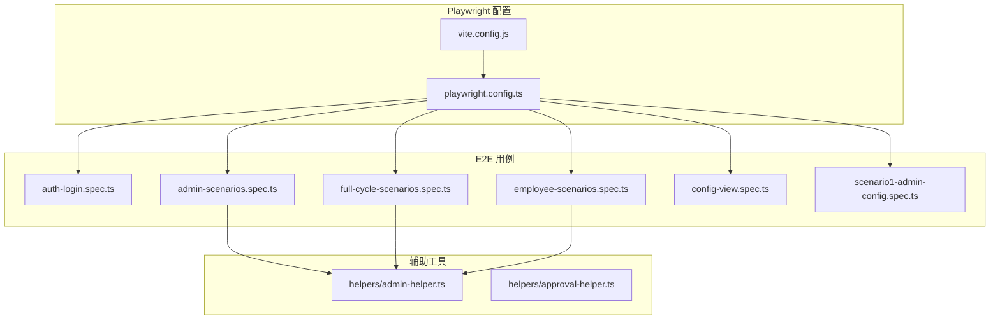
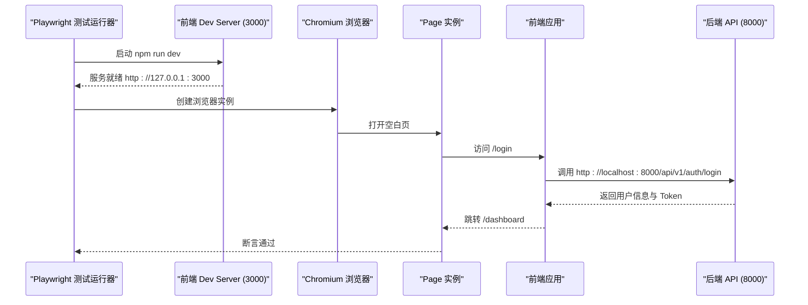
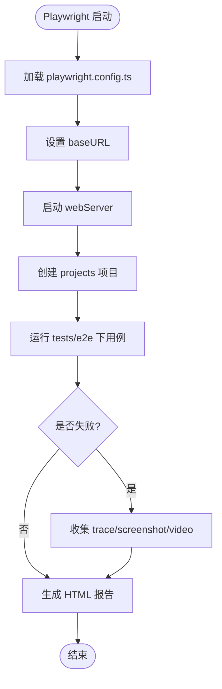
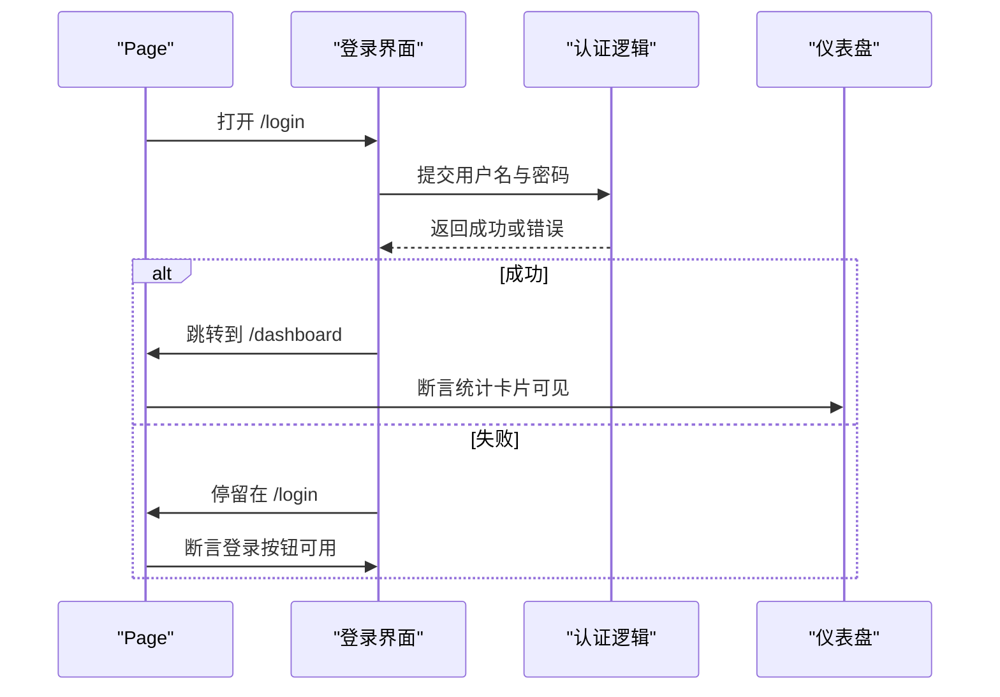
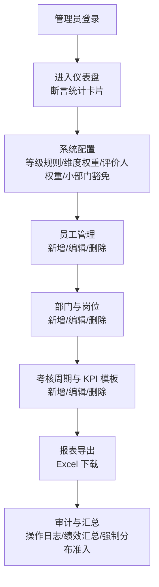
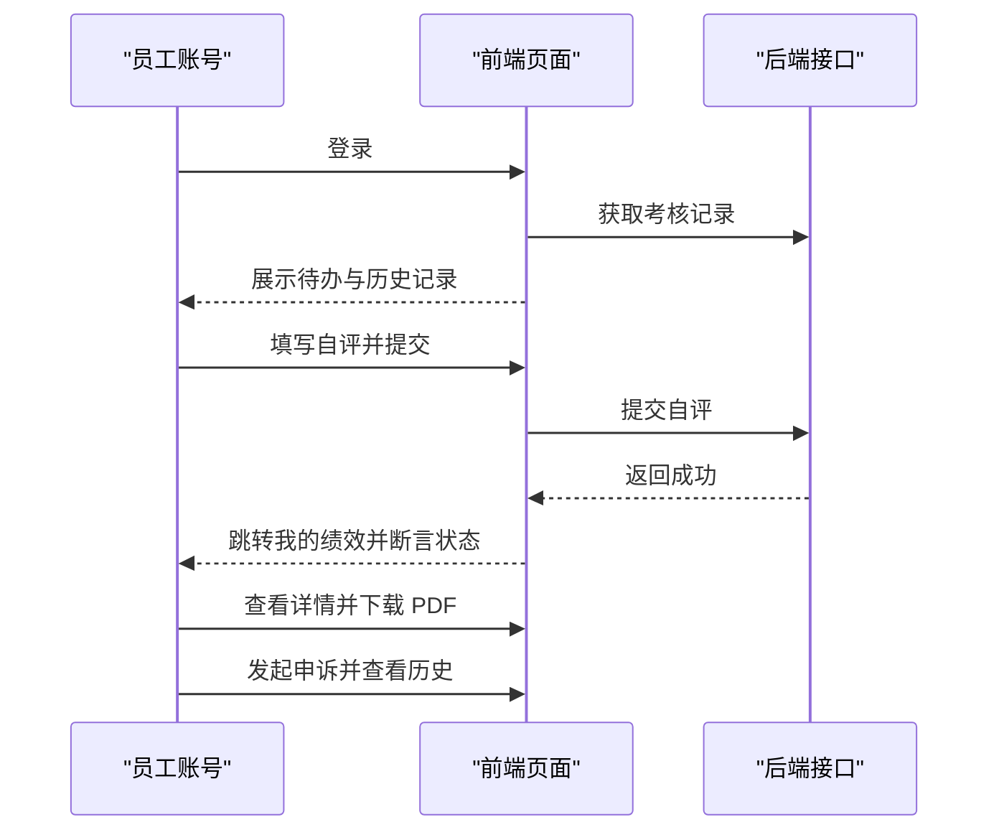
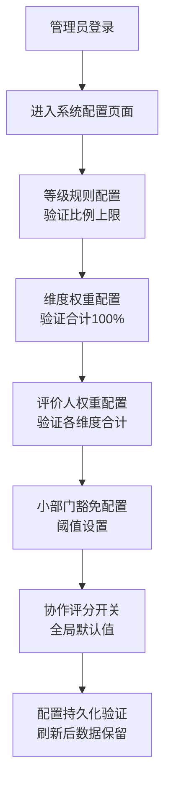
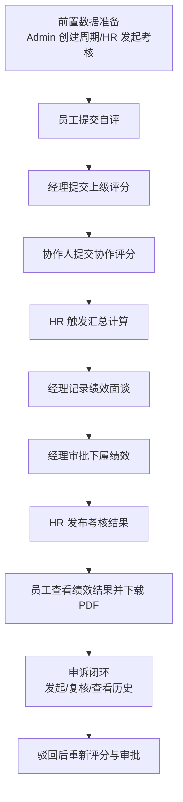
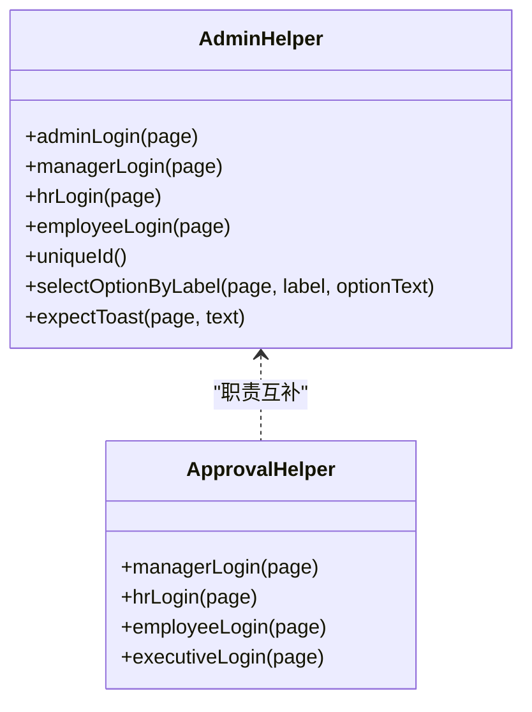
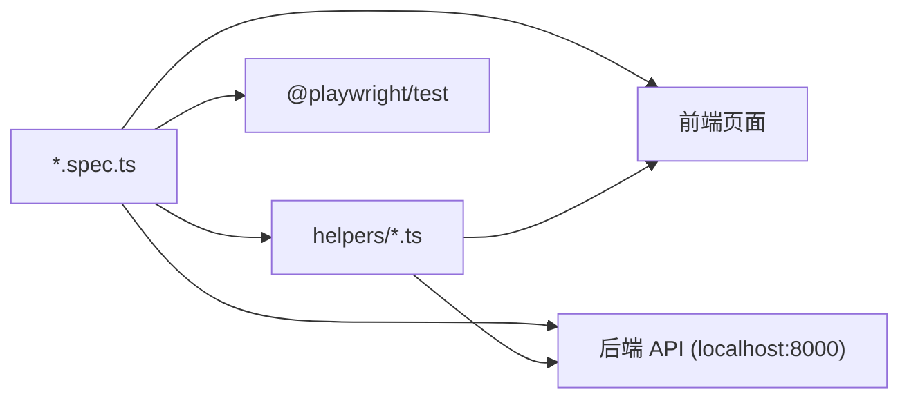

# 端到端测试

<cite>
**本文引用的文件**   
- [frontend/playwright.config.ts](file://frontend/playwright.config.ts)
- [frontend/vite.config.js](file://frontend/vite.config.js)
- [frontend/tests/e2e/README.md](file://frontend/tests/e2e/README.md)
- [frontend/tests/e2e/auth-login.spec.ts](file://frontend/tests/e2e/auth-login.spec.ts)
- [frontend/tests/e2e/admin-scenarios.spec.ts](file://frontend/tests/e2e/admin-scenarios.spec.ts)
- [frontend/tests/e2e/employee-scenarios.spec.ts](file://frontend/tests/e2e/employee-scenarios.spec.ts)
- [frontend/tests/e2e/full-cycle-scenarios.spec.ts](file://frontend/tests/e2e/full-cycle-scenarios.spec.ts)
- [frontend/tests/e2e/config-view.spec.ts](file://frontend/tests/e2e/config-view.spec.ts)
- [frontend/tests/e2e/scenario1-admin-config.spec.ts](file://frontend/tests/e2e/scenario1-admin-config.spec.ts)
- [frontend/tests/e2e/helpers/admin-helper.ts](file://frontend/tests/e2e/helpers/admin-helper.ts)
- [frontend/tests/e2e/helpers/approval-helper.ts](file://frontend/tests/e2e/helpers/approval-helper.ts)
</cite>

## 更新摘要
**所做更改**   
- 更新了后端API端点配置，从`http://localhost:8014`迁移到`http://localhost:8000`
- 更新了Vite代理配置以反映新的后端端口
- 更新了测试用例中的API调用端点
- 增强了环境配置说明和故障排查指南

## 目录
1. [引言](#引言)
2. [项目结构](#项目结构)
3. [核心组件](#核心组件)
4. [架构总览](#架构总览)
5. [详细组件分析](#详细组件分析)
6. [依赖关系分析](#依赖关系分析)
7. [性能与稳定性考虑](#性能与稳定性考虑)
8. [故障排查指南](#故障排查指南)
9. [结论](#结论)
10. [附录：运行命令与最佳实践](#附录运行命令与最佳实践)

## 引言
本文件面向绩效考核评分系统的端到端（E2E）测试，聚焦 Playwright 框架在本项目中的配置、使用方式与扩展方案。文档从系统架构、测试组织、页面交互、元素定位、截图与视频录制、多浏览器兼容性、并行执行、调试模式、CI/CD 集成与报告生成等维度展开，帮助读者快速理解并高质量维护现有 E2E 用例。

本项目的前端 E2E 测试位于 `frontend/tests/e2e`，由 Playwright 驱动 Chromium 浏览器，自动启动前端开发服务器，并通过真实登录流程与业务页面断言完成验收。**后端服务已统一迁移至 `http://localhost:8000` 端口**，测试覆盖管理员、HR、经理、员工、协作人、高层管理者等多角色场景，以及完整考核周期、申诉闭环、驳回重评等复杂业务流程。

## 项目结构
E2E 测试相关代码主要分布在以下位置：
- 配置层：`frontend/playwright.config.ts`、`frontend/vite.config.js`
- 用例层：`frontend/tests/e2e/*.spec.ts`
- 辅助工具：`frontend/tests/e2e/helpers/*.ts`
- 设计说明：`frontend/tests/e2e/README.md`

**图表来源**
- [frontend/playwright.config.ts:11-66](file://frontend/playwright.config.ts#L11-L66)
- [frontend/vite.config.js:12-21](file://frontend/vite.config.js#L12-L21)
- [frontend/tests/e2e/auth-login.spec.ts:1-114](file://frontend/tests/e2e/auth-login.spec.ts#L1-L114)
- [frontend/tests/e2e/admin-scenarios.spec.ts:1-733](file://frontend/tests/e2e/admin-scenarios.spec.ts#L1-L733)
- [frontend/tests/e2e/employee-scenarios.spec.ts:1-504](file://frontend/tests/e2e/employee-scenarios.spec.ts#L1-L504)
- [frontend/tests/e2e/full-cycle-scenarios.spec.ts:1-800](file://frontend/tests/e2e/full-cycle-scenarios.spec.ts#L1-L800)
- [frontend/tests/e2e/config-view.spec.ts:1-222](file://frontend/tests/e2e/config-view.spec.ts#L1-L222)
- [frontend/tests/e2e/scenario1-admin-config.spec.ts:1-171](file://frontend/tests/e2e/scenario1-admin-config.spec.ts#L1-L171)
- [frontend/tests/e2e/helpers/admin-helper.ts:1-77](file://frontend/tests/e2e/helpers/admin-helper.ts#L1-L77)
- [frontend/tests/e2e/helpers/approval-helper.ts:1-34](file://frontend/tests/e2e/helpers/approval-helper.ts#L1-L34)

**章节来源**
- [frontend/playwright.config.ts:1-67](file://frontend/playwright.config.ts#L1-L67)
- [frontend/vite.config.js:1-27](file://frontend/vite.config.js#L1-L27)
- [frontend/tests/e2e/README.md:1-183](file://frontend/tests/e2e/README.md#L1-L183)

## 核心组件
- **Playwright 配置中心**：定义测试目录、超时、并行策略、重试、报告、基础 URL、追踪、截图、视频、浏览器设备、webServer 自动启动等。
- **Vite 代理配置**：配置前端开发服务器的 API 代理到后端 `http://localhost:8000`。
- **登录与权限用例**：验证登录成功、失败、未登录重定向、首次登录强制改密等。
- **管理员场景用例**：仪表盘、系统配置、员工管理、部门岗位、考核周期、KPI 模板、报表导出、审计日志、汇总与强制分布准入等。
- **员工场景用例**：自评提交、草稿保存、我的绩效查看、PDF 下载、申诉发起与历史查看。
- **全链路场景用例**：完整考核 Happy Path、申诉闭环、驳回后重新评分。
- **配置管理用例**：系统配置页面的等级规则、维度权重、评价人权重、小部门豁免、协作评分开关等功能测试。
- **辅助工具**：统一登录封装、唯一 ID 生成、Element Plus 下拉选择、Toast 断言、审批相关登录封装。

**章节来源**
- [frontend/playwright.config.ts:11-66](file://frontend/playwright.config.ts#L11-L66)
- [frontend/vite.config.js:12-21](file://frontend/vite.config.js#L12-L21)
- [frontend/tests/e2e/auth-login.spec.ts:8-112](file://frontend/tests/e2e/auth-login.spec.ts#L8-L112)
- [frontend/tests/e2e/admin-scenarios.spec.ts:38-731](file://frontend/tests/e2e/admin-scenarios.spec.ts#L38-L731)
- [frontend/tests/e2e/employee-scenarios.spec.ts:160-503](file://frontend/tests/e2e/employee-scenarios.spec.ts#L160-L503)
- [frontend/tests/e2e/full-cycle-scenarios.spec.ts:268-800](file://frontend/tests/e2e/full-cycle-scenarios.spec.ts#L268-L800)
- [frontend/tests/e2e/config-view.spec.ts:9-221](file://frontend/tests/e2e/config-view.spec.ts#L9-L221)
- [frontend/tests/e2e/scenario1-admin-config.spec.ts:4-169](file://frontend/tests/e2e/scenario1-admin-config.spec.ts#L4-L169)
- [frontend/tests/e2e/helpers/admin-helper.ts:6-74](file://frontend/tests/e2e/helpers/admin-helper.ts#L6-L74)
- [frontend/tests/e2e/helpers/approval-helper.ts:3-33](file://frontend/tests/e2e/helpers/approval-helper.ts#L3-L33)

## 架构总览
Playwright 在运行时负责：
- 启动或复用前端 dev server（基于 `webServer.command`）。
- 根据 `projects` 配置实例化浏览器设备（当前为 Desktop Chrome）。
- 在每个测试中注入 `page` 对象，驱动页面导航、表单输入、点击、等待、断言。
- 在失败或重试时收集 trace、screenshot、video，并生成 HTML 报告。

**更新** 后端服务已统一迁移至 `http://localhost:8000` 端口，所有 API 调用均指向新端口。

**图表来源**
- [frontend/playwright.config.ts:32-49](file://frontend/playwright.config.ts#L32-L49)
- [frontend/playwright.config.ts:52-66](file://frontend/playwright.config.ts#L52-L66)
- [frontend/vite.config.js:12-21](file://frontend/vite.config.js#L12-L21)
- [frontend/tests/e2e/auth-login.spec.ts:9-37](file://frontend/tests/e2e/auth-login.spec.ts#L9-L37)

## 详细组件分析

### Playwright 配置与运行模型
- 测试目录：`tests/e2e`
- 基础地址：`http://127.0.0.1:3000`
- 超时：60 秒
- 并行：关闭文件级并行；CI 限制 worker 数量为 1
- 重试：CI 环境失败重试 2 次
- 报告：列表输出 + HTML 报告输出到 `playwright-report`
- 追踪与诊断：首次失败时启用 trace、截图、视频
- 浏览器设备：Desktop Chrome
- webServer：自动启动 `npm run dev`，CI 不复用本地已启动服务

**图表来源**
- [frontend/playwright.config.ts:11-66](file://frontend/playwright.config.ts#L11-L66)

**章节来源**
- [frontend/playwright.config.ts:11-66](file://frontend/playwright.config.ts#L11-L66)

### Vite 代理配置
Vite 开发服务器配置了 API 代理，将所有 `/api` 请求转发到后端服务：
- 代理目标：`http://localhost:8000`
- 路径重写：保持原路径不变
- 跨域处理：启用 `changeOrigin`

**更新** 代理目标已从旧的 `http://localhost:8014` 更新为 `http://localhost:8000`。

**章节来源**
- [frontend/vite.config.js:12-21](file://frontend/vite.config.js#L12-L21)

### 登录与权限控制测试
登录流程测试覆盖：
- 管理员成功登录后进入仪表盘，断言关键统计卡片可见。
- 登录失败停留在登录页，断言按钮恢复可点击。
- 未登录访问受保护页面被重定向到登录页。
- 首次登录弹出修改密码弹窗，弱密码校验拦截，合法密码提交后弹窗关闭并登出。

**图表来源**
- [frontend/tests/e2e/auth-login.spec.ts:9-52](file://frontend/tests/e2e/auth-login.spec.ts#L9-L52)

**章节来源**
- [frontend/tests/e2e/auth-login.spec.ts:8-112](file://frontend/tests/e2e/auth-login.spec.ts#L8-L112)

### 管理员场景测试
管理员场景覆盖仪表盘、系统配置、员工管理、部门与岗位、考核周期、KPI 模板、报表导出、审计日志、汇总与强制分布准入等。典型断言包括：
- 仪表盘全局统计与角色隔离。
- 等级规则与维度权重持久化。
- 维度权重合计不等于 100 时禁用保存。
- 新增/编辑/删除员工并刷新列表。
- 新增/编辑/删除部门与岗位。
- 新增/编辑/删除考核周期与 KPI 模板。
- 导出 Excel 并断言文件名后缀。
- 操作日志审计与绩效汇总页面准入。

**图表来源**
- [frontend/tests/e2e/admin-scenarios.spec.ts:38-731](file://frontend/tests/e2e/admin-scenarios.spec.ts#L38-L731)

**章节来源**
- [frontend/tests/e2e/admin-scenarios.spec.ts:38-731](file://frontend/tests/e2e/admin-scenarios.spec.ts#L38-L731)

### 员工场景测试
员工场景覆盖：
- 登录后仪表盘显示员工专属统计与快捷入口。
- 进入自评页面并提交自评。
- 保存自评草稿并回显。
- 查看我的绩效、下载 PDF 档案。
- 发起申诉并查看申诉历史。

**图表来源**
- [frontend/tests/e2e/employee-scenarios.spec.ts:160-503](file://frontend/tests/e2e/employee-scenarios.spec.ts#L160-L503)

**章节来源**
- [frontend/tests/e2e/employee-scenarios.spec.ts:160-503](file://frontend/tests/e2e/employee-scenarios.spec.ts#L160-L503)

### 配置管理测试
配置管理测试覆盖系统配置页面的各项功能：
- 等级规则配置与验证
- 维度权重配置与合计验证
- 评价人权重配置与维度验证
- 小部门豁免配置
- 协作评分开关配置
- 配置持久化验证

**更新** 所有配置 API 调用已更新为使用新的后端端口 `http://localhost:8000`。

**图表来源**
- [frontend/tests/e2e/config-view.spec.ts:9-221](file://frontend/tests/e2e/config-view.spec.ts#L9-L221)
- [frontend/tests/e2e/scenario1-admin-config.spec.ts:4-169](file://frontend/tests/e2e/scenario1-admin-config.spec.ts#L4-L169)

**章节来源**
- [frontend/tests/e2e/config-view.spec.ts:9-221](file://frontend/tests/e2e/config-view.spec.ts#L9-L221)
- [frontend/tests/e2e/scenario1-admin-config.spec.ts:4-169](file://frontend/tests/e2e/scenario1-admin-config.spec.ts#L4-L169)

### 全链路场景测试
全链路场景覆盖完整绩效考核 Happy Path、申诉闭环、驳回后重新评分。关键步骤包括：
- Admin 创建周期，HR 发起考核。
- 员工自评、经理评分、协作评分。
- HR 触发汇总计算。
- 经理记录面谈。
- 经理审批下属绩效。
- HR 发布结果。
- 员工查看结果并下载 PDF。
- 申诉发起、HR 复核处理、员工查看申诉历史。
- 驳回后重新评分与再次审批。

**图表来源**
- [frontend/tests/e2e/full-cycle-scenarios.spec.ts:268-800](file://frontend/tests/e2e/full-cycle-scenarios.spec.ts#L268-L800)

**章节来源**
- [frontend/tests/e2e/full-cycle-scenarios.spec.ts:268-800](file://frontend/tests/e2e/full-cycle-scenarios.spec.ts#L268-L800)

### 测试辅助工具
- 管理员登录助手：封装 admin、manager、hr、employee 登录流程，提供 `uniqueId` 与 Element Plus 下拉选择、Toast 断言辅助。
- 审批助手：封装 manager、hr、employee、executive 登录流程，便于跨页面审批场景复用。

**图表来源**
- [frontend/tests/e2e/helpers/admin-helper.ts:6-74](file://frontend/tests/e2e/helpers/admin-helper.ts#L6-L74)
- [frontend/tests/e2e/helpers/approval-helper.ts:3-33](file://frontend/tests/e2e/helpers/approval-helper.ts#L3-L33)

**章节来源**
- [frontend/tests/e2e/helpers/admin-helper.ts:1-77](file://frontend/tests/e2e/helpers/admin-helper.ts#L1-L77)
- [frontend/tests/e2e/helpers/approval-helper.ts:1-34](file://frontend/tests/e2e/helpers/approval-helper.ts#L1-L34)

## 依赖关系分析
- 用例对 Playwright 的依赖：`test`、`expect`、`page`、`page.request`。
- 用例对辅助工具的依赖：`admin-helper.ts`、`approval-helper.ts`。
- 用例对前端页面的依赖：通过 `baseURL` 与相对路径访问 `/login`、`/dashboard`、`/employees`、`/cycles`、`/reports`、`/self-assessment`、`/my-performance`、`/appeal`、`/approval-workbench`、`/interviews` 等。
- 用例对后端 API 的依赖：通过 `page.request` 直接调用认证、周期、员工、评分、协作评审、申诉等接口，用于前置数据准备与状态推进。**所有 API 调用已更新为使用新的后端端口 `http://localhost:8000`**。

**图表来源**
- [frontend/tests/e2e/admin-scenarios.spec.ts:1-733](file://frontend/tests/e2e/admin-scenarios.spec.ts#L1-L733)
- [frontend/tests/e2e/employee-scenarios.spec.ts:1-504](file://frontend/tests/e2e/employee-scenarios.spec.ts#L1-L504)
- [frontend/tests/e2e/full-cycle-scenarios.spec.ts:1-800](file://frontend/tests/e2e/full-cycle-scenarios.spec.ts#L1-L800)
- [frontend/tests/e2e/config-view.spec.ts:1-222](file://frontend/tests/e2e/config-view.spec.ts#L1-L222)
- [frontend/tests/e2e/scenario1-admin-config.spec.ts:1-171](file://frontend/tests/e2e/scenario1-admin-config.spec.ts#L1-L171)
- [frontend/tests/e2e/helpers/admin-helper.ts:1-77](file://frontend/tests/e2e/helpers/admin-helper.ts#L1-L77)
- [frontend/tests/e2e/helpers/approval-helper.ts:1-34](file://frontend/tests/e2e/helpers/approval-helper.ts#L1-L34)

**章节来源**
- [frontend/tests/e2e/admin-scenarios.spec.ts:1-733](file://frontend/tests/e2e/admin-scenarios.spec.ts#L1-L733)
- [frontend/tests/e2e/employee-scenarios.spec.ts:1-504](file://frontend/tests/e2e/employee-scenarios.spec.ts#L1-L504)
- [frontend/tests/e2e/full-cycle-scenarios.spec.ts:1-800](file://frontend/tests/e2e/full-cycle-scenarios.spec.ts#L1-L800)
- [frontend/tests/e2e/config-view.spec.ts:1-222](file://frontend/tests/e2e/config-view.spec.ts#L1-L222)
- [frontend/tests/e2e/scenario1-admin-config.spec.ts:1-171](file://frontend/tests/e2e/scenario1-admin-config.spec.ts#L1-L171)

## 性能与稳定性考虑
- 并行与 Worker：当前关闭文件级并行，CI 限制 worker 数量为 1，降低资源竞争与状态污染风险。
- 重试机制：CI 环境失败重试 2 次，提升不稳定用例通过率。
- 超时设置：默认 60 秒，配合 `waitForLoadState('networkidle')` 与显式等待，减少偶发超时。
- 追踪与诊断：首次失败时启用 trace、截图、视频，便于定位问题。
- 报告输出：HTML 报告集中输出到 `playwright-report`，便于归档与分析。

建议：
- 对于稳定且无状态污染的页面级用例，可在未来开启 `fullyParallel: true` 并合理拆分测试文件以提升速度。
- 对网络敏感的用例优先使用 `waitForResponse` 或 `waitForLoadState('networkidle')`，避免固定 `waitForTimeout`。
- 对长流程用例使用 `test.describe.serial` 保证顺序执行，避免并发导致的状态冲突。
- **确保后端服务运行在正确的端口 `http://localhost:8000`**。

**章节来源**
- [frontend/playwright.config.ts:14-30](file://frontend/playwright.config.ts#L14-L30)
- [frontend/playwright.config.ts:32-49](file://frontend/playwright.config.ts#L32-L49)
- [frontend/tests/e2e/full-cycle-scenarios.spec.ts:268-800](file://frontend/tests/e2e/full-cycle-scenarios.spec.ts#L268-L800)

## 故障排查指南
常见问题与定位方法：
- **后端连接失败**：检查后端服务是否运行在 `http://localhost:8000`，确认 `/api/v1/health` 响应正常。
- 登录失败或重定向异常：检查 `baseURL` 与前端 dev server 是否启动，确认 `/api/v1/auth/login` 响应正常。
- 元素定位失败：优先使用语义化选择器如 `getByRole`、`getByPlaceholder`、`getByText`，避免宽泛文本匹配。
- 弹窗与 Toast 断言失败：使用 `.el-message-box`、`.el-message--success`、`.el-message` 等容器进行断言。
- 下载文件失败：使用 `page.waitForEvent('download')` 捕获下载事件并断言文件名或路径。
- 流程状态不一致：通过 `page.request` 调用后端接口推进状态，或使用测试辅助接口模拟中间态。

**更新** 后端服务端口已从 `http://localhost:8014` 迁移至 `http://localhost:8000`，请确保所有配置和脚本都指向新端口。

参考实现路径：
- 登录与错误提示断言：[auth-login.spec.ts:39-52](file://frontend/tests/e2e/auth-login.spec.ts#L39-L52)
- 首次登录弹窗与弱密码校验：[auth-login.spec.ts:60-112](file://frontend/tests/e2e/auth-login.spec.ts#L60-L112)
- 下载 Excel/PDF 断言：[admin-scenarios.spec.ts:251-281](file://frontend/tests/e2e/admin-scenarios.spec.ts#L251-L281)、[employee-scenarios.spec.ts:355-365](file://frontend/tests/e2e/employee-scenarios.spec.ts#L355-L365)
- 弹窗与确认对话框：[full-cycle-scenarios.spec.ts:438-451](file://frontend/tests/e2e/full-cycle-scenarios.spec.ts#L438-L451)
- 配置 API 调用示例：[config-view.spec.ts:14-47](file://frontend/tests/e2e/config-view.spec.ts#L14-L47)、[scenario1-admin-config.spec.ts:9-42](file://frontend/tests/e2e/scenario1-admin-config.spec.ts#L9-L42)

**章节来源**
- [frontend/tests/e2e/auth-login.spec.ts:39-112](file://frontend/tests/e2e/auth-login.spec.ts#L39-L112)
- [frontend/tests/e2e/admin-scenarios.spec.ts:251-281](file://frontend/tests/e2e/admin-scenarios.spec.ts#L251-L281)
- [frontend/tests/e2e/employee-scenarios.spec.ts:355-365](file://frontend/tests/e2e/employee-scenarios.spec.ts#L355-L365)
- [frontend/tests/e2e/full-cycle-scenarios.spec.ts:438-451](file://frontend/tests/e2e/full-cycle-scenarios.spec.ts#L438-L451)
- [frontend/tests/e2e/config-view.spec.ts:14-47](file://frontend/tests/e2e/config-view.spec.ts#L14-L47)
- [frontend/tests/e2e/scenario1-admin-config.spec.ts:9-42](file://frontend/tests/e2e/scenario1-admin-config.spec.ts#L9-L42)

## 结论
本项目的 E2E 测试以 Playwright 为核心，围绕多角色、多页面、多流程的业务特性构建。**后端服务已成功迁移至 `http://localhost:8000` 端口**，所有相关配置和测试用例均已更新。通过统一的辅助工具与稳定的配置，测试覆盖了登录鉴权、系统配置、主数据管理、考核周期、评分与审批、申诉闭环等关键环节。建议在后续迭代中逐步引入多浏览器矩阵、更细粒度的并行策略与更完善的 CI/CD 集成，进一步提升测试覆盖率与执行效率。

## 附录：运行命令与最佳实践
- 运行所有角色场景测试：`npm run test:e2e`
- 运行单个角色场景：按文件路径指定，例如 `npx playwright test tests/e2e/admin-scenarios.spec.ts --project=chromium`
- 有头模式观察：`npx playwright test --project=chromium --headed`
- UI 调试模式：`npm run test:e2e:ui`

**更新** 环境前提要求：
- 后端服务必须运行在 `http://localhost:8000`
- 前端开发服务器运行在 `http://localhost:3000`
- 数据库已初始化并包含基础种子数据

最佳实践要点：
- 使用语义化选择器，避免宽泛文本匹配导致的严格模式冲突。
- 对网络请求使用 `waitForResponse` 或 `waitForLoadState('networkidle')`，减少硬等待。
- 对长流程用例使用 `test.describe.serial` 保证顺序执行。
- 对下载类用例使用 `page.waitForEvent('download')` 捕获并断言。
- 对失败用例利用 trace、截图、视频与 HTML 报告进行定位。
- **确保后端服务始终运行在正确的端口 `http://localhost:8000`**。

**章节来源**
- [frontend/tests/e2e/README.md:161-182](file://frontend/tests/e2e/README.md#L161-L182)
- [frontend/tests/e2e/README.md:4-5](file://frontend/tests/e2e/README.md#L4-L5)