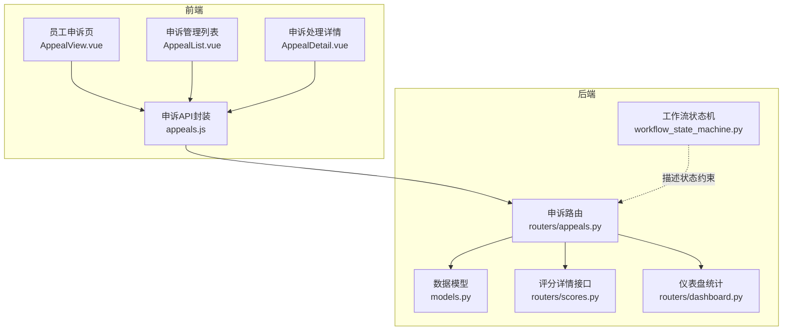
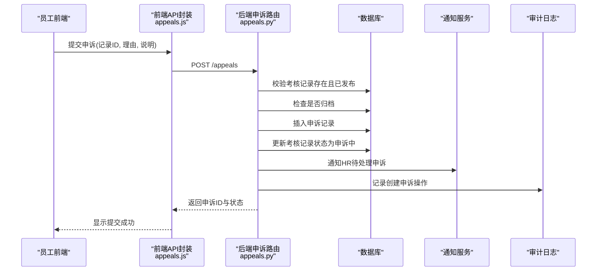
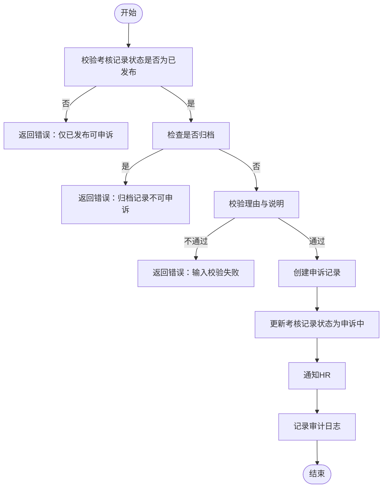
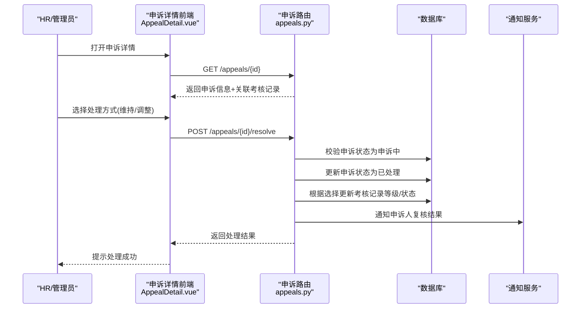
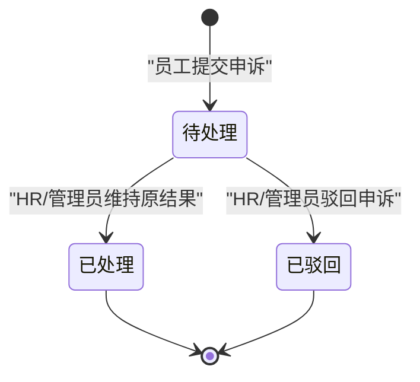
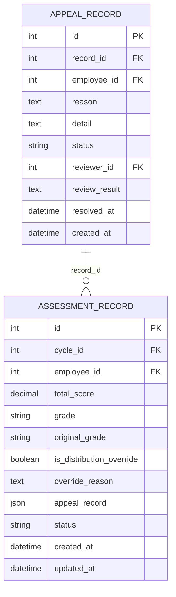
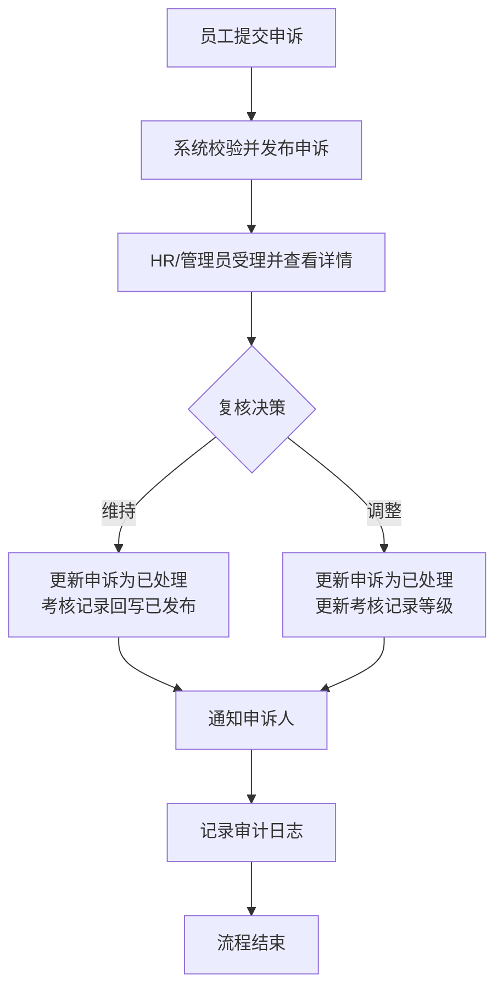
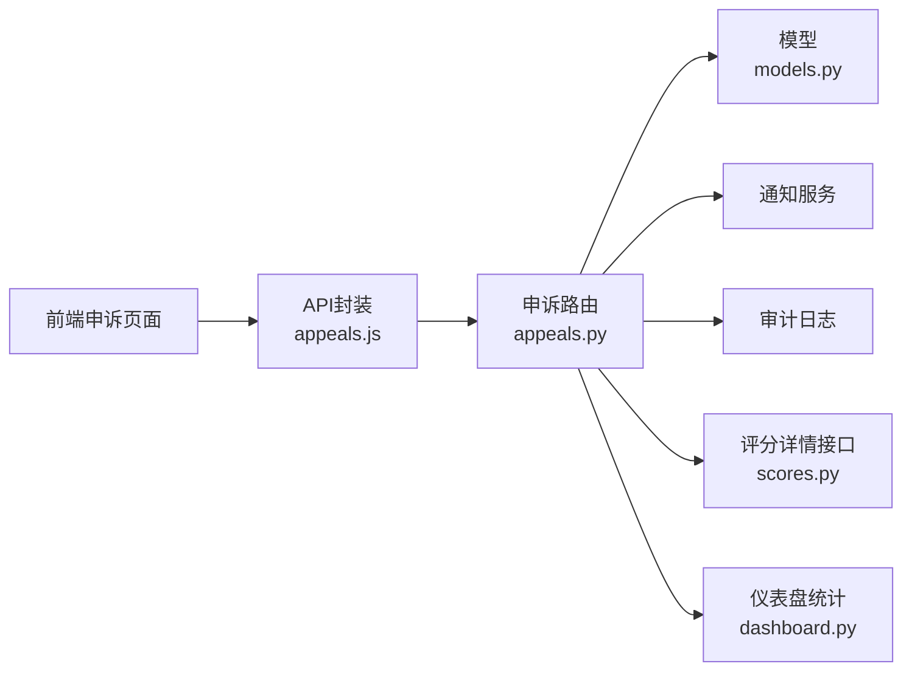

# 申诉处理系统

<cite>
**本文引用的文件**   
- [backend/app/routers/appeals.py](file://backend/app/routers/appeals.py)
- [backend/app/models.py](file://backend/app/models.py)
- [backend/app/utils/workflow_state_machine.py](file://backend/app/utils/workflow_state_machine.py)
- [backend/app/routers/scores.py](file://backend/app/routers/scores.py)
- [backend/app/routers/dashboard.py](file://backend/app/routers/dashboard.py)
- [frontend/src/api/appeals.js](file://frontend/src/api/appeals.js)
- [frontend/src/views/appeal/AppealView.vue](file://frontend/src/views/appeal/AppealView.vue)
- [frontend/src/views/appeal/AppealList.vue](file://frontend/src/views/appeal/AppealList.vue)
- [frontend/src/views/appeal/AppealDetail.vue](file://frontend/src/views/appeal/AppealDetail.vue)
</cite>

## 目录
1. [引言](#引言)
2. [项目结构](#项目结构)
3. [核心组件](#核心组件)
4. [架构总览](#架构总览)
5. [详细组件分析](#详细组件分析)
6. [依赖关系分析](#依赖关系分析)
7. [性能与扩展性考虑](#性能与扩展性考虑)
8. [故障排查指南](#故障排查指南)
9. [结论](#结论)
10. [附录：API 接口与前端使用说明](#附录api-接口与前端使用说明)

## 引言
本文件面向“绩效考核评分系统”中的申诉处理子系统，目标是帮助读者理解从员工发起申诉、HR/管理员复核到最终裁决的全流程，包括业务规则、数据模型、状态流转、前后端交互方式，以及与绩效考核数据的关联关系。文档同时提供可操作的 API 说明和前端界面使用指引，便于开发、测试与运维人员快速上手。

## 项目结构
申诉功能横跨后端路由、数据模型、工作流状态机以及前端多个页面与 API 封装模块：
- 后端
  - 路由层：负责接收请求、校验参数、执行业务逻辑、持久化数据、触发通知与审计日志。
  - 模型层：定义申诉记录、考核记录等实体及其关系。
  - 工具层：工作流状态机描述主流程及申诉分支的状态约束。
  - 其他服务：评分详情、仪表盘统计等模块会读取或展示申诉相关数据。
- 前端
  - 员工侧：查看已发布考核结果、发起申诉、查看申诉历史。
  - HR/管理侧：申诉列表查询、申诉详情查看、复核处理（维持或调整等级）。

**图表来源**
- [backend/app/routers/appeals.py:1-381](file://backend/app/routers/appeals.py#L1-L381)
- [backend/app/models.py:99-210](file://backend/app/models.py#L99-L210)
- [backend/app/utils/workflow_state_machine.py:10-35](file://backend/app/utils/workflow_state_machine.py#L10-L35)
- [frontend/src/api/appeals.js:1-26](file://frontend/src/api/appeals.js#L1-L26)
- [frontend/src/views/appeal/AppealView.vue:1-233](file://frontend/src/views/appeal/AppealView.vue#L1-L233)
- [frontend/src/views/appeal/AppealList.vue:1-126](file://frontend/src/views/appeal/AppealList.vue#L1-L126)
- [frontend/src/views/appeal/AppealDetail.vue:1-231](file://frontend/src/views/appeal/AppealDetail.vue#L1-L231)

**章节来源**
- [backend/app/routers/appeals.py:1-381](file://backend/app/routers/appeals.py#L1-L381)
- [backend/app/models.py:99-210](file://backend/app/models.py#L99-L210)
- [backend/app/utils/workflow_state_machine.py:10-35](file://backend/app/utils/workflow_state_machine.py#L10-L35)
- [frontend/src/api/appeals.js:1-26](file://frontend/src/api/appeals.js#L1-L26)
- [frontend/src/views/appeal/AppealView.vue:1-233](file://frontend/src/views/appeal/AppealView.vue#L1-L233)
- [frontend/src/views/appeal/AppealList.vue:1-126](file://frontend/src/views/appeal/AppealList.vue#L1-L126)
- [frontend/src/views/appeal/AppealDetail.vue:1-231](file://frontend/src/views/appeal/AppealDetail.vue#L1-L231)

## 核心组件
- 申诉路由与业务逻辑
  - 提供申诉创建、列表查询、详情获取、复核处理、终审解决等能力。
  - 关键校验：仅已发布的考核记录可申诉；理由必填且长度限制；详细说明不少于20字；归档保护；状态机约束。
- 数据模型
  - AppealRecord：申诉记录实体，包含申诉人、被申诉的考核记录、理由、详情、处理人、处理结果、时间戳等。
  - AssessmentRecord：考核记录实体，包含总分、等级、原始等级、强制分布标记、申诉快照 JSON、状态等。
- 工作流状态机
  - 定义主流程状态及申诉分支：已发布 → 申诉中 → 已发布。
- 前端页面
  - 员工侧：可申诉记录列表、申诉表单、申诉历史时间线。
  - HR/管理侧：申诉列表、申诉详情、复核处理表单。
- 辅助服务
  - 评分详情接口用于在申诉详情中展示原始评分数据。
  - 仪表盘统计用于展示当前员工的申诉数量。

**章节来源**
- [backend/app/routers/appeals.py:113-191](file://backend/app/routers/appeals.py#L113-L191)
- [backend/app/models.py:99-210](file://backend/app/models.py#L99-L210)
- [backend/app/utils/workflow_state_machine.py:10-35](file://backend/app/utils/workflow_state_machine.py#L10-L35)
- [frontend/src/views/appeal/AppealView.vue:107-167](file://frontend/src/views/appeal/AppealView.vue#L107-L167)
- [frontend/src/views/appeal/AppealList.vue:84-115](file://frontend/src/views/appeal/AppealList.vue#L84-L115)
- [frontend/src/views/appeal/AppealDetail.vue:127-209](file://frontend/src/views/appeal/AppealDetail.vue#L127-L209)

## 架构总览
申诉处理系统采用前后端分离架构，前端通过统一的 API 封装调用后端 FastAPI 路由，后端基于 SQLAlchemy ORM 操作数据库，并通过通知与审计日志完成闭环。

**图表来源**
- [frontend/src/api/appeals.js:7-9](file://frontend/src/api/appeals.js#L7-L9)
- [backend/app/routers/appeals.py:113-191](file://backend/app/routers/appeals.py#L113-L191)

**章节来源**
- [backend/app/routers/appeals.py:113-191](file://backend/app/routers/appeals.py#L113-L191)
- [frontend/src/api/appeals.js:1-26](file://frontend/src/api/appeals.js#L1-L26)

## 详细组件分析

### 申诉提交流程与业务规则
- 申诉范围限定
  - 仅当考核记录状态为“已发布”时允许发起申诉。
  - 若考核记录已归档，则禁止修改与申诉。
- 申诉原因分类
  - 前端提供下拉选项：对评分结果有异议、对等级划分有异议、对上级评语有异议、其他。
  - 后端要求理由必填且不超过1000字。
- 证据材料上传
  - 当前实现未提供文件上传字段；如需扩展，可在 AppealRecord 增加附件字段并在路由中增加上传处理。
- 申诉提交后行为
  - 创建申诉记录，状态为“待处理”。
  - 将对应考核记录的 appeal_record JSON 写入申诉快照，并将考核记录状态改为“申诉中”。
  - 向 HR/管理员发送待处理申诉通知。
  - 记录审计日志。

**图表来源**
- [backend/app/routers/appeals.py:113-191](file://backend/app/routers/appeals.py#L113-L191)

**章节来源**
- [backend/app/routers/appeals.py:113-191](file://backend/app/routers/appeals.py#L113-L191)
- [frontend/src/views/appeal/AppealView.vue:40-58](file://frontend/src/views/appeal/AppealView.vue#L40-L58)

### 申诉处理机制：受理、调查核实、仲裁决策
- 申诉受理
  - HR/管理员可通过申诉列表查看待处理申诉，进入详情页查看申诉信息与关联的考核记录。
- 调查核实
  - 申诉详情页面加载评分原始数据，支持查看自评、上级评、协作评、加权分、总分、等级、强制分布调整等信息。
- 仲裁决策
  - 提供两种处理方式：
    - 维持原结果：申诉状态变为“已处理”，考核记录回写为“已发布”，并记录处理结论。
    - 调整等级：申诉状态变为“已处理”，考核记录等级更新为新等级，并记录调整原因。
  - 审核通过后，系统通知申诉人结果。

**图表来源**
- [frontend/src/views/appeal/AppealDetail.vue:180-209](file://frontend/src/views/appeal/AppealDetail.vue#L180-L209)
- [backend/app/routers/appeals.py:296-380](file://backend/app/routers/appeals.py#L296-L380)

**章节来源**
- [backend/app/routers/appeals.py:193-293](file://backend/app/routers/appeals.py#L193-L293)
- [backend/app/routers/appeals.py:296-380](file://backend/app/routers/appeals.py#L296-L380)
- [frontend/src/views/appeal/AppealDetail.vue:127-209](file://frontend/src/views/appeal/AppealDetail.vue#L127-L209)

### 申诉跟踪：状态更新、进度查询、结果通知
- 状态更新
  - 申诉状态：待处理 → 已处理/已驳回。
  - 考核记录状态：已发布 → 申诉中 → 已发布。
- 进度查询
  - 员工侧：我的申诉历史列表，按时间倒序展示。
  - HR/管理侧：申诉列表支持按状态筛选。
- 结果通知
  - 创建申诉时通知 HR/管理员。
  - 复核完成后通知申诉人。

**图表来源**
- [backend/app/routers/appeals.py:235-256](file://backend/app/routers/appeals.py#L235-L256)
- [backend/app/routers/appeals.py:327-350](file://backend/app/routers/appeals.py#L327-L350)

**章节来源**
- [backend/app/routers/appeals.py:16-76](file://backend/app/routers/appeals.py#L16-L76)
- [backend/app/routers/appeals.py:193-293](file://backend/app/routers/appeals.py#L193-L293)
- [backend/app/routers/appeals.py:296-380](file://backend/app/routers/appeals.py#L296-L380)

### 申诉与绩效考核数据的关联
- 数据关联
  - AppealRecord 通过 record_id 关联 AssessmentRecord。
  - AssessmentRecord 通过 appeal_record JSON 字段保存申诉快照，包含申诉ID、理由、详情、状态、时间等。
- 申诉对评分结果的影响
  - 复核通过且传入新分数/等级时，可更新考核记录的总分或等级。
  - 终审解决时可选择调整等级，并记录调整原因。
- 历史申诉记录查询
  - 员工侧通过“我的申诉”接口获取历史。
  - 仪表盘统计当前员工的申诉数量。

> 本图为局部关系片段，完整实体关系与约束以 [ER图设计.md](系统架构/数据库架构设计/ER图设计.md) 为唯一权威来源。

**图表来源**
- [backend/app/models.py:99-210](file://backend/app/models.py#L99-L210)

**章节来源**
- [backend/app/models.py:99-210](file://backend/app/models.py#L99-L210)
- [backend/app/routers/scores.py:699-723](file://backend/app/routers/scores.py#L699-L723)
- [backend/app/routers/dashboard.py:391-401](file://backend/app/routers/dashboard.py#L391-L401)

### 完整工作流：从申诉提交到最终裁决
- 员工侧
  - 查看已发布考核记录，选择“发起申诉”，填写理由与说明并提交。
  - 查看申诉历史，跟踪状态变化。
- HR/管理侧
  - 查看待处理申诉列表，进入详情进行复核。
  - 选择“维持原结果”或“调整等级”，填写复核结论并提交。
- 系统侧
  - 更新申诉与考核记录状态。
  - 发送通知给相关人员。
  - 记录审计日志。

**图表来源**
- [backend/app/routers/appeals.py:113-191](file://backend/app/routers/appeals.py#L113-L191)
- [backend/app/routers/appeals.py:296-380](file://backend/app/routers/appeals.py#L296-L380)

**章节来源**
- [frontend/src/views/appeal/AppealView.vue:107-167](file://frontend/src/views/appeal/AppealView.vue#L107-L167)
- [frontend/src/views/appeal/AppealList.vue:84-115](file://frontend/src/views/appeal/AppealList.vue#L84-L115)
- [frontend/src/views/appeal/AppealDetail.vue:127-209](file://frontend/src/views/appeal/AppealDetail.vue#L127-L209)
- [backend/app/routers/appeals.py:113-191](file://backend/app/routers/appeals.py#L113-L191)
- [backend/app/routers/appeals.py:296-380](file://backend/app/routers/appeals.py#L296-L380)

## 依赖关系分析
- 路由依赖
  - 申诉路由依赖数据库会话、用户认证与角色权限、归档保护、通知服务、审计日志。
- 模型依赖
  - AppealRecord 依赖 Employee 与 AssessmentRecord。
  - AssessmentRecord 依赖 AssessmentCycle、Employee、Position、Department。
- 前端依赖
  - 申诉页面依赖 scores 接口以加载评分详情。
  - 申诉列表与详情依赖 appeals.js 封装的 API。

**图表来源**
- [backend/app/routers/appeals.py:1-381](file://backend/app/routers/appeals.py#L1-L381)
- [backend/app/models.py:99-210](file://backend/app/models.py#L99-L210)
- [frontend/src/api/appeals.js:1-26](file://frontend/src/api/appeals.js#L1-L26)

**章节来源**
- [backend/app/routers/appeals.py:1-381](file://backend/app/routers/appeals.py#L1-L381)
- [backend/app/models.py:99-210](file://backend/app/models.py#L99-L210)
- [frontend/src/api/appeals.js:1-26](file://frontend/src/api/appeals.js#L1-L26)

## 性能与扩展性考虑
- 查询优化
  - 申诉列表与详情涉及多表关联，建议在高频查询场景下对常用过滤字段建立索引（如 employee_id、status、created_at）。
- 事务与一致性
  - 申诉创建与考核记录状态更新应在同一事务中完成，确保数据一致性。
- 可扩展点
  - 证据材料上传：可在 AppealRecord 增加附件字段，并在路由中集成文件上传与存储逻辑。
  - 申诉原因分类：可将前端下拉选项与后端枚举配置化，便于动态调整。
  - 多级复核：当前实现为单级终审，可按需引入多级审批链。

[本节为通用指导，不涉及具体文件分析]

## 故障排查指南
- 常见错误
  - 非已发布记录无法申诉：检查考核记录状态是否为 published。
  - 归档记录不可申诉：检查考核记录是否已归档。
  - 输入校验失败：检查理由与说明是否符合长度与必填要求。
  - 重复复核：申诉状态非 pending 时不可再次复核。
- 定位方法
  - 查看后端返回的错误消息与状态码。
  - 检查数据库中的 AppealRecord 与 AssessmentRecord 状态与 JSON 快照。
  - 查看审计日志确认操作轨迹。

**章节来源**
- [backend/app/routers/appeals.py:123-142](file://backend/app/routers/appeals.py#L123-L142)
- [backend/app/routers/appeals.py:216-221](file://backend/app/routers/appeals.py#L216-L221)

## 结论
申诉处理系统在现有实现中提供了完整的端到端流程：员工可针对已发布考核记录发起申诉，HR/管理员可进行复核并作出维持或调整等级的决策，系统自动更新状态、发送通知并记录审计日志。数据模型清晰，前后端职责明确，具备良好的可维护性与扩展性。未来可根据业务需要增加证据上传、多级复核、更细粒度的申诉原因分类等功能。

[本节为总结性内容，不涉及具体文件分析]

## 附录：API 接口与前端使用说明

### 后端 API 接口定义
- 创建申诉
  - 路径：POST /appeals
  - 权限：登录用户
  - 请求体字段：record_id、reason、detail
  - 响应：申诉ID、状态、创建时间
- 查询申诉列表
  - 路径：GET /appeals
  - 权限：admin/hr/executive
  - 查询参数：status（可选）
  - 响应：申诉记录数组
- 查询我的申诉历史
  - 路径：GET /appeals/my-appeals
  - 权限：employee
  - 响应：申诉记录数组
- 获取申诉详情
  - 路径：GET /appeals/{appeal_id}
  - 权限：登录用户
  - 响应：申诉信息、关联考核记录摘要
- 复核申诉（终审）
  - 路径：POST /appeals/{appeal_id}/review
  - 权限：admin/hr
  - 请求体字段：action（approve/reject）、review_result、total_score（可选）、grade（可选）
  - 响应：申诉状态、复核结果、处理时间
- 申诉解决（维持或调整等级）
  - 路径：POST /appeals/{appeal_id}/resolve
  - 权限：admin/hr
  - 请求体字段：resolution（maintain/adjust）、new_grade（adjust时必填）、comment
  - 响应：申诉状态、resolution、new_grade（如有）、处理时间

**章节来源**
- [backend/app/routers/appeals.py:16-76](file://backend/app/routers/appeals.py#L16-L76)
- [backend/app/routers/appeals.py:78-111](file://backend/app/routers/appeals.py#L78-L111)
- [backend/app/routers/appeals.py:113-191](file://backend/app/routers/appeals.py#L113-L191)
- [backend/app/routers/appeals.py:193-293](file://backend/app/routers/appeals.py#L193-L293)
- [backend/app/routers/appeals.py:296-380](file://backend/app/routers/appeals.py#L296-L380)

### 前端使用说明
- 员工侧
  - 进入“申诉”页面，查看已发布考核记录，点击“发起申诉”。
  - 选择申诉理由，填写不少于20字的详细说明，提交后查看申诉历史。
- HR/管理侧
  - 进入“申诉管理”页面，按状态筛选，点击“处理”进入详情。
  - 在“复核处理”区域选择“维持原结果”或“调整等级”，填写复核结论并提交。
  - 只读模式下可查看处理结果与处理人信息。

**章节来源**
- [frontend/src/views/appeal/AppealView.vue:107-167](file://frontend/src/views/appeal/AppealView.vue#L107-L167)
- [frontend/src/views/appeal/AppealList.vue:84-115](file://frontend/src/views/appeal/AppealList.vue#L84-L115)
- [frontend/src/views/appeal/AppealDetail.vue:127-209](file://frontend/src/views/appeal/AppealDetail.vue#L127-L209)