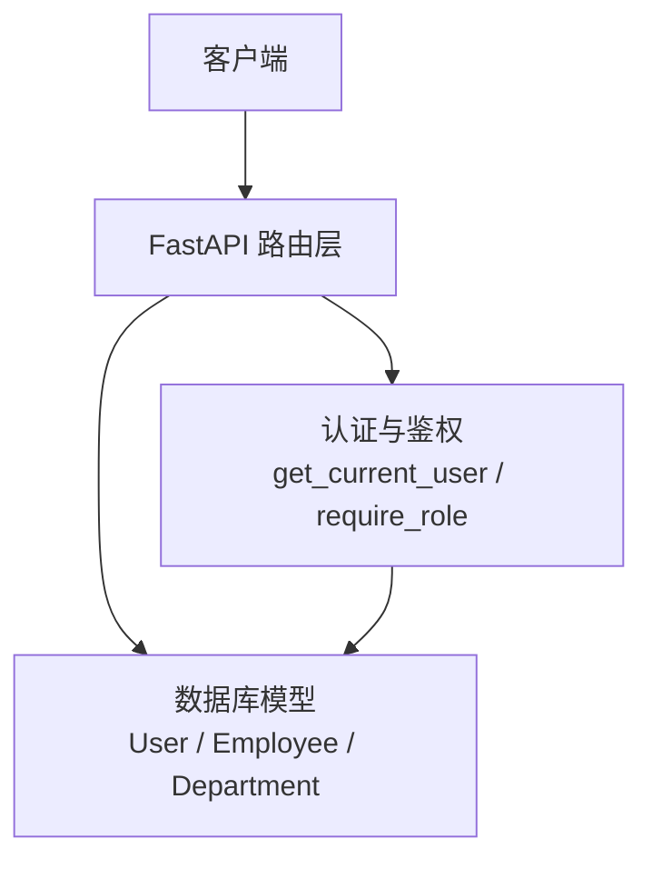
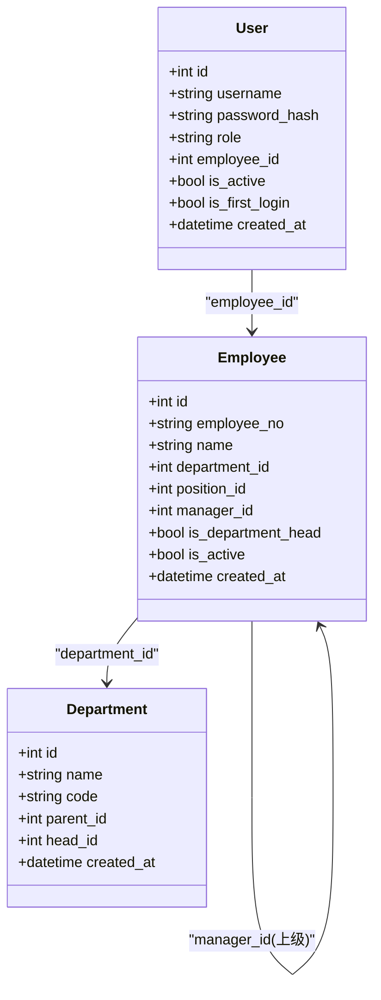
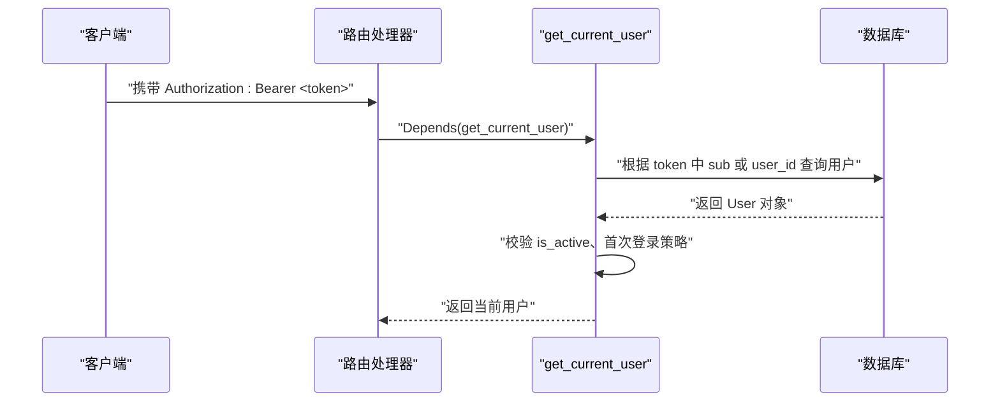
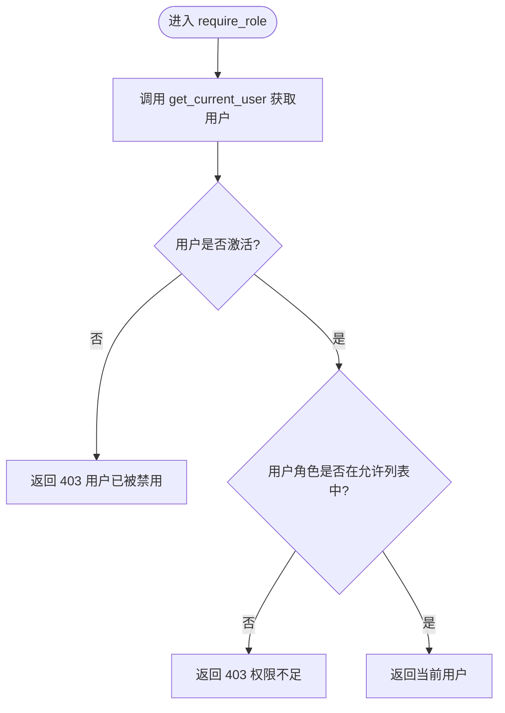
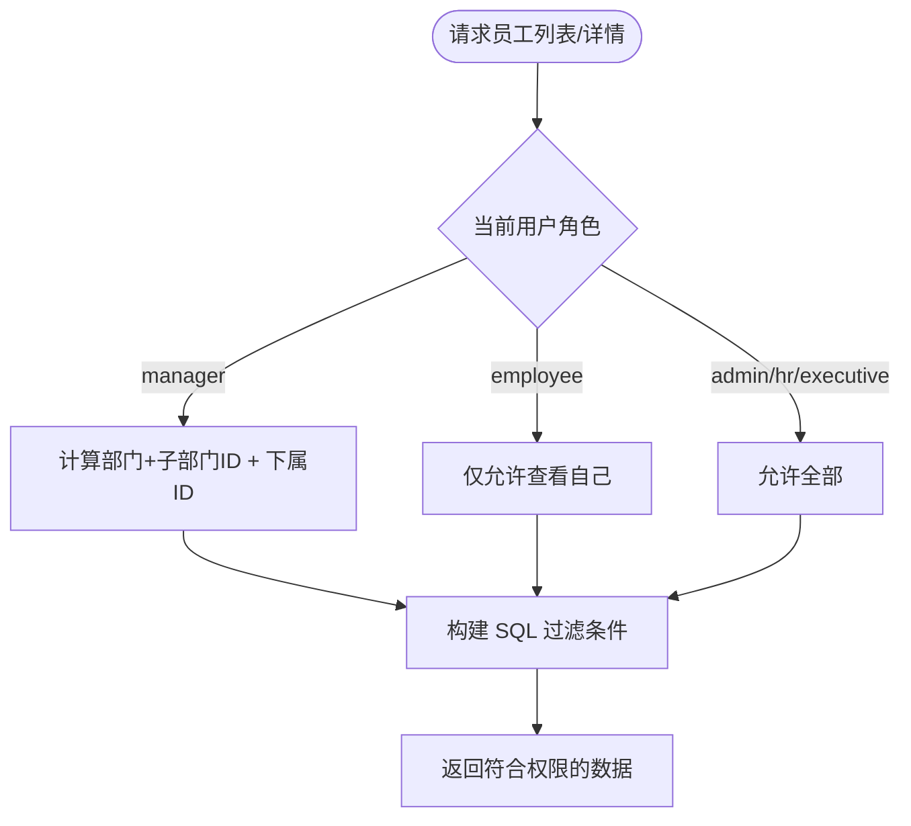
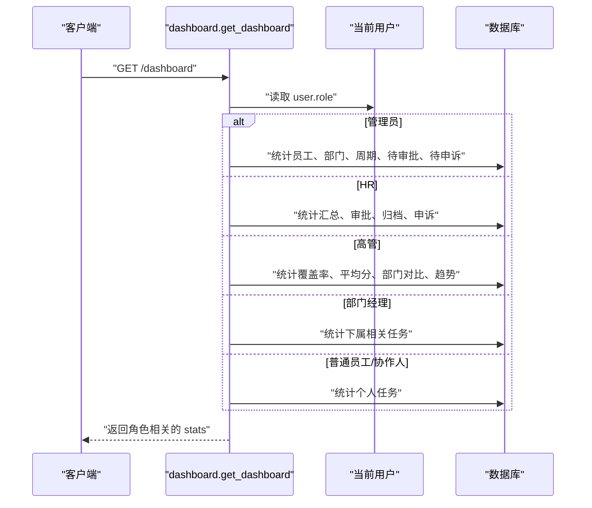
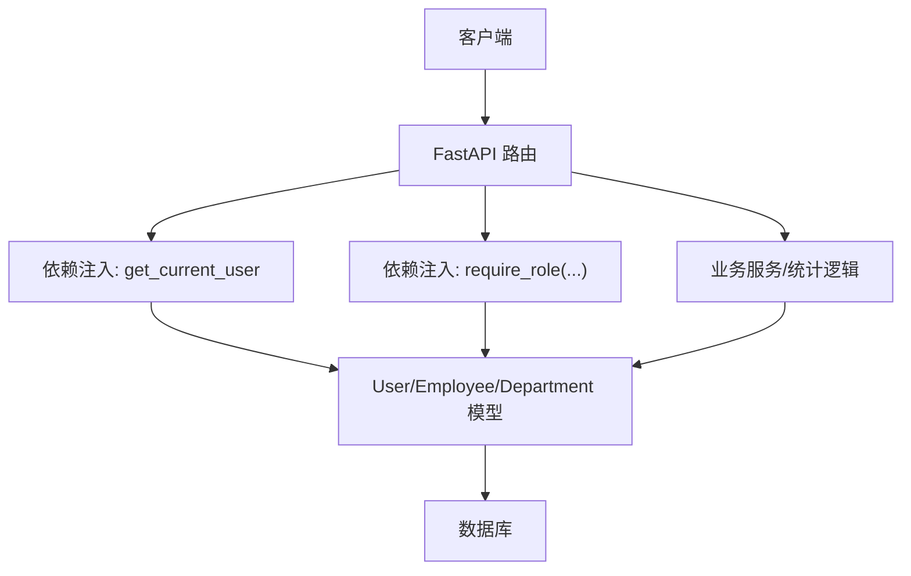
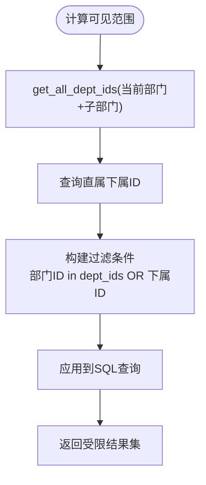
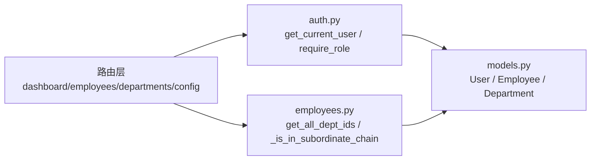

# RBAC权限控制

<cite>
**本文引用的文件**   
- [backend/app/auth.py](file://backend/app/auth.py)
- [backend/app/core/security.py](file://backend/app/core/security.py)
- [backend/app/models.py](file://backend/app/models.py)
- [backend/app/routers/dashboard.py](file://backend/app/routers/dashboard.py)
- [backend/app/routers/employees.py](file://backend/app/routers/employees.py)
- [backend/app/routers/departments.py](file://backend/app/routers/departments.py)
- [backend/app/routers/config.py](file://backend/app/routers/config.py)
- [backend/tests/test_p21_dashboard_role_scoped_stats.py](file://backend/tests/test_p21_dashboard_role_scoped_stats.py)
- [backend/tests/test_p22_require_role_is_active.py](file://backend/tests/test_p22_require_role_is_active.py)
</cite>

## 目录
1. [引言](#引言)
2. [项目结构](#项目结构)
3. [核心组件](#核心组件)
4. [架构总览](#架构总览)
5. [详细组件分析](#详细组件分析)
6. [依赖关系分析](#依赖关系分析)
7. [性能与可扩展性](#性能与可扩展性)
8. [故障排查指南](#故障排查指南)
9. [结论](#结论)
10. [附录：角色与接口权限矩阵](#附录角色与接口权限矩阵)

## 引言
本文面向“基于角色的访问控制（RBAC）”在绩效考核评分系统中的实现，重点说明以下内容：
- 角色定义与权限分配模型：管理员、HR、部门经理、普通员工、协作人、高管等。
- `require_role` 装饰器的实现原理、多角色检查与使用方式。
- 数据级别的权限控制：部门层级隔离、上下级链判断、数据可见性规则。
- 中间件式依赖注入的权限验证流程与自定义权限检查函数使用方法。
- 权限配置的最佳实践与安全建议。

本系统采用 FastAPI 依赖注入机制实现认证与授权，结合数据库中的用户角色字段与组织关系字段，完成接口级与数据级双重权限控制。

## 项目结构
后端权限相关代码主要分布在以下模块：
- 认证与鉴权：`app/auth.py`、`app/core/security.py`
- 数据模型：`app/models.py`
- 路由层权限控制：`app/routers/*.py`（如 dashboard、employees、departments、config）
- 测试用例：覆盖角色统计、禁用用户拦截等场景

**图表来源**
- [backend/app/auth.py:68-129](file://backend/app/auth.py#L68-L129)
- [backend/app/models.py:8-60](file://backend/app/models.py#L8-L60)

**章节来源**
- [backend/app/auth.py:1-130](file://backend/app/auth.py#L1-L130)
- [backend/app/models.py:1-266](file://backend/app/models.py#L1-L266)

## 核心组件
本节聚焦 RBAC 的核心实现点：
- 用户模型与角色字段
- JWT 认证与当前用户解析
- `require_role` 装饰器
- 部门层级与数据可见性工具方法
- 典型路由中的角色校验与数据隔离

### 用户模型与角色字段
用户表包含用户名、密码哈希、角色、是否激活、首次登录标记等字段；员工表包含部门、岗位、直属上级等组织信息。角色字段用于接口级权限判断，员工与部门关系用于数据级权限判断。

**图表来源**
- [backend/app/models.py:8-60](file://backend/app/models.py#L8-L60)

**章节来源**
- [backend/app/models.py:49-60](file://backend/app/models.py#L49-L60)
- [backend/app/models.py:31-48](file://backend/app/models.py#L31-L48)
- [backend/app/models.py:8-19](file://backend/app/models.py#L8-L19)

### 认证与当前用户解析
系统提供两套认证实现：
- `app/auth.py`：基于用户名解析当前用户，支持首次登录强制改密白名单。
- `app/core/security.py`：基于用户 ID 解析当前用户，Token payload 中包含角色。

两者均通过 Bearer Token 获取凭据，解码后查询数据库得到当前用户对象，并校验用户状态。

**图表来源**
- [backend/app/auth.py:68-113](file://backend/app/auth.py#L68-L113)
- [backend/app/core/security.py:82-138](file://backend/app/core/security.py#L82-L138)

**章节来源**
- [backend/app/auth.py:68-113](file://backend/app/auth.py#L68-L113)
- [backend/app/core/security.py:82-138](file://backend/app/core/security.py#L82-L138)

### `require_role` 装饰器与多角色检查
`require_role(*roles)` 是 FastAPI 依赖注入风格的权限检查函数。其内部逻辑：
- 先通过 `get_current_user` 获取已认证用户。
- 校验用户是否激活。
- 校验用户角色是否在允许的角色集合中。
- 任一条件不满足则返回 403 禁止访问。

该装饰器支持多角色传入，例如 `require_role("admin", "hr")`，表示 admin 或 hr 均可访问。

**图表来源**
- [backend/app/auth.py:116-129](file://backend/app/auth.py#L116-L129)

**章节来源**
- [backend/app/auth.py:116-129](file://backend/app/auth.py#L116-L129)

### 数据级别权限控制：部门层级隔离与可见性规则
系统在多个路由中实现了数据级权限控制，核心包括：
- 普通员工只能查看自己的数据。
- 部门经理可查看本部门及子部门的员工，以及下属员工。
- 使用递归函数收集部门及其子部门 ID，并结合直属上级关系进行过滤。
- 针对单个员工详情接口，进一步判断目标员工是否在当前管理者的下属链中。

**图表来源**
- [backend/app/routers/employees.py:233-312](file://backend/app/routers/employees.py#L233-L312)
- [backend/app/routers/employees.py:357-401](file://backend/app/routers/employees.py#L357-L401)
- [backend/app/routers/employees.py:437-466](file://backend/app/routers/employees.py#L437-L466)

**章节来源**
- [backend/app/routers/employees.py:233-312](file://backend/app/routers/employees.py#L233-L312)
- [backend/app/routers/employees.py:357-401](file://backend/app/routers/employees.py#L357-L401)
- [backend/app/routers/employees.py:437-466](file://backend/app/routers/employees.py#L437-L466)

### 仪表盘按角色聚合统计
仪表盘接口根据当前用户角色返回不同维度的统计数据：
- 管理员：公司级统计、部门数、活跃周期数、待审批/申诉数。
- HR：汇总与审批任务数、归档数量、待申诉数。
- 高管：覆盖率、平均分、部门平均分对比、近季度趋势、强制调整人员。
- 部门经理：下属待审、待批、待面谈数量。
- 普通员工/协作人：个人待办与任务统计。

**图表来源**
- [backend/app/routers/dashboard.py:15-136](file://backend/app/routers/dashboard.py#L15-L136)

**章节来源**
- [backend/app/routers/dashboard.py:15-136](file://backend/app/routers/dashboard.py#L15-L136)

## 架构总览
下图展示从客户端到数据库的完整 RBAC 流程，包括认证、角色校验、数据隔离与业务处理。

**图表来源**
- [backend/app/auth.py:68-129](file://backend/app/auth.py#L68-L129)
- [backend/app/models.py:8-60](file://backend/app/models.py#L8-L60)
- [backend/app/routers/dashboard.py:15-136](file://backend/app/routers/dashboard.py#L15-L136)

## 详细组件分析

### 认证与令牌生成
- `create_access_token`：生成 JWT access token，默认过期时间可配置。
- `decode_token`：解码并验证 JWT。
- `verify_password` / `get_password_hash`：bcrypt 密码校验与哈希。
- `get_current_user`：从 Bearer Token 解析用户，校验用户状态与首次登录策略。

注意：两套认证实现分别位于 `app/auth.py` 与 `app/core/security.py`，前者以用户名字段作为 subject，后者以用户 ID 作为 subject。

**章节来源**
- [backend/app/auth.py:46-65](file://backend/app/auth.py#L46-L65)
- [backend/app/core/security.py:20-33](file://backend/app/core/security.py#L20-L33)
- [backend/app/core/security.py:36-62](file://backend/app/core/security.py#L36-L62)
- [backend/app/core/security.py:65-79](file://backend/app/core/security.py#L65-L79)
- [backend/app/core/security.py:82-138](file://backend/app/core/security.py#L82-L138)

### 接口级权限控制：`require_role` 的使用
系统中大量路由通过 `Depends(require_role(...))` 限制访问角色，例如：
- 配置类接口：管理员专属或特定角色组合。
- 仪表盘接口：按角色开放不同统计维度。
- 员工与部门管理接口：管理员与 HR 操作为主。

示例路径参考：
- 配置接口：[backend/app/routers/config.py:22-28](file://backend/app/routers/config.py#L22-L28)、[backend/app/routers/config.py:242-247](file://backend/app/routers/config.py#L242-L247)
- 仪表盘接口：[backend/app/routers/dashboard.py:139-143](file://backend/app/routers/dashboard.py#L139-L143)、[backend/app/routers/dashboard.py:244-253](file://backend/app/routers/dashboard.py#L244-L253)

**章节来源**
- [backend/app/routers/config.py:22-28](file://backend/app/routers/config.py#L22-L28)
- [backend/app/routers/config.py:242-247](file://backend/app/routers/config.py#L242-L247)
- [backend/app/routers/dashboard.py:139-143](file://backend/app/routers/dashboard.py#L139-L143)
- [backend/app/routers/dashboard.py:244-253](file://backend/app/routers/dashboard.py#L244-L253)

### 数据级权限控制：部门层级与下属链
- `get_all_dept_ids`：递归收集指定部门及其所有子部门 ID。
- `_is_in_subordinate_chain`：判断目标员工是否为当前管理者的直接或间接下属。
- 员工列表与详情接口中，依据角色与上述工具方法进行数据过滤。

**图表来源**
- [backend/app/routers/employees.py:437-466](file://backend/app/routers/employees.py#L437-L466)
- [backend/app/routers/employees.py:250-260](file://backend/app/routers/employees.py#L250-L260)

**章节来源**
- [backend/app/routers/employees.py:437-466](file://backend/app/routers/employees.py#L437-L466)
- [backend/app/routers/employees.py:250-260](file://backend/app/routers/employees.py#L250-L260)

### 部门与岗位管理权限
部门与岗位的增删改查接口大多要求管理员或 HR 角色，部分查询接口仅需认证即可访问。

**章节来源**
- [backend/app/routers/departments.py:20-84](file://backend/app/routers/departments.py#L20-L84)
- [backend/app/routers/departments.py:87-148](file://backend/app/routers/departments.py#L87-L148)
- [backend/app/routers/departments.py:154-212](file://backend/app/routers/departments.py#L154-L212)

## 依赖关系分析
- 路由层依赖 `app.auth` 提供的 `get_current_user` 与 `require_role`。
- 数据隔离逻辑集中在 `app/routers/employees.py`，被其他路由复用（如 dashboard）。
- 模型层提供统一的数据实体，支撑认证、授权与业务逻辑。

**图表来源**
- [backend/app/routers/dashboard.py:1-12](file://backend/app/routers/dashboard.py#L1-L12)
- [backend/app/routers/employees.py:1-32](file://backend/app/routers/employees.py#L1-L32)
- [backend/app/auth.py:1-12](file://backend/app/auth.py#L1-L12)
- [backend/app/models.py:1-60](file://backend/app/models.py#L1-L60)

**章节来源**
- [backend/app/routers/dashboard.py:1-12](file://backend/app/routers/dashboard.py#L1-L12)
- [backend/app/routers/employees.py:1-32](file://backend/app/routers/employees.py#L1-L32)
- [backend/app/auth.py:1-12](file://backend/app/auth.py#L1-L12)
- [backend/app/models.py:1-60](file://backend/app/models.py#L1-L60)

## 性能与可扩展性
- 角色校验为轻量级字符串比较，开销极低。
- 部门层级递归查询可能带来额外数据库访问，建议在高频场景中对部门树进行缓存。
- 数据隔离通过 SQL 过滤实现，避免全表扫描；但复杂组织树下需关注 IN 列表大小与索引设计。
- 可扩展方向：
  - 引入权限组与资源映射表，支持更细粒度的资源级权限。
  - 将 `require_role` 扩展为 `require_permission`，支持动作级权限（如“编辑”、“导出”）。
  - 对部门树与下属链计算结果进行缓存，降低重复查询成本。

[本节为通用指导，不直接分析具体文件]

## 故障排查指南
常见问题与定位要点：
- 401 未认证：检查 Authorization Header 是否正确携带 Bearer Token，Token 是否有效且未过期。
- 403 权限不足：检查 `require_role` 中允许的角色是否包含当前用户角色；确认用户 `role` 字段设置正确。
- 403 用户已被禁用：检查用户 `is_active` 字段；若首次登录未改密，需访问白名单接口修改密码。
- 数据不可见：检查部门层级与下属链判断逻辑，确认当前用户是否能访问目标员工所在部门或下属链。

相关测试用例参考：
- 仪表盘按角色统计：[backend/tests/test_p21_dashboard_role_scoped_stats.py](file://backend/tests/test_p21_dashboard_role_scoped_stats.py)
- `require_role` 对禁用用户的拦截：[backend/tests/test_p22_require_role_is_active.py](file://backend/tests/test_p22_require_role_is_active.py)

**章节来源**
- [backend/tests/test_p21_dashboard_role_scoped_stats.py](file://backend/tests/test_p21_dashboard_role_scoped_stats.py)
- [backend/tests/test_p22_require_role_is_active.py](file://backend/tests/test_p22_require_role_is_active.py)

## 结论
本系统的 RBAC 实现以 FastAPI 依赖注入为核心，结合用户角色字段与组织关系字段，完成了接口级与数据级的双重权限控制。`require_role` 提供了简洁的多角色检查能力，部门层级与下属链工具方法保障了数据可见性的准确性。未来可通过权限组、资源级权限与缓存优化进一步提升灵活性与性能。

[本节为总结性内容，不直接分析具体文件]

## 附录：角色与接口权限矩阵
以下为常见接口的角色权限概览（基于源码中的 `require_role` 与路由逻辑）：

- 配置接口（等级规则、维度权重、评分人权重、小部门豁免、协作评分开关、评分锚点）：
  - 管理员：读写
  - HR/经理/普通员工：部分只读或受限访问

- 仪表盘接口：
  - 管理员/HR/高管：统计与聚合数据
  - 部门经理：下属相关统计
  - 普通员工/协作人：个人任务统计

- 员工与部门接口：
  - 管理员/HR：增删改查
  - 部门经理：查看本部门及子部门、下属
  - 普通员工：仅查看自身

- 认证接口：
  - 登录、刷新、个人信息、修改密码、登出：认证白名单

**章节来源**
- [backend/app/routers/config.py:22-28](file://backend/app/routers/config.py#L22-L28)
- [backend/app/routers/config.py:242-247](file://backend/app/routers/config.py#L242-L247)
- [backend/app/routers/dashboard.py:139-143](file://backend/app/routers/dashboard.py#L139-L143)
- [backend/app/routers/dashboard.py:244-253](file://backend/app/routers/dashboard.py#L244-L253)
- [backend/app/routers/employees.py:233-312](file://backend/app/routers/employees.py#L233-L312)
- [backend/app/routers/departments.py:87-148](file://backend/app/routers/departments.py#L87-L148)