# 安全架构设计

<cite>
**本文引用的文件**   
- [backend/app/main.py](file://backend/app/main.py)
- [backend/app/auth.py](file://backend/app/auth.py)
- [backend/app/core/security.py](file://backend/app/core/security.py)
- [backend/app/routers/auth.py](file://backend/app/routers/auth.py)
- [backend/app/models.py](file://backend/app/models.py)
- [backend/app/utils/audit_logger.py](file://backend/app/utils/audit_logger.py)
- [backend/app/services/operation_logger.py](file://backend/app/services/operation_logger.py)
- [backend/app/routers/employees.py](file://backend/app/routers/employees.py)
- [backend/app/routers/departments.py](file://backend/app/routers/departments.py)
- [backend/app/routers/scores.py](file://backend/app/routers/scores.py)
- [backend/app/routers/dashboard.py](file://backend/app/routers/dashboard.py)
</cite>

## 目录
1. [引言](#引言)
2. [项目结构与安全边界](#项目结构与安全边界)
3. [核心安全组件](#核心安全组件)
4. [系统架构总览](#系统架构总览)
5. [详细组件分析](#详细组件分析)
6. [依赖关系与耦合分析](#依赖关系与耦合分析)
7. [性能与可扩展性考虑](#性能与可扩展性考虑)
8. [故障排查指南](#故障排查指南)
9. [结论](#结论)

## 引言
本安全架构设计文档面向绩效考核评分系统，重点说明以下安全能力：
- JWT 认证机制：令牌生成、验证、刷新流程，以及首次登录强制改密策略。
- RBAC 权限控制：角色定义、权限分配方式与访问控制策略。
- 数据隔离机制：基于角色的数据访问控制与部门层级隔离。
- 审计日志系统：操作记录、安全事件追踪与合规性要求。
- 安全防护措施：输入校验、密码强度、防暴力破解、SQL注入防护、XSS防护建议等。

该文档既适合安全工程师进行架构评审，也适合业务开发者理解接口如何受保护。

## 项目结构与安全边界
后端采用 FastAPI 分层结构：
- 应用入口与中间件：`backend/app/main.py`
- 认证与安全工具：`backend/app/auth.py`、`backend/app/core/security.py`
- 路由层按业务划分：认证、员工、部门、考核、评分、仪表盘等
- 模型层统一在 `backend/app/models.py`
- 审计日志通过 ASGI 中间件与业务服务共同实现

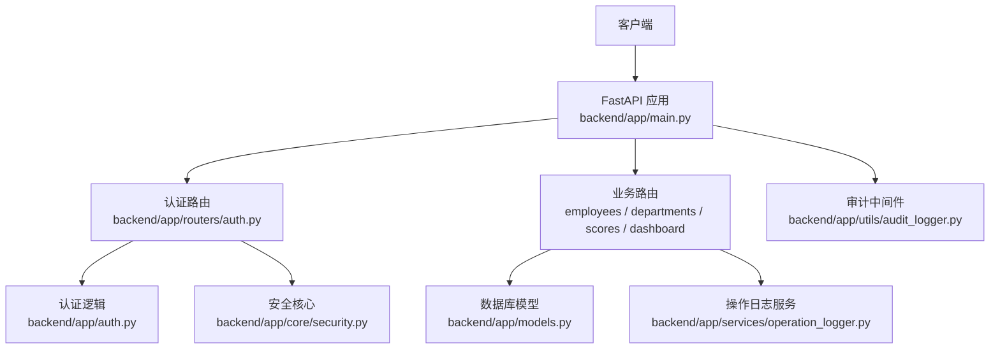

**图表来源**
- [backend/app/main.py:15-28](file://backend/app/main.py#L15-L28)
- [backend/app/routers/auth.py:1-28](file://backend/app/routers/auth.py#L1-L28)
- [backend/app/auth.py:1-17](file://backend/app/auth.py#L1-L17)
- [backend/app/core/security.py:1-17](file://backend/app/core/security.py#L1-L17)
- [backend/app/utils/audit_logger.py:104-110](file://backend/app/utils/audit_logger.py#L104-L110)

**章节来源**
- [backend/app/main.py:1-94](file://backend/app/main.py#L1-L94)

## 核心安全组件
本节聚焦认证、授权、数据隔离与审计四大安全能力。

### JWT 认证机制
JWT 相关实现分布在两个位置：
- `backend/app/auth.py`：提供登录、刷新、当前用户获取、角色检查、首次登录白名单控制。
- `backend/app/core/security.py`：提供通用 JWT 创建、解码、当前用户解析。

关键要点：
- Access Token 使用 HS256 算法，默认短期过期；Refresh Token 用于续期。
- 登录接口返回 access_token 与 refresh_token，并附带用户基本信息。
- 刷新接口仅根据有效 refresh_token 签发新的 access_token。
- 当前用户依赖会校验 token 有效性、用户存在性与活跃状态。
- 首次登录未修改初始密码的用户只能访问认证白名单接口。

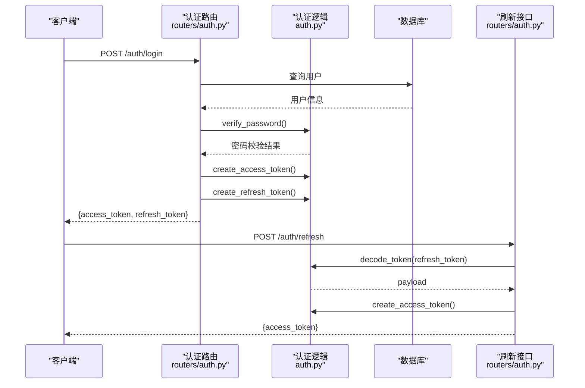

**图表来源**
- [backend/app/routers/auth.py:63-111](file://backend/app/routers/auth.py#L63-L111)
- [backend/app/auth.py:46-65](file://backend/app/auth.py#L46-L65)
- [backend/app/core/security.py:20-33](file://backend/app/core/security.py#L20-L33)

**章节来源**
- [backend/app/auth.py:12-113](file://backend/app/auth.py#L12-L113)
- [backend/app/core/security.py:13-139](file://backend/app/core/security.py#L13-L139)
- [backend/app/routers/auth.py:63-111](file://backend/app/routers/auth.py#L63-L111)

### RBAC 权限控制
RBAC 通过角色字段与依赖装饰器实现：
- 用户模型包含 role 字段，支持 admin、hr、executive、manager、employee、peer 等角色。
- `require_role(*roles)` 作为 FastAPI 依赖，限制接口访问角色集合。
- 部分接口还结合业务上下文做细粒度权限判断（例如上级只能评下属）。

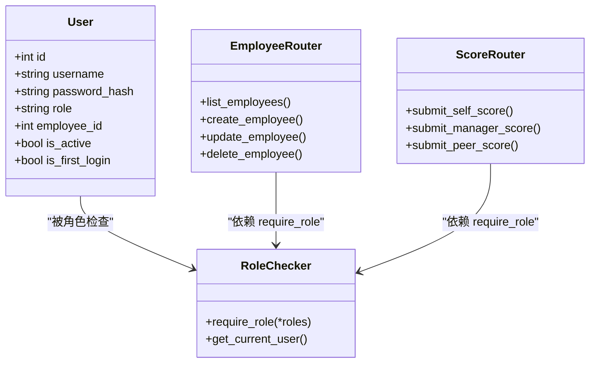

**图表来源**
- [backend/app/models.py:49-60](file://backend/app/models.py#L49-L60)
- [backend/app/auth.py:116-129](file://backend/app/auth.py#L116-L129)
- [backend/app/routers/employees.py:480-551](file://backend/app/routers/employees.py#L480-L551)
- [backend/app/routers/scores.py:740-796](file://backend/app/routers/scores.py#L740-L796)

**章节来源**
- [backend/app/models.py:49-60](file://backend/app/models.py#L49-L60)
- [backend/app/auth.py:116-129](file://backend/app/auth.py#L116-L129)
- [backend/app/routers/employees.py:480-551](file://backend/app/routers/employees.py#L480-L551)
- [backend/app/routers/scores.py:740-796](file://backend/app/routers/scores.py#L740-L796)

### 数据隔离机制
数据隔离分为两类：
- 基于角色的数据访问控制：不同角色只能查看或操作允许的数据范围。
- 基于部门层级与上下级关系的隔离：经理可看本部门及子部门，以及直属下属。

典型场景：
- 员工列表接口中，普通员工只能查看自己，经理可查看本部门及子部门员工及其下属。
- 员工详情接口中，对 peer 直接拒绝，employee 只能查看自己，manager 需满足部门或上下级关系。
- 评分接口中，上级只能给下属评分，协作人只能评被分配的同事。

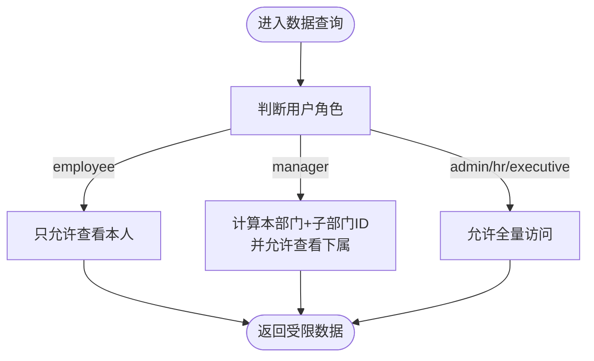

**图表来源**
- [backend/app/routers/employees.py:233-312](file://backend/app/routers/employees.py#L233-L312)
- [backend/app/routers/employees.py:357-401](file://backend/app/routers/employees.py#L357-L401)
- [backend/app/routers/scores.py:434-554](file://backend/app/routers/scores.py#L434-L554)

**章节来源**
- [backend/app/routers/employees.py:233-312](file://backend/app/routers/employees.py#L233-L312)
- [backend/app/routers/employees.py:357-401](file://backend/app/routers/employees.py#L357-L401)
- [backend/app/routers/scores.py:434-554](file://backend/app/routers/scores.py#L434-L554)

### 审计日志系统
审计日志由两部分组成：
- ASGI 中间件自动记录成功请求的操作日志，包括请求体、响应体、IP 地址、目标资源与动作。
- 业务服务显式记录关键业务操作，如评分提交、密码修改等。

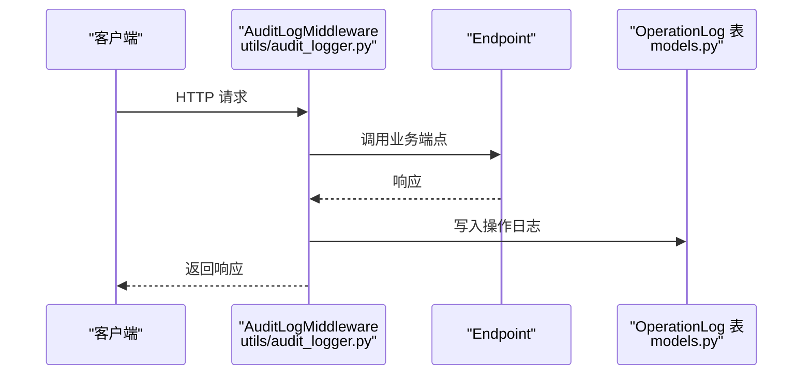

**图表来源**
- [backend/app/utils/audit_logger.py:104-188](file://backend/app/utils/audit_logger.py#L104-L188)
- [backend/app/models.py:186-196](file://backend/app/models.py#L186-L196)
- [backend/app/services/operation_logger.py:7-40](file://backend/app/services/operation_logger.py#L7-L40)

**章节来源**
- [backend/app/utils/audit_logger.py:15-53](file://backend/app/utils/audit_logger.py#L15-L53)
- [backend/app/utils/audit_logger.py:104-188](file://backend/app/utils/audit_logger.py#L104-L188)
- [backend/app/services/operation_logger.py:7-40](file://backend/app/services/operation_logger.py#L7-L40)
- [backend/app/models.py:186-196](file://backend/app/models.py#L186-L196)

## 系统架构总览
整体安全架构围绕“认证—授权—数据隔离—审计”闭环构建：
- 认证层负责身份核验与令牌管理。
- 授权层通过角色与业务上下文控制访问。
- 数据层通过 SQL 过滤与业务规则保证数据可见性。
- 审计层记录操作轨迹，支撑合规与追溯。

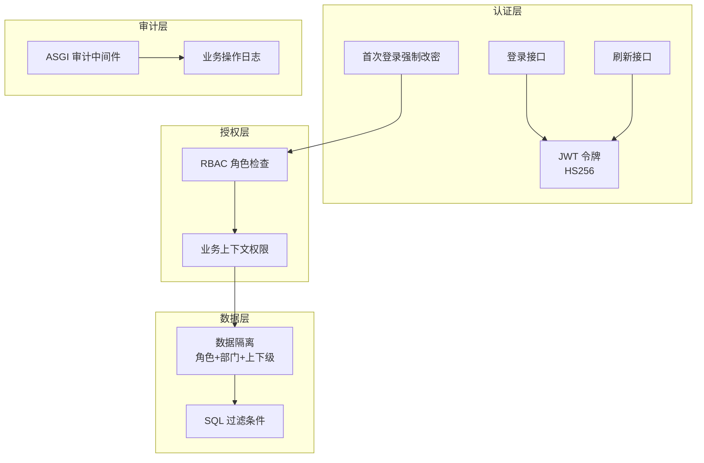

**图表来源**
- [backend/app/auth.py:19-27](file://backend/app/auth.py#L19-L27)
- [backend/app/auth.py:116-129](file://backend/app/auth.py#L116-L129)
- [backend/app/routers/employees.py:233-312](file://backend/app/routers/employees.py#L233-L312)
- [backend/app/utils/audit_logger.py:104-188](file://backend/app/utils/audit_logger.py#L104-L188)

## 详细组件分析

### 认证与令牌生命周期
- 登录成功后返回 access_token 与 refresh_token，同时返回用户基本信息。
- 刷新接口仅验证 refresh_token 的合法性，不重复校验用户状态，因此应配合前端合理存储与失效策略。
- 当前用户依赖会读取 Authorization Header，解码 token，查找用户，并检查活跃状态。
- 首次登录用户若尝试访问非白名单接口，将返回禁止访问。

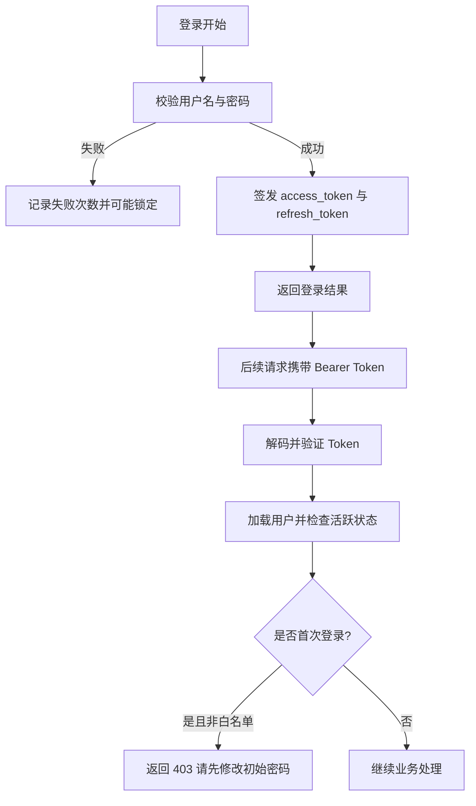

**图表来源**
- [backend/app/routers/auth.py:35-60](file://backend/app/routers/auth.py#L35-L60)
- [backend/app/routers/auth.py:63-93](file://backend/app/routers/auth.py#L63-L93)
- [backend/app/auth.py:68-113](file://backend/app/auth.py#L68-L113)

**章节来源**
- [backend/app/routers/auth.py:35-93](file://backend/app/routers/auth.py#L35-L93)
- [backend/app/auth.py:68-113](file://backend/app/auth.py#L68-L113)

### RBAC 与访问控制策略
- 角色定义集中在用户模型，常见角色包括 admin、hr、executive、manager、employee、peer。
- 接口通过 `require_role` 限制访问角色集合。
- 业务接口进一步结合上下文进行权限判断，例如：
  - 上级评分接口要求评分对象为下属。
  - 协作评分接口要求当前用户是被分配的协作人。
  - 员工详情接口对 peer 直接拒绝，employee 只能查看自己，manager 需要满足部门或上下级关系。

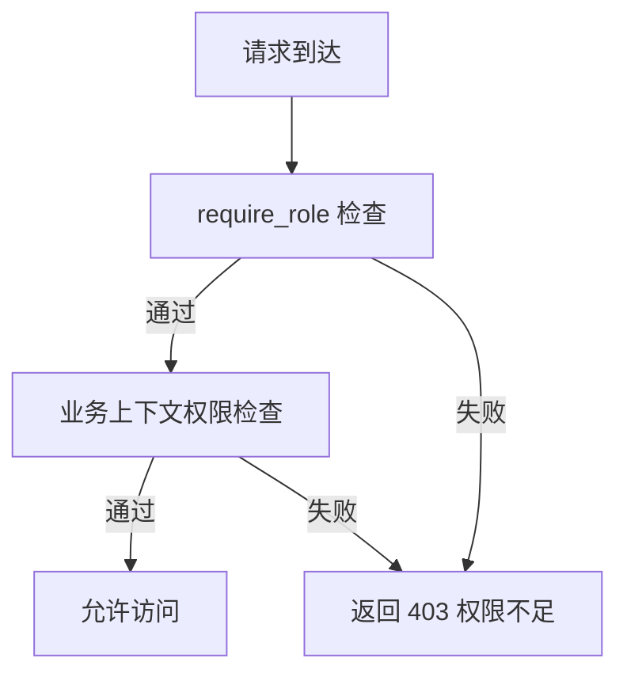

**图表来源**
- [backend/app/auth.py:116-129](file://backend/app/auth.py#L116-L129)
- [backend/app/routers/scores.py:434-554](file://backend/app/routers/scores.py#L434-L554)
- [backend/app/routers/employees.py:357-401](file://backend/app/routers/employees.py#L357-L401)

**章节来源**
- [backend/app/auth.py:116-129](file://backend/app/auth.py#L116-L129)
- [backend/app/routers/scores.py:434-554](file://backend/app/routers/scores.py#L434-L554)
- [backend/app/routers/employees.py:357-401](file://backend/app/routers/employees.py#L357-L401)

### 数据隔离与部门层级
- 员工列表接口根据角色动态添加过滤条件：
  - employee：只看自己。
  - manager：本部门及子部门员工，以及直属下属。
- 员工详情接口对 peer 直接拒绝，employee 只能查看自己，manager 需要满足部门或上下级关系。
- 部门树查询使用递归 CTE，便于前端展示组织层级。

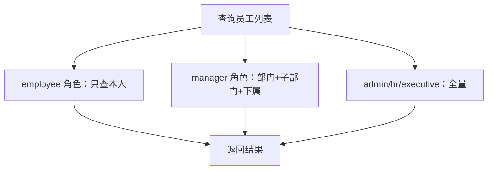

**图表来源**
- [backend/app/routers/employees.py:233-312](file://backend/app/routers/employees.py#L233-L312)
- [backend/app/routers/departments.py:20-84](file://backend/app/routers/departments.py#L20-L84)

**章节来源**
- [backend/app/routers/employees.py:233-312](file://backend/app/routers/employees.py#L233-L312)
- [backend/app/routers/departments.py:20-84](file://backend/app/routers/departments.py#L20-L84)

### 审计日志与合规性
- ASGI 中间件拦截 POST/PUT/DELETE 请求，记录成功响应（2xx）的操作日志。
- 日志包含用户 ID、动作、目标类型、目标 ID、旧值、新值、IP 地址。
- 业务服务在关键操作后显式记录日志，例如评分提交、密码修改。
- 合规性建议：
  - 对敏感字段进行脱敏后再落库。
  - 定期归档与保留策略，满足审计周期要求。
  - 对审计日志写入失败进行告警与重试。

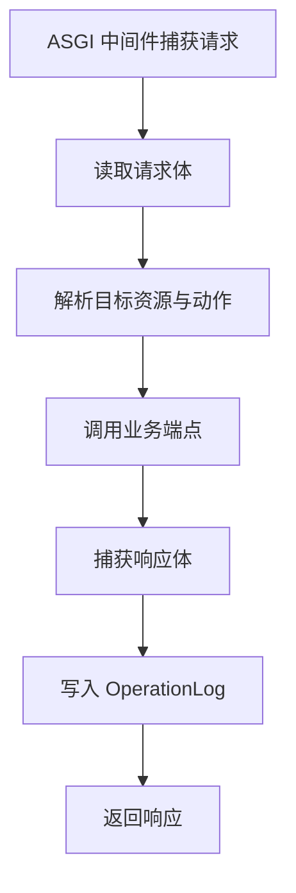

**图表来源**
- [backend/app/utils/audit_logger.py:104-188](file://backend/app/utils/audit_logger.py#L104-L188)
- [backend/app/services/operation_logger.py:7-40](file://backend/app/services/operation_logger.py#L7-L40)

**章节来源**
- [backend/app/utils/audit_logger.py:15-53](file://backend/app/utils/audit_logger.py#L15-L53)
- [backend/app/utils/audit_logger.py:104-188](file://backend/app/utils/audit_logger.py#L104-L188)
- [backend/app/services/operation_logger.py:7-40](file://backend/app/services/operation_logger.py#L7-L40)

## 依赖关系与耦合分析
- 认证模块与路由层耦合紧密：路由层依赖 `get_current_user` 与 `require_role`。
- 业务路由依赖模型层进行数据查询与更新，并通过 `log_operation` 记录审计。
- 审计中间件与主应用耦合，但通过 ASGI 标准接口解耦具体业务。
- 潜在风险：
  - 多个安全实现并存（`auth.py` 与 `core/security.py`），需注意密钥与过期时间配置一致性。
  - 角色检查与业务上下文权限分散在各路由，建议抽象为统一的权限策略服务。

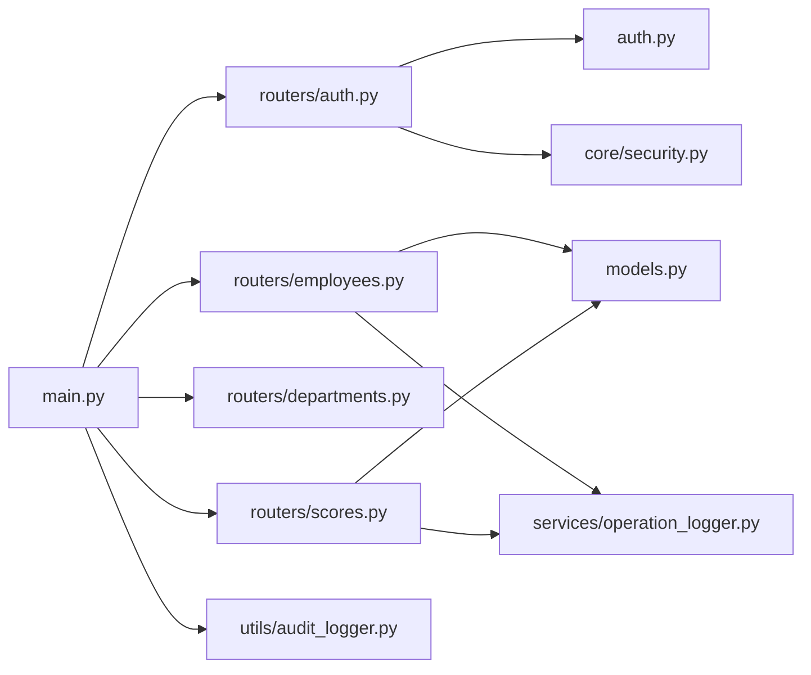

**图表来源**
- [backend/app/main.py:49-94](file://backend/app/main.py#L49-L94)
- [backend/app/routers/auth.py:1-28](file://backend/app/routers/auth.py#L1-L28)
- [backend/app/routers/employees.py:14-32](file://backend/app/routers/employees.py#L14-L32)
- [backend/app/routers/scores.py:1-21](file://backend/app/routers/scores.py#L1-L21)
- [backend/app/utils/audit_logger.py:104-110](file://backend/app/utils/audit_logger.py#L104-L110)

**章节来源**
- [backend/app/main.py:49-94](file://backend/app/main.py#L49-L94)
- [backend/app/routers/auth.py:1-28](file://backend/app/routers/auth.py#L1-L28)
- [backend/app/routers/employees.py:14-32](file://backend/app/routers/employees.py#L14-L32)
- [backend/app/routers/scores.py:1-21](file://backend/app/routers/scores.py#L1-L21)
- [backend/app/utils/audit_logger.py:104-110](file://backend/app/utils/audit_logger.py#L104-L110)

## 性能与可扩展性考虑
- JWT 解码与用户查询发生在每个受保护接口，建议在高频路径上优化：
  - 缓存用户基础信息（注意缓存失效与用户状态变更）。
  - 避免在每次请求中进行复杂部门层级递归查询，可预计算部门树或缓存。
- 审计中间件会读取并重新包装请求体，对大体积请求有额外开销，建议：
  - 对超大请求体进行限流或跳过审计。
  - 异步写入审计日志，降低主链路延迟。
- 角色检查与业务上下文权限建议集中化，减少重复代码与不一致风险。

[本节为通用指导，不直接分析具体文件]

## 故障排查指南
常见问题与定位方法：
- 401 未认证：
  - 检查 Authorization Header 是否正确携带 Bearer Token。
  - 确认 Token 未过期且未被篡改。
  - 确认用户存在且处于活跃状态。
- 403 权限不足：
  - 检查用户角色是否在允许列表中。
  - 检查业务上下文权限（例如上级是否真的为下属）。
  - 检查首次登录强制改密是否生效。
- 数据不可见：
  - 检查数据隔离逻辑是否符合预期（角色、部门、上下级）。
  - 检查 SQL 过滤条件是否正确拼接。
- 审计日志缺失：
  - 检查是否为写操作（POST/PUT/DELETE）。
  - 检查响应状态码是否为 2xx。
  - 检查审计中间件是否注册成功。

**章节来源**
- [backend/app/auth.py:68-113](file://backend/app/auth.py#L68-L113)
- [backend/app/routers/auth.py:35-60](file://backend/app/routers/auth.py#L35-L60)
- [backend/app/utils/audit_logger.py:161-188](file://backend/app/utils/audit_logger.py#L161-L188)

## 结论
本系统的安全架构以 JWT 认证为基础，结合 RBAC 与业务上下文权限控制，实现了较为完善的身份与访问控制。数据隔离通过角色与部门层级约束，确保敏感数据不被越权访问。审计日志通过中间件与业务服务双通道记录，满足基本合规需求。

为进一步强化安全，建议：
- 统一密钥管理与令牌策略，消除多实现带来的不一致。
- 引入更严格的输入校验与输出编码，防范 XSS 与注入攻击。
- 对审计日志进行脱敏与分级保护，提升隐私与合规水平。
- 将权限策略抽象为可配置的服务，支持动态角色与权限扩展。

[本节为总结性内容，不直接分析具体文件]