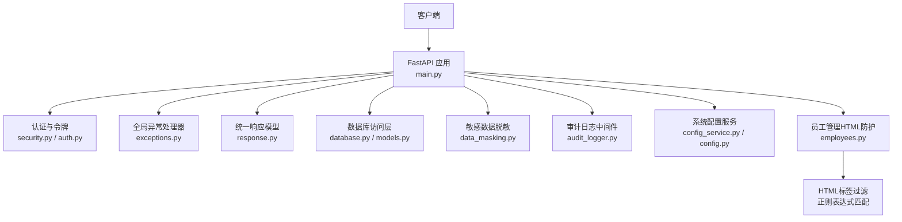
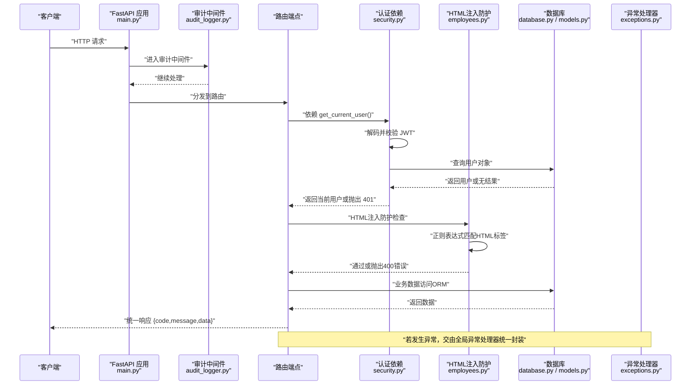
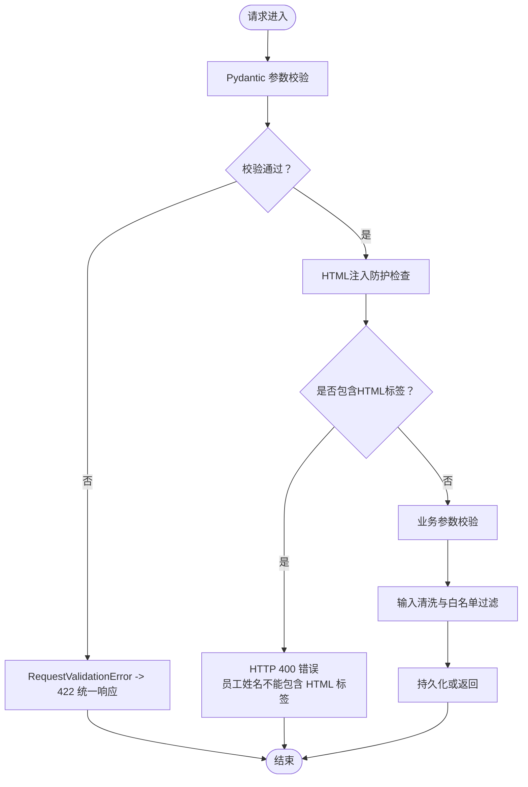
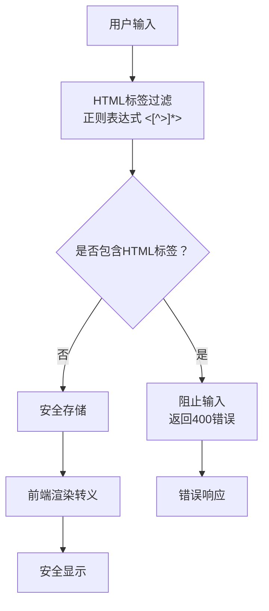
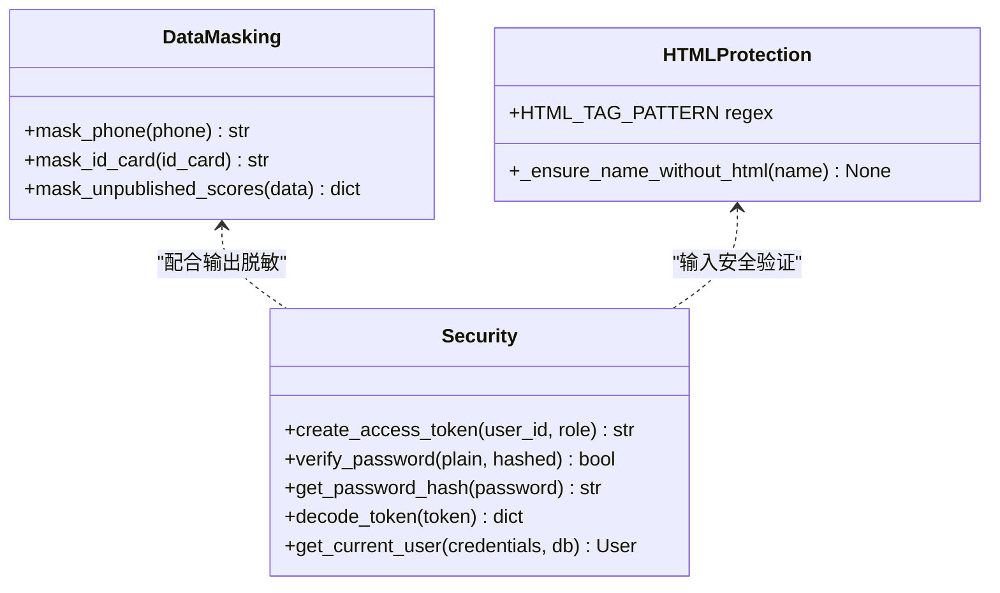
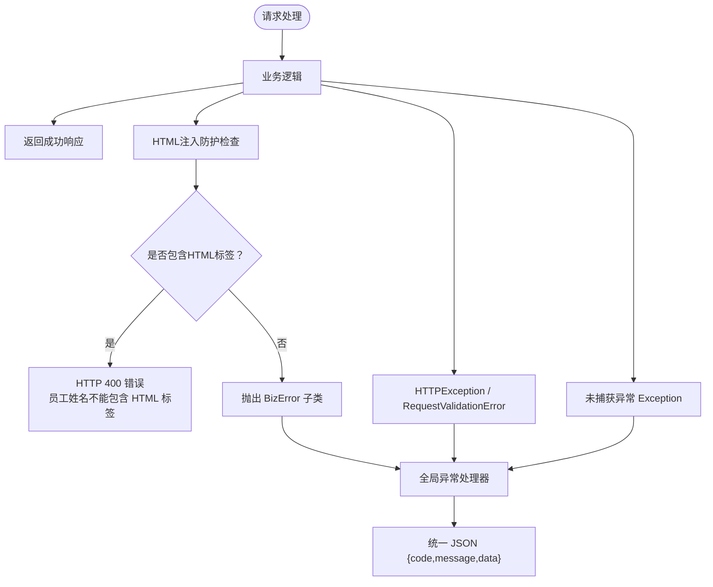
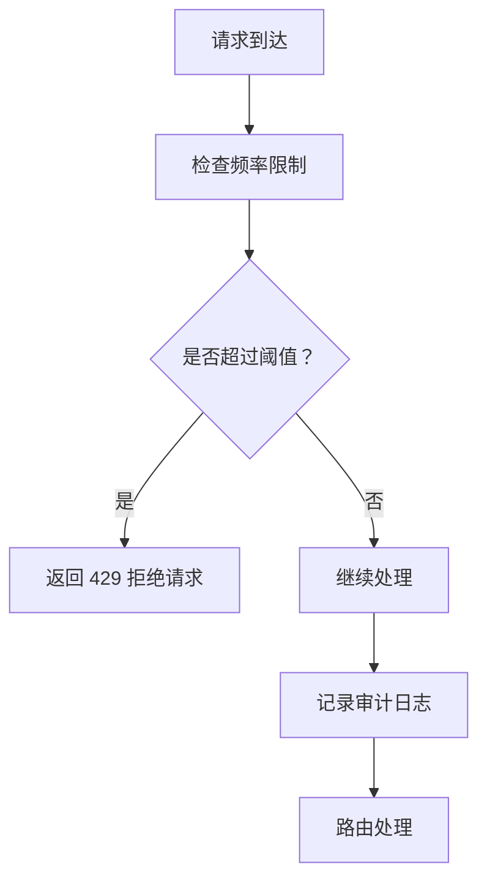
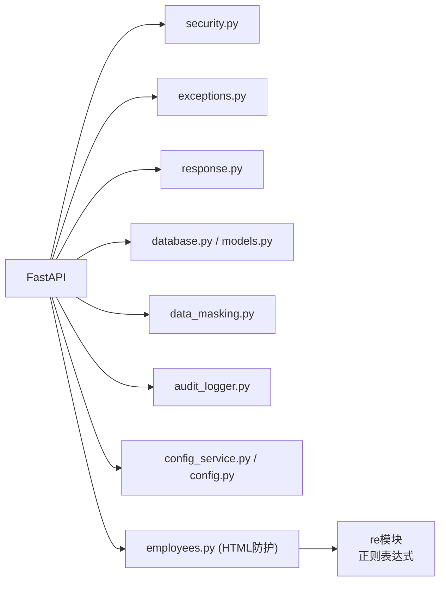

# 安全防护措施

<cite>
**本文引用的文件**   
- [backend/app/core/security.py](file://backend/app/core/security.py)
- [backend/app/core/exceptions.py](file://backend/app/core/exceptions.py)
- [backend/app/core/response.py](file://backend/app/core/response.py)
- [backend/app/main.py](file://backend/app/main.py)
- [backend/app/utils/data_masking.py](file://backend/app/utils/data_masking.py)
- [backend/app/auth.py](file://backend/app/auth.py)
- [backend/app/models.py](file://backend/app/models.py)
- [backend/app/routers/config.py](file://backend/app/routers/config.py)
- [backend/app/database.py](file://backend/app/database.py)
- [backend/app/services/config_service.py](file://backend/app/services/config_service.py)
- [backend/app/utils/audit_logger.py](file://backend/app/utils/audit_logger.py)
- [backend/app/routers/employees.py](file://backend/app/routers/employees.py)
- [backend/tests/test_security_injection.py](file://backend/tests/test_security_injection.py)
- [backend/tests/test_p7_05_injection_xss.py](file://backend/tests/test_p7_05_injection_xss.py)
- [backend/requirements.txt](file://backend/requirements.txt)
- [tests/scripts/test_sec.py](file://tests/scripts/test_sec.py)
- [tests/cases/_gen_cases.py](file://tests/cases/_gen_cases.py)
- [docs/TECH_绩效考核评分系统_v1.0.md](file://docs/TECH_绩效考核评分系统_v1.0.md)
- [docs/PRD_绩效考核评分系统_v1.0.md](file://docs/PRD_绩效考核评分系统_v1.0.md)
</cite>

## 更新摘要
**所做更改**
- 增强了员工管理模块的HTML注入防护功能
- 添加了针对XSS攻击的员工名称字段验证机制
- 更新了XSS攻击防护章节，包含具体的实现细节和测试用例
- 完善了输入验证与参数清洗部分的安全防护措施

## 目录
1. [引言](#引言)
2. [项目结构与安全边界](#项目结构与安全边界)
3. [核心安全组件](#核心安全组件)
4. [架构总览](#架构总览)
5. [详细组件分析](#详细组件分析)
6. [依赖关系与耦合分析](#依赖关系与耦合分析)
7. [性能与可用性考量](#性能与可用性考量)
8. [故障排查指南](#故障排查指南)
9. [结论](#结论)
10. [附录：配置与最佳实践清单](#附录配置与最佳实践清单)

## 引言
本文件聚焦"安全防护措施"，围绕输入验证与参数清洗、SQL 注入与 XSS 防护、敏感数据处理（脱敏、加密传输与存储）、异常处理与统一错误码、API 安全防护（速率限制、频率控制、恶意请求检测），以及安全配置最佳实践（环境变量管理、密钥轮换、安全审计）进行系统化说明。文档以代码仓库中的后端实现为依据，并结合测试用例与技术设计文档给出可落地的安全建议。

**更新** 新增了员工管理模块的HTML注入防护功能，专门防止XSS攻击通过员工名称字段，增强了系统的整体安全性。

## 项目结构与安全边界
后端采用 FastAPI 应用结构，安全相关能力分布在以下位置：
- 认证与令牌：`backend/app/core/security.py`、`backend/app/auth.py`
- 全局异常与统一响应：`backend/app/core/exceptions.py`、`backend/app/core/response.py`、`backend/app/main.py`
- 敏感数据脱敏：`backend/app/utils/data_masking.py`
- 数据库访问与 ORM：`backend/app/database.py`、`backend/app/models.py`
- 系统配置服务：`backend/app/services/config_service.py`、`backend/app/routers/config.py`
- 审计日志中间件：`backend/app/utils/audit_logger.py`
- **新增** 员工管理HTML注入防护：`backend/app/routers/employees.py`
- 依赖与第三方库：`backend/requirements.txt`

图示来源
- [backend/app/main.py:1-71](file://backend/app/main.py#L1-L71)
- [backend/app/core/security.py:1-139](file://backend/app/core/security.py#L1-L139)
- [backend/app/core/exceptions.py:1-107](file://backend/app/core/exceptions.py#L1-L107)
- [backend/app/core/response.py:1-99](file://backend/app/core/response.py#L1-L99)
- [backend/app/utils/data_masking.py:1-26](file://backend/app/utils/data_masking.py#L1-L26)
- [backend/app/utils/audit_logger.py](file://backend/app/utils/audit_logger.py)
- [backend/app/database.py](file://backend/app/database.py)
- [backend/app/models.py](file://backend/app/models.py)
- [backend/app/services/config_service.py](file://backend/app/services/config_service.py)
- [backend/app/routers/config.py](file://backend/app/routers/config.py)
- [backend/app/routers/employees.py:29-39](file://backend/app/routers/employees.py#L29-L39)

章节来源
- [backend/app/main.py:1-71](file://backend/app/main.py#L1-L71)
- [backend/app/core/security.py:1-139](file://backend/app/core/security.py#L1-L139)
- [backend/app/core/exceptions.py:1-107](file://backend/app/core/exceptions.py#L1-L107)
- [backend/app/core/response.py:1-99](file://backend/app/core/response.py#L1-L99)
- [backend/app/utils/data_masking.py:1-26](file://backend/app/utils/data_masking.py#L1-L26)
- [backend/app/routers/employees.py:29-39](file://backend/app/routers/employees.py#L29-L39)

## 核心安全组件
本节概述当前系统中已实现的安全能力与职责边界。

- 认证与授权
  - JWT Bearer 认证：从 Authorization Header 提取并校验 Token，解析 payload，查询用户对象，检查账号状态。
  - 密码哈希：使用 bcrypt 对密码进行哈希与校验。
  - 默认密钥：当前使用硬编码的 SECRET_KEY，需迁移至环境变量。

- 全局异常与统一响应
  - 业务异常基类 BizError 及其派生类 AuthError、NotFoundError、ValidationError，提供统一的 code/message/data 结构。
  - 注册全局异常处理器，将 HTTPException 与 RequestValidationError 转换为统一 JSON 格式，避免堆栈与 SQL 细节泄露。

- 敏感数据脱敏
  - 手机号、身份证号脱敏函数；未发布考核记录中 total_score 与 grade 置空。

- 数据库访问与 ORM
  - 通过 SQLAlchemy ORM 进行查询，天然参数化，降低 SQL 注入风险。
  - 启动时执行简单迁移与种子数据初始化。

- 审计日志
  - 通过中间件记录请求审计信息，便于安全审计与问题追踪。

- 系统配置
  - 提供 KPI 权重、等级规则等配置接口，支持缓存与失效机制。

- **新增** HTML注入防护
  - 员工姓名字段HTML标签过滤：使用正则表达式 `<[^>]*>` 检测并阻止HTML标签输入，防止XSS攻击。
  - 在创建和更新员工时自动调用 `_ensure_name_without_html()` 函数进行安全检查。

章节来源
- [backend/app/core/security.py:1-139](file://backend/app/core/security.py#L1-L139)
- [backend/app/core/exceptions.py:1-107](file://backend/app/core/exceptions.py#L1-L107)
- [backend/app/core/response.py:1-99](file://backend/app/core/response.py#L1-L99)
- [backend/app/utils/data_masking.py:1-26](file://backend/app/utils/data_masking.py#L1-L26)
- [backend/app/main.py:1-71](file://backend/app/main.py#L1-L71)
- [backend/app/utils/audit_logger.py](file://backend/app/utils/audit_logger.py)
- [backend/app/services/config_service.py](file://backend/app/services/config_service.py)
- [backend/app/routers/config.py](file://backend/app/routers/config.py)
- [backend/app/routers/employees.py:29-39](file://backend/app/routers/employees.py#L29-L39)

## 架构总览
下图展示一次受保护的 API 调用在系统中的关键路径：请求进入 FastAPI，经过 CORS 与审计中间件，路由到具体端点，由认证依赖校验 Token，业务逻辑访问数据库，最终返回统一响应。

图示来源
- [backend/app/main.py:1-71](file://backend/app/main.py#L1-L71)
- [backend/app/core/security.py:82-139](file://backend/app/core/security.py#L82-L139)
- [backend/app/core/exceptions.py:84-107](file://backend/app/core/exceptions.py#L84-L107)
- [backend/app/utils/audit_logger.py](file://backend/app/utils/audit_logger.py)
- [backend/app/database.py](file://backend/app/database.py)
- [backend/app/models.py](file://backend/app/models.py)
- [backend/app/routers/employees.py:29-39](file://backend/app/routers/employees.py#L29-L39)

## 详细组件分析

### 输入验证与参数清洗
- Pydantic 模型校验
  - FastAPI 基于 Pydantic 的请求体验证会在路由参数、Query、Body 上自动校验类型与约束，失败时触发 RequestValidationError，并由全局处理器转为统一 422 响应。
- 业务参数校验
  - 业务层可通过自定义 BizError/ValidationError 抛出结构化错误，确保前端获得一致的 code/message/data。
- **增强** HTML注入防护
  - 员工姓名字段使用正则表达式 `<[^>]*>` 检测HTML标签，防止XSS攻击。
  - 在创建和更新员工时自动调用 `_ensure_name_without_html()` 函数进行安全检查。
  - 检测到HTML标签时返回400错误，提示"员工姓名不能包含 HTML 标签"。
- 参数清洗建议
  - 对富文本或用户生成内容，建议在入库前进行白名单过滤（例如 bleach），并在输出时做 HTML 转义，防止 XSS。
  - 对 URL 参数与文件名等外部输入，应进行长度、字符集与扩展名校验，避免路径穿越与非法文件写入。

图示来源
- [backend/app/main.py:39-46](file://backend/app/main.py#L39-L46)
- [backend/app/core/exceptions.py:67-81](file://backend/app/core/exceptions.py#L67-L81)
- [backend/app/routers/employees.py:29-39](file://backend/app/routers/employees.py#L29-L39)

章节来源
- [backend/app/main.py:39-46](file://backend/app/main.py#L39-L46)
- [backend/app/core/exceptions.py:67-81](file://backend/app/core/exceptions.py#L67-L81)
- [backend/app/routers/employees.py:29-39](file://backend/app/routers/employees.py#L29-L39)

### SQL 注入防护
- ORM 参数化查询
  - 系统使用 SQLAlchemy ORM 进行数据访问，查询条件通过字段比较与过滤构建，天然避免字符串拼接 SQL，从而有效防御 SQL 注入。
- 禁止动态 SQL
  - 应避免使用原生 SQL 拼接用户输入；如需执行复杂查询，应使用参数化语句或预编译视图。
- 测试覆盖
  - 安全测试用例包含 SQL 注入攻击场景，预期返回 401 或正常业务错误，不暴露 SQL 细节。

章节来源
- [backend/app/database.py](file://backend/app/database.py)
- [backend/app/models.py](file://backend/app/models.py)
- [tests/cases/_gen_cases.py:1758-1780](file://tests/cases/_gen_cases.py#L1758-L1780)
- [docs/PRD_绩效考核评分系统_v1.0.md:1758-1767](file://docs/PRD_绩效考核评分系统_v1.0.md#L1758-L1767)

### XSS 攻击防护
- **增强** 前端渲染转义
  - 前端模板默认对变量进行转义显示，避免脚本执行。
- **增强** 后端输出策略
  - 对用户生成内容（如评语）建议入库前进行白名单过滤，输出时进行 HTML 转义；列表页不应直接渲染原始 HTML。
  - **新增** 员工姓名字段HTML标签过滤：使用正则表达式 `<[^>]*>` 检测并阻止HTML标签输入。
- **增强** 测试覆盖
  - 安全测试用例包含 XSS 攻击场景，预期提交成功但脚本不执行，并以纯文本或实体形式显示。
  - **新增** 专门的员工创建XSS测试：`test_xss_in_employee_create()` 验证员工名称字段的XSS防护。
  - **新增** 全面的XSS防护测试套件：`test_p7_05_injection_xss.py` 涵盖多个接口的XSS防护测试。

图示来源
- [backend/app/routers/employees.py:29-39](file://backend/app/routers/employees.py#L29-L39)
- [backend/tests/test_security_injection.py:46-60](file://backend/tests/test_security_injection.py#L46-L60)
- [backend/tests/test_p7_05_injection_xss.py:235-244](file://backend/tests/test_p7_05_injection_xss.py#L235-L244)

章节来源
- [backend/tests/scripts/test_sec.py:89-114](file://backend/tests/scripts/test_sec.py#L89-L114)
- [backend/tests/test_security_injection.py:46-60](file://backend/tests/test_security_injection.py#L46-L60)
- [backend/tests/test_p7_05_injection_xss.py:235-244](file://backend/tests/test_p7_05_injection_xss.py#L235-L244)
- [tests/cases/_gen_cases.py:1783-1802](file://tests/cases/_gen_cases.py#L1783-L1802)
- [docs/PRD_绩效考核评分系统_v1.0.md:1758-1767](file://docs/PRD_绩效考核评分系统_v1.0.md#L1758-L1767)
- [backend/app/routers/employees.py:29-39](file://backend/app/routers/employees.py#L29-L39)

### 敏感数据处理
- 数据脱敏
  - 手机号与身份证号脱敏函数保留前后若干位，中间用星号替换；未发布状态的考核记录中总分与等级置空，避免敏感信息泄露。
- 加密传输
  - 部署时应启用 HTTPS，强制跳转与响应头安全策略（HSTS、X-Frame-Options、CSP）应在网关或反向代理层配置。
- 存储安全
  - 密码使用 bcrypt 哈希存储，不保存明文；JWT 签名密钥应从环境变量加载，避免硬编码。

图示来源
- [backend/app/utils/data_masking.py:1-26](file://backend/app/utils/data_masking.py#L1-L26)
- [backend/app/core/security.py:20-63](file://backend/app/core/security.py#L20-L63)
- [backend/app/routers/employees.py:29-39](file://backend/app/routers/employees.py#L29-L39)

章节来源
- [backend/app/utils/data_masking.py:1-26](file://backend/app/utils/data_masking.py#L1-L26)
- [backend/app/core/security.py:20-63](file://backend/app/core/security.py#L20-L63)
- [backend/app/routers/employees.py:29-39](file://backend/app/routers/employees.py#L29-L39)
- [docs/TECH_绩效考核评分系统_v1.0.md:2271-2283](file://docs/TECH_绩效考核评分系统_v1.0.md#L2271-L2283)

### 异常处理与错误响应机制
- 统一业务异常
  - BizError 及其子类定义标准结构 {code, message, data}，并通过全局异常处理器返回统一 JSON。
- HTTP 与校验异常
  - HTTPException 与 RequestValidationError 被捕获后返回统一格式，避免暴露内部堆栈与 SQL 细节。
- 通用服务器错误
  - 未捕获异常统一返回 5000 业务码与"服务器内部错误"消息，保护系统细节。
- **新增** HTML注入防护异常
  - 当检测到HTML标签时，抛出 HTTPException(400, "员工姓名不能包含 HTML 标签")，提供明确的用户反馈。

图示来源
- [backend/app/core/exceptions.py:6-30](file://backend/app/core/exceptions.py#L6-L30)
- [backend/app/core/exceptions.py:84-107](file://backend/app/core/exceptions.py#L84-L107)
- [backend/app/main.py:31-46](file://backend/app/main.py#L31-L46)
- [backend/app/routers/employees.py:32-39](file://backend/app/routers/employees.py#L32-L39)

章节来源
- [backend/app/core/exceptions.py:6-30](file://backend/app/core/exceptions.py#L6-L30)
- [backend/app/core/exceptions.py:84-107](file://backend/app/core/exceptions.py#L84-L107)
- [backend/app/main.py:31-46](file://backend/app/main.py#L31-L46)
- [backend/app/routers/employees.py:32-39](file://backend/app/routers/employees.py#L32-L39)

### API 安全防护
- 速率限制与频率控制
  - 当前仓库未内置速率限制中间件；测试用例期望登录接口具备暴力破解防护与 429 响应。建议在网关或中间件层实现基于 IP/用户的限流策略（例如每分钟 N 次）。
- 恶意请求检测
  - 建议结合审计日志与 WAF 规则，检测异常 UA、频繁 4xx/5xx、异常参数模式等。
- 会话与跨域
  - CORS 中间件当前允许所有来源与凭据，生产环境应严格限定 allow_origins 与 allow_methods/headers。

图示来源
- [tests/cases/_gen_cases.py:1923-1940](file://tests/cases/_gen_cases.py#L1923-L1940)
- [backend/app/main.py:15-21](file://backend/app/main.py#L15-L21)
- [backend/app/utils/audit_logger.py](file://backend/app/utils/audit_logger.py)

章节来源
- [tests/cases/_gen_cases.py:1923-1940](file://tests/cases/_gen_cases.py#L1923-L1940)
- [backend/app/main.py:15-21](file://backend/app/main.py#L15-L21)

### 安全配置最佳实践
- 环境变量管理
  - 将 JWT SECRET_KEY、算法、过期时间等敏感配置迁移至环境变量或密钥管理服务，避免硬编码。
- 密钥轮换
  - 支持多密钥并行验证（旧密钥仍可用于短期解密），定期轮换并设置过渡期。
- 安全审计建议
  - 开启审计日志中间件，记录操作人、时间、动作、变更前后值；对敏感接口增加二次确认与双人审批流程。
- 部署安全
  - 强制 HTTPS、设置 HSTS、X-Frame-Options、Content-Security-Policy；Cookie 设置 HttpOnly、Secure、SameSite=Strict。

章节来源
- [backend/app/core/security.py:13-15](file://backend/app/core/security.py#L13-L15)
- [backend/app/auth.py:12-12](file://backend/app/auth.py#L12-L12)
- [backend/app/utils/audit_logger.py](file://backend/app/utils/audit_logger.py)
- [tests/scripts/test_sec.py:170-192](file://tests/scripts/test_sec.py#L170-L192)

## 依赖关系与耦合分析
- 低耦合高内聚
  - 认证逻辑集中在 security.py，异常处理集中在 exceptions.py，响应模型集中在 response.py，职责清晰。
- 外部依赖
  - FastAPI、Uvicorn、SQLAlchemy、Pydantic、python-jose、bcrypt 等库用于 Web 框架、异步运行、ORM、数据校验、JWT 与密码哈希。
- 潜在风险
  - CORS 配置过于宽松；JWT 密钥硬编码；缺少速率限制中间件。
- **新增** HTML注入防护依赖
  - 使用Python标准库 `re` 模块进行正则表达式匹配，无需额外依赖。
  - 与员工管理模块紧密耦合，在创建和更新操作中自动调用防护函数。

图示来源
- [backend/app/main.py:1-71](file://backend/app/main.py#L1-L71)
- [backend/requirements.txt:1-14](file://backend/requirements.txt#L1-L14)
- [backend/app/routers/employees.py:1-8](file://backend/app/routers/employees.py#L1-L8)

章节来源
- [backend/requirements.txt:1-14](file://backend/requirements.txt#L1-L14)
- [backend/app/main.py:1-71](file://backend/app/main.py#L1-L71)
- [backend/app/routers/employees.py:1-8](file://backend/app/routers/employees.py#L1-L8)

## 性能与可用性考量
- 认证开销
  - JWT 解码与 bcrypt 校验为 CPU 密集型操作，建议合理设置 Token 过期时间与刷新策略，避免频繁鉴权。
- 数据库访问
  - 使用 ORM 参数化查询，避免 N+1 查询与全表扫描；分页与索引优化提升查询性能。
- 审计日志
  - 审计中间件可能带来额外 I/O，建议异步写入或批量落盘，避免阻塞主流程。
- **新增** HTML注入防护性能
  - 正则表达式匹配性能开销极小，对系统性能影响可忽略不计。
  - 防护逻辑在业务逻辑之前执行，快速失败，减少不必要的数据库操作。

[本节为通用指导，不直接分析具体文件]

## 故障排查指南
- 常见错误定位
  - 401 未认证：检查 Authorization Header 是否携带有效 Bearer Token，Token 是否过期或被篡改。
  - 422 参数校验失败：检查请求体字段类型、必填项与约束是否符合 Pydantic 模型定义。
  - 400 HTML注入防护错误：检查员工姓名字段是否包含HTML标签，移除 `<script>`、`` 等危险标签。
  - 500 服务器错误：查看全局异常处理器返回的统一消息，结合审计日志与后端日志定位根因。
- 安全事件排查
  - SQL 注入/XSS：核对输入清洗与输出转义策略，检查是否存在绕过白名单的情况。
  - 越权访问：检查 RBAC 与数据归属校验逻辑，确保仅允许访问自身或下属数据。
  - **新增** HTML注入攻击：检查员工管理接口的HTML标签过滤逻辑，确认 `_ensure_name_without_html()` 函数正确调用。

章节来源
- [backend/app/main.py:31-46](file://backend/app/main.py#L31-L46)
- [backend/app/core/exceptions.py:84-107](file://backend/app/core/exceptions.py#L84-L107)
- [backend/app/routers/employees.py:32-39](file://backend/app/routers/employees.py#L32-L39)
- [tests/scripts/test_sec.py:170-192](file://tests/scripts/test_sec.py#L170-L192)

## 结论
当前系统在认证授权、统一异常与响应、敏感数据脱敏、ORM 参数化查询等方面具备基础安全能力。**新增** 的员工管理HTML注入防护功能进一步增强了系统的安全性，有效防止XSS攻击通过员工名称字段。为进一步提升安全性，建议：
- 将 JWT 密钥与敏感配置迁移至环境变量或密钥管理服务，并支持密钥轮换。
- 在生产环境启用 HTTPS 与安全响应头，收紧 CORS 策略。
- 引入速率限制与恶意请求检测中间件，完善暴力破解防护。
- 强化输入清洗与输出转义，全面防范 XSS 与注入攻击。
- 完善审计日志与合规报告，建立安全监控与应急预案。
- **新增** 考虑对其他用户输入字段也实施类似的HTML标签过滤策略，提供更全面的安全防护。

[本节为总结性内容，不直接分析具体文件]

## 附录：配置与最佳实践清单
- 环境变量与密钥
  - 使用环境变量管理 SECRET_KEY、ALGORITHM、ACCESS_TOKEN_EXPIRE_HOURS。
  - 支持多密钥并行验证，定期轮换并设置过渡期。
- 传输与存储安全
  - 强制 HTTPS，设置 HSTS、X-Frame-Options、Content-Security-Policy。
  - Cookie 设置 HttpOnly、Secure、SameSite=Strict。
  - 密码使用 bcrypt 哈希，不存明文。
- 输入与输出安全
  - 前端模板默认转义；后端对用户生成内容进行白名单过滤与 HTML 转义。
  - **新增** 员工姓名字段使用正则表达式 `<[^>]*>` 过滤HTML标签。
  - 对 URL、文件名、富文本等进行严格校验与清洗。
- 异常与审计
  - 统一异常结构与错误码，避免泄露内部细节。
  - 审计日志记录关键操作，支持溯源与合规审查。
- 速率限制与恶意请求检测
  - 基于 IP/用户维度实施限流，返回 429 提示。
  - 结合 WAF 与日志分析检测异常行为。
- **新增** HTML注入防护最佳实践
  - 对所有用户输入的文本字段实施HTML标签过滤。
  - 使用白名单策略而非黑名单策略进行内容过滤。
  - 在前端渲染时对数据进行适当的转义处理。
  - 定期进行安全测试，验证防护机制的有效性。

章节来源
- [backend/app/core/security.py:13-15](file://backend/app/core/security.py#L13-L15)
- [backend/app/auth.py:12-12](file://backend/app/auth.py#L12-L12)
- [backend/app/main.py:15-21](file://backend/app/main.py#L15-L21)
- [backend/app/routers/employees.py:29-39](file://backend/app/routers/employees.py#L29-L39)
- [backend/tests/test_security_injection.py:46-60](file://backend/tests/test_security_injection.py#L46-L60)
- [backend/tests/test_p7_05_injection_xss.py:235-244](file://backend/tests/test_p7_05_injection_xss.py#L235-L244)
- [tests/scripts/test_sec.py:170-192](file://tests/scripts/test_sec.py#L170-L192)
- [backend/app/utils/audit_logger.py](file://backend/app/utils/audit_logger.py)