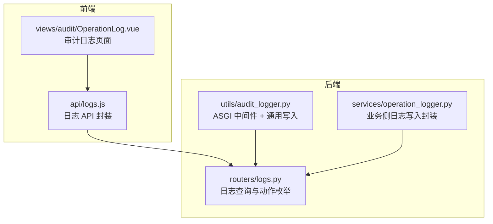
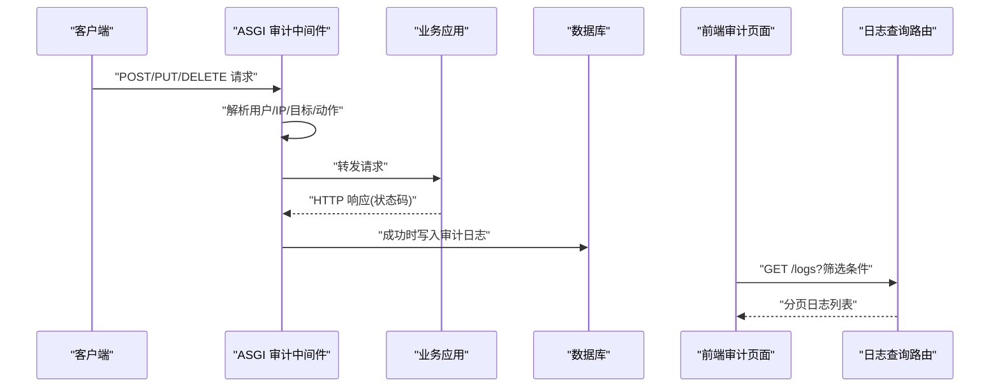
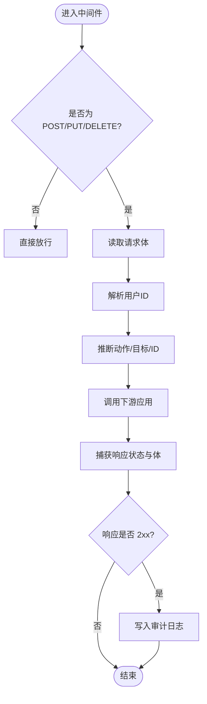
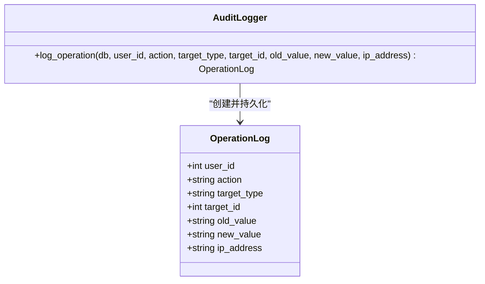
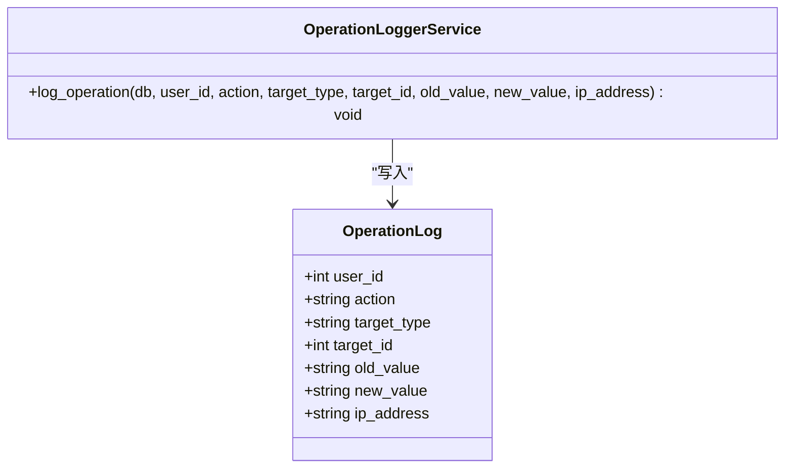
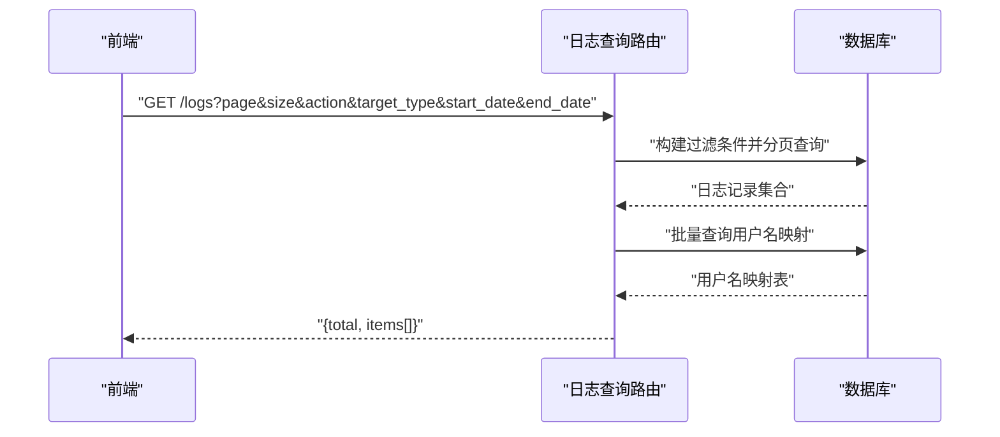
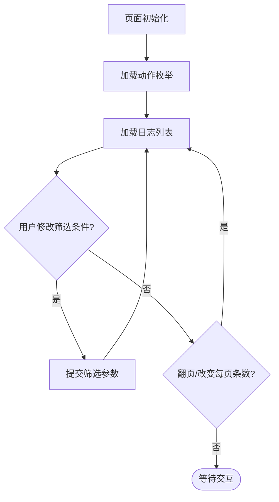
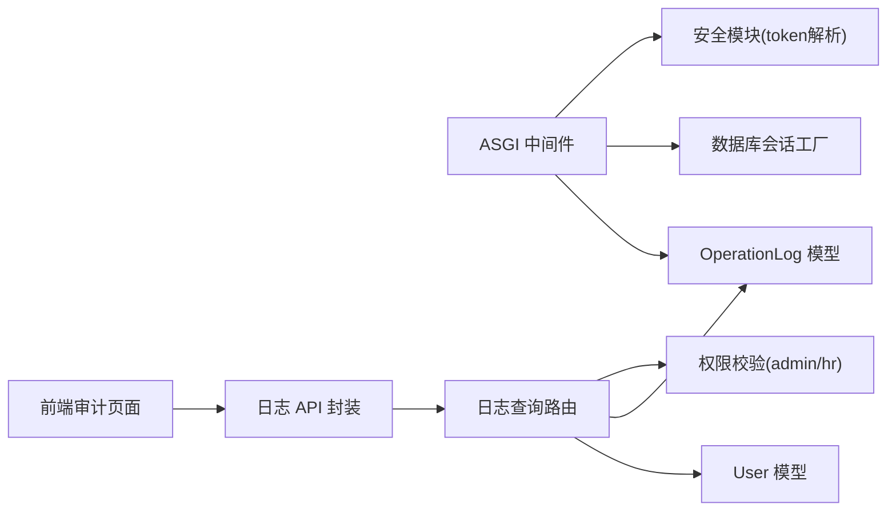

# 审计日志系统

<cite>
**本文引用的文件**   
- [audit_logger.py](file://backend/app/utils/audit_logger.py)
- [operation_logger.py](file://backend/app/services/operation_logger.py)
- [logs.py](file://backend/app/routers/logs.py)
- [OperationLog.vue](file://frontend/src/views/audit/OperationLog.vue)
- [logs.js](file://frontend/src/api/logs.js)
</cite>

## 目录
1. [简介](#简介)
2. [项目结构](#项目结构)
3. [核心组件](#核心组件)
4. [架构总览](#架构总览)
5. [详细组件分析](#详细组件分析)
6. [依赖关系分析](#依赖关系分析)
7. [性能与扩展性](#性能与扩展性)
8. [故障排查指南](#故障排查指南)
9. [结论](#结论)
10. [附录](#附录)

## 简介
本文件面向“审计日志系统”，系统性说明操作日志记录机制、数据结构设计、查询与分析能力、存储策略与合规要点，以及配置项、自定义处理器与分析工具使用方法。该系统覆盖用户操作追踪、关键业务事件记录与安全事件监控，提供前后端一致的审计能力：后端通过中间件自动捕获变更请求并落库，同时暴露查询接口；前端提供筛选、分页与可视化展示。

## 项目结构
审计日志相关代码分布在后端服务层、工具层、路由层与前端的视图与 API 模块中：
- 后端工具层：通用日志写入与 ASGI 中间件实现
- 后端服务层：业务侧显式调用日志写入的封装
- 后端路由层：日志查询与枚举操作类型
- 前端视图：审计日志页面（筛选、分页、详情）
- 前端 API：日志查询与动作枚举接口封装

**图表来源**
- [audit_logger.py:104-188](file://backend/app/utils/audit_logger.py#L104-L188)
- [operation_logger.py:7-40](file://backend/app/services/operation_logger.py#L7-L40)
- [logs.py:14-82](file://backend/app/routers/logs.py#L14-L82)
- [OperationLog.vue:70-174](file://frontend/src/views/audit/OperationLog.vue#L70-L174)
- [logs.js:1-10](file://frontend/src/api/logs.js#L1-L10)

**章节来源**
- [audit_logger.py:15-53](file://backend/app/utils/audit_logger.py#L15-L53)
- [operation_logger.py:7-40](file://backend/app/services/operation_logger.py#L7-L40)
- [logs.py:14-82](file://backend/app/routers/logs.py#L14-L82)
- [OperationLog.vue:1-188](file://frontend/src/views/audit/OperationLog.vue#L1-L188)
- [logs.js:1-10](file://frontend/src/api/logs.js#L1-L10)

## 核心组件
- ASGI 审计中间件：拦截 POST/PUT/DELETE 请求，解析用户身份、目标资源、IP，捕获请求体与响应体，仅对成功响应（2xx）落库。
- 通用日志写入函数：构造 OperationLog 实体并持久化，支持旧值/新值快照。
- 业务日志封装：为业务侧提供统一写入入口，便于在关键业务流程中记录结构化变更。
- 日志查询路由：支持按操作类型、目标类型、时间范围筛选，返回分页结果与用户映射信息。
- 前端审计页面：提供筛选表单、表格展示、分页控件与 JSON 格式化显示。

**章节来源**
- [audit_logger.py:15-53](file://backend/app/utils/audit_logger.py#L15-L53)
- [audit_logger.py:104-188](file://backend/app/utils/audit_logger.py#L104-L188)
- [operation_logger.py:7-40](file://backend/app/services/operation_logger.py#L7-L40)
- [logs.py:14-82](file://backend/app/routers/logs.py#L14-L82)
- [OperationLog.vue:1-188](file://frontend/src/views/audit/OperationLog.vue#L1-L188)

## 架构总览
审计日志的整体数据流如下：客户端发起写操作 → ASGI 中间件拦截 → 解析用户与目标 → 捕获请求/响应体 → 成功后写入日志 → 前端通过查询接口获取并展示。

**图表来源**
- [audit_logger.py:104-188](file://backend/app/utils/audit_logger.py#L104-L188)
- [logs.py:14-67](file://backend/app/routers/logs.py#L14-L67)

## 详细组件分析

### ASGI 审计中间件
- 职责：自动捕获写操作的请求与响应，提取用户身份、目标资源、IP 地址，仅在成功响应时落库。
- 关键点：
  - 仅处理 POST/PUT/DELETE。
  - 从 Authorization 头解析 token 得到 user_id。
  - 根据 URL 推断 action 与 target_type，并尝试提取 target_id。
  - 捕获 response body 以记录变更后的值。
  - 失败或异常时记录错误日志但不中断主流程。

**图表来源**
- [audit_logger.py:104-188](file://backend/app/utils/audit_logger.py#L104-L188)

**章节来源**
- [audit_logger.py:56-101](file://backend/app/utils/audit_logger.py#L56-L101)
- [audit_logger.py:104-188](file://backend/app/utils/audit_logger.py#L104-L188)

### 通用日志写入函数
- 职责：将一次操作的结构化信息持久化为审计日志记录。
- 字段：user_id、action、target_type、target_id、old_value、new_value、ip_address。
- 行为：序列化 old_value/new_value 为 JSON 字符串后入库。

**图表来源**
- [audit_logger.py:15-53](file://backend/app/utils/audit_logger.py#L15-L53)

**章节来源**
- [audit_logger.py:15-53](file://backend/app/utils/audit_logger.py#L15-L53)

### 业务侧日志封装
- 职责：为业务逻辑提供统一的日志写入入口，便于在审批、评分、KPI 调整等关键流程中记录结构化变更。
- 特点：参数语义清晰，支持传入变更前后的对象快照。

**图表来源**
- [operation_logger.py:7-40](file://backend/app/services/operation_logger.py#L7-L40)

**章节来源**
- [operation_logger.py:7-40](file://backend/app/services/operation_logger.py#L7-L40)

### 日志查询路由
- 职责：提供分页查询与动作枚举接口，支持按操作类型、目标类型、时间范围筛选。
- 输出：包含用户 ID 到用户名的映射，便于前端展示操作用户。

**图表来源**
- [logs.py:14-67](file://backend/app/routers/logs.py#L14-L67)

**章节来源**
- [logs.py:14-82](file://backend/app/routers/logs.py#L14-L82)

### 前端审计页面
- 职责：提供筛选表单（操作类型、目标类型、起止日期）、表格展示（含旧值/新值 JSON 格式化）、分页控件。
- 交互：加载动作枚举、提交筛选条件、分页切换、重置。

**图表来源**
- [OperationLog.vue:70-174](file://frontend/src/views/audit/OperationLog.vue#L70-L174)
- [logs.js:1-10](file://frontend/src/api/logs.js#L1-L10)

**章节来源**
- [OperationLog.vue:1-188](file://frontend/src/views/audit/OperationLog.vue#L1-L188)
- [logs.js:1-10](file://frontend/src/api/logs.js#L1-L10)

## 依赖关系分析
- 中间件依赖：
  - 安全模块用于解析 token 中的用户标识。
  - 数据库会话工厂用于写入日志。
  - 模型 OperationLog 定义日志实体结构。
- 路由依赖：
  - 认证与权限校验（admin/hr）。
  - 模型 OperationLog 与 User 进行关联查询。
- 前端依赖：
  - 日志 API 封装调用后端路由。

**图表来源**
- [audit_logger.py:1-11](file://backend/app/utils/audit_logger.py#L1-L11)
- [logs.py:1-10](file://backend/app/routers/logs.py#L1-L10)
- [logs.js:1-10](file://frontend/src/api/logs.js#L1-L10)

**章节来源**
- [audit_logger.py:1-11](file://backend/app/utils/audit_logger.py#L1-L11)
- [logs.py:1-10](file://backend/app/routers/logs.py#L1-L10)
- [logs.js:1-10](file://frontend/src/api/logs.js#L1-L10)

## 性能与扩展性
- 中间件开销：
  - 仅对 POST/PUT/DELETE 生效，减少无谓开销。
  - 仅在 2xx 响应时落库，避免失败请求污染审计数据。
  - 使用 try/except 包裹落库逻辑，确保异常不影响主流程。
- 查询性能：
  - 支持分页与多条件过滤，建议结合索引优化（如 created_at、action、target_type）。
  - 批量拉取用户名映射，减少 N+1 查询。
- 可扩展点：
  - 可接入异步队列（如 Celery/RabbitMQ）将日志写入解耦，提升吞吐。
  - 可引入外部日志平台（ELK/Loki）进行集中采集与分析。
  - 可按租户/环境维度拆分日志表或分区，便于归档与合规。

[本节为通用指导，不直接分析具体文件]

## 故障排查指南
- 未记录日志：
  - 检查请求方法是否为 POST/PUT/DELETE。
  - 确认响应状态码是否为 2xx。
  - 查看中间件异常日志，确认数据库写入是否成功。
- 用户信息为空：
  - 检查 Authorization 头是否携带有效 token。
  - 确认 token 解析逻辑能正确提取 user_id。
- 查询结果为空：
  - 核对筛选条件（action/target_type/start_date/end_date）是否正确。
  - 确认分页参数 page/size 合理。
- 前端展示异常：
  - 检查 logs.js 调用路径是否与后端路由一致。
  - 确认 OperationLog.vue 对 JSON 字符串的格式化逻辑。

**章节来源**
- [audit_logger.py:104-188](file://backend/app/utils/audit_logger.py#L104-L188)
- [logs.py:14-82](file://backend/app/routers/logs.py#L14-L82)
- [OperationLog.vue:70-174](file://frontend/src/views/audit/OperationLog.vue#L70-L174)
- [logs.js:1-10](file://frontend/src/api/logs.js#L1-L10)

## 结论
该审计日志系统通过 ASGI 中间件自动化捕获关键写操作，结合业务侧显式日志封装，形成“自动+手动”的双轨记录机制。后端提供灵活的查询接口，前端提供直观的审计界面，满足用户操作追踪、关键业务事件记录与安全事件监控的需求。建议在后续迭代中引入异步写入、外部日志平台与更细粒度的访问控制，以提升性能与合规能力。

[本节为总结性内容，不直接分析具体文件]

## 附录

### 日志数据结构设计
- 字段说明：
  - user_id：操作人标识
  - action：操作类型（如 create/update/delete 或业务动作）
  - target_type：目标对象类型（如 employee/cycle）
  - target_id：目标对象标识
  - old_value：变更前快照（JSON 字符串）
  - new_value：变更后快照（JSON 字符串）
  - ip_address：客户端 IP
  - created_at：记录时间戳（由框架/ORM 默认填充）

**章节来源**
- [audit_logger.py:15-53](file://backend/app/utils/audit_logger.py#L15-L53)
- [operation_logger.py:7-40](file://backend/app/services/operation_logger.py#L7-L40)

### 日志查询与分析
- 查询能力：
  - 分页：page、size
  - 条件筛选：action、target_type、start_date、end_date
  - 动作枚举：/logs/actions
- 分析建议：
  - 基于 action 与 target_type 统计高频操作与热点资源。
  - 基于 time range 检测异常时段与异常频率。
  - 结合 ip_address 识别异常来源。

**章节来源**
- [logs.py:14-82](file://backend/app/routers/logs.py#L14-L82)
- [OperationLog.vue:70-174](file://frontend/src/views/audit/OperationLog.vue#L70-L174)
- [logs.js:1-10](file://frontend/src/api/logs.js#L1-L10)

### 日志存储策略与合规
- 存储策略：
  - 当前实现直接写入数据库，适合中小规模场景。
  - 建议未来引入分表/分区与归档策略，降低热表体积。
- 轮转与归档：
  - 可按月份或季度归档历史日志，保留最近若干周期在线查询。
- 合规要求：
  - 保留必要元数据（用户、时间、IP、变更快照）。
  - 对敏感字段进行脱敏（可在写入前处理）。
  - 限制访问权限（仅 admin/hr 可查询）。

[本节为通用指导，不直接分析具体文件]

### 配置选项与自定义处理器
- 配置项建议：
  - 是否启用中间件自动记录（开关）
  - 仅记录 2xx 响应（开关）
  - 最大请求/响应体大小（字节）
  - 日志写入超时与重试次数
  - 是否开启敏感字段脱敏
- 自定义处理器：
  - 继承或替换中间件逻辑，实现自定义的日志格式与存储后端。
  - 在业务侧通过 operation_logger 注入额外上下文（如租户、环境）。

[本节为通用指导，不直接分析具体文件]

### 日志分析工具使用方法
- 前端工具：
  - 使用审计页面进行筛选与分页浏览。
  - 利用动作下拉框快速定位特定操作类型。
- 后端工具：
  - 通过 /logs/actions 获取动作枚举，辅助构建筛选器。
  - 结合数据库工具导出日志进行离线分析（注意脱敏与权限）。

**章节来源**
- [OperationLog.vue:70-174](file://frontend/src/views/audit/OperationLog.vue#L70-L174)
- [logs.py:70-82](file://backend/app/routers/logs.py#L70-L82)
- [logs.js:1-10](file://frontend/src/api/logs.js#L1-L10)