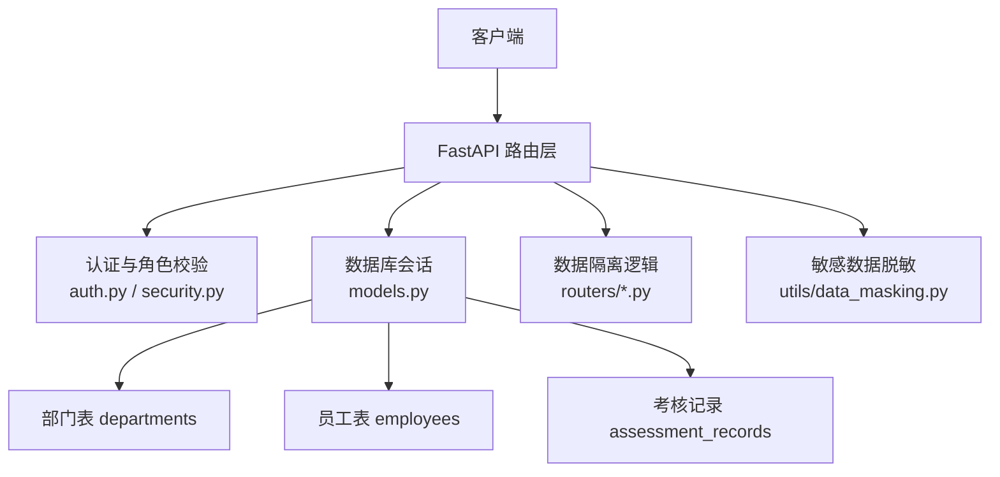
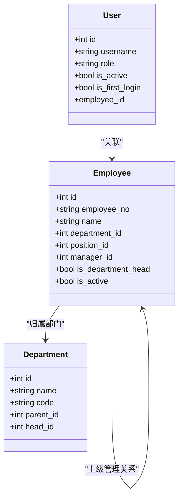
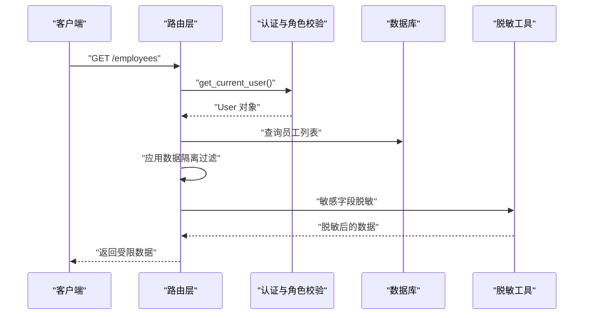
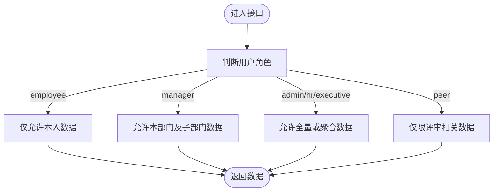
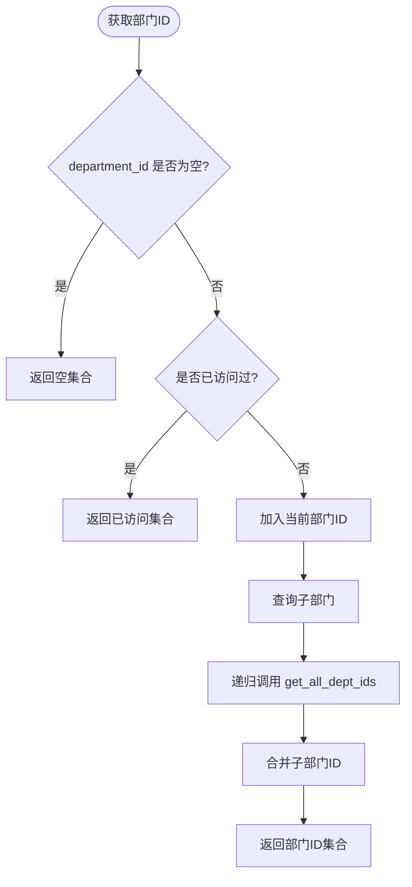
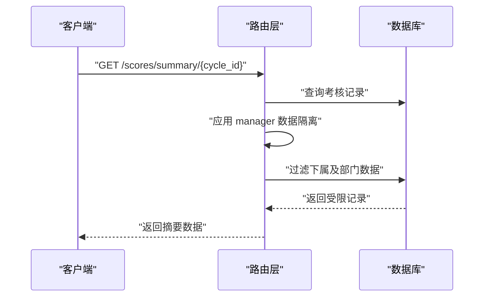
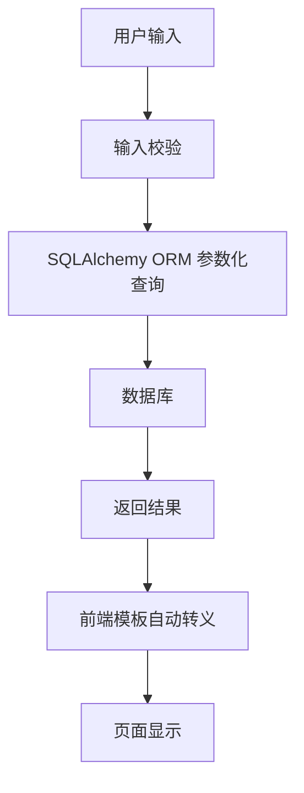
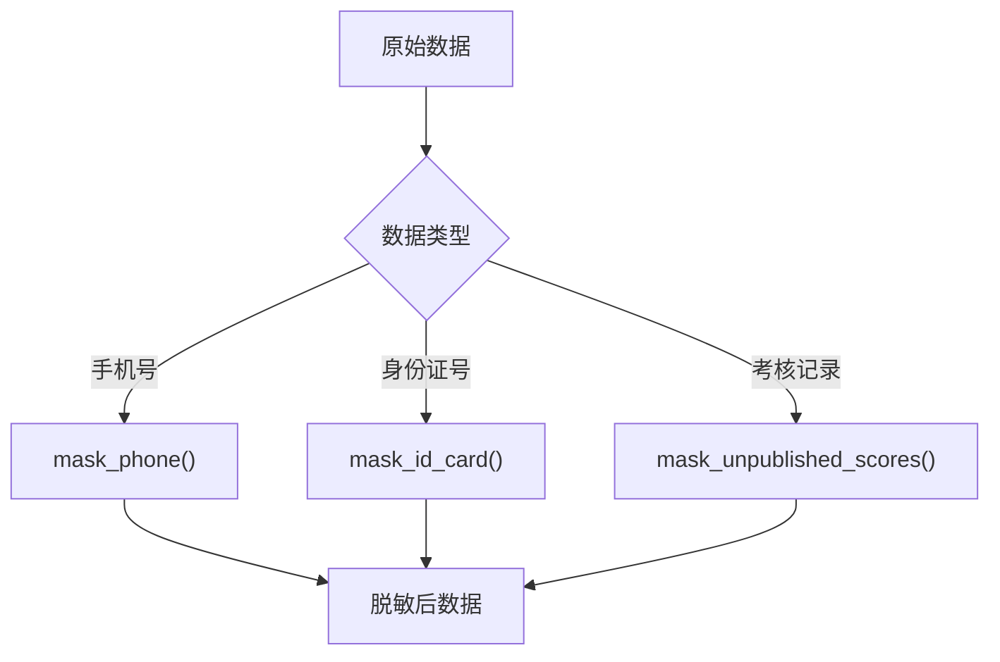
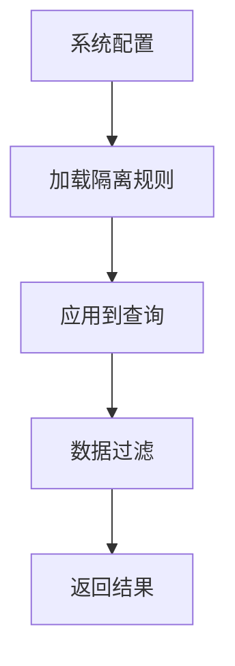
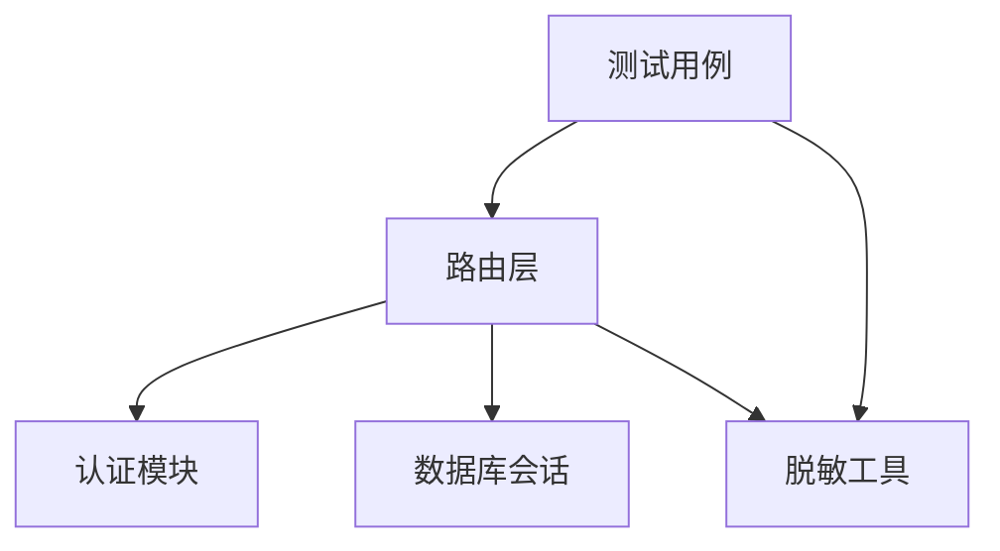

# 数据隔离机制

<cite>
**本文引用的文件**   
- [backend/app/auth.py](file://backend/app/auth.py)
- [backend/app/core/security.py](file://backend/app/core/security.py)
- [backend/app/dependencies.py](file://backend/app/dependencies.py)
- [backend/app/models.py](file://backend/app/models.py)
- [backend/app/utils/data_masking.py](file://backend/app/utils/data_masking.py)
- [backend/app/routers/employees.py](file://backend/app/routers/employees.py)
- [backend/app/routers/scores.py](file://backend/app/routers/scores.py)
- [backend/app/routers/interviews.py](file://backend/app/routers/interviews.py)
- [backend/app/routers/reports.py](file://backend/app/routers/reports.py)
- [backend/tests/test_data_isolation.py](file://backend/tests/test_data_isolation.py)
- [backend/tests/test_data_masking.py](file://backend/tests/test_data_masking.py)
- [docs/TECH_绩效考核评分系统_v1.0.md](file://docs/TECH_绩效考核评分系统_v1.0.md)
</cite>

## 目录
1. [引言](#引言)
2. [项目结构与数据隔离相关位置](#项目结构与数据隔离相关位置)
3. [核心概念与角色权限模型](#核心概念与角色权限模型)
4. [架构总览：数据隔离在系统中的位置](#架构总览数据隔离在系统中的位置)
5. [基于角色的数据访问控制策略](#基于角色的数据访问控制策略)
6. [部门层级隔离与子部门自动包含](#部门层级隔离与子部门自动包含)
7. [查询时的自动数据范围限制](#查询时的自动数据范围限制)
8. [SQL注入防护与输入校验](#sql注入防护与输入校验)
9. [敏感数据脱敏处理](#敏感数据脱敏处理)
10. [配置选项与自定义隔离规则实现方法](#配置选项与自定义隔离规则实现方法)
11. [依赖关系分析](#依赖关系分析)
12. [性能与可维护性建议](#性能与可维护性建议)
13. [故障排查指南](#故障排查指南)
14. [结论](#结论)

## 引言
本文件面向“数据隔离机制”的完整说明，重点覆盖以下目标：
- 解释基于角色的数据访问控制策略，明确不同角色对数据的可见性与操作权限。
- 详细说明部门层级隔离的实现方式，包括子部门数据自动包含和跨部门访问限制。
- 介绍查询时的自动数据范围限制、SQL注入防护以及敏感数据脱敏处理。
- 提供数据隔离的配置思路与自定义隔离规则的实现方法，帮助扩展新业务场景。

该机制主要应用于员工信息、考核记录、面试记录、报表统计等模块，确保用户只能看到其权限范围内的数据，避免越权访问和数据泄露。

## 项目结构与数据隔离相关位置
数据隔离能力分布在认证鉴权、路由层数据过滤、工具类脱敏以及测试用例中：
- 认证与角色校验：`backend/app/auth.py`、`backend/app/core/security.py`、`backend/app/dependencies.py`
- 数据模型与部门/员工关系：`backend/app/models.py`
- 路由层数据隔离逻辑：`backend/app/routers/employees.py`、`backend/app/routers/scores.py`、`backend/app/routers/interviews.py`、`backend/app/routers/reports.py`
- 敏感数据脱敏工具：`backend/app/utils/data_masking.py`
- 数据隔离与脱敏测试：`backend/tests/test_data_isolation.py`、`backend/tests/test_data_masking.py`
- 技术文档中的安全与隔离说明：`docs/TECH_绩效考核评分系统_v1.0.md`

**图表来源**  
- [backend/app/auth.py:68-129](file://backend/app/auth.py#L68-L129)
- [backend/app/core/security.py:82-138](file://backend/app/core/security.py#L82-L138)
- [backend/app/models.py:8-48](file://backend/app/models.py#L8-L48)
- [backend/app/routers/employees.py:247-260](file://backend/app/routers/employees.py#L247-L260)
- [backend/app/utils/data_masking.py:1-25](file://backend/app/utils/data_masking.py#L1-L25)

**章节来源**  
- [backend/app/auth.py:68-129](file://backend/app/auth.py#L68-L129)
- [backend/app/core/security.py:82-138](file://backend/app/core/security.py#L82-L138)
- [backend/app/models.py:8-48](file://backend/app/models.py#L8-L48)
- [backend/app/routers/employees.py:247-260](file://backend/app/routers/employees.py#L247-L260)
- [backend/app/utils/data_masking.py:1-25](file://backend/app/utils/data_masking.py#L1-L25)

## 核心概念与角色权限模型
系统中涉及的主要角色包括：
- admin：管理员，通常拥有全量数据访问权限。
- hr：人力资源，通常可查看本部门或全公司汇总数据。
- manager：部门经理，可查看本人下属及本部门及子部门数据。
- employee：普通员工，仅可查看本人相关数据。
- executive：高管，通常查看聚合数据，不直接下钻到个人明细。
- peer：同侪评审者，仅在特定流程中被允许参与评审，但不可随意查看他人数据。

角色权限通过 JWT Token 中的 `role` 字段进行传递，并在受保护接口中使用 `require_role` 装饰器进行强制校验。首次登录未修改密码的用户会被限制访问非白名单接口。

**图表来源**  
- [backend/app/models.py:8-48](file://backend/app/models.py#L8-L48)
- [backend/app/models.py:49-60](file://backend/app/models.py#L49-L60)

**章节来源**  
- [backend/app/auth.py:116-129](file://backend/app/auth.py#L116-L129)
- [backend/app/models.py:8-60](file://backend/app/models.py#L8-L60)

## 架构总览：数据隔离在系统中的位置
数据隔离在请求处理链路中的关键位置如下：
1. 客户端发起请求并携带 JWT Bearer Token。
2. FastAPI 依赖解析当前用户（`get_current_user`），校验 Token 有效性、用户状态和首次登录要求。
3. 路由层根据用户角色执行数据隔离过滤，例如按员工本人、部门及子部门、下属链等进行筛选。
4. 返回结果前，对敏感字段进行脱敏处理，如手机号、身份证号、未发布状态的分数与等级。

**图表来源**  
- [backend/app/core/security.py:82-138](file://backend/app/core/security.py#L82-L138)
- [backend/app/routers/employees.py:247-260](file://backend/app/routers/employees.py#L247-L260)
- [backend/app/utils/data_masking.py:1-25](file://backend/app/utils/data_masking.py#L1-L25)

**章节来源**  
- [backend/app/core/security.py:82-138](file://backend/app/core/security.py#L82-L138)
- [backend/app/routers/employees.py:247-260](file://backend/app/routers/employees.py#L247-L260)
- [backend/app/utils/data_masking.py:1-25](file://backend/app/utils/data_masking.py#L1-L25)

## 基于角色的数据访问控制策略
不同角色对数据的可见性和操作权限如下：
- 员工（employee）：仅能查看本人相关数据，如员工列表、考核记录、面试记录等。
- 经理（manager）：可查看本人下属及本部门及子部门的数据；不能跨部门访问非下属数据。
- HR/admin/executive：通常拥有更广泛的数据访问权限，具体取决于接口设计。
- peer：在特定评审流程中有限访问权限，但不能随意查看他人数据。

示例：
- 员工列表接口中，employee 角色仅能看到自己；manager 角色能看到本部门及子部门员工。
- 考核记录接口中，manager 角色仅能看到下属及本部门及子部门的记录。
- 面试记录接口中，employee 只能查看本人记录；manager 需满足下属链或部门归属条件。

**图表来源**  
- [backend/app/routers/employees.py:247-260](file://backend/app/routers/employees.py#L247-L260)
- [backend/app/routers/scores.py:111-127](file://backend/app/routers/scores.py#L111-L127)
- [backend/app/routers/interviews.py:156-171](file://backend/app/routers/interviews.py#L156-L171)

**章节来源**  
- [backend/app/routers/employees.py:247-260](file://backend/app/routers/employees.py#L247-L260)
- [backend/app/routers/scores.py:111-127](file://backend/app/routers/scores.py#L111-L127)
- [backend/app/routers/interviews.py:156-171](file://backend/app/routers/interviews.py#L156-L171)

## 部门层级隔离与子部门自动包含
部门层级隔离的核心是递归获取当前部门及其所有子部门 ID，然后用于数据过滤。实现要点：
- 使用 `get_all_dept_ids(db, department_id)` 递归收集部门及子部门 ID。
- 在查询时，将 `department_id in dept_ids` 作为过滤条件之一。
- 对于经理角色，还需结合下属链 `_is_in_subordinate_chain` 判断是否允许访问目标员工数据。

**图表来源**  
- [backend/app/routers/employees.py:437-450](file://backend/app/routers/employees.py#L437-L450)

**章节来源**  
- [backend/app/routers/employees.py:437-450](file://backend/app/routers/employees.py#L437-L450)

## 查询时的自动数据范围限制
系统在多个接口中实现了自动数据范围限制，确保用户只能访问其权限范围内的数据：
- 员工列表：employee 仅看本人；manager 看本部门及子部门。
- 考核记录：manager 仅看下属及本部门及子部门。
- 面试记录：employee 仅看本人；manager 需满足下属链或部门归属。
- 报表统计：manager 仅统计下属及本部门及子部门数据。

这些限制通过 SQLAlchemy ORM 的条件过滤实现，避免全表扫描和越权访问。

**图表来源**  
- [backend/app/routers/scores.py:111-127](file://backend/app/routers/scores.py#L111-L127)
- [backend/app/routers/reports.py:29-40](file://backend/app/routers/reports.py#L29-L40)

**章节来源**  
- [backend/app/routers/scores.py:111-127](file://backend/app/routers/scores.py#L111-L127)
- [backend/app/routers/reports.py:29-40](file://backend/app/routers/reports.py#L29-L40)

## SQL注入防护与输入校验
系统采用 SQLAlchemy ORM 进行参数化查询，避免字符串拼接 SQL，从而有效防止 SQL 注入攻击。同时，前端模板自动转义输出内容，后端对富文本使用过滤库进行清洗。

防护措施包括：
- 全系统使用 SQLAlchemy ORM + 参数化查询。
- 前端 Vue 模板自动转义。
- 后端富文本使用 bleach 过滤。
- 输入校验特殊字符。
- 统一错误响应，不暴露堆栈、SQL、路径。

**图表来源**  
- [docs/TECH_绩效考核评分系统_v1.0.md:2508-2519](file://docs/TECH_绩效考核评分系统_v1.0.md#L2508-L2519)

**章节来源**  
- [docs/TECH_绩效考核评分系统_v1.0.md:2508-2519](file://docs/TECH_绩效考核评分系统_v1.0.md#L2508-L2519)

## 敏感数据脱敏处理
敏感数据脱敏主要针对个人信息和未发布的考核分数：
- 手机号脱敏：保留前 3 位和后 4 位，中间用 `****` 替换。
- 身份证号脱敏：保留前 6 位和后 4 位，中间用 `********` 替换。
- 未发布状态考核记录：将 `total_score` 和 `grade` 置为 `None`。

这些脱敏逻辑在工具类中集中实现，并在 API 响应前应用。

**图表来源**  
- [backend/app/utils/data_masking.py:1-25](file://backend/app/utils/data_masking.py#L1-L25)

**章节来源**  
- [backend/app/utils/data_masking.py:1-25](file://backend/app/utils/data_masking.py#L1-L25)

## 配置选项与自定义隔离规则实现方法
虽然当前代码中没有显式的“数据隔离配置表”，但可以通过以下方式扩展：
- 新增配置项：在 `SystemConfig` 表中增加键值对，如 `data_isolation_mode`、`allow_cross_dept_access` 等。
- 动态规则加载：在路由层读取配置，动态调整过滤逻辑。
- 自定义隔离函数：封装新的隔离规则函数，如 `apply_custom_isolation(query, user)`，并在需要时调用。
- 测试驱动：为新规则编写单元测试，确保行为符合预期。

示例扩展点：
- 在 `employees.py` 中新增隔离函数，并根据配置决定是否启用跨部门访问。
- 在 `scores.py` 中根据配置调整 manager 的可见范围。
- 在 `reports.py` 中根据配置决定是否包含其他部门数据。

**图表来源**  
- [backend/app/models.py:222-227](file://backend/app/models.py#L222-L227)

**章节来源**  
- [backend/app/models.py:222-227](file://backend/app/models.py#L222-L227)

## 依赖关系分析
数据隔离相关的依赖关系如下：
- 路由层依赖认证模块获取当前用户。
- 路由层依赖数据库会话执行查询。
- 路由层依赖脱敏工具处理敏感字段。
- 测试用例验证隔离逻辑的正确性。

**图表来源**  
- [backend/app/routers/employees.py:247-260](file://backend/app/routers/employees.py#L247-L260)
- [backend/tests/test_data_isolation.py:13-64](file://backend/tests/test_data_isolation.py#L13-L64)
- [backend/tests/test_data_masking.py:12-61](file://backend/tests/test_data_masking.py#L12-L61)

**章节来源**  
- [backend/app/routers/employees.py:247-260](file://backend/app/routers/employees.py#L247-L260)
- [backend/tests/test_data_isolation.py:13-64](file://backend/tests/test_data_isolation.py#L13-L64)
- [backend/tests/test_data_masking.py:12-61](file://backend/tests/test_data_masking.py#L12-L61)

## 性能与可维护性建议
- 避免全表扫描：尽量在数据库层使用索引和条件过滤，减少内存过滤。
- 缓存部门树：如果部门结构变化不频繁，可缓存 `get_all_dept_ids` 的结果。
- 统一隔离函数：将重复的隔离逻辑封装为通用函数，提高可维护性。
- 监控越权访问：记录审计日志，便于追踪异常访问行为。

[本节为一般性建议，不直接分析具体文件]

## 故障排查指南
常见问题及排查方法：
- 员工看不到本部门其他员工：检查 manager 的部门归属和子部门递归是否正确。
- 经理看不到下属数据：检查下属链 `_is_in_subordinate_chain` 是否正确。
- 敏感数据未脱敏：检查是否在返回前调用了脱敏函数。
- SQL 注入报错：确认是否使用了 ORM 参数化查询，避免字符串拼接。

**章节来源**  
- [backend/app/routers/employees.py:453-466](file://backend/app/routers/employees.py#L453-L466)
- [backend/app/utils/data_masking.py:1-25](file://backend/app/utils/data_masking.py#L1-L25)

## 结论
本系统的“数据隔离机制”通过角色权限校验、部门层级递归、查询条件过滤和敏感数据脱敏等多层手段，确保了数据访问的安全性和可控性。未来可通过配置化隔离规则和统一隔离函数进一步提升灵活性和可维护性。

[本节为总结性内容，不直接分析具体文件]