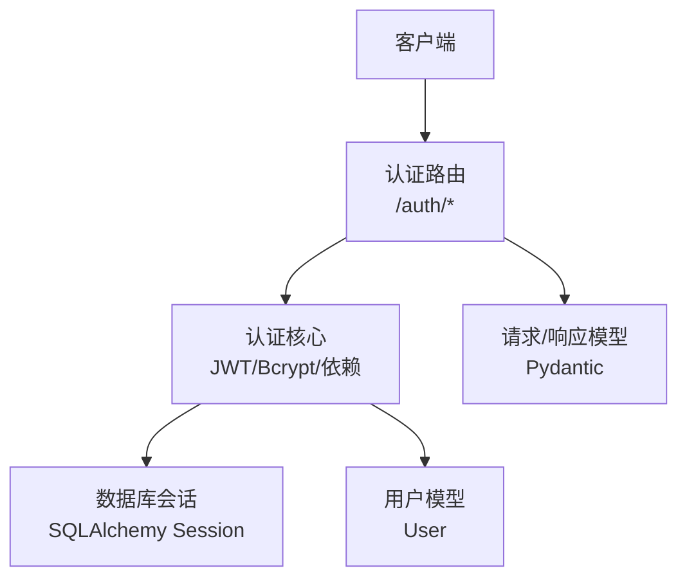
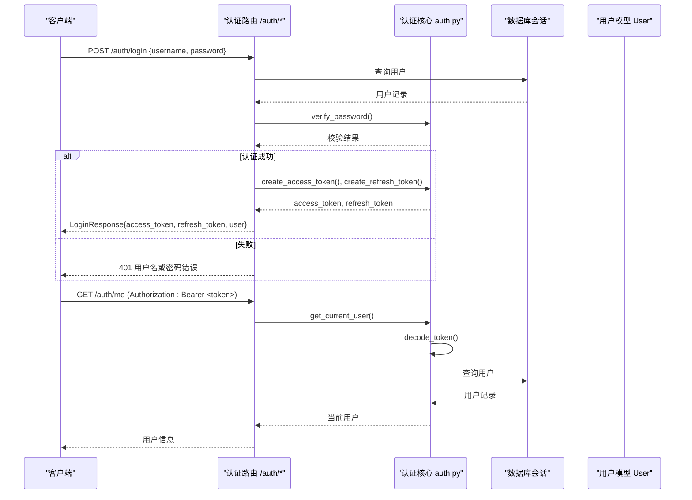
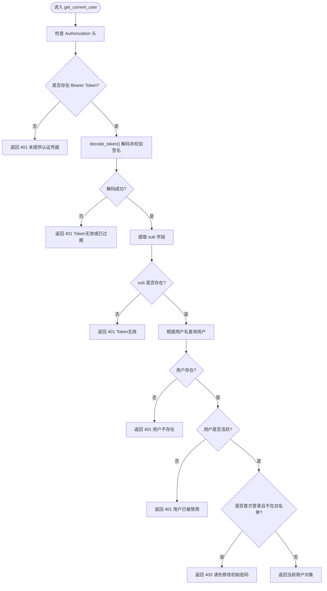
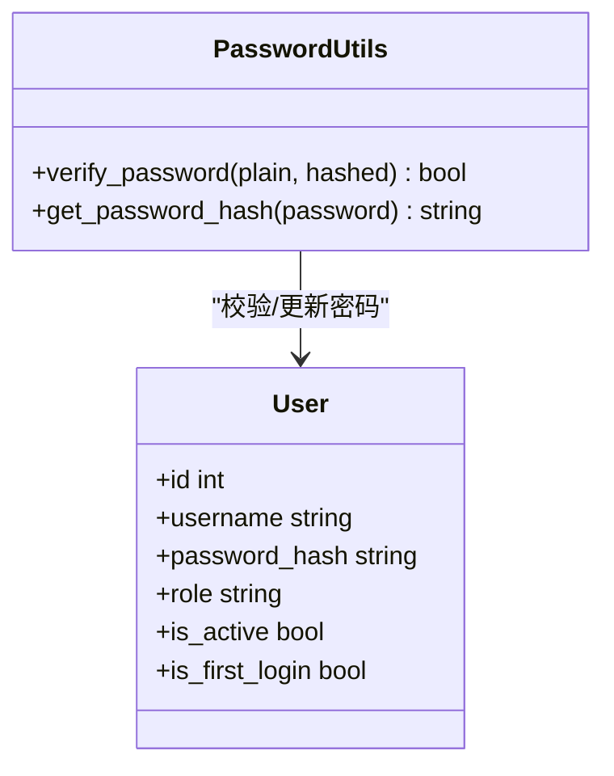
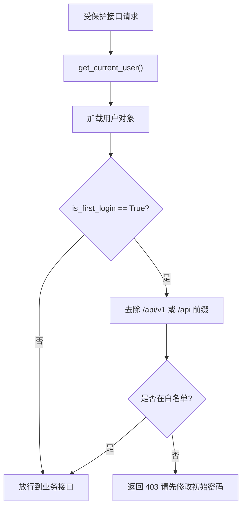
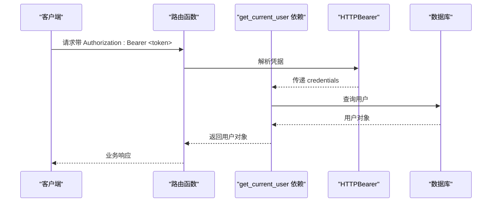
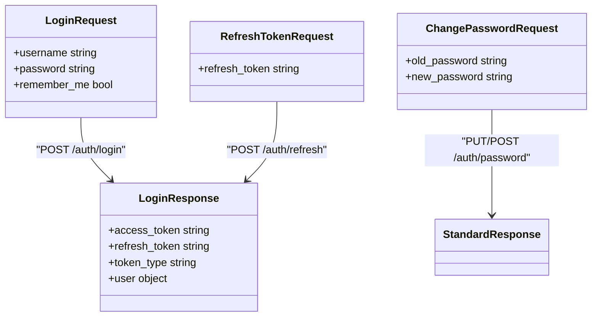
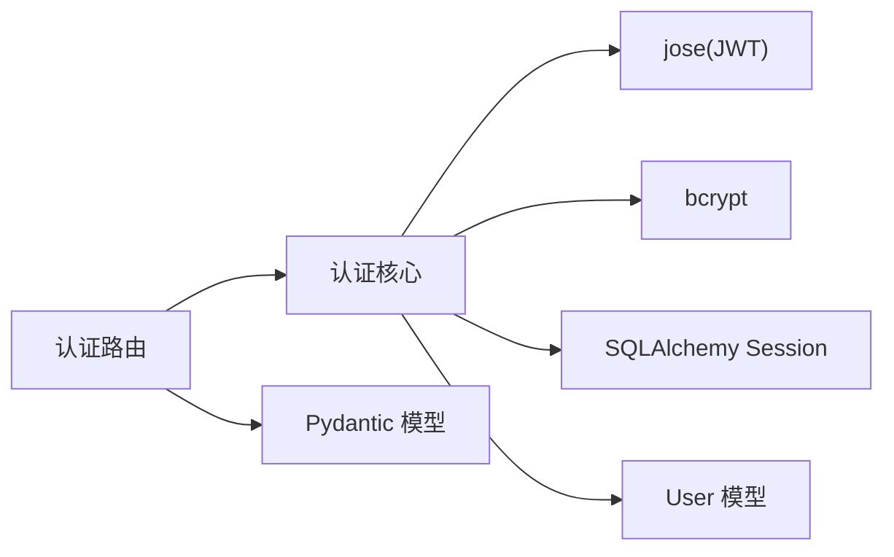

# 认证系统

<cite>
**本文引用的文件**   
- [backend/app/auth.py](file://backend/app/auth.py)
- [backend/app/core/security.py](file://backend/app/core/security.py)
- [backend/app/routers/auth.py](file://backend/app/routers/auth.py)
- [backend/app/models.py](file://backend/app/models.py)
- [backend/app/schemas.py](file://backend/app/schemas.py)
- [backend/tests/test_p0_15_first_login_guard.py](file://backend/tests/test_p0_15_first_login_guard.py)
</cite>

## 目录
1. [引言](#引言)
2. [项目结构](#项目结构)
3. [核心组件](#核心组件)
4. [架构总览](#架构总览)
5. [详细组件分析](#详细组件分析)
6. [依赖关系分析](#依赖关系分析)
7. [性能与安全考量](#性能与安全考量)
8. [故障排查指南](#故障排查指南)
9. [结论](#结论)

## 引言
本文件面向绩效考核评分系统的认证子系统，聚焦以下目标：
- 解释基于 JWT 的令牌认证机制，包括令牌的生成、验证、刷新与过期处理。
- 说明使用 bcrypt 进行密码哈希存储的安全实践。
- 阐述首次登录强制改密功能及其白名单机制、用户状态检查。
- 说明 HTTP Bearer 认证的工作原理与 FastAPI 依赖注入实现。
- 提供认证中间件（依赖）的配置和使用示例，包括令牌验证流程与错误处理。

## 项目结构
认证相关代码主要分布在后端模块中：
- 认证核心逻辑与工具函数位于 `backend/app/auth.py`。
- 路由接口定义位于 `backend/app/routers/auth.py`。
- 数据模型定义位于 `backend/app/models.py`。
- 请求/响应模式定义位于 `backend/app/schemas.py`。
- 另一份安全工具实现位于 `backend/app/core/security.py`，用于对比或历史兼容。
- 首次登录拦截行为由单元测试覆盖，见 `backend/tests/test_p0_15_first_login_guard.py`。

**图表来源**
- [backend/app/routers/auth.py:1-28](file://backend/app/routers/auth.py#L1-L28)
- [backend/app/auth.py:1-17](file://backend/app/auth.py#L1-L17)
- [backend/app/models.py:49-60](file://backend/app/models.py#L49-L60)
- [backend/app/schemas.py:12-29](file://backend/app/schemas.py#L12-L29)

**章节来源**
- [backend/app/auth.py:1-17](file://backend/app/auth.py#L1-L17)
- [backend/app/routers/auth.py:1-28](file://backend/app/routers/auth.py#L1-L28)
- [backend/app/models.py:49-60](file://backend/app/models.py#L49-L60)
- [backend/app/schemas.py:12-29](file://backend/app/schemas.py#L12-L29)

## 核心组件
- JWT 令牌工具：创建访问令牌、刷新令牌、解码校验。
- 密码工具：bcrypt 哈希与校验。
- 当前用户解析器：从 HTTP Bearer 头提取并验证 Token，查询用户对象，执行权限与首次登录检查。
- 角色守卫：可选的角色校验装饰器。
- 认证路由：登录、刷新、获取当前用户、修改密码、登出等接口。
- 数据模型：用户表包含用户名、密码哈希、角色、是否活跃、是否首次登录等字段。
- 请求/响应模式：登录请求、登录响应、刷新请求、改密请求等 Pydantic 模型。

**章节来源**
- [backend/app/auth.py:12-113](file://backend/app/auth.py#L12-L113)
- [backend/app/routers/auth.py:63-179](file://backend/app/routers/auth.py#L63-L179)
- [backend/app/models.py:49-60](file://backend/app/models.py#L49-L60)
- [backend/app/schemas.py:12-29](file://backend/app/schemas.py#L12-L29)

## 架构总览
下图展示认证子系统在请求生命周期中的位置与交互：

**图表来源**
- [backend/app/routers/auth.py:63-93](file://backend/app/routers/auth.py#L63-L93)
- [backend/app/routers/auth.py:114-122](file://backend/app/routers/auth.py#L114-L122)
- [backend/app/auth.py:46-65](file://backend/app/auth.py#L46-L65)
- [backend/app/auth.py:68-113](file://backend/app/auth.py#L68-L113)

## 详细组件分析

### JWT 令牌认证机制
- 令牌生成：
  - 访问令牌：包含用户标识与过期时间，默认有效期为分钟级。
  - 刷新令牌：用于换取新的访问令牌，默认有效期为天级。
- 令牌验证：
  - 通过 HS256 算法与密钥对令牌签名进行校验。
  - 解码后提取用户标识，查询数据库确认用户存在且活跃。
- 令牌刷新：
  - 校验刷新令牌有效性后，签发新的访问令牌。
- 过期处理：
  - 解码失败或过期时返回未认证错误。

**图表来源**
- [backend/app/auth.py:68-113](file://backend/app/auth.py#L68-L113)
- [backend/app/auth.py:46-65](file://backend/app/auth.py#L46-L65)

**章节来源**
- [backend/app/auth.py:46-65](file://backend/app/auth.py#L46-L65)
- [backend/app/auth.py:68-113](file://backend/app/auth.py#L68-L113)

### 密码加密存储机制（bcrypt）
- 密码哈希：
  - 使用 bcrypt.hashpw 生成随机盐并进行哈希，存储为字符串。
- 密码校验：
  - 使用 bcrypt.checkpw 比对明文与哈希值。
- 安全性：
  - 每次哈希使用不同盐，防止彩虹表攻击。
  - 建议在生产环境配置合适的 bcrypt 轮次与密钥管理策略。

**图表来源**
- [backend/app/auth.py:38-43](file://backend/app/auth.py#L38-L43)
- [backend/app/models.py:49-60](file://backend/app/models.py#L49-L60)

**章节来源**
- [backend/app/auth.py:38-43](file://backend/app/auth.py#L38-L43)
- [backend/app/models.py:49-60](file://backend/app/models.py#L49-L60)

### 首次登录强制改密与白名单机制
- 用户状态：
  - 用户模型包含 is_first_login 字段，默认值为 True。
- 白名单接口：
  - 仅允许首次登录用户访问认证相关接口：登录、刷新、我的信息、改密、登出。
- 拦截逻辑：
  - 在 get_current_user 中，若用户处于首次登录状态且请求路径不在白名单内，返回 403。
- 改密流程：
  - 修改成功后将 is_first_login 置为 False，解除业务接口限制。

**图表来源**
- [backend/app/auth.py:19-35](file://backend/app/auth.py#L19-L35)
- [backend/app/auth.py:107-112](file://backend/app/auth.py#L107-L112)

**章节来源**
- [backend/app/auth.py:19-35](file://backend/app/auth.py#L19-L35)
- [backend/app/auth.py:107-112](file://backend/app/auth.py#L107-L112)
- [backend/app/models.py:49-60](file://backend/app/models.py#L49-L60)
- [backend/tests/test_p0_15_first_login_guard.py:1-58](file://backend/tests/test_p0_15_first_login_guard.py#L1-L58)

### HTTP Bearer 认证与依赖注入
- 工作原理：
  - 客户端在请求头携带 Authorization: Bearer <token>。
  - FastAPI 的 HTTPBearer 自动解析凭据，传递给依赖函数。
- 依赖注入：
  - get_current_user 作为依赖被路由函数使用，完成令牌校验、用户查询与权限检查。
- 错误处理：
  - 未提供凭据、令牌无效、用户不存在、用户禁用等场景均返回明确的 401/403 错误。

**图表来源**
- [backend/app/auth.py:68-113](file://backend/app/auth.py#L68-L113)
- [backend/app/routers/auth.py:114-122](file://backend/app/routers/auth.py#L114-L122)

**章节来源**
- [backend/app/auth.py:68-113](file://backend/app/auth.py#L68-L113)
- [backend/app/routers/auth.py:114-122](file://backend/app/routers/auth.py#L114-L122)

### 认证路由与接口规范
- 登录接口：
  - 输入：用户名、密码、可选记住我。
  - 输出：access_token、refresh_token、token_type、用户信息（含 is_first_login）。
  - 失败：用户名或密码错误；多次失败触发限流。
- 刷新接口：
  - 输入：refresh_token。
  - 输出：新的 access_token。
- 我的信息接口：
  - 需要有效 Bearer Token。
  - 输出：用户基本信息。
- 修改密码接口：
  - 需要有效 Bearer Token。
  - 校验旧密码、新密码复杂度、长度与强度。
  - 成功后清除首次登录标记。
- 登出接口：
  - 需要有效 Bearer Token。
  - 返回退出成功。

**图表来源**
- [backend/app/schemas.py:12-29](file://backend/app/schemas.py#L12-L29)
- [backend/app/routers/auth.py:63-179](file://backend/app/routers/auth.py#L63-L179)

**章节来源**
- [backend/app/schemas.py:12-29](file://backend/app/schemas.py#L12-L29)
- [backend/app/routers/auth.py:63-179](file://backend/app/routers/auth.py#L63-L179)

### 安全与健壮性增强
- 登录失败次数限制：
  - 同一用户名短时间内多次失败将被临时锁定。
- 密码复杂度校验：
  - 最小长度、禁止纯数字或纯字母组合。
- 操作审计：
  - 修改密码会记录操作日志。

**章节来源**
- [backend/app/routers/auth.py:31-61](file://backend/app/routers/auth.py#L31-L61)
- [backend/app/routers/auth.py:125-164](file://backend/app/routers/auth.py#L125-L164)

## 依赖关系分析
认证子系统依赖如下模块：
- FastAPI 依赖注入与 HTTPBearer。
- jose 库进行 JWT 编解码。
- bcrypt 进行密码哈希。
- SQLAlchemy 会话与用户模型。
- Pydantic 请求/响应模型。

**图表来源**
- [backend/app/routers/auth.py:1-28](file://backend/app/routers/auth.py#L1-L28)
- [backend/app/auth.py:1-17](file://backend/app/auth.py#L1-L17)
- [backend/app/models.py:49-60](file://backend/app/models.py#L49-L60)
- [backend/app/schemas.py:12-29](file://backend/app/schemas.py#L12-L29)

**章节来源**
- [backend/app/routers/auth.py:1-28](file://backend/app/routers/auth.py#L1-L28)
- [backend/app/auth.py:1-17](file://backend/app/auth.py#L1-L17)
- [backend/app/models.py:49-60](file://backend/app/models.py#L49-L60)
- [backend/app/schemas.py:12-29](file://backend/app/schemas.py#L12-L29)

## 性能与安全考量
- 令牌有效期：
  - 访问令牌较短，减少泄露风险；刷新令牌较长，便于无感续期。
- 密码哈希成本：
  - bcrypt 计算开销较高，应合理设置轮次并在高并发场景下考虑缓存策略。
- 限流与防暴力破解：
  - 登录失败次数限制降低暴力破解风险。
- 密钥管理：
  - 生产环境应使用环境变量或密钥管理服务管理 SECRET_KEY，避免硬编码。

[本节为通用指导，不直接分析具体文件]

## 故障排查指南
- 401 未认证：
  - 检查 Authorization 头是否正确携带 Bearer Token。
  - 检查 Token 是否过期或无效。
- 403 权限不足或首次登录限制：
  - 检查用户是否为首次登录且访问非白名单接口。
  - 检查用户角色是否满足 require_role 要求。
- 429 请求过多：
  - 检查登录失败次数是否超过阈值。
- 密码修改失败：
  - 检查旧密码是否正确。
  - 检查新密码是否符合长度与复杂度要求。

**章节来源**
- [backend/app/auth.py:73-112](file://backend/app/auth.py#L73-L112)
- [backend/app/routers/auth.py:35-61](file://backend/app/routers/auth.py#L35-L61)
- [backend/app/routers/auth.py:125-164](file://backend/app/routers/auth.py#L125-L164)

## 结论
该认证系统以 JWT 为核心，结合 bcrypt 密码哈希与 FastAPI 依赖注入，实现了安全的令牌认证、刷新与过期处理。首次登录强制改密通过白名单机制与用户状态检查确保用户尽快提升账户安全。整体设计清晰、职责分离，具备可扩展性与可维护性。建议在部署时完善密钥管理与监控告警，进一步提升系统安全性与稳定性。