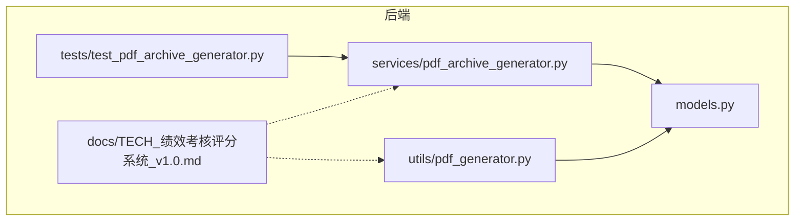
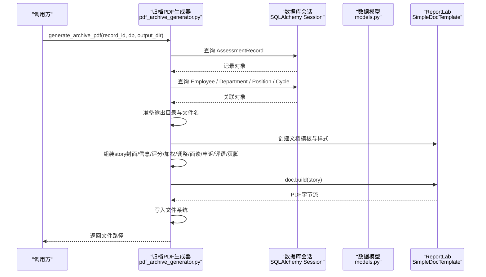
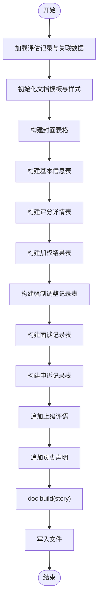
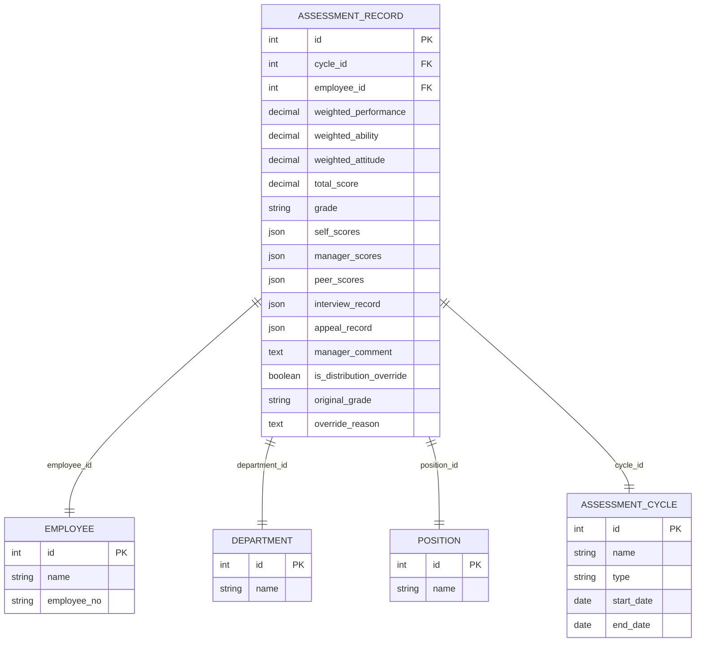
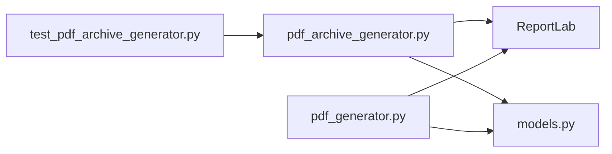

# PDF模板扩展机制

<cite>
**本文引用的文件**   
- [pdf_archive_generator.py](file://backend/app/services/pdf_archive_generator.py)
- [pdf_generator.py](file://backend/app/utils/pdf_generator.py)
- [models.py](file://backend/app/models.py)
- [test_pdf_archive_generator.py](file://backend/tests/test_pdf_archive_generator.py)
- [TECH_绩效考核评分系统_v1.0.md](file://docs/TECH_绩效考核评分系统_v1.0.md)
</cite>

## 目录
1. [引言](#引言)
2. [项目结构](#项目结构)
3. [核心组件](#核心组件)
4. [架构总览](#架构总览)
5. [详细组件分析](#详细组件分析)
6. [依赖关系分析](#依赖关系分析)
7. [性能与内存优化](#性能与内存优化)
8. [故障排查指南](#故障排查指南)
9. [结论](#结论)
10. [附录：扩展与定制指南](#附录扩展与定制指南)

## 引言
本文件面向需要扩展和定制绩效考核系统 PDF 档案生成能力的工程师，聚焦以下目标：
- 解析并说明 PDFArchiveGenerator 的模板引擎架构与渲染流程。
- 解释档案格式自定义的实现方式，包括表格布局、图表嵌入与签名区域配置。
- 提供自定义报表样式的开发指南，涵盖样式注入与动态内容生成。
- 说明多语言支持与国际化配置方法。
- 总结 PDF 生成性能优化与内存管理的技术要点。

当前实现基于 ReportLab 的 Platypus 构建 PDF，未引入 HTML/CSS 模板引擎；因此“模板”在当前代码中体现为“结构化数据 + 样式定义 + 文档元素组装”。

## 项目结构
PDF 相关能力主要位于后端服务层与工具层：
- 服务层：`app/services/pdf_archive_generator.py`，负责完整绩效考核档案 PDF 的生成与落盘。
- 工具层：`app/utils/pdf_generator.py`，提供轻量级 PDF 生成函数，供其他模块复用。
- 模型层：`app/models.py`，定义了考核记录、员工、部门、岗位、周期等实体，是 PDF 数据来源。
- 测试：`tests/test_pdf_archive_generator.py`，覆盖归档 PDF 生成的关键路径。
- 设计文档：`docs/TECH_绩效考核评分系统_v1.0.md`，包含 PDF 档案算法与内容结构的总体说明。

**图示来源**
- [pdf_archive_generator.py:1-302](file://backend/app/services/pdf_archive_generator.py#L1-L302)
- [pdf_generator.py:1-101](file://backend/app/utils/pdf_generator.py#L1-L101)
- [models.py:1-266](file://backend/app/models.py#L1-L266)
- [test_pdf_archive_generator.py:1-136](file://backend/tests/test_pdf_archive_generator.py#L1-L136)
- [TECH_绩效考核评分系统_v1.0.md:2083-2193](file://docs/TECH_绩效考核评分系统_v1.0.md#L2083-L2193)

**章节来源**
- [pdf_archive_generator.py:1-302](file://backend/app/services/pdf_archive_generator.py#L1-L302)
- [pdf_generator.py:1-101](file://backend/app/utils/pdf_generator.py#L1-L101)
- [models.py:1-266](file://backend/app/models.py#L1-L266)
- [test_pdf_archive_generator.py:1-136](file://backend/tests/test_pdf_archive_generator.py#L1-L136)
- [TECH_绩效考核评分系统_v1.0.md:2083-2193](file://docs/TECH_绩效考核评分系统_v1.0.md#L2083-L2193)

## 核心组件
- 归档 PDF 生成器（服务层）
  - 职责：根据评估记录 ID 查询数据，组装封面、基本信息、评分详情、加权结果、强制调整记录、面谈记录、申诉记录、上级评语与页脚声明，最终输出 PDF 文件路径。
  - 关键点：字体注册、JSON 字段安全解析、Table 样式、分页控制、BytesIO 缓冲写入。
- 轻量 PDF 生成器（工具层）
  - 职责：返回字节流形式的 PDF，用于接口直接响应或进一步处理。
  - 关键点：A4 页面、基础样式、基础信息表与得分表。
- 数据模型
  - 职责：提供 AssessmentRecord、Employee、Department、Position、AssessmentCycle 等实体，支撑 PDF 数据填充。
- 测试用例
  - 职责：验证归档 PDF 生成成功、目录自动创建、强制调整与面谈/申诉记录展示。

**章节来源**
- [pdf_archive_generator.py:18-302](file://backend/app/services/pdf_archive_generator.py#L18-L302)
- [pdf_generator.py:12-101](file://backend/app/utils/pdf_generator.py#L12-L101)
- [models.py:8-130](file://backend/app/models.py#L8-L130)
- [test_pdf_archive_generator.py:8-136](file://backend/tests/test_pdf_archive_generator.py#L8-L136)

## 架构总览
PDF 生成采用“数据准备 → 样式定义 → 文档元素组装 → 渲染输出”的流程。服务层使用 ReportLab 的 SimpleDocTemplate 与 Platypus 元素（Paragraph、Table、Spacer、PageBreak）构建文档流 story，并通过 BytesIO 缓冲后落盘。

**图示来源**
- [pdf_archive_generator.py:50-302](file://backend/app/services/pdf_archive_generator.py#L50-L302)
- [models.py:99-130](file://backend/app/models.py#L99-L130)

## 详细组件分析

### 归档 PDF 生成器（PDFArchiveGenerator）
- 模板引擎架构
  - 无 HTML/CSS 模板引擎，采用 ReportLab Platypus 作为“可视化模板引擎”。
  - 通过 ParagraphStyle 定义标题、正文、标签等样式，统一字体与字号。
  - 通过 Table + TableStyle 定义表格布局、边框、背景色、对齐与字体。
- 渲染流程
  - 加载数据：按 record_id 获取 AssessmentRecord，再加载 Employee、Department、Position、AssessmentCycle。
  - 初始化文档：A4 页面、四边留白、创建样式集。
  - 构建文档流：封面 → 基本信息 → 评分详情 → 加权结果 → 强制调整记录 → 面谈记录 → 申诉记录 → 上级评语 → 页脚声明。
  - 渲染输出：doc.build(story)，从 BytesIO 读取字节流并写入文件。
- 样式定制方法
  - 字体注册：优先尝试常见中文字体，失败回退到 Helvetica。
  - 段落样式：Title、Heading2、Normal、Label 四类样式，支持字号、对齐、间距与字体。
  - 表格样式：网格线、背景高亮列、垂直居中、字体与字号。
- 错误处理与健壮性
  - JSON 字段安全解析：封装 _safe_json，兼容 None、dict、字符串 JSON 与异常场景。
  - 空值保护：多处使用三元表达式与默认值“-”，避免空引用。
  - 目录创建：自动创建输出目录，确保落盘路径存在。

**图示来源**
- [pdf_archive_generator.py:50-302](file://backend/app/services/pdf_archive_generator.py#L50-L302)

**章节来源**
- [pdf_archive_generator.py:18-302](file://backend/app/services/pdf_archive_generator.py#L18-L302)

### 轻量 PDF 生成器（工具层）
- 职责：返回 PDF 字节流，便于在 API 层直接响应或进行二次处理。
- 特点：
  - 仅包含标题、基本信息表与得分表，适合快速导出。
  - 使用固定 Helvetica 字体，不进行中文字体注册。
  - 通过 BytesIO 缓冲，避免临时文件 IO。

**章节来源**
- [pdf_generator.py:12-101](file://backend/app/utils/pdf_generator.py#L12-L101)

### 数据模型与字段映射
- AssessmentRecord
  - 关键字段：total_score、grade、weighted_performance/ability/attitude、self_scores/manager_scores/peer_scores、interview_record/appeal_record、manager_comment、is_distribution_override/original_grade/override_reason。
- Employee/Department/Position/AssessmentCycle
  - 用于填充封面与基本信息。

**图示来源**
- [models.py:8-130](file://backend/app/models.py#L8-L130)

**章节来源**
- [models.py:8-130](file://backend/app/models.py#L8-L130)

## 依赖关系分析
- 服务层依赖
  - ReportLab：SimpleDocTemplate、Paragraph、Table、TableStyle、ParagraphStyle、colors、pdfmetrics、TTFont。
  - SQLAlchemy Session：用于查询数据。
  - 业务模型：AssessmentRecord、Employee、Department、Position、AssessmentCycle。
- 工具层依赖
  - ReportLab：同上，但更简化。
  - 业务模型：同上。
- 测试依赖
  - pytest：构造测试数据并断言生成路径与文件存在性。

**图示来源**
- [pdf_archive_generator.py:1-16](file://backend/app/services/pdf_archive_generator.py#L1-L16)
- [pdf_generator.py:1-10](file://backend/app/utils/pdf_generator.py#L1-L10)
- [models.py:1-10](file://backend/app/models.py#L1-L10)
- [test_pdf_archive_generator.py:1-6](file://backend/tests/test_pdf_archive_generator.py#L1-L6)

**章节来源**
- [pdf_archive_generator.py:1-16](file://backend/app/services/pdf_archive_generator.py#L1-L16)
- [pdf_generator.py:1-10](file://backend/app/utils/pdf_generator.py#L1-L10)
- [models.py:1-10](file://backend/app/models.py#L1-L10)
- [test_pdf_archive_generator.py:1-6](file://backend/tests/test_pdf_archive_generator.py#L1-L6)

## 性能与内存优化
- 内存管理
  - 使用 BytesIO 作为内存缓冲，避免中间文件 IO，减少磁盘压力。
  - 在生成完成后及时关闭 buffer，释放内存。
- 渲染性能
  - 合理设置 colWidths 与表格行数，避免过大表格导致渲染缓慢。
  - 预计算样式与颜色常量，减少重复创建开销。
- I/O 优化
  - 输出目录按需创建，避免不必要的 mkdir 调用。
  - 文件写入一次性完成，减少多次写操作。
- 并发建议
  - 若需批量生成 PDF，建议使用任务队列（如 Celery）异步处理，避免阻塞主线程。
  - 对大文档可考虑分块渲染与分页策略，降低单次内存峰值。

[本节为通用指导，无需具体文件引用]

## 故障排查指南
- 常见问题
  - 中文显示异常：检查字体注册逻辑与环境字体路径是否可用。
  - JSON 字段解析失败：确认 _safe_json 的输入类型与异常分支。
  - 输出目录不存在：确认 output_dir 参数与权限设置。
  - 强制调整记录未显示：检查 is_distribution_override 与 original_grade/override_reason 字段。
  - 面谈/申诉记录为空：确认 interview_record/appeal_record 是否为有效 JSON。
- 定位方法
  - 使用单元测试断言路径与文件存在性，逐步缩小问题范围。
  - 打印关键变量（record、emp、dept、pos、cycle）以确认数据完整性。
  - 检查 ReportLab 日志与异常堆栈，定位渲染阶段错误。

**章节来源**
- [pdf_archive_generator.py:18-47](file://backend/app/services/pdf_archive_generator.py#L18-L47)
- [test_pdf_archive_generator.py:60-136](file://backend/tests/test_pdf_archive_generator.py#L60-L136)

## 结论
当前 PDF 模板扩展机制基于 ReportLab Platypus，采用“数据结构 + 样式定义 + 文档元素组装”的方式实现。该方案具备明确的渲染流程与可扩展的样式体系，适合在现有基础上进行表格布局、图表嵌入与签名区域的定制。对于多语言与国际化，可通过扩展样式与文案字段实现；对于性能与内存，应关注 BytesIO 的使用与渲染复杂度控制。

[本节为总结性内容，无需具体文件引用]

## 附录：扩展与定制指南

### 模板渲染流程与样式定制
- 模板渲染流程
  - 数据准备 → 样式定义 → 文档元素组装 → 渲染输出。
  - 建议在新增章节时遵循既有顺序：封面 → 基本信息 → 评分详情 → 加权结果 → 强制调整 → 面谈 → 申诉 → 评语 → 页脚。
- 样式定制
  - 新增 ParagraphStyle：保持命名规范（Title、Heading2、Normal、Label），统一字体与字号。
  - 表格样式：使用 TableStyle 设置网格、背景、对齐与字体，确保可读性与一致性。
  - 字体注册：优先使用中文字体，失败回退到 Helvetica，保证跨平台兼容性。

**章节来源**
- [pdf_archive_generator.py:18-110](file://backend/app/services/pdf_archive_generator.py#L18-L110)
- [pdf_archive_generator.py:112-302](file://backend/app/services/pdf_archive_generator.py#L112-L302)

### 档案格式自定义：表格布局、图表嵌入、签名区域
- 表格布局
  - 使用 Table + TableStyle 定义列宽、边框、背景与对齐。
  - 针对长文本单元格，适当增大行高与内边距，提升可读性。
- 图表嵌入
  - 当前未实现图表嵌入；可在 story 中插入图片元素（ReportLab Image）并配合 Table 布局。
  - 建议将图表转为静态图片，避免复杂矢量图导致的渲染性能问题。
- 签名区域配置
  - 可在页脚前增加签名区块，包含签名人姓名、职务、日期与手写签名图片占位。
  - 使用 Spacer 控制间距，确保签名区域与前后内容协调。

**章节来源**
- [pdf_archive_generator.py:138-288](file://backend/app/services/pdf_archive_generator.py#L138-L288)

### 自定义报表样式：CSS 注入与动态内容生成
- CSS 注入
  - 当前不使用 HTML/CSS 模板引擎，无法直接注入 CSS。
  - 替代方案：通过 ParagraphStyle 与 TableStyle 精确控制样式，模拟 CSS 效果。
- 动态内容生成
  - 基于 AssessmentRecord 的 JSON 字段（self_scores、manager_scores、peer_scores、interview_record、appeal_record）动态渲染表格与段落。
  - 建议封装数据转换函数，统一处理空值、格式化与本地化。

**章节来源**
- [pdf_archive_generator.py:35-47](file://backend/app/services/pdf_archive_generator.py#L35-L47)
- [pdf_archive_generator.py:158-288](file://backend/app/services/pdf_archive_generator.py#L158-L288)

### 多语言支持与国际化配置
- 当前实现
  - 文案硬编码于 Python 代码中（如“绩效考核档案”、“基本信息”等）。
- 扩展建议
  - 建立多语言资源字典（如 YAML/JSON），按 key 组织文案。
  - 在渲染前根据用户语言环境选择对应文案，替换硬编码字符串。
  - 对日期、数字等格式进行本地化处理（如日期格式、千分位分隔符）。

[本节为概念性指导，无需具体文件引用]

### PDF 生成性能优化与内存管理技术要点
- 使用 BytesIO 缓冲，避免临时文件 IO。
- 预计算样式与颜色常量，减少重复创建。
- 控制表格规模与行数，避免单次渲染过慢。
- 批量生成时使用任务队列异步处理，降低主线程阻塞。
- 对超大文档采用分页与分块渲染策略，降低内存峰值。

[本节为通用指导，无需具体文件引用]