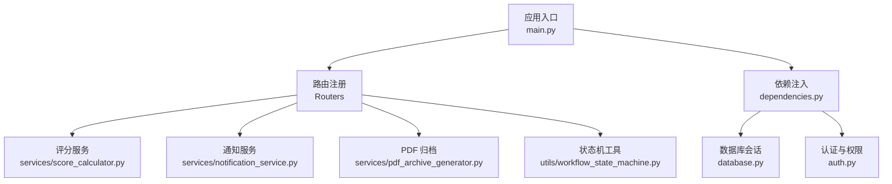
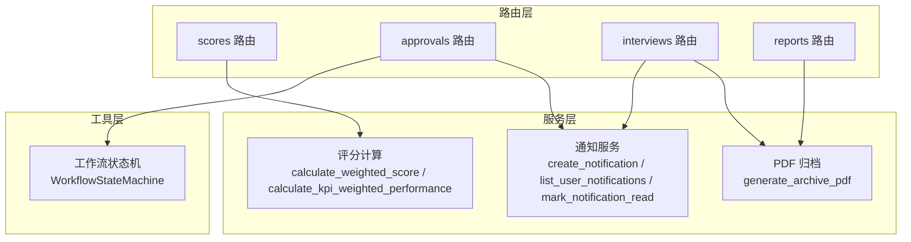
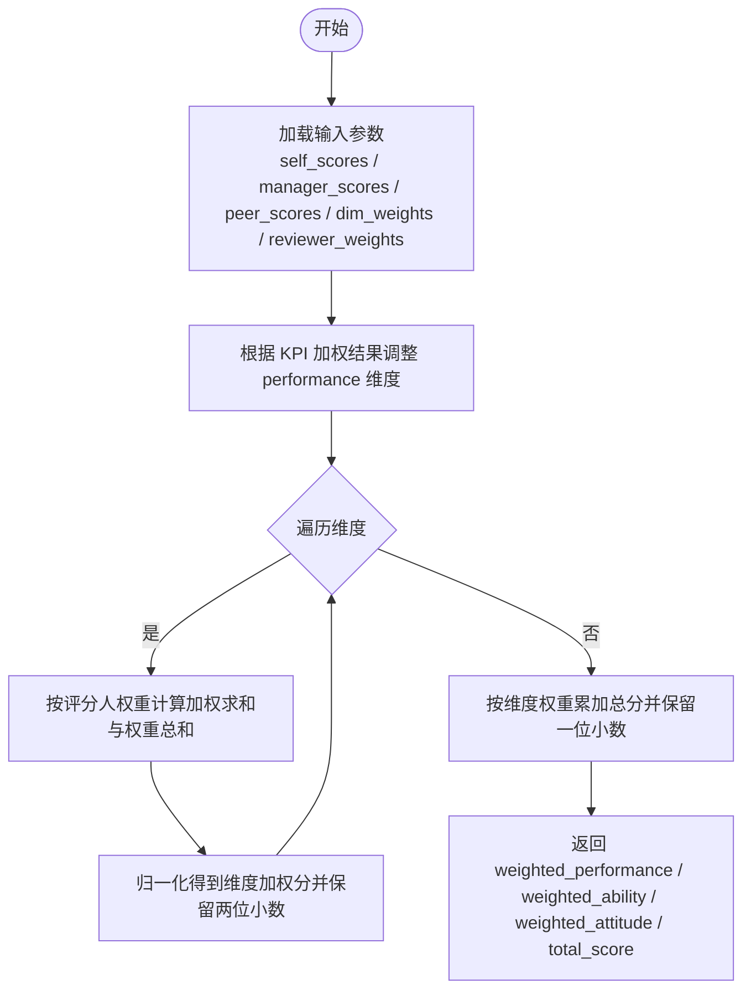
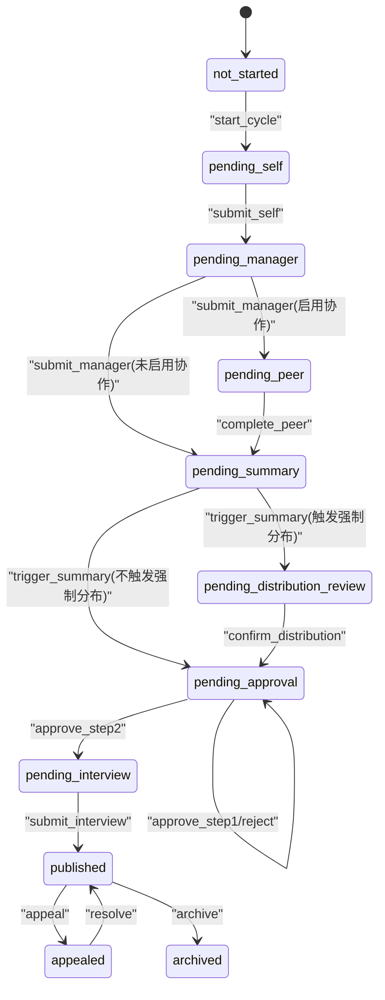
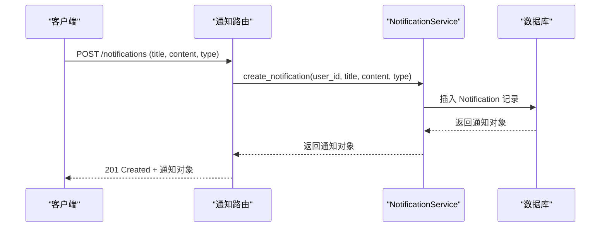
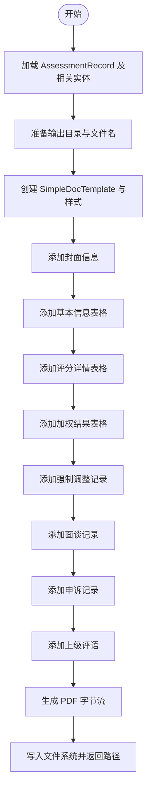
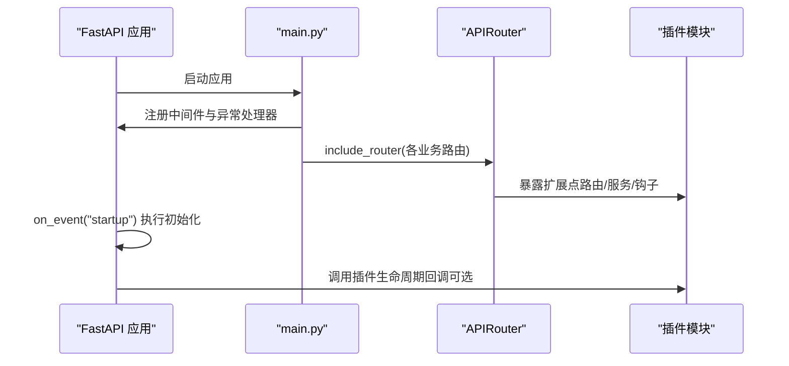
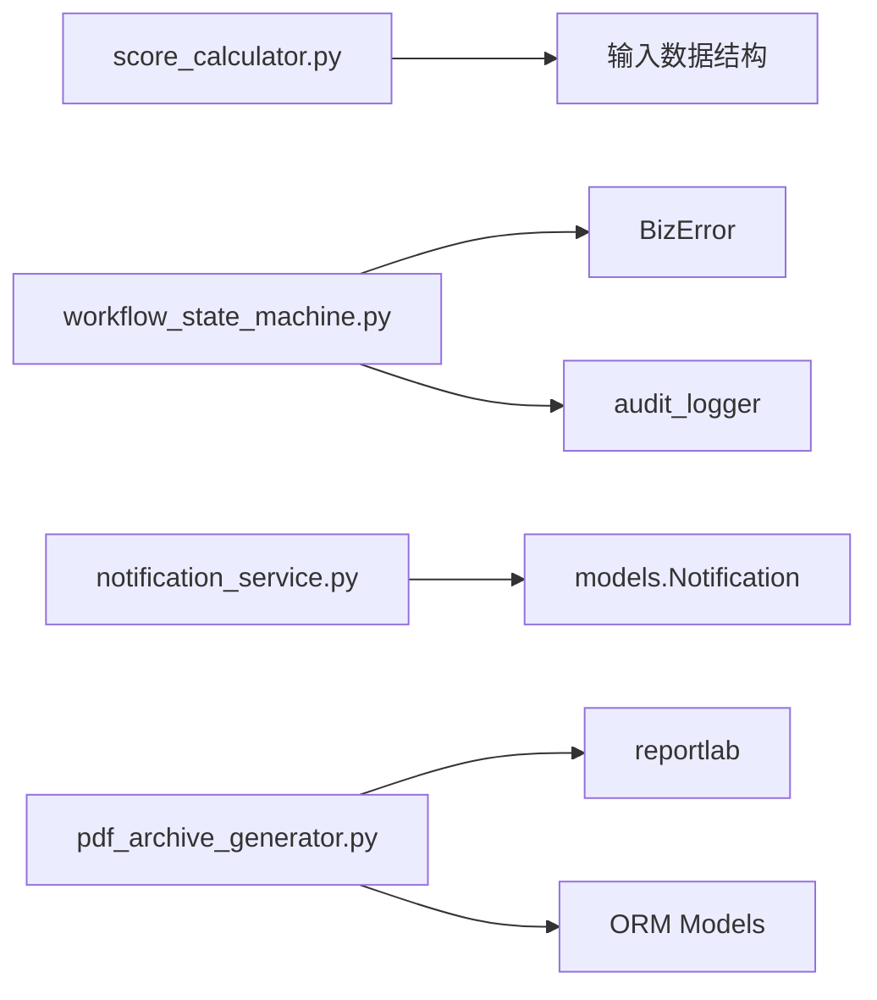

# 扩展机制设计

<cite>
**本文引用的文件 **
- [score_calculator.py](file://backend/app/services/score_calculator.py)
- [workflow_state_machine.py](file://backend/app/utils/workflow_state_machine.py)
- [notification_service.py](file://backend/app/services/notification_service.py)
- [pdf_archive_generator.py](file://backend/app/services/pdf_archive_generator.py)
- [main.py](file://backend/app/main.py)
- [dependencies.py](file://backend/app/dependencies.py)
</cite>

## 目录
1. [引言](#引言)
2. [项目结构](#项目结构)
3. [核心组件](#核心组件)
4. [架构总览](#架构总览)
5. [详细组件分析](#详细组件分析)
6. [依赖关系分析](#依赖关系分析)
7. [性能与可扩展性考虑](#性能与可扩展性考虑)
8. [故障排查指南](#故障排查指南)
9. [结论](#结论)
10. [附录：扩展实现清单](#附录扩展实现清单)

## 引言
本设计文档面向绩效考核评分系统的“扩展机制”，围绕以下五个方向展开：
- 评分算法扩展点：以函数式计算为核心，提供可替换的加权策略与 KPI 加权能力。
- 状态机扩展机制：基于 WorkflowStateMachine 的状态定义、转换规则与校验钩子扩展。
- 通知服务扩展：在现有数据库通知基础上，扩展多通道通知与消息模板定制。
- PDF 模板扩展：通过样式与章节编排扩展档案格式与报表样式。
- 插件化架构：结合 FastAPI 路由注册、依赖注入与生命周期事件，构建模块注册与生命周期管理的基础设施。

目标读者包括后端开发者、测试工程师与系统架构师，既关注代码级实现细节，也强调可维护性与演进路径。

## 项目结构
本项目采用前后端分离结构，后端使用 FastAPI，核心扩展点集中在 services 与 utils 层：
- services：业务服务层，包含评分计算、通知、PDF 归档等可插拔能力。
- utils：通用工具层，包含工作流状态机等基础设施。
- main.py：应用入口，负责路由注册、中间件、启动事件与数据初始化。
- dependencies.py：FastAPI 依赖注入封装，统一获取数据库会话与当前用户。

图表来源
- [main.py:1-71](file://backend/app/main.py#L1-L71)
- [dependencies.py:1-14](file://backend/app/dependencies.py#L1-L14)

章节来源
- [main.py:1-71](file://backend/app/main.py#L1-L71)
- [dependencies.py:1-14](file://backend/app/dependencies.py#L1-L14)

## 核心组件
本节聚焦评分算法、状态机、通知服务与 PDF 归档四大扩展点，说明其职责边界、扩展方式与集成位置。

- 评分算法扩展点
  - 提供加权总分与各维度得分的计算函数，支持自评、上级评、协作评三种评分人类型及维度权重配置。
  - 提供 KPI 加权 performance 计算函数，用于将 KPI 明细按权重聚合为 performance 维度得分。
  - 扩展建议：将加权策略抽象为策略接口（如 calculate_weighted_score），并提供默认实现；新增策略时通过工厂或注册表选择。

- 状态机扩展机制
  - WorkflowStateMachine 定义了从创建到归档的完整状态流转，支持条件转换与额外校验钩子。
  - 扩展建议：通过 register_validator 注册业务校验；通过继承或组合扩展 TRANSITIONS 映射；对条件分支使用 callable 返回目标状态。

- 通知服务扩展
  - 当前实现为数据库内通知记录，提供创建、查询与已读标记。
  - 扩展建议：抽象通知渠道接口（邮件、短信、站内信、IM），通过策略模式切换；引入消息模板引擎（如 Jinja2）进行内容定制。

- PDF 模板扩展
  - 使用 reportlab 生成档案 PDF，包含封面、基本信息、评分详情、加权结果、强制调整、面谈与申诉记录等章节。
  - 扩展建议：将样式与章节组装逻辑抽象为模板类；支持主题、字体、表格样式与页眉页脚的可配置化。

章节来源
- [score_calculator.py:1-126](file://backend/app/services/score_calculator.py#L1-L126)
- [workflow_state_machine.py:1-207](file://backend/app/utils/workflow_state_machine.py#L1-L207)
- [notification_service.py:1-39](file://backend/app/services/notification_service.py#L1-L39)
- [pdf_archive_generator.py:1-302](file://backend/app/services/pdf_archive_generator.py#L1-L302)

## 架构总览
下图展示扩展点在系统中的交互关系：评分服务被评分相关路由调用；状态机作为流程控制工具被审批与考核记录路由调用；通知服务与 PDF 归档在关键流程节点触发。

图表来源
- [main.py:49-71](file://backend/app/main.py#L49-L71)
- [score_calculator.py:4-84](file://backend/app/services/score_calculator.py#L4-L84)
- [workflow_state_machine.py:10-78](file://backend/app/utils/workflow_state_machine.py#L10-L78)
- [notification_service.py:5-38](file://backend/app/services/notification_service.py#L5-L38)
- [pdf_archive_generator.py:50-301](file://backend/app/services/pdf_archive_generator.py#L50-L301)

## 详细组件分析

### 评分算法扩展点
评分算法以两个核心函数为中心：
- calculate_weighted_score：根据自评、上级评、协作评与维度权重计算各维度加权分与总分。
- calculate_kpi_weighted_performance：根据 KPI 明细与权重计算 performance 维度的加权得分。

图表来源
- [score_calculator.py:4-84](file://backend/app/services/score_calculator.py#L4-L84)

扩展建议
- 将加权策略抽象为接口 Strategy.calculate(scores, weights)，并提供默认实现 DefaultStrategy。
- 通过注册表 registry.register("weighted", DefaultStrategy) 选择策略。
- 对 KPI 加权逻辑提供独立策略，便于与不同 KPI 模型对接。

章节来源
- [score_calculator.py:4-84](file://backend/app/services/score_calculator.py#L4-L84)
- [score_calculator.py:87-126](file://backend/app/services/score_calculator.py#L87-L126)

### 状态机扩展机制
WorkflowStateMachine 定义了状态常量与转换规则，支持条件转换与额外校验钩子。

图表来源
- [workflow_state_machine.py:22-78](file://backend/app/utils/workflow_state_machine.py#L22-L78)

扩展建议
- 新增状态：在 STATES 中添加新状态与中文描述。
- 新增动作：在 TRANSITIONS 中增加当前状态到目标状态的映射；复杂逻辑使用 lambda 或函数返回目标状态。
- 业务校验：通过 register_validator(state, action, validator) 注册校验函数，失败抛出 BizError。
- 日志审计：transition 方法在传入 db 与 user_id 时自动记录操作日志。

章节来源
- [workflow_state_machine.py:10-78](file://backend/app/utils/workflow_state_machine.py#L10-L78)
- [workflow_state_machine.py:105-186](file://backend/app/utils/workflow_state_machine.py#L105-L186)
- [workflow_state_machine.py:188-207](file://backend/app/utils/workflow_state_machine.py#L188-L207)

### 通知服务扩展
当前通知服务提供数据库内通知记录的创建、查询与已读标记。

图表来源
- [notification_service.py:5-17](file://backend/app/services/notification_service.py#L5-L17)

扩展建议
- 抽象通知渠道接口 Notifier.send(to, template, context)。
- 内置实现：EmailNotifier、SmsNotifier、InAppNotifier。
- 消息模板：使用 Jinja2 模板引擎，支持变量替换与多语言。
- 异步发送：结合 Celery/RQ 进行异步任务处理，避免阻塞主流程。

章节来源
- [notification_service.py:5-38](file://backend/app/services/notification_service.py#L5-L38)

### PDF 模板扩展
PDF 归档生成器使用 reportlab 构建档案，包含封面、基本信息、评分详情、加权结果、强制调整、面谈与申诉记录等章节。

图表来源
- [pdf_archive_generator.py:50-301](file://backend/app/services/pdf_archive_generator.py#L50-L301)

扩展建议
- 模板抽象：将封面、章节、表格样式抽取为 Template 类，支持主题与布局配置。
- 字体与国际化：动态注册字体，支持多语言标题与字段名。
- 可插拔章节：通过 Hook 机制允许外部模块追加自定义章节（如培训记录、奖惩记录）。
- 样式定制：提供 CSS-like 配置项，支持颜色、边框、对齐与分页行为。

章节来源
- [pdf_archive_generator.py:18-47](file://backend/app/services/pdf_archive_generator.py#L18-L47)
- [pdf_archive_generator.py:50-301](file://backend/app/services/pdf_archive_generator.py#L50-L301)

### 插件化架构设计
FastAPI 提供了路由注册、中间件与生命周期事件，可作为插件化的基础。

图表来源
- [main.py:1-71](file://backend/app/main.py#L1-L71)
- [main.py:126-129](file://backend/app/main.py#L126-L129)

扩展建议
- 模块注册：定义 PluginRegistry，支持按名称注册路由、服务与钩子。
- 依赖注入：通过 FastAPI Depends 注入共享服务（如数据库、缓存、消息队列）。
- 生命周期管理：在 startup/shutdown 事件中执行插件初始化与清理。
- 版本兼容：为路由与服务提供版本前缀，保证向后兼容。

章节来源
- [main.py:1-71](file://backend/app/main.py#L1-L71)
- [main.py:126-129](file://backend/app/main.py#L126-L129)
- [dependencies.py:1-14](file://backend/app/dependencies.py#L1-L14)

## 依赖关系分析
- 评分服务依赖输入数据结构（字典与列表），无外部状态，适合单元测试与策略替换。
- 状态机依赖 BizError 与审计日志，具备强约束与可观测性。
- 通知服务依赖 ORM 模型 Notification，需确保数据库连接与会话正确传递。
- PDF 归档依赖 reportlab 与多个 ORM 模型，涉及 IO 与样式渲染。

图表来源
- [score_calculator.py:1-126](file://backend/app/services/score_calculator.py#L1-L126)
- [workflow_state_machine.py:1-207](file://backend/app/utils/workflow_state_machine.py#L1-L207)
- [notification_service.py:1-39](file://backend/app/services/notification_service.py#L1-L39)
- [pdf_archive_generator.py:1-302](file://backend/app/services/pdf_archive_generator.py#L1-L302)

章节来源
- [score_calculator.py:1-126](file://backend/app/services/score_calculator.py#L1-L126)
- [workflow_state_machine.py:1-207](file://backend/app/utils/workflow_state_machine.py#L1-L207)
- [notification_service.py:1-39](file://backend/app/services/notification_service.py#L1-L39)
- [pdf_archive_generator.py:1-302](file://backend/app/services/pdf_archive_generator.py#L1-L302)

## 性能与可扩展性考虑
- 评分计算
  - 时间复杂度 O(D+R)，D 为维度数，R 为评分人数；可通过缓存维度权重与评分人权重提升性能。
  - 数值精度：中间结果保留两位小数，最终总分保留一位小数，符合 PRD 要求。
- 状态机
  - 转换校验为 O(1) 查找；额外校验钩子可异步执行以避免阻塞。
  - 日志写入失败不阻断主流程，提高鲁棒性。
- 通知服务
  - 同步写入数据库，建议在高频场景下改为异步任务队列。
  - 模板渲染应缓存编译后的模板对象。
- PDF 归档
  - 渲染过程涉及 IO 与样式计算，建议异步化与分页优化。
  - 字体注册与样式对象可复用，减少重复开销。

[本节为通用指导，不涉及具体文件分析]

## 故障排查指南
- 状态机错误
  - 未知状态：检查 STATES 是否包含该状态。
  - 非法动作：检查 TRANSITIONS 映射与 allowed_actions。
  - 校验失败：检查 register_validator 注册的校验函数是否正确抛出 BizError。
- 通知服务错误
  - 数据库连接问题：确认 SessionLocal 与事务提交。
  - 字段缺失：确认 Notification 模型字段与请求体一致。
- PDF 归档错误
  - 字体注册失败：检查 _ensure_fonts 中的字体路径与回退逻辑。
  - JSON 解析异常：检查 _safe_json 对 record.interview_record/appeal_record 的处理。
  - 文件写入失败：检查输出目录权限与磁盘空间。

章节来源
- [workflow_state_machine.py:136-186](file://backend/app/utils/workflow_state_machine.py#L136-L186)
- [notification_service.py:5-38](file://backend/app/services/notification_service.py#L5-L38)
- [pdf_archive_generator.py:18-47](file://backend/app/services/pdf_archive_generator.py#L18-L47)
- [pdf_archive_generator.py:294-301](file://backend/app/services/pdf_archive_generator.py#L294-L301)

## 结论
本设计文档围绕评分算法、状态机、通知服务与 PDF 归档四个扩展点，提出了清晰的扩展路径与最佳实践。通过策略模式、钩子机制与模板抽象，系统在保持现有稳定性的同时具备良好的可演进性。结合 FastAPI 的路由注册与生命周期事件，可进一步构建完整的插件化架构，支撑未来更多业务能力的接入与定制。

[本节为总结性内容，不涉及具体文件分析]

## 附录：扩展实现清单
- 评分算法
  - 新增策略：实现 Strategy.calculate(scores, weights) 接口。
  - 注册策略：在 Registry 中注册策略名称与实现。
  - 单元测试：覆盖维度权重、评分人权重与 KPI 加权边界情况。
- 状态机
  - 新增状态与动作：更新 STATES 与 TRANSITIONS。
  - 注册校验：使用 register_validator 添加业务校验。
  - 集成测试：验证条件转换与日志记录。
- 通知服务
  - 多渠道实现：Email/SMS/IM 通知器。
  - 模板引擎：Jinja2 模板与变量替换。
  - 异步任务：Celery/RQ 集成与重试机制。
- PDF 模板
  - 模板类：封装封面、章节与表格样式。
  - 主题配置：颜色、字体与布局选项。
  - 钩子机制：允许外部模块追加自定义章节。
- 插件化架构
  - 插件注册：PluginRegistry 管理路由、服务与钩子。
  - 依赖注入：Depends 注入共享服务。
  - 生命周期：startup/shutdown 回调与资源清理。

[本节为实施清单，不涉及具体文件分析]