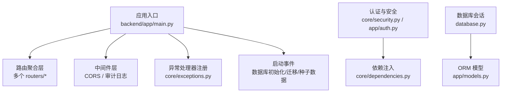
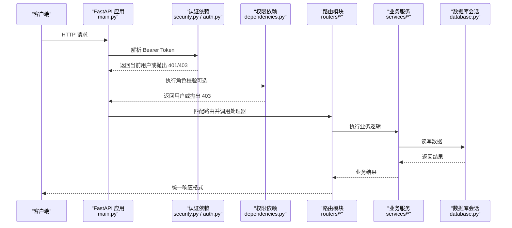
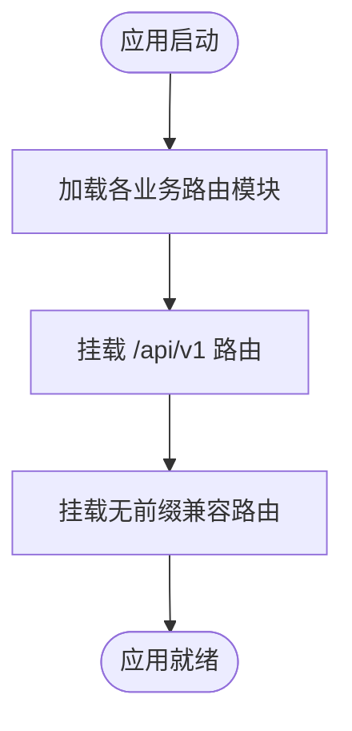
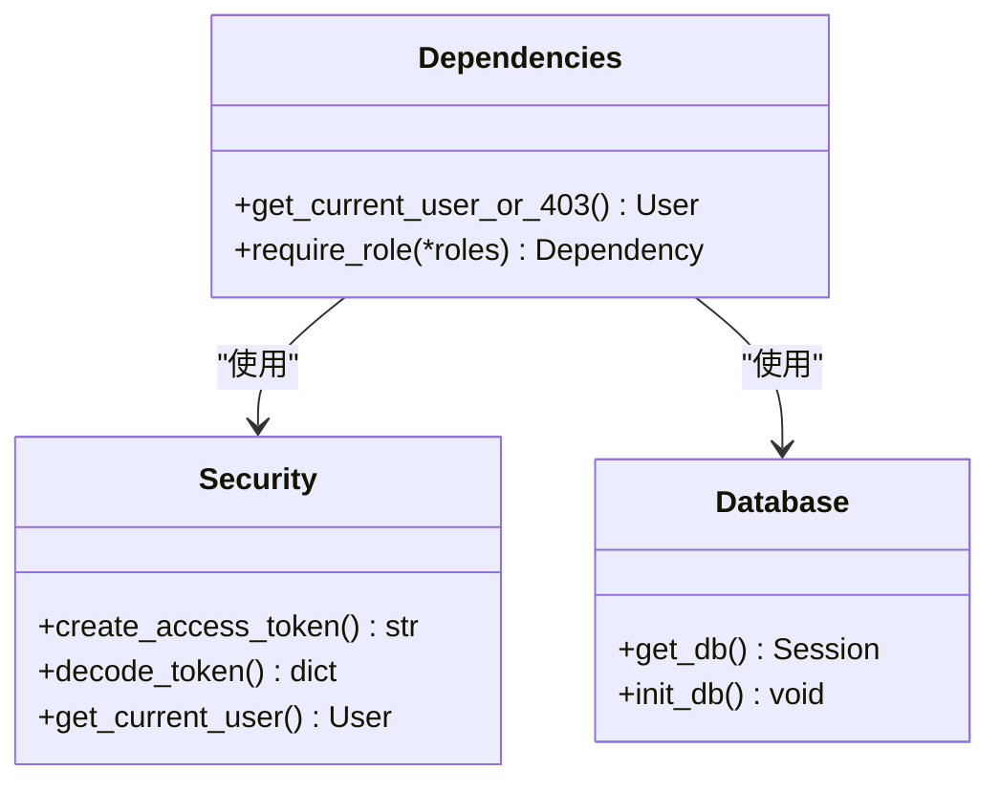
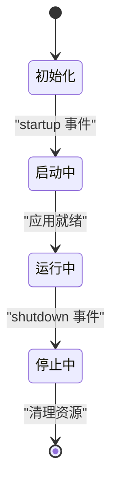
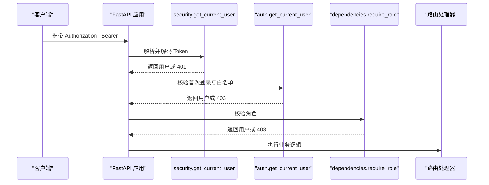
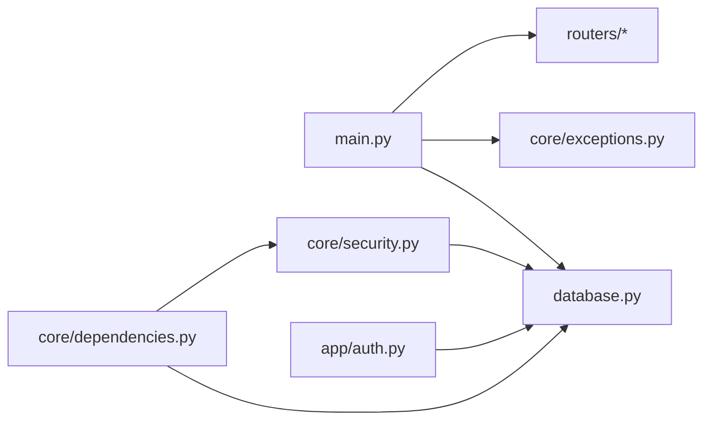

# 插件化架构设计

<cite>
**本文引用的文件**   
- [backend/app/main.py](file://backend/app/main.py)
- [backend/app/core/dependencies.py](file://backend/app/core/dependencies.py)
- [backend/app/core/security.py](file://backend/app/core/security.py)
- [backend/app/auth.py](file://backend/app/auth.py)
- [backend/app/core/exceptions.py](file://backend/app/core/exceptions.py)
- [backend/app/core/response.py](file://backend/app/core/response.py)
- [backend/app/database.py](file://backend/app/database.py)
</cite>

## 目录
1. [引言](#引言)
2. [项目结构](#项目结构)
3. [核心组件](#核心组件)
4. [架构总览](#架构总览)
5. [详细组件分析](#详细组件分析)
6. [依赖关系分析](#依赖关系分析)
7. [性能与扩展性考虑](#性能与扩展性考虑)
8. [故障排查指南](#故障排查指南)
9. [结论](#结论)
10. [附录：插件开发规范（建议）](#附录插件开发规范建议)

## 引言
本文件面向“插件化架构”的设计与实现，结合当前代码库中已有的 FastAPI 应用、路由注册、依赖注入、认证授权、异常处理与数据库初始化等能力，给出可落地的插件化方案。重点包括：
- 模块注册机制：基于 FastAPI Router 的模块化装配与集中式挂载
- 依赖注入容器与服务发现：FastAPI 依赖系统与可扩展的服务注册表
- 生命周期管理：启动事件驱动的初始化、数据迁移与种子数据准备
- 插件接口与配置：统一响应模型、错误模型与配置项约定
- 插件间通信与数据共享：通过依赖注入与共享服务对象
- 安全与权限控制：JWT 鉴权、角色校验与首次登录强制改密策略

## 项目结构
后端采用 FastAPI 框架，入口为 main.py，负责创建应用实例、注册中间件、挂载各业务路由、注册全局异常处理器，并在启动事件中完成数据库初始化与种子数据准备。认证与安全逻辑集中在 core/security.py 与 auth.py，通用依赖在 core/dependencies.py，统一异常与响应模型分别在 core/exceptions.py 与 core/response.py，数据库连接与会话在 database.py。

图示来源
- [backend/app/main.py:1-71](file://backend/app/main.py#L1-L71)
- [backend/app/core/exceptions.py:84-107](file://backend/app/core/exceptions.py#L84-L107)
- [backend/app/core/security.py:17-139](file://backend/app/core/security.py#L17-L139)
- [backend/app/auth.py:17-130](file://backend/app/auth.py#L17-L130)
- [backend/app/core/dependencies.py:1-51](file://backend/app/core/dependencies.py#L1-L51)
- [backend/app/database.py:13-31](file://backend/app/database.py#L13-L31)

章节来源
- [backend/app/main.py:1-71](file://backend/app/main.py#L1-L71)
- [backend/app/database.py:13-31](file://backend/app/database.py#L13-L31)

## 核心组件
- 应用入口与路由聚合：main.py 创建 FastAPI 实例，挂载 CORS、审计日志中间件，集中注册 API v1 与兼容前缀的路由集合，提供统一的命名空间与标签分组。
- 认证与安全：security.py 提供 JWT 令牌生成与解码、密码哈希与校验、Bearer 凭据解析；auth.py 提供增强型 get_current_user（含首次登录强制改密白名单）、刷新令牌与 require_role 装饰器。
- 依赖注入与权限：dependencies.py 提供 get_current_user_or_403 与 require_role 工厂函数，便于在各路由中以 Depends 形式声明式鉴权。
- 异常与响应：exceptions.py 定义 BizError 及其子类，并注册全局异常处理器；response.py 提供 BaseResponse、分页结构与成功/失败响应构造方法。
- 数据库与会话：database.py 提供引擎、会话工厂、get_db 依赖与 init_db 初始化方法。

章节来源
- [backend/app/main.py:1-71](file://backend/app/main.py#L1-L71)
- [backend/app/core/security.py:17-139](file://backend/app/core/security.py#L17-L139)
- [backend/app/auth.py:17-130](file://backend/app/auth.py#L17-L130)
- [backend/app/core/dependencies.py:1-51](file://backend/app/core/dependencies.py#L1-L51)
- [backend/app/core/exceptions.py:6-107](file://backend/app/core/exceptions.py#L6-L107)
- [backend/app/core/response.py:10-99](file://backend/app/core/response.py#L10-L99)
- [backend/app/database.py:13-31](file://backend/app/database.py#L13-L31)

## 架构总览
下图展示请求从进入 FastAPI 到鉴权、路由分发、业务处理的典型流程，以及插件化扩展点的位置。

图示来源
- [backend/app/main.py:1-71](file://backend/app/main.py#L1-L71)
- [backend/app/core/security.py:82-139](file://backend/app/core/security.py#L82-L139)
- [backend/app/auth.py:68-130](file://backend/app/auth.py#L68-L130)
- [backend/app/core/dependencies.py:10-51](file://backend/app/core/dependencies.py#L10-L51)
- [backend/app/database.py:21-31](file://backend/app/database.py#L21-L31)

## 详细组件分析

### 模块注册机制（插件装配）
- 路由即插件：每个业务域以独立 router 模块暴露，main.py 通过 include_router 进行集中装配，天然支持按功能拆分与按需启用。
- 版本化与兼容：同时挂载 /api/v1 与无前缀路由，保证向后兼容与测试便利。
- 插件发现与扩展：可在 main.py 中新增 include_router 调用以引入新插件；也可通过配置文件动态加载 router 模块（需配合 importlib）。

图示来源
- [backend/app/main.py:49-94](file://backend/app/main.py#L49-L94)

章节来源
- [backend/app/main.py:49-94](file://backend/app/main.py#L49-L94)

### 依赖注入容器与服务发现
- 依赖容器：FastAPI 内置依赖系统，通过 Depends 声明式注入 Session、当前用户、角色校验等。
- 服务发现：可通过维护一个“服务注册表”字典，将服务名映射到实例，再由依赖函数按需获取，实现解耦与可插拔。
- 现有实践：dependencies.py 提供通用依赖 get_current_user_or_403 与 require_role 工厂函数，供路由以 Depends 方式使用。

图示来源
- [backend/app/core/dependencies.py:10-51](file://backend/app/core/dependencies.py#L10-L51)
- [backend/app/core/security.py:82-139](file://backend/app/core/security.py#L82-L139)
- [backend/app/database.py:21-31](file://backend/app/database.py#L21-L31)

章节来源
- [backend/app/core/dependencies.py:10-51](file://backend/app/core/dependencies.py#L10-L51)
- [backend/app/core/security.py:82-139](file://backend/app/core/security.py#L82-L139)
- [backend/app/database.py:21-31](file://backend/app/database.py#L21-L31)

### 生命周期管理（初始化、启动、停止、销毁）
- 启动阶段：main.py 的 startup 事件触发数据库初始化、简单迁移与种子数据准备。
- 运行阶段：请求进入后经过中间件、鉴权、路由分发、业务处理。
- 停止阶段：可按需在 FastAPI 中添加 shutdown 事件，用于释放资源、关闭外部连接。
- 销毁阶段：依赖注入的 Session 由 get_db 自动管理生命周期，确保请求结束后关闭。

图示来源
- [backend/app/main.py:126-129](file://backend/app/main.py#L126-L129)
- [backend/app/database.py:21-31](file://backend/app/database.py#L21-L31)

章节来源
- [backend/app/main.py:126-129](file://backend/app/main.py#L126-L129)
- [backend/app/database.py:21-31](file://backend/app/database.py#L21-L31)

### 插件接口与配置管理
- 统一响应：response.py 提供 BaseResponse、分页结构与 success_response/paginate_response/error_response 构造方法，保证插件输出一致。
- 统一异常：exceptions.py 定义 BizError 及 AuthError/NotFoundError/ValidationError，并通过 register_exception_handlers 注册全局处理器，使插件抛出的异常被统一格式化。
- 配置约定：建议在插件中通过配置键值对（如 SystemConfig）管理开关、阈值与行为参数，并在启动时加载至内存缓存。

章节来源
- [backend/app/core/response.py:10-99](file://backend/app/core/response.py#L10-L99)
- [backend/app/core/exceptions.py:6-107](file://backend/app/core/exceptions.py#L6-L107)

### 插件间通信与数据共享
- 依赖注入共享：通过 dependencies.py 提供的依赖函数，插件可共享当前用户、数据库会话等上下文。
- 服务注册表：可维护一个进程内服务字典，插件在启动时注册自身服务，其他插件通过依赖函数获取，避免直接耦合。
- 事件总线（建议）：对于跨插件异步通知，可引入轻量事件总线，插件订阅/发布领域事件，降低耦合度。

章节来源
- [backend/app/core/dependencies.py:10-51](file://backend/app/core/dependencies.py#L10-L51)

### 安全验证与权限控制
- 认证流程：security.py 与 auth.py 提供 JWT 令牌签发、校验与解析，get_current_user 从请求头提取并验证凭据，必要时检查用户状态。
- 首次登录强制改密：auth.py 中 get_current_user 对 is_first_login 的用户限制访问非白名单接口。
- 角色授权：dependencies.py 与 auth.py 均提供 require_role 工厂函数，用于声明式角色校验。
- 统一错误：未认证/无权限会抛出 401/403，并由 exceptions.py 的全局处理器统一返回。

图示来源
- [backend/app/core/security.py:82-139](file://backend/app/core/security.py#L82-L139)
- [backend/app/auth.py:68-130](file://backend/app/auth.py#L68-L130)
- [backend/app/core/dependencies.py:27-51](file://backend/app/core/dependencies.py#L27-L51)

章节来源
- [backend/app/core/security.py:82-139](file://backend/app/core/security.py#L82-L139)
- [backend/app/auth.py:68-130](file://backend/app/auth.py#L68-L130)
- [backend/app/core/dependencies.py:27-51](file://backend/app/core/dependencies.py#L27-L51)

## 依赖关系分析
- main.py 依赖：数据库初始化、异常处理器注册、路由模块导入。
- security.py 依赖：数据库会话、User 模型、JWT 工具。
- auth.py 依赖：数据库会话、User 模型、JWT 工具。
- dependencies.py 依赖：security、database、models。
- exceptions.py 依赖：FastAPI 应用与 Request。
- response.py 依赖：Pydantic BaseModel。
- database.py 依赖：SQLAlchemy Engine/Session、Base 模型。

图示来源
- [backend/app/main.py:1-71](file://backend/app/main.py#L1-L71)
- [backend/app/core/exceptions.py:84-107](file://backend/app/core/exceptions.py#L84-L107)
- [backend/app/core/security.py:82-139](file://backend/app/core/security.py#L82-L139)
- [backend/app/auth.py:68-130](file://backend/app/auth.py#L68-L130)
- [backend/app/core/dependencies.py:1-51](file://backend/app/core/dependencies.py#L1-L51)
- [backend/app/database.py:13-31](file://backend/app/database.py#L13-L31)

章节来源
- [backend/app/main.py:1-71](file://backend/app/main.py#L1-L71)
- [backend/app/core/exceptions.py:84-107](file://backend/app/core/exceptions.py#L84-L107)
- [backend/app/core/security.py:82-139](file://backend/app/core/security.py#L82-L139)
- [backend/app/auth.py:68-130](file://backend/app/auth.py#L68-L130)
- [backend/app/core/dependencies.py:1-51](file://backend/app/core/dependencies.py#L1-L51)
- [backend/app/database.py:13-31](file://backend/app/database.py#L13-L31)

## 性能与扩展性考虑
- 路由聚合：集中挂载减少重复代码，提升可维护性；可按功能拆分为子路由组，按需启用。
- 依赖注入：避免全局单例滥用，通过 Depends 注入 Session 与当前用户，保证线程安全与可测试性。
- 数据库访问：使用 sessionmaker 管理会话，确保请求结束自动关闭；必要时引入连接池与查询优化。
- 扩展点：在 main.py 中预留动态加载路由的能力，结合配置中心实现插件热插拔。

[本节为通用指导，不直接分析具体文件]

## 故障排查指南
- 认证失败（401）：检查 Authorization 头是否包含有效 Bearer Token；确认 Token 未过期且 payload 包含 sub 字段。
- 权限不足（403）：检查用户角色是否在允许列表中；确认首次登录是否已修改密码。
- 业务异常：查看 BizError 子类抛出的 code/message/data，定位对应业务模块。
- 数据库问题：检查 init_db 是否执行、连接字符串是否正确、表结构是否与模型一致。

章节来源
- [backend/app/core/security.py:82-139](file://backend/app/core/security.py#L82-L139)
- [backend/app/auth.py:68-130](file://backend/app/auth.py#L68-L130)
- [backend/app/core/exceptions.py:6-107](file://backend/app/core/exceptions.py#L6-L107)
- [backend/app/database.py:21-31](file://backend/app/database.py#L21-L31)

## 结论
当前代码库已具备构建插件化架构的基础设施：FastAPI 路由聚合、依赖注入、认证授权、统一异常与响应、数据库会话管理。在此基础上，可通过“路由即插件”的方式实现模块解耦，通过依赖注入与服务注册表实现服务发现与通信，通过启动事件实现生命周期管理，并通过统一异常与响应保障一致性。后续可进一步引入配置中心与事件总线，完善插件的动态加载与跨模块协作。

[本节为总结性内容，不直接分析具体文件]

## 附录：插件开发规范（建议）
- 接口定义
  - 所有插件对外暴露 FastAPI Router，并在 main.py 中集中挂载。
  - 使用 dependencies.py 中的依赖函数进行鉴权与权限校验。
  - 使用 response.py 的统一响应结构返回数据。
- 配置管理
  - 插件配置以键值对形式存储，启动时加载至内存缓存。
  - 敏感配置通过环境变量或密钥管理服务注入。
- 版本兼容性
  - 插件版本号随 API 版本演进，保持向后兼容。
  - 废弃接口保留过渡期并提供迁移指引。
- 插件间通信
  - 通过依赖注入共享服务实例，避免直接耦合。
  - 跨模块通知建议使用事件总线，订阅/发布领域事件。
- 安全与权限
  - 所有受保护接口必须使用 require_role 或自定义依赖进行角色校验。
  - 对用户输入进行严格校验，防止注入与越权访问。

[本节为通用规范，不直接分析具体文件]