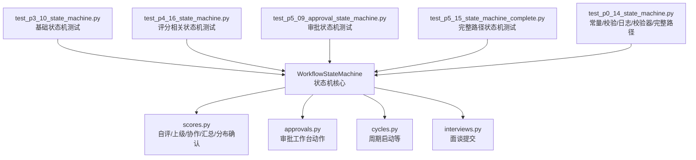
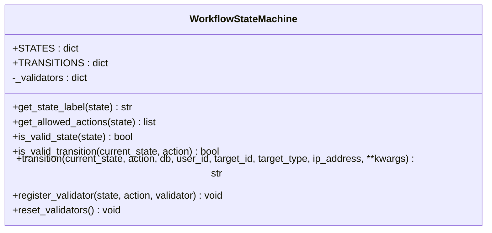
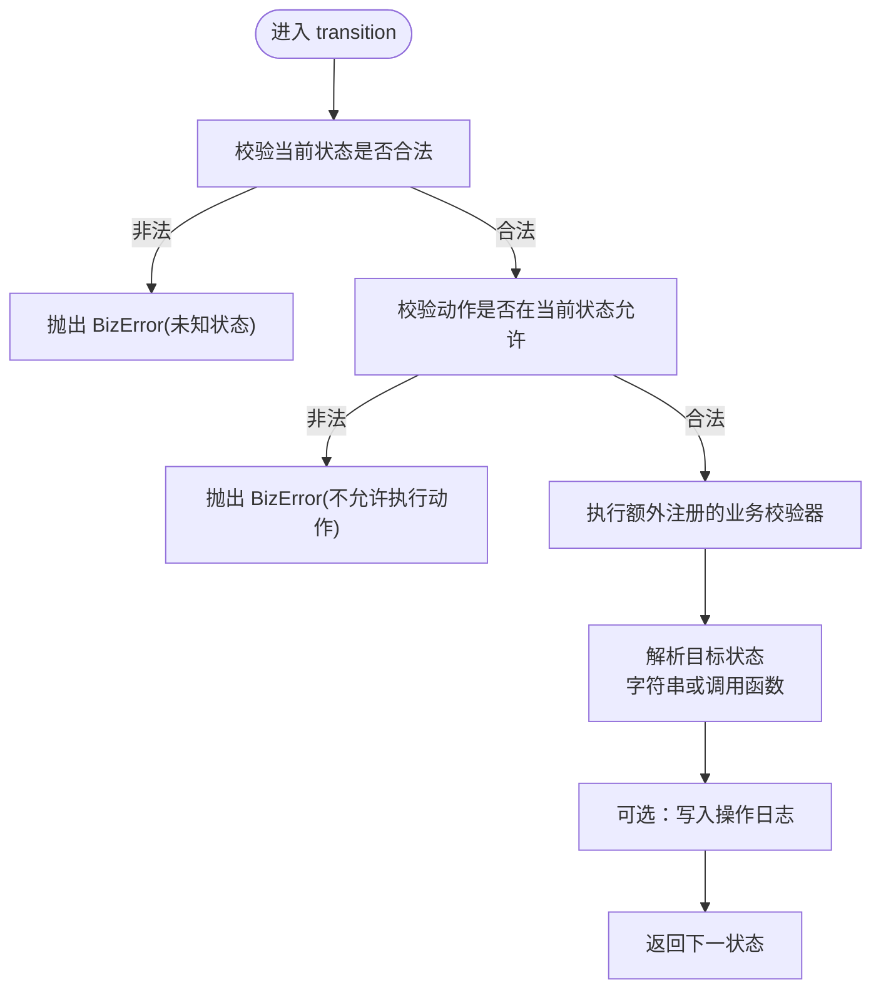
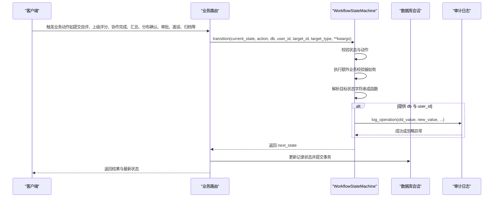
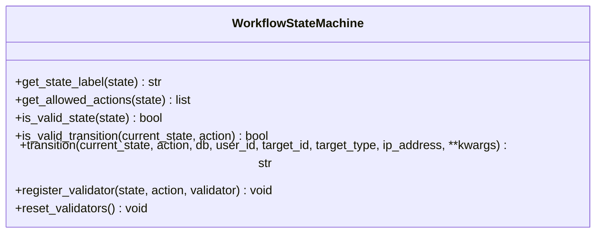
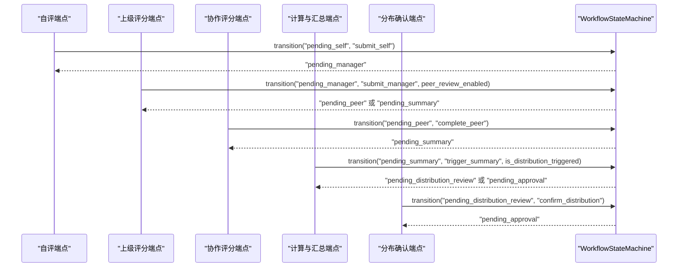
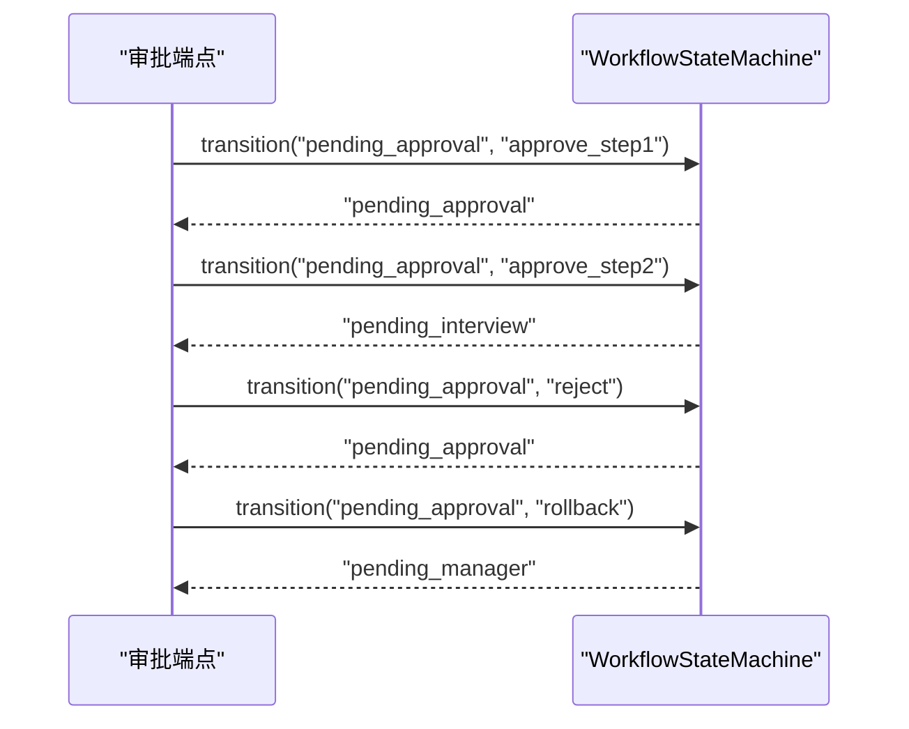
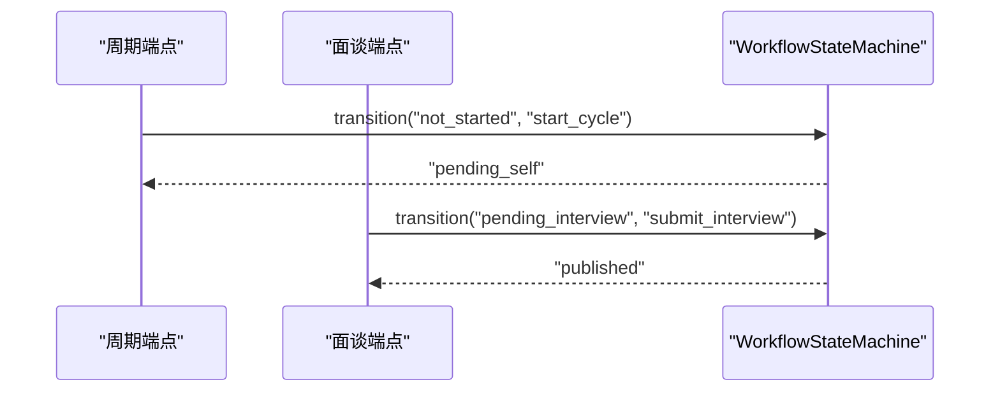
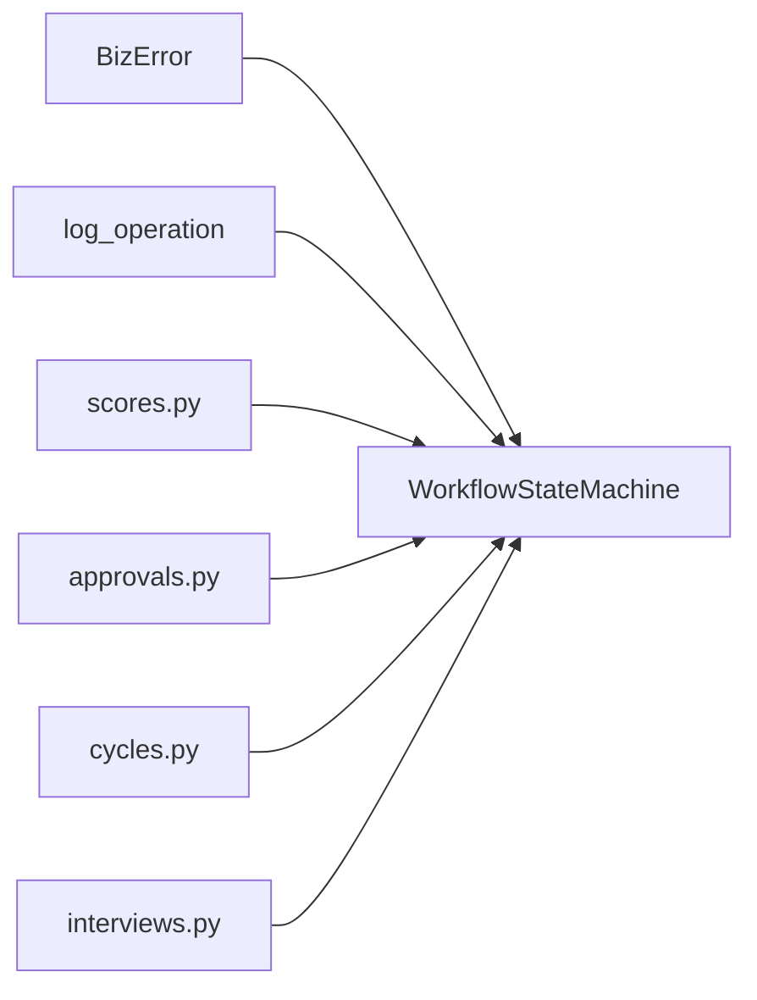

# 状态机扩展机制

<cite>
**本文引用的文件**   
- [workflow_state_machine.py](file://backend/app/utils/workflow_state_machine.py)
- [scores.py](file://backend/app/routers/scores.py)
- [approvals.py](file://backend/app/routers/approvals.py)
- [cycles.py](file://backend/app/routers/cycles.py)
- [interviews.py](file://backend/app/routers/interviews.py)
- [test_p3_10_state_machine.py](file://backend/tests/test_p3_10_state_machine.py)
- [test_p4_16_state_machine.py](file://backend/tests/test_p4_16_state_machine.py)
- [test_p5_09_approval_state_machine.py](file://backend/tests/test_p5_09_approval_state_machine.py)
- [test_p5_15_state_machine_complete.py](file://backend/tests/test_p5_15_state_machine_complete.py)
- [test_p0_14_state_machine.py](file://tests/test_p0_14_state_machine.py)
</cite>

## 目录
1. [引言](#引言)
2. [项目结构定位](#项目结构定位)
3. [核心组件：WorkflowStateMachine](#核心组件workflowstatemachine)
4. [架构总览](#架构总览)
5. [详细组件分析](#详细组件分析)
6. [依赖关系分析](#依赖关系分析)
7. [性能与一致性考虑](#性能与一致性考虑)
8. [调试与监控配置](#调试与监控配置)
9. [常见问题排查](#常见问题排查)
10. [结论](#结论)

## 引言
本文件面向绩效考核评分系统中的“工作流状态机扩展机制”，重点说明 WorkflowStateMachine 类的架构设计、状态定义规范、状态转换规则注册机制（含前置条件验证与后置动作）、自定义业务流程扩展方式、状态持久化与数据一致性保证，以及调试与监控配置建议。文档同时结合后端路由对状态机的实际调用和测试用例，帮助读者从概念到实现全面掌握该机制。

## 项目结构定位
状态机核心逻辑位于后端工具模块中，被多个业务路由复用；相关单元测试覆盖基础能力、评分流程、审批流程和完整链路。

**图表来源** 
- [workflow_state_machine.py:10-207](file://backend/app/utils/workflow_state_machine.py#L10-L207)
- [scores.py:290-331](file://backend/app/routers/scores.py#L290-L331)
- [scores.py:480-554](file://backend/app/routers/scores.py#L480-L554)
- [scores.py:760-796](file://backend/app/routers/scores.py#L760-L796)
- [scores.py:1300-1355](file://backend/app/routers/scores.py#L1300-L1355)
- [scores.py:1358-1415](file://backend/app/routers/scores.py#L1358-L1415)
- [approvals.py:511-513](file://backend/app/routers/approvals.py#L511-L513)
- [approvals.py:594-595](file://backend/app/routers/approvals.py#L594-L595)
- [approvals.py:694-695](file://backend/app/routers/approvals.py#L694-L695)
- [cycles.py:436-436](file://backend/app/routers/cycles.py#L436-L436)
- [interviews.py:418-418](file://backend/app/routers/interviews.py#L418-L418)

**章节来源**
- [workflow_state_machine.py:10-207](file://backend/app/utils/workflow_state_machine.py#L10-L207)
- [scores.py:290-331](file://backend/app/routers/scores.py#L290-L331)
- [scores.py:480-554](file://backend/app/routers/scores.py#L480-L554)
- [scores.py:760-796](file://backend/app/routers/scores.py#L760-L796)
- [scores.py:1300-1355](file://backend/app/routers/scores.py#L1300-L1355)
- [scores.py:1358-1415](file://backend/app/routers/scores.py#L1358-L1415)
- [approvals.py:511-513](file://backend/app/routers/approvals.py#L511-L513)
- [approvals.py:594-595](file://backend/app/routers/approvals.py#L594-L595)
- [approvals.py:694-695](file://backend/app/routers/approvals.py#L694-L695)
- [cycles.py:436-436](file://backend/app/routers/cycles.py#L436-L436)
- [interviews.py:418-418](file://backend/app/routers/interviews.py#L418-L418)

## 核心组件：WorkflowStateMachine
WorkflowStateMachine 是绩效考核领域通用的状态机基类，集中定义了：
- 状态常量及中文标签
- 状态到动作的转换表，支持静态目标状态或动态解析函数
- 当前状态允许的动作查询
- 状态合法性与转换合法性判断
- 统一的状态转换入口，内置前置校验、额外业务校验、日志记录
- 可插拔的业务校验器注册机制

**图表来源** 
- [workflow_state_machine.py:10-207](file://backend/app/utils/workflow_state_machine.py#L10-L207)

### 状态定义规范
- 状态集合 STATES 包含：未开始、待自评、待上级评分、待协作评分、待汇总、待强制分布审核、待审批、待面谈、已发布、申诉中、已归档。
- 每个状态都有对应的中文标签，便于前端展示和审计日志可读性。
- 新增状态时，应在 STATES 中补充键值对，并在 TRANSITIONS 中定义其入边与出边。

**章节来源**
- [workflow_state_machine.py:22-35](file://backend/app/utils/workflow_state_machine.py#L22-L35)

### 状态转换规则与条件分支
- TRANSITIONS 以“当前状态 → 动作 → 目标状态或解析函数”的形式声明。
- 支持两种目标形式：
  - 字符串：无条件跳转
  - 可调用对象：接收 **kwargs，根据业务参数决定下一状态
- 典型条件分支示例：
  - pending_manager + submit_manager：根据 peer_review_enabled 决定是否进入 pending_peer 或 pending_summary
  - pending_summary + trigger_summary：根据 is_distribution_triggered 决定是否进入 pending_distribution_review 或 pending_approval

**图表来源** 
- [workflow_state_machine.py:105-186](file://backend/app/utils/workflow_state_machine.py#L105-L186)

**章节来源**
- [workflow_state_machine.py:37-78](file://backend/app/utils/workflow_state_machine.py#L37-L78)
- [workflow_state_machine.py:105-186](file://backend/app/utils/workflow_state_machine.py#L105-L186)

### 前置条件验证与后置动作
- 前置条件验证：
  - 状态合法性检查
  - 动作合法性检查
  - 额外业务校验器（通过 register_validator 注册）
- 后置动作：
  - 当传入 db 与 user_id 时，自动调用审计日志记录，记录旧状态与新状态、目标类型与 ID、IP 等上下文信息
  - 日志失败不会阻断主流程，确保状态转换的鲁棒性

**章节来源**
- [workflow_state_machine.py:136-186](file://backend/app/utils/workflow_state_machine.py#L136-L186)

### 自定义业务流程扩展点
- 新增状态：在 STATES 中添加新状态及其中文标签，在 TRANSITIONS 中定义入边与出边。
- 新增动作：在对应状态的 TRANSITIONS 下添加动作映射，可为静态目标状态或动态解析函数。
- 新增前置校验：使用 register_validator 为指定状态+动作注册校验函数，校验失败需抛出 BizError。
- 测试保障：通过 reset_validators 清理注册校验器，避免跨用例污染。

**章节来源**
- [workflow_state_machine.py:80-104](file://backend/app/utils/workflow_state_machine.py#L80-L104)
- [workflow_state_machine.py:188-207](file://backend/app/utils/workflow_state_machine.py#L188-L207)
- [test_p3_10_state_machine.py:62-91](file://backend/tests/test_p3_10_state_machine.py#L62-L91)
- [test_p0_14_state_machine.py:275-314](file://tests/test_p0_14_state_machine.py#L275-L314)

## 架构总览
状态机作为无状态的核心引擎，被多个业务路由调用，负责将业务动作映射为状态变更，并输出下一状态供路由层更新数据库记录。

**图表来源** 
- [workflow_state_machine.py:105-186](file://backend/app/utils/workflow_state_machine.py#L105-L186)
- [scores.py:290-331](file://backend/app/routers/scores.py#L290-L331)
- [scores.py:480-554](file://backend/app/routers/scores.py#L480-L554)
- [scores.py:760-796](file://backend/app/routers/scores.py#L760-L796)
- [scores.py:1300-1355](file://backend/app/routers/scores.py#L1300-L1355)
- [scores.py:1358-1415](file://backend/app/routers/scores.py#L1358-L1415)
- [approvals.py:511-513](file://backend/app/routers/approvals.py#L511-L513)
- [approvals.py:594-595](file://backend/app/routers/approvals.py#L594-L595)
- [approvals.py:694-695](file://backend/app/routers/approvals.py#L694-L695)
- [cycles.py:436-436](file://backend/app/routers/cycles.py#L436-L436)
- [interviews.py:418-418](file://backend/app/routers/interviews.py#L418-L418)

## 详细组件分析

### 状态机核心方法
- get_state_label：获取状态中文标签
- get_allowed_actions：获取当前状态允许的所有动作
- is_valid_state / is_valid_transition：状态与转换合法性判断
- transition：统一转换入口，包含校验、日志、返回下一状态
- register_validator / reset_validators：扩展点管理

**图表来源** 
- [workflow_state_machine.py:83-207](file://backend/app/utils/workflow_state_machine.py#L83-L207)

**章节来源**
- [workflow_state_machine.py:83-207](file://backend/app/utils/workflow_state_machine.py#L83-L207)

### 评分流程中的状态机调用
- 自评提交：pending_self → submit_self → pending_manager
- 上级评分：pending_manager → submit_manager → pending_peer 或 pending_summary（由 peer_review_enabled 决定）
- 协作评分完成：pending_peer → complete_peer → pending_summary
- 汇总触发：pending_summary → trigger_summary → pending_distribution_review 或 pending_approval（由 is_distribution_triggered 决定）
- 强制分布确认：pending_distribution_review → confirm_distribution → pending_approval

**图表来源** 
- [scores.py:760-796](file://backend/app/routers/scores.py#L760-L796)
- [scores.py:480-554](file://backend/app/routers/scores.py#L480-L554)
- [scores.py:1300-1355](file://backend/app/routers/scores.py#L1300-L1355)
- [scores.py:290-331](file://backend/app/routers/scores.py#L290-L331)
- [scores.py:1358-1415](file://backend/app/routers/scores.py#L1358-L1415)

**章节来源**
- [scores.py:760-796](file://backend/app/routers/scores.py#L760-L796)
- [scores.py:480-554](file://backend/app/routers/scores.py#L480-L554)
- [scores.py:1300-1355](file://backend/app/routers/scores.py#L1300-L1355)
- [scores.py:290-331](file://backend/app/routers/scores.py#L290-L331)
- [scores.py:1358-1415](file://backend/app/routers/scores.py#L1358-L1415)

### 审批流程中的状态机调用
- pending_approval 下的动作：
  - approve_step1：停留在 pending_approval（多步审批的第一阶段）
  - approve_step2：推进至 pending_interview
  - reject：停留在 pending_approval（拒绝后仍可继续处理）
  - rollback：回退至 pending_manager（打回重新评分）

**图表来源** 
- [approvals.py:511-513](file://backend/app/routers/approvals.py#L511-L513)
- [approvals.py:594-595](file://backend/app/routers/approvals.py#L594-L595)
- [approvals.py:694-695](file://backend/app/routers/approvals.py#L694-L695)

**章节来源**
- [approvals.py:511-513](file://backend/app/routers/approvals.py#L511-L513)
- [approvals.py:594-595](file://backend/app/routers/approvals.py#L594-L595)
- [approvals.py:694-695](file://backend/app/routers/approvals.py#L694-L695)

### 周期与面谈流程中的状态机调用
- 周期启动：not_started → start_cycle → pending_self
- 面谈提交：pending_interview → submit_interview → published

**图表来源** 
- [cycles.py:436-436](file://backend/app/routers/cycles.py#L436-L436)
- [interviews.py:418-418](file://backend/app/routers/interviews.py#L418-L418)

**章节来源**
- [cycles.py:436-436](file://backend/app/routers/cycles.py#L436-L436)
- [interviews.py:418-418](file://backend/app/routers/interviews.py#L418-L418)

### 测试覆盖要点
- 基础状态机能力：状态常量、标签、合法性判断、允许动作、非法转换异常码
- 评分相关转换：自评、上级评分（协作开关）、协作完成、汇总触发、分布确认
- 审批相关转换：多步审批、拒绝、打回
- 完整路径：协作开启+强制分布、协作关闭+不触发强制分布、申诉路径、打回路径
- 审计日志：带 db 与 user_id 时写入 OperationLog，日志失败不阻断主流程
- 自定义校验器：注册、生效、重置

**章节来源**
- [test_p3_10_state_machine.py:10-91](file://backend/tests/test_p3_10_state_machine.py#L10-L91)
- [test_p4_16_state_machine.py:15-258](file://backend/tests/test_p4_16_state_machine.py#L15-L258)
- [test_p5_09_approval_state_machine.py:6-137](file://backend/tests/test_p5_09_approval_state_machine.py#L6-L137)
- [test_p5_15_state_machine_complete.py:6-198](file://backend/tests/test_p5_15_state_machine_complete.py#L6-L198)
- [test_p0_14_state_machine.py:28-385](file://tests/test_p0_14_state_machine.py#L28-L385)

## 依赖关系分析
- WorkflowStateMachine 依赖：
  - BizError：业务异常封装
  - log_operation：审计日志写入
- 路由层依赖：
  - scores.py：自评、上级评分、协作评分、汇总、分布确认
  - approvals.py：审批动作
  - cycles.py：周期启动
  - interviews.py：面谈提交
- 测试依赖：
  - 各测试文件断言状态转换、异常码、审计日志、校验器行为

**图表来源** 
- [workflow_state_machine.py:1-7](file://backend/app/utils/workflow_state_machine.py#L1-L7)
- [scores.py:290-331](file://backend/app/routers/scores.py#L290-L331)
- [approvals.py:511-513](file://backend/app/routers/approvals.py#L511-L513)
- [cycles.py:436-436](file://backend/app/routers/cycles.py#L436-L436)
- [interviews.py:418-418](file://backend/app/routers/interviews.py#L418-L418)

**章节来源**
- [workflow_state_machine.py:1-7](file://backend/app/utils/workflow_state_machine.py#L1-L7)
- [scores.py:290-331](file://backend/app/routers/scores.py#L290-L331)
- [approvals.py:511-513](file://backend/app/routers/approvals.py#L511-L513)
- [cycles.py:436-436](file://backend/app/routers/cycles.py#L436-L436)
- [interviews.py:418-418](file://backend/app/routers/interviews.py#L418-L418)

## 性能与一致性考虑
- 状态机本身是无状态的计算逻辑，时间复杂度主要取决于 TRANSITIONS 查找与可选的校验器执行，整体开销很小。
- 日志写入采用 try/except 包裹，失败不影响主流程，提升系统鲁棒性；但生产环境建议关注日志子系统可用性。
- 路由层在调用状态机后统一更新数据库字段并提交事务，保证状态变更与业务数据变更的一致性。
- 批量场景（如汇总触发）按记录循环调用状态机，建议在大规模数据处理时注意事务边界与重试策略。

[本节为通用指导，不直接分析具体文件]

## 调试与监控配置
- 调试建议：
  - 使用 is_valid_transition 与 get_allowed_actions 快速诊断当前状态允许的动作集合
  - 在业务路由中打印 current_state、action、kwargs，辅助定位条件分支问题
  - 利用测试用例中的完整路径断言，验证新状态与动作是否符合预期
- 监控指标建议：
  - 统计各状态停留时长与流转次数（基于 OperationLog）
  - 统计各动作触发频率与失败率（BizError code=1100/1101）
  - 针对关键动作（如 trigger_summary、confirm_distribution、approve_step2）设置告警阈值
- 日志配置：
  - 确保 log_operation 正常写入 OperationLog，必要时增加异步写入或降级策略
  - 在状态机内部捕获日志异常但不阻断主流程，避免影响用户体验

[本节为通用指导，不直接分析具体文件]

## 常见问题排查
- 未知状态错误（code=1100）：
  - 检查 STATES 是否包含该状态
  - 检查路由层传入的 current_state 是否与数据库一致
- 不允许执行动作错误（code=1101）：
  - 检查 TRANSITIONS 中是否定义了该动作
  - 检查业务前置条件是否满足（例如 peer_review_enabled、is_distribution_triggered）
- 审计日志未写入：
  - 检查是否传入 db 与 user_id
  - 检查 log_operation 是否可用
- 自定义校验器未生效：
  - 检查是否调用 register_validator 注册
  - 检查是否在测试中调用 reset_validators 清理

**章节来源**
- [workflow_state_machine.py:136-186](file://backend/app/utils/workflow_state_machine.py#L136-L186)
- [test_p0_14_state_machine.py:183-273](file://tests/test_p0_14_state_machine.py#L183-L273)

## 结论
WorkflowStateMachine 以简洁的类结构与清晰的转换表为核心，提供了可扩展、可测试、可审计的工作流状态机能力。通过状态常量、转换规则、条件分支与校验器注册机制，系统能够灵活表达绩效考核的全生命周期流程，并在路由层统一落地为数据库状态更新与审计日志记录。配合完善的测试覆盖与监控建议，该机制既保证了业务正确性，也具备良好的扩展性与可维护性。