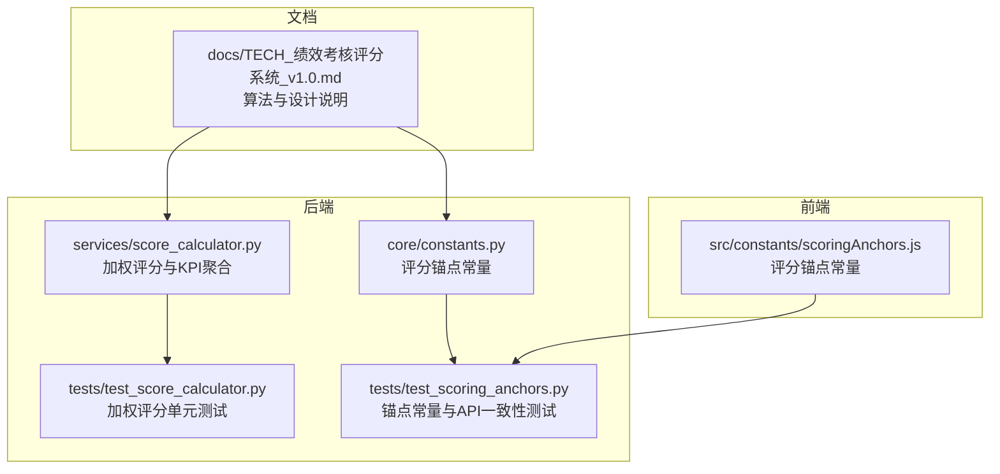
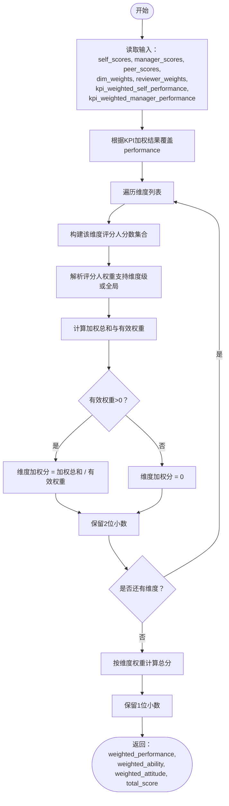
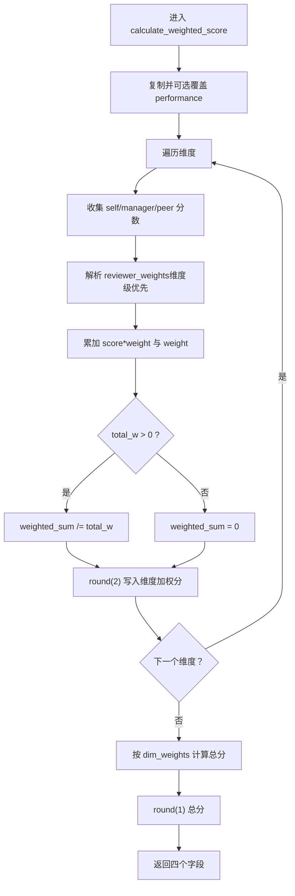
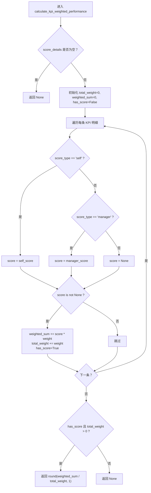
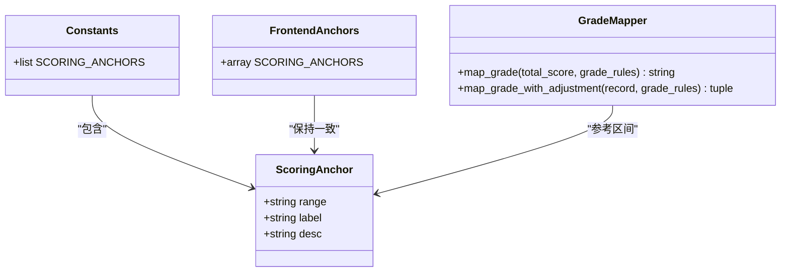
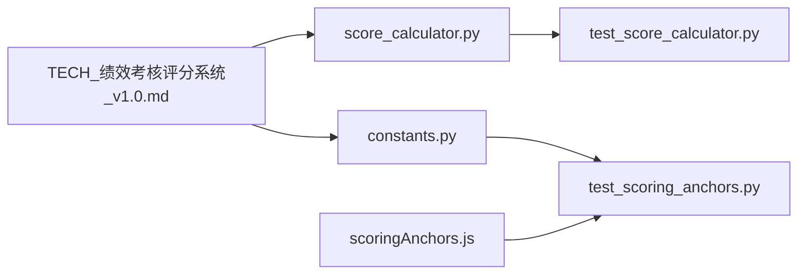
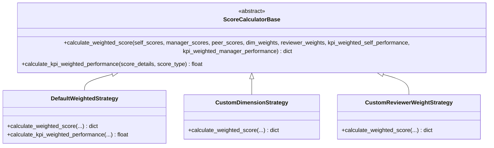

# 评分算法扩展机制

<cite>
**本文引用的文件**   
- [score_calculator.py](file://backend/app/services/score_calculator.py)
- [test_score_calculator.py](file://backend/tests/test_score_calculator.py)
- [constants.py](file://backend/app/core/constants.py)
- [scoringAnchors.js](file://frontend/src/constants/scoringAnchors.js)
- [test_scoring_anchors.py](file://backend/tests/test_scoring_anchors.py)
- [TECH_绩效考核评分系统_v1.0.md](file://docs/TECH_绩效考核评分系统_v1.0.md)
</cite>

## 目录
1. [引言](#引言)
2. [项目结构](#项目结构)
3. [核心组件](#核心组件)
4. [架构总览](#架构总览)
5. [详细组件分析](#详细组件分析)
6. [依赖关系分析](#依赖关系分析)
7. [性能与优化建议](#性能与优化建议)
8. [故障排查指南](#故障排查指南)
9. [结论](#结论)
10. [附录：扩展实现示例](#附录扩展实现示例)

## 引言
本文面向需要扩展或定制绩效考核评分算法的开发者，聚焦以下目标：
- 解释当前评分计算的核心函数与数据结构，尤其是加权总分与各维度得分的计算规则。
- 说明如何基于现有能力设计“自定义评分策略”，包括权重配置、维度计算与 KPI 加权逻辑。
- 梳理评分锚点（等级映射）的前后端一致性机制与扩展方法。
- 给出可操作的扩展步骤、最佳实践与性能优化建议。

本说明不假设读者熟悉全部代码库，但会提供精确的文件与行号引用，便于深入定位实现细节。

## 项目结构
与评分算法扩展直接相关的代码主要位于后端服务层与常量定义处，同时前端也维护了评分锚点的展示常量。

**图表来源**
- [score_calculator.py:1-126](file://backend/app/services/score_calculator.py#L1-L126)
- [constants.py:1-12](file://backend/app/core/constants.py#L1-L12)
- [scoringAnchors.js:1-11](file://frontend/src/constants/scoringAnchors.js#L1-L11)
- [test_score_calculator.py:1-178](file://backend/tests/test_score_calculator.py#L1-L178)
- [test_scoring_anchors.py:1-145](file://backend/tests/test_scoring_anchors.py#L1-L145)
- [TECH_绩效考核评分系统_v1.0.md:1158-1536](file://docs/TECH_绩效考核评分系统_v1.0.md#L1158-L1536)

**章节来源**
- [score_calculator.py:1-126](file://backend/app/services/score_calculator.py#L1-L126)
- [constants.py:1-12](file://backend/app/core/constants.py#L1-L12)
- [scoringAnchors.js:1-11](file://frontend/src/constants/scoringAnchors.js#L1-L11)
- [test_score_calculator.py:1-178](file://backend/tests/test_score_calculator.py#L1-L178)
- [test_scoring_anchors.py:1-145](file://backend/tests/test_scoring_anchors.py#L1-L145)
- [TECH_绩效考核评分系统_v1.0.md:1158-1536](file://docs/TECH_绩效考核评分系统_v1.0.md#L1158-L1536)

## 核心组件
当前评分体系由两个关键函数构成：
- 加权评分计算：按维度聚合各评分人分数，再按维度权重合成总分。
- KPI 加权业绩聚合：将 KPI 明细按权重聚合为 performance 维度的加权分。

此外，系统通过前后端常量同步评分锚点，用于等级映射与展示。

**章节来源**
- [score_calculator.py:4-84](file://backend/app/services/score_calculator.py#L4-L84)
- [score_calculator.py:87-126](file://backend/app/services/score_calculator.py#L87-L126)
- [constants.py:1-12](file://backend/app/core/constants.py#L1-L12)
- [scoringAnchors.js:1-11](file://frontend/src/constants/scoringAnchors.js#L1-L11)

## 架构总览
评分计算的整体流程如下：
- 输入：自评、上级评、协作评的维度分数；维度权重；评分人权重；可选的 KPI 加权 performance。
- 处理：
  - 对每个维度，按评分人权重进行归一化加权，得到维度加权分。
  - 对各维度加权分按维度权重求和，得到总分。
  - 若提供 KPI 加权 performance，则覆盖原始 performance 后再参与维度加权。
- 输出：各维度加权分与总分。

**图表来源**
- [score_calculator.py:4-84](file://backend/app/services/score_calculator.py#L4-L84)

**章节来源**
- [score_calculator.py:4-84](file://backend/app/services/score_calculator.py#L4-L84)

## 详细组件分析

### 加权评分计算函数 calculate_weighted_score
- 参数结构
  - self_scores：自评分数字典，键为维度名，值为分数。
  - manager_scores：上级评分数字典。
  - peer_scores：协作评分数字典。
  - dim_weights：维度权重字典，键为维度名，值为权重。
  - reviewer_weights：评分人权重，支持两种形态：
    - 维度级：{dimension: {self: w1, manager: w2, peer: w3}}
    - 全局级：{self: w1, manager: w2, peer: w3}
  - kpi_weighted_self_performance：可选，KPI 加权后的自评 performance。
  - kpi_weighted_manager_performance：可选，KPI 加权后的上级 performance。
- 返回值
  - weighted_performance：业绩维度加权分。
  - weighted_ability：能力维度加权分。
  - weighted_attitude：态度维度加权分。
  - total_score：总分（保留1位小数）。
- 关键行为
  - 若提供 KPI 加权 performance，则覆盖对应评分人的 performance 值。
  - 维度内评分人权重缺失时，仅对已提交评分的评分人进行归一化。
  - 中间维度结果保留2位小数，最终总分保留1位小数。
  - 维度权重之和大于1时，使用100作为缩放因子，保证总分语义正确。

**图表来源**
- [score_calculator.py:4-84](file://backend/app/services/score_calculator.py#L4-L84)

**章节来源**
- [score_calculator.py:4-84](file://backend/app/services/score_calculator.py#L4-L84)
- [test_score_calculator.py:15-132](file://backend/tests/test_score_calculator.py#L15-L132)

### KPI 加权业绩聚合 calculate_kpi_weighted_performance
- 作用：根据 KPI 明细列表计算加权 performance 得分，供上层覆盖 performance 维度。
- 输入
  - score_details：包含 weight、self_score、manager_score 的对象列表。
  - score_type：'self' 或 'manager'。
- 输出
  - 加权 performance 得分（保留1位小数），若无有效数据则返回 None。
- 关键行为
  - 忽略未评分项，仅对有分数的明细进行加权求和。
  - 当所有明细无分数或总权重为0时返回 None。

**图表来源**
- [score_calculator.py:87-126](file://backend/app/services/score_calculator.py#L87-L126)

**章节来源**
- [score_calculator.py:87-126](file://backend/app/services/score_calculator.py#L87-L126)
- [test_score_calculator.py:135-178](file://backend/tests/test_score_calculator.py#L135-L178)

### 评分锚点系统与等级映射
- 后端常量：SCORING_ANCHORS 定义了四个等级区间与描述。
- 前端常量：scoringAnchors.js 保持与后端一致的结构。
- 测试保障：test_scoring_anchors.py 校验前后端常量一致性以及 API 返回结构。
- 等级映射算法（文档中给出）：按 min 降序匹配区间，默认兜底为最低等级。

**图表来源**
- [constants.py:1-12](file://backend/app/core/constants.py#L1-L12)
- [scoringAnchors.js:1-11](file://frontend/src/constants/scoringAnchors.js#L1-L11)
- [TECH_绩效考核评分系统_v1.0.md:1217-1245](file://docs/TECH_绩效考核评分系统_v1.0.md#L1217-L1245)

**章节来源**
- [constants.py:1-12](file://backend/app/core/constants.py#L1-L12)
- [scoringAnchors.js:1-11](file://frontend/src/constants/scoringAnchors.js#L1-L11)
- [test_scoring_anchors.py:1-145](file://backend/tests/test_scoring_anchors.py#L1-L145)
- [TECH_绩效考核评分系统_v1.0.md:1217-1245](file://docs/TECH_绩效考核评分系统_v1.0.md#L1217-L1245)

## 依赖关系分析
- 服务层依赖：
  - score_calculator.py 提供纯函数式计算逻辑，无外部状态依赖，便于在任意业务流中复用。
- 常量依赖：
  - constants.py 与 scoringAnchors.js 需保持一致，测试用例强制校验。
- 文档依赖：
  - TECH_绩效考核评分系统_v1.0.md 描述了等级映射与 KPI 聚合的设计思路，与实现相互印证。

**图表来源**
- [score_calculator.py:1-126](file://backend/app/services/score_calculator.py#L1-L126)
- [test_score_calculator.py:1-178](file://backend/tests/test_score_calculator.py#L1-L178)
- [constants.py:1-12](file://backend/app/core/constants.py#L1-L12)
- [scoringAnchors.js:1-11](file://frontend/src/constants/scoringAnchors.js#L1-L11)
- [test_scoring_anchors.py:1-145](file://backend/tests/test_scoring_anchors.py#L1-L145)
- [TECH_绩效考核评分系统_v1.0.md:1158-1536](file://docs/TECH_绩效考核评分系统_v1.0.md#L1158-L1536)

**章节来源**
- [score_calculator.py:1-126](file://backend/app/services/score_calculator.py#L1-L126)
- [test_score_calculator.py:1-178](file://backend/tests/test_score_calculator.py#L1-L178)
- [constants.py:1-12](file://backend/app/core/constants.py#L1-L12)
- [scoringAnchors.js:1-11](file://frontend/src/constants/scoringAnchors.js#L1-L11)
- [test_scoring_anchors.py:1-145](file://backend/tests/test_scoring_anchors.py#L1-L145)
- [TECH_绩效考核评分系统_v1.0.md:1158-1536](file://docs/TECH_绩效考核评分系统_v1.0.md#L1158-L1536)

## 性能与优化建议
- 避免重复计算：
  - 若同一评估记录多次调用加权计算，应缓存 dim_weights 与 reviewer_weights，减少字典查找与分支判断。
- 数值精度控制：
  - 维度中间结果保留2位小数，总分保留1位小数，已在实现中固定，扩展时不要随意改变舍入策略，以免破坏一致性。
- 权重校验：
  - 建议在调用前校验 reviewer_weights 与 dim_weights 的有效性（非负、非零总权重），提前失败比运行时异常更友好。
- KPI 聚合优化：
  - 批量查询 KPI 明细后一次性聚合，避免逐条数据库访问。
- 可扩展性：
  - 将评分人类型（self/manager/peer）与维度（performance/ability/attitude）抽象为枚举或配置表，便于新增维度或评分人类型。

[本节为通用指导，不直接分析具体文件]

## 故障排查指南
- 维度加权分异常
  - 检查 reviewer_weights 是否包含该维度或全局权重。
  - 确认是否有评分人提交了该维度分数，否则 total_w 可能为0导致结果为0。
- 总分异常
  - 检查 dim_weights 之和是否大于1，若是，系统将使用100作为缩放因子。
  - 确认是否传入了 KPI 加权 performance，覆盖了原始 performance。
- KPI 加权 performance 为 None
  - 检查 score_details 是否为空，或所有明细 self_score/manager_score 均为 None，或总权重为0。
- 评分锚点不一致
  - 运行 test_scoring_anchors.py 中的前后端一致性测试，确保 SCORING_ANCHORS 结构与内容一致。

**章节来源**
- [score_calculator.py:4-126](file://backend/app/services/score_calculator.py#L4-L126)
- [test_score_calculator.py:15-178](file://backend/tests/test_score_calculator.py#L15-L178)
- [test_scoring_anchors.py:1-145](file://backend/tests/test_scoring_anchors.py#L1-L145)

## 结论
当前评分体系以轻量函数为核心，清晰分离了维度加权与 KPI 聚合职责，并通过前后端常量保障评分锚点的一致性。扩展新评分策略时，建议遵循以下原则：
- 保持输入输出契约稳定，避免破坏现有调用方。
- 在调用前做权重与数据有效性校验。
- 谨慎修改舍入规则，确保与测试断言一致。
- 通过测试驱动扩展，覆盖边界与异常场景。

[本节为总结性内容，不直接分析具体文件]

## 附录：扩展实现示例
以下为“如何继承基类实现新的评分算法”的概念性示例。由于当前仓库未提供 ScoreCalculator 基类，这里给出一个推荐的面向对象扩展模式，帮助你在未来引入基类时快速落地。

- 设计要点
  - 定义抽象基类，暴露 calculate_weighted_score 等接口。
  - 提供默认实现，复用现有加权与 KPI 聚合逻辑。
  - 允许子类重写维度聚合策略或评分人权重合并策略。
- 示例类图

- 使用方式
  - 选择默认策略：适用于标准三维度与三种评分人。
  - 自定义维度策略：扩展维度集合或维度内聚合规则。
  - 自定义评分人权重策略：调整不同维度下评分人权重的合并与归一化方式。

[本节为概念性示例，不直接分析具体文件]