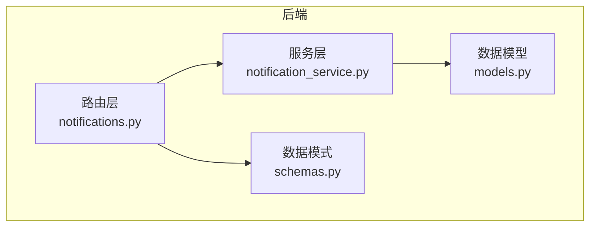
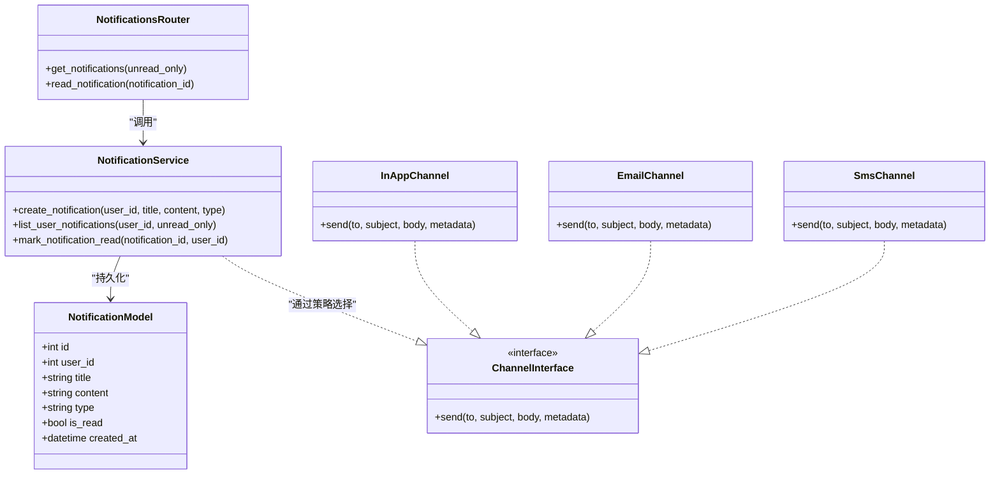
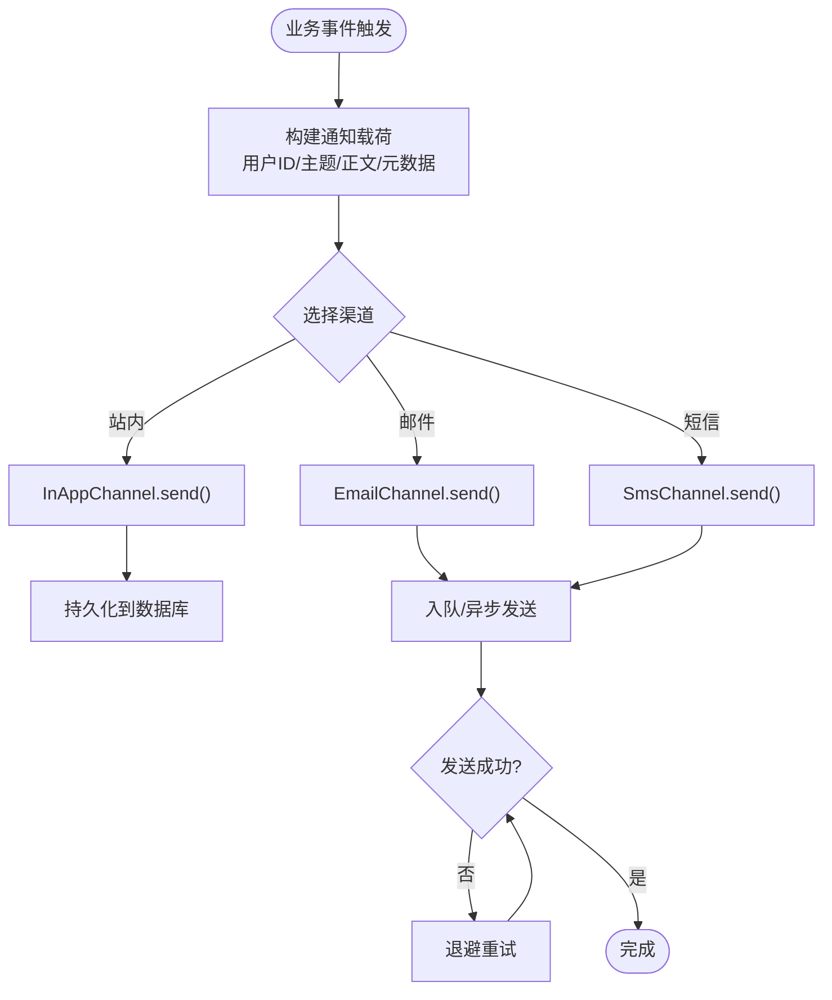
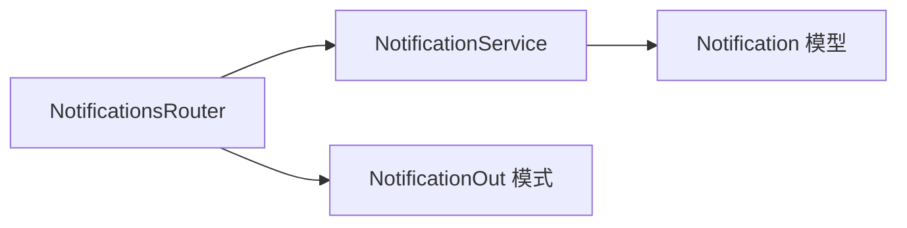

# 通知服务扩展机制

<cite>
**本文引用的文件**   
- [backend/app/services/notification_service.py](file://backend/app/services/notification_service.py)
- [backend/app/routers/notifications.py](file://backend/app/routers/notifications.py)
- [backend/app/models.py](file://backend/app/models.py)
- [backend/app/schemas.py](file://backend/app/schemas.py)
- [backend/tests/test_notification.py](file://backend/tests/test_notification.py)
- [tests/scripts/test_perf.py](file://tests/scripts/test_perf.py)
- [tests/scripts/test_exc.py](file://tests/scripts/test_exc.py)
</cite>

## 目录
1. [引言](#引言)
2. [项目结构](#项目结构)
3. [核心组件](#核心组件)
4. [架构总览](#架构总览)
5. [详细组件分析](#详细组件分析)
6. [依赖关系分析](#依赖关系分析)
7. [性能与队列、重试机制](#性能与队列重试机制)
8. [错误处理与可观测性](#错误处理与可观测性)
9. [最佳实践与扩展指南](#最佳实践与扩展指南)
10. [结论](#结论)

## 引言
本文件面向“通知服务扩展机制”，聚焦 NotificationService 的插件化架构设计，说明如何抽象并实现多种通知渠道（邮件、短信、站内消息等），并提供自定义渠道的实现范式。同时给出通知队列管理、重试机制的配置建议，以及性能优化和错误处理的工程实践。当前仓库已提供站内通知的数据模型、服务方法与路由；邮件、短信等外部渠道尚未在代码中实现，本文在保持现有实现不变的前提下，给出可扩展的架构设计与落地方案。

## 项目结构
后端采用 FastAPI + SQLAlchemy 的结构，通知能力由以下部分组成：
- 数据模型层：定义通知记录表结构与字段。
- 服务层：封装创建、查询、标记已读等业务逻辑。
- 路由层：暴露获取通知列表、标记已读的 API。
- 前端状态：维护未读通知数量等 UI 状态（非本文重点）。

图表来源
- [backend/app/routers/notifications.py:1-36](file://backend/app/routers/notifications.py#L1-L36)
- [backend/app/services/notification_service.py:1-39](file://backend/app/services/notification_service.py#L1-L39)
- [backend/app/models.py:244-253](file://backend/app/models.py#L244-L253)
- [backend/app/schemas.py:462-472](file://backend/app/schemas.py#L462-L472)

章节来源
- [backend/app/routers/notifications.py:1-36](file://backend/app/routers/notifications.py#L1-L36)
- [backend/app/services/notification_service.py:1-39](file://backend/app/services/notification_service.py#L1-L39)
- [backend/app/models.py:244-253](file://backend/app/models.py#L244-L253)
- [backend/app/schemas.py:462-472](file://backend/app/schemas.py#L462-L472)

## 核心组件
- 通知数据模型 Notification：包含用户标识、标题、内容、类型、是否已读、创建时间等字段。
- 通知服务 NotificationService：提供创建通知、按用户查询通知、标记已读等方法。
- 通知路由 NotificationsRouter：对外暴露获取通知列表与标记已读接口。
- 通知响应模式 NotificationOut：用于 API 返回结构。

章节来源
- [backend/app/models.py:244-253](file://backend/app/models.py#L244-L253)
- [backend/app/services/notification_service.py:5-38](file://backend/app/services/notification_service.py#L5-L38)
- [backend/app/routers/notifications.py:14-35](file://backend/app/routers/notifications.py#L14-L35)
- [backend/app/schemas.py:462-472](file://backend/app/schemas.py#L462-L472)

## 架构总览
当前系统实现了站内通知的基础能力，并通过 Notification.type 字段预留了通知类型的扩展空间。为支持多通道（邮件、短信、站内消息）与插件化扩展，推荐引入“通知渠道抽象 + 具体渠道实现”的分层设计，将发送逻辑从业务调用点解耦，并通过配置或注册表进行动态装配。

图表来源
- [backend/app/models.py:244-253](file://backend/app/models.py#L244-L253)
- [backend/app/services/notification_service.py:5-38](file://backend/app/services/notification_service.py#L5-L38)
- [backend/app/routers/notifications.py:14-35](file://backend/app/routers/notifications.py#L14-L35)

## 详细组件分析

### 通知数据模型 Notification
- 字段说明
  - id：自增主键
  - user_id：接收人用户 ID
  - title：通知标题
  - content：通知正文（可选）
  - type：通知类型（如 in_app/email/sms 等，用于区分渠道或场景）
  - is_read：是否已读
  - created_at：创建时间

- 复杂度与索引
  - 查询通常基于 user_id 过滤并按 created_at 排序，建议在 user_id 上建立索引以提升分页与筛选性能。

章节来源
- [backend/app/models.py:244-253](file://backend/app/models.py#L244-L253)

### 通知服务 NotificationService
- create_notification：创建一条站内通知记录，默认未读。
- list_user_notifications：按用户查询通知列表，支持仅未读过滤，按创建时间倒序。
- mark_notification_read：将指定通知标记为已读，需校验归属用户。

- 设计要点
  - 方法职责单一，便于单元测试与替换。
  - 当前未直接耦合外部渠道，适合向上扩展为“渠道分发器”。

章节来源
- [backend/app/services/notification_service.py:5-38](file://backend/app/services/notification_service.py#L5-L38)

### 通知路由 NotificationsRouter
- GET /api/notifications：获取当前用户的通知列表，支持 unread_only 参数。
- POST /api/notifications/{notification_id}/read：将某条通知标记为已读，不存在时返回 404。

- 安全与鉴权
  - 使用 get_current_user 获取当前登录用户上下文，确保数据隔离。

章节来源
- [backend/app/routers/notifications.py:14-35](file://backend/app/routers/notifications.py#L14-L35)

### 通知响应模式 NotificationOut
- 用于 API 返回结构，包含 id、user_id、title、content、type、is_read、created_at 等字段。

章节来源
- [backend/app/schemas.py:462-472](file://backend/app/schemas.py#L462-L472)

### 插件化渠道抽象与实现规范
为实现邮件、短信、站内消息等多渠道，建议如下抽象与实现规范：

- 渠道抽象接口 ChannelInterface
  - send(to, subject, body, metadata)：统一发送入口，to 可为邮箱、手机号或用户 ID，subject/body 用于模板渲染，metadata 携带渠道特定参数（如模板 ID、优先级、重试策略等）。

- 内置渠道实现
  - InAppChannel：写入 Notification 表，供前端轮询或 WebSocket 推送。
  - EmailChannel：对接 SMTP 或第三方邮件服务，支持模板引擎与附件。
  - SmsChannel：对接短信网关，支持签名、模板变量与回执回调。

- 渠道注册与选择
  - 通过配置或工厂类根据 Notification.type 或业务场景选择具体渠道。
  - 支持运行时切换与灰度发布。

- 模板定制
  - 模板以 key 形式存储，支持 HTML/纯文本双版本，变量注入由 metadata 驱动。
  - 模板缓存与热更新，避免频繁 IO。

- 幂等与去重
  - 对同一用户、同一事件、短时间窗口内重复触发进行去重，防止风暴。

图表来源
- [backend/app/services/notification_service.py:5-17](file://backend/app/services/notification_service.py#L5-L17)

### 自定义通知渠道实现示例（步骤）
- 定义渠道类
  - 实现 ChannelInterface 的 send 方法，处理目标解析、模板渲染、外部服务调用与异常捕获。
- 注册渠道
  - 在渠道注册表中登记 channel_key -> 渠道类映射。
- 接入业务
  - 在 NotificationService 中根据 type 或业务规则选择渠道，必要时先写库再异步发送。
- 模板管理
  - 新增模板 key 与变量占位符，并在 send 中注入。
- 测试验证
  - 针对失败、超时、限流等边界用例编写单测与集成测试。

[本节为概念性指导，不直接分析具体文件]

## 依赖关系分析
- 路由层依赖服务层与认证依赖。
- 服务层依赖 ORM 模型与数据库会话。
- 路由层依赖 Pydantic 输出模式。

图表来源
- [backend/app/routers/notifications.py:1-36](file://backend/app/routers/notifications.py#L1-L36)
- [backend/app/services/notification_service.py:1-39](file://backend/app/services/notification_service.py#L1-L39)
- [backend/app/models.py:244-253](file://backend/app/models.py#L244-L253)
- [backend/app/schemas.py:462-472](file://backend/app/schemas.py#L462-L472)

章节来源
- [backend/app/routers/notifications.py:1-36](file://backend/app/routers/notifications.py#L1-L36)
- [backend/app/services/notification_service.py:1-39](file://backend/app/services/notification_service.py#L1-L39)
- [backend/app/models.py:244-253](file://backend/app/models.py#L244-L253)
- [backend/app/schemas.py:462-472](file://backend/app/schemas.py#L462-L472)

## 性能与队列、重试机制
当前仓库未内置消息队列与重试框架，但测试脚本中出现了批量通知与队列深度监控的预期行为，表明未来可能引入队列能力。结合现有实现，建议如下：

- 队列接入
  - 使用 Celery + Redis/RabbitMQ 作为任务队列，将耗时发送逻辑（邮件、短信）异步化。
  - 将 NotificationService.create_notification 拆分为“入库 + 入队”两步，保证最终一致性。

- 重试策略
  - 指数退避 + 最大重试次数，失败进入死信队列以便人工干预。
  - 对幂等键（如 event_id + user_id）做去重，避免重复投递。

- 吞吐与批处理
  - 批量通知采用分片消费，限制单次任务大小，避免阻塞。
  - 对高频渠道（如站内）优先走内存缓存或本地队列，降低 DB 压力。

- 监控指标
  - 暴露队列深度、发送成功率、平均延迟、失败率等指标，便于容量规划与告警。

章节来源
- [tests/scripts/test_perf.py:222-231](file://tests/scripts/test_perf.py#L222-L231)
- [tests/scripts/test_exc.py:287-289](file://tests/scripts/test_exc.py#L287-L289)

## 错误处理与可观测性
- 路由层错误
  - 当通知不存在时返回 404，提示“通知不存在”。
- 服务层健壮性
  - 对数据库操作增加事务与异常捕获，避免部分提交。
  - 对渠道发送增加超时、限流、熔断保护。
- 日志与审计
  - 关键流程（创建、发送、失败、重试）打点记录，便于追踪。
  - 与现有审计日志体系打通，便于合规与排障。

章节来源
- [backend/app/routers/notifications.py:25-35](file://backend/app/routers/notifications.py#L25-L35)

## 最佳实践与扩展指南
- 渠道抽象先行
  - 先定义统一的 ChannelInterface，再逐步实现各渠道，避免散落的 if/else 分支。
- 模板与内容分离
  - 模板以 key 管理，内容与样式解耦，支持 A/B 测试与灰度。
- 幂等与去重
  - 所有外部发送必须幂等，结合业务事件 ID 与用户 ID 生成唯一键。
- 异步优先
  - 对 I/O 密集型渠道一律异步化，保障主链路性能。
- 可观测性
  - 指标、日志、追踪三件套齐全，覆盖端到端链路。
- 回滚与补偿
  - 发送失败需有补偿任务，确保最终一致。
- 安全与隐私
  - 敏感信息脱敏，传输加密，访问控制最小化。

[本节为通用工程实践，不直接分析具体文件]

## 结论
当前系统已具备站内通知的基础能力，包括数据模型、服务方法与路由。为支撑企业级多通道通知与高可用要求，建议引入渠道抽象与插件化注册机制，配合消息队列与重试策略，实现高性能、可观测、可扩展的通知体系。通过模板管理与幂等设计，可在不侵入业务代码的前提下平滑扩展新的通知渠道。