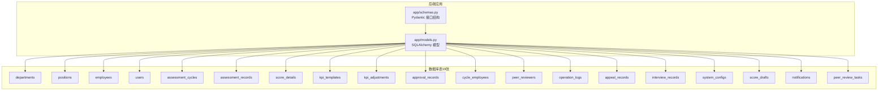
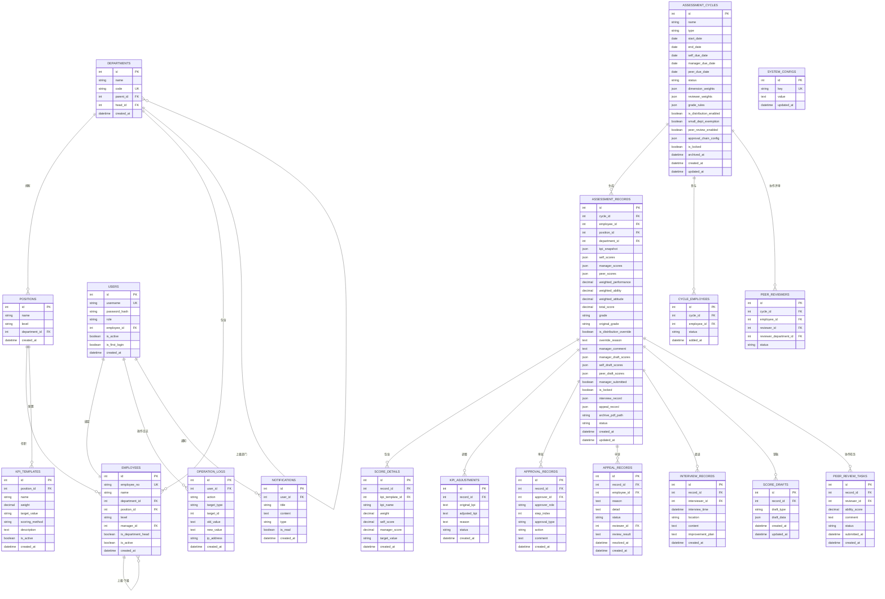
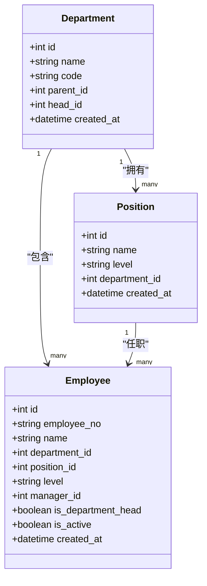
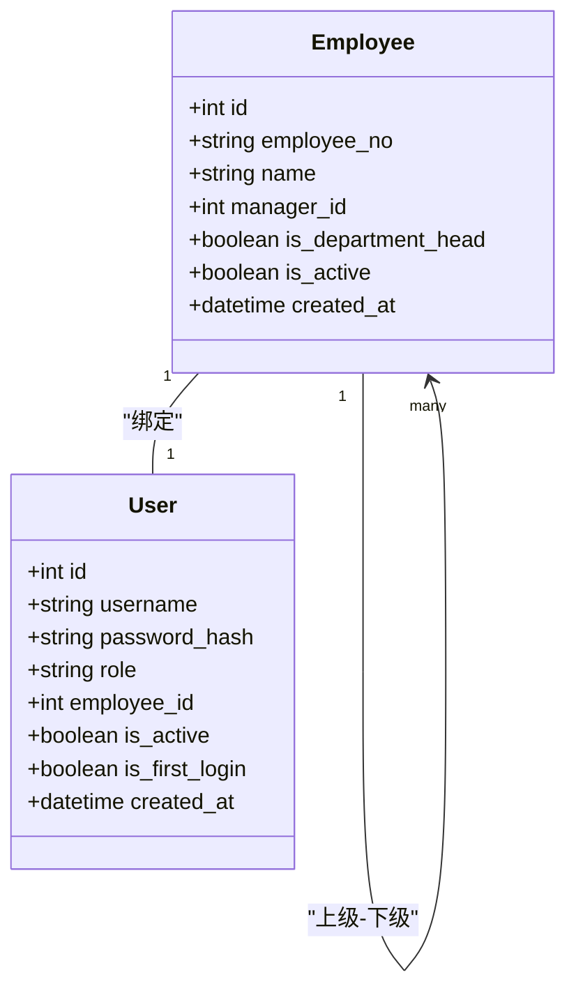
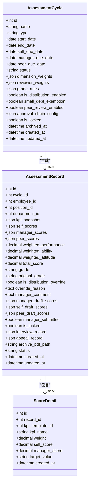
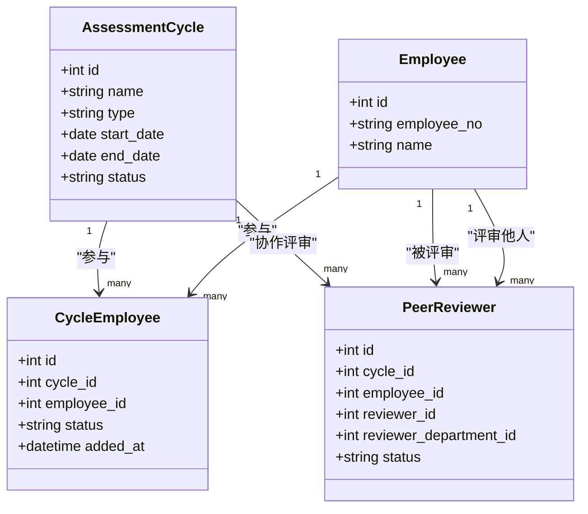
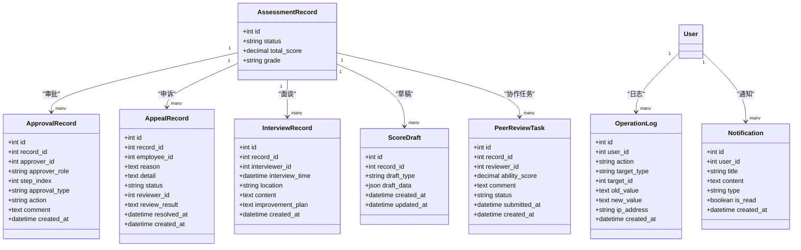

# ER图设计

<cite>
**本文引用的文件**   
- [models.py](file://backend/app/models.py)
- [schemas.py](file://backend/app/schemas.py)
</cite>

## 更新摘要
**变更内容**   
- 确立本ER图设计文档为数据库schema的单一事实来源
- 包含所有19个表的完整定义和关系映射
- 其他架构文档现在引用此中央ER图而非重复内容
- 增强实体关系可视化和业务约束说明

## 目录
1. [引言](#引言)
2. [项目结构](#项目结构)
3. [核心实体与属性定义](#核心实体与属性定义)
4. [关系映射说明](#关系映射说明)
5. [ER图可视化](#er图可视化)
6. [依赖关系与业务约束](#依赖关系与业务约束)
7. [详细组件分析](#详细组件分析)
8. [性能与扩展建议](#性能与扩展建议)
9. [常见问题排查](#常见问题排查)
10. [结论](#结论)

## 引言
本文件作为绩效考核评分系统的**权威数据库schema单一事实来源**，重点梳理部门、员工、考核周期、考核记录、评分详情等核心实体的关系与约束，并提供完整的实体关系图。文档同时解释一对一、一对多、自引用关系的实现方式，以及关键业务规则在模型层和接口校验层的体现。

**重要声明**：本ER图设计文档是系统数据库结构的权威参考，其他架构文档应直接引用此文档而非重复描述数据库schema。

## 项目结构
本项目的数据模型集中在后端模型的统一文件中，接口请求/响应结构集中在 Pydantic schemas 中。ER 图主要基于模型文件中的表结构与外键关系构建，并结合 schemas 中的字段校验补充业务约束。

**图表来源**
- [models.py:8-273](file://backend/app/models.py#L8-L273)
- [schemas.py:32-541](file://backend/app/schemas.py#L32-L541)

**章节来源**
- [models.py:8-273](file://backend/app/models.py#L8-L273)
- [schemas.py:32-541](file://backend/app/schemas.py#L32-L541)

## 核心实体与属性定义
以下为核心实体的属性与类型说明，字段含义以模型定义为准。

### 基础组织实体

- **Department(部门)**
  - id：整数主键
  - name：字符串，必填
  - code：字符串，唯一
  - parent_id：整数，自引用外键，指向 departments.id，表示上级部门
  - head_id：整数，外键，指向 employees.id，表示部门负责人
  - created_at：时间戳

- **Position(岗位)**
  - id：整数主键
  - name：字符串，必填
  - level：字符串，职级（如 P5、M3）
  - department_id：整数，外键，指向 departments.id
  - created_at：时间戳

- **Employee(员工)**
  - id：整数主键
  - employee_no：字符串，唯一，必填
  - name：字符串，必填
  - department_id：整数，外键，指向 departments.id
  - position_id：整数，外键，指向 positions.id
  - level：字符串，职级
  - manager_id：整数，自引用外键，指向 employees.id，表示直接上级
  - is_department_head：布尔值，是否部门负责人
  - is_active：布尔值，是否启用
  - created_at：时间戳

- **User(系统用户)**
  - id：整数主键
  - username：字符串，唯一，必填
  - password_hash：字符串，必填
  - role：字符串，必填
  - employee_id：整数，外键，指向 employees.id
  - is_active：布尔值
  - is_first_login：布尔值
  - created_at：时间戳

### 考核核心实体

- **AssessmentCycle(考核周期)**
  - id：整数主键
  - name：字符串，必填
  - type：字符串，必填
  - start_date：日期，必填
  - end_date：日期，必填
  - self_due_date：日期，自评截止
  - manager_due_date：日期，上级评截止
  - peer_due_date：日期，协作评截止
  - status：字符串，状态
  - dimension_weights：JSON，维度权重
  - reviewer_weights：JSON，评分人权重
  - grade_rules：JSON，等级规则
  - is_distribution_enabled：布尔值，是否启用分布
  - small_dept_exemption：布尔值，小部门豁免
  - peer_review_enabled：布尔值，是否启用协作评分
  - approval_chain_config：JSON，审批链配置
  - is_locked：布尔值，是否锁定
  - archived_at：时间戳
  - created_at/updated_at：时间戳

- **KpiTemplate(KPI模板)**
  - id：整数主键
  - position_id：整数，外键，指向 positions.id
  - name：字符串，必填
  - weight：小数，必填
  - target_value：字符串，目标值
  - scoring_method：字符串，评分方法
  - description：文本
  - is_active：布尔值
  - created_at：时间戳

- **AssessmentRecord(考核记录)**
  - id：整数主键
  - cycle_id：整数，外键，指向 assessment_cycles.id
  - employee_id：整数，外键，指向 employees.id
  - position_id：整数，外键，指向 positions.id
  - department_id：整数，外键，指向 departments.id
  - kpi_snapshot：JSON，KPI快照
  - self_scores/manager_scores/peer_scores：JSON，各角色评分
  - weighted_performance/weighted_ability/weighted_attitude：小数，维度加权分
  - total_score：小数，总分
  - grade/original_grade：字符串，等级
  - is_distribution_override：布尔值，是否覆盖分布
  - override_reason：文本，覆盖原因
  - manager_comment：文本，上级评语
  - manager_draft_scores/self_draft_scores/peer_draft_scores：JSON，草稿
  - manager_submitted：布尔值，上级已提交
  - is_locked：布尔值，是否锁定
  - interview_record/appeal_record：JSON，面试与申诉信息
  - archive_pdf_path：字符串，归档PDF路径
  - status：字符串，状态
  - created_at/updated_at：时间戳

- **ScoreDetail(评分详情)**
  - id：整数主键
  - record_id：整数，外键，指向 assessment_records.id
  - kpi_template_id：整数，外键，指向 kpi_templates.id
  - kpi_name：字符串，指标名称
  - weight：小数，权重
  - self_score/manager_score：小数，自评/上级评分
  - target_value：字符串，目标值
  - created_at：时间戳

### 辅助管理实体

- **KpiAdjustment(KPI调整)**
  - id：整数主键
  - record_id：整数，外键，指向 assessment_records.id
  - original_kpi/adjusted_kpi/reason/status：调整相关字段

- **ApprovalRecord(审批记录)**
  - id：整数主键
  - record_id：整数，外键，指向 assessment_records.id
  - approver_id：整数，外键，指向 employees.id
  - approver_role/step_index/approval_type/action/comment：审批流程字段

- **CycleEmployee(周期参与人员)**
  - id：整数主键
  - cycle_id：整数，外键，指向 assessment_cycles.id
  - employee_id：整数，外键，指向 employees.id
  - status/added_at：参与状态和时间

- **PeerReviewer(协作评审者)**
  - id：整数主键
  - cycle_id：整数，外键，指向 assessment_cycles.id
  - employee_id/reviewer_id：被评人和评审人ID
  - reviewer_department_id：评审人部门ID
  - status：协作评审状态

- **OperationLog(操作日志)**
  - id：整数主键
  - user_id：整数，外键，指向 users.id
  - action/target_type/target_id：操作信息
  - old_value/new_value/ip_address：审计信息

- **AppealRecord(申诉记录)**
  - id：整数主键
  - record_id：整数，外键，指向 assessment_records.id
  - employee_id：整数，外键，指向 employees.id
  - reason/detail/status/reviewer_id/review_result/resolved_at：申诉处理信息

- **InterviewRecord(面谈记录)**
  - id：整数主键
  - record_id：整数，外键，指向 assessment_records.id
  - interviewer_id：整数，外键，指向 employees.id
  - interview_time/location/content/improvement_plan：面谈信息

- **SystemConfig(系统配置)**
  - id：整数主键
  - key：字符串，唯一，必填
  - value：文本，配置值
  - updated_at：更新时间

- **ScoreDraft(评分草稿)**
  - id：整数主键
  - record_id：整数，外键，指向 assessment_records.id
  - draft_type/draft_data：草稿类型和数据
  - created_at/updated_at：时间戳

- **Notification(通知)**
  - id：整数主键
  - user_id：整数，外键，指向 users.id
  - title/content/type/is_read：通知信息

- **PeerReviewTask(协作评分任务)**
  - id：整数主键
  - record_id：整数，外键，指向 assessment_records.id
  - reviewer_id：整数，外键，指向 employees.id
  - ability_score/comment/status/submitted_at：协作评分任务信息

**章节来源**
- [models.py:8-273](file://backend/app/models.py#L8-L273)

## 关系映射说明

### 一对一关系
- **User ↔ Employee**：User.employee_id 指向 Employee.id，一个用户对应一个员工；Employee.user 使用 uselist=False 保证一对一。
- **语义**：系统登录账户与组织人事档案一一对应。

### 一对多关系
- **Department → Employee**：Department.employees 通过 Employee.department_id 建立一对多。
- **Department → Position**：Department.positions 通过 Position.department_id 建立一对多。
- **Position → Employee**：Position.employees 通过 Employee.position_id 建立一对多。
- **Position → KpiTemplate**：Position.kpi_templates 通过 KpiTemplate.position_id 建立一对多。
- **AssessmentCycle → AssessmentRecord**：AssessmentRecord.cycle_id 建立一对多。
- **AssessmentRecord → ScoreDetail**：ScoreDetail.record_id 建立一对多。
- **AssessmentRecord → KpiAdjustment**：KpiAdjustment.record_id 建立一对多。
- **AssessmentRecord → ApprovalRecord**：ApprovalRecord.record_id 建立一对多。
- **AssessmentRecord → AppealRecord**：AppealRecord.record_id 建立一对多。
- **AssessmentRecord → InterviewRecord**：InterviewRecord.record_id 建立一对多。
- **AssessmentRecord → ScoreDraft**：ScoreDraft.record_id 建立一对多。
- **AssessmentRecord → PeerReviewTask**：PeerReviewTask.record_id 建立一对多。
- **User → Notification**：Notification.user_id 建立一对多。
- **User → OperationLog**：OperationLog.user_id 建立一对多。

### 多对多关系（通过中间表实现）
- **AssessmentCycle ↔ Employee**：通过 CycleEmployee 表关联，包含唯一约束 (cycle_id, employee_id)。
- **AssessmentCycle ↔ Employee(协作评审)**：通过 PeerReviewer 表关联，包含唯一约束 (cycle_id, employee_id, reviewer_id)。

### 自引用关系
- **Department.parent_id**：部门层级树，parent_id 指向 departments.id。
- **Employee.manager_id**：上下级关系，manager_id 指向 employees.id；Employee.subordinates 反向聚合下级。

### 外键与索引
- 所有外键均显式声明，便于数据库层面约束完整性。
- 常用查询字段如 id、employee_no、username、code 等设置索引或唯一约束，提升检索性能。

**章节来源**
- [models.py:8-273](file://backend/app/models.py#L8-L273)

## ER图可视化
下面给出核心实体的 ER 图，展示一对一、一对多、多对多及自引用关系。

**图表来源**
- [models.py:8-273](file://backend/app/models.py#L8-L273)

## 依赖关系与业务约束

### 依赖关系
- **AssessmentRecord** 强依赖 AssessmentCycle、Employee、Position、Department。
- **ScoreDetail** 依赖 AssessmentRecord 与 KpiTemplate。
- **CycleEmployee** 与 **PeerReviewer** 作为多对多中间表，分别维护周期与员工的参与关系、协作评审关系。
- **ApprovalRecord**、**AppealRecord**、**InterviewRecord**、**ScoreDraft**、**PeerReviewTask** 均依赖 AssessmentRecord。
- **OperationLog** 与 **Notification** 依赖 Users。

### 业务约束（模型与接口层）
- **考核周期截止时间顺序**：self_due_date < manager_due_date < peer_due_date，由接口校验器强制。
- **考核周期维度权重总和必须等于 100%**。
- **等级规则区间需连续且无重叠**，min/max/ratio_limit 范围受校验。
- **评分人权重总和必须等于 100%**。
- **KPI模板指标名称唯一**，权重总和为 100%。
- **CycleEmployee** 与 **PeerReviewer** 存在唯一约束，防止重复关联。
- **未发布状态的考核记录对外屏蔽总分与等级**，由接口输出模型处理。

**章节来源**
- [schemas.py:209-315](file://backend/app/schemas.py#L209-L315)
- [schemas.py:365-385](file://backend/app/schemas.py#L365-L385)
- [schemas.py:406-458](file://backend/app/schemas.py#L406-L458)
- [schemas.py:489-511](file://backend/app/schemas.py#L489-L511)
- [schemas.py:118-187](file://backend/app/schemas.py#L118-L187)
- [models.py:167-184](file://backend/app/models.py#L167-L184)

## 详细组件分析

### 部门与岗位
- **Department** 支持层级结构，通过 parent_id 自引用形成树形组织。
- **Position** 属于某个 Department，并为该部门的员工与 KPI 模板提供归属。
- **关系**：
  - Department → Position：一对多
  - Department → Employee：一对多
  - Position → Employee：一对多

**图表来源**
- [models.py:8-46](file://backend/app/models.py#L8-L46)

**章节来源**
- [models.py:8-46](file://backend/app/models.py#L8-L46)

### 员工与用户
- **Employee** 与 **User** 为一对一关系，User.employee_id 指向 Employee.id。
- **Employee** 的 manager_id 自引用表示上下级关系，subordinates 反向聚合下级。

**图表来源**
- [models.py:31-60](file://backend/app/models.py#L31-L60)

**章节来源**
- [models.py:31-60](file://backend/app/models.py#L31-L60)

### 考核周期与考核记录
- **AssessmentCycle** 定义一次考核的时间范围、权重、等级规则与流程开关。
- **AssessmentRecord** 是某员工在特定周期的考核结果载体，包含多维评分与最终等级。
- **关系**：
  - AssessmentCycle → AssessmentRecord：一对多
  - AssessmentRecord → ScoreDetail：一对多

**图表来源**
- [models.py:62-144](file://backend/app/models.py#L62-L144)

**章节来源**
- [models.py:62-144](file://backend/app/models.py#L62-L144)

### 多对多：周期-员工参与与协作评审
- **CycleEmployee**：维护每个周期内参与考核的员工集合，含唯一约束避免重复。
- **PeerReviewer**：维护每个周期内针对某员工的协作评审者集合，含唯一约束。

**图表来源**
- [models.py:167-184](file://backend/app/models.py#L167-L184)

**章节来源**
- [models.py:167-184](file://backend/app/models.py#L167-L184)

### 辅助实体：审批、申诉、面谈、日志、通知、草稿
- **ApprovalRecord**：记录每次审批步骤与动作，关联 AssessmentRecord 与 Approver(Employee)。
- **AppealRecord**：记录申诉原因与处理结果，关联 AssessmentRecord 与 Reviewer(Employee)。
- **InterviewRecord**：记录面谈时间、地点、内容与改进计划，关联 AssessmentRecord 与 Interviewer(Employee)。
- **OperationLog**：记录系统操作审计，关联 User。
- **Notification**：记录系统通知，关联 User。
- **ScoreDraft**：保存不同角色的评分草稿，关联 AssessmentRecord。
- **PeerReviewTask**：记录协作评分任务的状态与得分，关联 AssessmentRecord 与 Reviewer(Employee)。

**图表来源**
- [models.py:145-273](file://backend/app/models.py#L145-L273)

**章节来源**
- [models.py:145-273](file://backend/app/models.py#L145-L273)

## 性能与扩展建议

### 索引优化
- 对频繁查询的外键字段添加复合索引，例如 (cycle_id, employee_id)、(record_id, draft_type) 等。
- 对状态字段如 status、is_active 建立索引以提升筛选性能。

### JSON 字段
- dimension_weights、reviewer_weights、grade_rules、kpi_snapshot 等 JSON 字段适合存储结构化配置，但应避免过度嵌套导致查询复杂化。

### 事务与一致性
- 在创建 AssessmentRecord 与 ScoreDetail 时，建议使用事务确保数据一致性。

### 扩展性
- 如需新增评分维度或角色，可在 schemas 层增加校验逻辑，并在 models 层扩展 AssessmentRecord 或新增关联表。

## 常见问题排查

### 循环引用错误
- Employee.manager_id 自引用可能导致 ORM 加载时的循环引用，建议在查询时按需加载 subordinates 或使用延迟加载策略。

### 唯一约束冲突
- CycleEmployee 与 PeerReviewer 的唯一约束可能因重复导入或批量操作触发冲突，需在写入前去重。

### 权重校验失败
- 考核周期维度权重或评分人权重总和不为 100% 会抛出校验错误，检查前端传参与默认值。

### 未发布数据泄露
- 未发布状态的考核记录不应返回总分与等级，确认接口输出模型是否正确遮蔽敏感字段。

**章节来源**
- [schemas.py:209-315](file://backend/app/schemas.py#L209-L315)
- [schemas.py:365-385](file://backend/app/schemas.py#L365-L385)
- [models.py:167-184](file://backend/app/models.py#L167-L184)

## 结论
本 ER 图围绕部门、员工、岗位、用户、考核周期、考核记录、评分详情等核心实体展开，清晰展示了系统的数据结构与关系。通过一对一、一对多、多对多与自引用关系，支撑了组织管理、考核流程、评分计算与审计追踪等业务场景。结合 schemas 层的严格校验，系统在数据一致性与业务规则方面具备较强保障。

**重要更新**：本ER图设计文档现已确立为数据库schema的单一事实来源，包含所有19个表的完整定义。其他架构文档应直接引用此中央ER图而非重复描述数据库结构，确保系统架构文档的一致性和权威性。后续可根据业务演进扩展新的评分维度、审批节点与报表实体，保持模型与接口的同步演进。