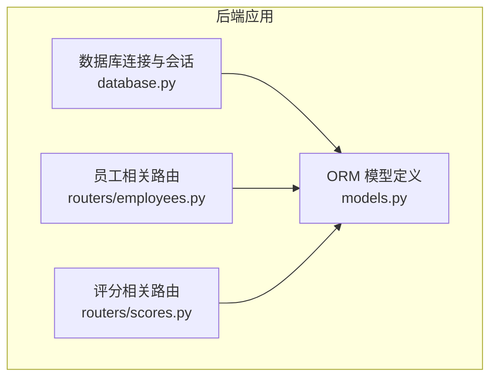
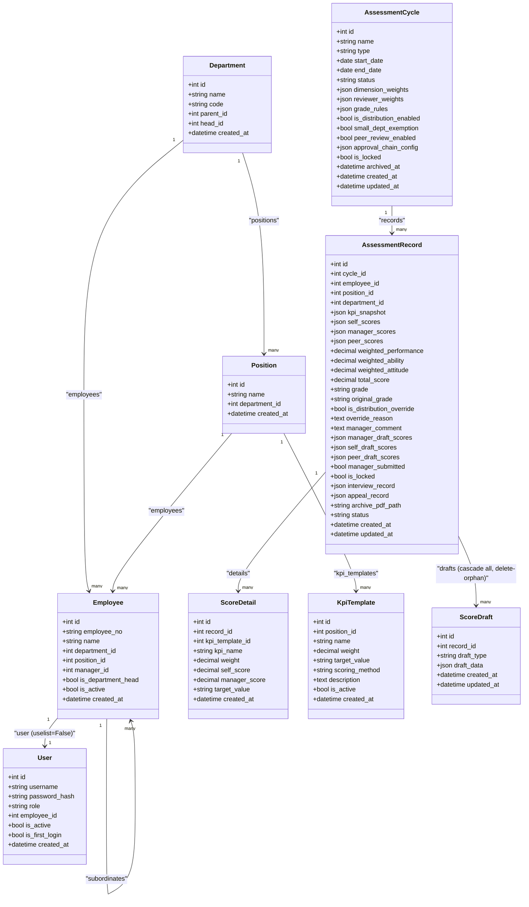
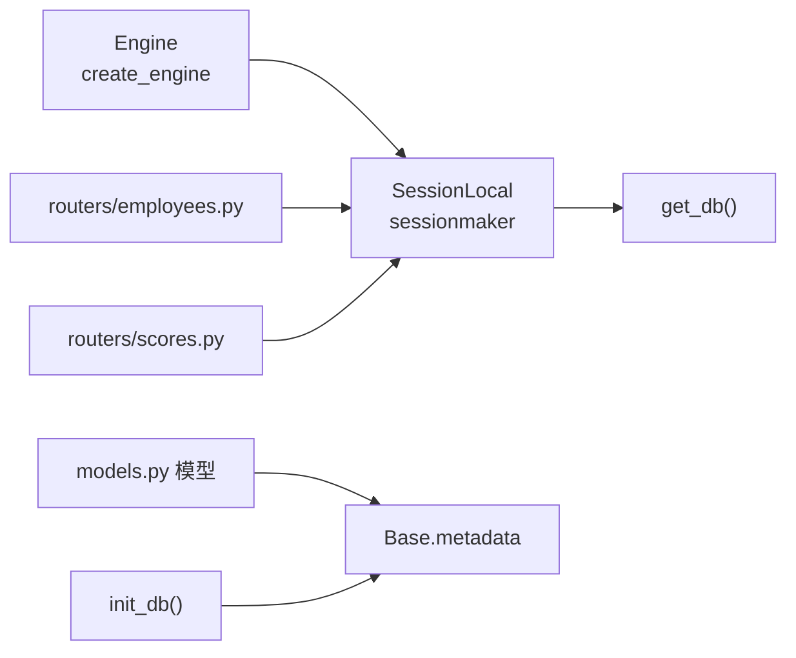

# ORM模型设计

<cite>
**本文引用的文件**   
- [models.py](file://backend/app/models.py)
- [database.py](file://backend/app/database.py)
- [employees.py](file://backend/app/routers/employees.py)
- [scores.py](file://backend/app/routers/scores.py)
</cite>

## 目录
1. [引言](#引言)
2. [项目结构](#项目结构)
3. [核心组件](#核心组件)
4. [架构总览](#架构总览)
5. [详细组件分析](#详细组件分析)
6. [依赖关系分析](#依赖关系分析)
7. [性能与查询优化](#性能与查询优化)
8. [模型验证与业务逻辑](#模型验证与业务逻辑)
9. [使用示例：实例化、查询、更新](#使用示例实例化查询更新)
10. [故障排查指南](#故障排查指南)
11. [结论](#结论)

## 引言
本文面向 SQLAlchemy ORM 模型层，系统性梳理本项目的 Base 继承体系、模型基类设计、relationship 配置策略（back_populates、foreign_keys、remote_side 等）、关联查询优化方法（懒加载、立即加载、选择加载），以及模型层的验证规则与业务逻辑边界。同时给出基于现有路由代码的实例化、查询、更新示例路径，帮助读者快速理解并安全扩展模型。

## 项目结构
本项目后端采用 FastAPI + SQLAlchemy ORM。ORM 相关代码集中在以下位置：
- 数据库连接与会话管理：backend/app/database.py
- ORM 模型定义：backend/app/models.py
- 使用模型的 API 路由：backend/app/routers/employees.py、backend/app/routers/scores.py

图表来源
- [database.py:13-30](file://backend/app/database.py#L13-L30)
- [models.py:1-6](file://backend/app/models.py#L1-L6)
- [employees.py:1-32](file://backend/app/routers/employees.py#L1-L32)
- [scores.py:1-21](file://backend/app/routers/scores.py#L1-L21)

章节来源
- [database.py:1-31](file://backend/app/database.py#L1-L31)
- [models.py:1-6](file://backend/app/models.py#L1-L6)

## 核心组件
- Base 与 declarative_base：所有模型均继承自 Base，用于统一声明表结构与元数据。
- 基础实体模型：Department、Position、Employee、User。
- 考核域模型：AssessmentCycle、AssessmentRecord、ScoreDetail、KpiTemplate、KpiAdjustment。
- 流程与协作模型：ApprovalRecord、PeerReviewer、PeerReviewTask、AppealRecord、InterviewRecord。
- 辅助与系统模型：OperationLog、SystemConfig、Notification、ScoreDraft。

这些模型通过 relationship 建立双向或单向关联，支撑组织人事、绩效考核、审批申诉、协作评价等业务场景。

章节来源
- [models.py:8-266](file://backend/app/models.py#L8-L266)

## 架构总览
下图展示核心模型之间的主要关系，包括部门-岗位-员工、用户-员工一对一、考核记录与草稿一对多、上级-下属递归关系等。

图表来源
- [models.py:8-266](file://backend/app/models.py#L8-L266)

## 详细组件分析

### Base 与模型基类设计
- Base 由 declarative_base() 创建，作为所有模型的基类，集中管理表元数据。
- 所有模型通过 __tablename__ 指定表名，并通过 Column 定义字段类型、约束、默认值、索引等。
- 时间戳字段普遍使用 default=datetime.utcnow，部分更新字段使用 onupdate=datetime.utcnow。
- JSON 字段用于存储复杂配置与快照数据，如维度权重、评分人权重、等级规则、KPI 快照、草稿数据等。

章节来源
- [models.py:1-6](file://backend/app/models.py#L1-L6)
- [models.py:62-83](file://backend/app/models.py#L62-L83)
- [models.py:100-129](file://backend/app/models.py#L100-L129)
- [models.py:230-241](file://backend/app/models.py#L230-L241)

### relationship 定义与参数说明

#### back_populates：双向关系一致性
- 在两个模型上分别定义 relationship，并使用相同的 back_populates 名称，确保访问时双向同步。
- 典型用法：
  - Department.employees 与 Employee.department
  - Position.employees 与 Employee.position
  - Position.kpi_templates 与 KpiTemplate.position
  - AssessmentRecord.drafts 与 ScoreDraft.record

这种配置避免 N+1 查询时的歧义，并让对象图保持一致性。

章节来源
- [models.py:17-18](file://backend/app/models.py#L17-L18)
- [models.py:27-29](file://backend/app/models.py#L27-L29)
- [models.py:43-47](file://backend/app/models.py#L43-L47)
- [models.py:60](file://backend/app/models.py#L60)
- [models.py:97](file://backend/app/models.py#L97)
- [models.py:131](file://backend/app/models.py#L131)
- [models.py:241](file://backend/app/models.py#L241)

#### foreign_keys：明确外键归属
- 当同一模型存在多个外键指向同一目标模型时，必须用 foreign_keys 指明具体列，避免歧义。
- 典型用法：
  - Department.employees 使用 foreign_keys="Employee.department_id"
  - Position.employees 使用 foreign_keys="Employee.position_id"
  - Employee.department 使用 foreign_keys=[department_id]
  - Employee.position 使用 foreign_keys=[position_id]

章节来源
- [models.py:17](file://backend/app/models.py#L17)
- [models.py:28](file://backend/app/models.py#L28)
- [models.py:43-44](file://backend/app/models.py#L43-L44)

#### remote_side：自引用关系的远端侧
- 自引用关系需要指定 remote_side，以表明“远端”是哪一侧的主键。
- 典型用法：
  - Employee.manager 使用 remote_side=[id]，表示 manager 指向的是另一个 Employee 的 id。
  - Employee.subordinates 通过 back_populates="manager" 与 manager 形成双向关系。

章节来源
- [models.py:45-46](file://backend/app/models.py#L45-L46)

#### uselist=False：一对一关系
- Employee.user 使用 uselist=False，表示一个员工对应一个用户账户，返回单个对象而非列表。
- User.employee 通过 back_populates="employee" 与之配对。

章节来源
- [models.py:47](file://backend/app/models.py#L47)
- [models.py:60](file://backend/app/models.py#L60)

#### cascade：级联删除孤儿
- AssessmentRecord.drafts 使用 cascade="all, delete-orphan"，当父记录删除时，子草稿自动清理，避免孤儿数据。

章节来源
- [models.py:131](file://backend/app/models.py#L131)

### 关键模型职责与复杂度

- Department：部门主数据，支持层级结构（parent_id）与负责人（head_id）。
- Position：岗位主数据，隶属于部门，承载 KPI 模板。
- Employee：员工主数据，包含部门、岗位、直属上级、是否部门负责人、是否在职等属性；提供 manager/subordinates 自引用关系。
- User：认证账户，与 Employee 一对一绑定。
- AssessmentCycle：考核周期配置，包含维度权重、评分人权重、等级规则、强制分布开关、协作评分开关、审批链配置等。
- AssessmentRecord：考核记录，聚合自评、上级评、协作评、加权得分、等级、状态机状态、归档路径等。
- ScoreDetail：KPI 明细评分，按记录维度展开。
- KpiTemplate：岗位 KPI 模板，含权重、目标值、评分方式等。
- ScoreDraft：评分草稿，支持自评、上级评、协作评等多类型草稿。
- ApprovalRecord、PeerReviewer、PeerReviewTask、AppealRecord、InterviewRecord：流程与协作相关实体。
- OperationLog、SystemConfig、Notification：审计、系统配置、通知。

复杂度分析要点：
- 自引用关系（Employee.manager/subordinates）适合树形遍历，但深度过大时需限制递归深度以避免性能问题。
- JSON 字段承载大量业务配置与快照，读取时需进行解析与校验，建议在服务层做缓存与校验。
- AssessmentRecord 与 ScoreDetail、ScoreDraft 是一对多关系，批量操作时应注意事务边界与级联行为。

章节来源
- [models.py:8-266](file://backend/app/models.py#L8-L266)

## 依赖关系分析
- database.py 负责引擎创建、会话工厂、初始化建表，并提供 get_db 依赖注入函数。
- models.py 定义所有模型，Base.metadata.create_all 会依据模型生成表结构。
- routers/employees.py 与 routers/scores.py 通过 Session 访问模型，执行 CRUD 与业务逻辑。

图表来源
- [database.py:13-30](file://backend/app/database.py#L13-L30)
- [models.py:1-6](file://backend/app/models.py#L1-L6)

章节来源
- [database.py:1-31](file://backend/app/database.py#L1-L31)
- [models.py:1-6](file://backend/app/models.py#L1-L6)

## 性能与查询优化

### 懒加载（默认）
- 未显式配置 eager loading 时，relationship 默认懒加载。
- 优点：按需加载，减少初始查询负载。
- 风险：在循环中访问关联对象可能产生 N+1 查询。

适用场景：
- 列表页仅展示主表字段，不频繁访问关联对象。
- 单条详情页面按需加载关联数据。

### 立即加载（joinedload）
- 使用 joinedload 在一次 SQL 中 JOIN 获取关联数据，避免 N+1。
- 当前路由中已引入 joinedload，可用于后续优化。

建议用法：
- 在需要一次性获取员工及其部门、岗位、上级信息的接口中使用 joinedload。
- 在评分汇总、审批详情等涉及多表关联的场景中优先使用。

章节来源
- [employees.py:1-3](file://backend/app/routers/employees.py#L1-L3)

### 选择加载（selectinload）
- selectinload 通过 IN 查询批量加载关联集合，适合一对多关系且子集较大的场景。
- 适用于 AssessmentRecord.drafts、ScoreDetail 等一对多关系的大列表场景。

建议用法：
- 批量获取考核记录的草稿或 KPI 明细时，使用 selectinload 降低往返次数。

### 查询优化实践建议
- 在列表接口中尽量只 SELECT 必要字段，避免 SELECT *。
- 对高频关联字段使用 joinedload/selectinload，避免 N+1。
- 对大结果集使用分页（limit/offset）与索引（Column(index=True)）。
- 对 JSON 字段进行结构化校验与缓存，避免重复解析。

章节来源
- [models.py:10-15](file://backend/app/models.py#L10-L15)
- [models.py:33-41](file://backend/app/models.py#L33-L41)
- [models.py:100-129](file://backend/app/models.py#L100-L129)

## 模型验证与业务逻辑

### 模型层验证
- 字段约束：nullable、unique、default、onupdate 等约束在模型层保证数据完整性。
- 唯一约束：表级 UniqueConstraint 用于组合唯一性（如 cycle_employees、peer_reviewers、score_drafts）。
- JSON 校验：在路由与服务层对 JSON 字段进行合法性校验（如维度权重之和为 1.0 或 100%）。

章节来源
- [models.py:174-184](file://backend/app/models.py#L174-L184)
- [models.py:239](file://backend/app/models.py#L239)
- [scores.py:181-198](file://backend/app/routers/scores.py#L181-L198)

### 业务逻辑在模型层的边界
- 模型层主要负责数据结构与关系映射，不建议承载复杂业务规则。
- 复杂业务逻辑（评分计算、强制分布、状态机流转、通知发送、审计日志）放在服务层与路由层。
- 模型层可通过 cascade、事件钩子（如 @event.listens_for）实现简单的级联与触发，但应保持轻量。

章节来源
- [scores.py:165-331](file://backend/app/routers/scores.py#L165-L331)
- [models.py:131](file://backend/app/models.py#L131)

## 使用示例：实例化、查询、更新

以下示例基于现有路由代码，给出常见操作的参考路径。为避免直接粘贴代码，仅提供精确的文件与行号定位。

### 实例化模型
- 创建员工：参考创建员工的 POST 接口，构造 Employee 实例并添加到会话后提交。
  - 参考路径：[employees.py:480-551](file://backend/app/routers/employees.py#L480-L551)
- 创建考核记录：通常在周期启动或分配阶段创建 AssessmentRecord，并写入 employee_id、cycle_id 等关键字段。
  - 参考路径：[scores.py:348-419](file://backend/app/routers/scores.py#L348-L419)

### 查询模型
- 查询员工列表：支持分页、关键词、部门筛选、排序，并进行数据隔离。
  - 参考路径：[employees.py:233-312](file://backend/app/routers/employees.py#L233-L312)
- 查询我的考核记录：根据当前用户角色过滤可见数据，组装响应。
  - 参考路径：[scores.py:636-737](file://backend/app/routers/scores.py#L636-L737)
- 查询待评列表：根据经理下属范围与状态筛选 AssessmentRecord。
  - 参考路径：[scores.py:348-419](file://backend/app/routers/scores.py#L348-L419)

### 更新模型
- 更新员工信息：校验工号唯一性与外键有效性，处理 manager_employee_no 到 manager_id 的解析。
  - 参考路径：[employees.py:554-629](file://backend/app/routers/employees.py#L554-L629)
- 提交上级评分：校验分数范围、评语长度，更新 manager_scores 与状态机状态，必要时创建协作任务。
  - 参考路径：[scores.py:434-554](file://backend/app/routers/scores.py#L434-L554)
- 提交协作评分：校验权限与分数，更新 peer_scores 与 PeerReviewTask。
  - 参考路径：[scores.py:561-626](file://backend/app/routers/scores.py#L561-L626)

### 关联查询优化示例
- 在需要一次性获取员工及其部门、岗位、上级信息的接口中，建议使用 joinedload。
  - 导入位置：[employees.py:1-3](file://backend/app/routers/employees.py#L1-L3)
- 在批量获取考核记录的草稿或 KPI 明细时，建议使用 selectinload。
  - 参考路径：[scores.py:680-690](file://backend/app/routers/scores.py#L680-L690)

章节来源
- [employees.py:233-312](file://backend/app/routers/employees.py#L233-L312)
- [employees.py:480-551](file://backend/app/routers/employees.py#L480-L551)
- [employees.py:554-629](file://backend/app/routers/employees.py#L554-L629)
- [scores.py:348-419](file://backend/app/routers/scores.py#L348-L419)
- [scores.py:434-554](file://backend/app/routers/scores.py#L434-L554)
- [scores.py:561-626](file://backend/app/routers/scores.py#L561-L626)
- [scores.py:636-737](file://backend/app/routers/scores.py#L636-L737)

## 故障排查指南

### 常见问题与定位
- N+1 查询导致性能退化：检查是否在循环中访问 relationship 而未使用 eager loading。
  - 排查建议：在列表接口中为常用关联字段添加 joinedload/selectinload。
  - 参考路径：[employees.py:1-3](file://backend/app/routers/employees.py#L1-L3)
- 自引用关系死循环：Employee.manager/subordinates 递归过深可能导致栈溢出或超时。
  - 排查建议：限制递归深度，或在路由中使用迭代方式收集下属 ID。
  - 参考路径：[employees.py:453-466](file://backend/app/routers/employees.py#L453-L466)
- JSON 字段校验失败：维度权重或评分人权重之和不为 1.0/100%。
  - 排查建议：在服务层增加严格校验并返回明确错误信息。
  - 参考路径：[scores.py:181-198](file://backend/app/routers/scores.py#L181-L198)
- 级联删除未生效：ScoreDraft 应随 AssessmentRecord 删除而清理。
  - 排查建议：确认 cascade="all, delete-orphan" 配置正确。
  - 参考路径：[models.py:131](file://backend/app/models.py#L131)

章节来源
- [employees.py:453-466](file://backend/app/routers/employees.py#L453-L466)
- [scores.py:181-198](file://backend/app/routers/scores.py#L181-L198)
- [models.py:131](file://backend/app/models.py#L131)

## 结论
本项目的 ORM 模型设计以 Base 为统一基类，围绕组织人事与绩效考核构建清晰的实体关系。relationship 的配置遵循 back_populates、foreign_keys、remote_side、uselist、cascade 等最佳实践，确保数据一致性与可维护性。在查询层面，应结合懒加载、joinedload、selectinload 的策略，平衡性能与可读性。模型层保持轻量，复杂业务逻辑下沉至服务层与路由层，便于测试与演进。