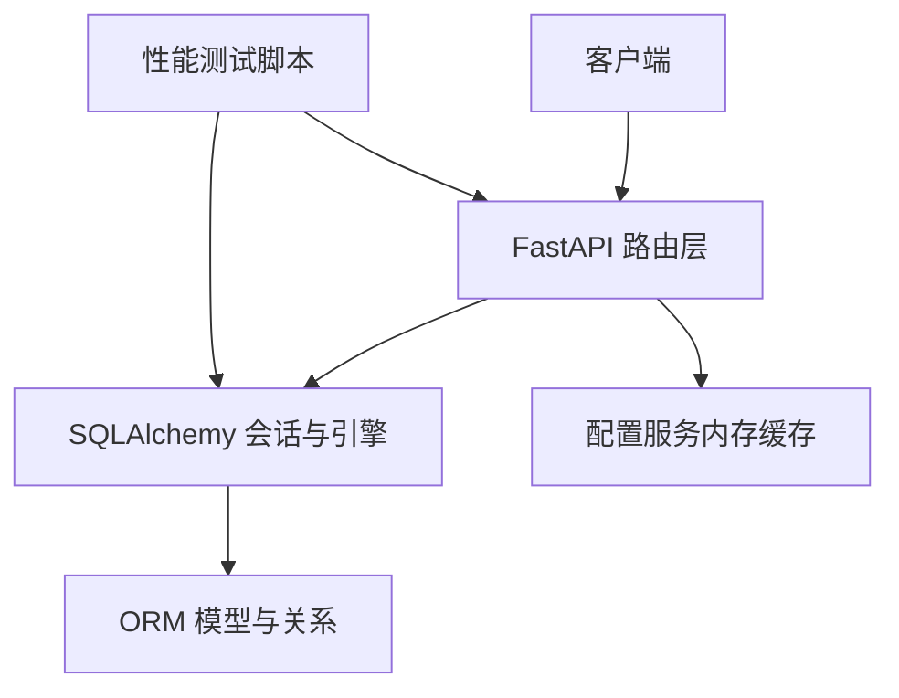
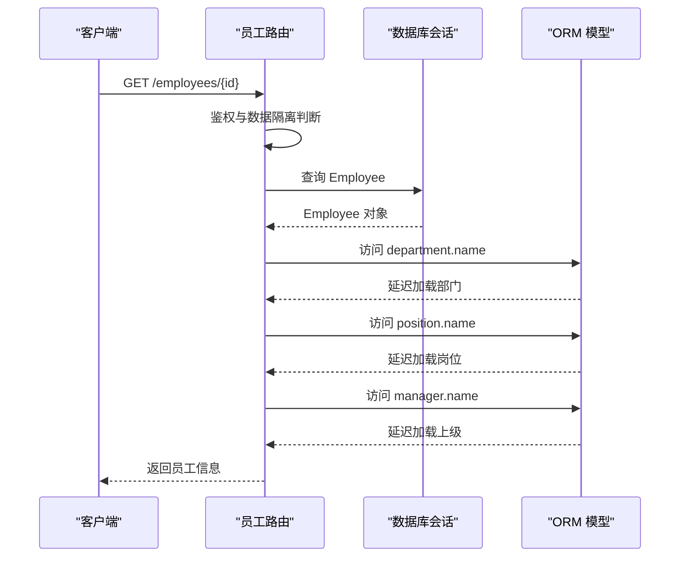
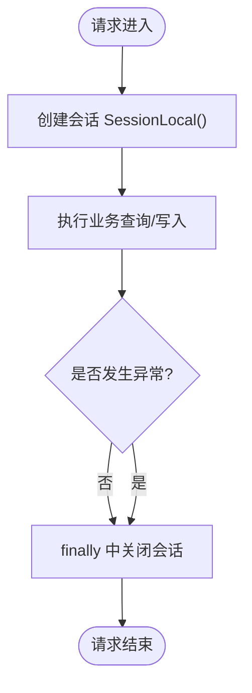
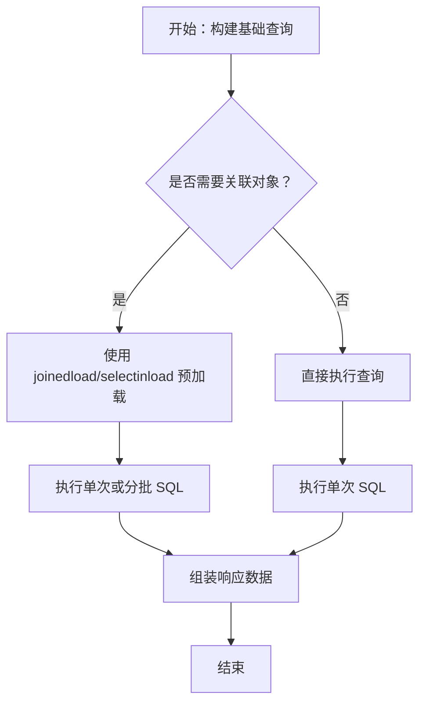
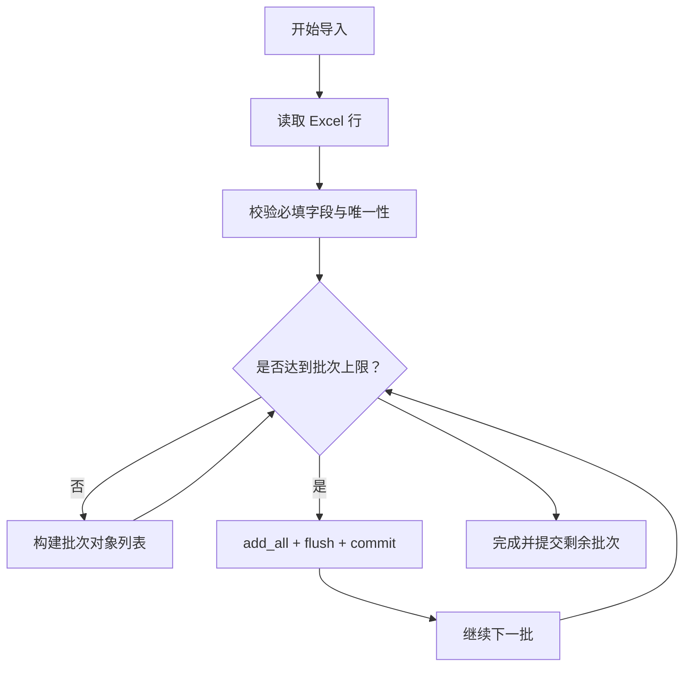
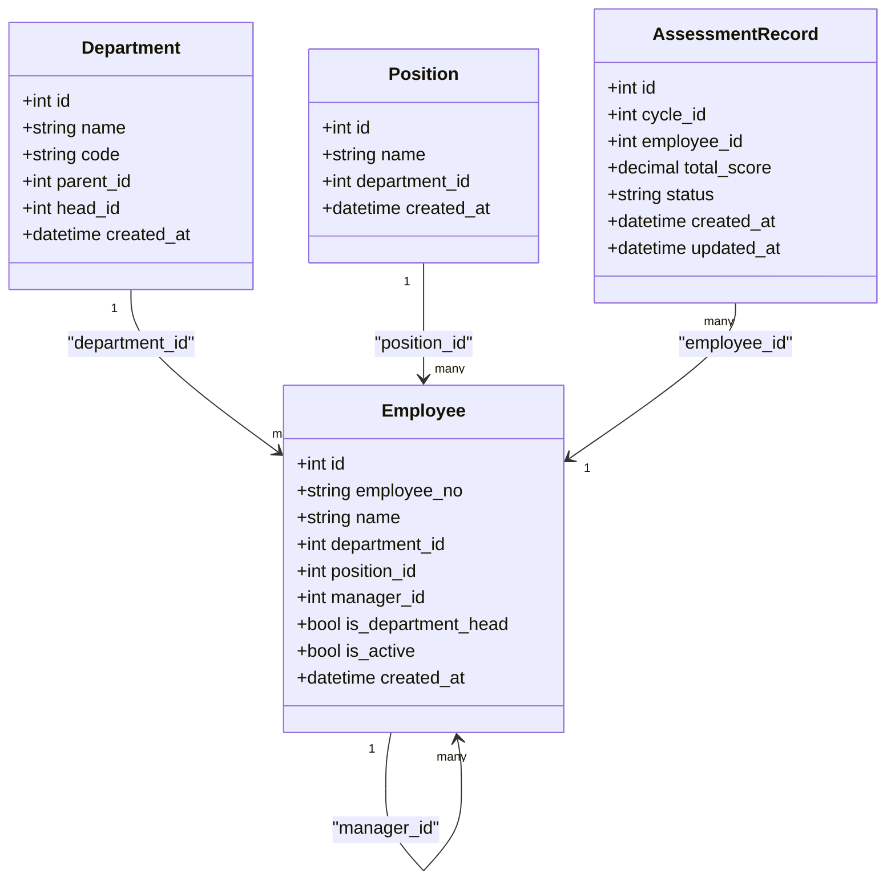
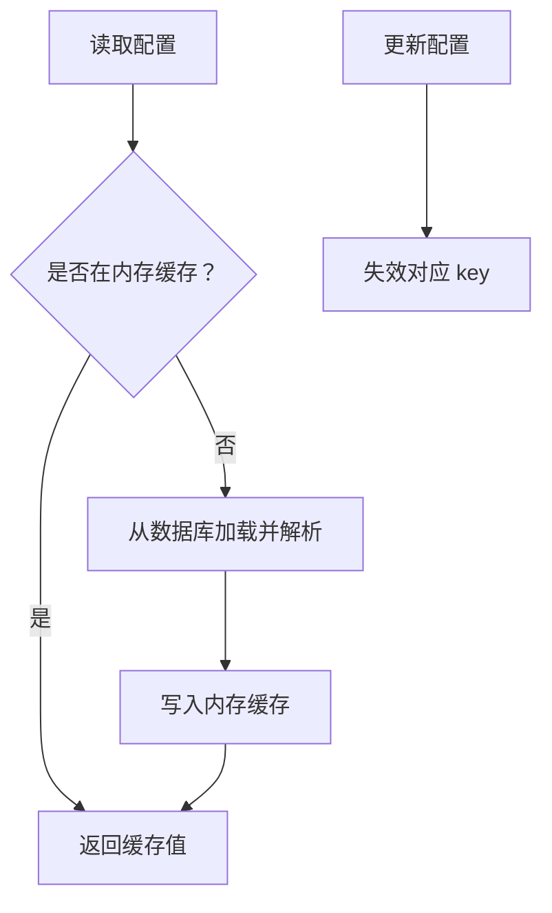
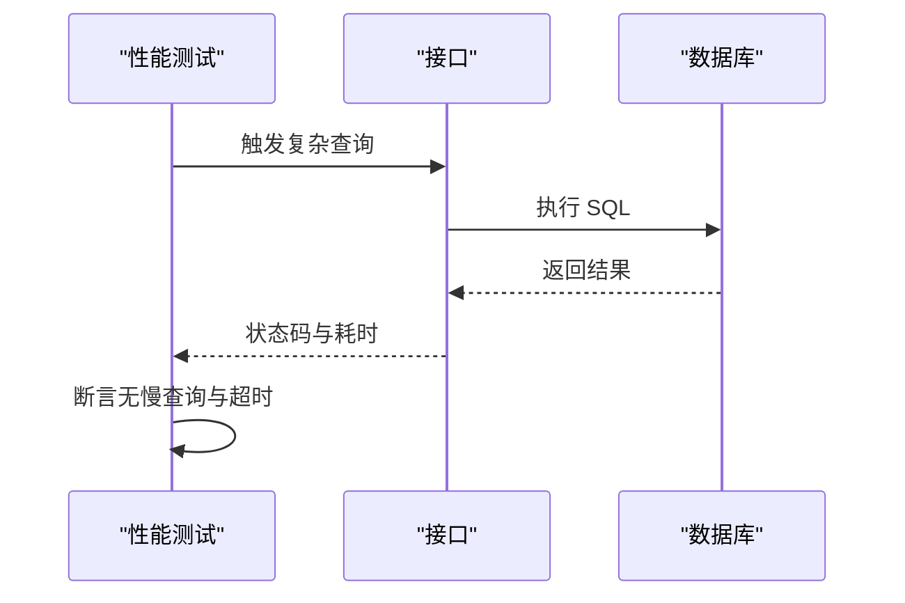
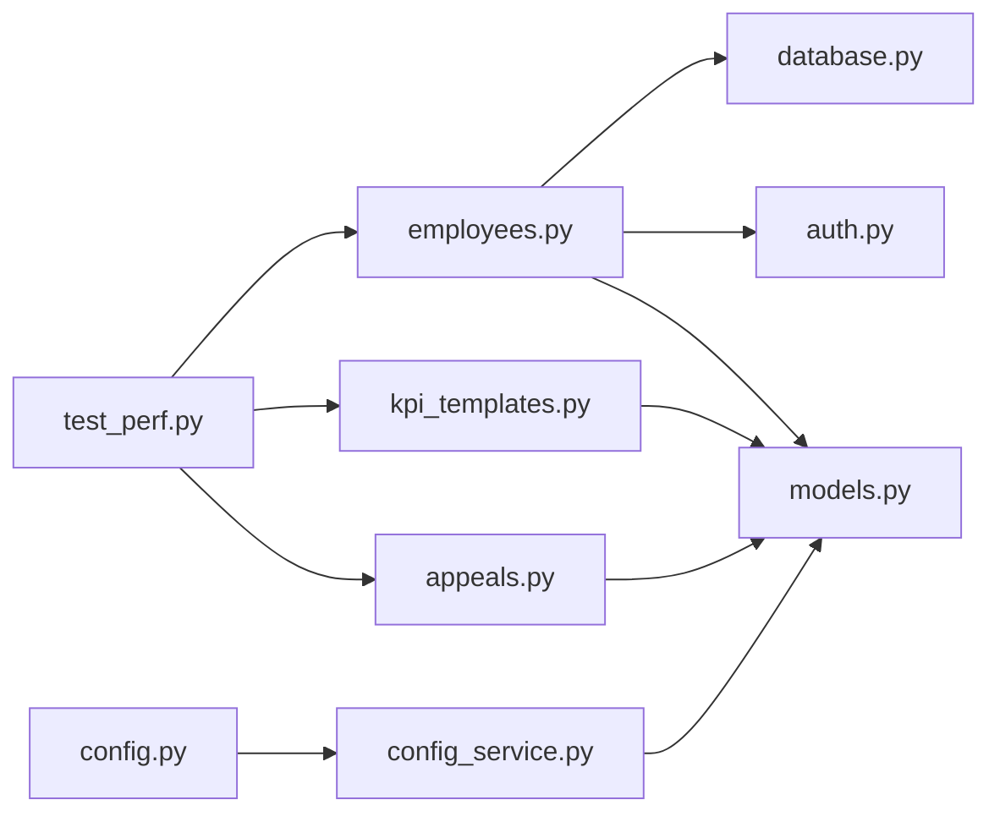

# 性能优化策略

<cite>
**本文引用的文件**   
- [database.py](file://backend/app/database.py)
- [models.py](file://backend/app/models.py)
- [employees.py](file://backend/app/routers/employees.py)
- [kpi_templates.py](file://backend/app/routers/kpi_templates.py)
- [appeals.py](file://backend/app/routers/appeals.py)
- [config_service.py](file://backend/app/services/config_service.py)
- [config.py](file://backend/app/routers/config.py)
- [test_perf.py](file://tests/scripts/test_perf.py)
- [PRD_绩效考核评分系统_v1.0.md](file://docs/PRD_绩效考核评分系统_v1.0.md)
- [TECH_绩效考核评分系统_v1.0.md](file://docs/TECH_绩效考核评分系统_v1.0.md)
</cite>

## 目录
1. [引言](#引言)
2. [项目结构](#项目结构)
3. [核心组件](#核心组件)
4. [架构总览](#架构总览)
5. [详细组件分析](#详细组件分析)
6. [依赖关系分析](#依赖关系分析)
7. [性能考量](#性能考量)
8. [故障排查指南](#故障排查指南)
9. [结论](#结论)
10. [附录](#附录)

## 引言
本文件面向数据库与查询性能优化，围绕以下目标展开：
- 查询优化策略：避免 N+1 查询、批量操作实现。
- 连接池与会话管理：Session 生命周期、连接复用与释放。
- 索引优化策略：热点字段索引设计与使用建议。
- 缓存策略：ORM 级预加载与配置结果缓存。
- 性能监控与慢查询分析：测试基线、监控手段与调优建议。

本项目后端基于 FastAPI + SQLAlchemy，当前使用 SQLite 作为数据库；模型层通过 ORM 定义实体与关系；部分路由已采用预加载或批量查询模式；配置服务实现了进程内内存缓存；测试脚本包含并发与慢查询相关用例。

## 项目结构
从性能视角关注的关键路径如下：
- 数据访问层：数据库引擎与会话工厂、初始化逻辑。
- 模型层：实体表结构与关系定义，决定外键与默认索引。
- 路由层：业务接口中的查询构造、预加载、分页与过滤。
- 服务层：配置缓存与失效机制。
- 测试层：并发读取、慢查询断言等性能验收点。

**图表来源**
- [database.py:13-18](file://backend/app/database.py#L13-L18)
- [models.py:8-266](file://backend/app/models.py#L8-L266)
- [employees.py:233-312](file://backend/app/routers/employees.py#L233-L312)
- [config_service.py:8-38](file://backend/app/services/config_service.py#L8-L38)
- [test_perf.py:101-117](file://tests/scripts/test_perf.py#L101-L117)

**章节来源**
- [database.py:1-31](file://backend/app/database.py#L1-L31)
- [models.py:1-266](file://backend/app/models.py#L1-L266)
- [employees.py:233-312](file://backend/app/routers/employees.py#L233-L312)
- [config_service.py:1-100](file://backend/app/services/config_service.py#L1-L100)
- [test_perf.py:97-117](file://tests/scripts/test_perf.py#L97-L117)

## 核心组件
- 数据库连接与会话：
  - 引擎创建并绑定到 SQLite 文件路径。
  - 会话工厂关闭自动提交与自动刷新，提供按请求的 Session 生命周期。
- 模型与关系：
  - 部门、岗位、员工、考核周期、考核记录、评分明细、审批、申诉、面谈、通知、系统配置等实体。
  - 多处主键列声明了 index=True，便于快速定位。
- 路由查询：
  - 员工列表接口支持分页、关键词、部门过滤、排序。
  - KPI 模板接口使用 joinedload 预加载关联岗位，避免 N+1。
  - 申诉列表存在逐条二次查询，可能产生 N+1。
- 配置缓存：
  - 进程内字典缓存配置解析结果，并提供单 key 失效与全量清理。
  - 配置更新路由调用失效方法，保证一致性。

**章节来源**
- [database.py:13-26](file://backend/app/database.py#L13-L26)
- [models.py:8-266](file://backend/app/models.py#L8-L266)
- [employees.py:233-312](file://backend/app/routers/employees.py#L233-L312)
- [kpi_templates.py:27-51](file://backend/app/routers/kpi_templates.py#L27-L51)
- [appeals.py:16-35](file://backend/app/routers/appeals.py#L16-L35)
- [config_service.py:8-38](file://backend/app/services/config_service.py#L8-L38)
- [config.py:77-266](file://backend/app/routers/config.py#L77-L266)

## 架构总览
下图展示一次典型“获取员工详情”的请求在数据库层的交互，包括权限校验、数据隔离、关联对象访问以及潜在的 N+1 风险点。

**图表来源**
- [employees.py:357-401](file://backend/app/routers/employees.py#L357-L401)
- [models.py:31-48](file://backend/app/models.py#L31-L48)

该流程体现了 ORM 的懒加载特性：若未显式预加载关联对象，每次访问都会触发额外查询。对于列表接口，这种模式会放大为 N+1 问题。

**章节来源**
- [employees.py:357-401](file://backend/app/routers/employees.py#L357-L401)
- [models.py:31-48](file://backend/app/models.py#L31-L48)

## 详细组件分析

### 连接池与会话管理
- 引擎与会话工厂：
  - 使用 create_engine 创建引擎，connect_args 中设置跨线程访问参数。
  - sessionmaker 关闭 autocommit 与 autoflush，确保事务边界由应用控制。
- 会话生命周期：
  - get_db 生成器在每个请求开始时创建 Session，并在 finally 中关闭，避免连接泄漏。
- 连接池现状与建议：
  - 当前 SQLite 引擎未显式配置连接池大小；SQLite 本身是文件锁型数据库，高并发写入易成为瓶颈。
  - 建议在迁移至 MySQL/PostgreSQL 时启用连接池（如 pool_size、max_overflow、pool_recycle），并结合业务峰值调整。
  - 对读多写少场景，可考虑只读副本与读写分离，降低主库压力。

**图表来源**
- [database.py:21-26](file://backend/app/database.py#L21-L26)

**章节来源**
- [database.py:13-26](file://backend/app/database.py#L13-L26)

### 查询优化与 N+1 避免
- 已实现的优化：
  - KPI 模板列表与详情使用 joinedload 预加载岗位，避免逐条查询岗位。
- 需要优化的场景：
  - 员工列表接口在遍历结果时访问 department、position、manager 名称，属于典型的 N+1 风险。
  - 申诉列表接口在循环中对每条记录再次查询 Employee，形成 N+1。
- 优化建议：
  - 列表接口统一使用 joinedload 或 selectinload 预加载关联对象。
  - 对深层嵌套关系，优先选择 selectinload 以减少 SQL 数量。
  - 对仅用于展示的字段，可使用 with_entities 或投影 DTO，减少数据传输体积。

**图表来源**
- [kpi_templates.py:27-51](file://backend/app/routers/kpi_templates.py#L27-L51)
- [employees.py:285-305](file://backend/app/routers/employees.py#L285-L305)
- [appeals.py:22-35](file://backend/app/routers/appeals.py#L22-L35)

**章节来源**
- [kpi_templates.py:27-51](file://backend/app/routers/kpi_templates.py#L27-L51)
- [employees.py:285-305](file://backend/app/routers/employees.py#L285-L305)
- [appeals.py:22-35](file://backend/app/routers/appeals.py#L22-L35)

### 批量操作实现
- 现有实践：
  - 员工导入接口逐行处理 Excel 数据，进行 upsert 与关联查找，最后统一 commit。
  - 多处路由在单个事务中多次 db.commit，需评估事务粒度与回滚范围。
- 优化建议：
  - 对大批量插入，使用 add_all 与 bulk_insert_mappings，减少 Python 层对象开销。
  - 将导入拆分为批次（如每批 500 条），分批提交，降低锁竞争与内存占用。
  - 对重复性查找（如部门、岗位、上级）先建立内存映射，再批量写入。

**图表来源**
- [employees.py:129-199](file://backend/app/routers/employees.py#L129-L199)

**章节来源**
- [employees.py:129-199](file://backend/app/routers/employees.py#L129-L199)

### 索引优化策略
- 现有索引：
  - 多个模型的主键列声明 index=True，例如 Department.id、Position.id、Employee.id、User.id、AssessmentCycle.id、KpiTemplate.id、AssessmentRecord.id、ScoreDetail.id、KpiAdjustment.id、ApprovalRecord.id、CycleEmployee.id、PeerReviewer.id、OperationLog.id、AppealRecord.id、InterviewRecord.id、SystemConfig.id、Notification.id、PeerReviewTask.id。
- 热点字段建议：
  - 员工查询常用条件：employee_no（已有唯一约束）、department_id、position_id、manager_id、is_active。
  - 考核记录常用条件：cycle_id、employee_id、status、total_score（用于排序）。
  - 审批与申诉常用条件：record_id、approver_id、reviewer_id、status。
  - 建议为高频过滤与排序字段添加复合索引，例如 (cycle_id, status)、(employee_id, status)、(approver_id, step_index)。
- 注意事项：
  - 避免过度索引影响写入性能。
  - 对模糊搜索（contains/ilike）注意前缀匹配的性能差异，必要时引入全文检索。

**图表来源**
- [models.py:8-48](file://backend/app/models.py#L8-L48)
- [models.py:99-129](file://backend/app/models.py#L99-L129)

**章节来源**
- [models.py:8-48](file://backend/app/models.py#L8-L48)
- [models.py:99-129](file://backend/app/models.py#L99-L129)

### 缓存策略
- ORM 级缓存：
  - 当前未启用全局 ORM 查询缓存；可通过 SQLAlchemy 扩展或应用层缓存实现。
- 查询结果缓存：
  - 配置服务使用进程内字典缓存 SystemConfig 解析结果，并提供单 key 失效与全量清理。
  - 配置更新路由调用 invalidate_config_cache，保证缓存一致性。
- 建议扩展：
  - 对热点报表与仪表盘数据，增加 Redis 缓存层，设置合理过期时间。
  - 对频繁读取但变化不频繁的维度权重、评分人权重、等级规则等，延长缓存有效期。
  - 对写后读一致性问题，采用写时失效或版本号策略。

**图表来源**
- [config_service.py:22-38](file://backend/app/services/config_service.py#L22-L38)
- [config.py:77-266](file://backend/app/routers/config.py#L77-L266)

**章节来源**
- [config_service.py:8-38](file://backend/app/services/config_service.py#L8-L38)
- [config.py:77-266](file://backend/app/routers/config.py#L77-L266)

### 性能监控与慢查询分析
- 测试基线：
  - 并发读取测试要求 100 并发读取在 5 秒内完成且无错误。
  - 慢查询监控用例覆盖员工列表、分布报表、周期进度等接口，断言状态码正常。
- 监控建议：
  - 开启数据库慢查询日志（long_query_time=1），定期巡检。
  - 对复杂报表使用 EXPLAIN 确认走索引，避免全表扫描。
  - 结合前端性能面板与后端日志，定位慢接口与慢 SQL。
- 调优建议：
  - 针对慢查询优先优化索引与查询语句，其次考虑缓存与异步任务。
  - 对导出与 PDF 生成等耗时任务，采用后台任务队列，前端显示进度。

**图表来源**
- [test_perf.py:101-117](file://tests/scripts/test_perf.py#L101-L117)

**章节来源**
- [test_perf.py:97-117](file://tests/scripts/test_perf.py#L97-L117)

## 依赖关系分析
- 路由层依赖：
  - employees.py 依赖 database.get_db、auth 鉴权、models 实体、operation_logger。
  - kpi_templates.py 使用 joinedload 预加载岗位。
  - appeals.py 存在循环内二次查询，潜在 N+1。
- 服务层依赖：
  - config_service.py 依赖 models.SystemConfig 与进程内缓存。
- 测试层依赖：
  - test_perf.py 依赖 FastAPI TestClient 与 admin_headers。

**图表来源**
- [employees.py:1-32](file://backend/app/routers/employees.py#L1-L32)
- [kpi_templates.py:1-51](file://backend/app/routers/kpi_templates.py#L1-L51)
- [appeals.py:1-35](file://backend/app/routers/appeals.py#L1-L35)
- [config_service.py:1-38](file://backend/app/services/config_service.py#L1-L38)
- [config.py:77-266](file://backend/app/routers/config.py#L77-L266)
- [test_perf.py:101-117](file://tests/scripts/test_perf.py#L101-L117)

**章节来源**
- [employees.py:1-32](file://backend/app/routers/employees.py#L1-L32)
- [kpi_templates.py:1-51](file://backend/app/routers/kpi_templates.py#L1-L51)
- [appeals.py:1-35](file://backend/app/routers/appeals.py#L1-L35)
- [config_service.py:1-38](file://backend/app/services/config_service.py#L1-L38)
- [config.py:77-266](file://backend/app/routers/config.py#L77-L266)
- [test_perf.py:101-117](file://tests/scripts/test_perf.py#L101-L117)

## 性能考量
- 并发处理能力：
  - 需求文档提出 50 人同时在线评分、20 人并发查看仪表盘、数据库连接池支持 100 并发连接的目标。
  - 当前 SQLite 在高并发写入下可能出现锁等待，建议生产环境迁移至 MySQL/PostgreSQL 并配置连接池。
- 计算响应时间：
  - 汇总计算与强制分布计算应使用批量 SQL，避免 N+1。
  - 排序字段（如 total_score）应建立合适索引，避免全表排序。
- 前端性能：
  - 长列表渲染建议使用虚拟滚动或分页，避免 DOM 溢出。
  - 图表渲染控制在合理数据点范围内。

**章节来源**
- [PRD_绩效考核评分系统_v1.0.md:1683-1719](file://docs/PRD_绩效考核评分系统_v1.0.md#L1683-L1719)
- [TECH_绩效考核评分系统_v1.0.md:3328-3337](file://docs/TECH_绩效考核评分系统_v1.0.md#L3328-L3337)

## 故障排查指南
- 慢查询定位：
  - 检查慢查询日志，识别超过阈值的 SQL。
  - 对复杂报表使用 EXPLAIN 分析执行计划，确认是否走索引。
- N+1 问题排查：
  - 在列表接口中观察是否出现大量关联对象延迟加载导致的额外查询。
  - 对循环内的二次查询改为预加载或批量查询。
- 连接泄漏排查：
  - 确认 get_db 的 finally 分支是否正确关闭会话。
  - 监控数据库连接数与等待时间，避免连接耗尽。
- 缓存一致性：
  - 配置更新后是否调用失效方法，确保后续读取命中最新数据。

**章节来源**
- [database.py:21-26](file://backend/app/database.py#L21-L26)
- [config_service.py:31-38](file://backend/app/services/config_service.py#L31-L38)
- [config.py:77-266](file://backend/app/routers/config.py#L77-L266)
- [test_perf.py:101-117](file://tests/scripts/test_perf.py#L101-L117)

## 结论
本项目在连接与会话管理、预加载与缓存方面已有基础实践，但仍需在以下方面持续优化：
- 全面消除 N+1 查询，特别是在员工列表与申诉列表等接口。
- 引入批量写入与批次提交，提升导入与批量操作的吞吐。
- 完善索引设计，覆盖热点过滤与排序字段。
- 扩展缓存策略，引入 Redis 缓存热点查询结果。
- 强化性能监控与慢查询分析，建立常态化巡检机制。

## 附录
- 关键接口与性能验收点参考：
  - 员工列表、候选协作人、申诉列表等接口的查询构造与潜在风险。
  - 配置服务的缓存与失效机制。
  - 性能测试中的并发与慢查询断言。

**章节来源**
- [employees.py:233-312](file://backend/app/routers/employees.py#L233-L312)
- [appeals.py:16-35](file://backend/app/routers/appeals.py#L16-L35)
- [config_service.py:8-38](file://backend/app/services/config_service.py#L8-L38)
- [test_perf.py:97-117](file://tests/scripts/test_perf.py#L97-L117)