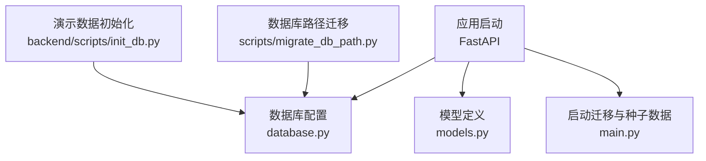
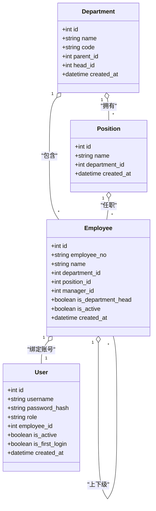
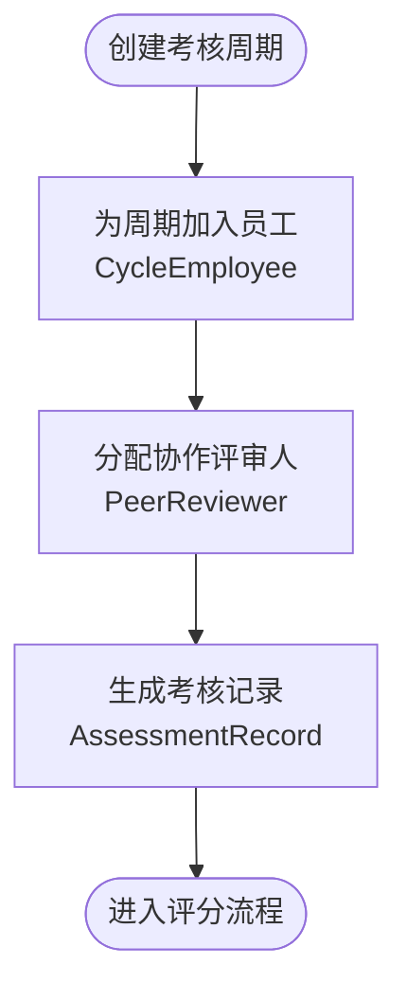
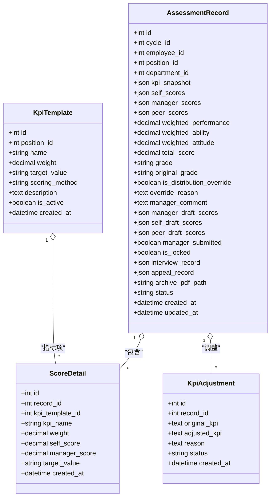
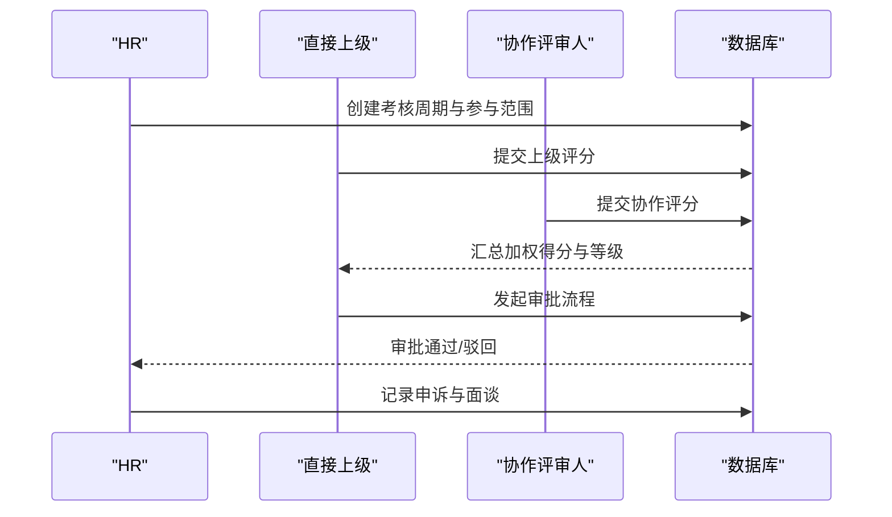
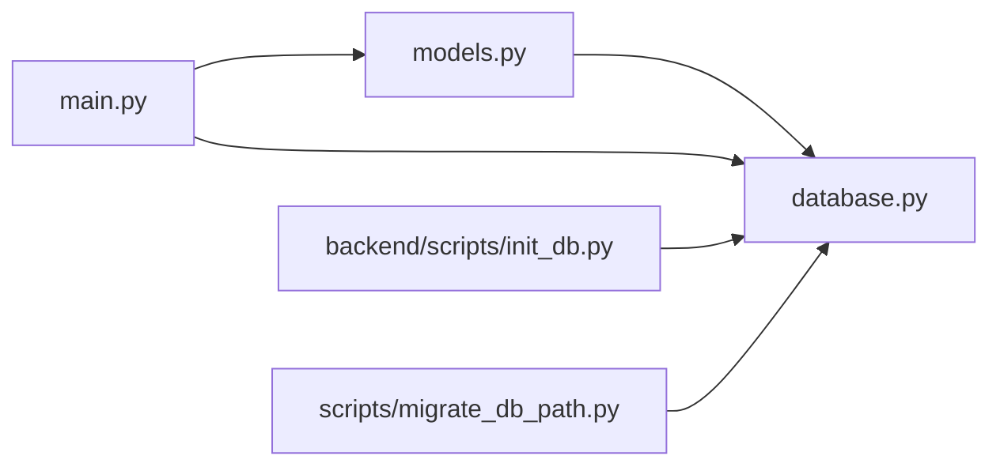

# 数据库架构设计

<cite>
**本文引用的文件**   
- [models.py](file://backend/app/models.py)
- [database.py](file://backend/app/database.py)
- [main.py](file://backend/app/main.py)
- [init_db.py](file://backend/scripts/init_db.py)
- [migrate_db_path.py](file://scripts/migrate_db_path.py)
</cite>

## 目录
1. [引言](#引言)
2. [项目结构](#项目结构)
3. [核心组件](#核心组件)
4. [架构总览](#架构总览)
5. [详细组件分析](#详细组件分析)
6. [依赖关系分析](#依赖关系分析)
7. [性能考虑](#性能考虑)
8. [故障排查指南](#故障排查指南)
9. [结论](#结论)
10. [附录](#附录)

## 引言
本文件面向绩效考核评分系统的数据库层，聚焦于 SQLite 上的 ER 模型、ORM 映射、表结构设计（主键/外键/索引/约束）、数据迁移机制、ORM 模型继承与关联定义，以及数据访问模式与性能优化策略。文档以代码仓库中的 SQLAlchemy 模型和启动脚本为依据，提供从概念到实现的可追溯说明，帮助读者快速理解并扩展系统的数据层。

## 项目结构
后端采用 FastAPI + SQLAlchemy 的常见分层：
- 数据模型定义位于 models.py，集中描述所有业务实体与关系。
- 数据库连接与会话管理位于 database.py，负责引擎创建、会话工厂与初始化入口。
- 应用启动时执行数据库初始化与轻量级迁移逻辑，位于 main.py。
- 演示数据初始化脚本位于 backend/scripts/init_db.py。
- 数据库路径迁移脚本位于 scripts/migrate_db_path.py。

图表来源
- [database.py:1-31](file://backend/app/database.py#L1-L31)
- [models.py:1-266](file://backend/app/models.py#L1-L266)
- [main.py:97-129](file://backend/app/main.py#L97-L129)
- [init_db.py:1-262](file://backend/scripts/init_db.py#L1-L262)
- [migrate_db_path.py:1-26](file://scripts/migrate_db_path.py#L1-L26)

章节来源
- [database.py:1-31](file://backend/app/database.py#L1-L31)
- [models.py:1-266](file://backend/app/models.py#L1-L266)
- [main.py:97-129](file://backend/app/main.py#L97-L129)
- [init_db.py:1-262](file://backend/scripts/init_db.py#L1-L262)
- [migrate_db_path.py:1-26](file://scripts/migrate_db_path.py#L1-L26)

## 核心组件
本节概述与数据库相关的关键模块职责：
- 数据模型层（models.py）：定义部门、岗位、员工、用户、考核周期、KPI 模板、考核记录、评分明细、审批记录、协作评审、申诉、面试、操作日志、系统配置、评分草稿等实体及其关系。
- 数据库连接层（database.py）：统一 SQLite 路径、创建 Engine、SessionLocal、get_db 依赖注入函数与 init_db 初始化入口。
- 启动与迁移（main.py）：在应用启动时调用 init_db 建表，并通过 _migrate_db 对已有表进行增量列添加。
- 演示数据初始化（init_db.py）：清空并重建表，插入演示部门、岗位、员工、用户及汇报关系。
- 路径迁移（migrate_db_path.py）：将 SQLite 文件从旧位置迁移至 data/db 目录。

章节来源
- [models.py:1-266](file://backend/app/models.py#L1-L266)
- [database.py:1-31](file://backend/app/database.py#L1-L31)
- [main.py:97-129](file://backend/app/main.py#L97-L129)
- [init_db.py:1-262](file://backend/scripts/init_db.py#L1-L262)
- [migrate_db_path.py:1-26](file://scripts/migrate_db_path.py#L1-L26)

## 架构总览
下图展示 ORM 模型之间的主要关系，包括一对多、自引用与多对多中间表。

> **全量 ER 图统一维护在 [ER图设计.md](ER图设计.md)**（表的集合、主键、外键、唯一约束、可空性均以该文件为准，共 19 张表）。
> 本文不再重复绘制实体关系，只讨论数据层架构、目录与文件组织、迁移机制与故障排查。

## 详细组件分析

### 组织与人员域
- 部门 Department：自引用 parent_id 表示层级；head_id 指向部门负责人；code 唯一。
- 岗位 Position：隶属于部门；与员工、KPI 模板关联。
- 员工 Employee：隶属部门与岗位；manager_id 自引用形成汇报树；is_department_head 标记负责人；与 User 一对一。
- 用户 User：用户名唯一；角色字段；与 Employee 一对一。

图表来源
- [models.py:8-60](file://backend/app/models.py#L8-L60)

章节来源
- [models.py:8-60](file://backend/app/models.py#L8-L60)

### 考核周期与参与范围
- 考核周期 AssessmentCycle：定义起止时间、各阶段截止日期、状态、权重与等级规则等 JSON 配置。
- 周期参与 CycleEmployee：cycle_id + employee_id 唯一，避免重复加入。
- 协作评审 PeerReviewer：cycle_id + employee_id + reviewer_id 唯一，确保同一周期内同一被评人与同一评审人仅一条记录。

图表来源
- [models.py:62-84](file://backend/app/models.py#L62-L84)
- [models.py:167-184](file://backend/app/models.py#L167-L184)

章节来源
- [models.py:62-84](file://backend/app/models.py#L62-L84)
- [models.py:167-184](file://backend/app/models.py#L167-L184)

### 指标与评分域
- KPI 模板 KpiTemplate：按岗位定义指标项，含权重、目标值、评分方式。
- 考核记录 AssessmentRecord：聚合自评、上级评、协作评、加权得分、等级、状态、锁定标志、归档路径等；JSON 存储快照与草稿。
- 评分明细 ScoreDetail：对应每个指标项的具体得分与目标值。
- KPI 调整 KpiAdjustment：记录指标调整原因与结果。

图表来源
- [models.py:85-154](file://backend/app/models.py#L85-L154)

章节来源
- [models.py:85-154](file://backend/app/models.py#L85-L154)

### 审批、申诉、面谈与协作任务
- 审批 ApprovalRecord：记录审批节点、动作与评论。
- 申诉 AppealRecord：记录申诉原因、处理结果与解决时间。
- 面谈 InterviewRecord：记录面谈时间、地点、内容与改进计划。
- 协作任务 PeerReviewTask：记录协作评审得分与提交时间。

图表来源
- [models.py:155-210](file://backend/app/models.py#L155-L210)
- [models.py:255-266](file://backend/app/models.py#L255-L266)

章节来源
- [models.py:155-210](file://backend/app/models.py#L155-L210)
- [models.py:255-266](file://backend/app/models.py#L255-L266)

### 审计、通知与系统配置
- 操作日志 OperationLog：记录用户操作、目标对象、变更前后值与 IP。
- 通知 Notifications：用户维度的站内信。
- 系统配置 SystemConfigs：键值对形式的系统参数。

章节来源
- [models.py:186-228](file://backend/app/models.py#L186-L228)

### 评分草稿
- 评分草稿 ScoreDraft：针对每条考核记录，按类型（自评/上级/协作）保存草稿，record_id + draft_type 唯一。

章节来源
- [models.py:230-242](file://backend/app/models.py#L230-L242)

## 依赖关系分析
- 模型耦合度：AssessmentRecord 作为核心聚合根，关联多个维度表（ScoreDetail、ApprovalRecord、AppealRecord、InterviewRecord、PeerReviewTask、ScoreDraft），体现高内聚低耦合的设计。
- 外部依赖：SQLAlchemy ORM、SQLite 驱动；FastAPI 启动生命周期钩子用于迁移与种子数据。
- 潜在循环依赖：无直接循环导入；自引用关系通过 foreign_keys 与 remote_side 明确区分。

图表来源
- [models.py:1-266](file://backend/app/models.py#L1-L266)
- [database.py:1-31](file://backend/app/database.py#L1-L31)
- [main.py:97-129](file://backend/app/main.py#L97-L129)
- [init_db.py:1-262](file://backend/scripts/init_db.py#L1-L262)
- [migrate_db_path.py:1-26](file://scripts/migrate_db_path.py#L1-L26)

章节来源
- [models.py:1-266](file://backend/app/models.py#L1-L266)
- [database.py:1-31](file://backend/app/database.py#L1-L31)
- [main.py:97-129](file://backend/app/main.py#L97-L129)
- [init_db.py:1-262](file://backend/scripts/init_db.py#L1-L262)
- [migrate_db_path.py:1-26](file://scripts/migrate_db_path.py#L1-L26)

## 性能考虑
- 索引策略
  - 主键自动索引：所有实体的 id 列均为主键且带 index=True，便于快速定位。
  - 唯一约束：employees.employee_no、users.username、departments.code、system_configs.key 等使用唯一约束保证数据一致性。
  - 复合唯一约束：cycle_employees(cycle_id, employee_id)、peer_reviewers(cycle_id, employee_id, reviewer_id)、score_drafts(record_id, draft_type) 防止重复。
  - 建议补充索引：assessment_records.status、assessment_records.cycle_id、approval_records.record_id、appeal_records.record_id、operation_logs.user_id、notifications.user_id 等高频查询列可考虑显式索引以提升过滤与 JOIN 性能。
- 连接池与并发
  - SQLite 默认单写者，当前 engine 未启用连接池；对于多进程场景需谨慎，建议使用线程隔离或引入 WAL 模式提升读并发。
  - SessionLocal 使用 autocommit=False、autoflush=False，适合手动事务控制；在高并发写入场景下应限制并发写操作，避免锁竞争。
- 查询优化
  - 减少 N+1：通过 relationship 的 back_populates 与 lazy loading 控制，必要时使用 joinedload 预加载关联对象。
  - 分页与筛选：对列表接口增加 limit/offset 与基于 status/cycle_id 的过滤条件，避免全表扫描。
  - JSON 字段：dimension_weights、reviewer_weights、grade_rules 等 JSON 字段适合灵活配置，但应避免在 SQL 层频繁解析；可在应用层缓存常用配置。
- 存储与备份
  - 数据库文件统一存放于 data/db/performance_evaluation.db，便于备份与迁移；定期备份该文件即可。

章节来源
- [models.py:8-266](file://backend/app/models.py#L8-L266)
- [database.py:13-18](file://backend/app/database.py#L13-L18)

## 故障排查指南
- 启动失败或表不存在
  - 现象：应用启动时报错找不到表。
  - 排查：确认已调用 init_db() 创建表；检查数据库文件路径是否正确。
  - 参考：[database.py:29-31](file://backend/app/database.py#L29-L31)
- 列缺失导致写入失败
  - 现象：新增字段后运行报错，提示列不存在。
  - 排查：确认 _migrate_db 是否执行；检查 assessment_records 是否已添加 manager_draft_scores/self_draft_scores/peer_draft_scores/manager_submitted 列。
  - 参考：[main.py:97-123](file://backend/app/main.py#L97-L123)
- 演示数据异常
  - 现象：登录或权限校验失败。
  - 排查：重新运行 init_db.py 初始化演示数据；确认密码哈希与角色是否正确。
  - 参考：[init_db.py:25-257](file://backend/scripts/init_db.py#L25-L257)
- 数据库路径不一致
  - 现象：找不到数据库文件或备份路径错误。
  - 排查：运行 migrate_db_path.py 将数据库迁移至 data/db；确认 application 中 SQLALCHEMY_DATABASE_URL 指向新路径。
  - 参考：[migrate_db_path.py:14-23](file://scripts/migrate_db_path.py#L14-L23)

章节来源
- [database.py:29-31](file://backend/app/database.py#L29-L31)
- [main.py:97-123](file://backend/app/main.py#L97-L123)
- [init_db.py:25-257](file://backend/scripts/init_db.py#L25-L257)
- [migrate_db_path.py:14-23](file://scripts/migrate_db_path.py#L14-L23)

## 结论
本数据库架构以 SQLAlchemy ORM 为核心，围绕“组织—人员—周期—指标—评分—审批—申诉—面谈”的业务主线构建实体模型，并通过 JSON 字段与唯一约束满足灵活配置与数据一致性需求。SQLite 作为嵌入式数据库简化部署，配合简单的 ALTER TABLE 迁移与演示数据初始化脚本，能够快速迭代与验证功能。在生产环境中，建议完善索引策略、引入连接池与 WAL 模式，并建立版本化的迁移方案，以支撑更高并发与更复杂的演进需求。

## 附录

### 表结构与约束要点
- 主键与自增：所有实体 id 为主键且 autoincrement=True。
- 外键关系：广泛使用 ForeignKey 建立关联，如 employees.department_id、assessment_records.cycle_id 等。
- 唯一性：employee_no、username、code、key 等字段使用 unique=True；组合唯一约束用于 cycle_employees、peer_reviewers、score_drafts。
- JSON 字段：大量使用 JSON 存储复杂配置与快照，便于扩展但不利于 SQL 层索引；建议在应用层做校验与缓存。
- 时间戳：created_at/updated_at 普遍存在，便于审计与追踪。

章节来源
- [models.py:8-266](file://backend/app/models.py#L8-L266)

### 数据迁移机制
- 启动时建表：init_db() 调用 Base.metadata.create_all 创建所有表。
- 轻量级迁移：_migrate_db 使用 inspect 检测列是否存在，若不存在则执行 ALTER TABLE ADD COLUMN。
- 演示数据：init_db.py 先 drop_all 再 create_all，随后插入演示部门、岗位、员工、用户与汇报关系。
- 路径迁移：migrate_db_path.py 将数据库文件从旧位置移动到 data/db。

章节来源
- [database.py:29-31](file://backend/app/database.py#L29-L31)
- [main.py:97-123](file://backend/app/main.py#L97-L123)
- [init_db.py:38-54](file://backend/scripts/init_db.py#L38-L54)
- [migrate_db_path.py:14-23](file://scripts/migrate_db_path.py#L14-L23)

### ORM 模型设计与关联
- 继承关系：所有模型继承 declarative_base() 的 Base。
- 关联定义：使用 relationship 与 back_populates 建立双向导航；自引用关系通过 foreign_keys 与 remote_side 明确。
- 级联删除：ScoreDraft 与 AssessmentRecord 之间使用 cascade="all, delete-orphan"，确保删除记录时清理草稿。

章节来源
- [models.py:1-6](file://backend/app/models.py#L1-L6)
- [models.py:17-47](file://backend/app/models.py#L17-L47)
- [models.py:131-132](file://backend/app/models.py#L131-L132)
- [models.py:239-241](file://backend/app/models.py#L239-L241)