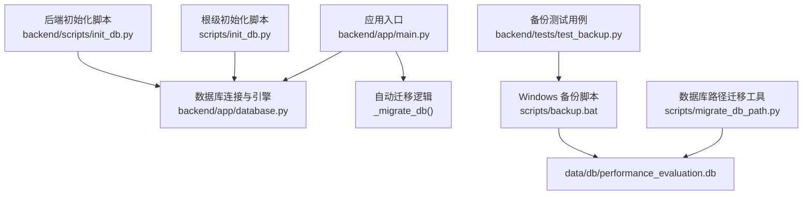
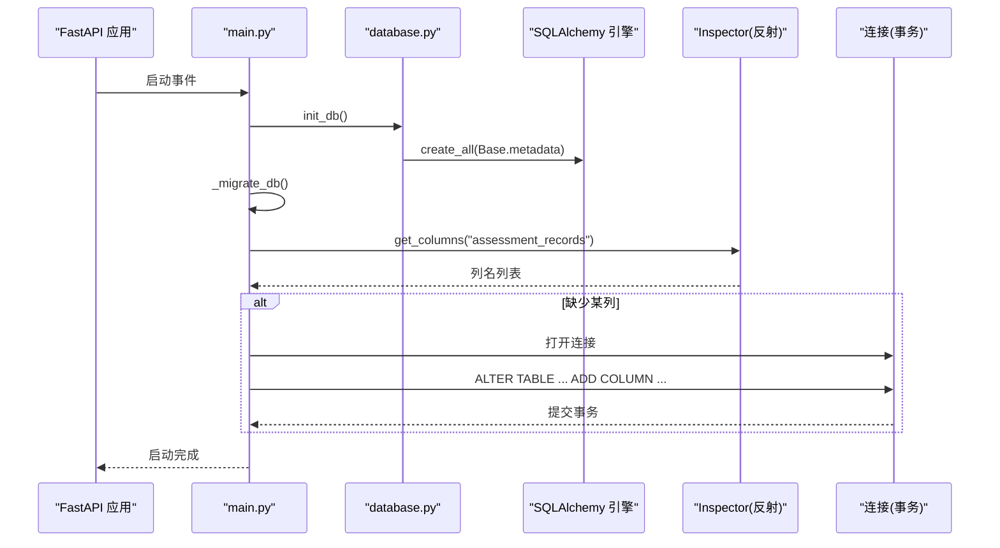
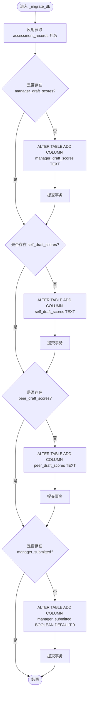
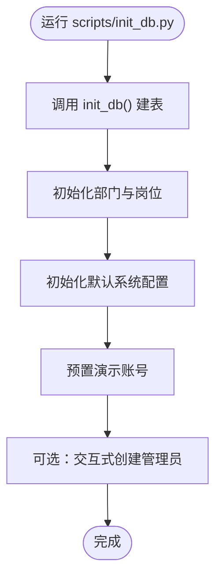
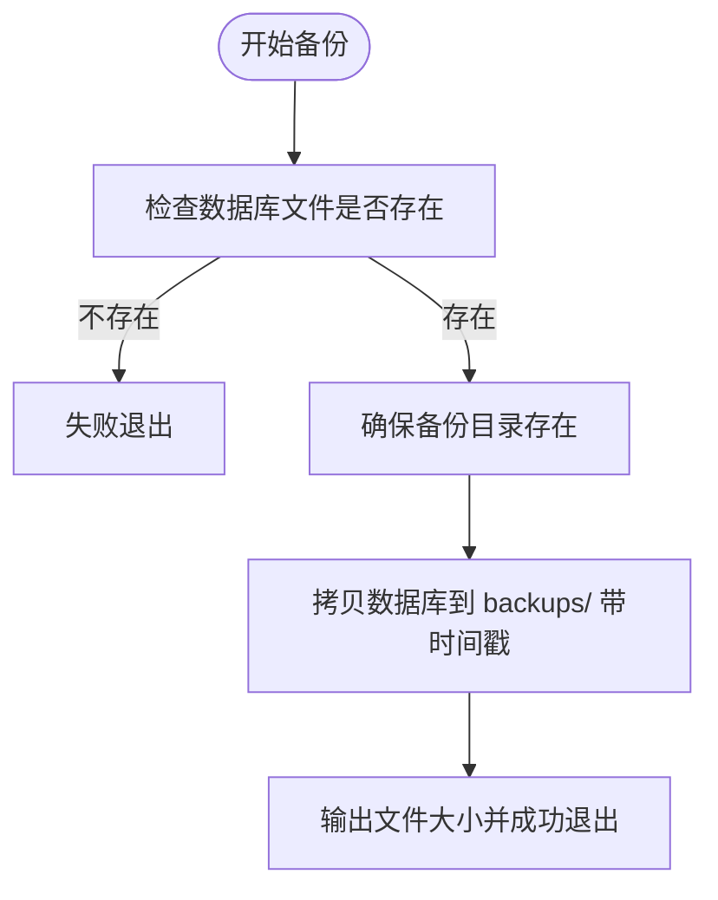
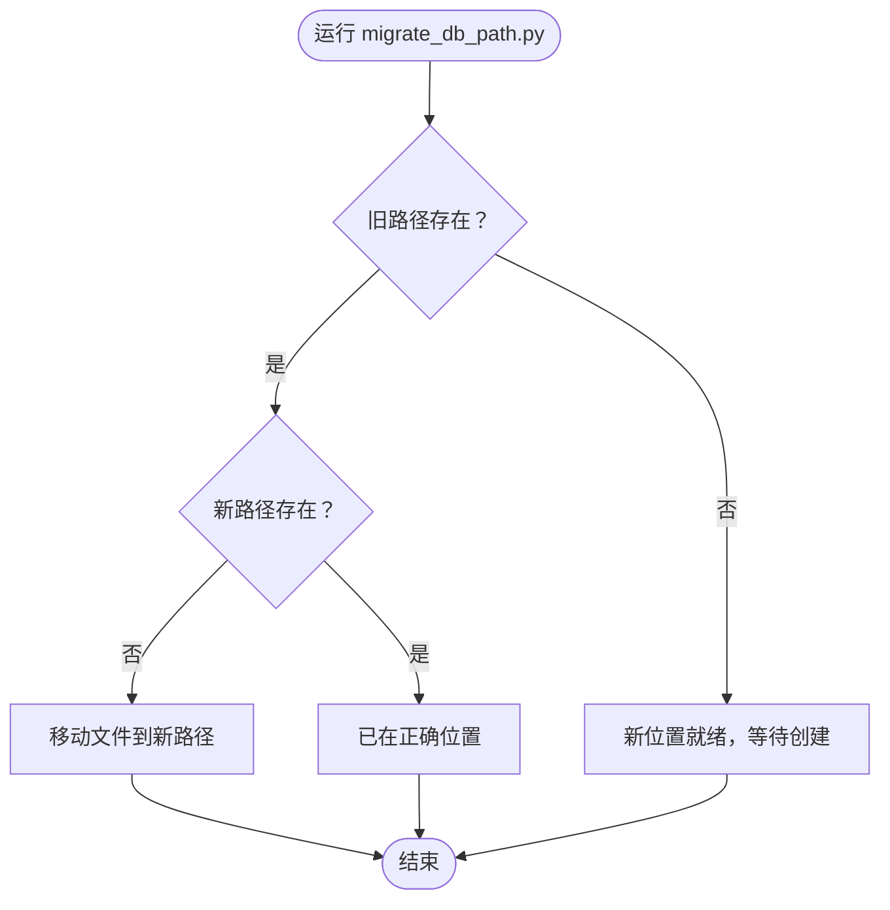
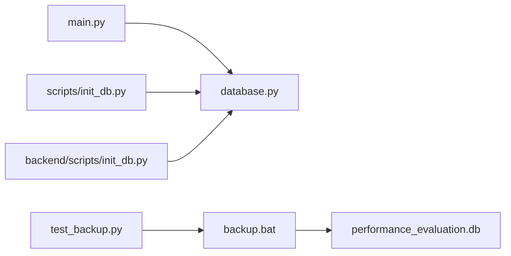

# 数据迁移机制

<cite>
**本文引用的文件**   
- [backend/app/database.py](file://backend/app/database.py)
- [backend/app/main.py](file://backend/app/main.py)
- [scripts/init_db.py](file://scripts/init_db.py)
- [backend/scripts/init_db.py](file://backend/scripts/init_db.py)
- [scripts/migrate_db_path.py](file://scripts/migrate_db_path.py)
- [scripts/backup.bat](file://scripts/backup.bat)
- [backend/tests/test_backup.py](file://backend/tests/test_backup.py)
</cite>

## 目录
1. [引言](#引言)
2. [项目结构](#项目结构)
3. [核心组件](#核心组件)
4. [架构总览](#架构总览)
5. [详细组件分析](#详细组件分析)
6. [依赖关系分析](#依赖关系分析)
7. [性能与一致性考虑](#性能与一致性考虑)
8. [故障排查指南](#故障排查指南)
9. [结论](#结论)
10. [附录：迁移脚本编写规范与最佳实践](#附录：迁移脚本编写规范与最佳实践)

## 引言
本文件面向“绩效考核评分系统”的数据库迁移机制，重点覆盖以下方面：
- SQLite 环境下的表结构变更实现方式（以 ALTER TABLE 为主）
- 版本管理机制现状与建议
- init_db.py 初始化脚本的职责与差异
- 数据备份与恢复策略（SQLite 文件级备份）
- 迁移脚本编写规范与最佳实践

当前系统在启动时执行轻量级迁移，确保新增列存在；同时提供独立的初始化脚本用于演示数据与默认配置。

## 项目结构
与数据迁移相关的关键位置如下：
- 应用层数据库连接与引擎：backend/app/database.py
- 应用启动与自动迁移逻辑：backend/app/main.py
- 根级初始化脚本（推荐）：scripts/init_db.py
- 后端内部初始化脚本（演示用）：backend/scripts/init_db.py
- 数据库路径迁移工具：scripts/migrate_db_path.py
- Windows 备份脚本：scripts/backup.bat
- 备份功能测试：backend/tests/test_backup.py

**图表来源**
- [backend/app/main.py:97-129](file://backend/app/main.py#L97-L129)
- [backend/app/database.py:1-31](file://backend/app/database.py#L1-L31)
- [scripts/init_db.py:21-23](file://scripts/init_db.py#L21-L23)
- [backend/scripts/init_db.py:11-17](file://backend/scripts/init_db.py#L11-L17)
- [scripts/migrate_db_path.py:1-26](file://scripts/migrate_db_path.py#L1-L26)
- [scripts/backup.bat:1-40](file://scripts/backup.bat#L1-L40)
- [backend/tests/test_backup.py:1-60](file://backend/tests/test_backup.py#L1-L60)

**章节来源**
- [backend/app/database.py:1-31](file://backend/app/database.py#L1-L31)
- [backend/app/main.py:97-129](file://backend/app/main.py#L97-L129)
- [scripts/init_db.py:1-316](file://scripts/init_db.py#L1-L316)
- [backend/scripts/init_db.py:1-262](file://backend/scripts/init_db.py#L1-L262)
- [scripts/migrate_db_path.py:1-26](file://scripts/migrate_db_path.py#L1-L26)
- [scripts/backup.bat:1-40](file://scripts/backup.bat#L1-L40)
- [backend/tests/test_backup.py:1-60](file://backend/tests/test_backup.py#L1-L60)

## 核心组件
- 数据库连接与引擎：统一在 backend/app/database.py 中定义 SQLite 引擎、会话工厂与初始化函数。
- 启动期自动迁移：backend/app/main.py 在应用启动时调用 _migrate_db()，通过 SQLAlchemy Inspector 检测列是否存在，不存在则使用 ALTER TABLE ADD COLUMN 添加新列。
- 初始化脚本：scripts/init_db.py 是推荐的初始化入口，负责建表、部门岗位、默认配置与预置账号；backend/scripts/init_db.py 为演示用途，会清空并重建所有表并插入演示数据。
- 路径迁移工具：scripts/migrate_db_path.py 将旧位置的数据库文件移动到 data/db/ 下。
- 备份脚本：scripts/backup.bat 对 SQLite 文件进行时间戳命名拷贝，生成 .db 备份文件。

**章节来源**
- [backend/app/database.py:1-31](file://backend/app/database.py#L1-L31)
- [backend/app/main.py:97-129](file://backend/app/main.py#L97-L129)
- [scripts/init_db.py:1-316](file://scripts/init_db.py#L1-L316)
- [backend/scripts/init_db.py:1-262](file://backend/scripts/init_db.py#L1-L262)
- [scripts/migrate_db_path.py:1-26](file://scripts/migrate_db_path.py#L1-L26)
- [scripts/backup.bat:1-40](file://scripts/backup.bat#L1-L40)

## 架构总览
下图展示了应用启动时的数据库初始化与迁移流程：

**图表来源**
- [backend/app/main.py:126-129](file://backend/app/main.py#L126-L129)
- [backend/app/main.py:97-124](file://backend/app/main.py#L97-L124)
- [backend/app/database.py:29-31](file://backend/app/database.py#L29-L31)

## 详细组件分析

### SQLite 下的 ALTER TABLE 实现
- 实现位置：backend/app/main.py 中的 _migrate_db()。
- 工作方式：
  - 使用 SQLAlchemy Inspector 获取 assessment_records 表的现有列名。
  - 针对每个需要的新列，判断是否已存在；若不存在，则通过 raw SQL 执行 ALTER TABLE ADD COLUMN。
  - 每次 ALTER 后提交事务，避免长事务。
- 涉及字段：
  - manager_draft_scores TEXT
  - self_draft_scores TEXT
  - peer_draft_scores TEXT
  - manager_submitted BOOLEAN DEFAULT 0

**图表来源**
- [backend/app/main.py:97-124](file://backend/app/main.py#L97-L124)

**章节来源**
- [backend/app/main.py:97-124](file://backend/app/main.py#L97-L124)

### 版本管理机制
- 现状：
  - 代码中没有显式的数据库版本号表或版本号字段。
  - 迁移通过“按列名存在性检查 + ALTER TABLE ADD COLUMN”的方式实现幂等增量变更。
- 风险与建议：
  - 建议引入统一的 schema_version 表或键值记录，便于审计与回滚规划。
  - 建议在 _migrate_db() 中增加版本校验与升级顺序控制，避免重复或错误顺序执行。
  - 对于删除列或重命名列等破坏性变更，应设计独立迁移脚本并在升级前做完整备份。

[本节为概念性说明，不直接分析具体文件]

### init_db.py 脚本职责与差异
- scripts/init_db.py（推荐）：
  - 创建数据库表（若不存在）。
  - 初始化部门与岗位。
  - 初始化默认系统配置（如等级规则、权重、豁免开关等）。
  - 预置 7 个演示账号，支持交互式创建自定义管理员。
  - 依赖 backend/app/database.py 提供的 engine、SessionLocal、init_db。
- backend/scripts/init_db.py（演示用）：
  - 直接 drop_all 再 create_all，清空并重建所有表。
  - 插入演示部门、岗位、员工、用户与汇报关系。
  - 适合本地开发快速重置环境，不适合生产环境。

**图表来源**
- [scripts/init_db.py:264-311](file://scripts/init_db.py#L264-L311)
- [scripts/init_db.py:43-84](file://scripts/init_db.py#L43-L84)
- [scripts/init_db.py:87-125](file://scripts/init_db.py#L87-L125)
- [scripts/init_db.py:128-205](file://scripts/init_db.py#L128-L205)

**章节来源**
- [scripts/init_db.py:1-316](file://scripts/init_db.py#L1-L316)
- [backend/scripts/init_db.py:1-262](file://backend/scripts/init_db.py#L1-L262)

### 数据备份与恢复策略
- 备份策略：
  - 使用 scripts/backup.bat 对 SQLite 文件进行拷贝备份，文件名包含时间戳。
  - 备份目标目录为 backups/，源数据库位于 data/db/performance_evaluation.db。
- 恢复策略：
  - 由于 SQLite 是单文件数据库，恢复即替换原文件。
  - 建议在恢复前停止服务，避免写入冲突。
  - 可结合操作系统任务计划或 CI/CD 定时执行 backup.bat。
- 验证方法：
  - backend/tests/test_backup.py 验证备份脚本能生成 .db 文件，且备份文件可读并包含关键表结构。

**图表来源**
- [scripts/backup.bat:1-40](file://scripts/backup.bat#L1-L40)
- [backend/tests/test_backup.py:21-60](file://backend/tests/test_backup.py#L21-L60)

**章节来源**
- [scripts/backup.bat:1-40](file://scripts/backup.bat#L1-L40)
- [backend/tests/test_backup.py:1-60](file://backend/tests/test_backup.py#L1-L60)

### 数据库路径迁移工具
- 作用：将旧位置的数据库文件移动到 data/db/ 下，统一存储位置。
- 行为：
  - 如果旧路径存在且新路径不存在，则移动文件。
  - 如果新路径已存在，提示已在正确位置。
  - 否则提示新位置就绪，等待创建。

**图表来源**
- [scripts/migrate_db_path.py:1-26](file://scripts/migrate_db_path.py#L1-L26)

**章节来源**
- [scripts/migrate_db_path.py:1-26](file://scripts/migrate_db_path.py#L1-L26)

## 依赖关系分析
- main.py 依赖 database.py 提供的 engine、SessionLocal、init_db。
- scripts/init_db.py 依赖 backend/app/database.py 与 app.models。
- backend/scripts/init_db.py 直接使用 SQLAlchemy 与 app.models，构建演示数据。
- backup.bat 与 test_backup.py 共同验证备份流程。

**图表来源**
- [backend/app/main.py:1-10](file://backend/app/main.py#L1-L10)
- [backend/app/database.py:1-31](file://backend/app/database.py#L1-L31)
- [scripts/init_db.py:21-23](file://scripts/init_db.py#L21-L23)
- [backend/scripts/init_db.py:11-17](file://backend/scripts/init_db.py#L11-L17)
- [scripts/backup.bat:1-40](file://scripts/backup.bat#L1-L40)
- [backend/tests/test_backup.py:1-60](file://backend/tests/test_backup.py#L1-L60)

**章节来源**
- [backend/app/main.py:1-10](file://backend/app/main.py#L1-L10)
- [backend/app/database.py:1-31](file://backend/app/database.py#L1-L31)
- [scripts/init_db.py:21-23](file://scripts/init_db.py#L21-L23)
- [backend/scripts/init_db.py:11-17](file://backend/scripts/init_db.py#L11-L17)
- [scripts/backup.bat:1-40](file://scripts/backup.bat#L1-L40)
- [backend/tests/test_backup.py:1-60](file://backend/tests/test_backup.py#L1-L60)

## 性能与一致性考虑
- 启动期迁移：
  - 每次启动都会反射表结构并可能执行多次 ALTER TABLE，建议在高频重启场景下缓存列信息或仅在必要时执行。
- 事务与锁：
  - SQLite 在写操作时会加锁，ALTER TABLE 属于写操作，应避免并发写入。
  - 备份与恢复应在服务停止后进行，避免文件被占用。
- 幂等性：
  - 当前 _migrate_db() 基于列名存在性判断，具备幂等性。
  - 建议后续引入版本表，保证迁移顺序与幂等性更强约束。

[本节为通用指导，不直接分析具体文件]

## 故障排查指南
- 启动时报 ALTER TABLE 失败：
  - 检查数据库文件是否被其他进程占用。
  - 确认数据库文件权限与磁盘空间。
- 备份失败：
  - 检查 backup.bat 是否能找到数据库文件。
  - 检查 backups 目录是否存在与写入权限。
- 初始化数据异常：
  - 使用 scripts/init_db.py 重新初始化，避免使用 backend/scripts/init_db.py 在生产环境。
  - 如需重置演示环境，可在开发环境使用 backend/scripts/init_db.py，注意它会清空并重建所有表。

**章节来源**
- [backend/app/main.py:97-124](file://backend/app/main.py#L97-L124)
- [scripts/backup.bat:1-40](file://scripts/backup.bat#L1-L40)
- [scripts/init_db.py:264-311](file://scripts/init_db.py#L264-L311)
- [backend/scripts/init_db.py:25-54](file://backend/scripts/init_db.py#L25-L54)

## 结论
- 当前系统采用“启动期轻量迁移 + 文件级备份”的策略，满足小规模迭代与演示需求。
- 建议逐步引入显式版本管理与更完善的迁移框架，提升可审计性与回滚能力。
- 推荐使用 scripts/init_db.py 进行初始化，避免在生产环境误用会清空数据的演示脚本。
- 备份与恢复应纳入运维流程，配合定时任务与恢复演练，保障数据安全。

[本节为总结性内容，不直接分析具体文件]

## 附录：迁移脚本编写规范与最佳实践
- 幂等性：
  - 所有迁移必须幂等，优先使用“存在性检查 + 条件变更”。
  - 新增列使用 ALTER TABLE ADD COLUMN，删除列需单独脚本并评估影响。
- 版本管理：
  - 引入 schema_version 表或键值记录，记录当前数据库版本与迁移历史。
  - 每次迁移前读取版本，按顺序执行未应用的迁移。
- 事务与原子性：
  - 单个迁移尽量在一个事务内完成，失败时整体回滚。
  - 跨表复杂变更拆分为多个小步骤，每步可独立回滚。
- 安全性：
  - 迁移前强制备份数据库。
  - 禁止在生产环境直接 DROP 或 TRUNCATE 大表。
- 可观测性：
  - 记录迁移日志，包括开始时间、结束时间、受影响行数、异常堆栈。
- 测试：
  - 为每个迁移编写单元测试，覆盖正向与异常分支。
  - 在测试环境中模拟旧版本数据库，验证升级路径。
- 文档化：
  - 每个迁移脚本附带说明：目的、影响范围、回滚方案、注意事项。
  - 更新 README 或运维手册，明确升级步骤与回滚步骤。

[本节为通用指导，不直接分析具体文件]