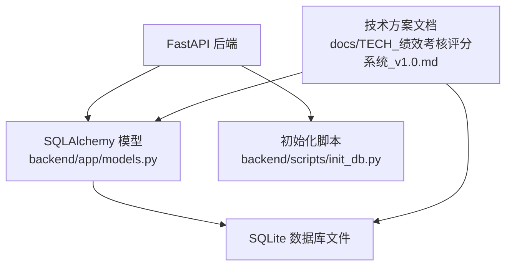
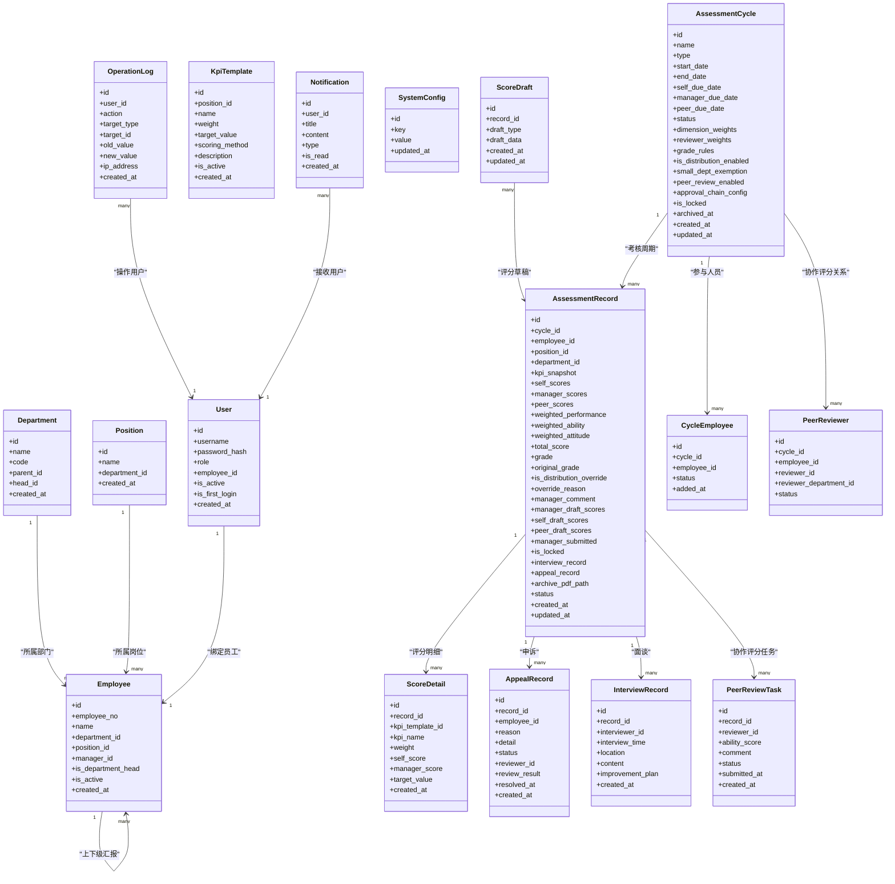
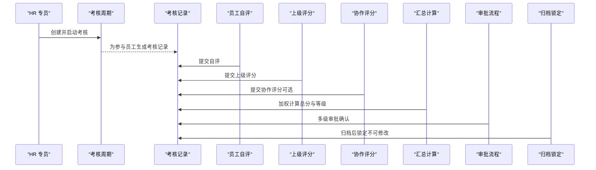
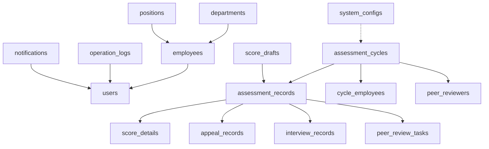

# 表结构设计

<cite>
**本文引用的文件**   
- [backend/app/models.py](file://backend/app/models.py)
- [backend/scripts/init_db.py](file://backend/scripts/init_db.py)
- [docs/TECH_绩效考核评分系统_v1.0.md](file://docs/TECH_绩效考核评分系统_v1.0.md)
</cite>

## 目录
1. [引言](#引言)
2. [项目结构与数据库定位](#项目结构与数据库定位)
3. [核心数据模型总览](#核心数据模型总览)
4. [架构与数据流概览](#架构与数据流概览)
5. [详细表结构说明](#详细表结构说明)
6. [索引策略与查询优化建议](#索引策略与查询优化建议)
7. [JSON 字段设计说明](#json-字段设计说明)
8. [DDL 示例与注释规范](#ddl-示例与注释规范)
9. [依赖关系分析](#依赖关系分析)
10. [性能与一致性注意事项](#性能与一致性注意事项)
11. [常见问题与排错建议](#常见问题与排错建议)
12. [结论](#结论)

## 引言
本文件面向绩效考核评分系统的数据库表结构，目标是：
- 明确每张表的字段定义、数据类型、约束和默认值。
- 说明主键、外键、唯一约束、检查约束的设计意图。
- 给出单列索引、复合索引的使用场景。
- 解释 `dimension_weights`、`reviewer_weights` 等 JSON 配置字段的数据结构。
- 提供 DDL 示例和字段注释规范，便于后续迁移到 MySQL/PostgreSQL。

当前实现基于 SQLAlchemy ORM 模型，并使用 SQLite 作为 MVP 数据库；技术方案文档中同时给出了 SQL 风格的表结构说明，可作为最终 DDL 参考。

> **与 ER 图的分工**：实体关系、外键与唯一约束以 [ER图设计.md](ER图设计.md) 为唯一权威来源；本文件只负责字段级明细、DDL 示例与索引建议，不再自行维护关系图。

**章节来源**
- [docs/TECH_绩效考核评分系统_v1.0.md:26-31](file://docs/TECH_绩效考核评分系统_v1.0.md#L26-L31)
- [docs/TECH_绩效考核评分系统_v1.0.md:73-78](file://docs/TECH_绩效考核评分系统_v1.0.md#L73-L78)

## 项目结构与数据库定位
后端使用 FastAPI + SQLAlchemy，ORM 模型集中在 `backend/app/models.py`；初始化脚本 `backend/scripts/init_db.py` 负责创建数据库文件并写入演示数据。技术文档在 `docs/TECH_绩效考核评分系统_v1.0.md` 中给出了完整的 ER 图、表结构和算法说明。



**图表来源**
- [backend/app/models.py:1-6](file://backend/app/models.py#L1-L6)
- [backend/scripts/init_db.py:11-17](file://backend/scripts/init_db.py#L11-L17)
- [docs/TECH_绩效考核评分系统_v1.0.md:26-31](file://docs/TECH_绩效考核评分系统_v1.0.md#L26-L31)

**章节来源**
- [backend/app/models.py:1-6](file://backend/app/models.py#L1-L6)
- [backend/scripts/init_db.py:11-17](file://backend/scripts/init_db.py#L11-L17)
- [docs/TECH_绩效考核评分系统_v1.0.md:26-31](file://docs/TECH_绩效考核评分系统_v1.0.md#L26-L31)

## 核心数据模型总览
从 ORM 模型看，系统包含以下主要实体：
- 组织基础数据：部门、岗位、员工、用户。
- 考核周期与模板：考核周期、KPI 模板。
- 考核执行数据：考核记录、评分明细、KPI 调整、审批记录、协作评分人、协作评分任务。
- 流程辅助数据：周期参与人员、操作日志、申诉记录、面谈记录、通知消息、评分草稿、系统配置。



**图表来源**
- [backend/app/models.py:8-266](file://backend/app/models.py#L8-L266)

**章节来源**
- [backend/app/models.py:8-266](file://backend/app/models.py#L8-L266)

## 架构与数据流概览
绩效考核以“考核记录”为核心，贯穿自评、上级评分、协作评分、汇总计算、等级映射、审批、面谈、发布、归档等阶段。JSON 配置字段用于承载维度权重、评价人权重、等级规则、审批链等可配置业务规则。



**图表来源**
- [docs/TECH_绩效考核评分系统_v1.0.md:82-110](file://docs/TECH_绩效考核评分系统_v1.0.md#L82-L110)
- [backend/app/models.py:62-131](file://backend/app/models.py#L62-L131)

**章节来源**
- [docs/TECH_绩效考核评分系统_v1.0.md:82-110](file://docs/TECH_绩效考核评分系统_v1.0.md#L82-L110)
- [backend/app/models.py:62-131](file://backend/app/models.py#L62-L131)

## 详细表结构说明

### 部门表 `departments`
- 主键：`id`，自增整数。
- 字段：
  - `name`：部门名称，必填。
  - `code`：部门编码，唯一。
  - `parent_id`：上级部门 ID，允许为空，形成树形结构。
  - `head_id`：部门负责人员工 ID，允许为空。
  - `created_at`：创建时间。
- 约束：
  - 主键约束：`id`。
  - 唯一约束：`code`。
  - 外键约束：`parent_id` 引用 `departments.id`；`head_id` 引用 `employees.id`。
- 索引：
  - `id` 为主键索引。
  - `code` 有唯一索引。
  - 建议对 `parent_id` 建立索引，提升部门树查询性能。

**章节来源**
- [backend/app/models.py:8-18](file://backend/app/models.py#L8-L18)
- [docs/TECH_绩效考核评分系统_v1.0.md:638-648](file://docs/TECH_绩效考核评分系统_v1.0.md#L638-L648)

### 岗位表 `positions`
- 主键：`id`，自增整数。
- 字段：
  - `name`：岗位名称，必填。
  - `department_id`：所属部门 ID，允许为空。
  - `created_at`：创建时间。
- 约束：
  - 主键约束：`id`。
  - 外键约束：`department_id` 引用 `departments.id`。
- 索引：
  - `id` 为主键索引。
  - 建议对 `department_id` 建立索引，提升按部门查询岗位的性能。

**章节来源**
- [backend/app/models.py:20-29](file://backend/app/models.py#L20-L29)
- [docs/TECH_绩效考核评分系统_v1.0.md:650-658](file://docs/TECH_绩效考核评分系统_v1.0.md#L650-L658)

### 员工表 `employees`
- 主键：`id`，自增整数。
- 字段：
  - `employee_no`：工号，唯一且必填。
  - `name`：姓名，必填。
  - `department_id`：部门 ID，允许为空。
  - `position_id`：岗位 ID，允许为空。
  - `manager_id`：直属上级员工 ID，允许为空，形成自引用层级。
  - `is_department_head`：是否部门负责人，默认 false。
  - `is_active`：是否在职，默认 true。
  - `created_at`：创建时间。
- 约束：
  - 主键约束：`id`。
  - 唯一约束：`employee_no`。
  - 外键约束：`department_id` 引用 `departments.id`；`position_id` 引用 `positions.id`；`manager_id` 引用 `employees.id`。
- 索引：
  - `id` 为主键索引。
  - `employee_no` 有唯一索引。
  - 建议对 `department_id`、`position_id`、`manager_id` 建立索引，提升组织关系查询性能。

**章节来源**
- [backend/app/models.py:31-47](file://backend/app/models.py#L31-L47)
- [docs/TECH_绩效考核评分系统_v1.0.md:660-676](file://docs/TECH_绩效考核评分系统_v1.0.md#L660-L676)

### 用户表 `users`
- 主键：`id`，自增整数。
- 字段：
  - `username`：登录用户名，唯一且必填。
  - `password_hash`：密码哈希，必填。
  - `role`：角色，必填。
  - `employee_id`：关联员工 ID，允许为空。
  - `is_active`：是否启用，默认 true。
  - `is_first_login`：是否首次登录，默认 true。
  - `created_at`：创建时间。
- 约束：
  - 主键约束：`id`。
  - 唯一约束：`username`。
  - 外键约束：`employee_id` 引用 `employees.id`。
- 索引：
  - `id` 为主键索引。
  - `username` 有唯一索引。
  - 建议对 `employee_id` 建立索引，提升通过员工查用户的性能。

**章节来源**
- [backend/app/models.py:49-60](file://backend/app/models.py#L49-L60)
- [docs/TECH_绩效考核评分系统_v1.0.md:781-793](file://docs/TECH_绩效考核评分系统_v1.0.md#L781-L793)

### 考核周期表 `assessment_cycles`
- 主键：`id`，自增整数。
- 关键字段：
  - `name`：周期名称，必填。
  - `type`：周期类型，必填。
  - `start_date`、`end_date`：起止日期，必填。
  - `self_due_date`、`manager_due_date`、`peer_due_date`：各阶段截止时间。
  - `status`：周期状态，默认 `not_started`。
  - `dimension_weights`：维度权重 JSON。**唯一默认口径为 `config_service.get_dimension_weights`**（业绩 60 / 能力 20 / 态度 20），`POST /assessment-cycles` 直接取该值写入快照；模型列默认（`models.py:76`）是同值的浮点形式（0.6/0.2/0.2），仅在绕过路由直接建模（脚本/测试）时生效。
  - `reviewer_weights`：评价人权重 JSON。**唯一默认口径为 `config_service.get_reviewer_weights`**：业绩 {自评 30, 上级 70, 协作 0}、能力 {自评 20, 上级 60, 协作 20}、态度 {自评 10, 上级 50, 协作 40}。创建周期时未传 `weights` 即以此填充；传了则按调用方快照保存。模型列默认（`models.py:77`）为同值的浮点形式。
  - `grade_rules`：等级规则 JSON，默认 A/B/C/D 分数区间与比例上限。
  - `is_distribution_enabled`：是否启用强制分布，默认 true。
  - `small_dept_exemption`：小部门豁免开关，默认 true。
  - `peer_review_enabled`：是否启用协作评分，默认 true。
  - `approval_chain_config`：审批链配置 JSON，允许为空。
  - `is_locked`：是否已归档锁定，默认 false。
  - `archived_at`：归档时间，允许为空。
  - `created_at`、`updated_at`：创建与更新时间。
- 约束：
  - 主键约束：`id`。
  - 业务约束：JSON 字段需满足业务校验（如权重合计为 100%、等级区间不重叠）。
- 索引：
  - `id` 为主键索引。
  - 建议对 `status`、`type`、`start_date`、`end_date` 建立索引，支持周期列表筛选与进度统计。

**章节来源**
- [backend/app/models.py:62-83](file://backend/app/models.py#L62-L83)
- [docs/TECH_绩效考核评分系统_v1.0.md:678-701](file://docs/TECH_绩效考核评分系统_v1.0.md#L678-L701)

### KPI 模板表 `kpi_templates`
- 主键：`id`，自增整数。
- 字段：
  - `position_id`：关联岗位 ID，必填。
  - `name`：指标名称，必填。
  - `weight`：指标权重，DECIMAL(5,2)，必填。
  - `target_value`：目标值，允许为空。
  - `scoring_method`：计分方式，默认 `percentage`。
  - `description`：评分标准说明，允许为空。
  - `is_active`：是否启用，默认 true。
  - `created_at`：创建时间。
- 约束：
  - 主键约束：`id`。
  - 外键约束：`position_id` 引用 `positions.id`。
- 索引：
  - `id` 为主键索引。
  - 建议对 `position_id` 建立索引，提升按岗位查询模板的性能。

**章节来源**
- [backend/app/models.py:85-97](file://backend/app/models.py#L85-L97)
- [docs/TECH_绩效考核评分系统_v1.0.md:703-716](file://docs/TECH_绩效考核评分系统_v1.0.md#L703-L716)

### 考核记录表 `assessment_records`
- 主键：`id`，自增整数。
- 关键字段：
  - `cycle_id`：考核周期 ID，必填。
  - `employee_id`：被考核员工 ID，必填。
  - `position_id`、`department_id`：考核时岗位与部门快照。
  - `kpi_snapshot`：KPI 模板快照 JSON，允许为空。
  - `self_scores`、`manager_scores`、`peer_scores`：各评分人原始分 JSON，允许为空。
  - `weighted_performance`、`weighted_ability`、`weighted_attitude`：加权维度得分，DECIMAL(5,2)。
  - `total_score`：总分，DECIMAL(5,2)。
  - `grade`：最终等级，允许为空。
  - `original_grade`：原始等级，允许为空。
  - `is_distribution_override`：是否强制分布干预，默认 false。
  - `override_reason`：干预原因，允许为空。
  - `manager_comment`：经理评语，允许为空。
  - `manager_draft_scores`、`self_draft_scores`、`peer_draft_scores`：各评分人草稿 JSON，允许为空。
  - `manager_submitted`：上级是否已提交，默认 false。
  - `is_locked`：是否锁定，默认 false。
  - `interview_record`、`appeal_record`：面谈与申诉记录 JSON，允许为空。
  - `archive_pdf_path`：归档 PDF 路径，允许为空。
  - `status`：考核记录状态，默认 `pending_self`。
  - `created_at`、`updated_at`：创建与更新时间。
- 约束：
  - 主键约束：`id`。
  - 外键约束：`cycle_id` 引用 `assessment_cycles.id`；`employee_id` 引用 `employees.id`；`position_id` 引用 `positions.id`；`department_id` 引用 `departments.id`。
- 索引：
  - `id` 为主键索引。
  - 建议对 `cycle_id`、`employee_id`、`status` 建立索引，提升按周期、员工、状态查询性能。

**章节来源**
- [backend/app/models.py:99-131](file://backend/app/models.py#L99-L131)
- [docs/TECH_绩效考核评分系统_v1.0.md:718-749](file://docs/TECH_绩效考核评分系统_v1.0.md#L718-L749)

### 评分明细表 `score_details`
- 主键：`id`，自增整数。
- 字段：
  - `record_id`：考核记录 ID，必填。
  - `kpi_template_id`：KPI 指标 ID，允许为空。
  - `kpi_name`：KPI 名称快照，允许为空。
  - `weight`：KPI 权重快照，DECIMAL(5,2)。
  - `self_score`：自评分，DECIMAL(5,2)。
  - `manager_score`：上级评分，DECIMAL(5,2)。
  - `target_value`：目标值快照，允许为空。
  - `created_at`：创建时间。
- 约束：
  - 主键约束：`id`。
  - 外键约束：`record_id` 引用 `assessment_records.id`；`kpi_template_id` 引用 `kpi_templates.id`。
- 索引：
  - `id` 为主键索引。
  - 建议对 `record_id`、`kpi_template_id` 建立索引，提升按考核记录和 KPI 查询明细的性能。

**章节来源**
- [backend/app/models.py:133-143](file://backend/app/models.py#L133-L143)
- [docs/TECH_绩效考核评分系统_v1.0.md:751-764](file://docs/TECH_绩效考核评分系统_v1.0.md#L751-L764)

### KPI 调整表 `kpi_adjustments`
- 主键：`id`，自增整数。
- 字段：
  - `record_id`：考核记录 ID，必填。
  - `original_kpi`：原始 KPI 文本，必填。
  - `adjusted_kpi`：调整后 KPI 文本，必填。
  - `reason`：调整原因，必填。
  - `status`：调整状态，默认 `pending`。
  - `created_at`：创建时间。
- 约束：
  - 主键约束：`id`。
  - 外键约束：`record_id` 引用 `assessment_records.id`。
- 索引：
  - `id` 为主键索引。
  - 建议对 `record_id` 建立索引，提升按考核记录查询调整历史。

**章节来源**
- [backend/app/models.py:145-153](file://backend/app/models.py#L145-L153)

### 审批记录表 `approval_records`
- 主键：`id`，自增整数。
- 字段：
  - `record_id`：考核记录 ID，必填。
  - `approver_id`：审批人员工 ID，必填。
  - `approver_role`：审批角色，允许为空。
  - `step_index`：审批步骤序号，默认 1。
  - `approval_type`：审批类型，默认 `normal`。
  - `action`：审批动作，允许为空。
  - `comment`：审批意见，允许为空。
  - `created_at`：创建时间。
- 约束：
  - 主键约束：`id`。
  - 外键约束：`record_id` 引用 `assessment_records.id`；`approver_id` 引用 `employees.id`。
- 索引：
  - `id` 为主键索引。
  - 建议对 `record_id`、`approver_id`、`step_index` 建立索引，提升审批流水查询性能。

**章节来源**
- [backend/app/models.py:155-165](file://backend/app/models.py#L155-L165)
- [docs/TECH_绩效考核评分系统_v1.0.md:766-778](file://docs/TECH_绩效考核评分系统_v1.0.md#L766-L778)

### 周期参与人员表 `cycle_employees`
- 主键：`id`，自增整数。
- 字段：
  - `cycle_id`：考核周期 ID，必填。
  - `employee_id`：员工 ID，必填。
  - `status`：参与状态，默认 `pending`。
  - `added_at`：加入时间。
- 约束：
  - 主键约束：`id`。
  - 唯一约束：`(cycle_id, employee_id)`。
  - 外键约束：`cycle_id` 引用 `assessment_cycles.id`；`employee_id` 引用 `employees.id`。
- 索引：
  - `id` 为主键索引。
  - 复合唯一索引：`(cycle_id, employee_id)`。
  - 建议对 `status` 建立索引，支持按状态筛选参与人员。

**章节来源**
- [backend/app/models.py:167-174](file://backend/app/models.py#L167-L174)
- [docs/TECH_绩效考核评分系统_v1.0.md:795-808](file://docs/TECH_绩效考核评分系统_v1.0.md#L795-L808)

### 协作评分关系表 `peer_reviewers`
- 主键：`id`，自增整数。
- 字段：
  - `cycle_id`：考核周期 ID，必填。
  - `employee_id`：被考核员工 ID，必填。
  - `reviewer_id`：协作评分人 ID，必填。
  - `reviewer_department_id`：评分人所属部门快照，允许为空。
  - `status`：协作评分状态，默认 `pending`。
- 约束：
  - 主键约束：`id`。
  - 唯一约束：`(cycle_id, employee_id, reviewer_id)`。
  - 外键约束：`cycle_id` 引用 `assessment_cycles.id`；`employee_id` 引用 `employees.id`；`reviewer_id` 引用 `employees.id`；`reviewer_department_id` 引用 `departments.id`。
- 索引：
  - `id` 为主键索引。
  - 复合唯一索引：`(cycle_id, employee_id, reviewer_id)`。
  - 建议对 `status` 建立索引，支持待评协作任务查询。

**章节来源**
- [backend/app/models.py:176-184](file://backend/app/models.py#L176-L184)
- [docs/TECH_绩效考核评分系统_v1.0.md:810-824](file://docs/TECH_绩效考核评分系统_v1.0.md#L810-L824)

### 操作日志表 `operation_logs`
- 主键：`id`，自增整数。
- 字段：
  - `user_id`：操作用户 ID，必填。
  - `action`：操作类型，必填。
  - `target_type`：操作对象类型，允许为空。
  - `target_id`：操作对象 ID，允许为空。
  - `old_value`、`new_value`：变更前后快照，允许为空。
  - `ip_address`：操作 IP，允许为空。
  - `created_at`：创建时间。
- 约束：
  - 主键约束：`id`。
  - 外键约束：`user_id` 引用 `users.id`。
- 索引：
  - `id` 为主键索引。
  - 建议对 `user_id`、`action`、`target_type`、`target_id`、`created_at` 建立索引，提升审计查询性能。

**章节来源**
- [backend/app/models.py:186-196](file://backend/app/models.py#L186-L196)
- [docs/TECH_绩效考核评分系统_v1.0.md:826-842](file://docs/TECH_绩效考核评分系统_v1.0.md#L826-L842)

### 申诉记录表 `appeal_records`
- 主键：`id`，自增整数。
- 字段：
  - `record_id`：关联考核记录 ID，必填。
  - `employee_id`：申诉人 ID，必填。
  - `reason`：申诉理由，必填。
  - `detail`：详细说明，允许为空。
  - `status`：申诉状态，默认 `pending`。
  - `reviewer_id`：复核人 ID，允许为空。
  - `review_result`：复核结论，允许为空。
  - `resolved_at`：处理完成时间，允许为空。
  - `created_at`：创建时间。
- 约束：
  - 主键约束：`id`。
  - 外键约束：`record_id` 引用 `assessment_records.id`；`employee_id` 引用 `employees.id`；`reviewer_id` 引用 `employees.id`。
- 索引：
  - `id` 为主键索引。
  - 建议对 `record_id`、`employee_id`、`status` 建立索引，提升申诉查询与统计性能。

**章节来源**
- [backend/app/models.py:198-209](file://backend/app/models.py#L198-L209)
- [docs/TECH_绩效考核评分系统_v1.0.md:844-861](file://docs/TECH_绩效考核评分系统_v1.0.md#L844-L861)

### 面谈记录表 `interview_records`
- 主键：`id`，自增整数。
- 字段：
  - `record_id`：关联考核记录 ID，必填。
  - `interviewer_id`：面谈人 ID，必填。
  - `interview_time`：面谈时间，允许为空。
  - `location`：面谈地点，允许为空。
  - `content`：沟通内容，允许为空。
  - `improvement_plan`：改进计划，允许为空。
  - `created_at`：创建时间。
- 约束：
  - 主键约束：`id`。
  - 外键约束：`record_id` 引用 `assessment_records.id`；`interviewer_id` 引用 `employees.id`。
- 索引：
  - `id` 为主键索引。
  - 建议对 `record_id`、`interviewer_id` 建立索引，提升面谈历史查询性能。

**章节来源**
- [backend/app/models.py:211-220](file://backend/app/models.py#L211-L220)
- [docs/TECH_绩效考核评分系统_v1.0.md:863-878](file://docs/TECH_绩效考核评分系统_v1.0.md#L863-L878)

### 系统配置表 `system_configs`
- 主键：`id`，自增整数。
- 字段：
  - `key`：配置键名，唯一且必填。
  - `value`：配置值，TEXT，必填。
  - `updated_at`：更新时间。
- 约束：
  - 主键约束：`id`。
  - 唯一约束：`key`。
- 索引：
  - `id` 为主键索引。
  - `key` 有唯一索引。
  - 建议对 `updated_at` 建立索引，支持按更新时间排序的配置查询。

**章节来源**
- [backend/app/models.py:222-227](file://backend/app/models.py#L222-L227)
- [docs/TECH_绩效考核评分系统_v1.0.md:882-895](file://docs/TECH_绩效考核评分系统_v1.0.md#L882-L895)

### 评分草稿表 `score_drafts`
- 主键：`id`，自增整数。
- 字段：
  - `record_id`：关联考核记录 ID，必填。
  - `draft_type`：草稿类型，必填。
  - `draft_data`：草稿数据 JSON，必填。
  - `created_at`、`updated_at`：创建与更新时间。
- 约束：
  - 主键约束：`id`。
  - 唯一约束：`(record_id, draft_type)`。
  - 外键约束：`record_id` 引用 `assessment_records.id`。
- 索引：
  - `id` 为主键索引。
  - 复合唯一索引：`(record_id, draft_type)`。
  - 建议对 `draft_type` 建立索引，支持按草稿类型查询。

**章节来源**
- [backend/app/models.py:230-241](file://backend/app/models.py#L230-L241)

### 通知消息表 `notifications`
- 主键：`id`，自增整数。
- 字段：
  - `user_id`：接收用户 ID，必填。
  - `title`：通知标题，必填。
  - `content`：通知内容，允许为空。
  - `type`：通知类型，允许为空。
  - `is_read`：是否已读，默认 false。
  - `created_at`：创建时间。
- 约束：
  - 主键约束：`id`。
  - 外键约束：`user_id` 引用 `users.id`。
- 索引：
  - `id` 为主键索引。
  - 建议对 `user_id`、`is_read`、`type`、`created_at` 建立索引，提升通知列表与未读统计性能。

**章节来源**
- [backend/app/models.py:244-252](file://backend/app/models.py#L244-L252)

### 协作评分任务表 `peer_review_tasks`
- 主键：`id`，自增整数。
- 字段：
  - `record_id`：关联考核记录 ID，必填。
  - `reviewer_id`：协作评分人 ID，必填。
  - `ability_score`：工作能力评分，DECIMAL(5,2)。
  - `comment`：协作评语，允许为空。
  - `status`：任务状态，默认 `pending`。
  - `submitted_at`：提交时间，允许为空。
  - `created_at`：创建时间。
- 约束：
  - 主键约束：`id`。
  - 外键约束：`record_id` 引用 `assessment_records.id`；`reviewer_id` 引用 `employees.id`。
- 索引：
  - `id` 为主键索引。
  - 建议对 `record_id`、`reviewer_id`、`status` 建立索引，提升协作任务查询性能。

**章节来源**
- [backend/app/models.py:255-265](file://backend/app/models.py#L255-L265)

## 索引策略与查询优化建议
- 单列索引常用场景：
  - 主键索引：所有表的 `id`。
  - 唯一索引：`departments.code`、`employees.employee_no`、`users.username`、`system_configs.key`。
  - 外键索引：建议对外键列建立索引，例如 `employees.department_id`、`employees.position_id`、`employees.manager_id`、`assessment_records.cycle_id`、`assessment_records.employee_id`、`score_details.record_id`、`approval_records.record_id`、`appeal_records.record_id`、`interview_records.record_id`、`notification.user_id`、`operation_log.user_id`。
- 复合索引常用场景：
  - `cycle_employees(cycle_id, employee_id)`：防止重复参与，提升按周期+员工查询性能。
  - `peer_reviewers(cycle_id, employee_id, reviewer_id)`：防止重复协作关系，提升按周期+被评人+协作人查询性能。
  - `score_drafts(record_id, draft_type)`：保证每个考核记录的每种草稿类型唯一，提升按记录+类型查询性能。
- 查询优化建议：
  - 对高频筛选列建立索引，如 `assessment_cycles.status`、`assessment_records.status`、`notifications.is_read`、`operation_logs.action`。
  - 对时间范围查询列建立索引，如 `assessment_cycles.start_date`、`assessment_cycles.end_date`、`operation_logs.created_at`、`notifications.created_at`。
  - 对组织关系查询列建立索引，如 `employees.department_id`、`employees.manager_id`、`positions.department_id`。

**章节来源**
- [backend/app/models.py:8-266](file://backend/app/models.py#L8-L266)
- [docs/TECH_绩效考核评分系统_v1.0.md:795-808](file://docs/TECH_绩效考核评分系统_v1.0.md#L795-L808)
- [docs/TECH_绩效考核评分系统_v1.0.md:810-824](file://docs/TECH_绩效考核评分系统_v1.0.md#L810-L824)
- [docs/TECH_绩效考核评分系统_v1.0.md:906-920](file://docs/TECH_绩效考核评分系统_v1.0.md#L906-L920)

## JSON 字段设计说明
系统中多处使用 JSON 字段存储灵活配置或快照数据，典型包括：
- `assessment_cycles.dimension_weights`：维度权重快照，默认取 `config_service.get_dimension_weights` = `{performance: 60, ability: 20, attitude: 20}`。
- `assessment_cycles.reviewer_weights`：评价人权重快照，默认取 `config_service.get_reviewer_weights`（业绩 30/70/0、能力 20/60/20、态度 10/50/40）。
- `assessment_cycles.grade_rules`：等级规则配置，默认 A/B/C/D 分数区间与比例上限。
- `assessment_cycles.approval_chain_config`：审批链配置，允许为空。
- `assessment_records.kpi_snapshot`：KPI 模板快照，允许为空。
- `assessment_records.self_scores`、`manager_scores`、`peer_scores`：各评分人原始分，允许为空。
- `assessment_records.manager_draft_scores`、`self_draft_scores`、`peer_draft_scores`：各评分人草稿数据，允许为空。
- `assessment_records.interview_record`、`appeal_record`：面谈与申诉记录快照，允许为空。
- `score_drafts.draft_data`：评分草稿完整数据，必填。
- `system_configs.value`：全局配置值，TEXT 存储 JSON。

数据结构设计原则：
- 将易变但结构相对稳定的配置放入 JSON，避免频繁改表结构。
- JSON 字段需在应用层进行校验，确保权重合计为 100%、等级区间不重叠、必填键存在。
- 对于需要频繁按 JSON 内字段查询的场景，考虑拆分为独立列或使用数据库的 JSON 查询能力。

**章节来源**
- [backend/app/models.py:62-83](file://backend/app/models.py#L62-L83)
- [backend/app/models.py:99-131](file://backend/app/models.py#L99-L131)
- [backend/app/models.py:230-241](file://backend/app/models.py#L230-L241)
- [backend/app/models.py:222-227](file://backend/app/models.py#L222-L227)
- [docs/TECH_绩效考核评分系统_v1.0.md:678-701](file://docs/TECH_绩效考核评分系统_v1.0.md#L678-L701)
- [docs/TECH_绩效考核评分系统_v1.0.md:718-749](file://docs/TECH_绩效考核评分系统_v1.0.md#L718-L749)
- [docs/TECH_绩效考核评分系统_v1.0.md:906-920](file://docs/TECH_绩效考核评分系统_v1.0.md#L906-L920)
- [docs/TECH_绩效考核评分系统_v1.0.md:882-895](file://docs/TECH_绩效考核评分系统_v1.0.md#L882-L895)

## DDL 示例与注释规范
以下为关键表的 DDL 示例，结合 SQLAlchemy 模型与技术方案文档中的 SQL 风格定义。实际迁移时可替换为 MySQL/PostgreSQL 语法。

- 部门表
```sql
CREATE TABLE departments (
    id          INTEGER PRIMARY KEY AUTOINCREMENT,
    name        VARCHAR(100) NOT NULL,
    code        VARCHAR(50) UNIQUE,
    parent_id   INTEGER,
    head_id     INTEGER,
    created_at  TIMESTAMP DEFAULT CURRENT_TIMESTAMP
);
```

- 岗位表
```sql
CREATE TABLE positions (
    id          INTEGER PRIMARY KEY AUTOINCREMENT,
    name        VARCHAR(100) NOT NULL,
    department_id INTEGER,
    created_at  TIMESTAMP DEFAULT CURRENT_TIMESTAMP
);
```

- 员工表
```sql
CREATE TABLE employees (
    id              INTEGER PRIMARY KEY AUTOINCREMENT,
    employee_no     VARCHAR(50) UNIQUE NOT NULL,
    name            VARCHAR(100) NOT NULL,
    department_id   INTEGER,
    position_id     INTEGER,
    manager_id      INTEGER,
    is_active       BOOLEAN DEFAULT TRUE,
    created_at      TIMESTAMP DEFAULT CURRENT_TIMESTAMP
);
```

- 用户表
```sql
CREATE TABLE users (
    id              INTEGER PRIMARY KEY AUTOINCREMENT,
    username        VARCHAR(100) UNIQUE NOT NULL,
    password_hash   VARCHAR(255) NOT NULL,
    role            VARCHAR(50) NOT NULL,
    employee_id     INTEGER,
    is_active       BOOLEAN DEFAULT TRUE,
    is_first_login  BOOLEAN DEFAULT TRUE,
    created_at      TIMESTAMP DEFAULT CURRENT_TIMESTAMP
);
```

- 考核周期表
```sql
CREATE TABLE assessment_cycles (
    id                  INTEGER PRIMARY KEY AUTOINCREMENT,
    name                VARCHAR(200) NOT NULL,
    type                VARCHAR(20) NOT NULL,
    start_date          DATE NOT NULL,
    end_date            DATE NOT NULL,
    self_due_date       DATE,
    manager_due_date    DATE,
    peer_due_date       DATE,
    status              VARCHAR(50) DEFAULT 'not_started',
    dimension_weights   TEXT NOT NULL,
    reviewer_weights    TEXT NOT NULL,
    grade_rules         TEXT NOT NULL,
    is_distribution_enabled BOOLEAN DEFAULT TRUE,
    small_dept_exemption BOOLEAN DEFAULT TRUE,
    peer_review_enabled BOOLEAN DEFAULT TRUE,
    approval_chain_config TEXT,
    is_locked           BOOLEAN DEFAULT FALSE,
    archived_at         TIMESTAMP,
    created_at          TIMESTAMP DEFAULT CURRENT_TIMESTAMP,
    updated_at          TIMESTAMP DEFAULT CURRENT_TIMESTAMP
);
```

- KPI 模板表
```sql
CREATE TABLE kpi_templates (
    id              INTEGER PRIMARY KEY AUTOINCREMENT,
    position_id     INTEGER NOT NULL,
    name            VARCHAR(200) NOT NULL,
    weight          DECIMAL(5,2) NOT NULL,
    target_value    VARCHAR(255),
    scoring_method  VARCHAR(50) DEFAULT 'percentage',
    description     TEXT,
    is_active       BOOLEAN DEFAULT TRUE,
    created_at      TIMESTAMP DEFAULT CURRENT_TIMESTAMP
);
```

- 考核记录表
```sql
CREATE TABLE assessment_records (
    id                      INTEGER PRIMARY KEY AUTOINCREMENT,
    cycle_id                INTEGER NOT NULL,
    employee_id             INTEGER NOT NULL,
    position_id             INTEGER,
    department_id           INTEGER,
    kpi_snapshot            TEXT,
    self_scores             TEXT,
    manager_scores          TEXT,
    peer_scores             TEXT,
    weighted_performance    DECIMAL(5,2),
    weighted_ability        DECIMAL(5,2),
    weighted_attitude       DECIMAL(5,2),
    total_score             DECIMAL(5,2),
    grade                   VARCHAR(10),
    original_grade          VARCHAR(10),
    is_distribution_override BOOLEAN DEFAULT FALSE,
    override_reason         TEXT,
    manager_comment         TEXT,
    manager_draft_scores    TEXT,
    self_draft_scores       TEXT,
    peer_draft_scores       TEXT,
    manager_submitted       BOOLEAN DEFAULT FALSE,
    is_locked               BOOLEAN DEFAULT FALSE,
    interview_record        TEXT,
    appeal_record           TEXT,
    archive_pdf_path        VARCHAR(255),
    status                  VARCHAR(50) DEFAULT 'pending_self',
    created_at              TIMESTAMP DEFAULT CURRENT_TIMESTAMP,
    updated_at              TIMESTAMP DEFAULT CURRENT_TIMESTAMP
);
```

- 评分明细表
```sql
CREATE TABLE score_details (
    id              INTEGER PRIMARY KEY AUTOINCREMENT,
    record_id       INTEGER NOT NULL,
    kpi_template_id INTEGER,
    kpi_name        VARCHAR(200),
    weight          DECIMAL(5,2),
    self_score      DECIMAL(5,2),
    manager_score   DECIMAL(5,2),
    target_value    VARCHAR(255),
    created_at      TIMESTAMP DEFAULT CURRENT_TIMESTAMP
);
```

- 周期参与人员表
```sql
CREATE TABLE cycle_employees (
    id          INTEGER PRIMARY KEY AUTOINCREMENT,
    cycle_id    INTEGER NOT NULL,
    employee_id INTEGER NOT NULL,
    status      VARCHAR(50) DEFAULT 'pending',
    added_at    TIMESTAMP DEFAULT CURRENT_TIMESTAMP,
    UNIQUE(cycle_id, employee_id)
);
```

- 协作评分关系表
```sql
CREATE TABLE peer_reviewers (
    id                    INTEGER PRIMARY KEY AUTOINCREMENT,
    cycle_id              INTEGER NOT NULL,
    employee_id           INTEGER NOT NULL,
    reviewer_id           INTEGER NOT NULL,
    reviewer_department_id INTEGER,
    status                VARCHAR(50) DEFAULT 'pending',
    UNIQUE(cycle_id, employee_id, reviewer_id)
);
```

- 操作日志表
```sql
CREATE TABLE operation_logs (
    id          INTEGER PRIMARY KEY AUTOINCREMENT,
    user_id     INTEGER NOT NULL,
    action      VARCHAR(100) NOT NULL,
    target_type VARCHAR(50),
    target_id   INTEGER,
    old_value   TEXT,
    new_value   TEXT,
    ip_address  VARCHAR(50),
    created_at  TIMESTAMP DEFAULT CURRENT_TIMESTAMP
);
```

- 申诉记录表
```sql
CREATE TABLE appeal_records (
    id              INTEGER PRIMARY KEY AUTOINCREMENT,
    record_id       INTEGER NOT NULL,
    employee_id     INTEGER NOT NULL,
    reason          TEXT NOT NULL,
    detail          TEXT,
    status          VARCHAR(50) DEFAULT 'pending',
    reviewer_id     INTEGER,
    review_result   TEXT,
    resolved_at     TIMESTAMP,
    created_at      TIMESTAMP DEFAULT CURRENT_TIMESTAMP
);
```

- 面谈记录表
```sql
CREATE TABLE interview_records (
    id              INTEGER PRIMARY KEY AUTOINCREMENT,
    record_id       INTEGER NOT NULL,
    interviewer_id  INTEGER NOT NULL,
    interview_time  TIMESTAMP,
    location        VARCHAR(200),
    content         TEXT,
    improvement_plan TEXT,
    created_at      TIMESTAMP DEFAULT CURRENT_TIMESTAMP
);
```

- 系统配置表
```sql
CREATE TABLE system_configs (
    id          INTEGER PRIMARY KEY AUTOINCREMENT,
    key         VARCHAR(100) UNIQUE NOT NULL,
    value       TEXT NOT NULL,
    updated_at  TIMESTAMP DEFAULT CURRENT_TIMESTAMP
);
```

- 评分草稿表
```sql
CREATE TABLE score_drafts (
    id          INTEGER PRIMARY KEY AUTOINCREMENT,
    record_id   INTEGER NOT NULL,
    draft_type  VARCHAR(50) NOT NULL,
    draft_data  TEXT NOT NULL,
    created_at  TIMESTAMP DEFAULT CURRENT_TIMESTAMP,
    updated_at  TIMESTAMP DEFAULT CURRENT_TIMESTAMP,
    UNIQUE(record_id, draft_type)
);
```

- 通知消息表
```sql
CREATE TABLE notifications (
    id              INTEGER PRIMARY KEY AUTOINCREMENT,
    user_id         INTEGER NOT NULL,
    title           VARCHAR(200) NOT NULL,
    content         TEXT,
    type            VARCHAR(50),
    is_read         BOOLEAN DEFAULT FALSE,
    created_at      TIMESTAMP DEFAULT CURRENT_TIMESTAMP
);
```

- 协作评分任务表
```sql
CREATE TABLE peer_review_tasks (
    id              INTEGER PRIMARY KEY AUTOINCREMENT,
    record_id       INTEGER NOT NULL,
    reviewer_id     INTEGER NOT NULL,
    ability_score   DECIMAL(5,2),
    comment         TEXT,
    status          VARCHAR(50) DEFAULT 'pending',
    submitted_at    TIMESTAMP,
    created_at      TIMESTAMP DEFAULT CURRENT_TIMESTAMP
);
```

字段注释规范建议：
- 每个字段应包含中文注释，说明业务含义、取值范围、是否必填。
- JSON 字段应注明内部结构键名与默认值。
- 外键字段应注明引用表与字段。
- 枚举类字段应列出合法值集合。
- 时间字段应注明时区与默认值行为。

**章节来源**
- [docs/TECH_绩效考核评分系统_v1.0.md:638-648](file://docs/TECH_绩效考核评分系统_v1.0.md#L638-L648)
- [docs/TECH_绩效考核评分系统_v1.0.md:650-658](file://docs/TECH_绩效考核评分系统_v1.0.md#L650-L658)
- [docs/TECH_绩效考核评分系统_v1.0.md:660-676](file://docs/TECH_绩效考核评分系统_v1.0.md#L660-L676)
- [docs/TECH_绩效考核评分系统_v1.0.md:678-701](file://docs/TECH_绩效考核评分系统_v1.0.md#L678-L701)
- [docs/TECH_绩效考核评分系统_v1.0.md:703-716](file://docs/TECH_绩效考核评分系统_v1.0.md#L703-L716)
- [docs/TECH_绩效考核评分系统_v1.0.md:718-749](file://docs/TECH_绩效考核评分系统_v1.0.md#L718-L749)
- [docs/TECH_绩效考核评分系统_v1.0.md:751-764](file://docs/TECH_绩效考核评分系统_v1.0.md#L751-L764)
- [docs/TECH_绩效考核评分系统_v1.0.md:766-778](file://docs/TECH_绩效考核评分系统_v1.0.md#L766-L778)
- [docs/TECH_绩效考核评分系统_v1.0.md:781-793](file://docs/TECH_绩效考核评分系统_v1.0.md#L781-L793)
- [docs/TECH_绩效考核评分系统_v1.0.md:795-808](file://docs/TECH_绩效考核评分系统_v1.0.md#L795-L808)
- [docs/TECH_绩效考核评分系统_v1.0.md:810-824](file://docs/TECH_绩效考核评分系统_v1.0.md#L810-L824)
- [docs/TECH_绩效考核评分系统_v1.0.md:826-842](file://docs/TECH_绩效考核评分系统_v1.0.md#L826-L842)
- [docs/TECH_绩效考核评分系统_v1.0.md:844-861](file://docs/TECH_绩效考核评分系统_v1.0.md#L844-L861)
- [docs/TECH_绩效考核评分系统_v1.0.md:863-878](file://docs/TECH_绩效考核评分系统_v1.0.md#L863-L878)
- [docs/TECH_绩效考核评分系统_v1.0.md:882-895](file://docs/TECH_绩效考核评分系统_v1.0.md#L882-L895)
- [docs/TECH_绩效考核评分系统_v1.0.md:906-920](file://docs/TECH_绩效考核评分系统_v1.0.md#L906-L920)
- [docs/TECH_绩效考核评分系统_v1.0.md:943-958](file://docs/TECH_绩效考核评分系统_v1.0.md#L943-L958)

## 依赖关系分析
表之间的依赖关系如下：
- 部门与岗位是组织基础数据，员工依赖部门和岗位。
- 用户与员工一对一或一对零一，用户账号绑定员工。
- 考核周期驱动考核记录生成，考核记录依赖周期、员工、岗位、部门。
- 评分明细依赖考核记录与 KPI 模板。
- 周期参与人员、协作评分关系依赖考核周期与员工。
- 审批记录、申诉记录、面谈记录、协作评分任务依赖考核记录。
- 操作日志依赖用户。
- 通知消息依赖用户。
- 评分草稿依赖考核记录。
- 系统配置独立存储，供周期与业务逻辑读取。



**图表来源**
- [backend/app/models.py:8-266](file://backend/app/models.py#L8-L266)

**章节来源**
- [backend/app/models.py:8-266](file://backend/app/models.py#L8-L266)

## 性能与一致性注意事项
- 事务一致性：
  - 考核启动、评分提交、汇总计算、审批流转等操作涉及多表更新，应在服务层使用事务包裹，保证原子性。
- 并发控制：
  - 评分草稿与正式评分之间应避免覆盖，使用 `score_drafts` 隔离草稿数据。
  - 协作评分任务应防止重复分配与重复提交。
- 数据完整性：
  - 外键约束建议在数据库层启用，防止脏数据。
  - JSON 字段需在应用层做结构校验，避免非法配置进入数据库。
- 性能影响：
  - JSON 字段不适合直接用于复杂条件查询，必要时拆分出独立列或建立视图。
  - 大表（如操作日志、通知消息）应定期归档或清理，避免单表过大影响查询性能。

**章节来源**
- [backend/app/models.py:99-131](file://backend/app/models.py#L99-L131)
- [backend/app/models.py:176-184](file://backend/app/models.py#L176-L184)
- [backend/app/models.py:230-241](file://backend/app/models.py#L230-L241)
- [docs/TECH_绩效考核评分系统_v1.0.md:131-152](file://docs/TECH_绩效考核评分系统_v1.0.md#L131-L152)

## 常见问题与排错建议
- 问题：权重合计不为 100%。
  - 排查：检查 `dimension_weights`、`reviewer_weights` 的 JSON 结构与应用层校验逻辑。
  - 解决：在前端与后端同时校验权重合计，保存前拦截非法配置。
- 问题：等级区间重叠或边界错误。
  - 排查：检查 `grade_rules` 的 min/max 配置。
  - 解决：在配置页面增加区间连续性与不重叠校验。
- 问题：协作评分未触发。
  - 排查：检查 `assessment_cycles.peer_review_enabled` 与周期参与人员的协作关系。
  - 解决：确认周期级协作评分开关与部门级覆盖配置。
- 问题：审批流程卡住。
  - 排查：检查 `approval_records.step_index` 与 `action` 字段。
  - 解决：根据状态机规则推进审批，必要时由 HR 重新指派审批人。
- 问题：操作日志缺失。
  - 排查：检查 `operation_logs` 插入逻辑与中间件是否启用。
  - 解决：确保敏感操作均记录日志，并在异常分支也记录失败信息。

**章节来源**
- [backend/app/models.py:62-83](file://backend/app/models.py#L62-L83)
- [backend/app/models.py:155-165](file://backend/app/models.py#L155-L165)
- [backend/app/models.py:176-184](file://backend/app/models.py#L176-L184)
- [backend/app/models.py:186-196](file://backend/app/models.py#L186-L196)
- [docs/TECH_绩效考核评分系统_v1.0.md:1311-1353](file://docs/TECH_绩效考核评分系统_v1.0.md#L1311-L1353)

## 结论
本绩效考核评分系统的数据库表结构围绕“组织基础数据—考核周期—考核记录—评分明细—流程辅助数据”展开，采用 JSON 字段承载灵活配置与快照数据，配合唯一约束与外键约束保障数据一致性与可追溯性。索引策略以主键、唯一索引为基础，并结合业务查询热点补充单列与复合索引。后续迁移至 MySQL/PostgreSQL 时，应重点关注 JSON 查询能力、外键约束启用、索引设计与事务一致性。