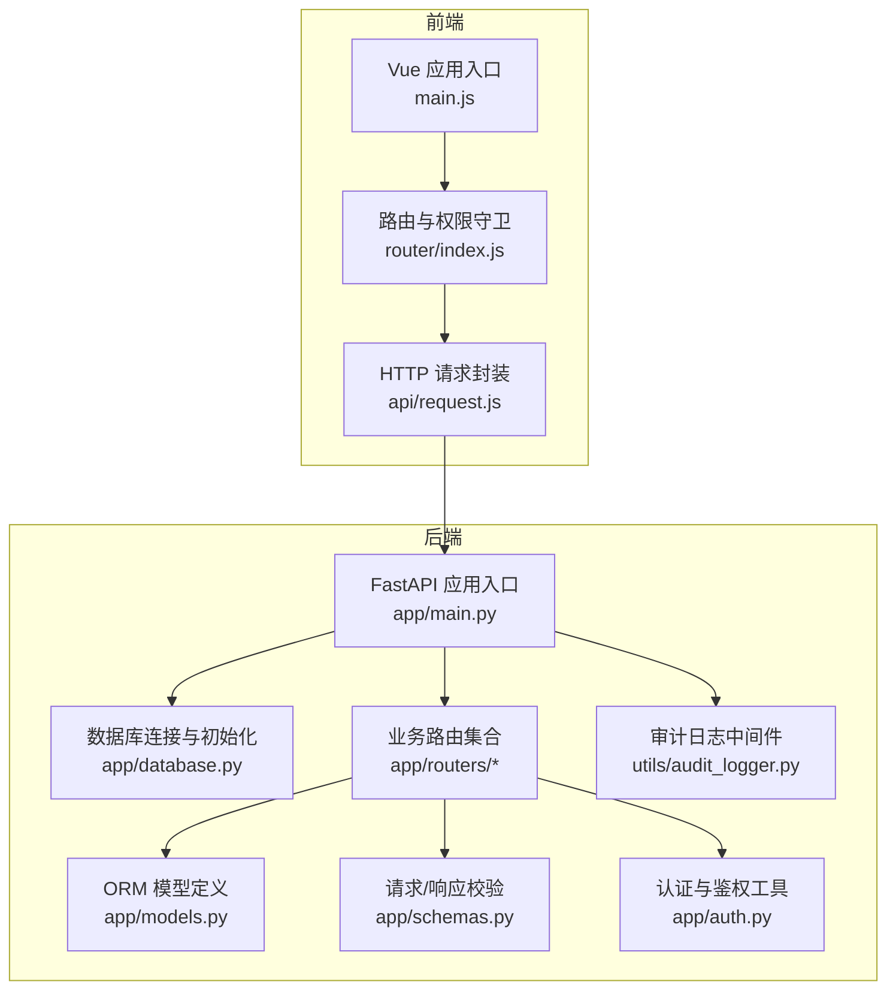
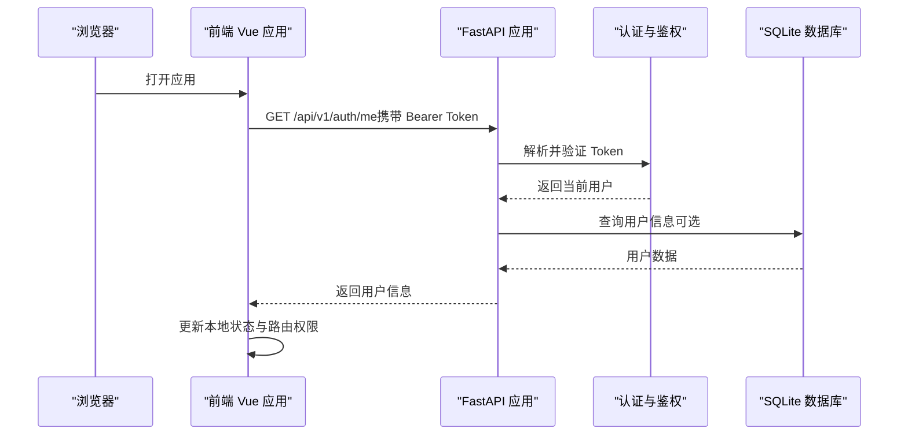
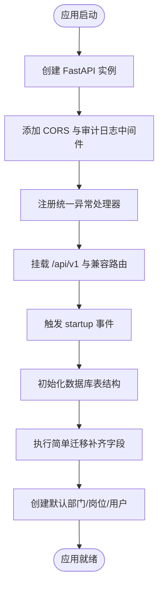
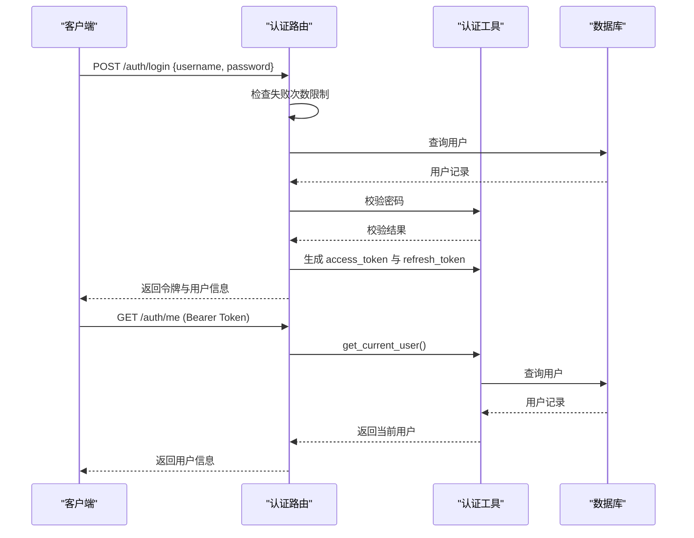
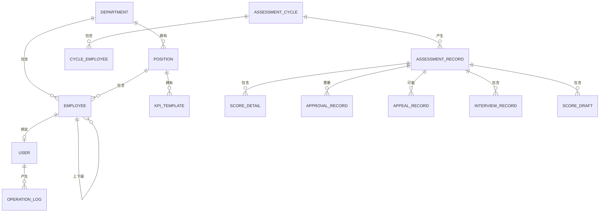
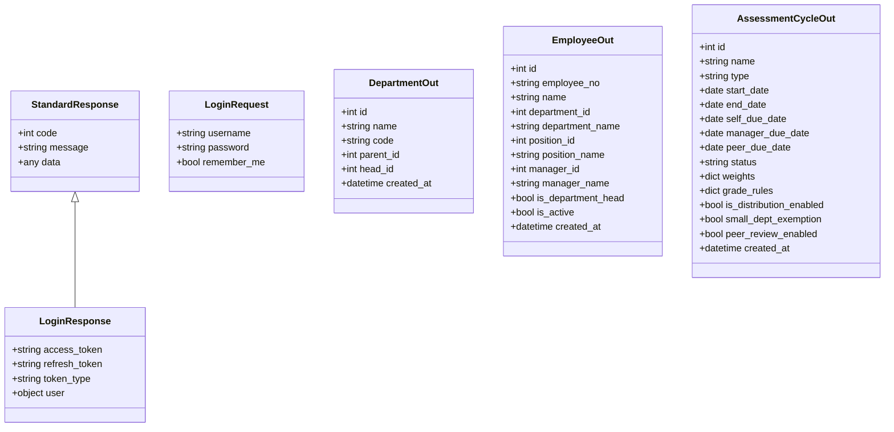
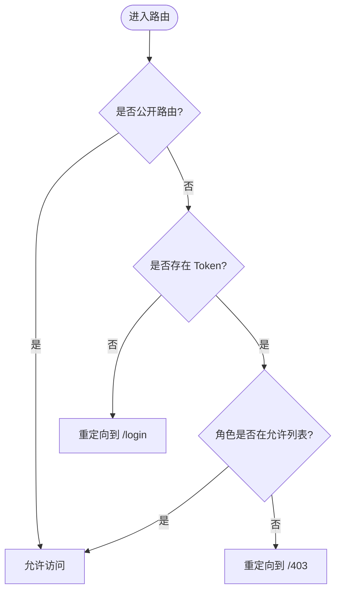
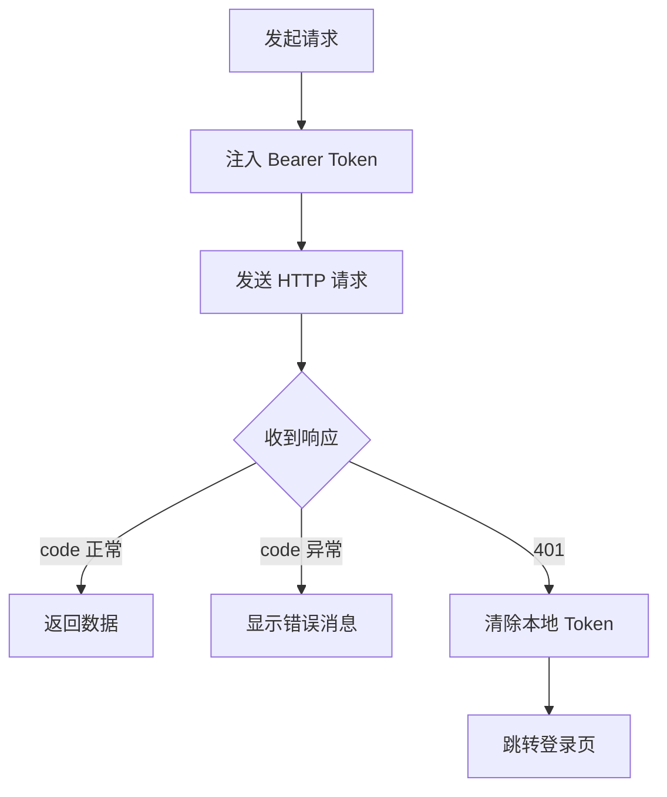
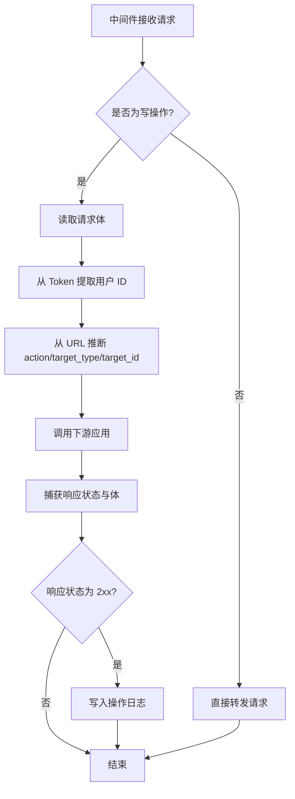
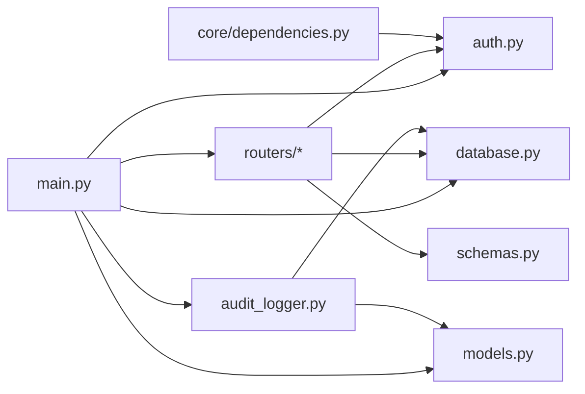

# 整体架构设计

<cite>
**本文引用的文件**   
- [backend/app/main.py](file://backend/app/main.py)
- [backend/app/database.py](file://backend/app/database.py)
- [backend/app/models.py](file://backend/app/models.py)
- [backend/app/schemas.py](file://backend/app/schemas.py)
- [backend/app/auth.py](file://backend/app/auth.py)
- [backend/app/routers/auth.py](file://backend/app/routers/auth.py)
- [backend/app/core/dependencies.py](file://backend/app/core/dependencies.py)
- [backend/app/utils/audit_logger.py](file://backend/app/utils/audit_logger.py)
- [frontend/src/main.js](file://frontend/src/main.js)
- [frontend/src/router/index.js](file://frontend/src/router/index.js)
- [frontend/src/api/request.js](file://frontend/src/api/request.js)
</cite>

## 目录
1. [引言](#引言)
2. [项目结构](#项目结构)
3. [核心组件](#核心组件)
4. [架构总览](#架构总览)
5. [详细组件分析](#详细组件分析)
6. [依赖关系分析](#依赖关系分析)
7. [性能与可扩展性考虑](#性能与可扩展性考虑)
8. [故障排查指南](#故障排查指南)
9. [结论](#结论)

## 引言
本文件面向绩效考核评分系统的整体架构设计，重点说明前后端分离模式、分层架构职责划分、主要组件及其通信机制，并给出应用启动流程与架构图。后端基于 FastAPI，前端基于 Vue.js；系统通过统一的 API 网关前缀进行前后端交互，内置认证中间件、审计日志中间件和 CORS 配置，并在启动时完成数据库初始化、默认数据填充与路由注册。

## 项目结构
系统采用前后端分离的目录组织方式：
- 后端 backend/app：包含应用入口、数据库连接、模型定义、请求校验 Schema、认证逻辑、路由模块、服务层、工具类等。
- 前端 frontend/src：包含应用入口、路由、状态管理、页面视图、API 封装等。

**图表来源**
- [frontend/src/main.js:1-23](file://frontend/src/main.js#L1-L23)
- [frontend/src/router/index.js:1-85](file://frontend/src/router/index.js#L1-L85)
- [frontend/src/api/request.js:1-89](file://frontend/src/api/request.js#L1-L89)
- [backend/app/main.py:1-94](file://backend/app/main.py#L1-L94)
- [backend/app/database.py:1-31](file://backend/app/database.py#L1-L31)
- [backend/app/models.py:1-266](file://backend/app/models.py#L1-L266)
- [backend/app/schemas.py:1-541](file://backend/app/schemas.py#L1-L541)
- [backend/app/auth.py:1-130](file://backend/app/auth.py#L1-L130)
- [backend/app/utils/audit_logger.py:1-188](file://backend/app/utils/audit_logger.py#L1-L188)

**章节来源**
- [frontend/src/main.js:1-23](file://frontend/src/main.js#L1-L23)
- [backend/app/main.py:1-94](file://backend/app/main.py#L1-L94)

## 核心组件
- 应用入口与全局中间件：FastAPI 实例创建、CORS 中间件、审计日志中间件、统一异常处理器、API 路由挂载。
- 数据库层：SQLAlchemy Engine、SessionLocal、get_db 依赖、init_db 表初始化。
- 模型层：部门、岗位、员工、用户、考核周期、KPI 模板、考核记录、审批、申诉、面谈、操作日志、通知、评分草稿等实体。
- 校验层：Pydantic Schema 用于输入校验、输出序列化与业务规则约束。
- 认证与鉴权：JWT 访问令牌与刷新令牌、密码哈希、首次登录强制改密、角色权限检查。
- 路由层：按业务域拆分的路由模块，统一挂载到 /api/v1 及兼容路径。
- 前端应用：Vue 应用初始化、ElementPlus 集成、Pinia 状态管理、路由守卫、Axios 请求封装。

**章节来源**
- [backend/app/main.py:1-94](file://backend/app/main.py#L1-L94)
- [backend/app/database.py:1-31](file://backend/app/database.py#L1-L31)
- [backend/app/models.py:1-266](file://backend/app/models.py#L1-L266)
- [backend/app/schemas.py:1-541](file://backend/app/schemas.py#L1-L541)
- [backend/app/auth.py:1-130](file://backend/app/auth.py#L1-L130)
- [frontend/src/main.js:1-23](file://frontend/src/main.js#L1-L23)
- [frontend/src/router/index.js:1-85](file://frontend/src/router/index.js#L1-L85)
- [frontend/src/api/request.js:1-89](file://frontend/src/api/request.js#L1-L89)

## 架构总览
系统采用前后端分离的分层架构：
- 前端负责 UI 渲染、路由导航、用户交互与本地状态管理，并通过 Axios 调用后端 API。
- 后端提供 RESTful API，使用 FastAPI 处理请求，结合 SQLAlchemy ORM 访问 SQLite 数据库。
- 中间件层提供跨域、审计日志、统一异常处理等横切能力。
- 认证与鉴权贯穿受保护接口，确保只有合法用户与角色可访问资源。

**图表来源**
- [frontend/src/api/request.js:14-45](file://frontend/src/api/request.js#L14-L45)
- [backend/app/routers/auth.py:114-122](file://backend/app/routers/auth.py#L114-L122)
- [backend/app/auth.py:68-113](file://backend/app/auth.py#L68-L113)

## 详细组件分析

### 应用入口与启动流程
FastAPI 应用在启动阶段执行以下关键步骤：
- 创建 FastAPI 实例并添加 CORS 中间件，允许跨域请求。
- 注册审计日志中间件与统一异常处理器。
- 挂载 /api/v1 路由组以及兼容无前缀的直接路由。
- 在 startup 事件中：
  - 初始化数据库表结构。
  - 执行简单迁移以补齐字段。
  - 根据角色创建默认部门、岗位与测试用户（管理员、HR、经理、员工、协作者、测试用户）。

**图表来源**
- [backend/app/main.py:9-28](file://backend/app/main.py#L9-L28)
- [backend/app/main.py:49-94](file://backend/app/main.py#L49-L94)
- [backend/app/main.py:97-129](file://backend/app/main.py#L97-L129)
- [backend/app/main.py:126-278](file://backend/app/main.py#L126-L278)
- [backend/app/database.py:29-31](file://backend/app/database.py#L29-L31)

**章节来源**
- [backend/app/main.py:1-278](file://backend/app/main.py#L1-L278)
- [backend/app/database.py:1-31](file://backend/app/database.py#L1-L31)

### 认证与鉴权机制
认证流程包括：
- 登录接口校验用户名与密码，失败次数限制与锁定策略。
- 生成 JWT 访问令牌与刷新令牌。
- 获取当前用户依赖函数校验 Token、用户状态与首次登录强制改密白名单。
- 角色权限检查装饰器，限制特定角色的接口访问。

**图表来源**
- [backend/app/routers/auth.py:63-93](file://backend/app/routers/auth.py#L63-L93)
- [backend/app/routers/auth.py:96-111](file://backend/app/routers/auth.py#L96-L111)
- [backend/app/routers/auth.py:114-122](file://backend/app/routers/auth.py#L114-L122)
- [backend/app/auth.py:38-65](file://backend/app/auth.py#L38-L65)
- [backend/app/auth.py:68-113](file://backend/app/auth.py#L68-L113)
- [backend/app/auth.py:116-129](file://backend/app/auth.py#L116-L129)

**章节来源**
- [backend/app/routers/auth.py:1-179](file://backend/app/routers/auth.py#L1-L179)
- [backend/app/auth.py:1-130](file://backend/app/auth.py#L1-L130)

### 数据访问层与模型关系
数据访问层基于 SQLAlchemy ORM，定义了多类实体及其关系：
- 部门与岗位：一对多关系，岗位属于部门。
- 员工：关联部门、岗位、上级与下级，并与用户一对一绑定。
- 用户：存储账号、密码哈希、角色与首次登录标记。
- 考核周期与 KPI 模板：支持权重、等级规则与评审权重配置。
- 考核记录：聚合自评、上级评、协作评分数与最终等级，支持草稿与归档。
- 审批、申诉、面谈、操作日志、通知、评分草稿等辅助实体。

**图表来源**
- [backend/app/models.py:8-60](file://backend/app/models.py#L8-L60)
- [backend/app/models.py:62-131](file://backend/app/models.py#L62-L131)
- [backend/app/models.py:133-266](file://backend/app/models.py#L133-L266)

**章节来源**
- [backend/app/models.py:1-266](file://backend/app/models.py#L1-L266)

### 请求校验与服务层
- 请求校验：使用 Pydantic 模型对输入参数进行严格校验，包括必填字段、长度范围、权重总和、日期顺序与区间连续性等。
- 输出模型：标准化响应结构与领域对象输出，如部门、岗位、员工、KPI 模板、考核周期、操作日志、评分草稿等。
- 服务层：业务逻辑集中在 services 目录（例如评分计算、分布强制、通知、PDF 归档、配置服务等），由路由层调用。

**图表来源**
- [backend/app/schemas.py:7-23](file://backend/app/schemas.py#L7-L23)
- [backend/app/schemas.py:31-117](file://backend/app/schemas.py#L31-L117)
- [backend/app/schemas.py:208-315](file://backend/app/schemas.py#L208-L315)

**章节来源**
- [backend/app/schemas.py:1-541](file://backend/app/schemas.py#L1-L541)

### 前端路由与权限控制
前端通过 Vue Router 定义页面路由，并为每个路由设置元信息 roles，配合 beforeEach 守卫实现前端权限控制：
- 未登录且非公开路由跳转到登录页。
- 已登录但角色不匹配跳转到 403 页面。
- 公共路由（如登录、403）无需认证。

**图表来源**
- [frontend/src/router/index.js:61-75](file://frontend/src/router/index.js#L61-L75)

**章节来源**
- [frontend/src/router/index.js:1-85](file://frontend/src/router/index.js#L1-L85)

### HTTP 请求封装与错误处理
前端 Axios 封装统一了：
- 基础 URL 与超时配置。
- 自动注入 Authorization 头。
- 开发环境打印请求与响应日志。
- 统一响应拦截：当后端返回 code 不为 0 或 200 时提示错误。
- 401 自动清理本地 Token 并重定向到登录页。

**图表来源**
- [frontend/src/api/request.js:1-89](file://frontend/src/api/request.js#L1-L89)

**章节来源**
- [frontend/src/api/request.js:1-89](file://frontend/src/api/request.js#L1-L89)

### 审计日志中间件
审计日志中间件在 ASGI 层拦截写操作（POST/PUT/DELETE），提取用户 ID、动作类型、目标资源与 ID，捕获请求体与响应体，仅记录成功请求（2xx），并将日志写入 operation_logs 表。

**图表来源**
- [backend/app/utils/audit_logger.py:104-188](file://backend/app/utils/audit_logger.py#L104-L188)

**章节来源**
- [backend/app/utils/audit_logger.py:1-188](file://backend/app/utils/audit_logger.py#L1-L188)

## 依赖关系分析
后端各模块之间的依赖关系如下：
- main.py 依赖 database.py、models.py、routers/*、auth.py、audit_logger.py。
- routers/auth.py 依赖 auth.py、schemas.py、models.py、database.py。
- core/dependencies.py 提供通用依赖（当前用户、角色校验）。
- utils/audit_logger.py 依赖 database.py、models.py、core/security.py。

**图表来源**
- [backend/app/main.py:1-94](file://backend/app/main.py#L1-L94)
- [backend/app/routers/auth.py:1-28](file://backend/app/routers/auth.py#L1-L28)
- [backend/app/core/dependencies.py:1-51](file://backend/app/core/dependencies.py#L1-L51)
- [backend/app/utils/audit_logger.py:1-188](file://backend/app/utils/audit_logger.py#L1-L188)

**章节来源**
- [backend/app/main.py:1-94](file://backend/app/main.py#L1-L94)
- [backend/app/routers/auth.py:1-28](file://backend/app/routers/auth.py#L1-L28)
- [backend/app/core/dependencies.py:1-51](file://backend/app/core/dependencies.py#L1-L51)
- [backend/app/utils/audit_logger.py:1-188](file://backend/app/utils/audit_logger.py#L1-L188)

## 性能与可扩展性考虑
- 数据库：当前使用 SQLite，适合开发与轻量部署；生产环境建议切换至 PostgreSQL/MySQL 以获得更好的并发与事务处理能力。
- 会话与缓存：认证目前基于无状态 JWT，适合水平扩展；如需黑名单或限流，可引入 Redis。
- 中间件：审计日志中间件会读取并复制请求/响应体，在高吞吐场景下需评估开销，必要时异步落盘或采样记录。
- 分页与索引：建议在高频查询字段上建立索引，并对列表接口实现分页与过滤。
- 前端：按需加载路由组件，减少首屏体积；合理使用 Pinia 缓存与局部更新。

[本节为通用指导，不涉及具体文件分析]

## 故障排查指南
- 登录失败与锁定：
  - 检查认证路由中的失败次数限制与锁定时间。
  - 确认密码复杂度与首次登录强制改密策略。
- 401 未认证：
  - 检查前端是否正确注入 Authorization 头。
  - 检查后端 Token 解码与用户有效性。
- 403 权限不足：
  - 检查路由守卫与后端 require_role 装饰器。
  - 确认用户角色与路由 meta.roles 配置一致。
- 跨域问题：
  - 检查 CORS 中间件 allow_origins 与 allow_headers 配置。
- 审计日志缺失：
  - 确认请求方法为 POST/PUT/DELETE 且响应状态为 2xx。
  - 检查中间件是否正确注册。

**章节来源**
- [backend/app/routers/auth.py:31-60](file://backend/app/routers/auth.py#L31-L60)
- [backend/app/auth.py:68-113](file://backend/app/auth.py#L68-L113)
- [frontend/src/api/request.js:47-86](file://frontend/src/api/request.js#L47-L86)
- [backend/app/main.py:15-21](file://backend/app/main.py#L15-L21)
- [backend/app/utils/audit_logger.py:104-188](file://backend/app/utils/audit_logger.py#L104-L188)

## 结论
本绩效考核评分系统采用前后端分离与分层架构，后端通过 FastAPI 提供 RESTful API，前端通过 Vue.js 构建用户界面并进行路由与权限控制。系统内置认证、鉴权、审计日志与 CORS 中间件，并在启动时完成数据库初始化与默认数据填充。该架构具备良好的可读性与可扩展性，便于后续引入缓存、消息队列与更复杂的业务流程。