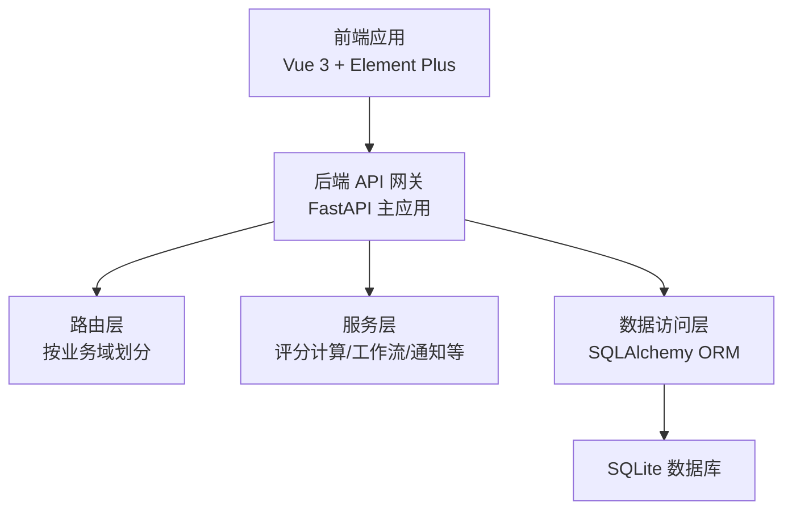
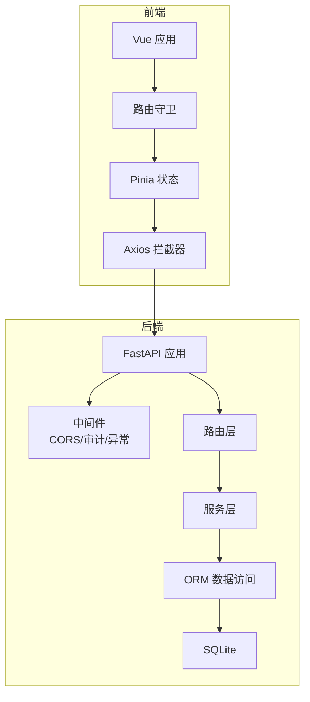
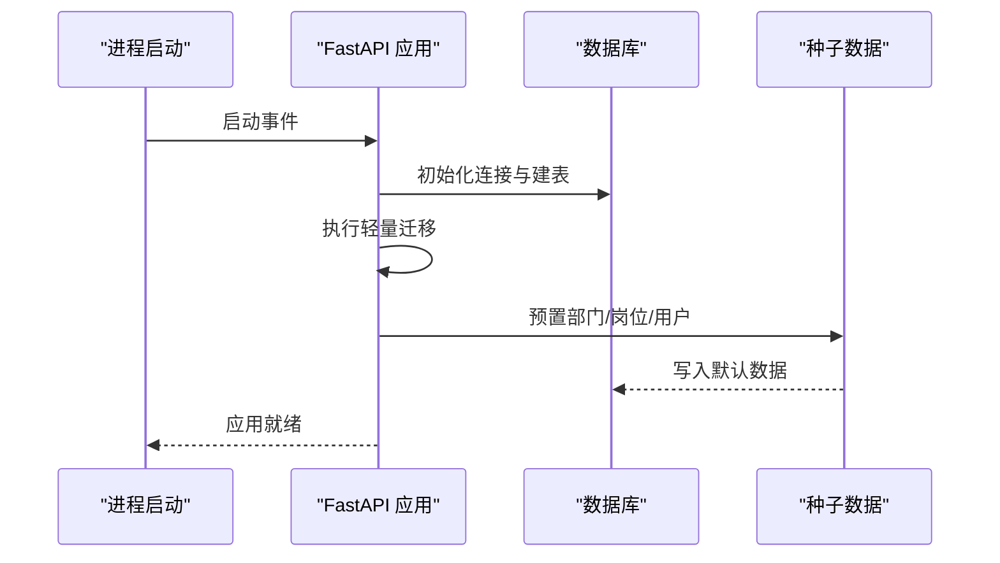
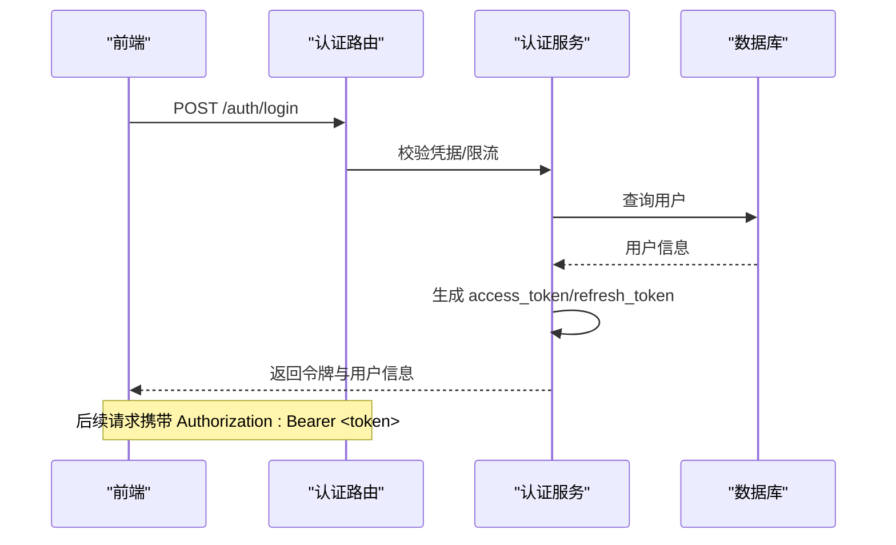
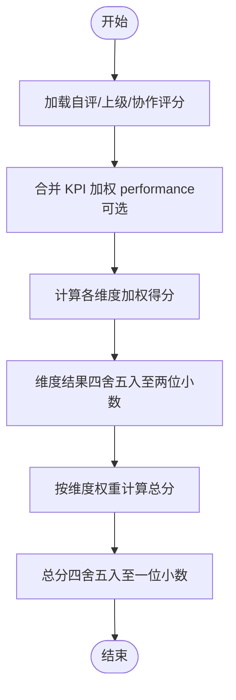
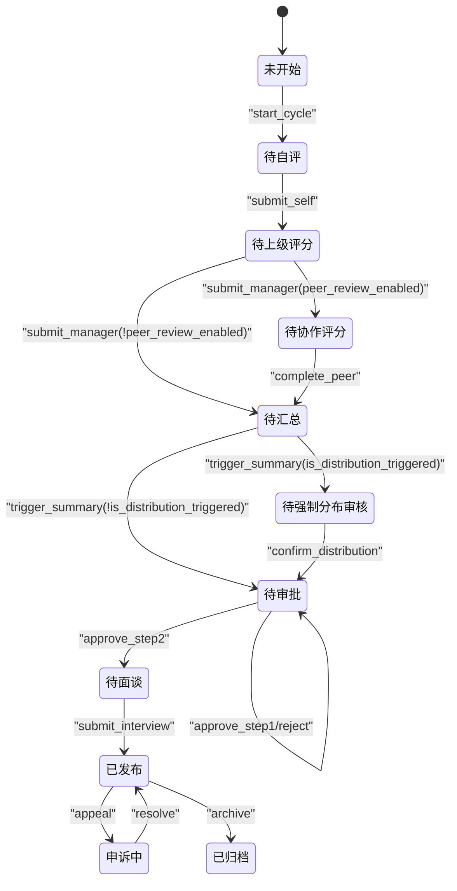
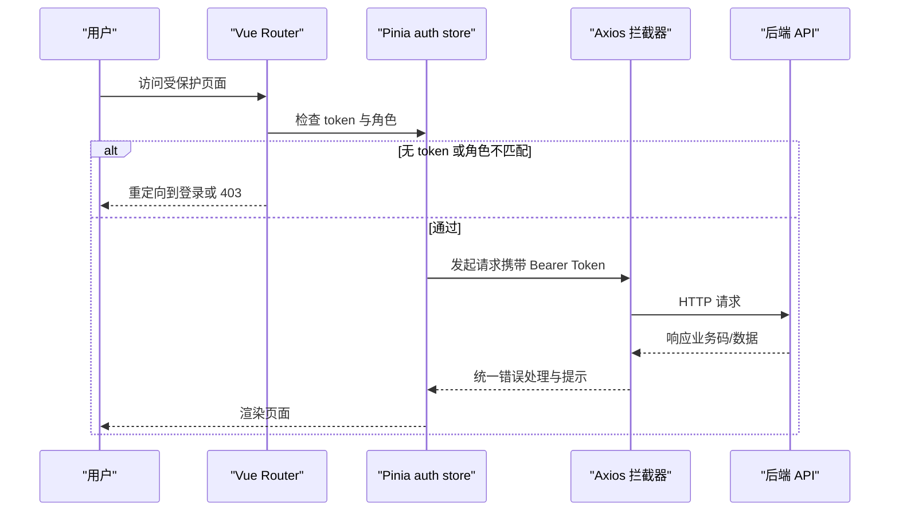
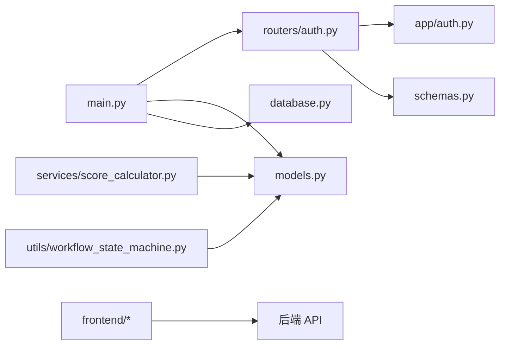

# 系统架构

<cite>
**本文引用的文件**   
- [backend/app/main.py](file://backend/app/main.py)
- [backend/app/database.py](file://backend/app/database.py)
- [backend/app/models.py](file://backend/app/models.py)
- [backend/app/schemas.py](file://backend/app/schemas.py)
- [backend/app/auth.py](file://backend/app/auth.py)
- [backend/app/core/security.py](file://backend/app/core/security.py)
- [backend/app/core/dependencies.py](file://backend/app/core/dependencies.py)
- [backend/app/core/response.py](file://backend/app/core/response.py)
- [backend/app/core/exceptions.py](file://backend/app/core/exceptions.py)
- [backend/app/routers/auth.py](file://backend/app/routers/auth.py)
- [backend/app/services/score_calculator.py](file://backend/app/services/score_calculator.py)
- [backend/app/utils/workflow_state_machine.py](file://backend/app/utils/workflow_state_machine.py)
- [frontend/src/main.js](file://frontend/src/main.js)
- [frontend/src/router/index.js](file://frontend/src/router/index.js)
- [frontend/src/stores/auth.js](file://frontend/src/stores/auth.js)
- [frontend/src/api/request.js](file://frontend/src/api/request.js)
</cite>

## 目录
1. [简介](#简介)
2. [项目结构](#项目结构)
3. [核心组件](#核心组件)
4. [架构总览](#架构总览)
5. [详细组件分析](#详细组件分析)
6. [依赖关系分析](#依赖关系分析)
7. [性能与扩展性](#性能与扩展性)
8. [故障排查指南](#故障排查指南)
9. [结论](#结论)
10. [附录](#附录)

## 简介
本文件为“绩效考核评分系统”的架构文档，面向前后端开发者、测试与运维人员。文档从整体架构、分层职责、数据库设计、安全机制、扩展点与部署视角进行系统化说明，帮助读者快速理解系统边界、数据流与关键实现位置。

## 项目结构
系统采用前后端分离：
- 前端：Vue 3 + Element Plus + Pinia + Vue Router，负责页面渲染、路由权限控制、状态管理与 API 调用封装。
- 后端：FastAPI + SQLAlchemy + SQLite，提供 RESTful API，包含认证授权、组织人事、考核周期、KPI 模板、评分计算、审批流程、申诉、面谈、报表与通知等能力。

**图示来源**
- [backend/app/main.py:9-71](file://backend/app/main.py#L9-L71)
- [backend/app/database.py:13-30](file://backend/app/database.py#L13-L30)
- [frontend/src/main.js:12-22](file://frontend/src/main.js#L12-L22)

**章节来源**
- [backend/app/main.py:9-94](file://backend/app/main.py#L9-L94)
- [frontend/src/main.js:12-22](file://frontend/src/main.js#L12-L22)

## 核心组件
- FastAPI 应用入口：统一注册中间件、异常处理器、路由分组与启动初始化。
- 路由层：按业务域拆分为认证、员工、部门、岗位、考核周期、KPI 模板、配置、仪表盘、申诉、评分、草稿、审批、面谈、协作评分、日志、通知与健康检查。
- 服务层：评分算法、工作流状态机、通知、PDF 归档、操作日志等可复用逻辑。
- 数据访问层：基于 SQLAlchemy 的模型定义、会话工厂与数据库初始化。
- 安全层：JWT 认证、RBAC 角色校验、首次登录强制改密、白名单接口。
- 前端：路由守卫、Pinia 状态管理、Axios 拦截器统一鉴权与错误处理。

**章节来源**
- [backend/app/main.py:9-94](file://backend/app/main.py#L9-L94)
- [backend/app/routers/auth.py:1-28](file://backend/app/routers/auth.py#L1-L28)
- [backend/app/services/score_calculator.py:1-126](file://backend/app/services/score_calculator.py#L1-L126)
- [backend/app/utils/workflow_state_machine.py:10-78](file://backend/app/utils/workflow_state_machine.py#L10-L78)
- [backend/app/database.py:13-30](file://backend/app/database.py#L13-L30)
- [backend/app/auth.py:12-27](file://backend/app/auth.py#L12-L27)
- [frontend/src/router/index.js:61-82](file://frontend/src/router/index.js#L61-L82)
- [frontend/src/api/request.js:14-86](file://frontend/src/api/request.js#L14-L86)

## 架构总览
系统采用前后端分离 + 分层架构（路由层-服务层-数据访问层），并通过 FastAPI 依赖注入实现横切关注点（认证、鉴权、审计、异常）。

**图示来源**
- [backend/app/main.py:15-28](file://backend/app/main.py#L15-L28)
- [backend/app/main.py:49-94](file://backend/app/main.py#L49-L94)
- [frontend/src/router/index.js:61-82](file://frontend/src/router/index.js#L61-L82)
- [frontend/src/api/request.js:14-86](file://frontend/src/api/request.js#L14-L86)

## 详细组件分析

### 应用入口与生命周期
- 创建 FastAPI 应用并启用 CORS、审计中间件与全局异常处理器。
- 注册 /api/v1 与兼容前缀路由，覆盖认证、员工、部门、岗位、周期、KPI、配置、仪表盘、申诉、评分、草稿、审批、面谈、协作评分、日志、通知与健康检查。
- 启动时初始化数据库、执行轻量迁移、并预置默认管理员与测试用户。

**图示来源**
- [backend/app/main.py:126-129](file://backend/app/main.py#L126-L129)
- [backend/app/main.py:97-124](file://backend/app/main.py#L97-L124)
- [backend/app/main.py:131-278](file://backend/app/main.py#L131-L278)
- [backend/app/database.py:29-30](file://backend/app/database.py#L29-L30)

**章节来源**
- [backend/app/main.py:9-94](file://backend/app/main.py#L9-L94)
- [backend/app/main.py:97-129](file://backend/app/main.py#L97-L129)
- [backend/app/main.py:131-278](file://backend/app/main.py#L131-L278)
- [backend/app/database.py:29-30](file://backend/app/database.py#L29-L30)

### 认证与授权
- JWT 认证：登录返回 access_token 与 refresh_token；刷新令牌；获取当前用户；首次登录强制改密白名单。
- RBAC：通过 require_role 装饰器限制角色访问；前端路由 meta.roles 做界面级权限控制。
- 密码安全：bcrypt 哈希；弱口令与复杂度校验；失败次数限流。

**图示来源**
- [backend/app/routers/auth.py:63-93](file://backend/app/routers/auth.py#L63-L93)
- [backend/app/auth.py:46-57](file://backend/app/auth.py#L46-L57)
- [backend/app/auth.py:68-113](file://backend/app/auth.py#L68-L113)
- [frontend/src/api/request.js:14-45](file://frontend/src/api/request.js#L14-L45)

**章节来源**
- [backend/app/auth.py:12-129](file://backend/app/auth.py#L12-L129)
- [backend/app/core/security.py:20-138](file://backend/app/core/security.py#L20-L138)
- [backend/app/core/dependencies.py:10-50](file://backend/app/core/dependencies.py#L10-L50)
- [backend/app/routers/auth.py:31-61](file://backend/app/routers/auth.py#L31-L61)
- [frontend/src/router/index.js:61-82](file://frontend/src/router/index.js#L61-L82)
- [frontend/src/stores/auth.js:20-50](file://frontend/src/stores/auth.js#L20-L50)

### 评分计算与 KPI 加权
- 维度得分 = Σ(评分人维度分 × 评分人权重)，总分 = Σ(维度得分 × 维度权重)。
- 支持将 KPI 明细加权后的 performance 替换到维度计算中。
- 中间结果保留两位小数，最终总分保留一位小数。

**图示来源**
- [backend/app/services/score_calculator.py:4-84](file://backend/app/services/score_calculator.py#L4-L84)
- [backend/app/services/score_calculator.py:87-126](file://backend/app/services/score_calculator.py#L87-L126)

**章节来源**
- [backend/app/services/score_calculator.py:1-126](file://backend/app/services/score_calculator.py#L1-L126)

### 工作流状态机
- 定义从“未开始”到“已归档”的主流程，以及“申诉”分支。
- 支持条件转换（如是否开启协作评分、是否触发强制分布）。
- 提供额外校验注册点，便于扩展业务规则。

**图示来源**
- [backend/app/utils/workflow_state_machine.py:22-78](file://backend/app/utils/workflow_state_machine.py#L22-L78)

**章节来源**
- [backend/app/utils/workflow_state_machine.py:10-207](file://backend/app/utils/workflow_state_machine.py#L10-L207)

### 数据库设计与 ER 图
核心实体包括部门、岗位、员工、用户、考核周期、KPI 模板、考核记录、评分明细、KPI 调整、审批记录、周期-员工关联、协作评审、操作日志、申诉、面谈、系统配置、评分草稿、通知、协作评审任务。

> 实体关系（主键、外键、唯一约束、可空性）统一由 [ER图设计.md](数据库架构设计/ER图设计.md) 维护，本文不重复绘制，仅保留关系概览：
> - 部门 1—N 岗位、1—N 员工；岗位 1—N 员工；员工通过 `manager_id` 自关联上下级。
> - 员工 1—0..1 用户（`User.employee_id` 可空）；用户 1—N 操作日志、1—N 通知。
> - 考核周期 1—N 周期-员工关联、1—N 考核记录；考核记录 N—1 周期、N—1 岗位、N—1 部门。
> - 考核记录 1—N 评分明细、审批记录、申诉、面谈、评分草稿、协作评审任务；岗位 1—N KPI 模板。

**章节来源**
- [backend/app/models.py:8-266](file://backend/app/models.py#L8-L266)

### 前端架构与交互
- 路由守卫：根据 meta.roles 与本地 token 进行导航保护。
- Axios 拦截器：自动附加 Authorization 头，统一处理业务码与 401 过期跳转。
- Pinia 状态：维护 token、用户信息与首次登录标志，并提供登录、登出、修改密码等方法。

**图示来源**
- [frontend/src/router/index.js:61-82](file://frontend/src/router/index.js#L61-L82)
- [frontend/src/api/request.js:14-86](file://frontend/src/api/request.js#L14-L86)
- [frontend/src/stores/auth.js:20-50](file://frontend/src/stores/auth.js#L20-L50)

**章节来源**
- [frontend/src/router/index.js:1-85](file://frontend/src/router/index.js#L1-L85)
- [frontend/src/api/request.js:1-89](file://frontend/src/api/request.js#L1-L89)
- [frontend/src/stores/auth.js:1-73](file://frontend/src/stores/auth.js#L1-L73)

## 依赖关系分析
- 模块耦合：
  - main.py 聚合所有路由与中间件，承担装配职责。
  - routers/auth.py 依赖 app.auth 提供的认证工具与 schemas。
  - services/score_calculator.py 被评分相关路由与服务调用，保持纯函数式计算。
  - utils/workflow_state_machine.py 提供通用状态机，供审批/考核流程使用。
  - database.py 提供 engine、SessionLocal、get_db 与 init_db。
- 外部依赖：
  - FastAPI、Pydantic、SQLAlchemy、jose、bcrypt、Element Plus、Vue Router、Pinia、Axios。

**图示来源**
- [backend/app/main.py:49-94](file://backend/app/main.py#L49-L94)
- [backend/app/routers/auth.py:1-28](file://backend/app/routers/auth.py#L1-L28)
- [backend/app/auth.py:1-27](file://backend/app/auth.py#L1-L27)
- [backend/app/database.py:13-30](file://backend/app/database.py#L13-L30)
- [backend/app/models.py:8-266](file://backend/app/models.py#L8-L266)
- [backend/app/services/score_calculator.py:1-126](file://backend/app/services/score_calculator.py#L1-L126)
- [backend/app/utils/workflow_state_machine.py:10-78](file://backend/app/utils/workflow_state_machine.py#L10-L78)

**章节来源**
- [backend/app/main.py:49-94](file://backend/app/main.py#L49-L94)
- [backend/app/routers/auth.py:1-28](file://backend/app/routers/auth.py#L1-L28)
- [backend/app/auth.py:1-27](file://backend/app/auth.py#L1-L27)
- [backend/app/database.py:13-30](file://backend/app/database.py#L13-L30)
- [backend/app/models.py:8-266](file://backend/app/models.py#L8-L266)
- [backend/app/services/score_calculator.py:1-126](file://backend/app/services/score_calculator.py#L1-L126)
- [backend/app/utils/workflow_state_machine.py:10-78](file://backend/app/utils/workflow_state_machine.py#L10-L78)

## 性能与扩展性
- 性能要点
  - SQLite 适合单机与中小规模场景；高并发需考虑连接参数与事务隔离。
  - 评分计算为纯函数，避免在循环中进行重复 I/O。
  - 审计日志写入失败不阻断主流程，保证可用性。
- 扩展点
  - 评分算法扩展：在 score_calculator.py 新增策略或替换 performance 加权逻辑。
  - 状态机扩展：通过 register_validator 注册额外校验，或在 TRANSITIONS 增加新动作。
  - 通知服务扩展：在 notification_service.py 接入邮件/短信/站内信等多通道。
  - 指标扩展：KPI 模板与 ScoreDetail 支持多指标维度，可在 models/schemas 中扩展字段。

[本节为通用指导，不直接分析具体文件]

## 故障排查指南
- 认证问题
  - 401 未认证：检查 Authorization 头是否携带有效 Bearer Token。
  - 403 权限不足：检查用户角色与路由 meta.roles 是否匹配。
  - 首次登录强制改密：确认用户 is_first_login 与白名单路径。
- 业务异常
  - BizError 统一返回 {code, message, data}，结合日志定位。
- 前端错误
  - Axios 拦截器对 401 自动跳转登录；业务码非 0/200 会弹出错误消息。

**章节来源**
- [backend/app/core/exceptions.py:6-107](file://backend/app/core/exceptions.py#L6-L107)
- [backend/app/auth.py:68-129](file://backend/app/auth.py#L68-L129)
- [frontend/src/api/request.js:47-86](file://frontend/src/api/request.js#L47-L86)

## 结论
该系统以 FastAPI 为核心构建前后端分离的分层架构，通过 JWT+RBAC 保障安全，借助状态机与工作流支撑复杂业务流程，并以可扩展的服务层承载评分算法与通知机制。数据库模型清晰、职责分明，便于迭代演进。建议在后续版本中引入更完善的索引策略、缓存与异步任务队列，以提升大规模数据下的性能与稳定性。

[本节为总结性内容，不直接分析具体文件]

## 附录
- 部署建议
  - 后端：Gunicorn/Uvicorn 托管 FastAPI，反向代理 Nginx，环境变量管理密钥与数据库路径。
  - 前端：静态资源由 Nginx 或 CDN 托管，API 通过反向代理转发至后端。
  - 数据备份：定期备份 SQLite 文件与导出关键报表。

[本节为通用指导，不直接分析具体文件]